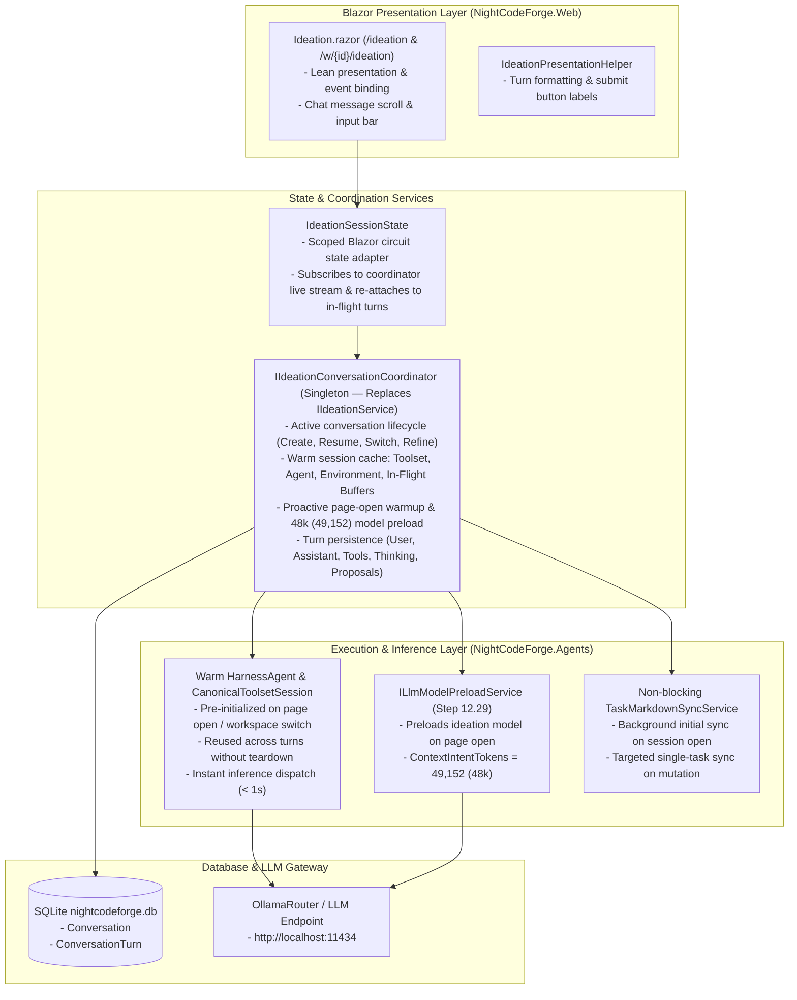

# 💡 Step 12.31: Interactive Ideation Agent Coordinator & Warm Execution Context

> **Feature & Developer Ergonomics Specification (Priority Tier 2)**  
> *Parent Plan:* [Features & Integrations Roadmap](README.md)  
> *Target Framework:* .NET 10 (C# 13) | *Status:* Planned  
> *Target Projects:* [`src/NightCodeForge.Agents`](../../src/NightCodeForge.Agents), [`src/NightCodeForge.Core`](../../src/NightCodeForge.Core), [`src/NightCodeForge.Infrastructure`](../../src/NightCodeForge.Infrastructure), [`src/NightCodeForge.Web`](../../src/NightCodeForge.Web), [`tests/NightCodeForge.Agents.Tests`](../../tests/NightCodeForge.Agents.Tests), [`tests/NightCodeForge.Infrastructure.Tests`](../../tests/NightCodeForge.Infrastructure.Tests), [`tests/NightCodeForge.Web.Tests`](../../tests/NightCodeForge.Web.Tests)  
> *Prerequisite Steps:* [Step 12.36A: Declarative Sandbox Mount Table & Container Lifecycle Redesign](../archive/phase-12/STEP_12_36A_DECLARATIVE_SANDBOX_MOUNT_TABLE_AND_CONTAINER_LIFECYCLE_REDESIGN.md) | [Step 12.36B: `CanonicalTools` Modular Decomposition & Interruption Pipeline](../archive/phase-12/STEP_12_36B_CANONICAL_TOOLS_MODULAR_DECOMPOSITION_AND_INTERRUPTION_PIPELINE.md)  
> *Related Steps:* [Step 12.1A: Backlog Context Digest & Cycle Rejection](../archive/phase-12/STEP_12_1A_BACKLOG_CONTEXT_DIGEST_AND_IN_TOOL_CYCLE_REJECTION.md), [Step 12.13A: Ideation Backlog Mutation Tools & Prompt Policy](../archive/phase-12/STEP_12_13A_IDEATION_BACKLOG_MUTATION_TOOLS_AND_PROMPT_POLICY.md), [Step 12.13B: "Refine in Ideation" Workflow & Mutation UI](../archive/phase-12/STEP_12_13B_REFINE_IN_IDEATION_WORKFLOW_AND_MUTATION_UI.md), [Step 12.4: Ideation Quick Notes & Suggestions](STEP_12_4_IDEATION_QUICK_NOTES_SUGGESTIONS_AND_DRAFT_PRUNING.md), [Step 12.29: Smart Router Model Preload](../archive/phase-12/STEP_12_29_SMART_ROUTER_MODEL_PRELOAD_AND_CONTEXT_INTENT.md), [Step 12.34B: Agent Nightwatch SOS Tool](STEP_12_34B_AGENT_NIGHTWATCH_SOS_TOOL_AND_ENVIRONMENT_REMEDIATION.md), [Step 12.35B: Nightwatch Idle Deep Analysis](STEP_12_35B_NIGHTWATCH_IDLE_DEEP_ANALYSIS_AND_LEGACY_DIAGNOSTIC_REPLACEMENT.md)  
> *Aligns With:* [AGENTS.md](../../AGENTS.md), [docs/ARCHITECTURE.md](../ARCHITECTURE.md)

> This document is a **specification**: it states required behaviors and constraints, not implementations. Implementation choices (signatures, code structure) are left to the implementer, within the constraints of the documents.

---

## 1. Problem Statement & Motivation

In the current implementation of the Ideation Chat:

1. **Massive Turn Latency Before Inference Starts (10–15 Seconds):**
   - Whenever a user sends a chat message, [`IdeationService.ConverseStreamingAsync`](../../src/NightCodeForge.Agents/Ideation/IdeationService.cs) executes a synchronous pre-flight preparation pipeline from scratch before dispatching the request to `OllamaRouter`:
     - **Full Backlog Disk Sync (`SyncBacklogToDiskAsync`):** Queries every task in the database and rewrites `docs/tasks/*.md` and `docs/tasks/archive/*.md` over the Windows-to-WSL UNC network share (`\\wsl.localhost\...` / 9P) on *every single turn*.
     - **Heavy Environment & Toolchain Probes:** Re-resolves `_envProvider.GetEnvironment()` (which is currently registered as `Scoped` in DI rather than `Singleton`, losing its `_cachedEnvironments` across scopes/circuits), executing WSL probe scripts (`wsl.exe bash -s`) across multiple SDKs and invoking `dotnet tool list -g` multiple times via `CompanionToolInstaller` whenever a new environment instance is constructed.
     - **Prompt & Catalog Ingestion:** Re-scans `AGENTS.md`, recalculates skills catalog prompts, and rebuilds the backlog XML digest.
     - **Context Window HTTP Discovery:** Probes `GET /api/router/models/{model}` against OllamaRouter if not cached.
     - **Ad-Hoc Agent Re-Creation & Flattened History:** Discards previous harness state, re-creates a new `CanonicalToolsetSession` and a new `HarnessAgent`, initiates a brand new `AgentSession`, and rebuilds `ChatMessage` history from flattened `(Role, Content)` text strings (`ChatMessage.GetEffectiveHistoryContent()`), losing structured `FunctionCallContent` / `FunctionResultContent` items and breaking LLM KV-cache prefix continuity across turns.
   - As a result, the developer waits 10 to 15 seconds after hitting "Send" before OllamaRouter even receives the HTTP inference request.

2. **UI Component Overburden & Fragile Razor State:**
   - Ideation conversation state (`Session.Messages`, `CurrentThinkingBuffer`, `CurrentParts`, `_userInput`, etc.) and orchestration logic currently reside directly inside [`Ideation.razor`](../../src/NightCodeForge.Web/Components/Pages/Ideation.razor) `@code` blocks.
   - Database operations (starting conversations, persisting turns, fetching profiles, promoting/purging proposals) and turn re-hydration parsing (`LoadConversationIntoSession`) are coupled into the UI layer, directly violating the `AGENTS.md` mandate: *Keep Razor components focused on presentation; parsing, payload extraction, data mapping, and non-trivial logic must live in dedicated services*.
   - Refreshing the page or navigating away loses transient streaming state, and turns cannot be re-hydrated or managed independently of the active Blazor circuit.

3. **Architectural Divergence from the Crucible Agent Pattern:**
   - The platform already possesses a robust, battle-tested pattern for autonomous agent workflows: the **Crucible Agent Harness** ([`ICrucibleConversationCoordinator`](../../src/NightCodeForge.Agents/Crucible/CrucibleConversationCoordinator.cs), [`CrucibleConversationState`](../../src/NightCodeForge.Agents/Crucible/CrucibleConversationCoordinator.cs), [`ConversationHistorySerializer`](../../src/NightCodeForge.Core/Workflow/ConversationHistorySerializer.cs), [`HarnessAgentRequest`](../../src/NightCodeForge.Agents/Inference/HarnessAgentFactory.cs), ordered turn-based database persistence, Pi-style context compaction, and SignalR activity broadcasting).
   - Ideation should be redesigned as an **"Interactive Crucible Agent"**: an interactive companion agent with state managed by a dedicated service, structured turn history persisted in SQLite, and an execution context kept warm across turns.

---

## 2. Architecture & Component Overview



---

## 3. Detailed Requirements & Specifications

### 3.1 Interactive Crucible Agent Paradigm & Persistence
1. **Clean-Break Replacement of `IIdeationService` with `IIdeationConversationCoordinator`:**
   - Under the `AGENTS.md` clean-break policy, **completely replace** `IIdeationService` (`IdeationService`) with `IIdeationConversationCoordinator` (`IdeationConversationCoordinator` in `NightCodeForge.Agents.Ideation` / `NightCodeForge.Core.Interfaces`).
   - Update DI registrations in [`Agents/ServiceCollectionExtensions.cs`](../../src/NightCodeForge.Agents/ServiceCollectionExtensions.cs), UI consumers, and tests to use `IIdeationConversationCoordinator` exclusively.
   - Extend `IdeationStreamUpdateKind` and `IdeationStreamUpdate` with an explicit `Error` variant (and error message payload) so turn errors can be broadcast and rendered cleanly.
   - Responsible for:
     - Starting new conversations, resuming task-refinement conversations (`?taskId={id}` via `IdeationRefinementService`), and restoring existing conversations from the database (`Conversation` and `ConversationTurn` entities).
     - Proactively warming up the execution context and preloading the LLM model when the Ideation page opens or the active workspace/config changes.
     - Persisting turns in structured execution order compatible with [`ConversationHistorySerializer`](../../src/NightCodeForge.Core/Workflow/ConversationHistorySerializer.cs) and UI rehydration:
       - `StageTurnRole.User` (as soon as the user submits the prompt).
       - `StageTurnRole.Thinking` (reasoning blocks with duration metadata).
       - Paired `StageTurnRole.Tool` (with `{"CallId": "..."}` in `MetadataJson`) and `StageTurnRole.ToolResult` (with matching `CallId`, `DurationMs`, and `Answers` metadata for `ask` tool calls).
       - `StageTurnRole.Optimization` (compaction checkpoints when `PiStyleCrucibleCompactionStrategy` compacts history, reusing the shared compaction-checkpoint and ordered turn-persistence mechanics from `CrucibleConversationState` / `CrucibleConversationCoordinator`).
       - `StageTurnRole.Assistant` (final assistant message with discovered `List<IdeationProposal>` serialized in `MetadataJson`).
     - Running active turns independently of individual Blazor circuit lifetimes so in-flight turns continue uninterrupted across browser reloads or page navigation, while providing explicit cancellation (`CancelActiveTurnAsync`) when requested by the user.
     - Exposing active-turn telemetry (`bool HasActiveTurn { get; }` and `event Action<bool>? OnTurnActivityChanged`) so lower-priority background system agents (such as `INightwatchIdleAnalysisService` in [Step 12.35B](STEP_12_35B_NIGHTWATCH_IDLE_DEEP_ANALYSIS_AND_LEGACY_DIAGNOSTIC_REPLACEMENT.md)) immediately yield or preempt GPU usage when an interactive Ideation turn or warm-up is running.
     - Broadcasting live `IdeationStreamUpdate` notifications to attached UI subscribers.
2. **DI Lifetimes & Scope Hygiene (`AGENTS.md` Compliance):**
   - Register [`IExecutionEnvironmentProvider`](../../src/NightCodeForge.Infrastructure/Execution/ExecutionEnvironmentProvider.cs) as a **Singleton** in [`Infrastructure/ServiceCollectionExtensions.cs`](../../src/NightCodeForge.Infrastructure/ServiceCollectionExtensions.cs) (all its constructor dependencies are already singletons) so its `_cachedEnvironments` dictionary persists across DI scopes and Blazor circuits.
   - Register `IIdeationConversationCoordinator` as a **Singleton** so warm sessions and in-flight turns survive Blazor circuit reconnections and page reloads.
   - Because `ICanonicalToolsetFactory`, `IAgentWorkspaceContextService`, `IHarnessAgentFactory`, `ITaskRepository`, `IWorkspaceRepository`, `IBacklogMutationToolService`, `ITaskMarkdownValidator`, and `IWebSearchService` are currently registered as **Scoped**, the singleton `IIdeationConversationCoordinator` **must not** inject `Scoped` services directly into its constructor (which would fail ASP.NET Core root scope validation) and **must not** capture a single scoped `AppDbContext` across turns—including inside cached `WarmIdeationSession.CanonicalToolsetSession` closures (relying on [Step 12.36B](../archive/phase-12/STEP_12_36B_CANONICAL_TOOLS_MODULAR_DECOMPOSITION_AND_INTERRUPTION_PIPELINE.md)'s per-invocation `IServiceScopeFactory` resolution in `BacklogManagementToolModule` and `WorkspaceFileToolModule`, and `IHttpClientFactory`-backed `IWebSearchService`). Resolve scoped collaborators via `IServiceScopeFactory` per operation/turn (or promote stateless factories to `Singleton` where all their dependencies allow), and strictly obey the `AGENTS.md` $\le 10$ required constructor parameter rule.
3. **Full Database Persistence, Structured Turn Re-hydration & In-Flight Re-attachment:**
   - When resuming an ideation conversation from SQLite (cold start on an existing `Conversation`), the coordinator loads the turns from `ITaskRepository.GetConversationWithTurnsAsync()` and reconstructs both:
     - The UI presentation state (`ChatMessage` view models, interleaved `ChatContentPart` items, and `IdeationProposalViewModel` cards), extracted out of `Ideation.razor` into a dedicated, unit-testable turn-rehydration service/helper that supports both the structured `Thinking` + `Tool` + `ToolResult` + `Assistant` turn sequence and legacy persisted turns.
     - The structured `Microsoft.Extensions.AI.ChatMessage` history (preserving `FunctionCallContent`, `FunctionResultContent`, and compaction checkpoints via [`ConversationHistorySerializer`](../../src/NightCodeForge.Core/Workflow/ConversationHistorySerializer.cs) rather than flattening tool calls into raw text). When cold-resuming an existing conversation whose restored token estimate meets or exceeds `PiStyleCrucibleCompactionStrategy.GetColdResumeThresholdTokens(...)`, arm cold-resume compaction (`ArmColdResumeCompaction()`) just like `CrucibleAgentHarness` to prevent slow cold prompt prefills.
   - **Open Conversation Status vs. Active Turn Generation (`IsGenerating`):**
     - Note that `StartIdeationConversationAsync` sets `Conversation.Status = StageExecutionStatus.Running` in SQLite for any open (non-archived) ideation conversation until the user archives it via "Clear Chat". Therefore, `Conversation.Status == StageExecutionStatus.Running` in the database indicates an open session, **not** that a turn is actively streaming. Whether a turn is currently generating (`IsGenerating`) is determined strictly by the coordinator's live in-memory `WarmIdeationSession` state.
   - **In-Flight Turn Continuity Across Reloads:**
     - Disposing `Ideation.razor` (circuit disconnect, browser refresh, or navigating to another page) must only unsubscribe the UI listener and **must not** cancel the running turn's `CancellationTokenSource`.
     - While a turn is actively running (`IsGenerating == true`), the coordinator maintains the in-flight streaming state (`CurrentParts`, `CurrentThinkingBuffer`, `CurrentMessageBuffer`, `CurrentToolCalls`, and any active `PendingQuestions` awaiting human answers).
     - When a Blazor circuit reconnects or navigates back to `/ideation`, `IdeationSessionState` attaches to the coordinator's active session, immediately hydrates both completed messages and the current in-flight streaming bubble (including interactive `ask` question cards), and continues receiving live `IdeationStreamUpdate` events until the turn completes.
   - Turn metadata (such as `CallId`, proposed tasks, question batches/answers, and thinking/tool durations) must be serialized in `ConversationTurn.MetadataJson`, allowing full visual and context fidelity upon browser reload or across sessions.

---

### 3.2 Warm Execution Context, Page-Open Warmup & 48k Model Preload

1. **Warm Session Cache & Deterministic Router Session Affinity:**
   - The coordinator maintains an in-memory cache of warm ideation sessions keyed by `ConversationId` (and associated `WorkspaceId`):
     ```
     WarmIdeationSession:
       - WorkspaceId
       - ConversationId
       - RouterSessionId (LlmSessionIds.ForIdeation(WorkspaceId, ConversationId))
       - EffectiveAgentProfile (ModelName, RoutingTarget, ThinkingEffort)
       - CustomSystemPrompt
       - CanonicalToolsetSession (Tools, Dispatcher, SkillsService, AITools)
       - HarnessAgent & Authoritative ChatHistory (List<ChatMessage>)
       - SystemPrompt & ContextDigest (with BacklogDigestVersion / LastSyncedAt)
       - InFlightTurnState (IsGenerating, CurrentParts, PendingQuestions, TurnCts)
       - LastAccessedAt (for LRU / idle eviction)
     ```
   - Pass the deterministic `RouterSessionId` (`LlmSessionIds.ForIdeation(workspaceId, conversationId)`) to `HarnessAgentRequest.SessionId` (instead of a random per-turn `Guid`) so `ILlmChatClientFactory` sends a stable `X-NCF-Session-Id` header across every turn of the conversation, preserving sticky backend affinity and KV-cache reuse in `OllamaRouter`.
2. **Proactive Warm-Up on Ideation Page Open & Smart Model Preload (`48k` = `49,152` Tokens):**
   - Define a named constant `IdeationDefaultContextIntentTokens = 49_152` (48k tokens).
   - Whenever the user opens `/ideation` (or switches active workspace, conversation, model override, or routing target), the coordinator triggers a non-blocking background warm-up (`WarmupSessionAsync`) before the user finishes typing their prompt:
     1. **Execution Context Warm-Up:** Resolves `IExecutionEnvironment`, ingests `AGENTS.md` and the skills catalog, builds the backlog digest, initializes `CanonicalToolsetSession`, and constructs the `HarnessAgent` (with restored `ChatHistory` if resuming an existing conversation). If the user submits a prompt while warm-up is already in progress, the turn awaits the in-flight warm-up task rather than starting a duplicate initialization.
     2. **Smart Router Model Preload ([Step 12.29](../archive/phase-12/STEP_12_29_SMART_ROUTER_MODEL_PRELOAD_AND_CONTEXT_INTENT.md)):** Concurrently invokes `ILlmModelPreloadService.PreloadModelAsync` (when `JitModelPreload` is enabled on the effective optimization flags and operations are not paused) with:
        - `ContextIntentTokens = effectiveProfile.ContextWindowTokens is > 0 ? effectiveProfile.ContextWindowTokens : IdeationDefaultContextIntentTokens` (`49,152` / `48k` default).
        - `Target` set to the pinned routing target when `SelectedRoutingTarget` is explicitly set (`Local`, `Remote`, or `Cloud`), or `null` when `Auto`.
3. **Instant Inference Dispatch & Multi-Turn `ChatHistory` Continuity:**
   - Because the session is pre-warmed on page open (or assembled on the first turn if cold), and kept warm across turns:
     - `WarmIdeationSession` maintains the authoritative `List<ChatMessage> ChatHistory` across turns (updated in-place by [`PerServiceCallChatHistoryPersistingChatClient`](../../src/NightCodeForge.Agents/Crucible/ChatClients/PerServiceCallChatHistoryPersistingChatClient.cs) and compacted when needed by [`PiStyleCrucibleCompactionStrategy`](../../src/NightCodeForge.Agents/Compaction/PiStyleCrucibleCompactionStrategy.cs)).
     - On **subsequent turns** within the same warm conversation, the coordinator clears `PendingProposals` from the previous turn, snapshots the per-turn token/call baselines on `ThinkingAndActivityTracingChatClient` (`TotalMeasuredInputTokens`, `TotalMeasuredOutputTokens`, `ModelCalls.Count`) so cumulative SDK token counters are never quadratically overcounted across turns, appends the new `ChatMessage(ChatRole.User, prompt)` to `ChatHistory`, invokes `agent.RunStreamingAsync(ChatHistory, await agent.CreateSessionAsync(ct))` (or passes only the delta message if reusing an existing MAF `AgentSession` instance) so prior messages are never duplicated in the LLM request payload while preserving the exact `SystemPrompt` prefix and `RouterSessionId` for OllamaRouter KV-cache reuse, and updates the session transcript via `SessionTranscriptService`.
     - **Bypasses:** Backlog disk re-sync, host SDK discovery scripts, companion tool checking, MCP server directory scanning, context window HTTP discovery, and prompt/catalog re-ingestion.
     - Inference dispatch (`POST /api/chat` to OllamaRouter) must start within **< 1 second** of the user submitting the message.

4. **Non-Blocking / Mutative Backlog Sync:**
   - `TaskMarkdownSyncService.SyncAllTasksToDiskAsync` (`_workspaceContext.SyncBacklogToDiskAsync`) must **not** run synchronously in the critical path before dispatching the user prompt.
   - Full bulk backlog disk synchronization (`SyncAllTasksToDiskAsync`) is only triggered asynchronously in the background when a workspace ideation session is first opened/initialized.
   - Individual backlog mutations (`propose_tasks`, `edit_task`, `set_task_priority`, `rework_priorities`, `remove_task`, or UI proposal promotion/dismissal) only synchronize the specific affected task file(s) via `ITaskMarkdownSyncService.SyncTaskToDiskAsync` / `ArchiveOrCleanupTaskFileAsync` (as already handled by `BacklogMutationToolService`).

5. **Session Eviction, Config Override Invalidation & Tri-Agent Synergy (Crucible & Nightwatch):**
   - If the user modifies `SelectedRoutingTarget` (`Auto`, `Local`, `Remote`, `Cloud`), `SelectedModelOverride`, or `CustomSystemPrompt` mid-conversation via the `⚙️ Config` panel, the coordinator rebuilds the `HarnessAgent` / `IChatClient` with the updated profile/instructions (and triggers a background 48k model preload if the model or routing target changed) while reusing the warm `CanonicalToolsetSession` (`IExecutionEnvironment`) and structured conversation history.
   - **Backlog & Nightwatch Insights Refresh:** When tasks are mutated outside the warm session (e.g., Crucible completes a stage, a proposal is promoted from the UI, or Nightwatch promotes a `HarnessIssue` / creates a `Suggested` task in [Step 12.34C](STEP_12_34C_NIGHTWATCH_TELEMETRY_HARNESS_ISSUES_UI_AND_SELF_HEALING_BACKLOG.md) / [Step 12.35B](STEP_12_35B_NIGHTWATCH_IDLE_DEEP_ANALYSIS_AND_LEGACY_DIAGNOSTIC_REPLACEMENT.md)), mark the workspace's cached backlog digest dirty so the warm session refreshes `<existing_workspace_tasks>` (and any high-friction split-candidate file hints from [Step 12.35A](../archive/phase-12/STEP_12_35A_TRANSCRIPT_FRICTION_CATEGORIZATION_AND_RECENT_WINDOW.md)) before the next user turn.
   - **In-Place Nightwatch Environment Self-Healing ([Step 12.34B](STEP_12_34B_AGENT_NIGHTWATCH_SOS_TOOL_AND_ENVIRONMENT_REMEDIATION.md) Synergy):** When `report_environment_issue` is invoked by the Ideation Agent inside a warm session, wire `WorkflowInteractionToolModule.ReportEnvironmentIssueHandler` to invoke `INightwatchService` in-place (recording the `HarnessIssue`, recreating/repairing the read-only `-ro` container or environment, and refreshing the warm session's `CanonicalToolsetSession`), returning the remediation result directly to the Ideation Agent as a tool result without aborting the user's interactive turn.
   - Cached warm sessions are cleanly evicted, disposed, and release their router affinity (`ILlmGatewayService.ReleaseSessionAffinityAsync(session.RouterSessionId)`) when:
     - The user switches to a different workspace.
     - An explicit "Clear Chat" / "Reset Session" action is triggered.
     - Global operations are paused (`IOperationsControlService.OnOperationsStateChanged`, which also cancels any in-flight ideation turn).
     - An idle timeout expires (e.g. 30 minutes of inactivity while not generating) to reclaim memory.

---

### 3.3 UI and Presentation Separation (`Ideation.razor`)

1. **Refactoring `Ideation.razor`:**
   - Remove `IIdeationService`, `TaskRepository`, `WorkspaceRepository`, `WorkflowRepository`, `MarkdownSync`, and low-level agent/turn-parsing logic (`LoadConversationIntoSession`) from `Ideation.razor`.
   - The Razor component must only interact with `IdeationSessionState` / `IIdeationConversationCoordinator` (and presentation helpers).
   - Event handlers (`SendMessageAsync`, `CancelGenerationAsync`, `HandleSessionSelectedAsync`, `HandleQuestionGroupAnswersSubmittedAsync`, `ResetSession`, `AddProposalToBacklogAsync`, `AddAllProposalsToBacklogAsync`, `DismissProposalAsync`) and `?taskId={id}` refinement initialization delegate to the coordinator / service layer and update UI presentation state.
   - `Ideation.razor.Dispose()` only detaches UI event subscriptions and JS auto-scroll; it must **never** cancel an active coordinator turn.
2. **Streaming & Reactive UI Updates:**
   - Streaming updates (`ThinkingDelta`, `MessageDelta`, `ToolCallStarted`, `ToolCallCompleted`, `QuestionAsked`, `ProposalDiscovered`, `Completed`, `Error`) are delivered via the coordinator to the presentation state.
   - The UI binds to reactive state collections, triggering `StateHasChanged()` only when updates arrive.

---

## 4. Performance & Verification Criteria

1. **Inference Dispatch Latency:**
   - **Pre-Warmed First Turn & Subsequent Warm Turns:** Time from clicking "Send" to OllamaRouter receiving `POST /api/chat` must be **< 1.0 second** (typically under 200ms).
   - **Cold First Turn (Immediate Send Before Background Warm-Up Finishes):** Time from clicking "Send" to OllamaRouter receiving the request must not exceed **2.5 seconds** (excluding external network download if companion tools are missing).
2. **State Resilience, In-Flight Continuity & Persistence:**
   - Refreshing the browser **mid-turn while the agent is streaming or waiting for an `ask` answer** keeps the turn running in `IIdeationConversationCoordinator` and seamlessly re-attaches the UI to the live streaming state and pending questions.
   - Refreshing the browser after a turn completes preserves all turns, reasoning blocks, proposals, and tool call histories loaded from SQLite.
3. **Automated Testing:**
   - Unit tests verifying `IIdeationConversationCoordinator` (replacing `IIdeationService`): page-open warm-up and `ILlmModelPreloadService` invocation with `ContextIntentTokens = 49152` (`48k`), deterministic `RouterSessionId` reuse across turns, warm session reuse, subsequent turn speed, non-duplication of messages across warm turns, mid-turn survival across subscriber disconnect/reconnect, config override invalidation (`RoutingTarget` / `CustomSystemPrompt`), non-blocking backlog sync, and session eviction on workspace switch or reset.
   - UI / Component tests verifying `Ideation.razor` binds cleanly to the coordinator without executing database or disk I/O logic in its code-behind, and that component disposal does not cancel an in-flight turn.

