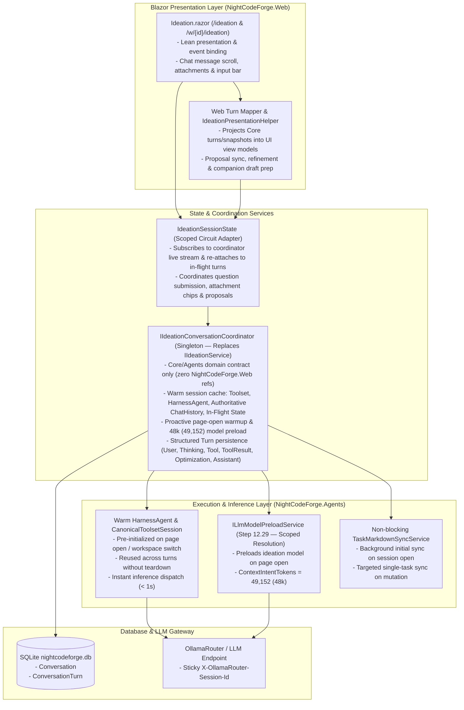

# 💡 Step 12.31: Interactive Ideation Agent Coordinator & Warm Execution Context

> **Feature & Developer Ergonomics Specification (Common Trunk #2)**  
> *Parent Plan:* [Features & Integrations Roadmap](README.md) *(Common Trunk #2 — follows `12.1B`, establishes the unified Ideation coordinator foundation for `12.2D` and `12.39`)*  
> *Target Framework:* .NET 10 (C# 13) | *Status:* Planned  
> *Target Projects:* [`src/NightCodeForge.Agents`](../../src/NightCodeForge.Agents), [`src/NightCodeForge.Core`](../../src/NightCodeForge.Core), [`src/NightCodeForge.Infrastructure`](../../src/NightCodeForge.Infrastructure), [`src/NightCodeForge.Web`](../../src/NightCodeForge.Web), [`tests/NightCodeForge.Agents.Tests`](../../tests/NightCodeForge.Agents.Tests), [`tests/NightCodeForge.Infrastructure.Tests`](../../tests/NightCodeForge.Infrastructure.Tests), [`tests/NightCodeForge.Web.Tests`](../../tests/NightCodeForge.Web.Tests)  
> *Prerequisite Steps:* [Step 12.36A: Declarative Sandbox Mount Table & Container Lifecycle Redesign](../archive/phase-12/STEP_12_36A_DECLARATIVE_SANDBOX_MOUNT_TABLE_AND_CONTAINER_LIFECYCLE_REDESIGN.md) | [Step 12.36B: `CanonicalTools` Modular Decomposition & Interruption Pipeline](../archive/phase-12/STEP_12_36B_CANONICAL_TOOLS_MODULAR_DECOMPOSITION_AND_INTERRUPTION_PIPELINE.md)  
> *Related Steps:* [Step 12.1A: Backlog Context Digest & Cycle Rejection](../archive/phase-12/STEP_12_1A_BACKLOG_CONTEXT_DIGEST_AND_IN_TOOL_CYCLE_REJECTION.md), [Step 12.2B/C: Workspace Attachments & Picker](../archive/phase-12/STEP_12_2C_ATTACHMENTS_WEB_UI_AND_TASK_PICKER.md), [Step 12.13A: Ideation Backlog Mutation Tools & Prompt Policy](../archive/phase-12/STEP_12_13A_IDEATION_BACKLOG_MUTATION_TOOLS_AND_PROMPT_POLICY.md), [Step 12.13B: "Refine in Ideation" Workflow & Mutation UI](../archive/phase-12/STEP_12_13B_REFINE_IN_IDEATION_WORKFLOW_AND_MUTATION_UI.md), [Step 12.4: Ideation Quick Notes & Suggestions](STEP_12_4_IDEATION_QUICK_NOTES_SUGGESTIONS_AND_DRAFT_PRUNING.md), [Step 12.29: Smart Router Model Preload](../archive/phase-12/STEP_12_29_SMART_ROUTER_MODEL_PRELOAD_AND_CONTEXT_INTENT.md), [Step 12.33A/B: Session Cost Telemetry](../archive/phase-12/STEP_12_33B_TASK_ESTIMATED_COST_TELEMETRY_AND_UI_PRESENTATION.md), [Step 12.35A: Transcript Friction Categorization](../archive/phase-12/STEP_12_35A_TRANSCRIPT_FRICTION_CATEGORIZATION_AND_RECENT_WINDOW.md), [Step 12.37: Companion Triage Handoff](../archive/phase-12/STEP_12_37_COMPANION_API_KEY_STORE_AND_ASSAY_HANDOFF_ENDPOINTS.md), [Step 11.52: Proposal Sync](../archive/phase-11/STEP_11_52_IDEATION_PROPOSAL_VIEW_SYNC_ON_AGENT_UPDATES.md)  
> *Aligns With:* [AGENTS.md](../../AGENTS.md), [docs/PLAN.md](../PLAN.md), [docs/ARCHITECTURE.md](../ARCHITECTURE.md)

> This document is a **specification**: it states required behaviors and constraints, not implementations. Implementation choices (signatures, code structure) are left to the implementer, within the constraints of the documents.

---

## 1. Problem Statement & Motivation

In the current implementation of the Ideation Chat:

1. **Massive Turn Latency Before Inference Starts (10–15 Seconds):**
   - Whenever a user sends a chat message, [`IdeationService.ConverseStreamingAsync`](../../src/NightCodeForge.Agents/Ideation/IdeationService.cs) executes a synchronous pre-flight preparation pipeline from scratch before dispatching the request to `OllamaRouter`:
     - **Full Backlog Disk Sync (`SyncBacklogToDiskAsync`):** Queries every task in the database and rewrites `docs/tasks/*.md` and `docs/tasks/archive/*.md` over the Windows-to-WSL UNC network share (`\\wsl.localhost\...` / 9P) on *every single turn*.
     - **Repeated Context & Digest Assembly:** Re-resolves environment locations (note [`IExecutionEnvironmentProvider`](../../src/NightCodeForge.Infrastructure/Execution/ExecutionEnvironmentProvider.cs), `HostSdkDiscoveryService`, and `CompanionToolInstaller` are already singletons with `GetEnvironmentAsync` caching from Step 12.36A), re-scans `AGENTS.md`, recalculates skills catalog prompts, and rebuilds `<existing_workspace_tasks>`, `<workspace_attachments>`, and `<workspace_friction_hotspots>` digests on every turn.
     - **Context Window & Capability HTTP Discovery:** Probes `GET /api/router/models/{model}` against OllamaRouter if not cached.
     - **Ad-Hoc Agent Re-Creation & Flattened History:** Discards previous harness state, re-creates a new `CanonicalToolsetSession` and a new `HarnessAgent`, initiates a brand new `AgentSession`, and rebuilds `ChatMessage` history from flattened `(Role, Content)` text strings (`ChatMessage.GetEffectiveHistoryContent()`), losing structured `FunctionCallContent` / `FunctionResultContent` items and breaking LLM KV-cache prefix continuity across turns.
   - As a result, the developer waits 10 to 15 seconds after hitting "Send" before OllamaRouter even receives the HTTP inference request.

2. **UI Component Overburden & Fragile Razor State:**
   - Ideation conversation state (`Session.Messages`, `CurrentThinkingBuffer`, `CurrentParts`, `_userInput`, etc.) and orchestration logic currently reside directly inside [`Ideation.razor`](../../src/NightCodeForge.Web/Components/Pages/Ideation.razor) `@code` blocks.
   - Database operations (starting conversations, persisting turns, fetching profiles, promoting/purging proposals, companion draft handoff, attachment deletion checks) and turn re-hydration parsing (`LoadConversationIntoSession`) are coupled into the UI layer, directly violating the `AGENTS.md` mandate: *Keep Razor components focused on presentation; parsing, payload extraction, data mapping, and non-trivial logic must live in dedicated services*.
   - Refreshing the page or navigating away disposes `Ideation.razor`, cancels `_cts`, loses transient streaming state and active `ask` questions, and breaks mid-turn continuity.

3. **Architectural Divergence from the Crucible Agent Pattern:**
   - The platform already possesses a robust, battle-tested pattern for autonomous agent workflows: the **Crucible Agent Harness** ([`ICrucibleConversationCoordinator`](../../src/NightCodeForge.Agents/Crucible/CrucibleConversationCoordinator.cs), [`ConversationHistorySerializer`](../../src/NightCodeForge.Core/Workflow/ConversationHistorySerializer.cs), [`HarnessAgentRequest`](../../src/NightCodeForge.Agents/Inference/HarnessAgentFactory.cs), ordered turn-based database persistence, Pi-style context compaction, and SignalR activity broadcasting).
   - Ideation should be redesigned as an **"Interactive Crucible Agent"**: an interactive companion agent with state managed by a dedicated singleton coordinator, structured turn history persisted in SQLite, and an execution context kept warm across turns.

---

## 2. Architecture & Component Overview



---

## 3. Detailed Requirements & Specifications

### 3.1 Interactive Crucible Agent Paradigm, Project Boundaries & Persistence
1. **Clean-Break Replacement of `IIdeationService` with `IIdeationConversationCoordinator`:**
   - Under the `AGENTS.md` clean-break policy, **completely replace** `IIdeationService` (`IdeationService`) with `IIdeationConversationCoordinator` (`IdeationConversationCoordinator` in `NightCodeForge.Core.Interfaces` / `NightCodeForge.Agents.Ideation`).
   - Update DI registrations in [`Agents/ServiceCollectionExtensions.cs`](../../src/NightCodeForge.Agents/ServiceCollectionExtensions.cs), UI consumers, and tests to use `IIdeationConversationCoordinator` exclusively.
   - **Strict Project Dependency Boundary (`NightCodeForge.Agents` Must Not Reference `NightCodeForge.Web`):**
     - `IIdeationConversationCoordinator` and `IdeationConversationCoordinator` operate strictly on `NightCodeForge.Core` and `NightCodeForge.Agents` types (`Conversation`, `ConversationTurn`, `IdeationStreamUpdate`, a Core in-flight turn snapshot record, and Core prompt/refinement parameters).
     - `IdeationSessionState`, a dedicated Web turn-rehydration mapper, [`IdeationRefinementService`](../../src/NightCodeForge.Web/Services/IdeationRefinementService.cs), and `IdeationPresentationHelper` in `NightCodeForge.Web.Services` project Core domain turns and live coordinator snapshots into Web view models (`ChatMessage`, `ChatContentPart`, `IdeationProposalViewModel`, `ConversationAttachmentChipViewModel`) and prepare refinement (`?taskId={id}`) / companion triage draft (`?draftId={id}`) prompts before calling the coordinator.
   - Extend `IdeationStreamUpdateKind` and `IdeationStreamUpdate` with an explicit `Error` variant (and error message payload) so turn errors can be broadcast and rendered cleanly.
   - Responsible for:
     - Starting new conversations, resuming task-refinement or draft-handoff conversations, and restoring existing conversations from the database (`Conversation` and `ConversationTurn` entities).
     - Proactively warming up the execution context and preloading the LLM model when the Ideation page opens or the active workspace/config changes.
     - Persisting turns in structured execution order compatible with [`ConversationHistorySerializer`](../../src/NightCodeForge.Core/Workflow/ConversationHistorySerializer.cs) and UI rehydration:
       - `StageTurnRole.User` (as soon as the user submits the prompt, including any Turn 1 `[Context]:\n- Current Date: ...` enrichment and persisted attachment citation metadata).
       - `StageTurnRole.Thinking` (reasoning blocks with duration metadata measured in the streaming loop, since [`TranscriptEntry`](../../src/NightCodeForge.Agents/Transcripts/SessionTranscriptService.cs) carries no `DurationMs`).
       - Paired `StageTurnRole.Tool` (with `{"CallId": "..."}` in `MetadataJson`) and `StageTurnRole.ToolResult` (with matching `CallId`, `DurationMs`, and `Answers` metadata for `CanonicalToolNames.Ask` calls).
       - `StageTurnRole.Optimization` (compaction checkpoints when `PiStyleCrucibleCompactionStrategy` compacts history, using `IServiceScopeFactory`-backed ordered DB persistence — **never** caching a scoped `CrucibleConversationState` inside the singleton coordinator).
       - `StageTurnRole.Assistant` (persisted once after final proposal extraction/reconciliation completes, with discovered `List<IdeationProposal>` serialized in `MetadataJson` so duplicate Assistant rows are never written by tracing callbacks).
     - Preserving **session cost telemetry** ([Step 12.33A/B](../archive/phase-12/STEP_12_33B_TASK_ESTIMATED_COST_TELEMETRY_AND_UI_PRESENTATION.md)): capturing baseline and end-of-turn `RouterSessionUsage` / `SessionUsageDelta` via `ILlmGatewayService` and emitting updated session cost data to `IdeationSessionState`.
     - Running active turns independently of individual Blazor circuit lifetimes so in-flight turns continue uninterrupted across browser reloads or page navigation, while providing explicit cancellation (`CancelActiveTurnAsync`) when requested by the user.
     - Exposing active-turn telemetry extension hooks (`bool HasActiveTurn { get; }` and `event Action<bool>? OnTurnActivityChanged`) and a workspace context dirty-notification hook (`MarkWorkspaceContextDirty(int workspaceId)`) for future background system agents (deferred Nightwatch steps `12.34B`/`12.34C`/`12.35B` are **not** wired in this step).
     - Broadcasting live `IdeationStreamUpdate` notifications to attached UI subscribers.

2. **DI Lifetimes, Scope Hygiene & Clean Disposal (`AGENTS.md` Compliance):**
   - [`IExecutionEnvironmentProvider`](../../src/NightCodeForge.Infrastructure/Execution/ExecutionEnvironmentProvider.cs) is **already registered as a Singleton** in [`Infrastructure/ServiceCollectionExtensions.cs`](../../src/NightCodeForge.Infrastructure/ServiceCollectionExtensions.cs#L108) (all its constructor dependencies, along with `HostSdkDiscoveryService` and `CompanionToolInstaller`, are already singletons).
   - Register `IIdeationConversationCoordinator` as a **Singleton** (`IAsyncDisposable` / `IDisposable`) so warm sessions and in-flight turns survive Blazor circuit reconnections and page reloads, and obeys the `AGENTS.md` **$\le 10$ required constructor parameters** ceiling with **zero optional constructor parameters**.
   - **Zero Captive Scoped/Transient Services:**
     - `ICanonicalToolsetFactory`, `IAgentWorkspaceContextService`, `IHarnessAgentFactory`, `ITaskRepository`, `IWorkspaceRepository`, `IBacklogMutationToolService`, `ITaskMarkdownValidator`, and `IWebSearchService` are **Scoped**, while `ILlmModelPreloadService` and `ILlmGatewayService` are registered as **Transient typed `HttpClient`s** in [`InferenceServiceCollectionExtensions.cs`](../../src/NightCodeForge.Infrastructure/InferenceServiceCollectionExtensions.cs).
     - The singleton `IIdeationConversationCoordinator` **must not** inject any Scoped service or Transient typed `HttpClient` directly into its constructor; resolve them per operation/turn through `IServiceScopeFactory`.
     - **Tool Module Scope Hygiene inside Cached `WarmIdeationSession.CanonicalToolsetSession`:** Ensure [`ResearchAndSkillsToolModule`](../../src/NightCodeForge.Agents/Tools/ResearchAndSkillsToolModule.cs) resolves `IWebSearchService` per invocation via `IServiceScopeFactory` rather than holding a scoped/transient `HttpClient` across warm turns, and pass `null` for scoped fallback defaults into `BacklogManagementToolModule` and `WorkspaceFileToolModule` when `IServiceScopeFactory` is supplied (`CanonicalToolsetFactory`) so no disposed scoped instances are retained in memory.
   - **Resource Ownership & Disposal Boundaries:**
     - Implement `IAsyncDisposable` on `IIdeationConversationCoordinator` (unsubscribing from `IOperationsControlService.OnOperationsStateChanged`, stopping the idle-eviction timer, cancelling active turn `CancellationTokenSource`s, releasing router affinities, and disposing owned clients on shutdown).
     - When evicting a `WarmIdeationSession` or rebuilding its `HarnessAgent`, **dispose** the per-session `HarnessAgentSetup.BaseClient` / `ActiveClient` (which wrap uncached per-session `HttpClient`s) strictly under the session lock when no turn is active — and **never** dispose the shared `IExecutionEnvironment` managed by `IExecutionEnvironmentProvider`.

3. **Full Database Persistence, Legacy Turn Reconciliation & In-Flight Re-Attachment:**
   - **Structured History Rehydration & Legacy `ToolResult`-Only Compatibility:**
     - On cold resume of an existing `Conversation` from SQLite (`GetConversationWithTurnsAsync`), reconstruct the authoritative `List<Microsoft.Extensions.AI.ChatMessage>` using [`ConversationHistorySerializer`](../../src/NightCodeForge.Core/Workflow/ConversationHistorySerializer.cs) rather than flattening tool calls into raw text.
     - **Legacy Turn Guard:** Pre-12.31 ideation turns persisted only `StageTurnRole.ToolResult` rows (embedding `ToolArguments` + `ToolResult` without a preceding `StageTurnRole.Tool` row) and stored thinking on `StageTurnRole.Assistant.ThinkingTrace` (without `StageTurnRole.Thinking` rows). Reconcile legacy `ToolResult`-only turns cleanly (synthesizing a paired assistant `FunctionCallContent` or skipping orphan results) so `ConversationHistorySerializer` never emits an orphan `role: "tool"` message that Ollama/OpenAI reject with HTTP 400.
     - Similarly, ensure the Web turn-rehydration mapper in `NightCodeForge.Web.Services` projects both structured (`Thinking` + `Tool` + `ToolResult` + `Optimization` + `Assistant`) turns and legacy (`ToolResult`-only / `Assistant.ThinkingTrace`) turns into `ChatMessage` / `ChatContentPart` / `IdeationProposalViewModel` cards (and restores `ConversationAttachmentChipViewModel` chips).
     - When cold-resuming an existing conversation whose restored token estimate meets or exceeds `PiStyleCrucibleCompactionStrategy.GetColdResumeThresholdTokens(...)`, arm cold-resume compaction (`ArmColdResumeCompaction()`) just like `CrucibleAgentHarness` to prevent slow cold prompt prefills.
   - **Open Conversation Status vs. Active Turn Generation (`IsGenerating`):**
     - `StartIdeationConversationAsync` sets `Conversation.Status = StageExecutionStatus.Running` in SQLite for any open (non-archived) ideation conversation until archived via "Clear Chat". Therefore, `Conversation.Status == StageExecutionStatus.Running` indicates an open session, **not** an active turn. `IsGenerating` is determined strictly by the coordinator's live in-memory `WarmIdeationSession` state.
   - **In-Flight Turn Continuity & `ask` Question Re-Attachment Across Reloads:**
     - Disposing `Ideation.razor` (circuit disconnect, browser refresh, or page navigation) must only unsubscribe UI listeners and **must not** cancel the coordinator-owned `TurnCts`.
     - Store in-flight streaming buffers (`CurrentParts`, `CurrentThinkingBuffer`, `CurrentMessageBuffer`, `CurrentToolCalls`, and active `IdeationQuestion` / `TaskCompletionSource<string>` instances for `CanonicalToolNames.Ask`) in the coordinator's `InFlightTurnState`, and route answer submission (`SubmitQuestionAnswersAsync`) through the coordinator.
     - When a Blazor circuit reconnects or another tab attaches to `/ideation`, `IdeationSessionState` hydrates both completed turns and the live in-flight streaming snapshot (including active `ask` question cards), and continues receiving `IdeationStreamUpdate` events until completion.
   - **Per-Conversation Transcript Naming (Concurrency Safety):**
     - Update [`SessionTranscriptService`](../../src/NightCodeForge.Agents/Transcripts/SessionTranscriptService.cs) ideation transcript naming to include `ConversationId` so concurrent ideation conversations in the same workspace never collide on the same transcript path on disk.

---

### 3.2 Warm Execution Context, Page-Open Warmup & 48k Model Preload

1. **Warm Session Cache & Deterministic Router Session Affinity:**
   - The coordinator maintains an in-memory cache of warm ideation sessions keyed by `ConversationId` (and associated `WorkspaceId`):
     ```
     WarmIdeationSession:
       - WorkspaceId
       - ConversationId
       - RouterSessionId (LlmSessionIds.ForIdeation(WorkspaceId, ConversationId))
       - EffectiveAgentProfile (ModelName, RoutingTarget, ThinkingEffort)
       - CustomSystemPrompt
       - ConfigVersion / ContextDirtyFlags (Backlog, Attachments)
       - CanonicalToolsetSession (Tools, Dispatcher, SkillsService, AITools — scope-clean)
       - HarnessAgent & Authoritative ChatHistory (List<ChatMessage>)
       - ActiveHarnessSetup (BaseClient / ActiveClient — disposed on rebuild/eviction)
       - SystemPrompt & ContextDigest (BacklogDigest, WorkspaceAttachmentsDigest, FrictionHotspotsDigest)
       - InFlightTurnState (TurnLock, IsGenerating, ActiveSubscribers, CurrentParts, PendingQuestions, TurnCts)
       - LastAccessedAt (for LRU / idle eviction)
     ```
   - Preserve the existing deterministic `RouterSessionId` (`LlmSessionIds.ForIdeation(workspaceId, conversationId)` in [`OllamaRoutingHeaders.cs`](../../src/NightCodeForge.Core/Inference/OllamaRoutingHeaders.cs)) on `HarnessAgentRequest.SessionId` (using header `X-OllamaRouter-Session-Id`) across every turn of the conversation so `OllamaRouter` maintains sticky backend affinity and KV-cache reuse, and preserve `ReleaseConversationSessionAsync` via `ILlmGatewayService.ReleaseSessionAffinityAsync`.
2. **Proactive Warm-Up on Ideation Page Open & Smart Model Preload (`48k` = `49,152` Tokens):**
   - Define a named constant `IdeationDefaultContextIntentTokens = 49_152` (48k tokens).
   - Whenever the user opens `/ideation` (or switches active workspace, conversation, model override, or routing target), the coordinator triggers a deduplicated, non-blocking background warm-up (`WarmupSessionAsync`) tagged with a generation/config token before the user finishes typing their prompt:
     1. **Execution Context Warm-Up:** Resolves `IExecutionEnvironment` (async, via singleton provider), ingests `AGENTS.md` and the skills catalog, builds the backlog/attachments/friction digests, initializes `CanonicalToolsetSession`, and constructs `HarnessAgent` (with restored `ChatHistory` if resuming an existing conversation). If the user submits a prompt while a matching warm-up is already in progress, the turn awaits the in-flight warm-up task rather than starting duplicate initialization; if config changes, reset, or global pause occurs mid-warmup, the stale warm-up result is discarded rather than cached.
     2. **Smart Router Model Preload ([Step 12.29](../archive/phase-12/STEP_12_29_SMART_ROUTER_MODEL_PRELOAD_AND_CONTEXT_INTENT.md)):** Concurrently invokes `ILlmModelPreloadService.PreloadModelAsync` (resolved via `IServiceScopeFactory` when `JitModelPreload` is enabled on effective optimization flags and operations are not paused) with:
        - `ContextIntentTokens = effectiveProfile.ContextWindowTokens is > 0 ? effectiveProfile.ContextWindowTokens : IdeationDefaultContextIntentTokens` (`49,152` / `48k` default).
        - `Target` set to `routingTarget.ToString()` when `SelectedRoutingTarget != OllamaRoutingTarget.Auto`, or `null` when `Auto`.
3. **Instant Inference Dispatch, Multi-Turn `ChatHistory` Continuity & Concurrency Serialization:**
   - **Per-Conversation Turn Serialization:** Guard `SendMessageAsync` with a per-conversation lock / active-turn check so simultaneous submissions from multiple tabs or double-clicks on the same `ConversationId` cannot race on `ChatHistory`, `CanonicalTools`, or `InFlightTurnState`.
   - Because the session is pre-warmed on page open (or assembled on the first turn if cold) and kept warm across turns:
     - `WarmIdeationSession` maintains the authoritative `List<ChatMessage> ChatHistory` across turns (updated in-place by [`PerServiceCallChatHistoryPersistingChatClient`](../../src/NightCodeForge.Agents/Crucible/ChatClients/PerServiceCallChatHistoryPersistingChatClient.cs) and compacted when needed by [`PiStyleCrucibleCompactionStrategy`](../../src/NightCodeForge.Agents/Compaction/PiStyleCrucibleCompactionStrategy.cs)).
     - On **subsequent turns** within the same warm conversation:
       - Clear `PendingProposals` / per-turn tracking sets on the toolset.
       - Snapshot `ThinkingAndActivityTracingChatClient` per-turn baselines using **`TotalModelCalls`** (NOT `ModelCalls.Count`, which caps at `MaxRetainedModelCalls = 300` in [`ThinkingAndActivityTracingChatClient.cs`](../../src/NightCodeForge.Agents/Inference/ThinkingAndActivityTracingChatClient.cs) — slice new entries via `ModelCalls.Where(c => c.Index > baselineTotalModelCalls)`), alongside `TotalMeasuredInputTokens` and `TotalMeasuredOutputTokens`, so cumulative SDK counters are never quadratically overcounted.
       - Append the new `ChatMessage(ChatRole.User, prompt)` (applying Turn 1 `[Context]:\n- Current Date: {yyyy-MM-dd}` if missing) to `ChatHistory`.
       - Pass a defensive copy **`ChatHistory.ToList()`** (stripped of MAF attribution via `CrucibleAgentHarness.StripAttribution`) into a **fresh `await agent.CreateSessionAsync(ct)`** on `agent.RunStreamingAsync(...)` — avoiding concurrent mutation of `ChatHistory` during `PerServiceCallChatHistoryPersistingChatClient`'s in-place updates and preventing MAF `InMemoryChatHistoryProvider` desync across cancellations or compactions, while preserving the exact `SystemPrompt` prefix and `RouterSessionId` for KV-cache reuse.
       - Update the session transcript via `SessionTranscriptService`.
     - **Bypasses:** Backlog disk re-sync, host SDK discovery scripts, companion tool checking, MCP server directory scanning, context window HTTP discovery, and prompt/catalog re-ingestion.
     - Inference dispatch (`POST /api/chat` to OllamaRouter) must start within **< 1 second** of the user submitting the message.

4. **Non-Blocking / Mutative Backlog Sync:**
   - `TaskMarkdownSyncService.SyncAllTasksToDiskAsync` (`_workspaceContext.SyncBacklogToDiskAsync`) must **not** run synchronously in the critical path before dispatching the user prompt.
   - Full bulk backlog disk synchronization (`SyncAllTasksToDiskAsync`) is only triggered asynchronously in the background when a workspace ideation session is first opened/initialized.
   - Individual backlog mutations (`propose_tasks`, `edit_task`, `set_task_priority`, `rework_priorities`, `remove_task`, or UI proposal promotion/dismissal) only synchronize the specific affected task file(s) via `ITaskMarkdownSyncService.SyncTaskToDiskAsync` / `ArchiveOrCleanupTaskFileAsync` (as already handled by `BacklogMutationToolService`).

5. **Session Eviction, Config Override Invalidation & Context Dirty Refresh:**
   - **Config Changes (`⚙️ Config`):** Wire config-change callbacks in `Ideation.razor` / `IdeationSessionState` when the user modifies `SelectedRoutingTarget`, `SelectedModelOverride` (also surfacing the model override selector cleanly if exposed in `⚙️ Config`), or `CustomSystemPrompt` mid-conversation so the coordinator rebuilds `HarnessAgent` / `IChatClient` with the updated profile/instructions (disposing the old `BaseClient` once idle and triggering a background 48k preload when model/target changed) while reusing the warm `CanonicalToolsetSession` and structured `ChatHistory`.
   - **External Backlog, Attachment & Friction Digest Refresh (KV-Cache Tradeoff):**
     - Expose `MarkWorkspaceContextDirty(int workspaceId)` (invoked when tasks or workspace attachments mutate outside the warm session, e.g. Crucible stage transitions or Web UI mutations in `TaskMutationService` / `AttachmentUiService`).
     - Because `HarnessAgentOptions.HarnessInstructions` is immutable after construction (and changing `SystemPrompt` invalidates the KV-cache prefix), either inject a compact `<workspace_context_update>` delta into the next `ChatRole.User` turn (preserving the cached system prefix) or rebuild `HarnessAgent` when dirty, and ensure [`AgentWorkspaceContextService.BuildFrictionHotspotsDigestAsync`](../../src/NightCodeForge.Agents/Context/AgentWorkspaceContextService.cs) ([Step 12.35A](../archive/phase-12/STEP_12_35A_TRANSCRIPT_FRICTION_CATEGORIZATION_AND_RECENT_WINDOW.md)) continues populating `<workspace_friction_hotspots>`.
   - **Safe Multi-Tab Eviction & Disposal:**
     - Cached warm sessions are cleanly evicted, disposed (`BaseClient` only, never `IExecutionEnvironment`), and release their router affinity (`ILlmGatewayService.ReleaseSessionAffinityAsync(session.RouterSessionId)`) **only when no turn is actively generating (`IsGenerating == false`)** (if a turn is active during an eviction trigger other than explicit cancel/pause, mark pending eviction and finalize in the turn's `finally` block):
       - When all active UI subscribers leave a workspace and switch elsewhere (never disrupting another browser tab actively streaming in that workspace).
       - On explicit "Clear Chat" / "Reset Session" action.
       - When global operations are paused (`IOperationsControlService.OnOperationsStateChanged`, which also cancels any active ideation turn).
       - When an idle timeout expires (named constant, e.g., `DefaultSessionIdleTimeout = TimeSpan.FromMinutes(30)`) while not generating.

---

### 3.3 UI and Presentation Separation (`Ideation.razor`)

1. **Refactoring `Ideation.razor`:**
   - Remove `IIdeationService`, `ITaskRepository`, `IWorkspaceRepository`, `IWorkflowRepository`, `ITaskMarkdownSyncService`, and low-level agent/turn-parsing logic (`LoadConversationIntoSession`) from [`Ideation.razor`](../../src/NightCodeForge.Web/Components/Pages/Ideation.razor), and route `IdeationRefinementService`, `ICompanionTriageDraftStore` (`?draftId=` handoff), attachment intake/deletion (`IAttachmentUiService` / `ITaskAttachmentRepository`), and proposal promotion/sync ([Step 11.52](../archive/phase-11/STEP_11_52_IDEATION_PROPOSAL_VIEW_SYNC_ON_AGENT_UPDATES.md)) cleanly through `IdeationSessionState` / `IdeationPresentationHelper` so Razor stays strictly presentation-focused.
   - Use `CanonicalToolNames.Ask` instead of raw `"ask"` string literals (`AGENTS.md`).
   - Event handlers (`SendMessageAsync`, `CancelGenerationAsync`, `HandleSessionSelectedAsync`, `HandleQuestionGroupAnswersSubmittedAsync`, `ResetSession`, `AddProposalToBacklogAsync`, `AddAllProposalsToBacklogAsync`, `DismissProposalAsync`) delegate to the coordinator / service layer and update UI presentation state.
   - `Ideation.razor.Dispose()` only detaches UI event subscriptions and JS auto-scroll; it must **never** cancel an active coordinator turn.
2. **Streaming & Reactive UI Updates:**
   - Streaming updates (`ThinkingDelta`, `MessageDelta`, `ToolCallStarted`, `ToolCallCompleted`, `QuestionAsked`, `ProposalDiscovered`, `Completed`, `Error`) are delivered via the coordinator to `IdeationSessionState`.
   - The UI binds to reactive state collections, triggering `StateHasChanged()` only when updates arrive.

---

## 4. Performance & Verification Criteria

1. **Inference Dispatch Latency:**
   - **Pre-Warmed First Turn & Subsequent Warm Turns:** Time from clicking "Send" to OllamaRouter receiving `POST /api/chat` must be **< 1.0 second** (typically under 200ms).
   - **Cold First Turn (Immediate Send Before Background Warm-Up Finishes):** Time from clicking "Send" to OllamaRouter receiving the request must not exceed **2.5 seconds** (excluding external network download if companion tools are missing).
2. **State Resilience, In-Flight Continuity & Persistence:**
   - Refreshing the browser **mid-turn while the agent is streaming or waiting for an `ask` answer** keeps the turn running in `IIdeationConversationCoordinator` and seamlessly re-attaches the UI to the live streaming state and pending `IdeationQuestion` cards.
   - Refreshing the browser after a turn completes preserves all turns, reasoning blocks, proposals, attachment chips, session costs, and tool call histories loaded from SQLite.
3. **Automated Testing:**
   - Unit tests verifying `IdeationConversationCoordinator` (replacing `IdeationService`): page-open warm-up and `ILlmModelPreloadService` invocation (`ContextIntentTokens = 49152` via `IServiceScopeFactory`), deterministic `RouterSessionId` (`LlmSessionIds.ForIdeation`) reuse across turns, warm session reuse, defensive `ChatHistory.ToList()` + fresh `AgentSession` execution without message duplication, `TotalModelCalls` baseline slicing above 300 calls, legacy `ToolResult`-only cold-resume reconciliation (no HTTP 400 orphan `tool` messages), mid-turn survival + `ask` question answering across subscriber disconnect/reconnect, multi-tab contention serialization and active-turn non-eviction, per-conversation transcript filenames, config override invalidation (`RoutingTarget` / `ModelOverride` / `CustomSystemPrompt`), non-blocking backlog sync, cost telemetry & attachment/companion-draft preservation, and `IAsyncDisposable` / `BaseClient` disposal hygiene (without disposing `IExecutionEnvironment`).
   - UI / Component (bUnit) tests verifying `Ideation.razor` binds cleanly to `IdeationSessionState` / `IIdeationConversationCoordinator` without executing repository or disk I/O logic in its code-behind, preserves `?taskId=` refinement, `?draftId=` companion handoff, and attachments, and does not cancel an in-flight turn on component disposal, followed by full test execution per [AGENTS.md](../../AGENTS.md).

