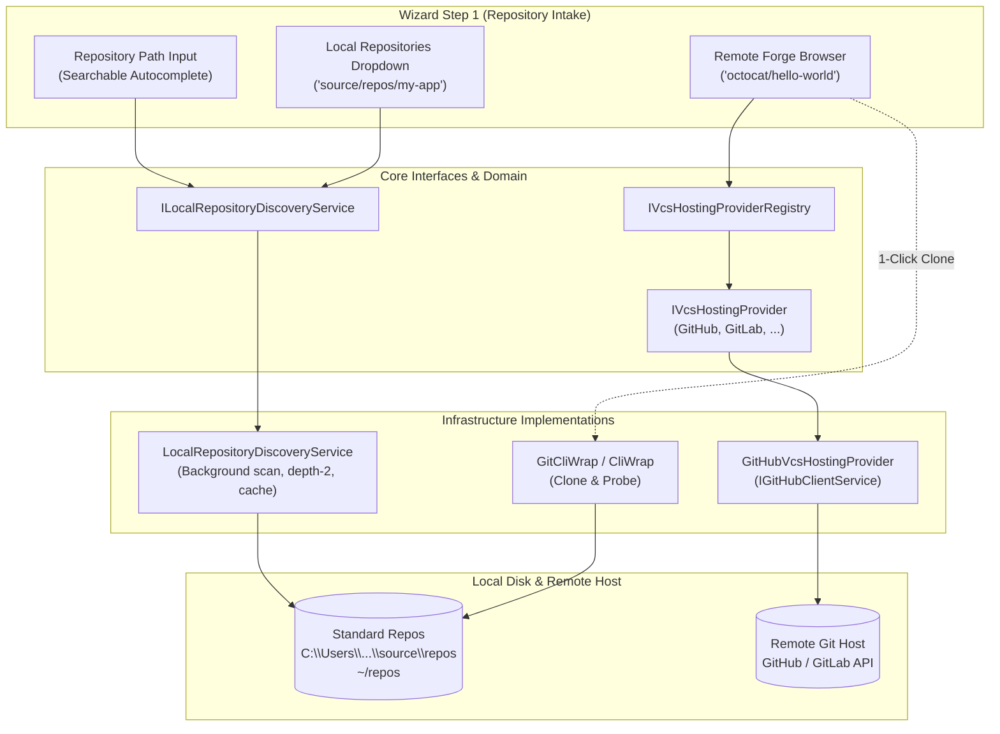

# 📁 Step 12.32A: Workspace Wizard Local Git Discovery, Provider-Agnostic Remote Hosting & Existing Project Picker

> **Feature Implementation Step (Part 1 of 2 — Existing Repository Discovery, Remote Forge Browser & Auto-Completion)**  
> *Parent Plan:* [Features & Integrations Roadmap](README.md)  
> *Companion Step:* [Step 12.32B: From-Scratch Workspace Templates & Remote Forge Publishing](STEP_12_32B_WORKSPACE_TEMPLATES_NATIVE_CLI_SCAFFOLDING_AND_REMOTE_PUBLISH.md)  
> *Related Steps:* [Step 12.11A: GitHub Client, Device Auth & Settings](STEP_12_11A_GITHUB_CLIENT_DEVICE_AUTH_AND_SETTINGS.md) | [Step 12.11B: Outbound PR Delivery](STEP_12_11B_GITHUB_PULL_REQUEST_DELIVERY.md) | [Step 12.26: Workspace Visual Identity](../archive/phase-12/STEP_12_26_WORKSPACE_EMOJI_COLOR_CODE_AND_SETTINGS.md)  
> *Source Policy:* [AGENTS.md](../../AGENTS.md)  
> *Project Target:* `src/NightCodeForge.Core`, `src/NightCodeForge.Infrastructure`, `src/NightCodeForge.Web`, `tests/NightCodeForge.Infrastructure.Tests`, `tests/NightCodeForge.Web.Tests`  
> *Status:* Planned | *Target Framework:* .NET 10 (C# 13)

> This document is a **specification**: it states required behaviors and constraints, not implementations. Implementation choices (signatures, code structure) are left to the implementer, within the constraints of the documents.

---

## 1. Executive Objective

When onboarding existing projects into NightCodeForge via [`WorkspaceCreationWizardModal.razor`](../../src/NightCodeForge.Web/Components/Workspaces/WorkspaceCreationWizardModal.razor), developers currently must manually copy-paste or type absolute paths into [`WizardStep1PathProbe.razor`](../../src/NightCodeForge.Web/Components/Workspaces/Steps/WizardStep1PathProbe.razor) (`C:\Users\...\source\repos\...`). If the directory has not been initialized with Git, or if the project resides on a remote hosting forge (GitHub, GitLab), the user experience requires external terminal commands before NightCodeForge can begin.

This step (Part 1 of Step 12.32) eliminates onboarding friction for existing repositories:
1. **Local Repository Auto-Discovery (`ILocalRepositoryDiscoveryService`):** Proactively scan standard developer workspace directories across Windows, Linux, and WSL2 (`%USERPROFILE%\source\repos`, `~/repos`, `~/projects`, `~/Development`, etc.) for Git repositories (`.git` directories or worktree pointers).
2. **Searchable Autocomplete & Quick-Picker (`WizardStep1PathProbe.razor`):** Provide a responsive, filtered dropdown/datalist in Step 1 of the wizard displaying discovered repositories (with friendly name, relative folder, detected branch, and last modified date) while preserving free-form manual path entry.
3. **Provider-Agnostic Remote Forge Abstraction (`IVcsHostingProvider`, `IVcsHostingProviderRegistry`):** Define a clean provider contract for remote Git hosting services (supporting GitHub, GitLab, Gitea, Bitbucket) without vendor lock-in.
4. **Remote Project Browser & Quick Clone:** When a remote forge (e.g. GitHub via [Step 12.11A](STEP_12_11A_GITHUB_CLIENT_DEVICE_AUTH_AND_SETTINGS.md)) is connected and active:
   - Query and display accessible remote repositories in the wizard.
   - If the remote repository is already cloned locally, automatically resolve and select the local path.
   - If not yet cloned locally, allow 1-click cloning into the developer's default repository directory (`git clone`) and proceed directly to branch and environment configuration.

---

## 2. Architecture & Service Contracts



### 2.1 Standard Discovery Locations & Scanning Policy

The scanner probes well-known development directory conventions up to a depth of 2 directories below each root (supporting both `<root>/<repo>` at depth 1 and `<root>/<owner-or-category>/<repo>` at depth 2). A valid Git repository is identified by the presence of a `.git` subfolder or a `.git` pointer file (for worktrees and submodules). Once a `.git` entry is detected in a directory, traversal stops recursing deeper into that repository's subdirectories.

| Operating System | Default Standard Scanned Roots |
| :--- | :--- |
| **Windows** | `%USERPROFILE%\source\repos`<br>`%USERPROFILE%\repos`<br>`%USERPROFILE%\projects`<br>`%USERPROFILE%\Development`<br>`%USERPROFILE%\workspace`<br>`%USERPROFILE%\Documents\GitHub` |
| **Linux / macOS** | `~/source/repos`<br>`~/repos`<br>`~/projects`<br>`~/Development`<br>`~/workspace`<br>`~/code` |
| **WSL2 Windows Interop** | `/mnt/c/Users/<user>/source/repos`<br>`/mnt/c/Users/<user>/repos`<br>`/mnt/c/Users/<user>/projects` |

- **Configurable Scanner Options (`LocalDiscoveryOptions` in `appsettings.json`):**
  ```json
  {
    "LocalDiscovery": {
      "ScanOnStartup": false,
      "MaxDepth": 2,
      "CacheDurationMinutes": 10,
      "AdditionalScanPaths": []
    }
  }
  ```
- **Performance & Safety Invariants:**
  - Directory scanning runs asynchronously on background worker threads (`Task.Run`).
  - Directories containing `.ncf-ignore` or known massive trees (`node_modules`, `bin`, `obj`, `.nuget`, `.local`, `.vs`, `.git`) are pruned immediately to avoid traversal stalls.
  - **Zero-Process Metadata Extraction:** To ensure scanning 100+ local repositories completes in `< 500ms` without process-spawn overhead on Windows, `CurrentBranch` and `RemoteOriginUrl` are extracted via lightweight file reads on `.git/HEAD` and `.git/config` (resolving `gitdir:` pointers for worktrees/submodules) rather than spawning `git.exe` per directory.
  - Scan results are cached in-memory with a configurable TTL (default 10 minutes) and support an explicit `RefreshAsync()` invocation from the UI.
  - Failures reading inaccessible or permission-restricted folders fail silently for that specific sub-tree without halting the remaining scan, logging diagnostic warnings.

### 2.2 Local Repository Discovery Service (`ILocalRepositoryDiscoveryService`)

```csharp
namespace NightCodeForge.Core.Interfaces;

public record DiscoveredRepository(
    string Name,
    string FullPath,
    string? CurrentBranch,
    DateTimeOffset LastModified,
    bool HasRemoteOrigin,
    string? RemoteOriginUrl);

public interface ILocalRepositoryDiscoveryService
{
    Task<IReadOnlyList<DiscoveredRepository>> GetDiscoveredRepositoriesAsync(
        bool forceRefresh = false, 
        CancellationToken cancellationToken = default);

    Task<IReadOnlyList<string>> GetStandardRootsAsync(
        CancellationToken cancellationToken = default);

    string ResolveDefaultNewRepositoryPath(string repositoryName);
}
```

### 2.3 Provider-Agnostic Remote Hosting Abstraction (`IVcsHostingProvider`)

To ensure the architecture is not hardcoded to GitHub, all remote repository interactions are defined through generic hosting interfaces:

```csharp
namespace NightCodeForge.Core.Interfaces;

public enum VcsHostingProviderType
{
    GitHub = 1,
    GitLab = 2,
    Gitea = 3,
    Bitbucket = 4,
    Custom = 99
}

public record VcsRepositorySummary(
    string Id,
    string Name,
    string FullName,
    string Owner,
    string Description,
    bool IsPrivate,
    string DefaultBranch,
    string HttpsCloneUrl,
    string SshCloneUrl,
    DateTimeOffset? UpdatedAt);

public interface IVcsHostingProvider
{
    VcsHostingProviderType ProviderType { get; }
    string DisplayName { get; }
    Task<bool> IsAuthenticatedAsync(CancellationToken cancellationToken = default);
    Task<string?> GetAuthenticatedUsernameAsync(CancellationToken cancellationToken = default);
    
    Task<IReadOnlyList<VcsRepositorySummary>> ListRepositoriesAsync(
        CancellationToken cancellationToken = default);

    Task<VcsRepositorySummary> CreateRepositoryAsync(
        string name, 
        string? description, 
        bool isPrivate, 
        CancellationToken cancellationToken = default);
}

public interface IVcsHostingProviderRegistry
{
    IReadOnlyList<IVcsHostingProvider> GetAvailableProviders();
    IVcsHostingProvider? GetProvider(VcsHostingProviderType type);
    Task<IVcsHostingProvider?> GetPrimaryAuthenticatedProviderAsync(
        CancellationToken cancellationToken = default);
}
```

### 2.4 GitHub Provider Implementation

- Implements `IVcsHostingProvider` using the GitHub App Device Flow infrastructure from [Step 12.11A](STEP_12_11A_GITHUB_CLIENT_DEVICE_AUTH_AND_SETTINGS.md) (`IGitHubClientService`, `IGitHubDeviceAuthService`, `IGitHubTokenStore`).
- When tokens are present and valid, `IsAuthenticatedAsync()` returns `true` and `ListRepositoriesAsync()` queries the authenticated user's accessible repositories via `GET /user/repos?sort=updated&per_page=100` (using refresh-aware tokens from `IGitHubDeviceAuthService.GetValidAccessTokenAsync`).
- **GitHub App Permission Requirement for `CreateRepositoryAsync`:** Creating a remote repository via `POST /user/repos` with a GitHub App user-to-server token (`ghu_...`) requires the NightCodeForge GitHub App registration to include **`Administration: Read & write`** repository permission. If the GitHub API returns `403 Forbidden` (e.g., the app installation is restricted to selected repositories and does not permit user-level repository creation), `CreateRepositoryAsync` throws a clear `VcsHostingProviderException` explaining the required GitHub App installation/permission setting.
- Extensible design: adding GitLab in the future only requires implementing `IVcsHostingProvider` and registering it in `IVcsHostingProviderRegistry`.

### 2.5 Constructor Parameter Limit & Service Cohesion ([AGENTS.md](../../AGENTS.md))

- [`WorkspaceProvisioningService`](../../src/NightCodeForge.Web/Services/WorkspaceProvisioningService.cs) already has 9 constructor parameters. Per [AGENTS.md](../../AGENTS.md) (*"never exceed 10 constructor parameters"*), do **not** inject `ILocalRepositoryDiscoveryService`, `IVcsHostingProviderRegistry`, and `IWorkspaceTemplateService` all directly into `WorkspaceProvisioningService`. Either extract cohesive collaborator services (e.g., `IWorkspaceRemoteCloneService` or `WorkspaceGitHygieneService`) or keep discovery and remote cloning in dedicated services injected into the wizard presentation helper.

---

## 3. Presentation & User Experience (`WizardStep1PathProbe.razor`)

### 3.1 Mode Switcher & Discovered Dropdown

1. **Intake Channel Switcher:**
   - Tabs or radio group at the top of Step 1:
     - 📁 **Local Git Repositories** (Default)
     - ☁️ **Remote Forge Projects** (Visible if any VCS provider is connected, or displays a "Connect GitHub" callout)
2. **Local Repository Quick-Select:**
   - A searchable `<select>` or custom filtered dropdown input listing all discovered repositories sorted by `LastModified DESC`.
   - Each item displays: `[Folder Name] (branch: main) — path/to/folder`.
   - Selecting an item immediately fills `Model.RepositoryPath`, triggers `ProbeRepositoryAsync()`, and auto-populates `Model.Name` and `Model.DefaultBaseBranch`.
   - Includes a **🔄 Refresh Scanned Repos** button with a subtle loading spinner.
3. **Manual Path Override:**
   - Developers can always type or paste a custom absolute path; the path input is coupled to the dropdown via standard two-way binding.

### 3.2 Remote Project Browser & 1-Click Clone

1. **Remote Repository Cards / Table:**
   - Displays repository list with search query filter, visibility badges (`🔒 Private`, `🌐 Public`), owner avatar/name, and last updated timestamp.
2. **Local Status Matching (Canonical URL Normalization):**
   - The UI cross-references remote clone URLs (`HttpsCloneUrl` / `SshCloneUrl`) against `DiscoveredRepository.RemoteOriginUrl` using a canonical repository URL normalizer (normalizing `https://github.com/Owner/Repo.git`, `https://github.com/owner/repo`, and `git@github.com:Owner/Repo.git` to lowercase `github.com/owner/repo`):
     - **Already Cloned Locally:** Shows a `✅ Local copy found` badge and a "Select Local Repository" button directing straight to Step 2.
     - **Not Cloned Locally:** Shows a `📥 Clone & Onboard` primary action button.
3. **Clone Execution Drawer / Modal (Ephemeral Auth for Private Repos):**
   - Clicking `📥 Clone & Onboard` suggests the default target path: `{DefaultReposRoot}/{RepoName}` (e.g. `C:\Users\Julien\source\repos\my-api`).
   - Runs `git clone` via `IGitCliRunner` / `CliWrap` using the ephemeral HTTP header authentication pattern from [Step 12.11B](STEP_12_11B_GITHUB_PULL_REQUEST_DELIVERY.md) (`git -c http.extraHeader="Authorization: Basic <base64(x-access-token:token)>" clone <HttpsCloneUrl> <targetPath>` with `GIT_TERMINAL_PROMPT=0`), ensuring private repositories clone without interactive credential prompts and without writing short-lived `ghu_...` tokens into `.git/config`.
   - On clone completion, automatically initializes `Model.RepositoryPath`, probes the repository, links `GitHubIntegrationSettings` (`RepositoryOwner`, `RepositoryName`, `Enabled = true`), and transitions smoothly to Step 2.

---

## 4. Implementation Checklist & Deliverables

- [ ] **Core Interfaces & Models (`NightCodeForge.Core`):**
  - [ ] Add `DiscoveredRepository` record and `ILocalRepositoryDiscoveryService` in `NightCodeForge.Core.Interfaces`.
  - [ ] Add `VcsHostingProviderType`, `VcsRepositorySummary`, `IVcsHostingProvider`, and `IVcsHostingProviderRegistry` in `NightCodeForge.Core.Interfaces`.
  - [ ] Add domain exceptions: `LocalRepositoryDiscoveryException`, `VcsHostingProviderException`.
- [ ] **Infrastructure Implementation (`NightCodeForge.Infrastructure`):**
  - [ ] Implement `LocalRepositoryDiscoveryService` scanning Windows, Linux, and WSL standard locations with depth-2 limits, cache TTL, and error isolation.
  - [ ] Implement `GitHubVcsHostingProvider` bridging `IGitHubClientService` / GitHub App tokens.
  - [ ] Implement `VcsHostingProviderRegistry` supporting dynamic discovery and primary provider resolution.
  - [ ] Bind `LocalDiscoveryOptions` in DI configuration.
- [ ] **Web Presentation & Wizard UI (`NightCodeForge.Web`):**
  - [ ] Enhance `WizardStep1PathProbe.razor` with local repository autocomplete / dropdown selector.
  - [ ] Add remote forge project browser tab with search filter and canonical URL-normalized local clone status badges.
  - [ ] Add 1-click ephemeral-auth clone workflow (`CloneRemoteRepositoryAsync`), respecting the 10-constructor-parameter limit on `WorkspaceProvisioningService`.
  - [ ] Extract presentation, URL normalization, and list mapping from `.razor` components into dedicated helper services per [AGENTS.md](../../AGENTS.md).
- [ ] **Automated Testing:**
  - [ ] Unit tests for `LocalRepositoryDiscoveryService` testing Windows and Linux standard paths, `.git` folder/worktree file detection, `.git/HEAD` + `.git/config` parsing, depth-2 limits, and caching in `NightCodeForge.Infrastructure.Tests`.
  - [ ] Unit tests for canonical Git URL normalization, `VcsHostingProviderRegistry`, and `GitHubVcsHostingProvider` mock responses.
  - [ ] bUnit component tests in `NightCodeForge.Web.Tests` asserting dropdown rendering, path auto-fill, and remote repository selection.

