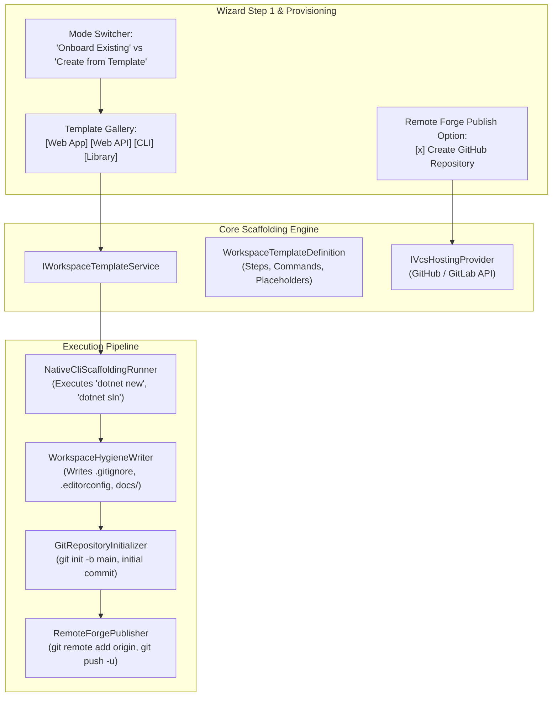

# ⚡ Step 12.32B: From-Scratch Workspace Templates (Native CLI Clean Architecture) & Remote Forge Publishing

> **Feature Implementation Step (Part 2 of 2 — Native CLI Scaffolding, Clean Architecture Templates & Remote Publishing)**  
> *Parent Plan:* [Features & Integrations Roadmap](README.md)  
> *Prerequisite Step:* [Step 12.32A: Workspace Wizard Local Git Discovery & Remote Hosting](STEP_12_32A_WORKSPACE_WIZARD_REPO_DISCOVERY_AND_REMOTE_PROJECT_PICKER.md)  
> *Related Steps:* [Step 12.11A: GitHub Client & Outbound PR Delivery](STEP_12_11A_GITHUB_CLIENT_SETTINGS_AND_PR_DELIVERY.md) | [Step 12.14: Global Skills Injection & Stack Tooling](../archive/phase-12/STEP_12_14_GLOBAL_SKILLS_INJECTION_AND_STACK_TOOLING.md)  
> *Source Policy:* [AGENTS.md](../../AGENTS.md)  
> *Project Target:* `src/NightCodeForge.Core`, `src/NightCodeForge.Infrastructure`, `src/NightCodeForge.Web`, `tests/NightCodeForge.Infrastructure.Tests`, `tests/NightCodeForge.Web.Tests`  
> *Status:* Planned | *Target Framework:* .NET 10 (C# 13)

> This document is a **specification**: it states required behaviors and constraints, not implementations. Implementation choices (signatures, code structure) are left to the implementer, within the constraints of the documents.

---

## 1. Executive Objective

Developers starting a new software project currently have to switch outside NightCodeForge to manually run CLI commands, configure a multi-project solution structure, configure `.gitignore` / `.editorconfig`, initialize Git, create GitHub repositories, and then return to NightCodeForge to onboard the workspace.

This step (Part 2 of Step 12.32) enables creating fresh, production-ready workspaces **from scratch directly inside the wizard**:
1. **Template as Native CLI Recipe:** Templates are **not static file copies**; they are structured, reproducible recipes executing native stack CLIs (e.g. `dotnet new` for .NET, with future extensibility for Node/Vite, Rust/Cargo, Python/Poetry).
2. **Canonical Project Architecture (`docs/`, `src/`, `tests/`):** All templates strictly establish the standard NightCodeForge directory layout, facilitating autonomous agent reasoning, test discovery, and deterministic quality gates:
   - `docs/` — Architectural blueprint, domain glossaries, and agent task specifications (`docs/tasks/`).
   - `src/` — Clean Architecture solution layers separating presentation, domain, and infrastructure.
   - `tests/` — Automated test projects mirroring `src/` layers.
3. **Four Built-in .NET Clean Architecture Templates:**
   - **Web App (Clean Architecture):** Blazor / Razor web app structured into `Web`, `Core`, `Infrastructure` with `Web.Tests` and `Core.Tests`.
   - **Web API (Clean Architecture):** Minimal / REST Web API structured into `Api`, `Core`, `Infrastructure` with `Api.Tests` and `Core.Tests`.
   - **CLI Application (Clean Architecture):** Command-line tool structured into `Cli`, `Core` with test suites.
   - **Class Library:** Reusable modular library with documentation and unit tests.
4. **Automated Git Initialization & Clean First Commit:** Auto-provisions `.gitignore`, `.editorconfig`, `README.md`, runs `git init -b main`, stages all files, and creates the baseline commit.
5. **Remote Forge Publishing (GitHub / GitLab):** When VCS provider integration ([Step 12.32A](STEP_12_32A_WORKSPACE_WIZARD_REPO_DISCOVERY_AND_REMOTE_PROJECT_PICKER.md) / [Step 12.11A](STEP_12_11A_GITHUB_CLIENT_SETTINGS_AND_PR_DELIVERY.md)) is active, developers can choose to automatically create the remote repository (public or private), register the `origin` remote, push `main`, and link workspace integration settings in one seamless flow.

---

## 2. Architecture & Service Specifications



### 2.1 Template Definition Model (`WorkspaceTemplateDefinition`)

```csharp
namespace NightCodeForge.Core.Domain;

public enum TemplateStackCategory
{
    DotNet = 1,
    TypeScriptNode = 2,
    Rust = 3,
    Python = 4
}

public enum TemplateArchitectureArchetype
{
    WebApp = 1,
    WebApi = 2,
    CliTool = 3,
    ClassLibrary = 4
}

public record WorkspaceTemplateCommand(
    string ToolExecutable, 
    string ArgumentsTemplate, 
    string? RelativeWorkingDirectory = null);

public record WorkspaceTemplateDefinition(
    string Id,
    string Name,
    string Description,
    string IconEmoji,
    TemplateStackCategory StackCategory,
    TemplateArchitectureArchetype Archetype,
    IReadOnlyList<WorkspaceTemplateCommand> BootstrapCommands,
    IReadOnlyList<string> GeneratedProjects);
```

### 2.2 Built-in Clean Architecture Templates (.NET 10)

All built-in .NET templates assume standard .NET 10 SDK presence on the host / WSL environment. To ensure deterministic solution file extension across .NET 10 SDK versions (which may default to `.slnx`), `dotnet new sln` explicitly passes `--format sln`, and individual project creation steps pass `--no-restore` followed by a single restore/build pass:

#### 1. Web Application (`dotnet-clean-webapp`)
- **Commands:**
  1. `dotnet new sln -n {ProjectName} --format sln`
  2. `dotnet new blazor -n {ProjectName}.Web -o src/{ProjectName}.Web --interactivity Server --empty false --no-restore`
  3. `dotnet new classlib -n {ProjectName}.Core -o src/{ProjectName}.Core --no-restore`
  4. `dotnet new classlib -n {ProjectName}.Infrastructure -o src/{ProjectName}.Infrastructure --no-restore`
  5. `dotnet add src/{ProjectName}.Web/{ProjectName}.Web.csproj reference src/{ProjectName}.Core/{ProjectName}.Core.csproj src/{ProjectName}.Infrastructure/{ProjectName}.Infrastructure.csproj`
  6. `dotnet add src/{ProjectName}.Infrastructure/{ProjectName}.Infrastructure.csproj reference src/{ProjectName}.Core/{ProjectName}.Core.csproj`
  7. `dotnet new xunit -n {ProjectName}.Core.Tests -o tests/{ProjectName}.Core.Tests --no-restore`
  8. `dotnet add tests/{ProjectName}.Core.Tests/{ProjectName}.Core.Tests.csproj reference src/{ProjectName}.Core/{ProjectName}.Core.csproj`
  9. `dotnet new xunit -n {ProjectName}.Web.Tests -o tests/{ProjectName}.Web.Tests --no-restore`
  10. `dotnet add tests/{ProjectName}.Web.Tests/{ProjectName}.Web.Tests.csproj reference src/{ProjectName}.Web/{ProjectName}.Web.csproj`
  11. `dotnet sln {ProjectName}.sln add src/{ProjectName}.Web src/{ProjectName}.Core src/{ProjectName}.Infrastructure tests/{ProjectName}.Core.Tests tests/{ProjectName}.Web.Tests`

#### 2. Web API (`dotnet-clean-webapi`)
- **Commands:**
  1. `dotnet new sln -n {ProjectName} --format sln`
  2. `dotnet new webapi -n {ProjectName}.Api -o src/{ProjectName}.Api --controllers false --no-restore`
  3. `dotnet new classlib -n {ProjectName}.Core -o src/{ProjectName}.Core --no-restore`
  4. `dotnet new classlib -n {ProjectName}.Infrastructure -o src/{ProjectName}.Infrastructure --no-restore`
  5. `dotnet add src/{ProjectName}.Api/{ProjectName}.Api.csproj reference src/{ProjectName}.Core/{ProjectName}.Core.csproj src/{ProjectName}.Infrastructure/{ProjectName}.Infrastructure.csproj`
  6. `dotnet add src/{ProjectName}.Infrastructure/{ProjectName}.Infrastructure.csproj reference src/{ProjectName}.Core/{ProjectName}.Core.csproj`
  7. `dotnet new xunit -n {ProjectName}.Core.Tests -o tests/{ProjectName}.Core.Tests --no-restore`
  8. `dotnet add tests/{ProjectName}.Core.Tests/{ProjectName}.Core.Tests.csproj reference src/{ProjectName}.Core/{ProjectName}.Core.csproj`
  9. `dotnet new xunit -n {ProjectName}.Api.Tests -o tests/{ProjectName}.Api.Tests --no-restore`
  10. `dotnet add tests/{ProjectName}.Api.Tests/{ProjectName}.Api.Tests.csproj reference src/{ProjectName}.Api/{ProjectName}.Api.csproj`
  11. `dotnet sln {ProjectName}.sln add src/{ProjectName}.Api src/{ProjectName}.Core src/{ProjectName}.Infrastructure tests/{ProjectName}.Core.Tests tests/{ProjectName}.Api.Tests`

#### 3. CLI Application (`dotnet-clean-cli`)
- **Commands:**
  1. `dotnet new sln -n {ProjectName} --format sln`
  2. `dotnet new console -n {ProjectName}.Cli -o src/{ProjectName}.Cli --no-restore`
  3. `dotnet new classlib -n {ProjectName}.Core -o src/{ProjectName}.Core --no-restore`
  4. `dotnet add src/{ProjectName}.Cli/{ProjectName}.Cli.csproj reference src/{ProjectName}.Core/{ProjectName}.Core.csproj`
  5. `dotnet new xunit -n {ProjectName}.Core.Tests -o tests/{ProjectName}.Core.Tests --no-restore`
  6. `dotnet add tests/{ProjectName}.Core.Tests/{ProjectName}.Core.Tests.csproj reference src/{ProjectName}.Core/{ProjectName}.Core.csproj`
  7. `dotnet new xunit -n {ProjectName}.Cli.Tests -o tests/{ProjectName}.Cli.Tests --no-restore`
  8. `dotnet add tests/{ProjectName}.Cli.Tests/{ProjectName}.Cli.Tests.csproj reference src/{ProjectName}.Cli/{ProjectName}.Cli.csproj`
  9. `dotnet sln {ProjectName}.sln add src/{ProjectName}.Cli src/{ProjectName}.Core tests/{ProjectName}.Core.Tests tests/{ProjectName}.Cli.Tests`

#### 4. Class Library (`dotnet-classlib`)
- **Commands:**
  1. `dotnet new sln -n {ProjectName} --format sln`
  2. `dotnet new classlib -n {ProjectName} -o src/{ProjectName} --no-restore`
  3. `dotnet new xunit -n {ProjectName}.Tests -o tests/{ProjectName}.Tests --no-restore`
  4. `dotnet add tests/{ProjectName}.Tests/{ProjectName}.Tests.csproj reference src/{ProjectName}/{ProjectName}.csproj`
  5. `dotnet sln {ProjectName}.sln add src/{ProjectName} tests/{ProjectName}.Tests`

### 2.3 Scaffolding Service (`IWorkspaceTemplateService`)

```csharp
namespace NightCodeForge.Core.Interfaces;

public record TemplateScaffoldingRequest(
    string TemplateId,
    string ProjectName,
    string TargetDirectoryPath,
    bool InitializeGit,
    bool PublishToRemoteForge,
    VcsHostingProviderType? RemoteProviderType,
    bool RemoteIsPrivate,
    string? RemoteDescription);

public record TemplateScaffoldingProgress(
    string CurrentStep, 
    int Percentage, 
    bool IsCompleted, 
    string? ErrorMessage);

public interface IWorkspaceTemplateService
{
    IReadOnlyList<WorkspaceTemplateDefinition> GetAvailableTemplates();
    WorkspaceTemplateDefinition? GetTemplate(string templateId);

    Task ScaffoldWorkspaceAsync(
        TemplateScaffoldingRequest request,
        IProgress<TemplateScaffoldingProgress>? progress = null,
        CancellationToken cancellationToken = default);
}
```

### 2.4 Baseline Repository Hygiene & Structure Generation

Upon executing template CLI commands, the service writes canonical NCF hygiene assets **before** staging and committing so the initial commit has clean LF line endings and passes all cross-platform checks out of the box:
- `docs/ARCHITECTURE.md`: High-level system overview documenting layered dependencies.
- `docs/tasks/.gitkeep`: Ready for autonomous task markdown sync.
- `.gitignore`: Standard .NET gitignore combined with the NCF managed block via [`GitignorePreparer.Prepare(...)`](../../src/NightCodeForge.Core/Services/GitignorePreparer.cs) (`TaskSyncConstants.RequiredGitIgnoreEntries`).
- `.editorconfig`: Standard C# / general formatting rules enforcing 4 spaces, UTF-8, and `end_of_line = lf` via [`EditorConfigPreparer.Prepare(...)`](../../src/NightCodeForge.Core/Services/EditorConfigPreparer.cs) (`EditorConfigConstants.BaselineEditorConfigContent`).
- `.gitattributes`: Enforces `* text=auto eol=lf` to prevent Windows vs. WSL2/Container line-ending drift.
- `README.md`: Project summary mentioning NightCodeForge workspace scaffolding.
- Git Initial Commit:
  - `git init -b main`
  - `git config core.autocrlf false`
  - `git config user.name "NightCodeForge"` and `git config user.email "forge@localhost"` (set locally in the repo only if not already globally configured)
  - `git add -A`
  - `git commit -m "feat: initial commit from NightCodeForge {TemplateName} template"`

### 2.5 Remote Forge Publishing Workflow

When `PublishToRemoteForge == true`:
1. Resolves `IVcsHostingProvider` from `IVcsHostingProviderRegistry` for the selected `RemoteProviderType` (e.g. GitHub).
2. Verifies authentication; if unauthenticated, fails fast with `VcsHostingProviderException`.
3. Calls `IVcsHostingProvider.CreateRepositoryAsync(request.ProjectName, request.RemoteDescription, request.RemoteIsPrivate)`.
4. Executes native Git remote linkage via `IGitCliRunner` / `CliWrap`:
   - `git remote add origin <HttpsCloneUrl>`
   - `git -c http.extraHeader="Authorization: Basic <base64(x-access-token:token)>" push -u origin main` (using the ephemeral HTTP header authentication pattern from [Step 12.11A](STEP_12_11A_GITHUB_CLIENT_SETTINGS_AND_PR_DELIVERY.md) with `GIT_TERMINAL_PROMPT=0` so short-lived `ghu_...` tokens are **never** written into `.git/config`).
5. Populates `GitHubIntegrationSettings` (`RepositoryOwner`, `RepositoryName`, `Enabled = true`) to be persisted on the newly provisioned [`Workspace`](../../src/NightCodeForge.Core/Domain/Workspace.cs) record in SQLite.

---

## 3. Presentation & User Experience

### 3.1 Wizard Mode Switcher (`WorkspaceCreationWizardModal.razor`)

At the entry of the wizard, developers see an intuitive intake selector:
- 📁 **Onboard Existing Repository** — Browse local directories or clone remote projects ([Step 12.32A](STEP_12_32A_WORKSPACE_WIZARD_REPO_DISCOVERY_AND_REMOTE_PROJECT_PICKER.md)).
- ⚡ **Create New from Template** — Choose an architectural template, define project name, and bootstrap.

### 3.2 Template Gallery & Configuration (Step 1 when in Template Mode)

1. **Visual Template Cards:**
   - Grid displaying the 4 Clean Architecture templates with emoji icons (`🌐 Web App`, `🔌 Web API`, `💻 CLI Tool`, `📦 Class Library`).
   - Cards display stack badges (`.NET 10`), architecture tags (`Clean Architecture`, `docs / src / tests`), and expected generated projects.
2. **Project Parameters:**
   - **Project Name (`PascalCase` or `kebab-case`):** Validated in real-time (C# identifier / solution name safety, filesystem safety).
   - **Destination Folder:** Defaults to `{DefaultReposRoot}\{ProjectName}` (e.g. `C:\Users\Julien\source\repos\my-new-app`), editable with probe warning if the folder already exists and is non-empty.
3. **Remote Forge Publishing Card:**
   - Appears if a VCS provider (e.g. GitHub) is connected.
   - Master toggle: `🚀 Publish to GitHub repository`.
   - Options: Repository Name (defaults to Project Name), Visibility (`🔒 Private` vs `🌐 Public`), Description.

### 3.3 Seamless Provisioning Progression & Execution Order

- Stepper dynamically skips Step 2 (Stack & Branch) since stack is predetermined by the template and base branch is initialized as `main`.
- Transitions directly to Step 3 (Execution Environment: WSL2 / Container / BareHost) and Step 4 (Provisioning), showing live progress in two coordinated phases:
  1. **Phase A — Template Scaffolding & Remote Publish (`IWorkspaceTemplateService.ScaffoldWorkspaceAsync`):** Creates the target directory, runs native `dotnet new` / `dotnet sln` commands, writes hygiene files (`.gitignore`, `.editorconfig`, `.gitattributes`, `docs/`), initializes Git (`git init -b main` + baseline commit), and (if enabled) creates the remote forge repository and pushes `main`.
  2. **Phase B — Workspace Onboarding (`IWorkspaceProvisioningService.ProvisionWorkspaceAsync`):** Persists the [`Workspace`](../../src/NightCodeForge.Core/Domain/Workspace.cs) record in SQLite (including `GitHubIntegrationSettings` when published), clones the isolated Ext4 mirror from the newly committed `main` branch, starts the `docs/tasks/` markdown sync watcher, and configures agent profiles.
- **Partial Failure & Retry Recovery:** If Phase A succeeds locally (`dotnet new` + `git commit`) but remote publishing fails (e.g., a GitHub repository with the same name already exists or network drops), the UI surfaces the specific `VcsHostingProviderException` message and allows retrying remote publish/provisioning or proceeding with local-only onboarding without re-running `dotnet new` over a non-empty directory.
- **Constructor Limit Compliance ([AGENTS.md](../../AGENTS.md)):** Keep `IWorkspaceTemplateService` as a separate service orchestrated by the wizard (or a dedicated coordinator) rather than adding more dependencies to [`WorkspaceProvisioningService`](../../src/NightCodeForge.Web/Services/WorkspaceProvisioningService.cs) (which already has 9 constructor parameters).

---

## 4. Implementation Checklist & Deliverables

- [ ] **Core Models & Interfaces (`NightCodeForge.Core`):**
  - [ ] Add `TemplateStackCategory`, `TemplateArchitectureArchetype`, `WorkspaceTemplateCommand`, `WorkspaceTemplateDefinition` in `NightCodeForge.Core.Domain`.
  - [ ] Add `TemplateScaffoldingRequest`, `TemplateScaffoldingProgress`, and `IWorkspaceTemplateService` in `NightCodeForge.Core.Interfaces`.
  - [ ] Add domain exceptions: `WorkspaceTemplateExecutionException`.
- [ ] **Infrastructure Implementation (`NightCodeForge.Infrastructure`):**
  - [ ] Implement `WorkspaceTemplateService` registering the 4 built-in Clean Architecture templates.
  - [ ] Implement CLI command execution pipeline via `CliWrap` with stdout/stderr logging and progress reporting.
  - [ ] Implement `WorkspaceHygieneWriter` generating canonical `docs/`, `src/`, `tests/`, `.gitignore`, `.editorconfig`, and `README.md`.
  - [ ] Implement automated `git init -b main` and initial commit execution.
  - [ ] Integrate remote forge creation and `git push -u origin main` via `IVcsHostingProvider`.
- [ ] **Web Presentation & Wizard UI (`NightCodeForge.Web`):**
  - [ ] Add mode switcher in `WorkspaceCreationWizardModal.razor` ("Onboard Existing" vs "Create New from Template").
  - [ ] Build `WizardTemplateSelector.razor` gallery with template cards, project name validation, and remote publish options.
  - [ ] Connect template progress streaming to `WizardStep4Provisioning.razor`.
- [ ] **Automated Testing:**
  - [ ] Unit tests for `WorkspaceTemplateService` verifying template definitions and command parameter substitution in `NightCodeForge.Infrastructure.Tests`.
  - [ ] Integration test executing CLI scaffolding in an isolated temp folder, asserting `docs/`, `src/`, `tests/`, `.git`, and solution build.
  - [ ] bUnit tests for `WizardTemplateSelector.razor` verifying template selection, project name validation, and publish toggle.

