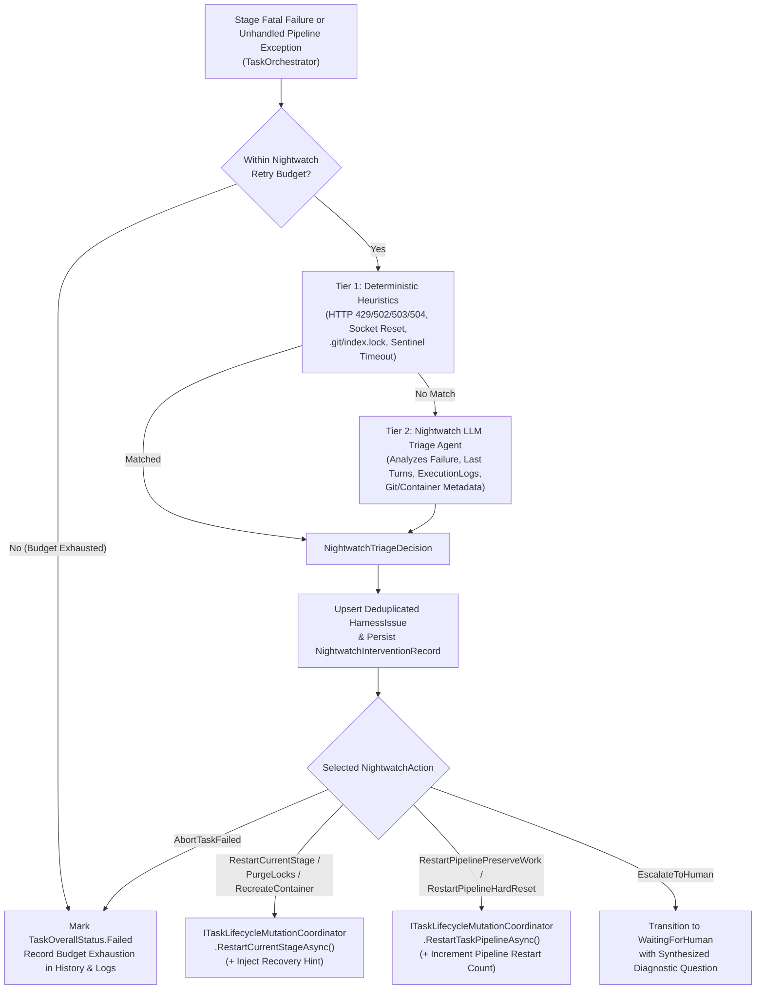

# 🦉 Step 12.34A: Autonomous Nightwatch — Harness Issue Ledger, Tiered Triage Engine & Orchestrator Failure Recovery

> **Feature & Resiliency Specification (Part 1 of 3 — Core Domain, Persistence, Tiered Triage & Orchestrator Hooks)**  
> *Parent Plan:* [Features & Integrations Roadmap](README.md)  
> *Prerequisite Steps:* [Step 12.36A: Declarative Sandbox Mount Table & Container Lifecycle Redesign](STEP_12_36A_DECLARATIVE_SANDBOX_MOUNT_TABLE_AND_CONTAINER_LIFECYCLE_REDESIGN.md) | [Step 12.36B: `CanonicalTools` Modular Decomposition & Interruption Pipeline](STEP_12_36B_CANONICAL_TOOLS_MODULAR_DECOMPOSITION_AND_INTERRUPTION_PIPELINE.md)  
> *Companion Steps:* [Step 12.34B: Agent-Invocable Nightwatch SOS Tool (`report_environment_issue`) & In-Flight Remediation](STEP_12_34B_AGENT_NIGHTWATCH_SOS_TOOL_AND_ENVIRONMENT_REMEDIATION.md) | [Step 12.34C: Nightwatch Telemetry UI, Harness Issue Ledger (`/diagnostics/nightwatch`) & Self-Improvement Task Promotion](STEP_12_34C_NIGHTWATCH_TELEMETRY_HARNESS_ISSUES_UI_AND_SELF_HEALING_BACKLOG.md)  
> *Related Steps:* [Step 11.38D: Orchestrator & Startup Recovery Decomposition](../archive/phase-11/STEP_11_38D_TASK_ORCHESTRATOR_AND_STARTUP_RECOVERY_DECOMPOSITION.md) | [Step 12.22A: Container Diagnostic Shell Service & Environment Doctor](STEP_12_22A_DIAGNOSTIC_SHELL_SERVICE_AND_CONTAINER_SIGINT_RECOVERY.md)  
> *Source Policy:* [AGENTS.md](../../AGENTS.md) | [docs/ARCHITECTURE.md](../ARCHITECTURE.md)  
> *Target Projects:* `src/NightCodeForge.Core`, `src/NightCodeForge.Infrastructure`, `src/NightCodeForge.Agents`, `src/NightCodeForge.Web`, `tests/NightCodeForge.Core.Tests`, `tests/NightCodeForge.Infrastructure.Tests`, `tests/NightCodeForge.Agents.Tests` | *Status:* Planned | *Target Framework:* .NET 10 (C# 13)

> This document is a **specification**: it states required behaviors and constraints, not implementations. Implementation choices (signatures, code structure) are left to the implementer, within the constraints of the documents.

---

## 1. Problem Statement & Motivation

In autonomous multi-stage runs, many task failures are caused not by impossible requirements, but by operational, environmental, or harness-level friction:
1. **Manual "Restart Stage" / "Restart Pipeline" Toil:** When a stage fails due to a transient LLM gateway hiccup, a container shell glitch, a lingering `.git/index.lock`, an empty/truncated model response, or an unrecovered worktree state, the task transitions to `TaskOverallStatus.Failed` and halts the DAG until a human inspects the logs and clicks **Retry Stage** or **Restart Pipeline**.
2. **Duplicated Stage-Retry Logic Across Layers:** Currently, `RestartTaskPipelineAsync` lives in [`ITaskLifecycleMutationCoordinator`](../../src/NightCodeForge.Core/Workflow/ITaskLifecycleMutationCoordinator.cs) / [`ITaskOrchestrator`](../../src/NightCodeForge.Core/Workflow/ITaskOrchestrator.cs), whereas `RetryCurrentStageAsync` is implemented directly inside [`DevQueueService`](../../src/NightCodeForge.Web/Services/DevQueueService.cs) in `NightCodeForge.Web`, preventing core orchestration services from triggering safe stage-level restarts with environment cleanup.
3. **Lost Harness Telemetry:** When agents or stages fail due to harness quirks (e.g., parser edge cases in [`QuestionItemParser`](../../src/NightCodeForge.Core/Domain/QuestionItemParser.cs), tool parameter schema mismatches, container mount drift, or recurring CLI timeouts), the root cause is buried in individual conversation transcripts rather than aggregated into an actionable engineering ledger to improve NightCodeForge itself.

---

## 2. Architecture & Execution Flow



---

## 3. Detailed Requirements & Specifications

### 3.1 Domain Models, Constants & Persistence (`NightCodeForge.Core` & `NightCodeForge.Infrastructure`)

1. **Audit Actor & Pipeline DataBag Keys:**
   - Add `public const string Nightwatch = "Nightwatch";` to [`AuditActors`](../../src/NightCodeForge.Core/Domain/AuditActors.cs).
   - Add named constants/helpers to [`PipelineDataBagKeys`](../../src/NightCodeForge.Core/Workflow/PipelineDataBagKeys.cs):
     - `NightwatchPipelineRestartCount = "nightwatch.pipeline_restarts"`
     - `NightwatchRecoveryHint = "nightwatch.recovery_hint"`
     - `NightwatchStageRestartCount(string stageId) => $"nightwatch.stage_restarts.{stageId}"`
2. **Nightwatch Enums & Domain Entities:**
   - `NightwatchTriggerSource`: `ReactiveStageFailure = 0`, `UnhandledPipelineException = 1`, `AgentEscalation = 2`, `ManualDiagnostic = 3`, `IdeationEscalation = 4`, `IdleTranscriptAnalysis = 5`.
   - `NightwatchAction`:
     - `AbortTaskFailed = 0` (do not retry; let task fail permanently)
     - `RestartCurrentStage = 1` (re-enqueue current stage, preserving worktree)
     - `PurgeLocksAndRestartStage = 2` (purge `.git/index.lock` on host & mirror, then re-enqueue current stage)
     - `RecreateContainerAndRestartStage = 3` (teardown & recreate task sandbox container, purge locks, and re-enqueue current stage)
     - `RestartPipelinePreserveWork = 4` (restart from Stage 1 with `TaskRestartGitMode.PreserveWork`)
     - `RestartPipelineHardReset = 5` (restart from Stage 1 with `TaskRestartGitMode.HardResetToBaseBranch`)
     - `EscalateToHuman = 6` (pause task in `IsWaitingForHuman = true` with a diagnostic question when external human action is required)
     - `RemediateIdeationEnvironment = 7` (in-place read-only container/environment repair for interactive Ideation sessions without task restart)
     - `RestartWsl2AndResume = 8` (gracefully shut down & restart WSL2 from the Windows host after closing the Nightwatch turn, then restart the target stage/workflow)
   - `HarnessIssueCategory`:
     - `TransientProviderError = 0` (rate limits, 5xx gateway errors, network drops, model preload timeouts)
     - `EnvironmentState = 1` (missing SDK/tool, read-only filesystem violation, port conflict, hung process)
     - `ContainerDriftOrDeadlock = 2` (container stopped/unresponsive, sentinel timeout, broken bind mount)
     - `GitLockOrWorktreeCorruption = 3` (`.git/index.lock`, detached HEAD anomaly, worktree sync mismatch)
     - `ToolExecutionFailure = 4` (canonical tool bug, path translation error, skill script failure)
     - `OutputParsingFailure = 5` (malformed tool call JSON, `QuestionItemParser` failure, frontmatter sync error)
     - `PromptOrDirectiveAmbiguity = 6` (agent looping on contradictory stage directives or empty diff)
     - `QualityGateInfrastructure = 7` (test runner crash, coverage collector failure unrelated to code changes)
     - `TaskCodeOrRequirementFailure = 8` (genuine code/test defect or impossible requirement — not a harness bug)
   - `HarnessIssueSeverity`: `Info = 0`, `Warning = 1`, `High = 2`, `Critical = 3`.
   - `HarnessIssueStatus`: `Open = 0`, `Resolved = 1`, `Ignored = 2`, `PromotedToTask = 3`.
   - `HarnessIssue` entity (stored in `HarnessIssues` table in `AppDbContext`):
     - `Id` (`int`), `WorkspaceId` (`int?`), `Fingerprint` (`string`, indexed, max 128 — deterministic SHA-256 hash of `Category + ":" + Component + ":" + NormalizedSignature`), `Category` (`HarnessIssueCategory`), `Severity` (`HarnessIssueSeverity`), `Status` (`HarnessIssueStatus`), `Component` (`string`, max 128, e.g., `"QuestionItemParser"`, `"NightCodeForgeContainerExecutor"`, `"OllamaRouter"`, `"GitSubsystem"`), `Title` (`string`, max 512), `RootCauseAnalysis` (`string`), `SuggestedHarnessFix` (`string?`), `SampleDiagnosticSnippet` (`string?`), `OccurrenceCount` (`int`), `SuccessfulAutoRemediationCount` (`int`), `FirstSeenAt` (`DateTime`), `LastSeenAt` (`DateTime`), `LastTaskId` (`int?`), `LastStageId` (`string?`, max 128), `PromotedForgeTaskId` (`int?`).
   - `NightwatchInterventionRecord` entity (stored in `NightwatchInterventions` table in `AppDbContext`):
     - `Id` (`int`), `WorkspaceId` (`int?`), `TaskId` (`int?` — nullable so non-task interventions from Ideation or Idle Fleet Analysis never use synthetic task IDs, per `AGENTS.md`), `StageId` (`string`, max 128), `TriggerSource` (`NightwatchTriggerSource`), `ActionTaken` (`NightwatchAction`), `UsedLlmTriage` (`bool`), `Rationale` (`string`), `RecoveryHint` (`string?`), `StageAttemptNumber` (`int`), `PipelineRestartNumber` (`int`), `HarnessIssueId` (`int?`, FK to `HarnessIssue`), `CreatedAt` (`DateTime`).
3. **Repository Contract (`INightwatchRepository` or extensions on `ITaskRepository`):**
   - Persist `NightwatchInterventionRecord` and atomic upsert of `HarnessIssue` by `Fingerprint` (incrementing `OccurrenceCount`, updating `LastSeenAt`, `LastTaskId`, `LastStageId`, and refreshing `RootCauseAnalysis` / `SuggestedHarnessFix` when non-empty; re-opening `Status` to `Open` if previously `Resolved` and the issue recurs).
   - Provide methods to increment `SuccessfulAutoRemediationCount` on the linked `HarnessIssue` when a stage that was restarted by Nightwatch subsequently completes with `result.IsSuccess == true`.

---

### 3.2 Unified Administrative Stage & Pipeline Restart (`ITaskLifecycleMutationCoordinator` & `ITaskOrchestrator`)

1. **Promote `RestartCurrentStageAsync` to Core Orchestration:**
   - Add `RestartCurrentStageAsync` to [`ITaskLifecycleMutationCoordinator`](../../src/NightCodeForge.Core/Workflow/ITaskLifecycleMutationCoordinator.cs) and [`ITaskOrchestrator`](../../src/NightCodeForge.Core/Workflow/ITaskOrchestrator.cs):
     ```csharp
     Task<bool> RestartCurrentStageAsync(
         int taskId,
         StageRestartOptions? options = null,
         CancellationToken cancellationToken = default);
     ```
     where `StageRestartOptions` encapsulates:
     - `ChangedBy` (`string`, defaults to `AuditActors.User`)
     - `Reason` (`string?`)
     - `RecoveryHint` (`string?` — stored in `PipelineDataBagKeys.NightwatchRecoveryHint` and injected once by `TaskOrchestrator` / `CrucibleConversationCoordinator.BeginAsync` as a `[Nightwatch Recovery Notice]` block in the next stage run's `BootstrapPrompt` / `AgentSessionContext`, then cleared upon consumption)
     - `PurgeGitLocks` (`bool` — purges `.git/index.lock` in host and mirror paths)
     - `RecreateContainer` (`bool` — invokes `_workspacePreparer.CleanupTaskContainerSafeAsync` so the next stage run provisions a fresh container)
     - `ReleaseRouterSessionAffinity` (`bool`, defaults to `true` on Nightwatch restarts — releases sticky router session affinity via `LlmSessionIds.ForStage(taskId, stageId)` so the retried stage is not pinned to a degraded or wedged LLM backend node)
     - `PreserveNightwatchCounters` (`bool` — when `true`, preserves `nightwatch.*` keys in `PipelineDataBag` across retry resets; when `false` on manual user retry, resets Nightwatch counters so the user grants a fresh Nightwatch budget)
   - Refactor [`DevQueueService.RetryCurrentStageAsync`](../../src/NightCodeForge.Web/Services/DevQueueService.cs) to delegate directly to `_taskOrchestrator.RestartCurrentStageAsync(taskId, ...)` instead of duplicating task lock, conversation superseding, and Hangfire enqueue logic in `NightCodeForge.Web`.
2. **Actor Attribution & Counter Preservation in `RestartTaskPipelineAsync`:**
   - Extend `RestartTaskPipelineAsync` (or add an overload accepting `changedBy`, `reasonOverride`, and `preserveNightwatchPipelineCounter`) so Nightwatch-initiated pipeline restarts record `ChangedBy = AuditActors.Nightwatch`, preserve `PipelineDataBagKeys.NightwatchPipelineRestartCount` (even across `TaskRestartGitMode.HardResetToBaseBranch`), and store any `NightwatchRecoveryHint`.
   - Manual user calls to `RestartTaskPipelineAsync` (`ChangedBy == AuditActors.User`) reset `NightwatchPipelineRestartCount` and `NightwatchStageRestartCount` to `0`.

---

### 3.3 Tiered Nightwatch Triage Engine & Unified Nightwatch Toolset (`INightwatchService`)

1. **Configuration & Settings Persistence (`NightwatchOptions` & `INightwatchSettingsService`):**
   - Implement singleton `INightwatchSettingsService` (`NightwatchSettingsService` in `NightCodeForge.Infrastructure.Data`, following the same thread-safe cached JSON-row pattern as `GlobalOptimizationSettingsService` and `WebSearchSettingsService`) persisting `NightwatchOptions` under key `"NightwatchSettings"` in `AppDbContext.SystemSettings` (`DbSet<SystemSetting>`), with initial defaults bound from `config/config.json`:
     - `Enabled` (`bool`, default `true`)
     - `EnableDeterministicFastPath` (`bool`, default `true`)
     - `EnableLlmTriage` (`bool`, default `true`)
     - `MaxStageRestartsPerStage` (`int`, default `2`, range `0..5`)
     - `MaxPipelineRestartsPerTask` (`int`, default `1`, range `0..3`)
     - `MaxWsl2RestartsPerHour` (`int`, default `1`, range `0..3`)
     - `ExecutionMode` (`ExecutionMode?`, optional; defaults to `ContainerSandbox` when Docker is available, falling back to `WslDirect` on Windows or `BareHost` on Linux/macOS)
     - `ContainerImage` (`string?`, optional image override for `ncf-nightwatch-ro`)
     - `OllamaLogsDirectoryPath` (`string?`, optional path to OllamaRouter / Ollama server logs)
     - `NightCodeForgeRepositoryPath` (`string?`, optional read-only path to NCF's own repo)
     - `ModelOverride` (`string?`, optional; defaults to workspace/global fast utility or ideation/chat profile)
     - `RoutingTarget` (`OllamaRoutingTarget`, default `OllamaRoutingTarget.Auto`)
   - Define `INightwatchService` (and its request/decision DTOs) in `NightCodeForge.Core` so `NightCodeForge.Core` workflow services can depend on it cleanly, with `NightwatchService` implemented and registered in `NightCodeForge.Agents` (`AddNightCodeForgeAgents`).
2. **Strict Circuit Breakers (Preventing Infinite Loops):**
   - Nightwatch **must never** edit repository source files, test files, config files, or database rows directly via shell/file tools (`IsReadOnly = true`, `SandboxSecurityTier.RestrictedReadOnly`).
   - Before executing a stage restart (`RestartCurrentStage`, `PurgeLocksAndRestartStage`, `RecreateContainerAndRestartStage`), verify `StageRestartCount < MaxStageRestartsPerStage`.
   - Before executing a pipeline restart (`RestartPipelinePreserveWork`, `RestartPipelineHardReset`), verify `PipelineRestartCount < MaxPipelineRestartsPerTask`.
   - Before executing `RestartWsl2AndResume`, verify the hourly WSL2 restart budget (`< MaxWsl2RestartsPerHour`) and ensure no other concurrent task stage or interactive Ideation turn is actively running.
   - If operations are globally paused (`_operationsControlService.IsPaused`) or task cancellation was explicitly requested by the user (`_lifecycleMutationCoordinator.IsCancelRequested(taskId)`), Nightwatch **must not** intervene.
3. **Unified `/nightcodeforge/` Nightwatch Virtual Root, Sanitized Config Snapshot & Declarative Mount Table ([Step 12.36A](STEP_12_36A_DECLARATIVE_SANDBOX_MOUNT_TABLE_AND_CONTAINER_LIFECYCLE_REDESIGN.md)):**
   - Just as standard task agents see `/workspace/` as their virtual root, the Nightwatch Agent executes with its virtual root and working directory set to `/nightcodeforge/` (`VirtualRootPath = "/nightcodeforge"`), exposing a clean, symlink-free read-only directory tree:
     ```text
     /nightcodeforge/
     ├── wks/                      # All workspace clones & task worktrees (wks/{workspaceId}/clone, wks/{workspaceId}/task-{taskId})
     ├── ncf-config/               # Sanitized read-only snapshot of NCF config JSON files (secrets/tokens masked as "[REDACTED]", excluding *.db & keyring files)
     ├── ncf-logs/                 # Read-only view of NCF application & Hangfire logs
     ├── router-logs/              # Read-only view of OllamaRouter & Ollama server logs
     └── ncf-source/               # (Optional) Read-only view of NightCodeForge's own repository
     ```
   - **Mandatory Secret Redaction for `ncf-config/`:**
     - Never bind-mount or path-map the live raw `config/` directory directly into `/nightcodeforge/ncf-config/`, as `bash` (`cat`/`rg`) and Docker `-v ...:ro` read raw disk bytes and would leak API keys/tokens into the LLM context and transcripts.
     - Instead, before launching a Nightwatch session, materialize/refresh a sanitized snapshot directory (e.g., `~/.nightcodeforge/nightwatch-sanitized-config/`) containing JSON-redacted copies of `appsettings*.json` and `config.json` (masking any `ApiKey`, `Token`, `Secret`, `Password`, or `ConnectionString` credentials as `"[REDACTED]"` and excluding `*.db*` / keyring files), and bind `ncf-config` in `SandboxMountTable` to that sanitized directory.
   - **Pure Virtual Mount Resolution (Zero On-Disk Symlinks Required):**
     - **Docker Container Layer (`ContainerSandbox` `ncf-nightwatch-ro`):** `ContainerMountAndDriftBuilder` ([Step 12.36A](STEP_12_36A_DECLARATIVE_SANDBOX_MOUNT_TABLE_AND_CONTAINER_LIFECYCLE_REDESIGN.md)) bind-mounts each `VirtualMountEntry` directly into `/nightcodeforge/<subpath>:ro` (`-v "<wks>:/nightcodeforge/wks:ro"`, `-v "<sanitized-config>:/nightcodeforge/ncf-config:ro"`, `-v "<logs>:/nightcodeforge/ncf-logs:ro"`, etc.) with `-w /nightcodeforge`.
     - **Host C# Layer (`WorkspaceFileToolModule.ReadAsync`):** `ISandboxPathResolver` maps `/nightcodeforge/<subpath>/...` (and relative `<subpath>/...` paths when the working directory is `/nightcodeforge`) directly to each mount's `HostDirectoryPath` via longest-prefix matching on `SandboxMountTable`.
     - **WSL2 / BareHost Direct Layer (`SandboxBashToolModule.BashAsync`):** When running outside a container, `ISandboxPathResolver` ([Step 12.36A §3.1.3](STEP_12_36A_DECLARATIVE_SANDBOX_MOUNT_TABLE_AND_CONTAINER_LIFECYCLE_REDESIGN.md)) sets the initial `bash` working directory to `~/.nightcodeforge/nightwatch-root/` and rewrites explicit `/nightcodeforge/<subpath>` prefixes in `bash` commands and `workingDirectory` arguments to their underlying `WslTargetDirectoryPath` (or `HostDirectoryPath`), avoiding any need for POSIX symlinks.
4. **Nightwatch Agent Toolset (`NightwatchSystemToolModule` via [Step 12.36B](STEP_12_36B_CANONICAL_TOOLS_MODULAR_DECOMPOSITION_AND_INTERRUPTION_PIPELINE.md)):**
   - **Inspection Tools:**
     - `read`: Standard `WorkspaceFileToolModule.ReadAsync` rooted at `/nightcodeforge/` (`IsReadOnly = true`).
     - `bash`: Restricted read-only `SandboxBashToolModule.BashAsync` rooted at `/nightcodeforge/` (`SandboxSecurityTier.RestrictedReadOnly`: `rg`, `grep`, `find`, `head`, `tail`, `ls`, `cat`, `git status/log/diff`, `csnav`).
     - `query_database(sql, limit = 100)`: Dedicated in-process C# read-only SQLite tool (never raw `sqlite3` over 9P/Docker, which risks WAL `-shm` index corruption across OS kernels). Opens `nightcodeforge.db` with `Mode=ReadOnly;` and `PRAGMA query_only = ON;`, enforces a single-statement read-only guard (`SELECT`, `WITH`, `EXPLAIN`, `PRAGMA table_info` / `PRAGMA index_list`), **enforces a SQLite authorizer / table allowlist that explicitly denies `SystemSettings` (`SQLITE_DENY` on `SystemSettings` so persisted API keys such as `WebSearchSettings.ApiKey` can never be read)**, applies a 5-second timeout and row/byte cap, and is paired with a compact `<database_schema>` summary in the Nightwatch system prompt.
   - **Immediate Administrative Tools (Execute in-flight and return diagnostic results to Nightwatch):**
     - `purge_git_locks(workspace_id, task_id?)`: Scans host repository, ext4 mirror, and task worktree for stale `.git/index.lock` / `HEAD.lock` files, removes them when no active `git` process holds them, and returns the removed paths.
     - `restart_container(workspace_id, task_id?, is_readonly = false)`: Tears down and recreates a task sandbox container (`ncf-task-{id}`) or workspace `-ro` container, runs a mount/writability check, and returns the container health status.
     - `reset_router_affinity(session_id)`: Releases sticky `OllamaRouter` session affinity (`ILlmGatewayService.ReleaseSessionAffinityAsync`) or probes router node health.
     - `record_harness_issue(category, severity, component, normalized_signature, title, root_cause, suggested_fix?, diagnostic_snippet?)`: Upserts a deduplicated `HarnessIssue` in SQLite.
   - **Deferred Terminal Remediation Tools (Commit & end the Nightwatch LLM turn first, then execute from the Windows Host C# orchestrator):**
     - `restart_stage(task_id, instructions?, purge_locks = false, recreate_container = false)`: Ends the Nightwatch turn, stores `instructions` in `PipelineDataBagKeys.NightwatchRecoveryHint` (injected as a `[Nightwatch Recovery Notice]` in the restarted stage), and calls `RestartCurrentStageAsync`.
     - `restart_workflow(task_id, git_mode: "preserve_work" | "hard_reset", instructions?)`: Ends the Nightwatch turn, stores `instructions` in `NightwatchRecoveryHint`, and calls `RestartTaskPipelineAsync`.
     - `restart_wsl2(reason, then_action: "restart_stage" | "restart_workflow" | "none", task_id?, instructions?)`: **Deferred host execution** so Nightwatch never kills its own container or LLM connection mid-turn. Persists the `HarnessIssue` and `NightwatchInterventionRecord` in SQLite first, closes the Nightwatch turn, verifies concurrency/cooldown guards on the host, runs `wsl --shutdown` from the Windows host process, waits for WSL2/Docker readiness, and then executes `then_action`.
     - `escalate_to_human(task_id, question, options)` / `abort_task_failed(task_id, rationale)`: Transitions the task to `WaitingForHuman` with synthesized diagnostic options or marks the task `Failed`.
5. **Tier 1: Deterministic Fast-Path Heuristics (`NightwatchHeuristicClassifier`):**
   - Evaluates failure messages, exception types, and stage outputs with zero LLM token cost before spinning up the Tier 2 Nightwatch Agent:
     - **Transient LLM / HTTP / Gateway Outage:** HTTP `429`, `502`, `503`, `504`, `HttpRequestException`, socket reset, stream idle timeout (`11.49`), or OllamaRouter node preload timeout $\rightarrow$ `NightwatchAction.RestartCurrentStage` (`Category = TransientProviderError`).
     - **Dangling Git Lock Contention:** `.git/index.lock` / `Unable to create '.../index.lock': File exists` $\rightarrow$ `NightwatchAction.PurgeLocksAndRestartStage` (`Category = GitLockOrWorktreeCorruption`).
     - **Container Shell / Sentinel Deadlock:** Container sentinel drain timeout, `docker exec` pipe broken, or container not running $\rightarrow$ `NightwatchAction.RecreateContainerAndRestartStage` (`Category = ContainerDriftOrDeadlock`).
     - **Corrupted Worktree / Base Branch Sync Failure Prior to Implementation:** Worktree missing or broken `.git` gitdir link in early stages $\rightarrow$ `NightwatchAction.RestartPipelineHardReset` (if `MaxExecutedStageOrder <= 2` and no unmerged implementation commits exist) or `PurgeLocksAndRestartStage`.
     - **Genuine Code / Test Loopback Exhaustion (Fast-Path Abort):** When a deterministic quality gate (`DeterministicBuildStage`, `DeterministicTestStage`, `DeterministicTestWithCoverageGate`, `DeterministicWarningRatchetStage`) exhausts its loopback retry budget with populated `CompilerErrors` / `FailedTests` and no container, lock, or infrastructure error markers $\rightarrow$ `NightwatchAction.AbortTaskFailed` (`Category = TaskCodeOrRequirementFailure`, `IsHarnessOrEnvironmentIssue = false`), avoiding pointless re-execution of deterministic build/test gates on broken code or wasted Tier 2 LLM calls.
6. **Tier 2: Tool-Equipped Nightwatch Triage Agent (`NightwatchService`):**
   - Invoked when Tier 1 returns no match and `EnableLlmTriage == true` and at least one restart budget (stage or pipeline) remains (or to investigate novel failures / Agent SOS escalations).
   - Runs as a bounded tool-calling agent session rooted at `/nightcodeforge/` with the **Nightwatch Agent Toolset** (§3.3.4), seeded with:
     - Task metadata (`#Id`, `Title`, `WorkspaceId`, `CurrentStageId`, `StageKind`, `ExecutionMode`) and virtual paths (`/nightcodeforge/wks/{workspaceId}/task-{taskId}`, `/nightcodeforge/ncf-logs/`, `/nightcodeforge/router-logs/`)
     - Current retry counts vs budgets (`StageRestartCount / MaxStageRestartsPerStage`, `PipelineRestartCount / MaxPipelineRestartsPerTask`)
     - Failure error message, exception summary, and deterministic transcript friction digest (`ITranscriptAnalysisService` from [Step 12.35A](STEP_12_35A_TRANSCRIPT_FRICTION_CATEGORIZATION_AND_RECENT_WINDOW.md))
     - Compact `<database_schema>` reference for `query_database`
   - Can inspect logs, query `nightcodeforge.db`, inspect the task worktree, run immediate remediation tools (`purge_git_locks`, `restart_container`, `record_harness_issue`), and conclude by invoking one of the **Deferred Terminal Remediation Tools** (`restart_stage`, `restart_workflow`, `restart_wsl2`, `escalate_to_human`, or `abort_task_failed`).
   - **Fail-Safe Fallback:** If the Nightwatch LLM agent times out or fails without invoking a terminal tool, log a warning and fall back to `NightwatchAction.AbortTaskFailed` so the orchestrator never hangs.

---

### 3.4 Orchestrator Integration & Task-Lock Safety (`TaskOrchestrator`)

1. **Hook in `HandleStageFatalFailureAsync`, Lock-Safe Deferred Execution & Constructor Ceiling Guard:**
   - **Preventing Self-Deadlock & Self-Cancellation on Task Locks:** Because `TaskOrchestrator.ProcessTaskAsync` holds the non-reentrant per-task `SemaphoreSlim` (`_workspacePreparer.AcquireTaskLockAsync`) and registers `taskCts` (`_lifecycleMutationCoordinator.RegisterExecutionCancellation`), Nightwatch triage (`INightwatchService.TryRecoverTaskFailureAsync(...)`) may inspect state while the lock is held, **but** calling external `RestartCurrentStageAsync` or `RestartTaskPipelineAsync` directly inside the lock would call `_cancellationManager.Cancel(taskId)` and deadlock awaiting `AcquireTaskLockAsync`. Therefore, **either**:
     1. Capture the `NightwatchTriageDecision` inside `ProcessTaskAsync`, unregister `taskCts` and dispose `lockReleaser` first, and then execute the deferred terminal action (`RestartCurrentStageAsync`, `RestartTaskPipelineAsync`, or `RestartWsl2AndResume`) outside the task lock, **or**
     2. Expose lock-assumed internal coordinator methods on `ITaskLifecycleMutationCoordinator` that skip `_cancellationManager.Cancel(taskId)` and `AcquireTaskLockAsync` when the caller already owns the lock (while still running `RestartWsl2AndResume` strictly after releasing all locks).
   - **10-Parameter Constructor Ceiling Guard (`ConstructorParameterCeilingTests`):** Both `TaskOrchestrator` and `TaskLifecycleMutationCoordinator` currently have **9** constructor parameters (`MaxConstructorParameters = 10`). Do not push either class above 10 parameters (for example, do not add both `ILlmGatewayService` and `INightwatchService` directly to `TaskLifecycleMutationCoordinator`); extract a cohesive collaborator (such as `ITaskNightwatchRecoveryCoordinator`) if more than one dependency is needed.
2. **Recovery Execution & Telemetry:**
   - When Nightwatch selects a restart action (`RestartCurrentStage`, `PurgeLocksAndRestartStage`, `RecreateContainerAndRestartStage`, `RestartPipelinePreserveWork`, `RestartPipelineHardReset`):
     - Increment the corresponding counter in `PipelineDataBag` (`NightwatchStageRestartCount(stageId)` or `NightwatchPipelineRestartCount`).
     - Store `NightwatchRecoveryHint` in `PipelineDataBag` if provided.
     - Broadcast an `AgentActivityEvent` (`AgentActivityKind.Notice`, metadata `["IsNightwatchIntervention"] = true`, `["NightwatchAction"] = decision.Action.ToString()`) via `IAgentActivityStreamer`.
     - Record an `ExecutionLog` entry (`LogLevel.Warning`) and `ForgeTaskHistory` entry (`ChangedBy = AuditActors.Nightwatch`) detailing the Nightwatch action, attempt number, and rationale.
     - Re-enqueue the target stage cleanly without leaving the task in `TaskOverallStatus.Failed`.
   - When a stage that has `NightwatchStageRestartCount(stageId) > 0` or `NightwatchPipelineRestartCount > 0` subsequently succeeds, notify `INightwatchService.RecordRemediationSuccessAsync(task.Id, stage.StageId, ct)` so the linked `HarnessIssue.SuccessfulAutoRemediationCount` is incremented.

---

## 4. Definition of Done (DoD) Checklist

- [ ] Add `AuditActors.Nightwatch`, `PipelineDataBagKeys` Nightwatch constants, `HarnessIssue`, `NightwatchInterventionRecord`, and associated enums (`NightwatchTriggerSource`, `NightwatchAction`, `HarnessIssueCategory`, `HarnessIssueSeverity`, `HarnessIssueStatus`) in `NightCodeForge.Core`.
- [ ] Configure `HarnessIssues` and `NightwatchInterventions` tables in `AppDbContext` and generate the EF Core migration in `NightCodeForge.Infrastructure`.
- [ ] Implement deterministic fingerprint calculation and atomic `HarnessIssue` upsert + `NightwatchInterventionRecord` persistence in the repository layer.
- [ ] Promote `RestartCurrentStageAsync` (with `StageRestartOptions`: lock purge, container recreation, recovery hint injection, and Nightwatch counter preservation/reset) into `ITaskLifecycleMutationCoordinator` and `ITaskOrchestrator`, and refactor `DevQueueService.RetryCurrentStageAsync` to delegate to `ITaskOrchestrator`.
- [ ] Inject and consume `PipelineDataBagKeys.NightwatchRecoveryHint` in `TaskOrchestrator` / `AgentSessionContext` so restarted agentic stages receive Nightwatch's recovery hint.
- [ ] Implement `INightwatchSettingsService` (`NightwatchSettingsService` persisting `NightwatchOptions` in `AppDbContext.SystemSettings` under key `"NightwatchSettings"`), sanitized `ncf-config/` snapshot materialization (redacting secrets/tokens), the `/nightcodeforge/` Nightwatch Virtual Root & `SandboxMountTable` bindings, the in-process read-only `query_database` SQLite tool (`Mode=ReadOnly`, `PRAGMA query_only = ON`, with `SystemSettings` table access denied), and `NightwatchSystemToolModule` (`purge_git_locks`, `restart_container`, `reset_router_affinity`, `record_harness_issue`, `restart_stage`, `restart_workflow`, `restart_wsl2`, `escalate_to_human`, `abort_task_failed`).
- [ ] Implement `NightwatchHeuristicClassifier` (Tier 1 deterministic rules) and `NightwatchService` (Tier 2 tool-equipped Nightwatch triage agent + circuit breakers) obeying the `AGENTS.md` $\le 10$ constructor parameter limit (`ConstructorParameterCeilingTests`) and no-silent-failure policy.
- [ ] Wire lock-safe Nightwatch reactive recovery into `TaskOrchestrator` failure handling (without self-deadlocking on `AcquireTaskLockAsync` or self-cancelling `taskCts`) and record remediation success when a restarted task/stage passes.
- [ ] Author unit and integration tests across `NightCodeForge.Core.Tests`, `NightCodeForge.Infrastructure.Tests`, and `NightCodeForge.Agents.Tests` verifying Tier 1 heuristics, Tier 2 Nightwatch terminal tool interruption & timeout fallback, `ncf-config` secret redaction & `query_database` `SystemSettings` denial, retry budget enforcement, `HarnessIssue` deduplication, and lock-safe end-to-end stage/pipeline auto-restart.

