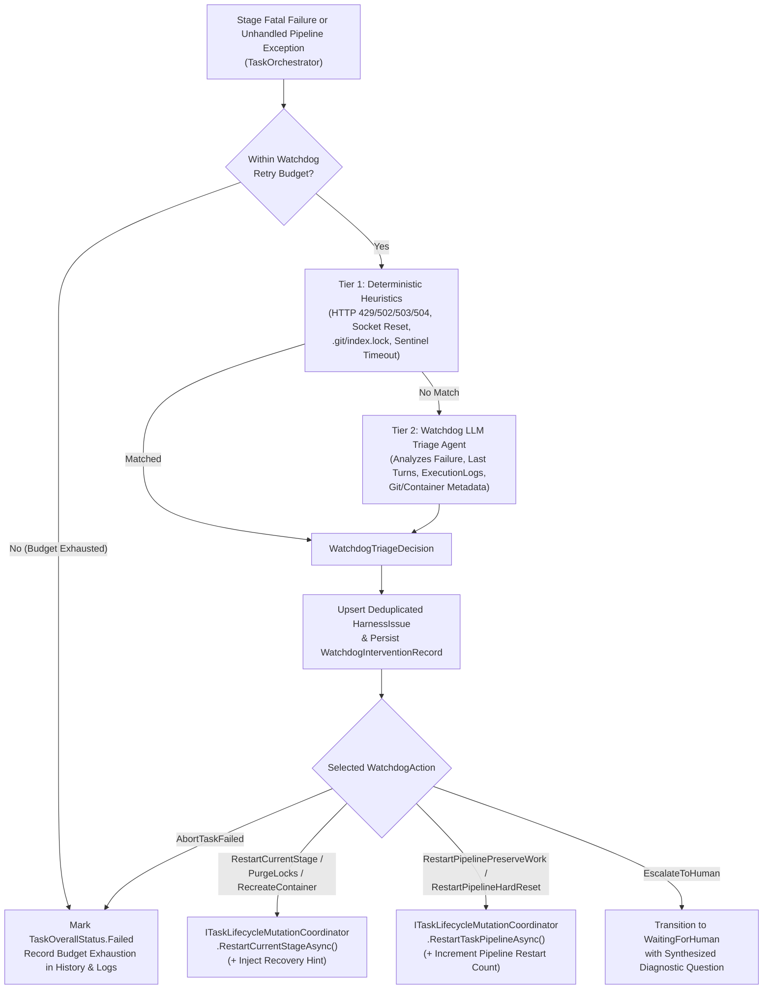

# 🐕 Step 12.34A: Autonomous Forge Watchdog — Harness Issue Ledger, Tiered Triage Engine & Orchestrator Failure Recovery

> **Feature & Resiliency Specification (Part 1 of 3 — Core Domain, Persistence, Tiered Triage & Orchestrator Hooks)**  
> *Parent Plan:* [Features & Integrations Roadmap](README.md)  
> *Companion Steps:* [Step 12.34B: Agent-Invocable Watchdog SOS Tool (`report_environment_issue`) & In-Flight Remediation](STEP_12_34B_AGENT_WATCHDOG_SOS_TOOL_AND_ENVIRONMENT_REMEDIATION.md) | [Step 12.34C: Watchdog Telemetry UI, Harness Issue Ledger (`/diagnostics/watchdog`) & Self-Improvement Task Promotion](STEP_12_34C_WATCHDOG_TELEMETRY_HARNESS_ISSUES_UI_AND_SELF_HEALING_BACKLOG.md)  
> *Related Steps:* [Step 11.38D: Orchestrator Decomposition](../archive/phase-11/STEP_11_38D_TASK_ORCHESTRATOR_DECOMPOSITION.md) | [Step 12.22A: Container Diagnostic Shell Service & Environment Doctor](STEP_12_22A_DIAGNOSTIC_SHELL_SERVICE_AND_CONTAINER_SIGINT_RECOVERY.md)  
> *Source Policy:* [AGENTS.md](../../AGENTS.md) | [docs/ARCHITECTURE.md](../ARCHITECTURE.md)  
> *Target Projects:* `src/NightCodeForge.Core`, `src/NightCodeForge.Infrastructure`, `src/NightCodeForge.Agents`, `src/NightCodeForge.Web`, `tests/NightCodeForge.Core.Tests`, `tests/NightCodeForge.Infrastructure.Tests`, `tests/NightCodeForge.Agents.Tests` | *Status:* Planned | *Target Framework:* .NET 10 (C# 13)

> This document is a **specification**: it states required behaviors and constraints, not implementations. Implementation choices (signatures, code structure) are left to the implementer, within the constraints of the documents.

---

## 1. Problem Statement & Motivation

In autonomous multi-stage runs, many task failures are caused not by impossible requirements, but by operational, environmental, or harness-level friction:
1. **Manual "Restart Stage" / "Restart Pipeline" Toil:** When a stage fails due to a transient LLM gateway hiccup, a container shell glitch, a lingering `.git/index.lock`, an empty/truncated model response, or an unrecovered worktree state, the task transitions to `TaskOverallStatus.Failed` and halts the DAG until a human inspects the logs and clicks **Retry Stage** or **Restart Pipeline**.
2. **Duplicated Stage-Retry Logic Across Layers:** Currently, `RestartTaskPipelineAsync` lives in [`ITaskLifecycleMutationCoordinator`](../../src/NightCodeForge.Core/Workflow/ITaskLifecycleMutationCoordinator.cs) / [`ITaskOrchestrator`](../../src/NightCodeForge.Core/Workflow/ITaskOrchestrator.cs), whereas `RetryCurrentStageAsync` is implemented directly inside [`DevQueueService`](../../src/NightCodeForge.Web/Services/DevQueueService.cs) in `NightCodeForge.Web`, preventing core orchestration services from triggering safe stage-level restarts with environment cleanup.
3. **Lost Harness Telemetry:** When agents or stages fail due to harness quirks (e.g., parser edge cases in [`QuestionItemParser`](../../src/NightCodeForge.Core/Domain/QuestionItemParser.cs), tool parameter schema mismatches, container mount drift, or recurring CLI timeouts), the root cause is buried in individual conversation transcripts rather than aggregated into an actionable engineering ledger to improve NightCodeForge itself.

---

## 2. Architecture & Execution Flow



---

## 3. Detailed Requirements & Specifications

### 3.1 Domain Models, Constants & Persistence (`NightCodeForge.Core` & `NightCodeForge.Infrastructure`)

1. **Audit Actor & Pipeline DataBag Keys:**
   - Add `public const string Watchdog = "Watchdog";` to [`AuditActors`](../../src/NightCodeForge.Core/Domain/AuditActors.cs).
   - Add named constants/helpers to [`PipelineDataBagKeys`](../../src/NightCodeForge.Core/Workflow/PipelineDataBagKeys.cs):
     - `WatchdogPipelineRestartCount = "watchdog.pipeline_restarts"`
     - `WatchdogRecoveryHint = "watchdog.recovery_hint"`
     - `WatchdogStageRestartCount(string stageId) => $"watchdog.stage_restarts.{stageId}"`
2. **Watchdog Enums & Domain Entities:**
   - `WatchdogTriggerSource`: `ReactiveStageFailure = 0`, `UnhandledPipelineException = 1`, `AgentEscalation = 2`, `ManualDiagnostic = 3`.
   - `WatchdogAction`:
     - `AbortTaskFailed = 0` (do not retry; let task fail permanently)
     - `RestartCurrentStage = 1` (re-enqueue current stage, preserving worktree)
     - `PurgeLocksAndRestartStage = 2` (purge `.git/index.lock` on host & mirror, then re-enqueue current stage)
     - `RecreateContainerAndRestartStage = 3` (teardown & recreate task sandbox container, purge locks, and re-enqueue current stage)
     - `RestartPipelinePreserveWork = 4` (restart from Stage 1 with `TaskRestartGitMode.PreserveWork`)
     - `RestartPipelineHardReset = 5` (restart from Stage 1 with `TaskRestartGitMode.HardResetToBaseBranch`)
     - `EscalateToHuman = 6` (pause task in `IsWaitingForHuman = true` with a diagnostic question when external human action is required)
   - `HarnessIssueCategory`:
     - `TransientProviderError = 0` (rate limits, 5xx gateway errors, network drops, model preload timeouts)
     - `EnvironmentState = 1` (missing SDK/tool, read-only filesystem violation, port conflict, hung process)
     - `ContainerDriftOrDeadlock = 2` (container stopped/unresponsive, sentinel timeout, broken bind mount)
     - `GitLockOrWorktreeCorruption = 3` (`.git/index.lock`, detached HEAD anomaly, worktree sync mismatch)
     - `ToolExecutionFailure = 4` (canonical tool bug, path translation error, skill script failure)
     - `OutputParsingFailure = 5` (malformed tool call JSON, `QuestionItemParser` failure, frontmatter sync error)
     - `PromptOrDirectiveAmbiguity = 6` (agent looping on contradictory stage directives or empty diff)
     - `QualityGateInfrastructure = 7` (test runner crash, coverage collector failure unrelated to code changes)
     - `TaskCodeOrRequirementFailure = 8` (genuine code/test defect or impossible requirement — not a harness bug)
   - `HarnessIssueSeverity`: `Info = 0`, `Warning = 1`, `High = 2`, `Critical = 3`.
   - `HarnessIssueStatus`: `Open = 0`, `Resolved = 1`, `Ignored = 2`, `PromotedToTask = 3`.
   - `HarnessIssue` entity (stored in `HarnessIssues` table in `AppDbContext`):
     - `Id` (`int`), `WorkspaceId` (`int?`), `Fingerprint` (`string`, indexed, max 128 — deterministic SHA-256 hash of `Category + ":" + Component + ":" + NormalizedSignature`), `Category` (`HarnessIssueCategory`), `Severity` (`HarnessIssueSeverity`), `Status` (`HarnessIssueStatus`), `Component` (`string`, max 128, e.g., `"QuestionItemParser"`, `"NightCodeForgeContainerExecutor"`, `"OllamaRouter"`, `"GitSubsystem"`), `Title` (`string`, max 512), `RootCauseAnalysis` (`string`), `SuggestedHarnessFix` (`string?`), `SampleDiagnosticSnippet` (`string?`), `OccurrenceCount` (`int`), `SuccessfulAutoRemediationCount` (`int`), `FirstSeenAt` (`DateTime`), `LastSeenAt` (`DateTime`), `LastTaskId` (`int?`), `LastStageId` (`string?`, max 128), `PromotedForgeTaskId` (`int?`).
   - `WatchdogInterventionRecord` entity (stored in `WatchdogInterventions` table in `AppDbContext`):
     - `Id` (`int`), `WorkspaceId` (`int`), `TaskId` (`int`), `StageId` (`string`, max 128), `TriggerSource` (`WatchdogTriggerSource`), `ActionTaken` (`WatchdogAction`), `UsedLlmTriage` (`bool`), `Rationale` (`string`), `RecoveryHint` (`string?`), `StageAttemptNumber` (`int`), `PipelineRestartNumber` (`int`), `HarnessIssueId` (`int?`, FK to `HarnessIssue`), `CreatedAt` (`DateTime`).
3. **Repository Contract (`IWatchdogRepository` or extensions on `ITaskRepository`):**
   - Persist `WatchdogInterventionRecord` and atomic upsert of `HarnessIssue` by `Fingerprint` (incrementing `OccurrenceCount`, updating `LastSeenAt`, `LastTaskId`, `LastStageId`, and refreshing `RootCauseAnalysis` / `SuggestedHarnessFix` when non-empty; re-opening `Status` to `Open` if previously `Resolved` and the issue recurs).
   - Provide methods to increment `SuccessfulAutoRemediationCount` on the linked `HarnessIssue` when a stage that was restarted by the Watchdog subsequently completes with `result.IsSuccess == true`.

---

### 3.2 Unified Administrative Stage & Pipeline Restart (`ITaskLifecycleMutationCoordinator` & `ITaskOrchestrator`)

1. **Promote `RestartCurrentStageAsync` to Core Orchestration:**
   - Add `RestartCurrentStageAsync` to [`ITaskLifecycleMutationCoordinator`](../../src/NightCodeForge.Core/Workflow/ITaskLifecycleMutationCoordinator.cs) and [`ITaskOrchestrator`](../../src/NightCodeForge.Core/Workflow/ITaskOrchestrator.cs):
     ```csharp
     Task<bool> RestartCurrentStageAsync(
         int taskId,
         StageRestartOptions? options = null,
         CancellationToken cancellationToken = default);
     ```
     where `StageRestartOptions` encapsulates:
     - `ChangedBy` (`string`, defaults to `AuditActors.User`)
     - `Reason` (`string?`)
     - `RecoveryHint` (`string?` — stored in `PipelineDataBagKeys.WatchdogRecoveryHint` and injected once into the next stage run's bootstrap prompt / `AgentSessionContext`, then cleared upon consumption)
     - `PurgeGitLocks` (`bool` — purges `.git/index.lock` in host and mirror paths)
     - `RecreateContainer` (`bool` — invokes `_workspacePreparer.CleanupTaskContainerSafeAsync` so the next stage run provisions a fresh container)
     - `PreserveWatchdogCounters` (`bool` — when `true`, preserves `watchdog.*` keys in `PipelineDataBag` across retry resets; when `false` on manual user retry, resets Watchdog counters so the user grants a fresh Watchdog budget)
   - Refactor [`DevQueueService.RetryCurrentStageAsync`](../../src/NightCodeForge.Web/Services/DevQueueService.cs) to delegate directly to `_taskOrchestrator.RestartCurrentStageAsync(taskId, ...)` instead of duplicating task lock, conversation superseding, and Hangfire enqueue logic in `NightCodeForge.Web`.
2. **Actor Attribution & Counter Preservation in `RestartTaskPipelineAsync`:**
   - Extend `RestartTaskPipelineAsync` (or add an overload accepting `changedBy`, `reasonOverride`, and `preserveWatchdogPipelineCounter`) so Watchdog-initiated pipeline restarts record `ChangedBy = AuditActors.Watchdog`, preserve `PipelineDataBagKeys.WatchdogPipelineRestartCount` (even across `TaskRestartGitMode.HardResetToBaseBranch`), and store any `WatchdogRecoveryHint`.
   - Manual user calls to `RestartTaskPipelineAsync` (`ChangedBy == AuditActors.User`) reset `WatchdogPipelineRestartCount` and `WatchdogStageRestartCount` to `0`.

---

### 3.3 Tiered Watchdog Triage Engine (`IForgeWatchdogService`)

1. **Configuration & Guardrails (`WatchdogOptions`):**
   - Configurable in `SystemSettings` / `config.json`:
     - `Enabled` (`bool`, default `true`)
     - `EnableDeterministicFastPath` (`bool`, default `true`)
     - `EnableLlmTriage` (`bool`, default `true`)
     - `MaxStageRestartsPerStage` (`int`, default `2`, range `0..5`)
     - `MaxPipelineRestartsPerTask` (`int`, default `1`, range `0..3`)
     - `ModelOverride` (`string?`, optional; defaults to workspace/global fast utility or ideation/chat profile)
     - `RoutingTarget` (`OllamaRoutingTarget`, default `OllamaRoutingTarget.Auto`)
2. **Strict Circuit Breakers (Preventing Infinite Loops):**
   - The Watchdog **must never** edit repository source files or test files.
   - Before recommending a stage restart (`RestartCurrentStage`, `PurgeLocksAndRestartStage`, `RecreateContainerAndRestartStage`), verify `StageRestartCount < MaxStageRestartsPerStage`.
   - Before recommending a pipeline restart (`RestartPipelinePreserveWork`, `RestartPipelineHardReset`), verify `PipelineRestartCount < MaxPipelineRestartsPerTask`.
   - If operations are globally paused (`_operationsControlService.IsPaused`) or task cancellation was explicitly requested by the user (`_lifecycleMutationCoordinator.IsCancelRequested(taskId)`), the Watchdog **must not** intervene.
3. **Tier 1: Deterministic Fast-Path Heuristics (`WatchdogHeuristicClassifier`):**
   - Evaluates failure messages, exception types, and stage outputs with zero LLM token cost:
     - **Transient LLM / HTTP / Gateway Outage:** HTTP `429`, `502`, `503`, `504`, `HttpRequestException`, socket reset, stream idle timeout (`11.49`), or OllamaRouter node preload timeout $\rightarrow$ `WatchdogAction.RestartCurrentStage` (`Category = TransientProviderError`).
     - **Dangling Git Lock Contention:** `.git/index.lock` / `Unable to create '.../index.lock': File exists` $\rightarrow$ `WatchdogAction.PurgeLocksAndRestartStage` (`Category = GitLockOrWorktreeCorruption`).
     - **Container Shell / Sentinel Deadlock:** Container sentinel drain timeout, `docker exec` pipe broken, or container not running $\rightarrow$ `WatchdogAction.RecreateContainerAndRestartStage` (`Category = ContainerDriftOrDeadlock`).
     - **Corrupted Worktree / Base Branch Sync Failure Prior to Implementation:** Worktree missing or broken `.git` gitdir link in early stages $\rightarrow$ `WatchdogAction.RestartPipelineHardReset` (if `MaxExecutedStageOrder <= 2` and no unmerged implementation commits exist) or `PurgeLocksAndRestartStage`.
4. **Tier 2: LLM Triage Agent (`ForgeWatchdogService`):**
   - Invoked when Tier 1 returns no match and `EnableLlmTriage == true` and at least one restart budget (stage or pipeline) remains (or to classify the `HarnessIssue` on novel failures).
   - Builds a compact, bounded diagnostic prompt containing:
     - Task metadata (`#Id`, `Title`, `CurrentStageId`, `StageKind`, `ExecutionMode`)
     - Current retry counts vs budgets (`StageRestartCount / MaxStageRestartsPerStage`, `PipelineRestartCount / MaxPipelineRestartsPerTask`)
     - Failure error message and exception summary
     - Tail of the last stage conversation (last 5 turns, truncated) and last 10 `ExecutionLog` entries
   - Requests a structured JSON response (`WatchdogTriageDecision`) containing:
     - `Action` (`WatchdogAction`)
     - `Rationale` (`string` — clear explanation for the audit log and UI)
     - `RecoveryHint` (`string?` — optional concise hint injected into the next agent attempt if restarting)
     - `IsHarnessOrEnvironmentIssue` (`bool`)
     - `IssueReport` (`HarnessIssueReport?` — `Category`, `Severity`, `Component`, `NormalizedSignature`, `Title`, `RootCauseAnalysis`, `SuggestedHarnessFix`, `SampleDiagnosticSnippet`)
   - **Fail-Safe Fallback:** If the LLM triage call itself fails or times out (e.g., 30-second timeout), log a warning and fall back to `WatchdogAction.AbortTaskFailed` so the orchestrator never hangs.

---

### 3.4 Orchestrator Integration (`TaskOrchestrator`)

1. **Hook in `HandleStageFatalFailureAsync` & Unhandled Exception Catch Block:**
   - In [`TaskOrchestrator`](../../src/NightCodeForge.Core/Workflow/TaskOrchestrator.cs), when a stage exhausts its normal conversational/loopback retries and enters `HandleStageFatalFailureAsync` (or when an unhandled non-cancellation exception occurs in `ProcessTaskAsync`), invoke `IForgeWatchdogService.TryRecoverTaskFailureAsync(...)` **whilst still holding or cleanly coordinating with the task lock**.
   - To respect the `AGENTS.md` $\le 10$ constructor parameter rule on `TaskOrchestrator` (which currently has 9 parameters), either encapsulate Watchdog failure delegation inside `ITaskLifecycleMutationCoordinator` or a cohesive collaborator so `TaskOrchestrator` never exceeds 10 constructor dependencies.
2. **Recovery Execution & Telemetry:**
   - When the Watchdog selects a restart action (`RestartCurrentStage`, `PurgeLocksAndRestartStage`, `RecreateContainerAndRestartStage`, `RestartPipelinePreserveWork`, `RestartPipelineHardReset`):
     - Increment the corresponding counter in `PipelineDataBag` (`WatchdogStageRestartCount(stageId)` or `WatchdogPipelineRestartCount`).
     - Store `WatchdogRecoveryHint` in `PipelineDataBag` if provided.
     - Broadcast an `AgentActivityEvent` (`AgentActivityKind.Notice`, metadata `["IsWatchdogIntervention"] = true`, `["WatchdogAction"] = decision.Action.ToString()`) via `IAgentActivityStreamer`.
     - Record an `ExecutionLog` entry (`LogLevel.Warning`) and `ForgeTaskHistory` entry (`ChangedBy = AuditActors.Watchdog`) detailing the Watchdog action, attempt number, and rationale.
     - Re-enqueue the target stage cleanly without leaving the task in `TaskOverallStatus.Failed`.
   - When a stage that has `WatchdogStageRestartCount(stageId) > 0` or `WatchdogPipelineRestartCount > 0` subsequently succeeds, notify `IForgeWatchdogService.RecordRemediationSuccessAsync(task.Id, stage.StageId, ct)` so the linked `HarnessIssue.SuccessfulAutoRemediationCount` is incremented.

---

## 4. Definition of Done (DoD) Checklist

- [ ] Add `AuditActors.Watchdog`, `PipelineDataBagKeys` Watchdog constants, `HarnessIssue`, `WatchdogInterventionRecord`, and associated enums (`WatchdogTriggerSource`, `WatchdogAction`, `HarnessIssueCategory`, `HarnessIssueSeverity`, `HarnessIssueStatus`) in `NightCodeForge.Core`.
- [ ] Configure `HarnessIssues` and `WatchdogInterventions` tables in `AppDbContext` and generate the EF Core migration in `NightCodeForge.Infrastructure`.
- [ ] Implement deterministic fingerprint calculation and atomic `HarnessIssue` upsert + `WatchdogInterventionRecord` persistence in the repository layer.
- [ ] Promote `RestartCurrentStageAsync` (with `StageRestartOptions`: lock purge, container recreation, recovery hint injection, and Watchdog counter preservation/reset) into `ITaskLifecycleMutationCoordinator` and `ITaskOrchestrator`, and refactor `DevQueueService.RetryCurrentStageAsync` to delegate to `ITaskOrchestrator`.
- [ ] Inject and consume `PipelineDataBagKeys.WatchdogRecoveryHint` in `TaskOrchestrator` / `AgentSessionContext` so restarted agentic stages receive the Watchdog's recovery hint.
- [ ] Implement `WatchdogHeuristicClassifier` (Tier 1 deterministic rules) and `ForgeWatchdogService` (Tier 2 LLM triage + circuit breakers) obeying the `AGENTS.md` $\le 10$ constructor parameter limit and no-silent-failure policy.
- [ ] Wire Watchdog reactive recovery into `TaskOrchestrator` failure handling and record remediation success when a restarted task/stage passes.
- [ ] Author unit and integration tests across `NightCodeForge.Core.Tests`, `NightCodeForge.Infrastructure.Tests`, and `NightCodeForge.Agents.Tests` verifying Tier 1 heuristics, Tier 2 LLM JSON parsing & fallback, retry budget enforcement, `HarnessIssue` deduplication, and end-to-end stage/pipeline auto-restart.

