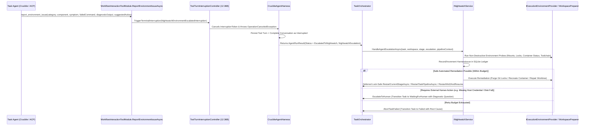

# 🆘 Step 12.34B: Agent-Invocable Nightwatch SOS Tool (`report_environment_issue`) & In-Flight Environment Remediation

> **Feature & Resiliency Specification (Part 2 of 3 — Agent SOS Tool, Interruption Protocol & Safe Environment Remediation)**  
> *Parent Plan:* [Features & Integrations Roadmap](README.md)  
> *Prerequisite Steps:* [Step 12.36A: Declarative Sandbox Mount Table & Container Lifecycle Redesign](STEP_12_36A_DECLARATIVE_SANDBOX_MOUNT_TABLE_AND_CONTAINER_LIFECYCLE_REDESIGN.md) | [Step 12.36B: `CanonicalTools` Modular Decomposition & Interruption Pipeline](STEP_12_36B_CANONICAL_TOOLS_MODULAR_DECOMPOSITION_AND_INTERRUPTION_PIPELINE.md) | [Step 12.34A: Autonomous Nightwatch — Harness Issue Ledger, Tiered Triage Engine & Orchestrator Failure Recovery](STEP_12_34A_NIGHTWATCH_DOMAIN_LEDGER_AND_ORCHESTRATOR_REACTIVE_TRIAGE.md)  
> *Companion Step:* [Step 12.34C: Nightwatch Telemetry UI, Harness Issue Ledger (`/diagnostics/nightwatch`) & Self-Improvement Task Promotion](STEP_12_34C_NIGHTWATCH_TELEMETRY_HARNESS_ISSUES_UI_AND_SELF_HEALING_BACKLOG.md)  
> *Related Steps:* [Step 10.4: Crucible Interactive `ask` Tool](../archive/phase-10/STEP_10_4_CRUCIBLE_INTERACTIVE_ASK_TOOL.md) | [Step 12.22A: Container Diagnostic Shell Service & Environment Doctor](STEP_12_22A_DIAGNOSTIC_SHELL_SERVICE_AND_CONTAINER_SIGINT_RECOVERY.md)  
> *Source Policy:* [AGENTS.md](../../AGENTS.md) | [docs/ARCHITECTURE.md](../ARCHITECTURE.md)  
> *Target Projects:* `src/NightCodeForge.Core`, `src/NightCodeForge.Infrastructure`, `src/NightCodeForge.Agents`, `tests/NightCodeForge.Core.Tests`, `tests/NightCodeForge.Agents.Tests` | *Status:* Planned | *Target Framework:* .NET 10 (C# 13)

> This document is a **specification**: it states required behaviors and constraints, not implementations. Implementation choices (signatures, code structure) are left to the implementer, within the constraints of the documents.

---

## 1. Problem Statement & Motivation

When an autonomous coding or review agent encounters an **environment or harness failure** mid-stage—such as:
- A broken or missing SDK / companion CLI (`dotnet`, `csnav`, `mdfetch`, `codecondenser`, `git`) inside the container or WSL2 environment,
- A dangling `.git/index.lock` or corrupted git worktree link (`gitdir: /workspace/clone/.git/worktrees/...`),
- A wedged background process or locked file/port inside the task container,
- A read-only mount violation or broken bind mount, or
- A canonical tool malfunction (e.g., `edit` or `bash` failing due to path mapping or encoding bugs),

the agent currently has only two bad options:
1. **Burn tokens in a loop** trying hacky bash workarounds, modifying files it shouldn't touch, or hallucinating explanations until it hits the turn/token cap.
2. **Call `ask` to bother the human user** for an operational problem that NightCodeForge itself can fix automatically (e.g., recreating the container, purging locks, or restarting the stage).

Giving agents a dedicated **`report_environment_issue`** ("Nightwatch SOS") tool allows them to immediately halt the current turn and hand off structured diagnostics to **Nightwatch** ([Step 12.34A](STEP_12_34A_NIGHTWATCH_DOMAIN_LEDGER_AND_ORCHESTRATOR_REACTIVE_TRIAGE.md)) for automated environment remediation and harness issue tracking.

---

## 2. Architecture & Interruption Lifecycle

---

## 3. Detailed Requirements & Specifications

### 3.1 Canonical Tool Definition (`report_environment_issue`)

1. **Tool Identifier & Whitelisting:**
   - Add `public const string ReportEnvironmentIssue = "report_environment_issue";` to [`CanonicalToolNames`](../../src/NightCodeForge.Core/Domain/CanonicalToolNames.cs) and include it in `CanonicalToolNames.All`.
   - Include `CanonicalToolNames.ReportEnvironmentIssue` in [`DefaultAgentTools.ReadOnly`](../../src/NightCodeForge.Core/Domain/DefaultAgentTools.cs), `DefaultAgentTools.Ideation`, `DefaultAgentTools.Full`, and `DefaultAgentTools.Review` so both autonomous Crucible task agents and interactive Ideation agents can report environment issues to Nightwatch.
2. **Tool Signature & Schema (`WorkflowInteractionToolModule` & `NightCodeForgeToolDispatcher`):**
   - Extend `WorkflowInteractionToolModule` ([Step 12.36B](STEP_12_36B_CANONICAL_TOOLS_MODULAR_DECOMPOSITION_AND_INTERRUPTION_PIPELINE.md)) and `NightCodeForgeToolDispatcher` parameter/alias mappings with `ReportEnvironmentIssueAsync`:
     - `category` (`string`, required): One of `"environment_state"`, `"container_drift"`, `"git_worktree"`, `"tool_failure"`, `"missing_sdk_or_binary"`, `"network_or_service"`, `"other"`.
     - `component` (`string`, required): The tool, binary, or subsystem that failed (e.g., `"dotnet"`, `"git"`, `"csnav"`, `"bash"`, `"edit"`, `"container_fs"`).
     - `symptom` (`string`, required): Concise description of the environment or harness issue encountered.
     - `failedCommand` (`string?`, optional): The exact command or tool call that triggered the failure.
     - `diagnosticOutput` (`string?`, optional): Relevant stdout/stderr or error message snippet (bounded to 4,000 characters).
     - `suggestedAction` (`string?`, optional): Agent's suggested remediation (`"recreate_container"`, `"purge_git_locks"`, `"restart_stage"`, `"restart_pipeline"`, `"escalate_to_human"`).
3. **Dual-Mode Interruption vs. In-Place Remediation (`Crucible` vs. `Ideation` Synergy via [Step 12.36B](STEP_12_36B_CANONICAL_TOOLS_MODULAR_DECOMPOSITION_AND_INTERRUPTION_PIPELINE.md)):**
   - Validate that `symptom` and `component` are non-empty (returning an in-tool validation error message if blank so the model can correct the call), and construct a `NightwatchEscalationPayload` domain record.
   - **Mode A — Crucible Task Execution (`ToolTurnInterruptionController` Turn-Unwinding Mode):**
     - Define `NightwatchEnvironmentEscalatedInterruption(NightwatchEscalationPayload Payload) : ToolTurnInterruption`.
     - When no in-place remediation handler is configured, `WorkflowInteractionToolModule.ReportEnvironmentIssueAsync` invokes `InterruptionController.TriggerTerminalInterruption(new NightwatchEnvironmentEscalatedInterruption(payload))` so `FunctionInvokingChatClient` cleanly aborts the tool loop without swallowing the signal as a tool error string.
     - In `CrucibleAgentHarness`'s unified `catch (OperationCanceledException)` handler, when `InterruptionController.CapturedInterruption is NightwatchEnvironmentEscalatedInterruption escalated`, invokes `CompleteWithNightwatchEscalationAsync(escalated.Payload)` to persist the `StageTurnRole.Tool` and `StageTurnRole.ToolResult` (`"Escalated environment issue to Nightwatch."`) turns in `CrucibleConversationState`, mark the conversation as `StageExecutionStatus.Interrupted`, and return `AgentRunResult` with `AgentRunStatus.EscalatedToNightwatch` and the attached `NightwatchEscalationPayload`.
   - **Mode B — Interactive Ideation (`IIdeationConversationCoordinator` In-Place Self-Healing, [Step 12.31](STEP_12_31_INTERACTIVE_IDEATION_AGENT_COORDINATOR_AND_WARM_EXECUTION_CONTEXT.md)):**
     - In interactive Ideation sessions, `IIdeationConversationCoordinator` configures `WorkflowInteractionToolModule`'s in-place `ReportEnvironmentIssueHandler` to invoke `INightwatchService.TryRemediateIdeationEnvironmentAsync(workspace, payload, ct)` **in-place without ending the turn**:
       - Records the `HarnessIssue` and `NightwatchInterventionRecord` (`TriggerSource = NightwatchTriggerSource.IdeationEscalation`, `ActionTaken = NightwatchAction.RemediateIdeationEnvironment`, `TaskId = null`), recreates/repairs the read-only `-ro` container or purges read locks, refreshes the warm session's `IExecutionEnvironment`, and returns a structured tool result string (`"Nightwatch repaired the read-only execution environment (...). You may retry your command now."`) so the Ideation Agent continues answering the user seamlessly.

---

### 3.2 System Prompt & Tool Directive Guidance

1. **Agent Directive Injection:**
   - Add a clear, concise instruction in the tool description / Layer 1 system prompt whenever `report_environment_issue` is permitted:
     - **When to call `report_environment_issue`:** Missing or broken compilers/SDKs (`dotnet`, `node`, `python`, `git`), corrupted `.git` worktree metadata or lingering `index.lock` files that cannot be removed, broken container mounts or read-only filesystem errors on writable paths, unresponsive container shell state, or internal harness tool bugs.
     - **When NOT to call `report_environment_issue`:** Normal compilation errors or unit test failures caused by the task's code changes (which the agent must fix itself), or functional requirement ambiguities (which must use `ask`).

---

### 3.3 Nightwatch In-Flight Environment Probe & Remediation (`INightwatchService`)

1. **Environment Health Verification & Unified Nightwatch Toolset:**
   - When `TaskOrchestrator` receives `AgentRunStatus.EscalatedToNightwatch` (or catches `NightwatchEscalationException`), it invokes `INightwatchService.HandleAgentEscalationAsync(...)`.
   - `NightwatchService` runs fast deterministic environment checks first and, when deeper diagnosis is needed, launches the tool-equipped Nightwatch Agent rooted at `/nightcodeforge/` ([Step 12.34A §3.3](STEP_12_34A_NIGHTWATCH_DOMAIN_LEDGER_AND_ORCHESTRATOR_REACTIVE_TRIAGE.md)) with read-only access to `/nightcodeforge/{wks,ncf-config,ncf-logs,router-logs}`, `query_database`, and the Nightwatch administrative tools:
     - Checks whether `.git/index.lock` or worktree `.git` lock files exist on the host repository, ext4 mirror, or task worktree.
     - Checks whether the task's worktree directory and `.git` pointer file exist and are valid.
     - In `ContainerSandbox` mode, checks whether the task container is running, whether mounts match expected configuration, and (once [Step 12.22A](STEP_12_22A_DIAGNOSTIC_SHELL_SERVICE_AND_CONTAINER_SIGINT_RECOVERY.md) is present, or via a lightweight probe command) verifies `$HOME`, `/tmp`, and `/workspace` writability.
2. **Safe Administrative Remediation Actions (Immediate & Deferred Terminal):**
   - Based on the agent's `NightwatchEscalationPayload`, the environment probe findings, and the remaining retry budget (`MaxStageRestartsPerStage` / `MaxPipelineRestartsPerTask` / `MaxWsl2RestartsPerHour`), Nightwatch executes one of:
     - **Container Recreation + Stage Restart (`NightwatchAction.RecreateContainerAndRestartStage` / `restart_container` + `restart_stage`):** Destroys and recreates the task's sandbox container (`CleanupTaskContainerSafeAsync`), purges any git locks, records a `RecoveryHint` (instructions explaining that the container was freshly recreated), and restarts the current stage.
     - **Git Lock Purge / Worktree Repair + Stage Restart (`NightwatchAction.PurgeLocksAndRestartStage` / `purge_git_locks` + `restart_stage`):** Purges dangling `.git/index.lock` files across host/mirror/worktree, verifies worktree branch checkout via `PrepareTaskBranchAndMirrorAsync`, and restarts the current stage with optional recovery instructions.
     - **Full Pipeline Restart (`NightwatchAction.RestartPipelinePreserveWork` or `NightwatchAction.RestartPipelineHardReset` / `restart_workflow`):** If the worktree is irrecoverably corrupted before implementation changes were committed, resets the worktree to `BaseBranch` and restarts from Stage 1 with optional recovery instructions.
     - **Deferred WSL2 Host Restart (`NightwatchAction.RestartWsl2AndResume` / `restart_wsl2`):** If the WSL2 VM or Docker daemon inside WSL2 is wedged/unresponsive and within `MaxWsl2RestartsPerHour` (with no other concurrent task or Ideation turn running), closes the Nightwatch turn first, persists the `HarnessIssue` and `NightwatchInterventionRecord` in SQLite on the Windows host, executes `wsl --shutdown` from the host process, waits for WSL2/Docker readiness, and restarts the stage.
     - **Escalate to Human (`NightwatchAction.EscalateToHuman` / `escalate_to_human`):** If the issue cannot be fixed by container/git/WSL2/stage reset (e.g., host disk full, missing external resource, or Nightwatch retry budgets are exhausted), transitions the task to `IsWaitingForHuman = true` with a synthesized `Question` summarizing the agent's report, Nightwatch's probe results, and recommended maintainer options (`"Retry stage after fixing host environment"`, `"Recreate container and retry"`, `"Abort task"`).
3. **Mandatory Harness Issue Recording:**
   - Every agent SOS invocation (`TriggerSource = NightwatchTriggerSource.AgentEscalation`) **must** create or increment a `HarnessIssue` in SQLite (with the agent's `component`, `symptom`, `failedCommand`, and `diagnosticOutput`) and link it to a `NightwatchInterventionRecord`, providing direct visibility into environment pain points experienced by agents.

---

## 4. Definition of Done (DoD) Checklist

- [ ] Add `CanonicalToolNames.ReportEnvironmentIssue` (`"report_environment_issue"`) and register it in `DefaultAgentTools` (`ReadOnly`, `Ideation`, `Full`, `Review`) for both task execution and interactive Ideation sessions.
- [ ] Define `NightwatchEscalationPayload`, `NightwatchEnvironmentEscalatedInterruption : ToolTurnInterruption`, and `AgentRunStatus.EscalatedToNightwatch`.
- [ ] Implement `ReportEnvironmentIssueAsync` in `WorkflowInteractionToolModule` ([Step 12.36B](STEP_12_36B_CANONICAL_TOOLS_MODULAR_DECOMPOSITION_AND_INTERRUPTION_PIPELINE.md)) and register aliases in `NightCodeForgeToolDispatcher`, supporting both Mode A (`ToolTurnInterruptionController` turn unwinding for Crucible stages) and Mode B (in-place `TryRemediateIdeationEnvironmentAsync` handler for `IIdeationConversationCoordinator` warm sessions).
- [ ] Update `CrucibleAgentHarness` (and `AcpAgentHarness` where applicable) to handle `NightwatchEnvironmentEscalatedInterruption`, persist the tool call & tool result turns in the conversation, mark the conversation `Interrupted`, and return `AgentRunResult` with `AgentRunStatus.EscalatedToNightwatch`.
- [ ] Implement `INightwatchService.HandleAgentEscalationAsync` and `TryRemediateIdeationEnvironmentAsync` performing environment/lock/worktree probes, recording the `HarnessIssue` and `NightwatchInterventionRecord`, and executing container recreation, lock purging, deferred stage/pipeline/WSL2 restart, in-place `-ro` container repair, or human escalation within configured retry budgets.
- [ ] Wire lock-safe `AgentRunStatus.EscalatedToNightwatch` handling in `TaskOrchestrator.ProcessTaskAsync` (coordinating terminal restarts without self-deadlocking on the task lock, per [Step 12.34A §3.4](STEP_12_34A_NIGHTWATCH_DOMAIN_LEDGER_AND_ORCHESTRATOR_REACTIVE_TRIAGE.md)).
- [ ] Add unit and integration tests in `NightCodeForge.Core.Tests` and `NightCodeForge.Agents.Tests` verifying `report_environment_issue` invocation in `WorkflowInteractionToolModule`, `ToolTurnInterruptionController` unwinding in `CrucibleAgentHarness`, in-place Ideation `-ro` environment self-healing, Nightwatch escalation handling (including `restart_wsl2` deferral), and fallback to `WaitingForHuman` when budgets are exhausted.

