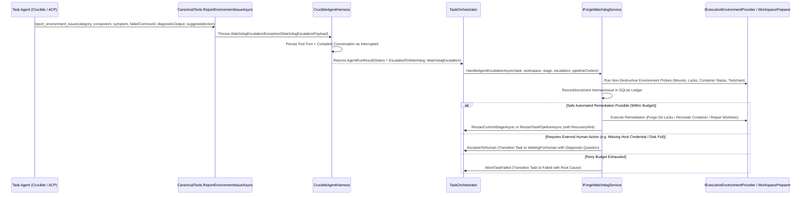

# 🆘 Step 12.34B: Agent-Invocable Watchdog SOS Tool (`report_environment_issue`) & In-Flight Environment Remediation

> **Feature & Resiliency Specification (Part 2 of 3 — Agent SOS Tool, Interruption Protocol & Safe Environment Remediation)**  
> *Parent Plan:* [Features & Integrations Roadmap](README.md)  
> *Prerequisite Step:* [Step 12.34A: Autonomous Forge Watchdog — Harness Issue Ledger, Tiered Triage Engine & Orchestrator Failure Recovery](STEP_12_34A_WATCHDOG_DOMAIN_LEDGER_AND_ORCHESTRATOR_REACTIVE_TRIAGE.md)  
> *Companion Step:* [Step 12.34C: Watchdog Telemetry UI, Harness Issue Ledger (`/diagnostics/watchdog`) & Self-Improvement Task Promotion](STEP_12_34C_WATCHDOG_TELEMETRY_HARNESS_ISSUES_UI_AND_SELF_HEALING_BACKLOG.md)  
> *Related Steps:* [Step 10.4: Crucible Interactive `ask` Tool](../archive/phase-10/STEP_10_4_CRUCIBLE_INTERACTIVE_ASK_TOOL.md) | [Step 12.22A: Container Diagnostic Shell Service & Environment Doctor](STEP_12_22A_DIAGNOSTIC_SHELL_SERVICE_AND_CONTAINER_SIGINT_RECOVERY.md)  
> *Source Policy:* [AGENTS.md](../../AGENTS.md) | [docs/ARCHITECTURE.md](../ARCHITECTURE.md)  
> *Target Projects:* `src/NightCodeForge.Core`, `src/NightCodeForge.Infrastructure`, `src/NightCodeForge.Agents`, `tests/NightCodeForge.Core.Tests`, `tests/NightCodeForge.Agents.Tests` | *Status:* Planned | *Target Framework:* .NET 10 (C# 13)

> This document is a **specification**: it states required behaviors and constraints, not implementations. Implementation choices (signatures, code structure) are left to the implementer, within the constraints of the documents.

---

## 1. Problem Statement & Motivation

When an autonomous coding or review agent encounters an **environment or harness failure** mid-stage—such as:
- A broken or missing SDK / companion CLI (`dotnet`, `csnav`, `mdfetch`, `codecondenser`, `git`) inside the container or WSL2 environment,
- A dangling `.git/index.lock` or corrupted git worktree link (`gitdir: /workspace/clone/.git/worktrees/...`),
- A wedged background process or locked file/port inside the task container,
- A read-only mount violation or broken bind mount, or
- A canonical tool malfunction (e.g., `edit` or `bash` failing due to path mapping or encoding bugs),

the agent currently has only two bad options:
1. **Burn tokens in a loop** trying hacky bash workarounds, modifying files it shouldn't touch, or hallucinating explanations until it hits the turn/token cap.
2. **Call `ask` to bother the human user** for an operational problem that NightCodeForge itself can fix automatically (e.g., recreating the container, purging locks, or restarting the stage).

Giving agents a dedicated **`report_environment_issue`** ("Watchdog SOS") tool allows them to immediately halt the current turn and hand off structured diagnostics to the **Forge Watchdog** ([Step 12.34A](STEP_12_34A_WATCHDOG_DOMAIN_LEDGER_AND_ORCHESTRATOR_REACTIVE_TRIAGE.md)) for automated environment remediation and harness issue tracking.

---

## 2. Architecture & Interruption Lifecycle

---

## 3. Detailed Requirements & Specifications

### 3.1 Canonical Tool Definition (`report_environment_issue`)

1. **Tool Identifier & Whitelisting:**
   - Add `public const string ReportEnvironmentIssue = "report_environment_issue";` to [`CanonicalToolNames`](../../src/NightCodeForge.Core/Domain/CanonicalToolNames.cs) and include it in `CanonicalToolNames.All`.
   - Include `CanonicalToolNames.ReportEnvironmentIssue` in [`DefaultAgentTools.ReadOnly`](../../src/NightCodeForge.Core/Domain/DefaultAgentTools.cs), `DefaultAgentTools.Full`, and `DefaultAgentTools.Review` (excluding `DefaultAgentTools.Ideation` or gating activation in `CanonicalAIFunctionFactory` to task-scoped sessions where `Scope.TaskId is > 0`).
2. **Tool Signature & Schema (`CanonicalTools` & `CanonicalAIFunctionFactory`):**
   - Expose `ReportEnvironmentIssueAsync` on [`CanonicalTools`](../../src/NightCodeForge.Agents/Tools/CanonicalTools.cs):
     - `category` (`string`, required): One of `"environment_state"`, `"container_drift"`, `"git_worktree"`, `"tool_failure"`, `"missing_sdk_or_binary"`, `"network_or_service"`, `"other"`.
     - `component` (`string`, required): The tool, binary, or subsystem that failed (e.g., `"dotnet"`, `"git"`, `"csnav"`, `"bash"`, `"edit"`, `"container_fs"`).
     - `symptom` (`string`, required): Concise description of the environment or harness issue encountered.
     - `failedCommand` (`string?`, optional): The exact command or tool call that triggered the failure.
     - `diagnosticOutput` (`string?`, optional): Relevant stdout/stderr or error message snippet (bounded to 4,000 characters).
     - `suggestedAction` (`string?`, optional): Agent's suggested remediation (`"recreate_container"`, `"purge_git_locks"`, `"restart_stage"`, `"restart_pipeline"`, `"escalate_to_human"`).
3. **Immediate Turn Interruption (`WatchdogEscalationException`):**
   - Similar to [`HumanInterruptionException`](../../src/NightCodeForge.Core/Exceptions/HumanInterruptionException.cs) for the `ask` tool:
     - Validate that `symptom` and `component` are non-empty (returning an in-tool validation error message if blank so the model can correct the call).
     - Construct a `WatchdogEscalationPayload` domain record and throw `WatchdogEscalationException(payload)`.
     - Ensure `CrucibleAgentHarness` (and `LenientToolDispatcher`) does **not** swallow `WatchdogEscalationException` as a generic tool error string; instead, persist the `StageTurnRole.Tool` and `StageTurnRole.ToolResult` (`"Escalated environment issue to Forge Watchdog."`) turns in SQLite, mark the conversation as `StageExecutionStatus.Interrupted`, and return `AgentRunResult` with `AgentRunStatus.EscalatedToWatchdog` and the attached `WatchdogEscalationPayload`.

---

### 3.2 System Prompt & Tool Directive Guidance

1. **Agent Directive Injection:**
   - Add a clear, concise instruction in the tool description / Layer 1 system prompt whenever `report_environment_issue` is permitted:
     - **When to call `report_environment_issue`:** Missing or broken compilers/SDKs (`dotnet`, `node`, `python`, `git`), corrupted `.git` worktree metadata or lingering `index.lock` files that cannot be removed, broken container mounts or read-only filesystem errors on writable paths, unresponsive container shell state, or internal harness tool bugs.
     - **When NOT to call `report_environment_issue`:** Normal compilation errors or unit test failures caused by the task's code changes (which the agent must fix itself), or functional requirement ambiguities (which must use `ask`).

---

### 3.3 Watchdog In-Flight Environment Probe & Remediation (`IForgeWatchdogService`)

1. **Environment Health Verification Before Remediation:**
   - When `TaskOrchestrator` receives `AgentRunStatus.EscalatedToWatchdog` (or catches `WatchdogEscalationException`), it invokes `IForgeWatchdogService.HandleAgentEscalationAsync(...)`.
   - Before deciding on an action, `ForgeWatchdogService` performs fast, non-destructive host/environment checks on the task's workspace and container:
     - Checks whether `.git/index.lock` or worktree `.git` lock files exist on the host repository, ext4 mirror, or task worktree.
     - Checks whether the task's worktree directory and `.git` pointer file exist and are valid.
     - In `ContainerSandbox` mode, checks whether the task container is running, whether mounts match expected configuration, and (once [Step 12.22A](STEP_12_22A_DIAGNOSTIC_SHELL_SERVICE_AND_CONTAINER_SIGINT_RECOVERY.md) is present, or via a lightweight probe command) verifies `$HOME`, `/tmp`, and `/workspace` writability.
2. **Safe Administrative Remediation Actions:**
   - Based on the agent's `WatchdogEscalationPayload`, the environment probe findings, and the remaining retry budget (`MaxStageRestartsPerStage` / `MaxPipelineRestartsPerTask`), the Watchdog executes one of:
     - **Container Recreation + Stage Restart (`WatchdogAction.RecreateContainerAndRestartStage`):** Destroys the task's sandbox container (`CleanupTaskContainerSafeAsync`), purges any git locks, records a `RecoveryHint` explaining that the container was freshly recreated, and restarts the current stage.
     - **Git Lock Purge / Worktree Repair + Stage Restart (`WatchdogAction.PurgeLocksAndRestartStage`):** Purges dangling `.git/index.lock` files across host/mirror/worktree, verifies worktree branch checkout via `PrepareTaskBranchAndMirrorAsync`, and restarts the current stage.
     - **Full Pipeline Restart (`WatchdogAction.RestartPipelinePreserveWork` or `RestartPipelineHardReset`):** If the worktree is irrecoverably corrupted before implementation changes were committed, resets the worktree to `BaseBranch` and restarts from Stage 1.
     - **Escalate to Human (`WatchdogAction.EscalateToHuman`):** If the issue cannot be fixed by container/git/stage reset (e.g., host disk full, missing external resource, or Watchdog stage retry budget is already exhausted), transitions the task to `IsWaitingForHuman = true` with a synthesized `Question` summarizing the agent's report, the Watchdog's probe results, and recommended maintainer options (`"Retry stage after fixing host environment"`, `"Recreate container and retry"`, `"Abort task"`).
3. **Mandatory Harness Issue Recording:**
   - Every agent SOS invocation (`TriggerSource = WatchdogTriggerSource.AgentEscalation`) **must** create or increment a `HarnessIssue` in SQLite (with the agent's `component`, `symptom`, `failedCommand`, and `diagnosticOutput`) and link it to a `WatchdogInterventionRecord`, providing direct visibility into environment pain points experienced by agents.

---

## 4. Definition of Done (DoD) Checklist

- [ ] Add `CanonicalToolNames.ReportEnvironmentIssue` (`"report_environment_issue"`) and register it in `DefaultAgentTools` (`ReadOnly`, `Full`, `Review`) for task execution sessions.
- [ ] Define `WatchdogEscalationPayload`, `WatchdogEscalationException`, and `AgentRunStatus.EscalatedToWatchdog` in `NightCodeForge.Core`.
- [ ] Implement `CanonicalTools.ReportEnvironmentIssueAsync` and wire it in `CanonicalAIFunctionFactory` and `NightCodeForgeToolDispatcher` so calling `report_environment_issue` throws `WatchdogEscalationException` without being swallowed as a normal string tool result.
- [ ] Update `CrucibleAgentHarness` (and `AcpAgentHarness` where applicable) to catch `WatchdogEscalationException`, persist the tool call & tool result turns in the conversation, mark the conversation `Interrupted`, and return `AgentRunResult` with `AgentRunStatus.EscalatedToWatchdog`.
- [ ] Implement `IForgeWatchdogService.HandleAgentEscalationAsync` performing environment/lock/worktree probes, recording the `HarnessIssue` and `WatchdogInterventionRecord`, and executing container recreation, lock purging, stage/pipeline restart, or human escalation within configured retry budgets.
- [ ] Wire `AgentRunStatus.EscalatedToWatchdog` / `WatchdogEscalationException` handling in `TaskOrchestrator.ProcessTaskAsync`.
- [ ] Add unit and integration tests in `NightCodeForge.Core.Tests` and `NightCodeForge.Agents.Tests` verifying `report_environment_issue` tool invocation, turn unwinding in `CrucibleAgentHarness`, Watchdog escalation handling, container recreation trigger, and fallback to `WaitingForHuman` when budgets are exhausted.

