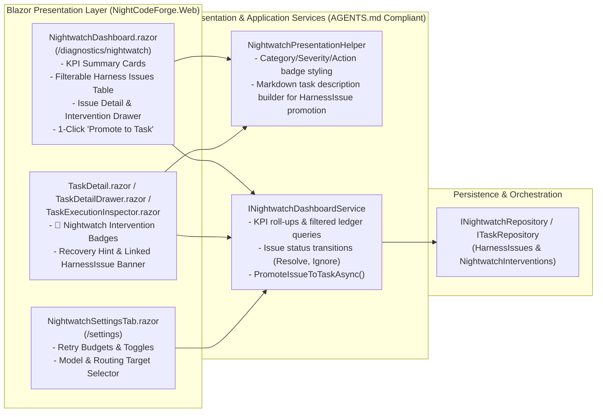

# 📊 Step 12.34C: Nightwatch Telemetry UI, Harness Issue Ledger (`/diagnostics/nightwatch`) & Self-Improvement Task Promotion

> **Feature & Developer Ergonomics Specification (Part 3 of 3 — Web UI Dashboard, Settings, Timeline Badges & Self-Healing Backlog Loop)**  
> *Parent Plan:* [Features & Integrations Roadmap](README.md)  
> *Prerequisite Steps:* [Step 12.34A: Autonomous Nightwatch — Harness Issue Ledger, Tiered Triage Engine & Orchestrator Failure Recovery](STEP_12_34A_NIGHTWATCH_DOMAIN_LEDGER_AND_ORCHESTRATOR_REACTIVE_TRIAGE.md) | [Step 12.34B: Agent-Invocable Nightwatch SOS Tool (`report_environment_issue`) & In-Flight Remediation](STEP_12_34B_AGENT_NIGHTWATCH_SOS_TOOL_AND_ENVIRONMENT_REMEDIATION.md)  
> *Related Steps:* [Step 12.13B: "Refine in Ideation" Workflow & Mutation UI](../archive/phase-12/STEP_12_13B_REFINE_IN_IDEATION_WORKFLOW_AND_MUTATION_UI.md) | [Step 12.22B: Interactive Container Diagnostic Bash Console Web UI (`/diagnostics/shell`)](STEP_12_22B_DIAGNOSTIC_BASH_CONSOLE_WEB_UI.md)  
> *Source Policy:* [AGENTS.md](../../AGENTS.md) | [docs/ARCHITECTURE.md](../ARCHITECTURE.md)  
> *Target Projects:* `src/NightCodeForge.Core`, `src/NightCodeForge.Infrastructure`, `src/NightCodeForge.Web`, `tests/NightCodeForge.Web.Tests`, `tests/NightCodeForge.Acceptance.Tests` | *Status:* Planned | *Target Framework:* .NET 10 (C# 13)

> This document is a **specification**: it states required behaviors and constraints, not implementations. Implementation choices (signatures, code structure) are left to the implementer, within the constraints of the documents.

---

## 1. Executive Objective

Once Nightwatch ([Step 12.34A](STEP_12_34A_NIGHTWATCH_DOMAIN_LEDGER_AND_ORCHESTRATOR_REACTIVE_TRIAGE.md)) and the Agent SOS tool ([Step 12.34B](STEP_12_34B_AGENT_NIGHTWATCH_SOS_TOOL_AND_ENVIRONMENT_REMEDIATION.md)) are collecting structured `HarnessIssue` and `NightwatchInterventionRecord` telemetry, maintainers need:
1. **Transparency on Autonomous Interventions:** Clear visual indicators on `TaskDetail.razor`, `TaskDetailDrawer.razor`, `TaskExecutionInspector.razor`, and `/monitoring` whenever Nightwatch restarts a stage, resets a pipeline, recreates a container, or purges locks—so autonomous administrative actions are never silent.
2. **A Dedicated Harness Issue Ledger & Triage UI (`/diagnostics/nightwatch`):** A central dashboard aggregating recurring harness, container, parser, and provider issues ranked by frequency and severity, showing root-cause analysis and auto-remediation success rates.
3. **Closing the Self-Improvement Loop (1-Click Task Creation):** The ability to turn any recurring `HarnessIssue` into a structured `ForgeTask` (or open it in Ideation Chat) with one click so NightCodeForge can be used to fix its own harness bugs.
4. **Nightwatch Governance Settings (`NightwatchSettingsTab.razor`):** UI controls in `/settings` to tune retry budgets, toggle Tier 1 / Tier 2 triage, and select the Nightwatch LLM model/routing target.

---

## 2. UI & Service Architecture

---

## 3. Detailed Requirements & Specifications

### 3.1 Presentation Separation & Service Contracts (`AGENTS.md` Compliance)

1. **`NightwatchPresentationHelper` (`NightCodeForge.Web/Services` or `NightCodeForge.Core`):**
   - Pure, stateless helper class (unit-testable without UI rendering context) providing:
     - Human-readable labels, icons, and CSS badge classes for `HarnessIssueCategory`, `HarnessIssueSeverity`, `HarnessIssueStatus`, `NightwatchAction`, and `NightwatchTriggerSource`.
     - `BuildTaskProposalFromHarnessIssue(HarnessIssue issue, IReadOnlyList<NightwatchInterventionRecord> recentInterventions)`: Generates a structured markdown task title and description (Problem Statement, Component, Root Cause Analysis, Diagnostic Snippet, Occurrence Statistics, and Suggested Harness Fix) ready to be saved as a `ForgeTask`.
2. **`INightwatchDashboardService`:**
   - Provides UI-ready snapshots and mutations:
     - `GetDashboardSnapshotAsync(int? workspaceId = null, HarnessIssueStatus? statusFilter = null, HarnessIssueCategory? categoryFilter = null, CancellationToken ct = default)` returning:
       - `NightwatchKpiSummary`: `TotalInterventionsCount`, `AutoRecoveredStagesCount`, `AutoRestartedPipelinesCount`, `OpenHarnessIssuesCount`, `CriticalOrHighIssuesCount`, `SelfHealingSuccessRatePercent`.
       - `IReadOnlyList<HarnessIssueSummaryItem>`: Ordered by `Status == Open` first, then `Severity DESC`, `OccurrenceCount DESC`, `LastSeenAt DESC`.
       - `IReadOnlyList<NightwatchInterventionSummaryItem>`: Recent Nightwatch actions across tasks with links to `/tasks/{taskId}` and `/inspector/{taskId}`.
     - `GetIssueDetailAsync(int harnessIssueId, CancellationToken ct = default)`: Returns the `HarnessIssue` and its linked `NightwatchInterventionRecord` history.
     - `UpdateIssueStatusAsync(int harnessIssueId, HarnessIssueStatus newStatus, CancellationToken ct = default)`: Marks an issue as `Resolved`, `Ignored`, or re-opens it to `Open`.
     - `PromoteIssueToTaskAsync(int harnessIssueId, int targetWorkspaceId, TaskOverallStatus initialStatus = TaskOverallStatus.Suggested, int priority = TaskPriority.Normal, CancellationToken ct = default)`: Creates a `ForgeTask` (`CreatedBy = AuditActors.Nightwatch`) using `NightwatchPresentationHelper.BuildTaskProposalFromHarnessIssue`, links `HarnessIssue.PromotedForgeTaskId = createdTask.Id`, sets `HarnessIssue.Status = HarnessIssueStatus.PromotedToTask`, syncs the task markdown to disk, notifies `IIdeationConversationCoordinator` ([Step 12.31](STEP_12_31_INTERACTIVE_IDEATION_AGENT_COORDINATOR_AND_WARM_EXECUTION_CONTEXT.md)) to refresh the warm backlog digest for `targetWorkspaceId`, and returns the created `ForgeTask.Id`.
     - **Closed-Loop Auto-Resolution (`Crucible` $\rightarrow$ `Nightwatch` Synergy):** When a promoted `ForgeTask` (`HarnessIssue.PromotedForgeTaskId == task.Id`) transitions to `TaskOverallStatus.Closed` upon Crucible pipeline merge completion, automatically transition the linked `HarnessIssue.Status` from `PromotedToTask` to `HarnessIssueStatus.Resolved` (and if the same `Fingerprint` ever recurs on a future run, [Step 12.34A](STEP_12_34A_NIGHTWATCH_DOMAIN_LEDGER_AND_ORCHESTRATOR_REACTIVE_TRIAGE.md) automatically re-opens it to `Open`).
     - `ManualInvokeNightwatchOnTaskAsync(int taskId, CancellationToken ct = default)`: Allows a maintainer to manually trigger Nightwatch triage on a `Failed` task from the UI.

---

### 3.2 Nightwatch & Harness Issue Ledger Page (`/diagnostics/nightwatch`)

1. **Navigation & Routing:**
   - Add `NightwatchDashboard.razor` at route `/diagnostics/nightwatch` (and link it from the sidebar navigation / `/monitoring` header with an open high-severity issue count badge if $> 0$).
2. **KPI Header Cards:**
   - Display 4 metric cards:
     - **🦉 Total Nightwatch Interventions** (with breakdown of Tier 1 heuristic vs Tier 2 LLM triage).
     - **♻️ Auto-Recovered Runs** (count of Nightwatch-restarted stages/pipelines that subsequently passed, plus Self-Healing Success Rate %).
     - **⚠️ Open Harness Issues** (with count of `High` / `Critical` severity items).
     - **🛠️ Promoted to Tasks** (count of harness issues converted into backlog tasks).
3. **Filterable Harness Issues Table & Detail Drawer:**
   - Filter bar by Workspace (`All` or specific workspace), `Status` (`Open`, `PromotedToTask`, `Resolved`, `Ignored`), `Category`, and `Severity`.
   - Table columns: `Severity`, `Category`, `Component`, `Title`, `Occurrences` (`N×`), `Auto-Healed` (`M / N`), `Last Seen` (with link to last affected `Task #ID`), `Status`, and quick actions.
   - Clicking a row opens the **Harness Issue Detail Drawer** displaying:
     - Full `RootCauseAnalysis`, `SuggestedHarnessFix`, and formatted `SampleDiagnosticSnippet`.
     - Chronological list of linked `NightwatchInterventionRecord` items (Task `#ID`, Stage, Trigger Source, Action Taken, Rationale).
     - Action buttons:
       - **➕ Promote to Backlog Task** (select target workspace and `Suggested` vs `Open`, or navigate to `/tasks/{PromotedForgeTaskId}` if already promoted).
       - **💡 Refine in Ideation** (navigates to `/w/{wsId}/ideation?taskId={PromotedForgeTaskId}` after creating a `Suggested` task).
       - **✅ Mark Resolved** / **🔇 Ignore** / **🔄 Reopen**.
4. **Recent Nightwatch Interventions Feed:**
   - A secondary tab or panel on `/diagnostics/nightwatch` listing recent `NightwatchInterventionRecord` events across the forge so maintainers can audit every automatic stage restart, pipeline reset, lock purge, or container recreation.

---

### 3.3 Task Detail, Inspector & Settings Integration

1. **Task Detail & Inspector Nightwatch Timeline / Banner:**
   - In [`TaskDetail.razor`](../../src/NightCodeForge.Web/Components/Pages/TaskDetail.razor), [`TaskDetailDrawer.razor`](../../src/NightCodeForge.Web/Components/Backlog/TaskDetailDrawer.razor), and [`TaskExecutionInspector.razor`](../../src/NightCodeForge.Web/Components/Monitoring/TaskExecutionInspector.razor):
     - Render a `🦉 Nightwatch` badge on stages/tasks that have recorded `NightwatchInterventionRecord` entries.
     - Display a collapsible **Nightwatch Interventions** section showing each intervention's timestamp, trigger (`Reactive Failure` vs `Agent SOS`), action taken, rationale, injected recovery hint, and a clickable link to the associated `HarnessIssue` in `/diagnostics/nightwatch?issueId={id}`.
     - On `Failed` tasks where the Nightwatch budget was exhausted (or Nightwatch was disabled), provide a **🦉 Ask Nightwatch to Triage & Recover** button alongside `Retry Stage` and `Restart Pipeline`.
2. **Global Nightwatch Settings Tab (`NightwatchSettingsTab.razor`):**
   - Register a **🦉 Nightwatch** tab in [`Settings.razor`](../../src/NightCodeForge.Web/Components/Pages/Settings.razor) backed by `INightwatchSettingsService` ([Step 12.34A](STEP_12_34A_NIGHTWATCH_DOMAIN_LEDGER_AND_ORCHESTRATOR_REACTIVE_TRIAGE.md)) allowing maintainers to configure `NightwatchOptions`:
     - Enable/disable Autonomous Nightwatch (`Enabled`).
     - Enable/disable Tier 1 Deterministic Fast-Path (`EnableDeterministicFastPath`) and Tier 2 LLM Triage (`EnableLlmTriage`).
     - Configure circuit-breaker budgets: `MaxStageRestartsPerStage` (`0..5`, default `2`), `MaxPipelineRestartsPerTask` (`0..3`, default `1`), and `MaxWsl2RestartsPerHour` (`0..3`, default `1`).
     - Configure Nightwatch sandbox `ExecutionMode` (`ContainerSandbox`, `WslDirect`, `BareHost`) and optional virtual mount paths (`OllamaLogsDirectoryPath` and `NightCodeForgeRepositoryPath`).
     - Configure optional `ModelOverride` and `RoutingTarget` (`Auto`, `Local`, `Remote`, `Cloud`) for Tier 2 LLM triage.

---

## 4. Definition of Done (DoD) Checklist

- [ ] Implement `NightwatchPresentationHelper` and `INightwatchDashboardService` (`NightwatchDashboardService`) keeping all formatting, aggregation, and markdown task generation out of `.razor` `@code` blocks in accordance with [AGENTS.md](../../AGENTS.md).
- [ ] Build `NightwatchDashboard.razor` (`/diagnostics/nightwatch`) with KPI summary cards, filterable Harness Issues table, Issue Detail & Intervention history drawer, and 1-click **Promote to Backlog Task** / **Refine in Ideation** actions (plus closed-loop auto-resolution when promoted tasks close).
- [ ] Surface Nightwatch intervention badges, rationale/recovery-hint banners, and deep links to `/diagnostics/nightwatch` in `TaskDetail.razor`, `TaskDetailDrawer.razor`, and `TaskExecutionInspector.razor`.
- [ ] Build `NightwatchSettingsTab.razor` and register it in `Settings.razor` to manage `NightwatchOptions` via `INightwatchSettingsService` (`AppDbContext.SystemSettings`).
- [ ] Author unit tests for `NightwatchPresentationHelper` and `NightwatchDashboardService`, bUnit component tests for `NightwatchDashboard.razor` and `NightwatchSettingsTab.razor` in `NightCodeForge.Web.Tests`, and an LLM-free Playwright E2E test in `NightCodeForge.Acceptance.Tests` verifying `/diagnostics/nightwatch` filtering, issue status updates, and 1-click promotion of a `HarnessIssue` into a backlog `ForgeTask`.

