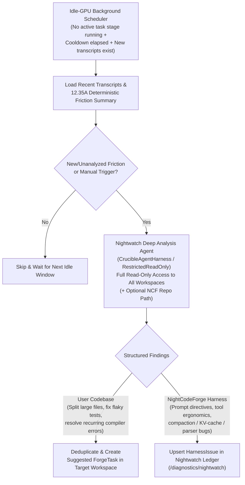

# 🦉 Step 12.35B: Idle-GPU Nightwatch Deep Transcript & Workspace Analysis (Replacing Legacy AI Diagnostics)

> **Feature & Autonomous Improvement Specification (Part 2 of 2 — Idle-GPU Nightwatch Analyzer & Legacy Diagnostic Removal)**  
> *Parent Plan:* [Features & Integrations Roadmap](README.md)  
> *Prerequisite Steps:* [Step 12.36A: Declarative Sandbox Mount Table & Container Lifecycle Redesign](../archive/phase-12/STEP_12_36A_DECLARATIVE_SANDBOX_MOUNT_TABLE_AND_CONTAINER_LIFECYCLE_REDESIGN.md) | [Step 12.36B: `CanonicalTools` Modular Decomposition & Interruption Pipeline](../archive/phase-12/STEP_12_36B_CANONICAL_TOOLS_MODULAR_DECOMPOSITION_AND_INTERRUPTION_PIPELINE.md) | [Step 12.34A: Autonomous Nightwatch — Harness Issue Ledger & Tiered Triage](STEP_12_34A_NIGHTWATCH_DOMAIN_LEDGER_AND_ORCHESTRATOR_REACTIVE_TRIAGE.md) | [Step 12.34C: Nightwatch Telemetry UI & Harness Issue Ledger (`/diagnostics/nightwatch`)](STEP_12_34C_NIGHTWATCH_TELEMETRY_HARNESS_ISSUES_UI_AND_SELF_HEALING_BACKLOG.md) | [Step 12.35A: Deterministic Transcript Friction Categorization & Recent-Session Windowing](../archive/phase-12/STEP_12_35A_TRANSCRIPT_FRICTION_CATEGORIZATION_AND_RECENT_WINDOW.md)  
> *Source Policy:* [AGENTS.md](../../AGENTS.md) | [docs/ARCHITECTURE.md](../ARCHITECTURE.md)  
> *Target Projects:* `src/NightCodeForge.Core`, `src/NightCodeForge.Infrastructure`, `src/NightCodeForge.Agents`, `src/NightCodeForge.Web`, `tests/NightCodeForge.Agents.Tests`, `tests/NightCodeForge.Web.Tests` | *Status:* Planned | *Target Framework:* .NET 10 (C# 13)

> This document is a **specification**: it states required behaviors and constraints, not implementations. Implementation choices (signatures, code structure) are left to the implementer, within the constraints of the documents.

---

## 1. Problem Statement & Motivation

Currently, `Session Transcripts` includes an on-demand **AI Diagnostics** modal (`DiagnosticsModal.razor` + `TranscriptDiagnosticService.cs` + `TranscriptBrowserService.RunDiagnosticsAsync`) that runs a single-turn LLM prompt over a single transcript without access to the workspace codebase. This has two major drawbacks:

1. **Shallow, Ungrounded Diagnostics:** Without read-only access to the workspace files referenced in the transcript, the diagnostic model can only guess at why edits failed, why a file caused churn, or why a compiler/test error kept recurring.
2. **Wasted Idle GPU Capacity & Siloed Workflow:** Between active task runs, the local GPU/LLM sits idle. Instead of requiring a human to manually click "AI Diagnostics" on individual transcripts, **Nightwatch** can use idle GPU windows to deeply analyze recent transcripts (within the recency cap from [Step 12.35A](../archive/phase-12/STEP_12_35A_TRANSCRIPT_FRICTION_CATEGORIZATION_AND_RECENT_WINDOW.md)), inspect the actual workspace files in read-only mode, and route concrete improvement proposals into the right backlog.

---

## 2. Architecture & Execution Flow

---

## 3. Detailed Requirements & Specifications

### 3.1 Idle-GPU Nightwatch Deep Analysis Service (`INightwatchIdleAnalysisService`)

1. **Idle Detection & Preemption Guardrails (`Crucible` & `Ideation` Priority Synergy):**
   - Run as a periodic background check (or Hangfire recurring job) that triggers a deep analysis pass **only when**:
     - `NightwatchOptions.EnableIdleTranscriptAnalysis` is `true` and global operations are not paused (`!_operationsControlService.IsPaused`).
     - Zero task stages are currently executing in the orchestrator / active worker queue **and** no interactive Ideation turn or warm-up is active (`!_ideationCoordinator.HasActiveTurn` from [Step 12.31](STEP_12_31_INTERACTIVE_IDEATION_AGENT_COORDINATOR_AND_WARM_EXECUTION_CONTEXT.md)).
     - The configured cooldown (`IdleAnalysisCooldownMinutes`, e.g. default `60`) has elapsed since the last pass, and at least one new/modified transcript exists within the recent window (`IdleAnalysisMaxTranscripts`, default from `TranscriptAnalysisDefaults.DefaultRecentLimit`).
   - Use a `CancellationToken` linked to **both** orchestrator task-start events **and** `IIdeationConversationCoordinator.OnTurnActivityChanged` so that if either a Crucible task stage or an interactive Ideation turn starts while an idle analysis pass is running, the idle pass yields/cancels immediately and releases its router session affinity rather than competing for the GPU.
2. **Manual Trigger Support:**
   - Expose `RunDeepAnalysisAsync(int? workspaceId = null, string? focusTranscriptFileName = null, CancellationToken ct = default)` so maintainers can also trigger a Nightwatch deep analysis on demand from `/transcripts` or `/diagnostics/nightwatch`.

---

### 3.2 Unified `/nightcodeforge/` Read-Only Root, Database & Backlog Tools

1. **Unified `/nightcodeforge/` Virtual Root & Read-Only Toolset ([Step 12.34A §3.3](STEP_12_34A_NIGHTWATCH_DOMAIN_LEDGER_AND_ORCHESTRATOR_REACTIVE_TRIAGE.md) & [Step 12.36A](../archive/phase-12/STEP_12_36A_DECLARATIVE_SANDBOX_MOUNT_TABLE_AND_CONTAINER_LIFECYCLE_REDESIGN.md)):**
   - When executing the Nightwatch deep analysis agent, provision the shared `/nightcodeforge/` Nightwatch Virtual Root (`SandboxSecurityTier.RestrictedReadOnly`, `IsReadOnly = true`) granting **read-only access to all workspaces (`/nightcodeforge/wks/`), sanitized NCF config snapshot (`/nightcodeforge/ncf-config/` with secrets redacted), NCF logs (`/nightcodeforge/ncf-logs/`), OllamaRouter/Ollama logs (`/nightcodeforge/router-logs/`), and optional NCF source (`/nightcodeforge/ncf-source/`)** via `SandboxMountTable` and `ISandboxPathResolver` (Docker `-v ...:/nightcodeforge/<subpath>:ro` bind mounts, Host C# path resolution in `ReadAsync`, and WSL2 command path rewriting, with zero on-disk symlinks), while strictly forbidding any file writes, edits, git mutations, or destructive shell commands.
   - Available tools for the Nightwatch Idle Deep Analysis Agent (`NightwatchSystemToolModule`):
     - `read` and restricted read-only `bash` (`rg`, `grep`, `find`, `head`, `tail`, `git status`, `git log`, `git diff`, `csnav`) rooted at `/nightcodeforge/`.
     - `query_database(sql, limit = 100)`: In-process C# read-only SQLite tool (`Mode=ReadOnly`, `PRAGMA query_only = ON`, `SELECT`/`WITH`/`EXPLAIN`/`PRAGMA table_info` only, **with `SystemSettings` table access denied** per [Step 12.34A §3.3.4](STEP_12_34A_NIGHTWATCH_DOMAIN_LEDGER_AND_ORCHESTRATOR_REACTIVE_TRIAGE.md)) to correlate transcript friction with `ForgeTasks`, `Conversations`, `ConversationTurns`, `StageExecutions`, `ExecutionLogs`, and existing `HarnessIssues`.
     - `propose_workspace_task(workspace_id, title, description, rationale, affected_files, evidence_transcripts, priority?)`: Creates a deduplicated `TaskOverallStatus.Suggested` `ForgeTask` (`CreatedBy = AuditActors.Nightwatch`) in the target workspace.
     - `record_harness_issue(category, severity, component, normalized_signature, title, root_cause, suggested_fix, diagnostic_snippet?)`: Upserts a deduplicated `HarnessIssue` into the Nightwatch ledger (`/diagnostics/nightwatch`).
   - Pre-seed the agent's initial context with the structured **Step 12.35A** deterministic fleet & per-session friction summary (high-friction/split-candidate files, failing tools, failing/hanging bash commands, top compiler error codes) and the `<database_schema>` summary so the agent immediately knows which files, logs, and tables to inspect.

---

### 3.3 Dual-Routed Tool-Driven Actionable Outputs

Rather than relying on fragile post-run JSON fence parsing (which would double-count findings already persisted via tool calls), the Nightwatch Idle Deep Analysis Agent records its actionable findings **exclusively through the two dedicated `NightwatchSystemToolModule` persistence tools**, separating findings cleanly into two destinations:

1. **User Codebase Improvement Suggestions (`propose_workspace_task` $\rightarrow$ `Suggested` `ForgeTask`s):**
   - Each codebase finding targets a specific `WorkspaceId` and includes `Title`, `Rationale`, `AffectedFiles`, `EvidenceTranscripts`, and a concrete `TaskDescription` (e.g., splitting an oversized file causing repeated edit churn, fixing a recurring build/test failure).
   - **Deduplication & Ideation Cache Refresh:** Compute a deterministic fingerprint (or match against existing non-closed tasks / recorded suggestion fingerprints) inside `propose_workspace_task` before creating a `ForgeTask` in `TaskOverallStatus.Suggested` with `CreatedBy = AuditActors.Nightwatch` (and syncing to `docs/tasks/`), preventing duplicate suggestions across consecutive idle runs. Notify `IIdeationConversationCoordinator` ([Step 12.31](STEP_12_31_INTERACTIVE_IDEATION_AGENT_COORDINATOR_AND_WARM_EXECUTION_CONTEXT.md)) when new `Suggested` tasks are created so any warm Ideation session for that workspace refreshes its `<existing_workspace_tasks>` digest.
2. **NightCodeForge Harness & Prompt Improvements (`record_harness_issue` $\rightarrow$ `HarnessIssue` Ledger):**
   - Records a `NightwatchInterventionRecord` (`TriggerSource = NightwatchTriggerSource.IdleTranscriptAnalysis`, `TaskId = null`) and upserts each NightCodeForge finding once into `HarnessIssues` via `INightwatchRepository` with its deterministic `Fingerprint`, `Category`, `Component`, `RootCauseAnalysis`, `SuggestedHarnessFix`, and `SampleDiagnosticSnippet`, making it immediately visible in `/diagnostics/nightwatch` for review and 1-click promotion to a backlog task (or **💡 Refine in Ideation**).

---

### 3.4 Clean-Break Replacement of Legacy AI Diagnostics

Per the `AGENTS.md` Clean Break policy, remove the legacy single-transcript AI Diagnostic modal and service:

1. **Removals:**
   - Remove `src/NightCodeForge.Agents/Transcripts/TranscriptDiagnosticService.cs` (`TranscriptDiagnosticService` and `TranscriptDiagnosis`) and its DI registration in `NightCodeForge.Agents/ServiceCollectionExtensions.cs`.
   - Remove `src/NightCodeForge.Web/Components/Transcripts/DiagnosticsModal.razor`.
   - Remove `RunDiagnosticsAsync`, `ApplyRemediationAsync`, `ConvertDiagnosisToReport`, `GenerateHeuristicReport`, and `CloneAndSetFlag` from `ITranscriptBrowserService` / `TranscriptBrowserService` (along with the now-unused `IGlobalOptimizationSettingsService`, `IServiceScopeFactory`, and `ILlmChatClientFactory` constructor parameters on `TranscriptBrowserService`), and remove `DiagnosticReport` and `RemediationSuggestion` from `TranscriptModels.cs`.
2. **UI Replacement (`Transcripts.razor` & `NightwatchDashboard.razor`):**
   - In `Transcripts.razor`, replace the **🧠 AI Diagnostics** button with **🦉 Analyze with Nightwatch** (invoking `INightwatchIdleAnalysisService.RunDeepAnalysisAsync` focused on the active workspace / selected transcript) and a quick link to **Nightwatch Ledger (`/diagnostics/nightwatch`)** when issues or suggested tasks were produced.
   - In `NightwatchSettingsTab.razor` ([Step 12.34C](STEP_12_34C_NIGHTWATCH_TELEMETRY_HARNESS_ISSUES_UI_AND_SELF_HEALING_BACKLOG.md)), add configuration controls for:
     - `EnableIdleTranscriptAnalysis` (`bool`, default `true`)
     - `IdleAnalysisCooldownMinutes` (`int`, default `60`)
     - `IdleAnalysisMaxTranscripts` (`int`, default `50`)
     - `NightCodeForgeRepositoryPath` (`string?`, optional read-only path for NCF self-inspection)

---

## 4. Definition of Done (DoD) Checklist

- [ ] Extend `NightwatchOptions` and `NightwatchTriggerSource` (`IdleTranscriptAnalysis`) for idle-GPU transcript & workspace analysis.
- [ ] Implement `INightwatchIdleAnalysisService` with idle-orchestrator detection, preemption on active task start, recent-transcript windowing, and multi-workspace `RestrictedReadOnly` tool access.
- [ ] Route Nightwatch findings via `propose_workspace_task` and `record_harness_issue` tool calls into deduplicated `TaskOverallStatus.Suggested` `ForgeTask`s for user codebases and `HarnessIssue` upserts for NightCodeForge improvements.
- [ ] Remove legacy `TranscriptDiagnosticService`, `DiagnosticsModal.razor`, `DiagnosticReport`, and `RunDiagnosticsAsync`, and replace the trigger in `Transcripts.razor` with Nightwatch deep analysis + `/diagnostics/nightwatch` navigation.
- [ ] Add idle-analysis settings to `NightwatchSettingsTab.razor` and cover scheduling, preemption, read-only boundary enforcement, deduplication, and UI updates with unit/component tests.

