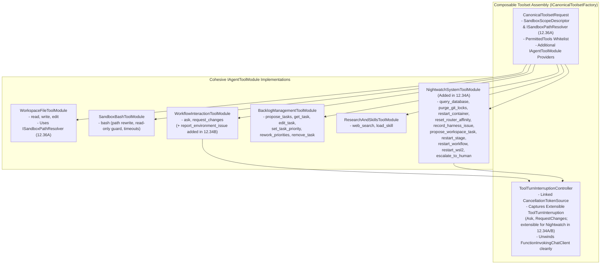

# 🧰 Step 12.36B: `CanonicalTools` Modular Decomposition, Composable Tool Modules & Unified Interruption Pipeline

> **Architecture & Foundation Refactoring Specification (Part 2 of 2 — Modular Tool Architecture & Turn Interruption Control)**  
> *Parent Plan:* [Features & Integrations Roadmap](README.md)  
> *Prerequisite Step:* [Step 12.36A: Declarative Sandbox Mount Table, Async Environment Provisioning & Container Lifecycle Redesign](STEP_12_36A_DECLARATIVE_SANDBOX_MOUNT_TABLE_AND_CONTAINER_LIFECYCLE_REDESIGN.md)  
> *Unblocks & De-Risks:* [Step 12.31: Interactive Ideation Coordinator](STEP_12_31_INTERACTIVE_IDEATION_AGENT_COORDINATOR_AND_WARM_EXECUTION_CONTEXT.md) | [Step 12.34A: Nightwatch Ledger & Triage Toolset](STEP_12_34A_NIGHTWATCH_DOMAIN_LEDGER_AND_ORCHESTRATOR_REACTIVE_TRIAGE.md) | [Step 12.34B: Agent Nightwatch SOS Tool](STEP_12_34B_AGENT_NIGHTWATCH_SOS_TOOL_AND_ENVIRONMENT_REMEDIATION.md) | [Step 12.35B: Nightwatch Idle Deep Analysis](STEP_12_35B_NIGHTWATCH_IDLE_DEEP_ANALYSIS_AND_LEGACY_DIAGNOSTIC_REPLACEMENT.md) | [Step 12.2B: Agent Attachment Tools](STEP_12_2B_AGENT_ATTACHMENT_TOOLS_AND_PROMPT_DIGEST.md)  
> *Source Policy:* [AGENTS.md](../../AGENTS.md) | [docs/ARCHITECTURE.md](../ARCHITECTURE.md)  
> *Target Projects:* `src/NightCodeForge.Core`, `src/NightCodeForge.Agents`, `tests/NightCodeForge.Core.Tests`, `tests/NightCodeForge.Agents.Tests` | *Status:* Planned | *Target Framework:* .NET 10 (C# 13)

> This document is a **specification**: it states required behaviors and constraints, not implementations. Implementation choices (signatures, code structure) are left to the implementer, within the constraints of the documents.

---

## 1. Problem Statement & Motivation

In `NightCodeForge.Agents`, [`CanonicalTools.cs`](../../src/NightCodeForge.Agents/Tools/CanonicalTools.cs) (1,242 lines) and [`CanonicalAIFunctionFactory.cs`](../../src/NightCodeForge.Agents/Tools/CanonicalAIFunctionFactory.cs) (271 lines) have grown into a god-object that mixes unrelated responsibilities and fragile control-flow hacks:

1. **Everything Lives in One 1,242-Line Class:**
   - File I/O (`ReadAsync`, `WriteAsync`, `EditAsync`), fuzzy indentation matching, `.editorconfig` formatting, shell command rewriting (`BashAsync`), interactive human questioning (`AskAsync`), code review rejection (`RequestChanges`), backlog task proposal parsing (`ProposeTasksAsync`), 5 database backlog mutation tools (`GetTaskAsync`, `EditTaskAsync`, `SetTaskPriorityAsync`, `ReworkPrioritiesAsync`, `RemoveTaskAsync`), web search (`WebSearchAsync`), and skill loading (`LoadSkillAsync`) are all methods on `CanonicalTools`.
   - Adding new agent-specific tools—such as Nightwatch's `query_database`, `restart_stage`, `restart_workflow`, `restart_container`, `restart_wsl2`, `purge_git_locks`, or `report_environment_issue` ([Step 12.34A/B](STEP_12_34A_NIGHTWATCH_DOMAIN_LEDGER_AND_ORCHESTRATOR_REACTIVE_TRIAGE.md))—would push `CanonicalTools` past 2,000 lines and couple database/orchestrator administrative dependencies into every standard coding agent session.
2. **Fragile `interruptionCts` Exception-Unwinding Duplication:**
   - Because `Microsoft.Extensions.AI.FunctionInvokingChatClient` catches all non-`OperationCanceledException` exceptions thrown inside `AIFunction` delegates and converts them into tool error strings, [`CrucibleAgentHarness`](../../src/NightCodeForge.Agents/Crucible/CrucibleAgentHarness.cs) currently wires ad-hoc mutable delegates (`canonicalTools.AskHandler = ...`, `canonicalTools.RequestChangesHandler = ...`) that set local variables (`capturedInterruption`, `capturedRequestChanges`), cancel `interruptionCts`, and throw `OperationCanceledException(interruptionCts.Token)`.
   - With **Nightwatch SOS (`report_environment_issue`)** and **Nightwatch Terminal Remediation Tools (`restart_stage`, `restart_workflow`, `restart_wsl2`, `escalate_to_human`, `abort_task_failed`)**, we need a single, reusable **`IToolTurnInterruptionController`** that cleanly unwinds `FunctionInvokingChatClient` whenever any tool signals a terminal turn transition—or executes an in-place handler when running in interactive Ideation mode.

---

## 2. Target Architecture



---

## 3. Detailed Requirements & Specifications

### 3.1 Modular Tool Architecture (`IAgentToolModule`)

1. **`IAgentToolModule` Contract:**
   - Define a clean module interface in `NightCodeForge.Agents.Tools`:
     ```csharp
     public interface IAgentToolModule
     {
         IReadOnlyList<AIFunction> CreateFunctions();
     }
     ```
2. **Decompose `CanonicalTools` into 5 Core Modules:**
   - **`WorkspaceFileToolModule`:** Encapsulates `read`, `write`, and `edit` (including `FuzzyIndentationMatcher`, `ReadOutputFormatter`, `.editorconfig` application, and `ITaskMarkdownValidator` cycle checks), delegating all path resolution and virtual mount / read-only boundary checks to `ISandboxPathResolver` ([Step 12.36A](STEP_12_36A_DECLARATIVE_SANDBOX_MOUNT_TABLE_AND_CONTAINER_LIFECYCLE_REDESIGN.md)).
   - **`SandboxBashToolModule`:** Encapsulates `bash` execution, `/workspace` and virtual-mount command path translation, `ReadOnlyCommandValidator`, build/test timeout escalation, and `StructuredDiagnosticExtractor`.
   - **`WorkflowInteractionToolModule`:** Encapsulates `ask` (`QuestionItemParser`) and `request_changes` (and is extended with `report_environment_issue` in [Step 12.34B](STEP_12_34B_AGENT_NIGHTWATCH_SOS_TOOL_AND_ENVIRONMENT_REMEDIATION.md)).
   - **`BacklogManagementToolModule`:** Encapsulates `propose_tasks` (`PendingProposals`) and the 5 host-level backlog mutation tools (`get_task`, `edit_task`, `set_task_priority`, `rework_priorities`, `remove_task`).
   - **`ResearchAndSkillsToolModule`:** Encapsulates `web_search` and `load_skill`.
   - **Per-Invocation DI Scope Hygiene for Warm Sessions:** Because `CanonicalToolsetSession` is cached across turns in warm Ideation sessions ([Step 12.31](STEP_12_31_INTERACTIVE_IDEATION_AGENT_COORDINATOR_AND_WARM_EXECUTION_CONTEXT.md)), `BacklogManagementToolModule` (`IBacklogMutationToolService`) and `WorkspaceFileToolModule` (`ITaskMarkdownValidator`) must resolve `IServiceScope` (and thus `ITaskRepository` / `AppDbContext`) **per tool invocation** via `IServiceScopeFactory` rather than capturing a single scoped `AppDbContext` instance when `CanonicalToolsetSession` is constructed.
   - Keep a thin facade or composition root on `CanonicalToolsetSession` so existing callers (`CrucibleAgentHarness`, `IdeationConversationCoordinator`, `NightCodeForgeToolDispatcher` / `LenientToolDispatcher`) access `PendingProposals`, `SkillsService`, `AITools`, and `InterruptionController` cleanly without breaking constructor parameter limits ($\le 10$ per `AGENTS.md`).
3. **Extensibility for System Agents (Nightwatch):**
   - `CanonicalToolsetRequest` supports non-workspace scopes (`Workspace? Workspace` when using `SandboxScopeDescriptor` from [Step 12.36A](STEP_12_36A_DECLARATIVE_SANDBOX_MOUNT_TABLE_AND_CONTAINER_LIFECYCLE_REDESIGN.md)) and accepts optional additional `IReadOnlyList<IAgentToolModule> AdditionalModules` so `NightwatchService` ([Step 12.34A](STEP_12_34A_NIGHTWATCH_DOMAIN_LEDGER_AND_ORCHESTRATOR_REACTIVE_TRIAGE.md)) and `NightwatchIdleAnalysisService` ([Step 12.35B](STEP_12_35B_NIGHTWATCH_IDLE_DEEP_ANALYSIS_AND_LEGACY_DIAGNOSTIC_REPLACEMENT.md)) can attach `NightwatchSystemToolModule` (`query_database`, `restart_stage`, `restart_workflow`, `restart_container`, `restart_wsl2`, etc.) alongside `WorkspaceFileToolModule` (`read`) and `SandboxBashToolModule` (`bash`) without polluting standard task or ideation sessions.

---

### 3.2 Unified Turn Interruption Controller (`ToolTurnInterruptionController`)

1. **Solving `FunctionInvokingChatClient` Exception Swallowing Once (Open/Polymorphic Payload):**
   - Implement `ToolTurnInterruptionController : IDisposable` using an extensible abstract base record `ToolTurnInterruption` so `12.36B` compiles standalone without forward-referencing downstream Nightwatch types:
     - Wraps a linked `CancellationTokenSource` (`InterruptionToken`) passed to `agent.RunStreamingAsync(..., InterruptionToken)`.
     - Provides `TriggerTerminalInterruption(ToolTurnInterruption interruption)` which records the structured interruption payload:
       - Migrated in `12.36B`: `HumanClarificationInterruption(IReadOnlyList<Question> Questions)` and `ReviewerChangesRequestedInterruption(string Feedback, string? Reason)`.
       - Added by downstream Nightwatch steps without modifying `ToolTurnInterruptionController`: `NightwatchEnvironmentEscalatedInterruption` ([Step 12.34B](STEP_12_34B_AGENT_NIGHTWATCH_SOS_TOOL_AND_ENVIRONMENT_REMEDIATION.md)) and `NightwatchTerminalDecisionInterruption` ([Step 12.34A](STEP_12_34A_NIGHTWATCH_DOMAIN_LEDGER_AND_ORCHESTRATOR_REACTIVE_TRIAGE.md)).
     - Calls `_interruptionCts.Cancel()` and throws `OperationCanceledException(_interruptionCts.Token)` so `FunctionInvokingChatClient` immediately aborts the tool loop without converting the interruption into a tool error string.
2. **In-Place Interactive Mode vs. Turn-Unwinding Mode:**
   - When configured with an in-place handler (e.g., interactive `ask` in Ideation awaiting user answers via a channel, or in-place `report_environment_issue` self-healing in Ideation), the tool awaits the in-place handler and returns a normal string tool result to the LLM.
   - When configured in turn-unwinding mode (Crucible pipeline stages or Nightwatch terminal actions), the tool invokes `InterruptionController.TriggerTerminalInterruption(...)` and the harness inspects `InterruptionController.CapturedInterruption` in a single, unified `catch (OperationCanceledException)` block.

---

## 4. Definition of Done (DoD) Checklist

- [x] Define `IAgentToolModule` and decompose `CanonicalTools` / `CanonicalAIFunctionFactory` into `WorkspaceFileToolModule`, `SandboxBashToolModule`, `WorkflowInteractionToolModule`, `BacklogManagementToolModule`, and `ResearchAndSkillsToolModule`, ensuring `BacklogManagementToolModule` and `WorkspaceFileToolModule` resolve `ITaskRepository` / `AppDbContext` per tool invocation via `IServiceScopeFactory` so cached toolsets never hold a disposed scope.
- [x] Wire `WorkspaceFileToolModule` and `SandboxBashToolModule` to `ISandboxPathResolver` ([Step 12.36A](STEP_12_36A_DECLARATIVE_SANDBOX_MOUNT_TABLE_AND_CONTAINER_LIFECYCLE_REDESIGN.md)) so all path resolution, virtual mounts, and read-only boundary checks go through a single tested component.
- [x] Implement `ToolTurnInterruptionController` and refactor `CrucibleAgentHarness` to use it for `ask`, `request_changes`, and future Nightwatch / terminal tool interruptions.
- [x] Support `AdditionalModules` in `CanonicalToolsetRequest` / `ICanonicalToolsetFactory` so system agents (Nightwatch) can plug in `NightwatchSystemToolModule` cleanly.
- [x] Verify all existing and new unit tests in `NightCodeForge.Core.Tests` and `NightCodeForge.Agents.Tests` pass (`dotnet test --filter "Category!=Acceptance&Category!=E2E"`).

