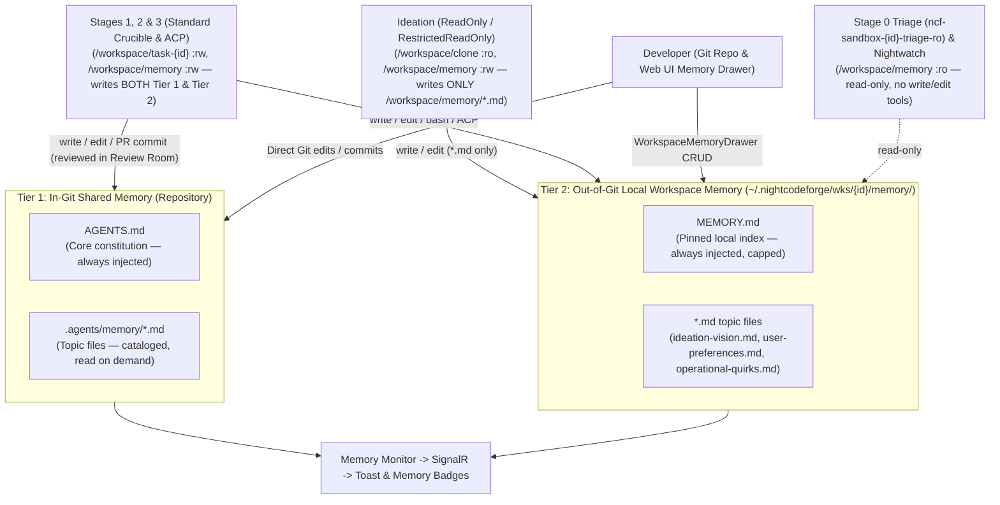

# 🧠 Step 12.39: Two-Tier Agent Memory Management, Selective `:rw` Memory Mount & Live UI Notifications

> **Feature Implementation Step (Auditable Shared & Local Markdown Memory Across Ideation, Pipeline Stages & ACP)**  
> *Parent Plan:* [Features & Integrations Roadmap](README.md) *(Common Trunk #4 — builds on `12.31` `IIdeationConversationCoordinator`)*  
> *Prerequisite Step:* [Step 12.31: Interactive Ideation Agent Coordinator & Warm Execution Context](STEP_12_31_INTERACTIVE_IDEATION_AGENT_COORDINATOR_AND_WARM_EXECUTION_CONTEXT.md)  
> *Related Architecture:* [Step 12.2A: Attachments Store](../archive/phase-12/STEP_12_2A_ATTACHMENTS_STORE_INTAKE_AND_MARKITDOWN.md) | [Step 12.14: Global Skills Injection](../archive/phase-12/STEP_12_14_GLOBAL_SKILLS_INJECTION_AND_STACK_TOOLING.md) | [Step 12.36A: Declarative Sandbox Mount Table](../archive/phase-12/STEP_12_36A_DECLARATIVE_SANDBOX_MOUNT_TABLE_AND_CONTAINER_LIFECYCLE_REDESIGN.md) | [Step 12.36B: CanonicalTools Modular Decomposition](../archive/phase-12/STEP_12_36B_CANONICAL_TOOLS_MODULAR_DECOMPOSITION_AND_INTERRUPTION_PIPELINE.md)  
> *Target Components:* `src/NightCodeForge.Core`, `src/NightCodeForge.Infrastructure`, `src/NightCodeForge.Agents`, `src/NightCodeForge.Web`, `tests/NightCodeForge.Core.Tests`, `tests/NightCodeForge.Infrastructure.Tests`, `tests/NightCodeForge.Agents.Tests`, `tests/NightCodeForge.Web.Tests` | *Status:* Planned | *Target Framework:* .NET 10 (C# 13)  
> *Aligns With:* [AGENTS.md](../../AGENTS.md), [docs/PLAN.md](../PLAN.md)
>
> This document is a **specification**: it states required behaviors and constraints, not implementations. Implementation choices (signatures, code structure) are left to the implementer, within the constraints of the documents.

---

## 1. Executive Objective & Two-Tier Memory Architecture

Today, [`AgentsMdService`](../../src/NightCodeForge.Agents/Context/AgentsMdService.cs) only ingests `AGENTS.md` passively as read-only prompt rules. Ideation runs against `/workspace/clone` (`:ro`), Stages 1–3 run in isolated `task-{id}` git worktrees (`Standard` `:rw`), and no agent is instructed when or how to persist durable knowledge.

This step establishes a **100% auditable, plain-Markdown, two-tier agent memory system** designed for transparency, manual user editing, and cross-session continuity:



### 1.1 Tier 1 vs. Tier 2 Responsibilities & Access Matrix

| Dimension | Tier 1: Shared Repository Memory (`AGENTS.md` + `.agents/memory/*.md`) | Tier 2: Local Workspace Memory (`/workspace/memory/*.md`) |
| :--- | :--- | :--- |
| **Storage Location** | Inside the Git repository (`<repo>/AGENTS.md` and `<repo>/.agents/memory/*.md`) | Outside Git at `~/.nightcodeforge/wks/{workspaceId}/memory/` (sibling of `clone/`, `attachments/`, and `task-{taskId}/`) |
| **Audience & Access** | Read by all; **writable only by Stages 1–3 (`Crucible` & `ACP`)** inside `/workspace/task-{id}` (`:rw`) and by developers via Git (never writable by Ideation or Triage) | **Mounted `:ro` for Stage 0 Triage** (in isolated `ncf-sandbox-{id}-triage-ro` container, no `write`/`edit` tools) and **Nightwatch**; **mounted `:rw` for all other agents** (Ideation `-ro` containers write **only** `/workspace/memory/*.md`; Stages 1–3 `Crucible` & `ACP` read/write freely) |
| **Persistence & Sharing** | **Committed to Git** via **Stage 2 PR commits** (audited in the Review Room diff viewer) or **edited and committed directly by the developer** | **Live shared directory** (`:rw` across Ideation and Stages 1–3) — immediately visible without waiting for PR merges or causing worktree merge conflicts |
| **Typical Content** | Permanent coding standards, architectural invariants, module boundaries, domain glossary, testing pitfalls | Ideation interview outcomes, rejected alternatives, developer preferences, unmerged debugging discoveries, local environment quirks |
| **Context Injection** | `AGENTS.md` always injected in `<project_context>`; `.agents/memory/*.md` listed in `<memory_catalog>` for on-demand `read` | `/workspace/memory/MEMORY.md` always injected in `<workspace_memory>` (capped); other `/workspace/memory/*.md` files listed in `<memory_catalog>` |

### 1.2 Pinned Memory Size Caps (Named Constants)
To prevent context-window bloat across turns and preserve KV-cache efficiency, pinned `MEMORY.md` injection must enforce named constants in [`AgentsMdService`](../../src/NightCodeForge.Agents/Context/AgentsMdService.cs) (never magic numbers):
- `MaxPinnedMemoryLines = 150`
- `MaxPinnedMemoryBytes = 12_288` (12 KB)
- When `/workspace/memory/MEMORY.md` exceeds either limit, [`AgentsMdService`](../../src/NightCodeForge.Agents/Context/AgentsMdService.cs) truncates the injected excerpt cleanly at a line boundary and appends an explicit notice advising the agent to keep `MEMORY.md` concise and move detailed notes into topic files under `/workspace/memory/<topic>.md`.

---

## 2. Path Resolution, Selective `:rw` Mount & Security Boundaries

> **Service Design & Constructor Constraint ([AGENTS.md](../../AGENTS.md)):** All new and modified services must require all collaborators (no optional constructor parameters, no silent fallbacks or bare `catch { }` blocks), never exceed **10 constructor parameters**, and define named constants/enums instead of magic numbers or strings.

### 2.1 Directory Layout & Path Resolution
```text
~/.nightcodeforge/wks/{workspaceId}/
├── clone/                         # canonical git clone (:ro in Ideation / ReadOnly)
├── attachments/                   # workspace attachments store (:ro, Step 12.2A)
├── memory/                        # NEW — workspace local memory store (:rw for Ideation & Stages 1–3, :ro for Triage/Nightwatch)
│   ├── MEMORY.md                  # pinned local memory index
│   └── ideation-vision.md         # topic-scoped local memory files
└── task-{taskId}/                 # ephemeral ForgeTask worktrees (:rw in Stages 1–3)
```

**ContainerSandbox Mapping (Docker):**
```text
/workspace/
├── clone/                         # :ro in RestrictedReadOnly containers
├── task-{taskId}/                 # :rw in Stage 1–3 containers
├── attachments/                   # :ro (omitted in Triage)
└── memory/                        # :rw in Ideation (-ro) & Stage 1–3 containers; :ro in Triage (-triage-ro) & Nightwatch
```

- **Path Resolution Contracts ([`IWorkspacePathResolver`](../../src/NightCodeForge.Core/Interfaces/IWorkspacePathResolver.cs) & [`WorkspacePathResolver`](../../src/NightCodeForge.Infrastructure/Execution/WorkspacePathResolver.cs)):**
  - Add `GetWorkspaceMemoryPath(int workspaceId)` on `IWorkspacePathResolver` (with a default interface implementation returning `$"{GetAgentWorkspaceRootPath(workspaceId)}/memory"` so existing test fakes continue to compile) and implement it on `WorkspacePathResolver`.
  - Extend `WorkspacePathResolver.ResolveCruciblePath` so `/workspace/memory`, `/workspace/memory/...`, and `.nightcodeforge/wks/{workspaceId}/memory/...` resolve to the sibling `memory/` directory under `~/.nightcodeforge/wks/{workspaceId}/`, never inside `clone/`, `task-{id}/`, or `workspace.RepositoryPath` (in `BareHost` mode, prefer `GetWorkspaceMemoryPath(workspaceId)` whenever `workspaceId > 0` so `/workspace/memory` never resolves inside `<repo>/memory`).

### 2.2 Selective Read-Write Mount (`AllowWriteInReadOnlyScope`) & Symlink Security
Because Ideation runs in a read-only workspace scope (`AgentMode.ReadOnly`, `SandboxSecurityTier.RestrictedReadOnly`, container `ncf-sandbox-{id}-ro`) while still needing to persist local memory, [`SandboxMountTable`](../../src/NightCodeForge.Core/Interfaces/SandboxMountTable.cs) and [`SandboxPathResolver`](../../src/NightCodeForge.Core/Interfaces/SandboxPathResolver.cs) must support per-mount write exceptions inside read-only scopes:

1. **`VirtualMountEntry.AllowWriteInReadOnlyScope` ([`SandboxMountTable.cs`](../../src/NightCodeForge.Core/Interfaces/SandboxMountTable.cs)):**
   - `VirtualMountEntry.AllowWriteInReadOnlyScope` is already declared on `VirtualMountEntry` (`default: false`). Wire it end-to-end through `SandboxMountTable` construction (ensuring `/workspace/attachments` always pins `IsReadOnly = true, AllowWriteInReadOnlyScope = false` and `SandboxMountTable.ForNightwatch` explicitly pins `AllowWriteInReadOnlyScope = false` alongside `IsReadOnly = true`), `SandboxPathResolver`, `WorkspacePathResolverSandboxAdapter`, `ContainerEnvironmentFactory.BuildWorkspaceScope`, and `ContainerMountAndDriftBuilder`.
2. **Workspace Scope Construction & Host Memory Directory ([`ContainerEnvironmentFactory.cs`](../../src/NightCodeForge.Infrastructure/Execution/ContainerEnvironmentFactory.cs)):**
   - Add `EnsureHostMemoryDirectory` (unlike `EnsureHostTmpDirectory`/`EnsureHostAttachmentsDirectory`, it must **always** pre-create `~/.nightcodeforge/wks/{workspaceId}/memory/` under user ownership with permissions compatible with `-ro` container `1000:1000` UID/GID when host UID differs, and must **never** create a `memory/` folder inside `workspace.RepositoryPath` when `HostWorkspacePath` falls back to `RepositoryPath`) so Docker never auto-creates an empty `root:root` directory or fails mounting `:rw` inside `:ro`.
   - Register the `/workspace/memory` `VirtualMountEntry` in `BuildWorkspaceScope` with:
     - `virtualSubPath: "memory"`
     - `virtualMountPath: "/workspace/memory"`
     - `isReadOnly: false`
     - `allowWriteInReadOnlyScope: true` (when trusted workspace scope; see Section 2.4 for Stage 0 Triage `:ro` enforcement and Nightwatch `:ro` enforcement).
   - Ensure [`IIdeationConversationCoordinator`](../../src/NightCodeForge.Core/Interfaces/IIdeationService.cs) ([Step 12.31](STEP_12_31_INTERACTIVE_IDEATION_AGENT_COORDINATOR_AND_WARM_EXECUTION_CONTEXT.md)) passes an explicit Ideation `SandboxScope` (and [`WorkspacePathResolverSandboxAdapter`](../../src/NightCodeForge.Agents/Tools/WorkspacePathResolverSandboxAdapter.cs) gates `AllowWriteInReadOnlyScope` via an explicit opt-in flag on `CanonicalToolScope` rather than granting it to every read-only caller, includes the sibling `memory` root in `ValidateWithinWorkspace`, and updates `TranslateBashCommand` / `ResolveBashWorkingDirectory` for `/workspace/memory`) so `read`/`write`/`edit` and read-only `bash` work uniformly across `ContainerSandbox`, `WslDirect`, and `BareHost`.
3. **Path Resolver & Symlink Escape Enforcement ([`SandboxPathResolver.cs`](../../src/NightCodeForge.Core/Interfaces/SandboxPathResolver.cs) & [`WorkspacePathResolverSandboxAdapter.cs`](../../src/NightCodeForge.Agents/Tools/WorkspacePathResolverSandboxAdapter.cs)):**
   - In `SandboxPathResolver.ResolveHostPath`, do **not** reject `forWrite && Scope.IsReadOnly` before resolving the target mount entry.
   - Instead, resolve the candidate mount (`ResolveCanonicalVirtualPathToHost` and `TryResolveAlreadyMappedHostOrWslPath`, extending the latter to recognize `.nightcodeforge/wks/{id}/memory`) and enforce:
     ```text
     effectiveReadOnly = matchedMount.IsReadOnly || (Scope.IsReadOnly && !matchedMount.AllowWriteInReadOnlyScope)
     ```
   - Reject writes to any mount where `effectiveReadOnly == true` (including `/workspace/clone`, `/workspace/skills`, `/workspace/attachments`, `/tmp`, and unmapped paths) with `UnauthorizedAccessException`.
   - **Mandatory Symlink / Reparse-Point Rejection:** Reject any symlink or directory reparse point (`FileAttributes.ReparsePoint` / `LinkTarget != null` across every path segment from mount root to target) for both `/workspace/memory` and `.agents/memory` in `SandboxPathResolver`, `WorkspacePathResolverSandboxAdapter`, `WorkspaceFileToolModule`, `AcpHostRpcHandler`, `AgentsMdService`, `IAgentMemoryMonitorService`, and `WorkspaceMemoryUiService` so Stage 2 code or a malicious git repository symlink can never exfiltrate host secrets (`~/.ssh/...`) into prompts or overwrite arbitrary host files.
   - Ensure `SandboxPathResolver.TranslateBashCommand` translates `/workspace/memory` prefixes accurately in `WslDirect` and `BareHost` execution tiers.
4. **Docker Bind Mount & Drift Detection ([`ContainerMountAndDriftBuilder.cs`](../../src/NightCodeForge.Infrastructure/Execution/ContainerMountAndDriftBuilder.cs)):**
   - Update **both** Section 1A and Section 1C of `ContainerMountAndDriftBuilder.BuildVolumeMounts` to compute:
     ```text
     effectiveReadOnly = entry.IsReadOnly || (options.IsRestrictedReadOnly && !entry.AllowWriteInReadOnlyScope)
     ```
   - Because `/workspace` is `:ro` in `RestrictedReadOnly` (`-ro`) containers while `/workspace/memory` evaluates `effectiveReadOnly == false` for Ideation (and `true` for Triage), Section 1C mounts `-v "{hostMemoryPath}:/workspace/memory"` (`:rw` for Ideation, `:ro` for Triage) over `/workspace`.
   - Ensure `EvaluateMountDrift` checks `/workspace/memory` presence, host source path, and `:rw` vs `:ro` flag so stale containers missing the `/workspace/memory` mount (or mounted with the wrong mode) are recreated automatically.

### 2.3 Canonical File Tools, Ideation `RestrictedReadOnly` Profile & `ReadOnlyCommandValidator` Hardening
1. **Tool Permissions & Ideation `SecurityTier` Reconciliation ([`DefaultAgentTools.cs`](../../src/NightCodeForge.Core/Domain/DefaultAgentTools.cs), [`AgentProfile.cs`](../../src/NightCodeForge.Core/Domain/AgentProfile.cs), [`AppDbContext.cs`](../../src/NightCodeForge.Infrastructure/Data/AppDbContext.cs)):**
   - Grant `CanonicalToolNames.Write` and `CanonicalToolNames.Edit` to `DefaultAgentTools.Ideation` (so Ideation can create and update `/workspace/memory/*.md` directly using standard `read`/`write`/`edit` tools, while `/workspace/clone` remains `:ro`).
   - Set `SecurityTier = SandboxSecurityTier.RestrictedReadOnly` in `AgentProfile.CreateDefaultIdeationProfile` (previously omitted, leaving Ideation in `Standard` `:rw`!).
   - Keep `DefaultAgentTools.ReadOnly` strictly read-only (no `Write`/`Edit`) so generic read-only profiles and untrusted triage do not gain write tools.
   - Update `AppDbContext.ReconcileIdeationProfilesAsync` (`EnsureDefaultGlobalAgentProfilesAsync`) to reconcile existing persisted Ideation profiles (global and workspace-scoped) with `SecurityTier = SandboxSecurityTier.RestrictedReadOnly` and `Write`/`Edit` when using standard Ideation tools, and update affected test assertions (`BacklogToolWiringTests`, `TriageServiceTests`).
2. **Module & `.md`-Only Guardrails ([`WorkspaceFileToolModule.cs`](../../src/NightCodeForge.Agents/Tools/WorkspaceFileToolModule.cs)):**
   - Update `WriteAsync` and `EditAsync`: when `IsEffectiveReadOnly` is true, check whether `SandboxPathResolver.MountTable.Entries` contains any writable entry with `AllowWriteInReadOnlyScope == true` (`!e.IsReadOnly && e.AllowWriteInReadOnlyScope`).
   - If **no** such selective writable mount exists, preserve the existing fail-fast `InvalidOperationException("Write operations are not permitted in read-only mode.")` (and equivalent edit exception).
   - If a selective writable mount **does** exist (such as `/workspace/memory` in Ideation), delegate path authorization to `SandboxPathResolver.ResolveHostPath(path, forWrite: true)`:
     - In `ReadOnly` mode (and in `WorkspaceMemoryUiService`), enforce **Markdown-only** (`.md`) non-dotfile writes inside `/workspace/memory` (rejecting scripts, hidden dotfiles, or arbitrary binaries).
     - Paths under `/workspace/memory/*.md` resolve and write normally (with `.editorconfig` formatting and per-workspace locking/atomic replacement per Section 4.1).
     - Any attempt to write or edit `/workspace/clone/...`, `.agents/memory/...`, `AGENTS.md`, `docs/tasks/...`, or arbitrary repo-relative paths throws `UnauthorizedAccessException` and returns a clear, actionable tool error:
       `Error: Access denied: Mount '<mount>' is read-only. In read-only mode, only '/workspace/memory/*.md' is writable.`
3. **Harden `ReadOnlyCommandValidator` Against `awk` / `sed` Writes & Exec ([`ReadOnlyCommandValidator.cs`](../../src/NightCodeForge.Agents/Tools/ReadOnlyCommandValidator.cs)):**
   - Because `/workspace/memory` is mounted `:rw` inside Ideation `-ro` containers, tighten `ReadOnlyCommandValidator` rules for `AdditionalAllowedBinaries`: add explicit command rules blocking `awk` file redirection/shell execution (`>`, `>>`, `system(`, `getline` pipe) and `sed` write/exec/script flags (`w`, `e`, `-f`) alongside existing `-i`/`--in-place` blocks so Ideation's read-only `bash` cannot bypass `write`/`edit` boundaries.

### 2.4 Stage 0 Untrusted Intake Triage (`:ro` Container Isolation) & Nightwatch Protection
- **Stage 0 Untrusted Intake Triage ([`TriageService.cs`](../../src/NightCodeForge.Agents/Triage/TriageService.cs)):**
  - Keep `UntrustedTriagePermittedTools` strictly without `Write` and `Edit` (never able to write memory).
  - Mount `/workspace/memory` strictly **`:ro`** (`isReadOnly: true`, `allowWriteInReadOnlyScope: false`) in `TriageService.BuildTriageSandboxScope` (so Triage can read memory if helpful, never write it).
  - **Mandatory Container Name Isolation (`ncf-sandbox-{id}-triage-ro`):** Because [`ContainerMountAndDriftBuilder.ResolveContainerName`](../../src/NightCodeForge.Infrastructure/Execution/ContainerMountAndDriftBuilder.cs#L39-L63) currently ignores `ScopeCacheKey` and resolves both Triage and Ideation to `ncf-sandbox-{id}-ro`, assign Triage a distinct `ContainerName` (e.g. `ncf-sandbox-{workspace.Id}-triage` $\rightarrow$ `ncf-sandbox-{workspace.Id}-triage-ro`) on `BuildTriageSandboxScope` and include it in `ContainerEnvironmentFactory.RemoveBaseContainerAsync`. This prevents mount drift from tearing down live Ideation sessions or exposing Ideation's `:rw` memory and `/workspace/attachments` mounts to untrusted Triage.
- **System Nightwatch (`SandboxScopeKind.SystemNightwatch`):**
  - Keep all mounts under `/nightcodeforge/wks/...` strictly read-only (`isReadOnly: true`, `allowWriteInReadOnlyScope: false`), explicitly pinned inside `SandboxMountTable.ForNightwatch`.

---

## 3. Progressive Disclosure Prompt Ingestion & Role-Specific `<memory_guidelines>`

### 3.1 Extending `AgentsMdService`, `AgentWorkspaceContextService` & `AcpAgentHarness`
To respect the **10-parameter constructor ceiling** on [`CrucibleAgentHarness`](../../src/NightCodeForge.Agents/Crucible/CrucibleAgentHarness.cs) (10 parameters), [`AcpAgentHarness`](../../src/NightCodeForge.Agents/Acp/AcpAgentHarness.cs) (9 parameters), and singleton [`IIdeationConversationCoordinator`](../../src/NightCodeForge.Core/Interfaces/IIdeationService.cs) ([Step 12.31](STEP_12_31_INTERACTIVE_IDEATION_AGENT_COORDINATOR_AND_WARM_EXECUTION_CONTEXT.md)), and because `AgentsMdService` is instantiated both via DI and parameterlessly in tests and `ExternalProcessAgentHarnessBase`, keep `AgentsMdService()` parameterless-compatible (receiving resolved paths/inputs via method arguments) and route `IWorkspacePathResolver` and `IAgentMemoryMonitorService` coordination through [`AgentWorkspaceContextService`](../../src/NightCodeForge.Agents/Context/AgentWorkspaceContextService.cs) (currently 7 parameters) and `CanonicalTools` / `AgentPromptContext`.

1. **Discovery Sources:**
   - **Tier 1 Root:** Existing `AGENTS.md` / `.agents/AGENTS.md` / `CLAUDE.md` / `GEMINI.md` via `AgentsMdService.IngestRulesAsync(repoPath)`.
   - **Tier 1 Committed Satellites:** All `*.md` files under `<repoPath>/.agents/memory/` (sorted alphabetically, symlink-checked, capped to `MaxCatalogEntries = 50`).
   - **Tier 2 Local Pinned Index:** `<memoryDir>/MEMORY.md` where `<memoryDir>` is resolved via `IWorkspacePathResolver.ToHostPath(IWorkspacePathResolver.GetWorkspaceMemoryPath(workspace.Id))` (when `workspace.Id > 0`, symlink-checked).
   - **Tier 2 Local Topic Satellites:** All `*.md` files under `<memoryDir>/` excluding `MEMORY.md` (sorted alphabetically, symlink-checked).
2. **Metadata & 1-Line Summary Extraction (`<memory_catalog>`):**
   - For each satellite file in `.agents/memory/*.md` and `/workspace/memory/*.md`, extract a 1-line description from optional YAML frontmatter (`description: ...`) or fall back to the first Markdown `# Heading` or first non-empty content line (truncated to `MaxCatalogDescriptionLength = 140` chars).
   - Render a lean progressive-disclosure block:
     ```xml
     <memory_catalog>
     Topic memory files available to read on demand via `read`:
     - [Shared/Git] .agents/memory/architecture-decisions.md — Module boundaries between Core, Agents, and Infrastructure
     - [Local] /workspace/memory/ideation-vision.md — Product roadmap constraints and rejected alternatives
     </memory_catalog>
     ```
3. **Always-Injected Local Memory (`<workspace_memory>`):**
   - When `/workspace/memory/MEMORY.md` exists and is non-empty, wrap its bounded content (enforcing `MaxPinnedMemoryLines` and `MaxPinnedMemoryBytes`) in `<workspace_memory>` tags.

### 3.2 KV-Cache Layer Placement & Warm Session Refresh
To preserve the >90% KV-cache prefix hit rate on local inference engines:
- **Layer 1 (`BuildLayer1GlobalRules` in [`PromptPrefixStabilizer.cs`](../../src/NightCodeForge.Agents/Optimizations/PromptPrefixStabilizer.cs)):** Holds the static `<project_context>` (`AGENTS.md` + execution guidelines) and `<skills>` catalog (plus universal invariant memory rules if any). Carve out `/workspace/memory/` explicitly from existing `"do not modify files in sibling directories"` rules in `PromptPrefixStabilizer` (`CanonicalRulesPrompt`, `BuildLayer3TaskScope`) and `ExternalProcessAgentHarnessBase.BuildEnrichedPrompt` so directives do not contradict each other.
- **Layer 2 (`BuildLayer2StagePersona`):** Place **role-specific** `<memory_guidelines>` here (rather than Layer 1!) so Stage 1, Stage 2, and Stage 3 continue sharing a byte-identical Layer 1 prefix.
- **Layer 3 (`BuildLayer3TaskScope`):** Holds the dynamic `<workspace_memory>` (`MEMORY.md`) and `<memory_catalog>` sections alongside `<task_scope>` and `<existing_workspace_tasks>`. Because local `/workspace/memory/*.md` files evolve dynamically during ideation and pipeline runs, placing them in Layer 3 prevents local memory edits from invalidating Layer 1 and Layer 2 KV-cache prefixes across tasks.
- **Ideation ([`IIdeationConversationCoordinator`](../../src/NightCodeForge.Core/Interfaces/IIdeationService.cs) / `WarmIdeationSession` from [Step 12.31](STEP_12_31_INTERACTIVE_IDEATION_AGENT_COORDINATOR_AND_WARM_EXECUTION_CONTEXT.md)):** Injects `<project_context>`, `<memory_guidelines>`, `<workspace_memory>`, and `<memory_catalog>` via `IAgentWorkspaceContextService.BuildPromptContextAsync` (resolved per operation via `IServiceScopeFactory`), and hooks into `IIdeationConversationCoordinator.MarkWorkspaceContextDirty(workspaceId)` whenever memory files change externally (via `WorkspaceMemoryDrawer` or concurrent Stage 1–3 tasks) so warm Ideation sessions refresh `<workspace_memory>` / `<memory_catalog>` before the next turn.
- **ACP Harness & Host RPC ([`AcpAgentHarness.cs`](../../src/NightCodeForge.Agents/Acp/AcpAgentHarness.cs), [`ExternalProcessAgentHarnessBase.cs`](../../src/NightCodeForge.Agents/ExternalProcess/ExternalProcessAgentHarnessBase.cs), [`AcpHostRpcHandler.cs`](../../src/NightCodeForge.Agents/Acp/AcpHostRpcHandler.cs)):**
  - Neither `AcpAgentHarness` nor `ExternalProcessAgentHarnessBase` injects `IAgentWorkspaceContextService`; convert `ExternalProcessAgentHarnessBase.BuildEnrichedPrompt` to async (`BuildEnrichedPromptAsync`) calling `_agentsMdService` + `_pathResolver` directly (0 new ctor params on 9-param `AcpAgentHarness`) so `agy acp` receives `<workspace_memory>`, `<memory_catalog>`, and Stage-appropriate `<memory_guidelines>`.
  - Update [`AcpHostRpcHandler`](../../src/NightCodeForge.Agents/Acp/AcpHostRpcHandler.cs) (`ResolveLocalWorkspaceCandidate`, `ValidateWithinWorkspace`, `WriteFileAsync`, plus immediate memory-write notification via `IHarnessActivityRecorder`) to recognize `/workspace/memory/*.md` (sibling `memory/` directory, never resolving inside `task-{id}/memory/`), enforce symlink rejection, honor `AllowWriteInReadOnlyScope`, and allow `fs/read_text_file` and `fs/write_text_file` on `/workspace/memory`.

### 3.3 Role-Specific `<memory_guidelines>` Directives
Inject explicit, role-scoped `<memory_guidelines>` telling agents *what* to remember and *where* to write it:

- **Ideation Agent (`ReadOnly` / `RestrictedReadOnly`):**
  - Read `<workspace_memory>` and relevant `<memory_catalog>` files before asking questions the developer already answered in earlier sessions.
  - Whenever an `ask` interview or discussion establishes durable product vision, domain terminology, architectural preferences, user workflow preferences, or **explicitly rejected approaches**, use `write` or `edit` **only** on `/workspace/memory/MEMORY.md` (concise bullet index) or `/workspace/memory/<topic>.md` (detailed topic notes with optional `description:` YAML frontmatter).
  - Never attempt to edit `AGENTS.md`, `.agents/memory/*`, or repository code directly from Ideation (`/workspace/clone` is read-only). When a local convention or decision should be shared with all developers via Git, include *"Update `AGENTS.md` or `.agents/memory/<topic>.md`"* as an explicit sub-task in the proposed Stage 2 task specification.
- **Stages 1 (`TaskReview`), 2 (`Implementation`), and 3 (`CodeReviewAndFix`) — `Standard` (`:rw`) Crucible & ACP:**
  - Consult `<workspace_memory>` and relevant `<memory_catalog>` entries when scoping tasks, implementing changes, or reviewing diffs.
  - Use **both** tiers appropriately inside `/workspace/task-{id}` (`:rw`) and `/workspace/memory` (`:rw`):
    - Write immediate operational/debugging discoveries, environment quirks, recurring review lessons, or cross-task notes to `/workspace/memory/<topic>.md` (Tier 2 local, shared live across concurrent worktrees without Git conflicts).
    - When a task establishes a permanent architectural invariant, project convention, or explicitly promotes local knowledge into shared team documentation, create or update `.agents/memory/<topic>.md` or `AGENTS.md` inside the task worktree (`/workspace/task-{id}`) so it is committed with the PR and reviewed by the user in the Review Room.
  - Respect user autonomy: developers may also edit and commit `AGENTS.md` and `.agents/memory/*.md` directly in the repository at any time; agents must treat committed repo rules as authoritative.

---

## 4. Real-Time UI Notifications, Telemetry & Workspace Memory Drawer

### 4.1 Concurrency-Safe Writes & Dual-Path Memory Change Detection (`IAgentMemoryMonitorService`)
Because agents and users can modify memory simultaneously across multiple channels—(1) Crucible `write`/`edit` tools (`WorkspaceFileToolModule`), (2) ACP host RPC (`AcpHostRpcHandler.WriteWorkspaceFileAsync`), (3) direct container filesystem writes (`agy acp` native file tools or Stage 1–3 `bash` scripts into `:rw` mounts), and (4) `WorkspaceMemoryDrawer` UI edits—both file writes and change detection must prevent races and misattribution:

1. **Canonical Memory Path Classifier & Constants:** Centralize path/scope/change constants in Core (`AgentMemoryConstants`) and implement `AgentMemoryPathClassifier` in `NightCodeForge.Core` classifying paths (after symlink validation) into:
   - `AgentMemoryScope.LocalWorkspace` (`/workspace/memory/*.md`, host `~/.nightcodeforge/wks/{id}/memory/*.md`)
   - `AgentMemoryScope.SharedRepository` (`AGENTS.md`, `.agents/AGENTS.md`, `.agents/memory/*.md`)
   - `None` (ignore non-memory files)
2. **Per-Workspace Atomic Writes:** Guard host C# writes to `/workspace/memory` across `WorkspaceFileToolModule`, `AcpHostRpcHandler`, and `WorkspaceMemoryUiService` with per-workspace locking / atomic temp-file-and-replace so concurrent Stage 1–3 tasks, Ideation, and the UI drawer never suffer Windows/9P sharing violations or lost edits.
3. **Pre/Post-Turn Snapshot Diffing & Attribution Ledger (`IAgentMemoryMonitorService`):**
   - Captures lightweight symlink-safe `(RelativePath -> Sha256 / Length)` snapshots of `~/.nightcodeforge/wks/{workspaceId}/memory/` and `<workingDir>/.agents/memory/` + `AGENTS.md` before and after agent turns/stages, routed through `IAgentWorkspaceContextService` (or `CanonicalTools` / [`IHarnessActivityRecorder`](../../src/NightCodeForge.Agents/ExternalProcess/IHarnessActivityRecorder.cs)) in [`IIdeationConversationCoordinator`](../../src/NightCodeForge.Core/Interfaces/IIdeationService.cs), [`CrucibleAgentHarness`](../../src/NightCodeForge.Agents/Crucible/CrucibleAgentHarness.cs) (10 params), and [`AcpAgentHarness`](../../src/NightCodeForge.Agents/Acp/AcpAgentHarness.cs) (9 params) without exceeding constructor ceilings.
   - Maintain a **workspace-wide recent-write attribution ledger** `(WorkspaceId, RelativePath, PostWriteSha256, Timestamp)` populated by all host write hooks (`WorkspaceFileToolModule`, `AcpHostRpcHandler`, `WorkspaceMemoryUiService`) so:
     1. A single write never triggers duplicate immediate + post-turn notifications.
     2. If Ideation or `WorkspaceMemoryDrawer` edits `/workspace/memory/ideation-vision.md` while Task #42 is concurrently executing Stage 2, Task #42's post-turn snapshot diff observes that the hash already matches a recorded attribution entry and does **not** misattribute the change to Task #42.

### 4.2 Activity Streaming & SignalR Contract
1. **Activity Stream Metadata ([`AgentActivityModels.cs`](../../src/NightCodeForge.Core/Streaming/AgentActivityModels.cs)):**
   - Add named constants to `AgentActivityMetadataKeys`:
     - `ActionTypeMemoryUpdated = "MemoryUpdated"`
     - `WorkspaceId = "workspaceId"` (replacing raw `"workspaceId"` literals)
     - `MemoryScope = "memoryScope"` (`"Local"` | `"SharedGit"`)
     - `MemoryRelativePath = "memoryRelativePath"` (e.g. `/workspace/memory/ideation-vision.md` or `.agents/memory/architecture-decisions.md`)
     - `MemoryChangeKind = "memoryChangeKind"` (`"Created"` | `"Updated"` | `"Deleted"`)
   - Emit `AgentActivityKind.Notice` with `ActionType = ActionTypeMemoryUpdated` and the above metadata whenever a memory file changes, and notify `IIdeationConversationCoordinator.MarkWorkspaceContextDirty(workspaceId)` for local workspace memory updates.
2. **SignalR Hub & Client Connection ([`IOrchestratorHubClient.cs`](../../src/NightCodeForge.Infrastructure/Hubs/IOrchestratorHubClient.cs), [`SignalRActivityBridgeService.cs`](../../src/NightCodeForge.Infrastructure/Hubs/SignalRActivityBridgeService.cs), [`OrchestratorHubClientConnection.cs`](../../src/NightCodeForge.Web/Services/OrchestratorHubClientConnection.cs)):**
   - Add `Task ReceiveMemoryUpdated(int workspaceId, int? taskId, string stageId, string memoryScope, string relativePath, string changeKind, string summary);` to `IOrchestratorHubClient`.
   - In `SignalRActivityBridgeService.DispatchActivityEventAsync` (under `AgentActivityKind.Notice`), when `ActionType == AgentActivityMetadataKeys.ActionTypeMemoryUpdated`, broadcast `ReceiveMemoryUpdated` to `_hubContext.Clients.All` (mirroring `ReceiveBacklogMutation`) and emit any execution log entry at **Info** level (never `Warning`, avoiding warning-log spam in task execution logs).
   - Expose `event Action<int, int?, string, string, string, string, string>? OnMemoryUpdatedReceived;` on `OrchestratorHubClientConnection`.

### 4.3 Web UI Notifications, Chat Badges & `WorkspaceMemoryDrawer.razor`
> **UI & Presentation Separation ([AGENTS.md](../../AGENTS.md)):** Keep all `.razor` components strictly focused on layout, rendering, and event binding. All file listing, frontmatter/summary extraction, diff/notification formatting, validation, and CRUD coordination must reside in dedicated `NightCodeForge.Web.Services` classes (`WorkspaceMemoryUiService` and `MemoryPresentationHelper`) with unit tests and $\le 10$ required constructor parameters (no optional constructor parameters, no bare `catch { }`, and fail fast if workspace ID is missing from DB).

1. **Live Toast & Push Notifications ([`WebNotificationService.cs`](../../src/NightCodeForge.Web/Services/WebNotificationService.cs), [`NotificationPreferences.cs`](../../src/NightCodeForge.Web/Services/NotificationPreferences.cs), [`ToastService.cs`](../../src/NightCodeForge.Web/Services/ToastService.cs), [`MainLayout.razor`](../../src/NightCodeForge.Web/Components/Layout/MainLayout.razor)):**
   - Subscribe to `OrchestratorHubClientConnection.OnMemoryUpdatedReceived` inside [`WebNotificationService`](../../src/NightCodeForge.Web/Services/WebNotificationService.cs) (which already owns SignalR connection + `ToastService`, keeping [`MainLayout.razor`](../../src/NightCodeForge.Web/Components/Layout/MainLayout.razor) free of SignalR handler logic) and display a non-blocking toast via `ToastService.Show`:
     - Title: `🧠 Agent Memory Updated`
     - Message example: `Ideation updated /workspace/memory/ideation-vision.md` or `Task #42 (Stage 2) created .agents/memory/architecture-decisions.md`
   - If adding an optional `NotificationSubject` toggle in [`NotificationPreferences.cs`](../../src/NightCodeForge.Web/Services/NotificationPreferences.cs) / `WebNotificationService` for background desktop push notifications, provide a task-less dispatch overload since Ideation memory updates have `taskId == null`.
2. **Chat & Execution Inspector Badges ([`Ideation.razor`](../../src/NightCodeForge.Web/Components/Pages/Ideation.razor), [`IdeationToolCall.razor`](../../src/NightCodeForge.Web/Components/Transcripts/IdeationToolCall.razor), [`ToolCallCard.razor`](../../src/NightCodeForge.Web/Components/Transcripts/ToolCallCard.razor), [`StageConversationViewer.razor`](../../src/NightCodeForge.Web/Components/Monitoring/StageConversationViewer.razor)):**
   - Use `MemoryPresentationHelper` to identify tool calls (`write`, `edit`) targeting memory paths (`/workspace/memory/*`, `.agents/memory/*`, `AGENTS.md`) and post-turn memory change events.
   - Add dedicated clickable memory-badge parameters to [`ToolCallCard.razor`](../../src/NightCodeForge.Web/Components/Transcripts/ToolCallCard.razor) and [`IdeationToolCall.razor`](../../src/NightCodeForge.Web/Components/Transcripts/IdeationToolCall.razor) (independent of `ToolCallCard.BadgeText`, which `StageConversationViewer` already uses for `primingBadge`) so a `🧠 Memory` pill (`Local` vs `Shared/Git`, plus `Created`/`Updated`/`Deleted`) opens `WorkspaceMemoryDrawer.razor` directly at that file from both Ideation and the Task Inspector.
3. **Workspace Memory Drawer (`WorkspaceMemoryDrawer.razor`) & XSS / Git-Sync Safety:**
   - Add a `🧠 Memory` header action button in [`Ideation.razor`](../../src/NightCodeForge.Web/Components/Pages/Ideation.razor) (with a live indicator dot/count when memory files were updated in the session) and a memory inspector/editor panel accessible from Workspace Settings ([`Settings.razor`](../../src/NightCodeForge.Web/Components/Pages/Settings.razor) or workspace tabs) opening `WorkspaceMemoryDrawer.razor`.
   - **XSS Prevention ([`MarkdownHelper.cs`](../../src/NightCodeForge.Web/Services/MarkdownHelper.cs)):** Because `MarkdownHelper` does not currently call `.DisableHtml()`, memory preview rendering in `WorkspaceMemoryDrawer.razor` must use `.DisableHtml()` (or HTML sanitization) so agent-authored or external repo Markdown files can never execute scripts in the browser.
   - **Tab 1 — Local Workspace Memory (`~/.nightcodeforge/wks/{id}/memory/*.md`):**
     - Lists `MEMORY.md` (with line/byte budget meter against `MaxPinnedMemoryLines` / `MaxPinnedMemoryBytes`) and all local topic `.md` files.
     - Full user audit & management: view rendered Markdown (HTML-disabled) or raw source, create new `.md` files, edit inline and save atomically to disk, or delete obsolete files (with confirmation).
   - **Tab 2 — Committed Repository Memory (`AGENTS.md` & `.agents/memory/*.md`):**
     - Reads authoritatively from `workspace.RepositoryPath` (never `~/.nightcodeforge/wks/{id}/clone`, where [`GitMirrorSyncService`](../../src/NightCodeForge.Infrastructure/Git/GitMirrorSyncService.cs) runs `git reset --hard host-origin/{baseBranch}` and would discard uncommitted edits).
     - Lists `AGENTS.md` (and fallback rule file if used) plus all `.agents/memory/*.md` files from the repository.
     - Defaults to safe read-only inspection with copy-path / Review Room links (if inline editing of `workspace.RepositoryPath` is offered, guard it with an explicit "Save & Commit to `<baseBranch>`" action and a dirty-working-tree warning so uncommitted host changes do not cause autonomous `updateInstead` merges in `GitMirrorSyncService.PushBaseBranchToHostAsync` to fail).
   - Automatically refreshes the active drawer list when `OnMemoryUpdatedReceived` fires for the current `workspaceId`.

---

## 5. Implementation Checklist & Deliverables

- [ ] **Core Contracts, Selective `:rw` Mount & Path Resolution (`NightCodeForge.Core` & `NightCodeForge.Infrastructure`):**
  - [ ] Add `GetWorkspaceMemoryPath(int workspaceId)` (with default interface implementation) on [`IWorkspacePathResolver`](../../src/NightCodeForge.Core/Interfaces/IWorkspacePathResolver.cs) and implement it plus `/workspace/memory` mapping in [`WorkspacePathResolver`](../../src/NightCodeForge.Infrastructure/Execution/WorkspacePathResolver.cs) (with `BareHost` guard so `/workspace/memory` never resolves inside `<repo>/memory`).
  - [ ] Wire `VirtualMountEntry.AllowWriteInReadOnlyScope` across [`SandboxMountTable`](../../src/NightCodeForge.Core/Interfaces/SandboxMountTable.cs) (explicitly pinning `AllowWriteInReadOnlyScope = false` on `ForNightwatch` and `/workspace/attachments`) and update [`SandboxPathResolver`](../../src/NightCodeForge.Core/Interfaces/SandboxPathResolver.cs) (`ResolveHostPath`, `TryResolveAlreadyMappedHostOrWslPath`, `TranslateBashCommand`) to enforce `matchedMount.IsReadOnly || (Scope.IsReadOnly && !matchedMount.AllowWriteInReadOnlyScope)` and reject symlinks/reparse points across `/workspace/memory` and `.agents/memory`.
  - [ ] Update [`ContainerEnvironmentFactory`](../../src/NightCodeForge.Infrastructure/Execution/ContainerEnvironmentFactory.cs) (`EnsureHostMemoryDirectory` unconditionally creating `~/.nightcodeforge/wks/{id}/memory/` with `-ro` UID-compatible permissions + `/workspace/memory` mount entry in `BuildWorkspaceScope` + cleaning up `ncf-sandbox-{id}-triage-ro` in `RemoveBaseContainerAsync`) and [`ContainerMountAndDriftBuilder`](../../src/NightCodeForge.Infrastructure/Execution/ContainerMountAndDriftBuilder.cs) (Sections 1A & 1C of `BuildVolumeMounts` and `EvaluateMountDrift`) so Ideation `-ro` and Stage 1–3 containers mount `/workspace/memory` `:rw` while Triage (`ncf-sandbox-{id}-triage-ro`) and Nightwatch mount `:ro`.
  - [ ] Add `AgentMemoryConstants`, `AgentMemoryScope`, `AgentMemoryChangeKind`, `AgentMemoryChangeEvent`, and `AgentMemoryPathClassifier` in `NightCodeForge.Core`.
- [ ] **Canonical Tools, Ideation `RestrictedReadOnly` Profile, Triage Isolation & Bash Hardening (`NightCodeForge.Core`, `NightCodeForge.Infrastructure`, `NightCodeForge.Agents`):**
  - [ ] Add `Write` and `Edit` to `DefaultAgentTools.Ideation` in [`DefaultAgentTools`](../../src/NightCodeForge.Core/Domain/DefaultAgentTools.cs), set `SecurityTier = SandboxSecurityTier.RestrictedReadOnly` in [`AgentProfile.CreateDefaultIdeationProfile`](../../src/NightCodeForge.Core/Domain/AgentProfile.cs), and reconcile existing Ideation profiles (`Write`/`Edit` + `RestrictedReadOnly`) in [`AppDbContext`](../../src/NightCodeForge.Infrastructure/Data/AppDbContext.cs) (updating `BacklogToolWiringTests` and `TriageServiceTests`).
  - [ ] Keep `DefaultAgentTools.ReadOnly` and [`TriageService`](../../src/NightCodeForge.Agents/Triage/TriageService.cs) (`UntrustedTriagePermittedTools`) strictly without write/edit tools, and give `TriageService.BuildTriageSandboxScope` both `:ro` `/workspace/memory` and a distinct `ContainerName` (`ncf-sandbox-{id}-triage-ro`).
  - [ ] Update [`WorkspaceFileToolModule`](../../src/NightCodeForge.Agents/Tools/WorkspaceFileToolModule.cs) (`WriteAsync` / `EditAsync` enforcing `.md`-only non-dotfile writes in `ReadOnly` mode, symlink rejection, and per-workspace atomic writes), [`WorkspacePathResolverSandboxAdapter`](../../src/NightCodeForge.Agents/Tools/WorkspacePathResolverSandboxAdapter.cs) (gated `AllowWriteInReadOnlyScope`, `memory` root in `ValidateWithinWorkspace`, and `/workspace/memory` translation in `TranslateBashCommand` / `ResolveBashWorkingDirectory`), and [`ReadOnlyCommandValidator`](../../src/NightCodeForge.Agents/Tools/ReadOnlyCommandValidator.cs) (blocking `awk` / `sed` file writes and exec).
- [ ] **Prompt Ingestion, Progressive Disclosure, Role Directives & ACP Integration (`NightCodeForge.Agents`):**
  - [ ] Extend [`AgentsMdService`](../../src/NightCodeForge.Agents/Context/AgentsMdService.cs) (parameterless-compatible, symlink-safe) and [`AgentWorkspaceContextService`](../../src/NightCodeForge.Agents/Context/AgentWorkspaceContextService.cs) (preserving $\le 10$ constructor parameters on `CrucibleAgentHarness` and `AcpAgentHarness`, and wiring into [`IIdeationConversationCoordinator`](../../src/NightCodeForge.Core/Interfaces/IIdeationService.cs) / `WarmIdeationSession` from [Step 12.31](STEP_12_31_INTERACTIVE_IDEATION_AGENT_COORDINATOR_AND_WARM_EXECUTION_CONTEXT.md) with dirty-flag refresh) to inject bounded `<workspace_memory>` (`MEMORY.md`, capped by `MaxPinnedMemoryLines = 150` / `MaxPinnedMemoryBytes = 12_288`) and `<memory_catalog>` across `.agents/memory/*.md` and `/workspace/memory/*.md`.
  - [ ] Place `<workspace_memory>` and `<memory_catalog>` in Layer 3 of [`PromptPrefixStabilizer`](../../src/NightCodeForge.Agents/Optimizations/PromptPrefixStabilizer.cs), role-specific `<memory_guidelines>` in Layer 2 (`BuildLayer2StagePersona`) / Ideation / ACP prompts (explicitly carving out `/workspace/memory/` from sibling-directory restrictions), and update `ExternalProcessAgentHarnessBase.BuildEnrichedPromptAsync` + [`AcpHostRpcHandler`](../../src/NightCodeForge.Agents/Acp/AcpHostRpcHandler.cs) (`fs/read_text_file` & `fs/write_text_file` for `/workspace/memory/*.md`).
- [ ] **Memory Change Detection, Activity Telemetry & SignalR (`NightCodeForge.Core`, `NightCodeForge.Agents`, `NightCodeForge.Infrastructure`):**
  - [ ] Implement `IAgentMemoryMonitorService` (symlink-safe pre/post-turn snapshot diff + workspace-wide recent-write attribution ledger preventing duplicate/misattributed notifications) wired via `IAgentWorkspaceContextService` / `CanonicalTools` / [`IHarnessActivityRecorder`](../../src/NightCodeForge.Agents/ExternalProcess/IHarnessActivityRecorder.cs) into [`IIdeationConversationCoordinator`](../../src/NightCodeForge.Core/Interfaces/IIdeationService.cs), [`CrucibleAgentHarness`](../../src/NightCodeForge.Agents/Crucible/CrucibleAgentHarness.cs), and [`AcpAgentHarness`](../../src/NightCodeForge.Agents/Acp/AcpAgentHarness.cs) without adding constructor parameters.
  - [ ] Add memory metadata constants to [`AgentActivityModels`](../../src/NightCodeForge.Core/Streaming/AgentActivityModels.cs), `ReceiveMemoryUpdated` to [`IOrchestratorHubClient`](../../src/NightCodeForge.Infrastructure/Hubs/IOrchestratorHubClient.cs), Info-level bridging + `MarkWorkspaceContextDirty` integration to [`SignalRActivityBridgeService`](../../src/NightCodeForge.Infrastructure/Hubs/SignalRActivityBridgeService.cs), and `OnMemoryUpdatedReceived` to [`OrchestratorHubClientConnection`](../../src/NightCodeForge.Web/Services/OrchestratorHubClientConnection.cs).
- [ ] **Web UI Notifications, Badges & Drawer (`NightCodeForge.Web`):**
  - [ ] Implement `MemoryPresentationHelper` and `WorkspaceMemoryUiService` in `NightCodeForge.Web/Services` (no optional constructor parameters, $\le 10$ constructor parameters, fail fast on missing DB workspace, no logic in `.razor` `@code` blocks).
  - [ ] Wire live `ToastService.Show` notifications in [`WebNotificationService`](../../src/NightCodeForge.Web/Services/WebNotificationService.cs) (and task-less notification overload if desktop push enabled), add dedicated clickable `🧠 Memory` badge parameters to [`ToolCallCard.razor`](../../src/NightCodeForge.Web/Components/Transcripts/ToolCallCard.razor) and [`IdeationToolCall.razor`](../../src/NightCodeForge.Web/Components/Transcripts/IdeationToolCall.razor) wired in [`Ideation.razor`](../../src/NightCodeForge.Web/Components/Pages/Ideation.razor) and [`StageConversationViewer.razor`](../../src/NightCodeForge.Web/Components/Monitoring/StageConversationViewer.razor), and build `WorkspaceMemoryDrawer.razor` (`.DisableHtml()` Markdown preview, Local Memory atomic CRUD + `workspace.RepositoryPath` Committed Repo Memory view/guarded commit flow).
- [ ] **Tests:**
  - [ ] Unit tests in `NightCodeForge.Core.Tests` and `NightCodeForge.Infrastructure.Tests`: `SandboxPathResolver` selective `:rw` enforcement + symlink rejection in `RestrictedReadOnly` scopes, `ContainerMountAndDriftBuilder` (`BuildVolumeMounts` Sections 1A/1C + `EvaluateMountDrift` mounting `/workspace/memory` `:rw` inside Ideation `-ro` containers vs `:ro` inside `ncf-sandbox-{id}-triage-ro`), `AppDbContext` Ideation `RestrictedReadOnly` reconciliation, `WorkspacePathResolver.ResolveCruciblePath` (`BareHost` guard), `SignalRActivityBridgeService` Info-level log bridging, and `AgentMemoryPathClassifier`.
  - [ ] Unit tests in `NightCodeForge.Agents.Tests`: `WorkspaceFileToolModule` allowing `/workspace/memory/*.md` writes while rejecting `/workspace/clone/...` and non-`.md`/symlink targets in Ideation read-only mode, `ReadOnlyCommandValidator` blocking `awk`/`sed` file writes & exec, `TriageService` keeping `write`/`edit` excluded and `/workspace/memory` `:ro` in isolated `ncf-sandbox-{id}-triage-ro`, `AcpHostRpcHandler` `/workspace/memory/*.md` read/write + `ExternalProcessAgentHarnessBase` prompt injection, `AgentsMdService` `MEMORY.md` cap truncation + `.agents/memory/*.md` catalog generation, `PromptPrefixStabilizer` Layer 1/2 KV-cache invariance, `IIdeationConversationCoordinator` warm-session dirty refresh, and `IAgentMemoryMonitorService` concurrent snapshot attribution.
  - [ ] Unit and bUnit tests in `NightCodeForge.Web.Tests`: `MemoryPresentationHelper`, `WorkspaceMemoryUiService`, `WebNotificationService` `ReceiveMemoryUpdated` toast dispatch, clickable `🧠 Memory` chat/inspector badges, and `WorkspaceMemoryDrawer.razor` HTML-safe rendering + local CRUD + committed memory view, followed by full test suite execution (including Acceptance & E2E suites) per [AGENTS.md](../../AGENTS.md).
