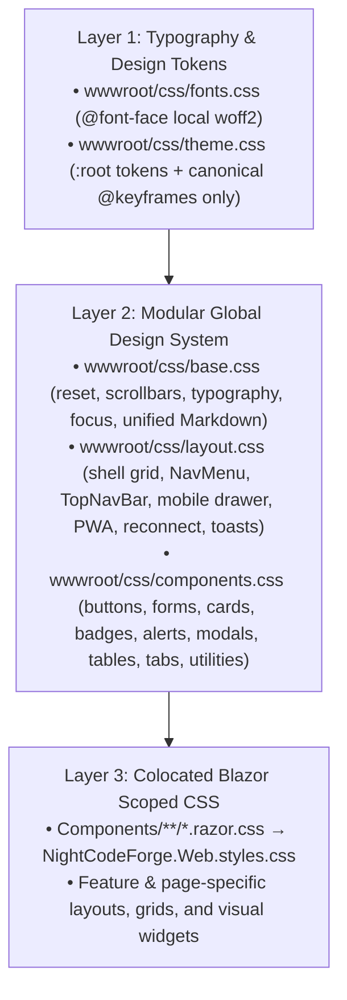

# 🎨 Step 12.44: CSS Architecture Rationalization, Blazor Scoped Styles & Design Token Consolidation

> **Feature Implementation Step (Modular Global Stylesheets, Blazor CSS Isolation, Dead Asset Removal & Token/Primitive Harmonization)**  
> *Parent Plan:* [Features & Integrations Roadmap](README.md)  
> *Target Components:* [`src/NightCodeForge.Web`](../../src/NightCodeForge.Web), [`tests/NightCodeForge.Web.Tests`](../../tests/NightCodeForge.Web.Tests) | *Status:* Planned | *Target Framework:* .NET 10 (C# 13)  
> *Aligns With:* [AGENTS.md](../../AGENTS.md), [docs/PLAN.md](../PLAN.md)
>
> This document is a **specification**: it states required behaviors and constraints, not implementations. Implementation choices (signatures, code structure) are left to the implementer, within the constraints of the documents.

---

## 1. Problem Statement & Baseline Audit

Over the course of Phases 5–12, NightCodeForge's Web UI styling grew organically by appending per-step sections onto global stylesheets without CSS isolation or design-system consolidation. A baseline audit of [`src/NightCodeForge.Web`](../../src/NightCodeForge.Web) identified the following structural issues:

| Area | Verified Baseline | Architectural Issue |
| :--- | :--- | :--- |
| **Monolithic Global CSS** | [`wwwroot/css/app.css`](../../src/NightCodeForge.Web/wwwroot/css/app.css): **8,745 lines (191.8 KB)** | Accumulates 25+ feature sections chronologically in one flat global file with 908 class names across `theme.css` + `app.css`. |
| **Mixed-Responsibility Theme Sheet** | [`wwwroot/css/theme.css`](../../src/NightCodeForge.Web/wwwroot/css/theme.css): **676 lines (16.2 KB)** | Mixes `:root` design tokens (lines 1–70) with unrelated form, settings, modal, transcript, diagnostics, turn-bubble, thinking-accordion, and Markdown rules. |
| **Unused Vendor Assets** | `wwwroot/lib/bootstrap/`: **44 files (~8.5 MB)** | Never linked by [`App.razor`](../../src/NightCodeForge.Web/Components/App.razor), yet bloats the repository, static asset manifests, and published output. |
| **Unlinked Blazor CSS Isolation** | [`App.razor`](../../src/NightCodeForge.Web/Components/App.razor) omits `NightCodeForge.Web.styles.css` | Leaves [`ReconnectModal.razor.css`](../../src/NightCodeForge.Web/Components/Layout/ReconnectModal.razor.css) (157 lines, light-theme Blazor template leftover) and placeholder [`MainLayout.razor.css`](../../src/NightCodeForge.Web/Components/Layout/MainLayout.razor.css) / [`NavMenu.razor.css`](../../src/NightCodeForge.Web/Components/Layout/NavMenu.razor.css) orphaned while forcing every component style into global `app.css`. |
| **Inline `` blocks out of [`Home.razor`](../../src/NightCodeForge.Web/Components/Pages/Home.razor), [`TranscriptAnalysisViewer.razor`](../../src/NightCodeForge.Web/Components/Transcripts/TranscriptAnalysisViewer.razor), [`FleetAnalysisDashboard.razor`](../../src/NightCodeForge.Web/Components/Transcripts/FleetAnalysisDashboard.razor), and [`Transcripts.razor`](../../src/NightCodeForge.Web/Components/Pages/Transcripts.razor) into colocated `*.razor.css` files.
2. Zero `<style>` tags are permitted in any `.razor` file under `src/NightCodeForge.Web/Components`.

### 3.3 Primitives, Design Tokens, Breakpoints & Dead-Code Cleanup

1. **Unified Primitives (Clean Break):**
   - Consolidate `.markdown-body`, `.forge-markdown`, and `.diagnostic-markdown` into a single canonical Markdown system in `base.css` (with an inline variant where needed).
   - Harmonize duplicate button families (`.btn-*` / `.forge-btn-*`), form controls (`.form-control-dark` / `.forge-input` / `.forge-select`), modals (`.forge-modal*`), cards, and badges (`.badge-status`, `.badge-tag`) in `components.css` and update all Razor callers to use the canonical classes.
2. **Zero Duplicate Selectors & Keyframes:**
   - Merge or eliminate all duplicate top-level selectors across global CSS files.
   - Deduplicate `@keyframes` (e.g., `amberPulse`, overlapping pulse/spin animations) into `theme.css`.
3. **Token Adoption & `!important` Reduction:**
   - Replace hardcoded hex and `rgb()`/`rgba()` literals with `:root` custom properties from `theme.css` across both global stylesheets and `*.razor.css` files.
   - Eliminate unnecessary `!important` overrides caused by load-order conflicts; reserve `!important` strictly for deliberate single-purpose utility classes where cascade override is intentional.
4. **Standardized Responsive Breakpoints:**
   - Consolidate ad-hoc breakpoints (`1100px`, `1024px`, `900px`, `767.98px`, `479.98px`) onto a consistent 4-tier responsive scale:
     - Desktop: `> 1024px`
     - Tablet / Compact Desktop: `<= 1024px`
     - Mobile: `< 768px` (or `<= 767.98px`)
     - Small Phone: `< 480px` (or `<= 479.98px`)
   - Preserve all mobile touch-target, drawer, and responsive table behaviors from Step `12.8A`.
5. **Dead Rule Pruning:**
   - Audit unused CSS classes before deletion, explicitly checking C# string interpolation and conditional class builders (e.g., `badge-priority-*`, `badge-status.*`, `log-*`, `log-level-*`, Blazor `components-reconnect-*`) so dynamically assigned classes are preserved.

### 3.4 Pragmatic Inline `style="..."` Attribute Reduction

1. Replace static, repetitive inline `style="..."` attributes across Razor components (especially high-density pages/tabs such as `TaskDetail.razor`, `AgentProfilesTab.razor`, `FleetAnalysisDashboard.razor`, `OllamaRouterGatewayCard.razor`, `CreateTask.razor`, `WorkspaceSettingsTab.razor`, `TranscriptAnalysisViewer.razor`, `Home.razor`, `GitHubSettingsTab.razor`, `TailscaleSettingsCard.razor`, `TaskExecutionInspector.razor`, `ActiveOperationsHero.razor`) with semantic classes in `*.razor.css` or shared primitives/utilities in `components.css`.
2. Target at least a **70% reduction** in inline `style="..."` attributes compared to the 2,599 baseline.
3. Retain inline `style="..."` **only** for genuinely dynamic runtime-computed values (e.g., workspace accent CSS custom properties `--ws-accent`, dynamic percentage progress/meter widths, dynamic SVG positioning, or explicit per-item dynamic colors).

### 3.5 Air-Gapped Hardening, PWA Service Worker & Existing Test Alignment

1. **Air-Gapped Guarantees:** Preserve all constraints verified by [`AirGappedSubresourcesTests.cs`](../../tests/NightCodeForge.Web.Tests/AirGappedSubresourcesTests.cs) — zero external HTTP/HTTPS subresources, local `@font-face` + `font-display: swap` in `fonts.css`, and `--font-sans`/`--font-mono` native system fallbacks in `theme.css`.
2. **PWA Service Worker ([`wwwroot/service-worker.js`](../../src/NightCodeForge.Web/wwwroot/service-worker.js)):**
   - Update `PRECACHE_URLS` to match the new modular stylesheets under `wwwroot/css/` (`fonts.css`, `theme.css`, `base.css`, `layout.css`, `components.css`), removing `/css/app.css`.
   - Bump `CACHE_NAME` (e.g., `'ncf-cache-v2'`) so installed PWAs evict the obsolete `app.css` cache on activation.
   - Do **not** add `NightCodeForge.Web.styles.css` to `PRECACHE_URLS` unless it resolves cleanly via physical path checks, or ensure `PwaManifestAndServiceWorkerTests` validates both `wwwroot` assets and the bundled scoped stylesheet appropriately; update the static precache URL count assertion in [`PwaManifestAndServiceWorkerTests.cs`](../../tests/NightCodeForge.Web.Tests/PwaManifestAndServiceWorkerTests.cs) to match the updated `PRECACHE_URLS` list.
3. **Update Location-Coupled Tests:**
   - Update [`DevQueueComponentTests.cs`](../../tests/NightCodeForge.Web.Tests/DevQueueComponentTests.cs) (`DevQueueStyles_AreDefinedInAppCss`) and [`EnvironmentDiagnosticShellPageTests.cs`](../../tests/NightCodeForge.Web.Tests/EnvironmentDiagnosticShellPageTests.cs) (`DiagnosticShellStyles_AreDefinedInAppCss_AndDoNotUseUnlinkedScopedCss`) to verify selectors against the new modular global stylesheets (`base.css`, `layout.css`, `components.css`) and colocated `*.razor.css` files rather than asserting everything lives in `app.css` or forbidding `*.razor.css`.

### 3.6 Automated CSS Hygiene & Budget Guardrail Tests

Add automated test coverage in [`tests/NightCodeForge.Web.Tests`](../../tests/NightCodeForge.Web.Tests) to prevent CSS regressions from re-emerging:

1. **Cascade Link Order (`App.razor`):** Verify [`App.razor`](../../src/NightCodeForge.Web/Components/App.razor) loads stylesheets in strict layer order (`css/fonts.css` → `css/theme.css` → `css/base.css` → `css/layout.css` → `css/components.css` → `NightCodeForge.Web.styles.css`) and does not reference `app.css` or `bootstrap`.
2. **No Inline `<style>` Tags:** Assert zero `<style` blocks exist in any `.razor` file under `src/NightCodeForge.Web/Components`.
3. **No Vendor Bootstrap Bloat:** Assert `wwwroot/lib/bootstrap` does not exist.
4. **Global Stylesheet Size Ceiling:** Assert no single CSS file under `wwwroot/css/` exceeds **1,000 lines**.
5. **Zero Duplicate Top-Level Selectors:** Assert no exact top-level selector appears more than once across global `wwwroot/css/*.css` files.
6. **Pure Token Theme Sheet:** Assert `wwwroot/css/theme.css` contains only `:root` variable definitions and `@keyframes` blocks (zero component/page class selectors).

---

## 4. Definition of Done (DoD) Checklist

- [ ] Remove unused `src/NightCodeForge.Web/wwwroot/lib/bootstrap/` (44 files / ~8.5 MB) and orphaned light-theme `ReconnectModal.razor.css` (and clean up empty layout `.razor.css` placeholders).
- [ ] Refactor `wwwroot/css/theme.css` to strictly `:root` design tokens and canonical `@keyframes`, and split monolithic `wwwroot/css/app.css` into layered global sheets (`base.css`, `layout.css`, `components.css`) under 1,000 lines each.
- [ ] Link `NightCodeForge.Web.styles.css` and the layered global stylesheets in `App.razor` in strict cascade order.
- [ ] Migrate all feature/page-specific CSS rules and all 4 inline `<style>` blocks into colocated `*.razor.css` files.
- [ ] Consolidate duplicate Markdown, button, form-control, modal, badge, breakpoint, and `@keyframes` definitions; replace hardcoded hex/`rgba()` values with `:root` tokens; prune verified dead rules.
- [ ] Reduce static inline `style="..."` attributes across Razor components by $\ge 70\%$ from the 2,599 baseline, keeping inline styles only for runtime-computed values.
- [ ] Update `wwwroot/service-worker.js` (`PRECACHE_URLS` and `CACHE_NAME`), `PwaManifestAndServiceWorkerTests.cs`, `DevQueueComponentTests.cs`, and `EnvironmentDiagnosticShellPageTests.cs`.
- [ ] Add automated CSS hygiene and budget guardrail tests in `tests/NightCodeForge.Web.Tests`.
- [ ] Verify visual parity across desktop, tablet, and mobile viewports on core routes (`/`, `/ideation`, `/backlog`, `/monitoring`, `/inbox`, `/review/{id}`, `/triage`, `/git-sync`, `/dev-queue`, `/memory`, `/diagnostics/shell`, `/transcripts`, `/settings`, and the dark-theme reconnect banner).
- [ ] Verify full non-E2E suite passes via `dotnet test --filter "Category!=Acceptance&Category!=E2E"` and full Playwright E2E suite passes via `dotnet test`.
