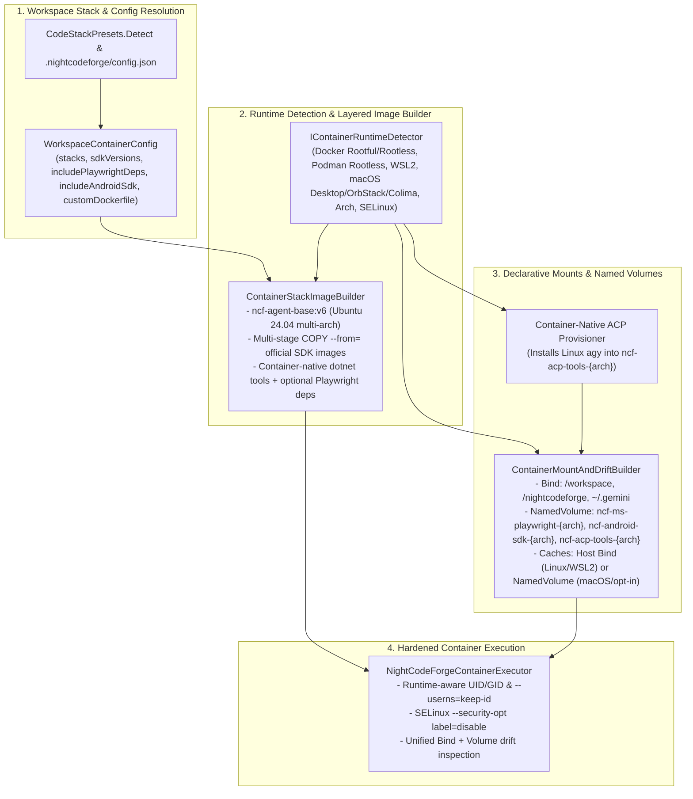

# 📦 Step 12.45A: Cross-Platform Layered Container Images, Named Toolchain Volumes & Runtime Hardening

> **Phase 12 Implementation Step (Extend Features — Cross-Platform Execution Sandboxing)**  
> *Parent Plan:* [Features & Integrations Roadmap](README.md)  
> *Companion Step:* [Step 12.45B: Sandbox Toolchain Management UI, Environment Doctor & Multi-Distro/macOS Installer Alignment](STEP_12_45B_SANDBOX_TOOLCHAIN_UI_DIAGNOSTICS_AND_MULTI_DISTRO_INSTALLER.md)  
> *Related Steps:* [Step 12.36A: Declarative Sandbox Mount Table & Container Lifecycle Redesign](../archive/phase-12/STEP_12_36A_DECLARATIVE_SANDBOX_MOUNT_TABLE_AND_CONTAINER_LIFECYCLE_REDESIGN.md) | [Step 12.5A: ACP Harness Catalog & Antigravity Container Rework](../archive/phase-12/STEP_12_5A_ACP_HARNESS_CATALOG_ANTIGRAVITY_AND_CONTAINER_REWORK.md) | [Step 12.23A: Standalone Crucible Benchmark Engine & Container Verifier](STEP_12_23A_CRUCIBLE_BENCHMARK_ENGINE_AND_CONTAINER_VERIFIER.md)  
> *Source Policy:* [AGENTS.md](../../AGENTS.md) | [docs/ARCHITECTURE.md](../ARCHITECTURE.md)  
> *Project Target:* `src/NightCodeForge.Core`, `src/NightCodeForge.Infrastructure`, `src/NightCodeForge.Agents`, `tests/NightCodeForge.Core.Tests`, `tests/NightCodeForge.Infrastructure.Tests`, `tests/NightCodeForge.Agents.Tests` | *Status:* Deferred (v0.2) | *Target Framework:* .NET 10 (C# 13)

> This document is a **specification**: it states required behaviors and constraints, not implementations. Implementation choices (signatures, code structure) are left to the implementer, within the constraints of the documents.

> [!IMPORTANT]
> **Revision Prerequisite (Pending Benchmark Stream Merge):** Revise and reconcile this specification once the ongoing Benchmark stream ([Step 12.23A](STEP_12_23A_CRUCIBLE_BENCHMARK_ENGINE_AND_CONTAINER_VERIFIER.md) / [Step 12.23B](STEP_12_23B_BENCHMARK_CLI_AND_LEADERBOARD_WEB_UI.md)) changes are merged into trunk. The benchmark work requires substantial ongoing container adaptations (especially for reliable **Node.js** and **Rust** execution, caches, mounts, and environment setup) that must be folded into this design before implementation begins.

---

## 1. Executive Objective & Problem Statement

NightCodeForge's `ContainerSandbox` execution mode currently assumes binary ABI compatibility between the Unix host (or Windows WSL2 distro) and an `ubuntu:24.04` container image (`ncf-agent-base:v5`). Specifically, five host-coupled assumptions prevent reliable container execution across non-Ubuntu Linux distributions (Fedora, Arch, openSUSE, Alpine, NixOS, mismatched Debian/Ubuntu releases) and macOS (Intel `amd64` and Apple Silicon `arm64`):

1. **Host Shared Libraries Bind-Mounted Over Ubuntu 24.04:** [`NightCodeForgeContainerExecutor`](../../src/NightCodeForge.Infrastructure/Execution/NightCodeForgeContainerExecutor.cs) (`DefaultSdkMountPaths`) and [`HostSdkDiscoveryService`](../../src/NightCodeForge.Infrastructure/Execution/HostSdkDiscoveryService.cs) probe and bind-mount `/usr/lib/x86_64-linux-gnu` directly into `ubuntu:24.04`, causing glibc, OpenSSL, and `libicu` ABI conflicts on non-Ubuntu Linux distributions, ARM64 hosts, and macOS.
2. **Host SDK Binaries Bind-Mounted Into Containers:** [`ContainerMountAndDriftBuilder`](../../src/NightCodeForge.Infrastructure/Execution/ContainerMountAndDriftBuilder.cs) bind-mounts host toolchain directories (`/usr/share/dotnet`, `/usr/lib/jvm`, `~/.dotnet`, `~/.cargo`, etc.) directly into containers, which fails on macOS (Mach-O binaries), Alpine (`musl` vs `glibc`), and rolling/newer Linux distributions.
3. **Host Companion Tools & Antigravity ACP (`agy`) Bind-Mounts:** [`ContainerEnvironmentFactory`](../../src/NightCodeForge.Infrastructure/Execution/ContainerEnvironmentFactory.cs) mounts host `~/.dotnet/tools` (`csnav`, `mdfetch`, `codecondenser`, `ncf`) to `/opt/ncf-dotnet-tools:ro` and host `~/.local/bin/agy` to `/opt/ncf-acp/agy:ro`, both of which depend on host-OS/host-ABI executables.
4. **OS/Arch-Specific Caches & Distro-Coupled Cert Paths:** Mounting host `~/.cache/ms-playwright` directly to `/cache/ms-playwright` collides across host/container ABIs (and fails on macOS), while `/etc/ssl/certs` on RHEL/Fedora relies on symlinks into `/etc/pki` that dangle inside Ubuntu.
5. **Linux & macOS Container Runtime Friction:** Non-Ubuntu Linux hosts frequently run **rootless Docker**, **rootless Podman**, or **enforcing SELinux** (Fedora/RHEL/openSUSE), and macOS hosts run Docker Desktop / OrbStack / Colima with UID `501:20` and `/private/var` / `/private/tmp` symlinked mount sources that break container write permissions and mount drift inspection.

### Architectural Decision: Clean Break to Layered Stack Images + Named Toolchain Volumes

Following the **Clean Break** policy in [AGENTS.md](../../AGENTS.md), NightCodeForge adopts **layered multi-stage `COPY --from=` stack images combined with architecture-qualified Docker named volumes**:
- **Remove host-ABI SDK bind-mounting completely** from `ContainerSandbox` (no `/usr/lib/x86_64-linux-gnu`, no host SDK probing, no host `~/.dotnet/tools` bind-mounts).
- **Support all Linux distributions and macOS (`amd64` & `arm64`) uniformly** while **preserving the Windows/WSL2 container routing architecture** (`wsl.exe -d <distro> -- docker ...`, `WslPathConverter`, ext4 worktrees, and timeout escalation ladder), with WSL2 containers consuming the exact same self-contained stack images and named volumes.

---

## 2. Target Architecture

---

## 3. Behavioral Specifications

### 3.1 Clean-Break Removal of Host-ABI Bind-Mounting

1. **Retire `IHostSdkDiscoveryService` & `HostSdkDiscoveryService`:**
   - Remove `IHostSdkDiscoveryService` ([`IHostSdkDiscoveryService.cs`](../../src/NightCodeForge.Core/Interfaces/IHostSdkDiscoveryService.cs)), [`HostSdkDiscoveryService`](../../src/NightCodeForge.Infrastructure/Execution/HostSdkDiscoveryService.cs), their DI registrations in [`ServiceCollectionExtensions.cs`](../../src/NightCodeForge.Infrastructure/ServiceCollectionExtensions.cs), and `HostSdkDiscoveryServiceTests.cs`.
2. **Strip Host SDK & Shared-Library Mounts from Container Configuration:**
   - Remove `MountHostSdks`, `SdkMountPaths`, and `DefaultSdkMountPaths` (including `/usr/lib/x86_64-linux-gnu` and `/etc/ssl/certs`) from `ContainerExecutorOptions` ([`NightCodeForgeContainerExecutor.cs`](../../src/NightCodeForge.Infrastructure/Execution/NightCodeForgeContainerExecutor.cs)), [`ContainerMountAndDriftBuilder`](../../src/NightCodeForge.Infrastructure/Execution/ContainerMountAndDriftBuilder.cs), and [`ContainerEnvironmentFactory`](../../src/NightCodeForge.Infrastructure/Execution/ContainerEnvironmentFactory.cs).
   - Remove `AdditionalSdkMountPaths` from `ExecutionEnvironmentProviderOptions` ([`ExecutionEnvironmentProvider.cs`](../../src/NightCodeForge.Infrastructure/Execution/ExecutionEnvironmentProvider.cs)).
   - Remove host `~/.dotnet/tools` bind-mounting (`/opt/ncf-dotnet-tools:ro`) from [`ContainerEnvironmentFactory`](../../src/NightCodeForge.Infrastructure/Execution/ContainerEnvironmentFactory.cs); companion CLI tools are instead baked directly into the managed stack images (Section 3.2).
   - Retain `ICompanionToolInstaller` ([`CompanionToolInstaller.cs`](../../src/NightCodeForge.Infrastructure/Execution/CompanionToolInstaller.cs)) solely for `BareHost` and `WslDirect` workflows (no longer invoked as a pre-flight blocker when creating `ContainerSandbox` environments).
3. **Constructor Hygiene:**
   - Removing `IHostSdkDiscoveryService` and container-mode `ICompanionToolInstaller` coupling from `ContainerEnvironmentFactory` keeps its constructor parameter count well within the `AGENTS.md` 10-parameter ceiling while preserving clean dependency injection.

### 3.2 Layered Multi-Stage Stack Images (`COPY --from=`)

Replace the single monolithic `ncf-agent-base:v5` assumption with a lean base image plus deterministic, on-demand derived stack images built using Docker multi-stage `COPY --from=` from official multi-arch (`amd64` / `arm64`) upstream images:

1. **Lean Multi-Arch Base Image (`ncf-agent-base:v6`):**
   - `FROM ubuntu:24.04` containing universal CLI/OS primitives only: `git`, `ripgrep`, `curl`, `ca-certificates`, `jq`, `procps`, `build-essential`, `unzip`, `tar`, `gzip`, `locales` (`en_US.UTF-8`, `fr_FR.UTF-8`), `libicu-dev`, `libunwind8`, `fontconfig`, `fonts-liberation`, `fonts-dejavu-core`, `python3`, `python3-venv`, `python3-pip`, `nodejs`, `npm`.
   - Pre-creates writable `/cache/{nuget,npm,pnpm,uv,m2,ms-playwright}`, `/ncf-home/{.dotnet,.local/bin,.vstest-artifacts}`, `/opt/ncf-dotnet-tools`, `/opt/ncf-acp`, and `/opt/android-sdk` mount targets, plus default `HOME=/ncf-home`, `LANG=en_US.UTF-8`, `DOTNET_SKIP_FIRST_TIME_EXPERIENCE=1`, `VSTEST_ARTIFACTS_BASE_DIRECTORY=/ncf-home/.vstest-artifacts`, and `/cache/*` cache environment variables.
   - Used directly for `SandboxScopeKind.SystemNightwatch` and `CodeStack.Universal` scopes (avoiding heavy SDK downloads when only repository/log inspection is needed).
2. **Supported Stack Layers & Official `COPY --from=` Sources:**
   - Extend [`CodeStack`](../../src/NightCodeForge.Core/Domain/CodeStack.cs) with `Jvm` (`"jvm"`, normalizing `"java"`, `"jvm"`, `"kotlin"`, `"maven"`, `"gradle"`, and marker detection for `pom.xml`, `build.gradle`, `build.gradle.kts`) alongside `DotNet`, `Node`, `Python`, `Rust`, `Go`, and `Universal`.
   - Each requested stack adds a `COPY --from=` stage on top of `ncf-agent-base:v6`:
     - **`dotnet` (default version `10.0`):** `COPY --from=mcr.microsoft.com/dotnet/sdk:{ver} /usr/share/dotnet /usr/share/dotnet`, sets `DOTNET_ROOT=/usr/share/dotnet`, updates `PATH`, and installs container-native companion tools (`NightCodeForge.Cli`, `Pmad.CSharpNav`, `Pmad.MarkdownFetch`, `Pmad.CodeCondenser`) into `/opt/ncf-dotnet-tools` at image build time via `dotnet tool install --tool-path /opt/ncf-dotnet-tools`. In `AirGappedMode`, when local `.nupkg` packages are supplied in the configured bundle/package directory, copy them into the temporary build context and pass `--add-source ... --no-cache` (never reaching out to NuGet.org). When `dotnetWorkloads` are requested (e.g., `maui-android`, `android`, `wasm-tools`), install them at image build time (`RUN dotnet workload install <workloads> --skip-manifest-update` or online manifest update, with offline workload/package source support in `AirGappedMode`) because `dotnet workload install` mutates `/usr/share/dotnet/{packs,sdk-manifests,metadata}` and non-root / `-ro` runtime containers must remain immutable.
     - **`node` (default version `22`):** `COPY --from=node:{ver}-bookworm-slim /usr/local/bin/ /usr/local/bin/` and `/usr/local/lib/node_modules /usr/local/lib/node_modules` (enabling `corepack` / `pnpm`).
     - **`python`:** Keeps Ubuntu 24.04 Python 3 + `COPY --from=ghcr.io/astral-sh/uv:latest /uv /uvx /usr/local/bin/` and pre-installs `pytest` and `ruff` in a shared tools venv on `PATH`.
     - **`rust` (default version `1`):** `COPY --from=rust:{ver}-bookworm /usr/local/cargo /usr/local/cargo` and `/usr/local/rustup /usr/local/rustup`, setting `CARGO_HOME=/usr/local/cargo` and `RUSTUP_HOME=/usr/local/rustup`.
     - **`go` (default version `1`):** `COPY --from=golang:{ver}-bookworm /usr/local/go /usr/local/go`, setting `GOROOT=/usr/local/go`.
     - **`jvm` (default version `21`):** `COPY --from=eclipse-temurin:{ver}-jdk /opt/java/openjdk /opt/java/openjdk`, setting `JAVA_HOME=/opt/java/openjdk`, plus `maven` / `gradle` CLI availability.
   - **Universal `mdfetch` Availability:** Non-`.NET` stack images that do not otherwise include the .NET SDK still receive container-native `mdfetch` (either via a temporary SDK build stage copying only the self-contained/trimmed tool or a minimal runtime layer) without leaving the full `.NET` SDK on `PATH` when `dotnet` is not requested.
   - **MAUI Android & `.NET` for Android Composition:** Auto-detect MAUI/Android `.NET` workspaces when a `.csproj` declares `<UseMaui>true</UseMaui>` or an Android target framework (`net*-android`), or when explicitly configured via `dotnetWorkloads` (e.g., `["maui-android"]`) or `includeAndroidSdk: true`. Automatically compose the **`jvm` layer** (`eclipse-temurin` JDK, `JAVA_HOME=/opt/java/openjdk`) alongside `dotnet` + the `maui-android` / `android` workload, mount `ncf-android-sdk-{arch}` at `/opt/android-sdk` (`ANDROID_HOME=/opt/android-sdk`, `ANDROID_SDK_ROOT=/opt/android-sdk`, plus `/opt/android-sdk/platform-tools` and `/opt/android-sdk/cmdline-tools/latest/bin` on `PATH`), and honor an optional `container.platform` override (e.g., `"linux/amd64"`) for ARM64 hosts (such as Apple Silicon macOS) when Android SDK build-tools (`aapt2`, `cmdline-tools`) require `linux/amd64` emulation.
3. **Optional Playwright OS Shared-Library Layer:**
   - When `includePlaywrightDeps` is `true` (explicitly configured or auto-detected by inspecting workspace `.csproj` / `package.json` / `pyproject.toml` for `Microsoft.Playwright` / `playwright`), the derived stack image installs Chromium/WebKit/Firefox OS shared dependencies (`libnss3`, `libnspr4`, `libatk1.0-0`, `libatk-bridge2.0-0`, `libcups2`, `libdrm2`, `libdbus-1-3`, `libxkbcommon0`, `libxcomposite1`, `libxdamage1`, `libxfixes3`, `libxrandr2`, `libgbm1`, `libasound2t64`, `libpango-1.0-0`, `libcairo2`, `libxshmfence1`, `xvfb`) via `apt-get` inside the image build.
4. **Workspace Configuration & Custom Dockerfile Support:**
   - Extend [`WorkspaceProjectConfig`](../../src/NightCodeForge.Core/Domain/CodeStack.cs) with an optional `Container` (`WorkspaceContainerConfig`) section in `.nightcodeforge/config.json`:
     - `stacks` (`List<string>?` — e.g. `["dotnet", "node"]` for full-stack repos)
     - `sdkVersions` (`Dictionary<string, string>?` — e.g. `{"dotnet": "9.0", "node": "20"}`)
     - `dotnetWorkloads` (`List<string>?` — e.g. `["maui-android"]`, `["android"]`, `["wasm-tools"]`)
     - `includePlaywrightDeps` (`bool?`)
     - `includeAndroidSdk` (`bool?`)
     - `platform` (`string?` — optional OCI platform override such as `"linux/amd64"`, passed to `docker build --platform` and `docker run --platform`)
     - `customDockerfile` (`string?` — relative path inside repo; defaults to probing `.nightcodeforge/Dockerfile` if present)
   - When a custom workspace `Dockerfile` exists (and `Workspace.ContainerImage` is not manually overridden to an external registry tag), build it on top of (or instead of) the composed stack image and tag deterministically.
5. **Deterministic Image Naming, Locking & Fail-Fast Build Semantics:**
   - Canonical tags:
     - `ncf-agent-base:v6` for `Universal` / `SystemNightwatch`.
     - `ncf-agent-{stack}:v6` for default single-stack presets (e.g., `ncf-agent-dotnet:v6`).
     - `ncf-stack-{sha12}:v6` for multi-stack combinations, custom SDK versions, `.NET` workloads (`dotnetWorkloads`), Playwright deps, `platform` overrides, or custom `.nightcodeforge/Dockerfile` builds (hashed from normalized Dockerfile + target OCI platform/architecture).
   - Legacy managed aliases (`ncf-agent-base:v1`..`v5`, `nightcodeforge-agent:v1`..`v5`) map automatically to the resolved stack image rather than binding to stale v5 images.
   - Coordinate concurrent image builds with an async per-image-tag `SemaphoreSlim` so parallel `N`-worker tasks never race `docker build` on the same tag.
   - Preserve 30-day image freshness checks; if a managed image build fails (e.g., network error, invalid custom Dockerfile, invalid SDK tag), **fail fast** with a clear `InvalidOperationException` / domain exception including the build stderr (never silently continuing with a missing image).

### 3.3 Docker Named Volumes for Binary-ABI-Sensitive Caches & Mutable Heavy SDKs

1. **Architecture-Qualified Named Volumes (`ncf-<purpose>-{arch}`):**
   - Qualify all managed Docker named volumes with the container runtime architecture (`amd64` or `arm64`) resolved by `IContainerRuntimeDetector`:
     - **`ncf-ms-playwright-{arch}` $\rightarrow$ `/cache/ms-playwright`:** Always a Docker named volume across Linux, macOS, and Windows/WSL2 (replacing host `~/.cache/ms-playwright`). Mounted `:rw` in `Standard` containers and `:ro` in `RestrictedReadOnly` containers (`tail`/`browser` binaries remain isolated to Linux container ABI).
     - **`ncf-android-sdk-{arch}` $\rightarrow$ `/opt/android-sdk`:** Mounted when `includeAndroidSdk == true`, `dotnetWorkloads` includes `maui-android`/`android`, or Android/MAUI project markers (`AndroidManifest.xml`, `gradle` Android plugin, `<UseMaui>true</UseMaui>`, `net*-android`) are detected (with `{arch}` honoring any `container.platform` override). Exports `ANDROID_HOME=/opt/android-sdk` and `ANDROID_SDK_ROOT=/opt/android-sdk`, persists `cmdline-tools`, platforms, licenses, and NDKs across container recreations (bootstrapped via `dotnet build -t:InstallAndroidDependencies -p:AcceptAndroidSDKLicenses=true` or an on-demand `sdkmanager` provisioner container), and mounts `:rw` in `Standard` tier and `:ro` in `RestrictedReadOnly` tier.
     - **`ncf-acp-tools-{arch}` $\rightarrow$ `/opt/ncf-acp`:** Mounted `:ro` in `Standard` agent containers when Antigravity ACP is active on non-Ubuntu Linux or macOS (and optionally uniformly across platforms; Section 3.4).
2. **Platform-Aware Package Cache Strategy (`/cache/nuget`, `/cache/npm`, `/cache/pnpm`, `/cache/uv`, `/cache/m2`):**
   - **Linux & Windows/WSL2:** Continue bind-mounting host package cache directories (`~/.nuget/packages`, `~/.npm`, `~/.local/share/pnpm/store`, `~/.cache/uv`, `~/.m2/repository`) by default so host and container builds share downloaded packages (overridable via options to use named volumes).
   - **macOS:** Default to Docker named volumes (`ncf-cache-nuget-{arch}`, `ncf-cache-npm-{arch}`, `ncf-cache-pnpm-{arch}`, `ncf-cache-uv-{arch}`, `ncf-cache-m2-{arch}`) to avoid VirtioFS bind-mount I/O overhead and macOS-vs-Linux native addon/wheel cache collisions (while allowing explicit configuration opt-in to bind-mount OS-independent caches such as NuGet/Maven).
3. **Explicit Mount Kind & Unified Drift Detection (`ContainerMountAndDriftBuilder`):**
   - Extend `ContainerVolumeMount` with `ContainerMountKind` (`Bind = 0`, `NamedVolume = 1`).
   - `ResolveHostPath` and tilde expansion MUST NOT rewrite `NamedVolume` source names (passing `-v "{VolumeName}:{ContainerPath}[:ro]"` directly).
   - Update `MountInspectFormat` in [`ContainerMountAndDriftBuilder`](../../src/NightCodeForge.Infrastructure/Execution/ContainerMountAndDriftBuilder.cs) to inspect mount type and name/source (`{{range .Mounts}}{{.Type}}={{.Destination}}={{if eq .Type "volume"}}{{.Name}}{{else}}{{.Source}}{{end}}={{.RW}};{{end}}`) so `EvaluateMountDrift` validates both bind mounts and named volumes cleanly without false-positive recreations.

### 3.4 Container-Native Antigravity ACP (`agy`) Provisioning

1. **Container-Native `agy` Installation into `ncf-acp-tools-{arch}`:**
   - On non-Ubuntu Linux and macOS hosts, host `~/.local/bin/agy` cannot execute inside an `ubuntu:24.04` container (either wrong OS/Mach-O format or mismatched host glibc/ABI).
   - Introduce a container-native ACP provisioner (`IContainerAcpProvisioner` or companion provisioning step) that installs the Linux (`amd64`/`arm64`) `agy` binary directly into the `ncf-acp-tools-{arch}` named volume via a short-lived `ncf-agent-base:v6` container (`-v ncf-acp-tools-{arch}:/opt/ncf-acp:rw`), verifying `/opt/ncf-acp/agy --version` and failing fast in `AirGappedMode` if the volume is unpopulated and offline installation is disabled.
   - Windows/WSL2 continues supporting WSL2 `~/.local/bin/agy` bind-mount (or opting into `ncf-acp-tools-{arch}` uniformly).
2. **Credential Persistence & Catalog/Launcher Integration:**
   - Host `~/.gemini` continues to be bind-mounted `:rw` to `/ncf-home/.gemini` across all platforms (Linux, macOS, Windows/WSL2) because `antigravity-oauth-token` and configuration files are pure data/JSON/protobuf shared with host `agy login`.
   - Update [`AcpHarnessCatalogService`](../../src/NightCodeForge.Agents/Acp/AcpHarnessCatalogService.cs) and [`AcpProcessLauncher`](../../src/NightCodeForge.Agents/Acp/AcpProcessLauncher.cs) so:
     - When `ncf-acp-tools-{arch}` contains `/opt/ncf-acp/agy`, `AcpHarnessCatalogService` can probe `agy` version/handshake inside `ncf-agent-base:v6` (with `~/.gemini` mounted `:rw`) on non-Ubuntu Linux and macOS even if `agy` is not installed natively on the host (reporting e.g. `"Container Volume (ncf-acp-tools-{arch})"` as execution target).
     - `ContainerEnvironmentFactory` mounts `ncf-acp-tools-{arch}` at `/opt/ncf-acp:ro` in `Standard` containers without requiring host `~/.local/bin/agy` to exist.

### 3.5 Cross-Platform Linux & macOS Container Runtime Hardening (`IContainerRuntimeDetector`)

1. **Runtime Capability Discovery (`IContainerRuntimeDetector`):**
   - Probe and cache `ContainerRuntimeCapabilities` once per process (with `ClearCache()` support):
     - `RuntimeFlavor` (`DockerRootfulLinux`, `DockerRootlessLinux`, `PodmanRootless`, `DockerWsl2`, `MacOsDockerDesktop`, `MacOsOrbStack`, `MacOsColima`).
     - `ContainerCliExecutable` (`"docker"` by default; resolves `"podman"` when configured or when `docker` is absent / `docker --version` reports Podman).
     - `ContainerArchitecture` (`"amd64"` or `"arm64"`, normalized from `docker info -f "{{.Architecture}}"` / `uname -m`).
     - `IsRootless` (`bool`, derived from `docker info -f "{{.SecurityOptions}}"` containing `rootless` or Podman rootless info).
     - `IsSelinuxEnforcing` (`bool`, derived on Linux hosts from `getenforce` == `Enforcing` or `docker info` security options containing `selinux`).
2. **User-Namespace & UID:GID Resolution Across Runtimes:**
   - Update [`HostUserIdentityResolver`](../../src/NightCodeForge.Infrastructure/Execution/HostUserIdentityResolver.cs) and [`ContainerMountAndDriftBuilder`](../../src/NightCodeForge.Infrastructure/Execution/ContainerMountAndDriftBuilder.cs):
     - **Rootful Docker (Linux) & Windows/WSL2:** Use host/WSL `uid:gid` for `Standard` containers and `1000:1000` for `RestrictedReadOnly`.
     - **Rootless Docker (Linux):** Omit `--user` for `Standard` containers (container UID `0` maps to the host user inside the rootless user namespace, preserving host file ownership and RW access on bind-mounted worktrees); retain `1000:1000` for `RestrictedReadOnly`.
     - **Rootless Podman (Linux):** Pass `--userns=keep-id` with host `uid:gid` for `Standard` containers; omit `--userns=keep-id` and use `1000:1000` for `RestrictedReadOnly`.
     - **macOS (Docker Desktop / OrbStack / Colima):** Use container-native `1000:1000` (matching Ubuntu 24.04's `ubuntu` user in `/etc/passwd`) instead of macOS host `501:20`, preventing `git`, `ssh`, and SDK failures on unknown container UIDs while the macOS VM file-sharing layer maps writes back to the macOS user cleanly.
3. **SELinux Compatibility (Fedora / RHEL / CentOS / openSUSE):**
   - When `IsSelinuxEnforcing == true`, emit `--security-opt label=disable` on sandbox `docker run` / `podman run` invocations so containers can access user-owned workspace clones, `.gemini`, and cache directories without mutating host SELinux file labels (**never** apply `:Z` relabeling on host repositories or shared home directories).
4. **macOS Bind-Mount Path Canonicalization:**
   - In `ContainerMountAndDriftBuilder.NormalizeMountSourcePath`, canonicalize macOS `/private/var` $\leftrightarrow$ `/var`, `/private/tmp` $\leftrightarrow$ `/tmp`, and `/host_mnt/...` prefixes returned by `docker inspect` so drift detection matches expected bind-mount sources on macOS without triggering container recreation loops.

---

## 4. Definition of Done (DoD) Checklist

- [ ] **Clean Break Removal:** Remove `IHostSdkDiscoveryService`, `HostSdkDiscoveryService`, `MountHostSdks`, `SdkMountPaths`, `DefaultSdkMountPaths`, `AdditionalSdkMountPaths`, and host `~/.dotnet/tools` container bind-mounts; retain `ICompanionToolInstaller` strictly for `BareHost` / `WslDirect`.
- [ ] **Layered Multi-Stage Stack Images:** Implement `ncf-agent-base:v6` and `ContainerStackImageBuilder` supporting `dotnet` (including `dotnetWorkloads` such as `maui-android` with auto-composed `jvm` + Android SDK volume and optional `platform` override), `node`, `python`, `rust`, `go`, `jvm`, multi-stack compositions, `.nightcodeforge/config.json` `container` overrides, `.nightcodeforge/Dockerfile`, optional Playwright OS deps, air-gapped `.nupkg` build context, per-tag build locking, and fail-fast error surfacing.
- [ ] **Architecture-Qualified Named Volumes:** Implement `ContainerMountKind` (`Bind` vs `NamedVolume`), `ncf-ms-playwright-{arch}`, `ncf-android-sdk-{arch}`, `ncf-acp-tools-{arch}`, macOS named cache volumes, and unified bind + volume `DetectContainerDriftAsync` validation.
- [ ] **Container-Native Antigravity ACP (`agy`):** Implement `IContainerAcpProvisioner` populating `ncf-acp-tools-{arch}` and update `AcpHarnessCatalogService` + `AcpProcessLauncher` so `agy acp` runs inside containers across non-Ubuntu Linux, macOS, and Windows/WSL2 while sharing host `~/.gemini`.
- [ ] **Cross-Platform Runtime Hardening:** Implement `IContainerRuntimeDetector` and update `HostUserIdentityResolver` + `ContainerMountAndDriftBuilder` for rootless Docker, rootless Podman (`--userns=keep-id`), SELinux (`--security-opt label=disable`), and macOS (`1000:1000` + `/private/*` path canonicalization), while preserving Windows/WSL2 container routing.
- [ ] **Verification:** Add/update unit and integration tests in `NightCodeForge.Core.Tests`, `NightCodeForge.Infrastructure.Tests`, and `NightCodeForge.Agents.Tests`; verify `dotnet test --filter "Category!=Acceptance&Category!=E2E"` during development and execute the full test suite (`dotnet test`) upon completion.
