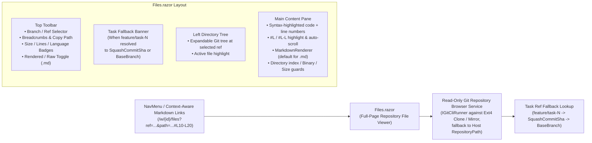

# 📂 Step 12.46A: Git Branch Repository File Viewer (`/files`)

> **Feature Implementation Step (Part 1 of 2 — Read-Only Git Ref Tree & File Inspector Page)**  
> *Parent Plan:* [Features & Integrations Roadmap](README.md)  
> *Companion Step:* [Step 12.46B: Context-Aware Markdown Link Builder & Unified UI Integration](STEP_12_46B_CONTEXT_AWARE_MARKDOWN_LINK_BUILDER.md)  
> *Related Steps:* [Step 12.41: Full-Page Agent Memory Explorer](STEP_12_41_WORKSPACE_MEMORY_PAGE_AND_IDEATION_CLEANUP_PROMPTS.md) *(Implemented)* | [Step 12.40: Tool Output & File Read Binary Content Guard](STEP_12_40_TOOL_OUTPUT_BINARY_CONTENT_GUARD.md) *(Planned)* | [Step 12.44: CSS Architecture Rationalization & Scoped Styles](STEP_12_44_CSS_ARCHITECTURE_RATIONALIZATION_AND_SCOPED_STYLES.md) *(Planned)*  
> *Target Components:* `src/NightCodeForge.Core`, `src/NightCodeForge.Infrastructure`, `src/NightCodeForge.Web`, `tests/NightCodeForge.Core.Tests`, `tests/NightCodeForge.Infrastructure.Tests`, `tests/NightCodeForge.Web.Tests` | *Status:* Implemented | *Target Framework:* .NET 10 (C# 13)  
> *Aligns With:* [AGENTS.md](../../AGENTS.md), [docs/PLAN.md](../PLAN.md)
>
> This document is a **specification**: it states required behaviors and constraints, not implementations. Implementation choices (signatures, code structure) are left to the implementer, within the constraints of the documents.

---

## 1. Problem Statement & Motivation

NightCodeForge executes tasks inside isolated Git worktrees and branches (`feature/task-{id}`) hosted in the workspace's Ext4 working clone/mirror (`~/.nightcodeforge/wks/{id}/clone`), while the developer's host working directory may stay on `main` or another branch entirely. Across Ideation chats, stage conversations, transcripts, task descriptions, and agent memory files, agents and maintainers frequently reference arbitrary repository files by branch/worktree path and line range (for example `/workspace/task-42/src/Service.cs#L12-L34` or `/workspace/clone/docs/ARCHITECTURE.md`).

Today, NightCodeForge has no in-app repository file browser:
1. **No Arbitrary Git Branch Inspection:** Users can view diffs in the Review Room and committed memory files in `Memory.razor`, but cannot open an arbitrary file on `main`, `feature/task-{id}`, or a merged squash commit directly from the Web UI.
2. **Broken Mental Context After Squash-Merge:** Once a task completes and its ephemeral worktree and `feature/task-{id}` branch are deleted, links referencing `task-{id}` still need a graceful, transparent fallback (the task's `SquashCommitSha` or `BaseBranch`) so historical conversations and transcripts remain inspectable.
3. **Prerequisite for Context-Aware Markdown Links:** Before [Step 12.46B](STEP_12_46B_CONTEXT_AWARE_MARKDOWN_LINK_BUILDER.md) can rewrite arbitrary `/workspace/(clone|task-{nnn})/...` and relative repository Markdown links into live navigation targets, NightCodeForge needs a dedicated, safe, read-only `/files` viewer supporting branch/commit selection, directory tree browsing, syntax highlighting, line-range highlighting, and Markdown preview.

---

## 2. Architecture & Navigation Flow

---

## 3. Detailed Requirements & Specifications

### 3.1 Read-Only Git Ref, Tree & File Service (`Core` / `Infrastructure`)

Provide a dedicated read-only repository browsing service backed exclusively by [`IGitCliRunner`](../../src/NightCodeForge.Core/Interfaces/IGitCliRunner.cs) (no shell interpolation, no arbitrary host filesystem reads outside Git object queries):

1. **Repository Location, Cross-Platform Accessibility & Binary-Safe Git Capture:**
   - Resolve the workspace's canonical Git inspection directory using the same priority and Windows/WSL2 UNC accessibility rules as [`GitWorkspaceManager`](../../src/NightCodeForge.Infrastructure/Git/GitWorkspaceManager.cs), [`GitSyncService`](../../src/NightCodeForge.Web/Services/GitSyncService.cs), and [`TaskMarkdownSyncService`](../../src/NightCodeForge.Core/Services/TaskMarkdownSyncService.cs):
     1. Prefer `Workspace.Ext4MirrorPath` when configured and accessible (mapping WSL/Linux paths via `WslPathConverter` / [`IWorkspacePathResolver`](../../src/NightCodeForge.Core/Interfaces/IWorkspacePathResolver.cs) `.ToHostPath` on Windows).
     2. Otherwise, for non-`BareHost` workspaces, check the canonical working clone (`IWorkspacePathResolver.GetAgentWorkingClonePath(workspace.Id)`) if accessible.
     3. Fall back to `Workspace.RepositoryPath`.
   - Enforce read-only Git operations on committed Git objects only (`for-each-ref` / `branch`, `rev-parse`, `ls-tree`, `cat-file`, `show`). Never mutate repository state, checkout branches, modify working tree files, or read arbitrary host working-tree files.
   - **Raw-Byte Git Stdout Capability:** Today, [`SystemProcessRunner`](../../src/NightCodeForge.Core/Execution/SystemProcessRunner.cs) decodes `StandardOutput` as UTF-8 and strips `\0` bytes, and [`IGitCliRunner`](../../src/NightCodeForge.Core/Interfaces/IGitCliRunner.cs) returns only `string StandardOutput`. Add a binary-safe raw-byte stdout capture path across [`IProcessRunner`](../../src/NightCodeForge.Core/Interfaces/IProcessRunner.cs) / `SystemProcessRunner` and `IGitCliRunner` / `GitCliRunner` (preserving existing WSL2 routing, timeouts, and stderr credential redaction) so `git ls-tree -l -z` preserves `\0` record delimiters and `git show <ref>:<path>` delivers unmodified raw bytes for accurate binary detection and size-safe decoding.
2. **Branch & Ref Enumeration:**
   - Enumerate local branches using machine-safe formatting (such as `git for-each-ref --format=%(refname:short) refs/heads/` or `git branch --format=%(refname:short)`) so current-branch `*` / worktree `+` markers and detached `HEAD` entries never pollute branch names.
   - Return local branches in deterministic display order:
     1. Workspace default base branch (`Workspace.DefaultBaseBranch`, defaulting empty/whitespace to `"main"`), if present.
     2. Active `feature/task-*` branches sorted numerically ascending by task ID (with case-insensitive lexicographical tie-breaking for any non-numeric suffixes).
     3. Remaining local branches sorted case-insensitively alphabetically.
   - Support inspecting any valid branch name, tag, or commit SHA (e.g., `SquashCommitSha`) passed via query parameter, even when that SHA is not a named branch in the dropdown.
3. **Task Branch Fallback Resolution (`feature/task-{nnn}` / `taskId` Hint):**
   - Verify requested refs resolve to a commit in Git (`git rev-parse --verify <ref>^{commit}`).
   - When the requested ref targets `feature/task-{nnn}` (or an optional `taskId` hint is supplied) and does not exist in Git (for example, after squash-merge cleanup):
     - Look up the matching `ForgeTask` strictly within the **same `WorkspaceId`** (enforcing workspace isolation; never resolve a task from another workspace).
     - Apply fallback precedence:
       1. If `ForgeTask.SquashCommitSha` is set and resolves to a commit in Git, resolve to that commit SHA and attach structured fallback metadata indicating the original branch was replaced by the squashed commit.
       2. Otherwise, if `ForgeTask.BaseBranch` is set and resolves in Git, fall back to `ForgeTask.BaseBranch`, attaching structured fallback metadata indicating the original branch is unavailable and showing the task's base branch instead.
       3. Otherwise, fall back to `Workspace.DefaultBaseBranch` (defaulting empty/whitespace to `"main"`).
     - Ensure fallback metadata records the original requested ref, resolved ref/SHA, fallback reason, and associated `TaskId` so the UI can surface a clear informational banner.
4. **Directory Tree Listing:**
   - List directory entries at a given ref and optional directory path using machine-safe `git ls-tree -l -z` (long format `-l` plus NUL-delimited `-z` with `--` argument separation) so entry types, modes, and blob byte sizes are returned in a single Git invocation without N+1 `cat-file -s` queries.
   - Handle Git's directory-argument quirk: when listing a non-root directory, pass the normalized directory path with a trailing slash (e.g., `<ref> -- <dir>/`, or `<ref>:<dir>`) so Git lists the directory's children rather than a single entry for the directory itself.
   - Map Git object types and modes cleanly into structured entries containing entry kind (`tree`/directory for mode `040000`, `blob`/file for `100644`/`100755`, `symlink` for mode `120000`, `submodule`/gitlink for mode `160000` / type `commit`), name, normalized repo-relative path, and byte size for blobs (null/omitted for non-blob entries such as trees or submodules).
   - Sort directories first (case-insensitive alphabetical), followed by files (case-insensitive alphabetical).
   - Support both single-directory listing (for lazy tree expansion and directory index views) and subtree queries needed to expand ancestors of a deep-linked file path.
5. **File Content Reading, Entry-Type Dispatch & Safety Guards:**
   - **Strict Input Validation & Injection Prevention:**
     - Validate refs before passing arguments to Git: reject NUL bytes, control characters, whitespace, colons (`:`), `..`, `@{`, backslashes, and leading-dash refs (`-`) to prevent both Git CLI option injection and `<ref>:<path>` object-specifier injection.
     - Validate and normalize paths using forward slashes without leading or trailing slashes (except root `""`): reject NUL bytes, control characters, backslash path traversal, and `..` segments that escape repository root. Always use `--` separators where supported by Git subcommands.
   - **Entry-Type Inspection Before Blob Reading:**
     - Inspect the target path's Git entry kind/mode at the resolved ref (via `git ls-tree -l -z <ref> -- <path>` or `git cat-file -t`) before reading blob bytes:
       - If the path resolves to a `tree` (directory), return/dispatch cleanly to directory listing rather than attempting `git cat-file -s` / `git show` as a file.
       - If the path resolves to a `submodule` (mode `160000` / `commit`), return a structured submodule entry notice (recording the pinned commit SHA) without invoking `cat-file -s` or `show`.
       - If the path resolves to a `symlink` (mode `120000`), read the stored symlink target string safely and return structured symlink metadata without dereferencing host filesystem paths.
   - **Preview Size Guard (Named Constant):**
     - Check blob byte size via `git cat-file -s` (or the `ls-tree -l` size) before loading file bytes.
     - Enforce a named maximum preview byte threshold (consistent with UI preview budgets, e.g., 512 KB–1 MB). If the blob exceeds the limit, do not load its content into memory; return structured metadata indicating the file is oversized along with its exact byte size.
   - **Binary Content Detection (Shared Core Guard):**
     - Inspect raw bytes returned by `git show <ref>:<path>` (via the binary-safe raw-byte Git capture path) for NUL bytes outside valid UTF-16/UTF-32 BOM-decoded text, non-printable ASCII control-character density, and invalid UTF-8 / `U+FFFD` replacement-character density (aligned with the heuristics specified in [Step 12.40](STEP_12_40_TOOL_OUTPUT_BINARY_CONTENT_GUARD.md), with zero false positives on empty files or valid multilingual UTF-8 text).
     - Because Step 12.40 is still planned, place the reusable raw-byte binary detection helper in `NightCodeForge.Core` with unit tests in `NightCodeForge.Core.Tests` so Step 12.40 can build on or share it without duplication.
     - When binary content is detected, return a structured binary-file result (without decoded garbled text) so the UI displays a clear binary preview notice and metadata.
   - **Fail-Fast Domain Exceptions:**
     - Per [AGENTS.md](../../AGENTS.md), never synthesize fake files or swallow errors in bare `catch { }` blocks. Throw dedicated domain exceptions when the workspace does not exist, the Git repository is missing/inaccessible, the ref cannot be resolved (even after task fallback), the path/ref fails validation, or the requested file/directory does not exist at that ref.

### 3.2 Dedicated Full-Page File Viewer UI (`Files.razor`, `NavMenu`, `WorkspaceUrlHelper`)

1. **Routes, Navigation & Workspace Switching:**
   - Create `src/NightCodeForge.Web/Components/Pages/Files.razor` routed at:
     - `@page "/files"`
     - `@page "/w/{WorkspaceId:int}/files"`
   - Pass target coordinates via named-constant query parameters (rather than route path segments, avoiding ambiguity with `/` in branch names such as `feature/task-42` and deep file paths):
     - `ref`: Branch name or commit SHA (defaults to `Workspace.DefaultBaseBranch`, or `"main"` when empty/unset).
     - `path`: Normalized repository-relative file or directory path (defaults to repository root when omitted).
     - `taskId` *(optional)*: Task ID hint enabling `feature/task-{id}` fallback lookup and linking back to `/w/{WorkspaceId}/tasks/{TaskId}`.
     - `lines` *(optional)*: Explicit line or range query fallback (e.g., `42` or `42-58`), in addition to standard URL fragment anchors (`#L42`, `#L42-L58`).
   - Add a **Repository Files** (`📂 Repository Files`) navigation link in [`NavMenu.razor`](../../src/NightCodeForge.Web/Components/Layout/NavMenu.razor) (in the `Workflow` section alongside `Agent Memory`) using `WorkspaceState.GetNavHref(...)`.
   - Update [`WorkspaceUrlHelper.cs`](../../src/NightCodeForge.Web/Services/WorkspaceUrlHelper.cs):
     - Map `"files"` in `GetSectionDisplayName` to `"Repository Files"`.
     - Strip file/ref/task/line query parameters and fragments in `GetTargetUrlForWorkspaceSwitch` when switching workspaces on `/files`, landing cleanly on `/w/{newWorkspaceId}/files`.
   - Render `<WorkspaceEmptyStateHero />` when no workspace is active (`WorkspaceState.ActiveWorkspace == null`).
2. **Page Layout, Toolbar & Tree Browsing:**
   - **Top Toolbar:**
     - **Branch / Ref Selector:** Dropdown listing enumerated branches, plus an explicit temporary option pill when inspecting a commit SHA (such as a resolved `SquashCommitSha`). Changing the ref preserves the current `path` (showing a clean inline error banner if the file does not exist on the newly selected ref, while keeping the tree and ref selector usable).
     - **Clickable Breadcrumbs:** Split `path` into clickable parent directory segments (`repo-root / src / Core / Foo.cs`), updating the URL and loading the corresponding directory view.
     - **Metadata & Actions:** Display file byte size, line count, detected language/extension badge, a **Copy Path** button (using `navigator.clipboard.writeText`), and (for `.md`/`.markdown` files) a **Rendered / Raw** toggle button.
   - **Task Fallback Banner:**
     - Whenever `feature/task-{nnn}` fell back to `SquashCommitSha` or `BaseBranch`, display a non-intrusive informational banner stating which ref was requested, which commit/branch is displayed instead, and a direct link to `/w/{WorkspaceId}/tasks/{TaskId}`.
   - **Left Directory Tree Pane:**
     - Render an expandable repository tree for the active ref, automatically expanding ancestor directories of the currently selected `path` and highlighting the selected file or directory.
     - Selecting a directory expands/collapses it in the tree (and optionally updates the directory index view); selecting a file navigates cleanly to `/w/{WorkspaceId}/files?ref=...&path=...`.
3. **File Rendering, Line Highlighting & Scroll-Into-View:**
   - **Fragment & `LocationChanged` Synchronization:**
     - Blazor's `[SupplyParameterFromQuery]` does not bind URL fragments (`#L42`, `#L42-L58`). Parse the fragment from `NavigationManager.Uri` via the dedicated line-range helper and subscribe to `NavigationManager.LocationChanged` (disposing the subscription cleanly) so in-page fragment-only navigation and line clicks update the highlighted range without losing tree expansion state.
   - **Code & Plain-Text Files:**
     - Render line-by-line with line numbers in a monospace code viewer using `ISyntaxHighlightingService` ([`SimpleSyntaxHighlighter`](../../src/NightCodeForge.Web/Services/SimpleSyntaxHighlighter.cs)) and the existing `.tok-*` token CSS classes.
     - Support single-line and range highlighting parsed from URL fragments (`#L42`, `#L42-L58`, case-insensitive `L`) or the `lines` query parameter (`42`, `42-58`), clamping inverted or out-of-bounds ranges safely without crashing.
     - Highlight matched lines visually with a distinct row accent and automatically scroll the first highlighted line into view via JS interop in [`wwwroot/js/app.js`](../../src/NightCodeForge.Web/wwwroot/js/app.js) (`window.NightCodeForge.*`, respecting `prefers-reduced-motion` and handling `JSDisconnectedException` / `TaskCanceledException` cleanly, matching [`Memory.razor`](../../src/NightCodeForge.Web/Components/Pages/Memory.razor)).
     - Clicking a line number updates the URL anchor (`#L{n}`, or `Shift+Click` for `#L{start}-L{end}`, e.g. with `replace: true`) so users can copy/share exact line links.
   - **Markdown Files (`.md` / `.markdown`):**
     - Default to **Rendered** mode using [`MarkdownRenderer.razor`](../../src/NightCodeForge.Web/Components/Common/MarkdownRenderer.razor) (HTML-disabled, XSS-safe, and wired for [Step 12.46B](STEP_12_46B_CONTEXT_AWARE_MARKDOWN_LINK_BUILDER.md) relative links using the current ref, `taskId` if present, and file path).
     - Provide a **Rendered / Raw** toggle; **Raw** mode renders the syntax-highlighted, line-numbered source.
     - **Anchor Override Rule:** If the URL targets a specific line or line range (`#L...` or `lines=...`), automatically open the Markdown file in **Raw** mode so the targeted lines are highlighted and scrolled into view (allowing the user to toggle back to **Rendered** at any time).
   - **Directory Index & Degraded States:**
     - When `path` is empty or targets a directory (`tree`), render a clean directory table showing entries (name, type icon, size) clickable to drill down.
     - Render clear, accessible inline notices for binary files, oversized files, symlinks, submodules, missing refs, or missing file paths while keeping the branch selector and directory tree functional.
   - **Styling Alignment:**
     - Define viewer styles in [`wwwroot/css/app.css`](../../src/NightCodeForge.Web/wwwroot/css/app.css) using tokens from [`wwwroot/css/theme.css`](../../src/NightCodeForge.Web/wwwroot/css/theme.css) (consistent with the current non-isolated stylesheet architecture while [Step 12.44](STEP_12_44_CSS_ARCHITECTURE_RATIONALIZATION_AND_SCOPED_STYLES.md) remains planned).

### 3.3 UI & Presentation Separation & `AGENTS.md` Constraints

- Keep `Files.razor` strictly focused on layout, rendering, and user interaction per [AGENTS.md](../../AGENTS.md).
- Extract URL/query building, line-range parsing and formatting (`#L42`, `#L42-L58`), breadcrumb generation, path validation/normalization, and tree node state helpers into dedicated, unit-testable services/helpers in `src/NightCodeForge.Web/Services/`.
- Follow all [AGENTS.md](../../AGENTS.md) rules: no optional constructor parameters, $\le 10$ required constructor parameters per service, named constants/enums instead of magic numbers or strings, no synthetic database records, and no bare `catch { }` blocks.

---

## 4. Definition of Done (DoD) Checklist

- [x] Add binary-safe raw-byte stdout capture to `IProcessRunner` / `SystemProcessRunner` and `IGitCliRunner` / `GitCliRunner` (preserving WSL2 routing, timeouts, and stderr redaction), and place a reusable raw-byte binary content detector in `NightCodeForge.Core` with unit tests in `NightCodeForge.Core.Tests`.
- [x] Implement the read-only Git repository browser service in `Core` / `Infrastructure` using `IGitCliRunner` (`Ext4MirrorPath` -> canonical clone -> `RepositoryPath` priority with Windows/WSL2 UNC support), supporting machine-safe branch/ref enumeration, workspace-scoped `feature/task-{nnn}` fallback (`SquashCommitSha` -> `ForgeTask.BaseBranch` -> `Workspace.DefaultBaseBranch`), `git ls-tree -l -z` directory listing, entry-type dispatch (directory/symlink/submodule/blob), `git cat-file -s` + `git show` file reading, strict ref/path traversal & option/specifier-injection validation, named-constant size limit, and raw-byte binary detection.
- [x] Create `Files.razor` (`@page "/files"` and `@page "/w/{WorkspaceId:int}/files"`), add the `📂 Repository Files` entry to `NavMenu.razor`, render `<WorkspaceEmptyStateHero />` when no workspace is active, and update `WorkspaceUrlHelper` (`GetSectionDisplayName` + stripping file query/fragment parameters on workspace switch).
- [x] Implement the File Viewer UI: branch/ref dropdown, task fallback banner, clickable path breadcrumbs, expandable directory tree, syntax-highlighted line-numbered code viewer, `#L` / `#L-L` line-range parsing and `LocationChanged` fragment sync, row highlighting & JS scroll-into-view, clickable line numbers, Markdown Rendered/Raw toggle (with Raw auto-selection when line anchors are present), and clear directory/symlink/submodule/binary/oversized/error states styled via `app.css` / `theme.css`.
- [x] Extract all URL building, line-range parsing, breadcrumb, and presentation logic into dedicated helpers/services in `src/NightCodeForge.Web/Services/` per [AGENTS.md](../../AGENTS.md) (no non-trivial logic in `@code`, no optional constructor parameters, no magic strings, no bare `catch { }`).
- [x] Add unit tests in `NightCodeForge.Core.Tests` (raw-byte process/Git capture, binary detector), `NightCodeForge.Infrastructure.Tests` (Git browser service, task branch fallback & workspace isolation, path/ref security rejection, directory/symlink/submodule/size/binary guards), and unit + bUnit tests in `NightCodeForge.Web.Tests` (`Files.razor`, fragment `LocationChanged` sync, URL/line-range helpers, `WorkspaceUrlHelper`), then run the full test suite per [AGENTS.md](../../AGENTS.md).
