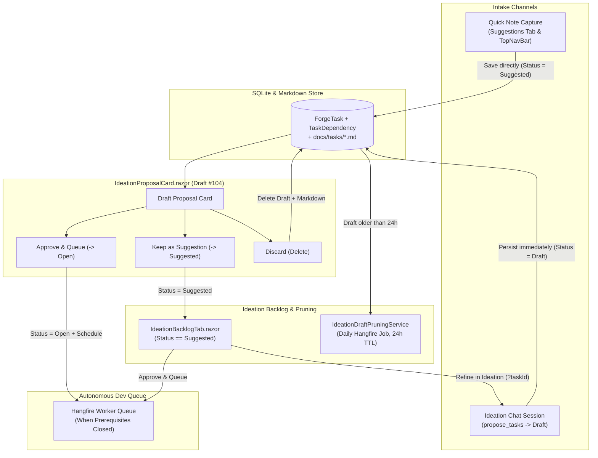

# 💡 Step 12.4: Ideation Quick Notes, Tri-State Proposal Cards & 24h Draft Pruning

> **Feature Implementation Step (Backlog Management & Ideation Lifecycle)** *(formerly Step 11.5)*  
> *Parent Plan:* [Features & Integrations Roadmap](README.md)  
> *Companion Steps:* [Step 12.13A: Ideation Backlog Mutation Tools & Prompt Policy](../archive/phase-12/STEP_12_13A_IDEATION_BACKLOG_MUTATION_TOOLS_AND_PROMPT_POLICY.md) | [Step 12.13B: "Refine in Ideation" Workflow & Mutation UI](../archive/phase-12/STEP_12_13B_REFINE_IN_IDEATION_WORKFLOW_AND_MUTATION_UI.md) | [Step 12.31: Interactive Ideation Agent Coordinator](../archive/phase-12/STEP_12_31_INTERACTIVE_IDEATION_AGENT_COORDINATOR_AND_WARM_EXECUTION_CONTEXT.md)  
> *Project Target:* `src/NightCodeForge.Core`, `src/NightCodeForge.Infrastructure`, `src/NightCodeForge.Web`, `tests/NightCodeForge.Core.Tests`, `tests/NightCodeForge.Infrastructure.Tests`, `tests/NightCodeForge.Web.Tests` | *Status:* Planned | *Target Framework:* .NET 10 (C# 13)  
> *Aligns With:* [AGENTS.md](../../AGENTS.md), [docs/PLAN.md](../PLAN.md)

> This document is a **specification**: it states required behaviors and constraints, not implementations. Implementation choices (signatures, code structure) are left to the implementer, within the constraints of the documents.

---

## 1. Executive Objective

Complete the three-state Ideation proposal and quick-capture lifecycle (`Draft`, `Suggested`, `Open`):

1. **Quick Notes Intake ("Think Now, Chat Later"):** Enable developers to capture spontaneous thoughts, feature ideas, and architectural notes directly into the **Ideation Backlog** (`Status = TaskOverallStatus.Suggested`) from the Ideation Suggestions tab or the top navigation bar without launching an AI chat session.
2. **Ideation Backlog / Suggestions Tab (`IdeationBacklogTab.razor`):** Surface all workspace `Suggested` tasks inside [`Ideation.razor`](../../src/NightCodeForge.Web/Components/Pages/Ideation.razor) alongside `Proposals` and `Attachments`, with search/priority filtering and direct **Approve & Queue**, **Refine in Ideation**, and **Delete** actions.
3. **Three-Way Proposal Lifecycle on `IdeationProposalCard.razor`:**
   - **Approve & Queue (`Draft` → `Open`):** Persists edits and selected `MergeMode`, promotes the task directly into `Open` status, and schedules it via [`ITaskOrchestrator`](../../src/NightCodeForge.Core/Workflow/ITaskOrchestrator.cs) when prerequisites are closed.
   - **Keep as Suggestion (`Draft` → `Suggested`):** Persists edits and preserves the task in the Ideation Backlog / Suggestions list for future evaluation without queuing autonomous execution.
   - **Discard (Delete):** Permanently deletes the unpromoted `Draft` item and its dependencies from SQLite and disk markdown.
4. **Automated 24h TTL Pruning for Abandoned Drafts:** Purge stale, unpromoted `Draft` tasks older than 24 hours via a daily Hangfire recurring job (`IdeationDraftPruningService`), while preserving `Suggested` tasks indefinitely.

---

## 2. Current Baseline & Remaining Scope

### 2.1 Already Implemented in Baseline
- [`TaskOverallStatus`](../../src/NightCodeForge.Core/Domain/Enums.cs) defines `Triage = -2`, `Draft = -1`, `Suggested = 0`, and `Open = 2`.
- [`BacklogMutationToolService`](../../src/NightCodeForge.Agents/Tools/BacklogMutationToolService.cs) (`ProposeTasksAsync`) already writes Ideation `propose_tasks` outputs immediately to SQLite as `TaskOverallStatus.Draft` so subsequent calls in the same session receive concrete integer IDs (`depends_on_ids`).
- [`Ideation.razor`](../../src/NightCodeForge.Web/Components/Pages/Ideation.razor) provides the two-pane desktop layout (`chat-pane` + `proposals-pane` with `IdeationSideTab.Proposals` and `IdeationSideTab.Attachments`, plus `ideation-mobile-switcher`) and supports `?taskId={id}` refinement sessions ([Step 12.13B](../archive/phase-12/STEP_12_13B_REFINE_IN_IDEATION_WORKFLOW_AND_MUTATION_UI.md)).
- [`Backlog.razor`](../../src/NightCodeForge.Web/Components/Pages/Backlog.razor) already excludes `TaskOverallStatus.Draft` from the Kanban board and visual DAG.

### 2.2 Remaining Gaps Addressed by This Step
- [`IdeationProposalCard.razor`](../../src/NightCodeForge.Web/Components/Ideation/IdeationProposalCard.razor) currently offers only binary actions (`Add to Backlog` → `Suggested`, and `Dismiss` → delete `Draft`) with no `Approve & Queue` (`Draft` → `Open`) action or `MergeMode` selector.
- There is no Quick Notes capture input in [`Ideation.razor`](../../src/NightCodeForge.Web/Components/Pages/Ideation.razor) or [`TopNavBar.razor`](../../src/NightCodeForge.Web/Components/Layout/TopNavBar.razor), and no `IdeationBacklogTab.razor` view for `Suggested` tasks.
- [`TaskTableFilterService`](../../src/NightCodeForge.Web/Services/TaskTableFilterService.cs) currently merges `Draft` into `TaskStatusFilter.Suggested`, blurring unconfirmed drafts with confirmed suggestions.
- Stale `Draft` records from abandoned ideation sessions accumulate indefinitely in SQLite and `docs/tasks/` without automated TTL cleanup.

---

## 3. High-Level Architecture & Lifecycle Flow

---

## 4. Behavioral Specifications

### 4.1 Strict `Draft` vs. `Suggested` Separation
1. **`Draft` (`TaskOverallStatus.Draft = -1`) Isolation:**
   - Represents an unconfirmed task proposed inside an Ideation chat session.
   - Excluded from autonomous pipeline execution ([`TaskOrchestrator`](../../src/NightCodeForge.Core/Workflow/TaskOrchestrator.cs)), excluded from `/backlog` Kanban & DAG ([`Backlog.razor`](../../src/NightCodeForge.Web/Components/Pages/Backlog.razor)), and excluded from `TaskStatusFilter.Suggested` in [`TaskTableFilterService`](../../src/NightCodeForge.Web/Services/TaskTableFilterService.cs) (so filtering `/tasks` by `Suggested` returns only confirmed `Suggested` tasks).
2. **`Suggested` (`TaskOverallStatus.Suggested = 0`) Preservation:**
   - Represents a confirmed idea or quick note stored in the Ideation Backlog.
   - Preserved indefinitely (never pruned by TTL cleanup) and never autonomously executed until explicitly promoted to `Open`.

### 4.2 Quick Notes Intake ("Think Now, Chat Later")
1. **Entry Points:**
   - **Ideation Suggestions Tab (`IdeationBacklogTab.razor`):** Inline quick-capture bar at the top of the tab for fast capture while reviewing suggestions.
   - **Top Navigation Bar ([`TopNavBar.razor`](../../src/NightCodeForge.Web/Components/Layout/TopNavBar.razor)):** Compact quick-note trigger button opening a lightweight modal/popover accessible from any page and mobile viewport (`< 768px`) without crowding the top bar.
   - When no active workspace is selected (`WorkspaceState.ActiveWorkspace == null`), disable submission and display clear guidance to select or create a workspace.
2. **Inputs & Validation:**
   - **Title:** Required (non-whitespace after trimming).
   - **Brief Note / Context:** Optional multi-line description.
   - **Action:** `"Save to Ideation Backlog"`.
3. **Persistence & Sync Behavior:**
   - Persist directly into `ForgeTask` via [`ITaskRepository.CreateWithBaselineAsync`](../../src/NightCodeForge.Core/Repositories/ITaskRepository.cs) attributed to `AuditActors.User`:
     - `Status = TaskOverallStatus.Suggested`
     - `Origin = TaskOrigin.Ideation`
     - `Priority = TaskPriority.Normal`
     - `Difficulty = TaskDifficulty.Standard`
     - `MergeMode = MergeMode.ManualReviewRequired` (safe default; configurable upon promotion to `Open`)
     - `WorkflowId` resolved from `workspace.DefaultWorkflowId` or the default workflow via `IWorkflowRepository`
     - `BaseBranch` resolved from `workspace.DefaultBaseBranch` or `WorkflowDefaults.DefaultBaseBranch`
   - Perform best-effort markdown sync via [`ITaskMarkdownSyncService.SyncTaskToDiskAsync`](../../src/NightCodeForge.Core/Services/TaskMarkdownSyncService.cs); if disk sync fails (non-cancellation error), log a warning and surface a non-fatal warning toast rather than failing silently.
   - Invalidate Ideation workspace context via `IIdeationConversationCoordinator.MarkWorkspaceContextDirty(workspace.Id)` so future chat turns see the new suggestion in `<existing_workspace_tasks>`.
   - Refresh active Ideation task state / notify views so the captured note immediately appears in `IdeationBacklogTab.razor` and `/backlog`.

### 4.3 Ideation Backlog / Suggestions Tab (`IdeationBacklogTab.razor`)
1. **Side-Panel & Mobile Integration in [`Ideation.razor`](../../src/NightCodeForge.Web/Components/Pages/Ideation.razor):**
   - Extend [`IdeationSideTab`](../../src/NightCodeForge.Web/Services/IdeationMobilePane.cs) to three tabs: `Proposals`, `Suggestions` (with a live count badge of `Suggested` tasks), and `Attachments`.
   - Expose the `Suggestions` tab in both the desktop side panel and the mobile pane switcher (`ideation-mobile-switcher`).
2. **Filtering & Presentation Separation ([AGENTS.md](../../AGENTS.md)):**
   - Display all workspace tasks where `Status == TaskOverallStatus.Suggested` (strictly excluding `Draft` and `Triage`), ordered deterministically (e.g., priority ascending, then newest first).
   - Provide search (by `#id`, title, or description) and priority filter controls; extract filtering, sorting, and quick-note/suggestion coordination logic into dedicated Web services/helpers under `src/NightCodeForge.Web/Services/` rather than embedding business logic in `.razor` `@code` blocks.
3. **Per-Suggestion Card Actions:**
   - Display task `#Id`, title, concise description preview, priority/difficulty/origin badges, and creation timestamp.
   - **🚀 Approve & Queue:** Opens promotion controls (reusing [`MaintainerPromotionModal.razor`](../../src/NightCodeForge.Web/Components/Backlog/MaintainerPromotionModal.razor) or equivalent [`ITaskOrchestrator.PromoteSuggestedTaskAsync`](../../src/NightCodeForge.Core/Workflow/ITaskOrchestrator.cs) workflow) to configure Priority, Difficulty, `MergeMode` (`Automatic`, `ManualReviewRequired`, `ExternalPullRequest` gated on GitHub PR delivery availability), and `BaseBranch`, promoting the task to `Open` and enqueueing when prerequisites are closed.
   - **💡 Refine in Ideation:** Navigates to workspace-scoped `/w/{workspaceId}/ideation?taskId={id}` ([Step 12.13B](../archive/phase-12/STEP_12_13B_REFINE_IN_IDEATION_WORKFLOW_AND_MUTATION_UI.md)) and switches the mobile view back to the Chat pane when triggered from within `Ideation.razor`.
   - **🗑️ Delete:** Requires explicit confirmation; only permitted for unstarted `Suggested` tasks (`!task.HasExecutionRun`) that have no active non-terminal dependent tasks (`Cancelled`, `Rejected`, and `Triage` do not block deletion; active dependents fail with a clear user-facing error). Deletes the record via `ITaskRepository.DeleteAsync`, cleans up its `docs/tasks/` markdown file via `ITaskMarkdownSyncService.ArchiveOrCleanupTaskFileAsync(..., archive: false)`, marks Ideation coordinator context dirty, and refreshes the suggestions list.

### 4.4 Three-Way Action on Proposal Cards (`IdeationProposalCard.razor`)
1. **Editable Proposal Fields:**
   - Retain Title, Description Preview/Edit, Priority, Difficulty, Linked Attachments, and Prerequisite Dependencies on [`IdeationProposalCard.razor`](../../src/NightCodeForge.Web/Components/Ideation/IdeationProposalCard.razor).
   - Add a `MergeMode` selector defaulting to `MergeMode.ManualReviewRequired`; expose `MergeMode.ExternalPullRequest` only when GitHub Pull Request delivery is available for the workspace (`GitHubPullRequestUiHelper.IsPullRequestDeliveryAvailableAsync`, per [Step 12.11B](../archive/phase-12/STEP_12_11B_GITHUB_PULL_REQUEST_DELIVERY.md)).
2. **Three-Way Lifecycle Actions (when proposal is in `Draft` state):**
   - **🚀 Approve & Queue (`Draft` → `Open`):**
     - Validates title, attachment citations, and `ExternalPullRequest` availability (failing fast with a clear error notification if invalid).
     - Persists any user edits (Title, Description, Priority, Difficulty, `MergeMode`, Dependencies, Attachments), sets `Status = TaskOverallStatus.Open` with `AuditActors.User` history, syncs markdown and GitHub mirror (when enabled), updates the dependency store, marks coordinator context dirty, and schedules execution via [`ITaskOrchestrator`](../../src/NightCodeForge.Core/Workflow/ITaskOrchestrator.cs) (`PromoteSuggestedTaskAsync` / `TryScheduleOpenTaskIfReadyAsync`) if all prerequisites are `Closed` (if prerequisites are unclosed, leaves in `Open` without enqueuing).
     - Card transitions to a confirmed **Approved & Queued (`Open`)** state banner with direct navigation links to the task and `/backlog`.
   - **💡 Keep as Suggestion (`Draft` → `Suggested`):**
     - Persists user edits and attachment/dependency links, sets `Status = TaskOverallStatus.Suggested` with `AuditActors.User` history, syncs markdown to disk, marks coordinator context dirty, and does **not** enqueue autonomous execution.
     - Card transitions to a **Saved as Suggestion** state banner with a link to view in the Suggestions tab or `/backlog`.
   - **🗑️ Discard (Delete):**
     - Deletes the unpromoted `Draft` task and associated `TaskDependency` links from SQLite (`ITaskRepository.DeleteAsync`), removes any on-disk markdown file (`ArchiveOrCleanupTaskFileAsync(..., archive: false)`), marks coordinator context dirty, refreshes `WorkspaceTasks` (updating remaining cards' dependency lists), and removes the card from the proposal list.
3. **Batch Action & ViewModel Separation:**
   - Update [`IdeationProposalViewModel`](../../src/NightCodeForge.Web/Services/IdeationSessionState.cs) to track the resolved persisted lifecycle state (`Draft`, `Suggested`, `Open`) rather than a single boolean, and keep all persistence/orchestration logic in [`IIdeationProposalService`](../../src/NightCodeForge.Web/Services/IdeationProposalService.cs) and [`IdeationPresentationHelper`](../../src/NightCodeForge.Web/Services/IdeationPresentationHelper.cs).
   - Provide a clear batch action in [`Ideation.razor`](../../src/NightCodeForge.Web/Components/Pages/Ideation.razor) to **Keep All as Suggestions** (`Draft` → `Suggested` sequentially without auto-queuing autonomous execution).

### 4.5 Automated 24-Hour TTL Pruning (`IdeationDraftPruningService`)
1. **Hangfire Recurring Job Registration:**
   - Implement `IdeationDraftPruningService` in `NightCodeForge.Infrastructure` and register it during host startup ([`Program.cs`](../../src/NightCodeForge.Web/Program.cs)) on `HangfireQueues.Default` (`NCF-Utility-Worker`, never an inference queue) via `IRecurringJobManager.AddOrUpdate`.
   - Define named constants (no magic numbers or strings) for the recurring job identifier, daily cron schedule, and default 24-hour TTL (`TimeSpan.FromHours(24)`).
   - Inject `TimeProvider` and required collaborators (`ITaskRepository`, `IWorkspaceRepository`, `ITaskMarkdownSyncService`, `IIdeationConversationCoordinator`, `ILogger<IdeationDraftPruningService>`) with no optional constructor parameters ([AGENTS.md](../../AGENTS.md)).
2. **Pruning & Preservation Rules:**
   - Query tasks where `Status == TaskOverallStatus.Draft`.
   - A `Draft` is eligible for pruning only when **both** `CreatedAt < cutoff` and `UpdatedAt < cutoff` (`cutoff = timeProvider.GetUtcNow().UtcDateTime - DefaultDraftTtl`), so drafts actively edited within the last 24 hours are not prematurely deleted.
   - **`Suggested` (`Status == 0`), `Triage` (`Status == -2`), `Open`, and all non-`Draft` tasks are NEVER pruned automatically.**
   - **Dependency Integrity Guard:** Before deleting an expired `Draft`, verify it is not referenced as a prerequisite by any active non-`Draft` task (`Suggested`, `Open`, `Reviewed`, `Implemented`, `Ready`). If referenced, skip deletion and log a warning rather than silently breaking a promoted task's dependency graph.
3. **Cleanup & Synchronization:**
   - For each pruned `Draft`: delete the record and its `TaskDependency` entries via `ITaskRepository.DeleteAsync`, perform best-effort markdown cleanup (`ArchiveOrCleanupTaskFileAsync(..., archive: false)`) with structured warning logging on failure (no bare `catch { }`) so `TaskDiskSyncCoordinator` cannot resurrect deleted drafts from disk, and mark affected workspace Ideation contexts dirty.

---

## 5. Implementation Checklist & Deliverables

- [ ] **Domain, Queries & Constants:**
  - [ ] Strictly differentiate `TaskOverallStatus.Draft = -1` and `TaskOverallStatus.Suggested = 0` in [`TaskTableFilterService`](../../src/NightCodeForge.Web/Services/TaskTableFilterService.cs) (`TaskStatusFilter.Suggested` excludes `Draft`) and verify all task query/classifier paths.
  - [ ] Centralize quick-note defaults, pruning job ID, cron schedule, and 24h TTL as named constants.
- [ ] **Tri-State Proposal Card & Services:**
  - [ ] Update `IdeationProposalViewModel`, [`IdeationPresentationHelper`](../../src/NightCodeForge.Web/Services/IdeationPresentationHelper.cs), and [`IIdeationProposalService`](../../src/NightCodeForge.Web/Services/IdeationProposalService.cs) to support `Approve & Queue` (`Draft -> Open` with `MergeMode`), `Keep as Suggestion` (`Draft -> Suggested`), and `Discard` (`Delete`).
  - [ ] Update [`IdeationProposalCard.razor`](../../src/NightCodeForge.Web/Components/Ideation/IdeationProposalCard.razor) with `MergeMode` selector (gating `ExternalPullRequest`) and tri-state action buttons + distinct post-action status banners.
  - [ ] Update [`Ideation.razor`](../../src/NightCodeForge.Web/Components/Pages/Ideation.razor) batch action to "Keep All as Suggestions".
- [ ] **Quick Notes & Ideation Backlog Tab UI:**
  - [ ] Extract quick-note creation and suggestion filtering/deletion coordination into dedicated service/helper classes in `src/NightCodeForge.Web/Services/`.
  - [ ] Add `IdeationBacklogTab.razor` with inline Quick Note capture bar, search/priority filters, and `Approve & Queue`, `Refine in Ideation`, and `Delete` actions; integrate into [`Ideation.razor`](../../src/NightCodeForge.Web/Components/Pages/Ideation.razor) (`IdeationSideTab.Suggestions`) and mobile switcher.
  - [ ] Add compact Quick Note capture trigger/modal in [`TopNavBar.razor`](../../src/NightCodeForge.Web/Components/Layout/TopNavBar.razor) with responsive mobile behavior.
- [ ] **Background Draft Pruning:**
  - [ ] Implement `IdeationDraftPruningService` (using `TimeProvider`, dependency-integrity guard, markdown cleanup, and structured logging) and register daily Hangfire recurring job in [`Program.cs`](../../src/NightCodeForge.Web/Program.cs) on `HangfireQueues.Default`.
- [ ] **Automated Tests:**
  - [ ] Unit tests (`Core`/`Infrastructure`/`Web.Tests`): Quick Note creation (`Suggested`, `Ideation` origin, normal priority, disk sync), tri-state proposal transitions (`Draft -> Open`, `Draft -> Suggested`, `Draft -> Deleted`), `TaskTableFilterService` separation of `Draft` vs `Suggested`, and `IdeationDraftPruningService` (deletes stale `Draft` >24h, preserves recently updated `Draft`, preserves `Suggested`, skips `Draft` referenced by active tasks, cleans up markdown).
  - [ ] bUnit tests: updated [`IdeationProposalCardTests.cs`](../../tests/NightCodeForge.Web.Tests/IdeationProposalCardTests.cs) covering tri-state buttons and `MergeMode` selector, plus bUnit coverage for `IdeationBacklogTab.razor` and the `TopNavBar.razor` Quick Note modal.
  - [ ] Run fast tests (`dotnet test --filter "Category!=Acceptance&Category!=E2E"`) during development and full test suite on completion per [AGENTS.md](../../AGENTS.md).
