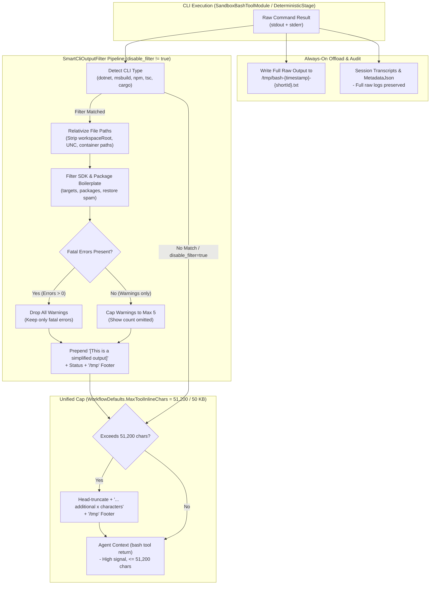
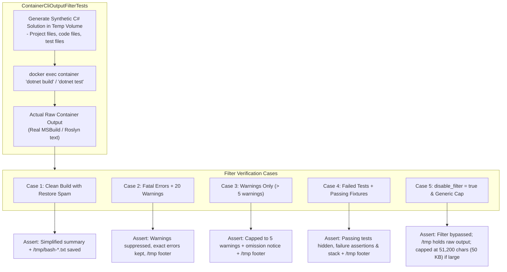

# 🧹 Step 12.6: Smart CLI & Build Tool Output Filtering, `/tmp` Offload & Unified Output Limits

> **Phase 12 Implementation Step (Extend Features - Intelligence & Quality Gates)** *(formerly Step 11.3)*  
> *Parent Plan:* [Features & Integrations Roadmap](README.md)  
> *Project Target:* `src/NightCodeForge.Core/Domain`, `src/NightCodeForge.Core/Services`, `src/NightCodeForge.Core/Workflow`, `src/NightCodeForge.Infrastructure/Execution`, `src/NightCodeForge.Agents/Tools/Filtering`, `src/NightCodeForge.Agents/Tools`, `src/NightCodeForge.Agents/Crucible`, `src/NightCodeForge.Agents/Transcripts`, `src/NightCodeForge.Web/Components`, `src/NightCodeForge.Web/Services`, `tests/NightCodeForge.Core.Tests`, `tests/NightCodeForge.Agents.Tests`, `tests/NightCodeForge.Cli.Tests`, `tests/NightCodeForge.Web.Tests` | *Status:* Planned  
> *Aligns With:* [AGENTS.md](../../AGENTS.md), [docs/PLAN.md](../PLAN.md)
>
> This document is a **specification**: it states required behaviors and constraints, not implementations. Implementation choices (signatures, code structure) are left to the implementer, within the constraints of the documents.

---

## 1. Executive Objective

Significantly improve LLM reasoning efficiency and token economy by applying **smart, semantic output filters**, **always offloading full `bash` logs to `/tmp`**, and **unifying inline tool output limits** across `bash`, `read`, and `web_search` — while cleanly replacing the legacy `StructuredDiagnosticExtractor`:

1. **Always Offload Full `bash` Output to `/tmp` (Uniform with `web_search`):**
   - Every `bash` execution writes its full, raw, untruncated output to `/tmp/bash-{timestamp}-{shortId}.txt` via `ISandboxPathResolver` (matching [`ResearchAndSkillsToolModule.WebSearchAsync`](../../src/NightCodeForge.Agents/Tools/ResearchAndSkillsToolModule.cs)'s `/tmp/web-search-*.md` offload pattern), so agents can query any skipped lines or details on demand via `grep`/`rg`/`sed` or `read` without re-running builds or test suites.
   - Ensure `SandboxTmpMount` is mounted across both `Standard` (`:rw`) and `RestrictedReadOnly` (`:ro`) container scopes so `/tmp/bash-*.txt` is readable inside `-ro` containers as well.

2. **Unified Inline Output Cap Across `bash`, `read`, and `web_search`:**
   - Replace the disparate tool output caps in [`WorkflowDefaults`](../../src/NightCodeForge.Core/Workflow/WorkflowDefaults.cs) (`MaxStageOutputChars = 32768`, `MaxWebSearchTotalInlineChars = 12000`, `MaxReadFileBytes = 100 * 1024`) with a single unified inline cap (`WorkflowDefaults.MaxToolInlineChars = 50 * 1024`, i.e. `51_200` chars/bytes or `50 KB`, with `MaxReadFileBytes = MaxToolInlineChars` and `MaxWebSearchTotalInlineChars = MaxToolInlineChars`), keeping every tool response within `50 KB` (~15k tokens).

3. **Path Relativization, SDK Boilerplate Pruning & Warning Policy:**
   - Strip long absolute host, WSL2 (`/home/.../wks/{id}/...`), and container (`/workspace/...`) paths into workspace-relative paths (`src/Core/Workflow.cs(45,12)`), and strip trailing ` [C:\...\Project.csproj]` annotations, SDK targets, package restore spam, and copyright banners.
   - **Suppress Warnings When Errors Exist:** Drop compiler warnings when fatal errors exist (`[⚠️ Suppressed {count} compiler warnings to focus on {errorCount} fatal errors.]`).
   - **Warning Cap When No Errors Exist:** Cap warnings to top $N$ (default `5`) with an omission notice.

4. **Standardized Output Formats (Simplified vs. Generic Truncated):**
   - **Smart-Filtered CLI Commands** (`dotnet build`, `dotnet test`, `msbuild`, `tsc`, `cargo`, `npm`):
     ```text
     [This is a simplified output]
     src/Core/Workflow.cs(45,12): error CS0246: ...
     src/Core/Workflow.cs(45,12): error CS0246: ...
     src/Core/Workflow.cs(45,12): error CS0246: ...
     [⚠️ Suppressed {count} compiler warnings to focus on {errorCount} fatal errors.]
     Build failed.
     [Full output : /tmp/xxxx.txt (x chars), use grep/rg/sed to extract additional informations]
     ```
   - **Generic Commands Exceeding the Unified Inline Cap** (unmatched tools or `disable_filter: true`):
     ```text
     xxxxxx
     xxxxxx
     xcxxxx
     ... additional x characters
     [Full output : /tmp/xxxx.txt (x chars), use grep/rg/sed to extract additional informations]
     ```

5. **Clean-Break Replacement of `StructuredDiagnosticExtractor` & `StructuredDiagnosticExtraction`:**
   - Fully replace the legacy [`StructuredDiagnosticExtractor`](../../src/NightCodeForge.Agents/Optimizations/StructuredDiagnosticExtractor.cs) (which appended redundant `[Structured Diagnostics Extracted]` blocks after full raw output) and replace `LocalOptimizationFlags.StructuredDiagnosticExtraction` with `LocalOptimizationFlags.SmartCliOutputFiltering` across domain models, transcripts, UI settings, and tests.

6. **Context vs. Audit Telemetry Separation & Filter Bypass:**
   - The **compact, capped** output is returned to the LLM via `bash`; the **full, raw** output lives in `/tmp/bash-*.txt`, disk session transcripts (`SessionTranscriptService`), and `ConversationTurn.MetadataJson` for developer auditability.
   - `bash` exposes `disable_filter: bool? = null` so an agent needing raw diagnostics inline can bypass semantic filtering (still writing `/tmp/bash-*.txt` and enforcing `MaxToolInlineChars`).

---

## 2. Problem Statement & Motivation

A standard `dotnet build` or `msbuild` invocation on a multi-project solution often outputs 2,000 to 10,000 tokens of raw console logs:
- Hundreds of lines of package asset resolution and restore notices.
- Deep nested file paths repeated on every warning/error line.
- Dozens of non-fatal warnings (e.g. CS1591 XML doc warnings, obsolete warnings) that bury the actual fatal error (`CS0246: The type or namespace could not be found`).
- Previously, `StructuredDiagnosticExtractor` kept the full raw output and **appended** extracted diagnostics on top, increasing rather than reducing prompt tokens, while `bash` (32 KB), `web_search` (12 KB), and `read` (100 KB) enforced inconsistent context limits without saving `bash` logs to `/tmp`.
- For local LLMs (e.g. Qwen 2.5 Coder 32B, DeepSeek R1 14B) with 16k–32k context windows, a single verbose build or `read` call can consume 30% to 50% of the working context, causing "lost in the middle" syndrome and hallucinations.

---

## 3. Architecture & Filter Pipeline



---

## 4. Technical Design Specifications

### 4.1 Filter Abstraction (`ICliOutputFilter`)

Define `ICliOutputFilter`, `ICliOutputFilterRegistry`, and `CommandFilterOptions` in `NightCodeForge.Core.Workflow.Filtering` (or place the Core contracts and regex-based filter implementations `DotNetCliOutputFilter`, `NodeTscCliFilter`, `CargoCliFilter`, and `CliOutputFilterRegistry` in `NightCodeForge.Core` / `NightCodeForge.Agents.Tools.Filtering` with a Core contract and static/default registry), because `NightCodeForge.Core` does not reference `NightCodeForge.Agents` and `TaskOrchestrator` must remain within the 10-parameter constructor ceiling:

```csharp
namespace NightCodeForge.Core.Workflow.Filtering; // or NightCodeForge.Agents.Tools.Filtering backed by Core contracts

public interface ICliOutputFilter
{
    /// <summary>
    /// Checks whether this filter applies to the executed command line.
    /// </summary>
    bool CanHandle(string command);

    /// <summary>
    /// Transforms raw CLI stdout/stderr into a compact, high-signal representation for the LLM.
    /// </summary>
    string FilterOutput(string rawOutput, string workspaceRoot, CommandFilterOptions options);
}

public record CommandFilterOptions(
    int MaxWarnings = 5,
    bool RelativizePaths = true,
    bool SuppressWarningsOnErrors = true,
    bool StripSdkInternalLocations = true);
```

---

### 4.2 DotNet & MSBuild Filter Implementation (`DotNetCliOutputFilter`)

#### 1. Path Relativization Regex & Normalization
Replaces:
`C:\Users\Julien\source\repos\jetelain\NightCodeForge\src\Core\Workflow.cs(45,12): error CS0246... [C:\...\Core.csproj]`
With:
`src/Core/Workflow.cs(45,12): error CS0246: ...`

- Replaces backslashes with normalized forward slashes for relative file paths.
- Strips trailing ` [.../*.csproj]` project annotations.
- Strips `/workspace/task-{id}/` container prefixes and `\\wsl.localhost\...` UNC prefixes.

#### 2. SDK Targets & Boilerplate Stripping
- Identifies and collapses lines matching:
  - `Microsoft.NET.Sdk...`
  - `Microsoft.Common.CurrentVersion.targets`
  - `Determining projects to restore...`
  - `All projects are up-to-date for restore.`
  - Copyright notices and ASCII banners.

#### 3. Warning Policy Enforcement & Simplified Output Format
- Prefix simplified CLI output with `[This is a simplified output]`.
- If `error CS...` count > 0:
  - Drops all `warning CS...` lines.
  - Inserts: `[⚠️ Suppressed {count} compiler warnings to focus on {errorCount} fatal errors.]`
  - Includes build/test outcome summary line (e.g., `Build failed.`) followed by the `/tmp` full-output pointer footer:
    ```text
    [This is a simplified output]
    src/Core/Workflow.cs(45,12): error CS0246: ...
    [⚠️ Suppressed 15 compiler warnings to focus on 2 fatal errors.]
    Build failed.
    [Full output : /tmp/bash-20261118192300-a1b2c3d4.txt (14820 chars), use grep/rg/sed to extract additional informations]
    ```
- If error count == 0 and warning count > `MaxWarnings`:
  - Retains first 5 unique warnings.
  - Inserts: `[... and {count - 5} additional warnings omitted. Run with disable_filter=true for complete list.]`
  - Includes outcome summary (`Build succeeded.` / `Passed! ...`) and the `/tmp` full-output pointer footer.
- For `dotnet test` failures, omits passing test fixture noise while retaining failed test names, assertion messages, relative stack trace lines, summary status, and the `/tmp` full-output pointer footer.

---

### 4.3 Unified Output Caps, `/tmp` Offload, Clean-Break Replacement & Deterministic Priming

1. **Modular Tool Architecture & Dependency Injection (Constructor Ceiling `<= 10`):**
   - `bash` execution and AI function schema definition live in [`SandboxBashToolModule`](../../src/NightCodeForge.Agents/Tools/SandboxBashToolModule.cs) (`BashAsync` and `CreateFunctions`), composed by [`CanonicalToolsetFactory`](../../src/NightCodeForge.Agents/Tools/CanonicalToolsetFactory.cs), while [`CanonicalTools`](../../src/NightCodeForge.Agents/Tools/CanonicalTools.cs) exposes forwarding overloads and [`CanonicalAIFunctionFactory`](../../src/NightCodeForge.Agents/Tools/CanonicalAIFunctionFactory.cs) delegates to the tool modules.
   - Inject `ICliOutputFilterRegistry` as a **required** constructor dependency (no optional parameters or silent fallbacks per [AGENTS.md](../../AGENTS.md)) into:
     - [`CanonicalToolsetFactory`](../../src/NightCodeForge.Agents/Tools/CanonicalToolsetFactory.cs) (`8 -> 9` constructor parameters)
     - [`CanonicalTools`](../../src/NightCodeForge.Agents/Tools/CanonicalTools.cs) (`8 -> 9` constructor parameters)
     - [`SandboxBashToolModule`](../../src/NightCodeForge.Agents/Tools/SandboxBashToolModule.cs) (`4 -> 5` constructor parameters)
   - Update [`TestCanonicalToolsBuilder`](../../tests/NightCodeForge.Agents.Tests/Fixtures/TestCanonicalToolsBuilder.cs) with default filter registry wiring so existing test suites and `ConstructorParameterCeilingTests` (`<= 10` parameters) remain green.
   - Note that [`TaskOrchestrator`](../../src/NightCodeForge.Core/Workflow/TaskOrchestrator.cs) is already at the **10-parameter constructor ceiling**; do **not** add constructor parameters to `TaskOrchestrator` (or `CrucibleAgentHarness` / `IdeationService`, which are also at 10 parameters).
   - Extend `CanonicalToolScope` in [`CanonicalToolsetFactory`](../../src/NightCodeForge.Agents/Tools/CanonicalToolsetFactory.cs) with `OptimizationFlags` (`LocalOptimizationFlags`), and populate it from [`CrucibleAgentHarness`](../../src/NightCodeForge.Agents/Crucible/CrucibleAgentHarness.cs), `IdeationService`, and `TriageService`.

2. **Unified Inline Output Cap Across `bash`, `read`, `web_search` & Transcript Friction Thresholds ([`WorkflowDefaults.cs`](../../src/NightCodeForge.Core/Workflow/WorkflowDefaults.cs), [`TranscriptAnalysisModels.cs`](../../src/NightCodeForge.Core/Services/TranscriptAnalysisModels.cs)):**
   - Define `WorkflowDefaults.MaxToolInlineChars = 50 * 1024` (`51_200` chars / `50 KB`, ~15k tokens) as the single source of truth for inline tool responses and oversized-output telemetry across the tools and transcript analyzer:
     - `bash`: Replace `MaxStageOutputChars = 32768` usage in `SandboxBashToolModule` (and unify `WorkflowDefaults.MaxStageOutputChars` / `MaxBashOutputInlineChars` to `MaxToolInlineChars = 51_200`, while keeping full raw deterministic logs in `/tmp` or DataBag for Inspector and capping agent priming via `MaxToolInlineChars`).
     - `web_search`: Align `MaxWebSearchTotalInlineChars = MaxToolInlineChars` (`51_200`) in [`ResearchAndSkillsToolModule.cs`](../../src/NightCodeForge.Agents/Tools/ResearchAndSkillsToolModule.cs).
     - `read`: Align `MaxReadFileBytes = MaxToolInlineChars` (`51_200`, `50 KB`) across [`WorkflowDefaults.cs`](../../src/NightCodeForge.Core/Workflow/WorkflowDefaults.cs), [`WorkspaceFileToolModule.cs`](../../src/NightCodeForge.Agents/Tools/WorkspaceFileToolModule.cs), [`ReadOutputFormatter.cs`](../../src/NightCodeForge.Agents/Tools/ReadOutputFormatter.cs), and [`CanonicalAIFunctionFactory.cs`](../../src/NightCodeForge.Agents/Tools/CanonicalAIFunctionFactory.cs).
     - **Transcript Friction Telemetry:** Align `TranscriptAnalysisDefaults.OversizedToolOutputCharThreshold = WorkflowDefaults.MaxToolInlineChars` (`51_200` / `50 KB`) in [`TranscriptAnalysisModels.cs`](../../src/NightCodeForge.Core/Services/TranscriptAnalysisModels.cs) so [`TranscriptAnalysisService`](../../src/NightCodeForge.Core/Services/TranscriptAnalysisService.cs) does not falsely flag normal `read`/`web_search`/`bash` outputs within the `50 KB` tool cap as `Oversized tool outputs`.
   - Update existing cap and transcript-threshold unit tests ([`CanonicalToolsReadCapTests.cs`](../../tests/NightCodeForge.Agents.Tests/Tools/CanonicalToolsReadCapTests.cs), [`WorkspaceFileToolModuleTests.cs`](../../tests/NightCodeForge.Agents.Tests/Tools/WorkspaceFileToolModuleTests.cs), [`SandboxBashToolModuleTests.cs`](../../tests/NightCodeForge.Agents.Tests/Tools/SandboxBashToolModuleTests.cs), [`CanonicalToolsTests.cs`](../../tests/NightCodeForge.Agents.Tests/CanonicalToolsTests.cs), [`TranscriptAnalysisServiceTests.cs`](../../tests/NightCodeForge.Cli.Tests/TranscriptAnalysisServiceTests.cs), and [`TranscriptComponentTests.cs`](../../tests/NightCodeForge.Web.Tests/TranscriptComponentTests.cs)) to assert the unified `50 KB` (`51,200`) threshold.

3. **Always Record `bash` Output to `/tmp`, Schema & Generic Truncation Format:**
   - Extend [`SandboxBashToolModule.CreateFunctions`](../../src/NightCodeForge.Agents/Tools/SandboxBashToolModule.cs) (`"bash"`) and [`SandboxBashToolModule.BashAsync`](../../src/NightCodeForge.Agents/Tools/SandboxBashToolModule.cs) (preserving the 4-parameter forwarding overload on both `SandboxBashToolModule` and [`CanonicalTools`](../../src/NightCodeForge.Agents/Tools/CanonicalTools.cs)) with `bool? disable_filter = null` / `bool? disableFilter = null`:
     ```csharp
     AIFunctionFactory.Create(
         ([Description("Shell command line to execute")] string command,
          [Description("Timeout in seconds")] int? timeout = null,
          [Description("Working directory relative to repo root")] string? working_directory = null,
          [Description("Optional. Set to true to bypass smart output filtering and receive raw, uncompressed CLI output")] bool? disable_filter = null,
          CancellationToken ct = default) => BashAsync(command, timeout, working_directory, disable_filter, ct),
         "bash",
         "Executes a bash or shell command within the workspace sandbox.")
     ```
   - **Always Persist Raw Output to `/tmp`:** Whenever `bash` produces raw output, write the full untruncated raw output to `/tmp/bash-{timestamp}-{shortId}.txt` via `SandboxPathResolver.ResolveHostPath(virtualTmpPath, forWrite: false)` (matching `ResearchAndSkillsToolModule.WebSearchAsync`). Update [`ContainerEnvironmentFactory.cs`](../../src/NightCodeForge.Infrastructure/Execution/ContainerEnvironmentFactory.cs) so `SandboxTmpMount` is created and mounted (`isReadOnly: true` at `/tmp` inside `-ro` containers, `:rw` in Standard scopes) in `RestrictedReadOnly` container scopes as well, ensuring `/tmp/bash-*.txt` can always be inspected via `grep`/`rg`/`sed` or `read` (failing open gracefully to inline-only truncation only if a test/system scope intentionally omits `/tmp` mount).
   - **Smart CLI Filtering (`disableFilter != true` and `scope.OptimizationFlags.SmartCliOutputFiltering`):** Match `command` via `_cliFilterRegistry.GetFilter(command)`, transform raw output with `CommandFilterOptions`, prepend `[This is a simplified output]`, and append `[Full output : {virtualTmpPath} ({rawChars} chars), use grep/rg/sed to extract additional informations]` (enforcing `MaxToolInlineChars` if the simplified output itself still exceeds the cap).
   - **Generic Output & Capping (`MaxToolInlineChars`):** When no CLI filter matches or `disable_filter == true` / `SmartCliOutputFiltering == false`, if the output fits within `MaxToolInlineChars`, return it directly; if it exceeds `MaxToolInlineChars`, head-truncate to fit within `MaxToolInlineChars` using the exact format:
     ```text
     <head excerpt fitting within MaxToolInlineChars>
     ... additional {omittedChars} characters
     [Full output : {virtualTmpPath} ({totalChars} chars), use grep/rg/sed to extract additional informations]
     ```

4. **Clean-Break Replacement of `StructuredDiagnosticExtractor` & `StructuredDiagnosticExtraction`:**
   - Following the clean-break policy in [AGENTS.md](../../AGENTS.md), **fully remove** legacy [`StructuredDiagnosticExtractor.cs`](../../src/NightCodeForge.Agents/Optimizations/StructuredDiagnosticExtractor.cs) and [`StructuredDiagnosticExtractorTests.cs`](../../tests/NightCodeForge.Agents.Tests/StructuredDiagnosticExtractorTests.cs) (`SandboxBashToolModule.BashAsync` no longer appends `[Structured Diagnostics Extracted]`).
   - Replace `LocalOptimizationFlags.StructuredDiagnosticExtraction` with `LocalOptimizationFlags.SmartCliOutputFiltering` (default `true`) across:
     - [`LocalOptimizationFlags.cs`](../../src/NightCodeForge.Core/Domain/LocalOptimizationFlags.cs) (and `Clone()`)
     - [`SessionTranscriptService.cs`](../../src/NightCodeForge.Agents/Transcripts/SessionTranscriptService.cs) (`smart_cli_output_filtering:` YAML frontmatter)
     - [`TranscriptBrowserService.cs`](../../src/NightCodeForge.Web/Services/TranscriptBrowserService.cs) (`CloneAndSetFlag`, `ParseSummaryFromContent`, and optimization diff targets)
     - [`GlobalOptimizationSettingsTab.razor`](../../src/NightCodeForge.Web/Components/Settings/GlobalOptimizationSettingsTab.razor), [`AgentProfilesTab.razor`](../../src/NightCodeForge.Web/Components/Settings/AgentProfilesTab.razor), [`Transcripts.razor`](../../src/NightCodeForge.Web/Components/Pages/Transcripts.razor), and corresponding Core/Infrastructure/Web unit tests.

5. **Context vs. Audit Telemetry Separation & Deterministic Stage Priming:**
   - **LLM Context vs. Audit Transcripts:** `SandboxBashToolModule.BashAsync` returns the simplified or capped string to the model so `ChatHistory` and persisted `ConversationTurn.ToolResult` (`ConversationHistorySerializer.Serialize`) stay compact across turns and pause/resume cycles. Do **not** invent a non-existent `_transcriptService?.RecordToolExecution(...)` call; instead, record the raw uncompressed output, `/tmp` file path, and compression savings metadata via a callback or session audit tracker passed on `CanonicalToolScope` so [`CrucibleAgentHarness`](../../src/NightCodeForge.Agents/Crucible/CrucibleAgentHarness.cs) / [`CrucibleConversationCoordinator`](../../src/NightCodeForge.Agents/Crucible/CrucibleConversationCoordinator.cs) can attach that audit metadata to `ConversationTurn.MetadataJson` and disk session transcripts (`SessionTranscriptService`).
   - **Deterministic Build & Test Stages:** In `DeterministicBuildStage` and `DeterministicTestStage`, continue storing **full raw** execution output in `PipelineDataBagKeys.StageOutput(StageId)` / `StageCommands(StageId)` so the Task Inspector (`ConversationTurn`) and audit logs always show complete unedited logs. Because [`TaskOrchestrator`](../../src/NightCodeForge.Core/Workflow/TaskOrchestrator.cs) is in `NightCodeForge.Core` and at the 10-parameter constructor ceiling, either define the filter abstraction and default registry in `NightCodeForge.Core` so [`TaskOrchestrator.SetSyntheticPrimingFromDeterministicStage`](../../src/NightCodeForge.Core/Workflow/TaskOrchestrator.cs#L2835-L2950) can filter `SyntheticPrimingExecution.Output` directly when `pipelineContext.CurrentProfile?.OptimizationFlags?.SmartCliOutputFiltering == true` (with zero new constructor parameters), **and/or** apply `ICliOutputFilterRegistry` in [`CrucibleConversationCoordinator.ApplySyntheticPriming`](../../src/NightCodeForge.Agents/Crucible/CrucibleConversationCoordinator.cs#L511-L550) (4 constructor parameters) when `context.OptimizationFlags.SmartCliOutputFiltering` is enabled.

---

## 5. Token Savings Benchmark Targets

| Command Scenario | Raw Token Count | Filtered Token Count | Compression Ratio |
| :--- | :--- | :--- | :--- |
| `dotnet build` with 1 compile error + 45 warnings | ~3,200 tokens | ~140 tokens | **95% reduction** |
| `dotnet test` with 2 failing tests + 15 projects | ~4,500 tokens | ~270 tokens | **94% reduction** |
| Successful `dotnet build` with restore noise | ~1,800 tokens | ~60 tokens (`[This is a simplified output]` + `Build succeeded.` + `/tmp` footer) | **96% reduction** |

---

## 6. Fast Unit Tests & Containerized Synthetic Test Fixtures

- **Fast Deterministic Unit Tests (Default Inner-Loop Suite):** Fast unit tests covering `DotNetCliOutputFilter`, `NodeTscCliFilter`, `CargoCliFilter`, `CliOutputFilterRegistry`, `SandboxBashToolModule` `/tmp/bash-*.txt` offload + simplified/generic truncation formats, unified `WorkflowDefaults.MaxToolInlineChars = 50 * 1024` (`51,200` / `50 KB`) across `read`/`web_search`/`bash` and `TranscriptAnalysisDefaults.OversizedToolOutputCharThreshold`, [`LocalOptimizationFlags.Clone()`](../../src/NightCodeForge.Core/Domain/LocalOptimizationFlags.cs), transcript YAML frontmatter / `TranscriptBrowserService`, `ContainerEnvironmentFactory` `RestrictedReadOnly` `/tmp` mount, and deterministic stage priming filtering must run without Docker under `dotnet test --filter "Category!=Acceptance&Category!=E2E"`.
- **Containerized Synthetic Integration Tests (`[Trait("Category", "Acceptance")]`):** To ensure filtering accuracy against actual, unmocked compiler behaviors, `ContainerCliOutputFilterTests` must be annotated with `[Trait("Category", "Acceptance")]` and run synthetic .NET test projects **inside a real Docker container** (using the workspace container sandbox or `mcr.microsoft.com/dotnet/sdk:10.0`):



### Synthetic Cases Matrix

| Case ID | Scenario Setup in Container | Expected Filtered Output & `/tmp` Behavior |
| :--- | :--- | :--- |
| **`Case_CleanBuild`** | 3-project solution restoring external NuGet packages (`xunit`, `Microsoft.Extensions.Logging`). | `[This is a simplified output]`, single `Build succeeded.` summary, zero restore/copyright noise, `[Full output : /tmp/bash-*.txt (... chars), use grep/rg/sed to extract additional informations]`, and `/tmp` file contains verbatim raw output. |
| **`Case_FatalErrorsAndWarnings`** | C# code with 2 fatal compile errors (`CS0246`, `CS0103`) and 15 warnings (`CS0168`, `CS0618`, `CS1591`). | `[This is a simplified output]`, fatal error diagnostics with relative paths (`src/Domain/Order.cs(24,12)`), `[⚠️ Suppressed 15 compiler warnings to focus on 2 fatal errors.]`, `Build failed.`, and `/tmp` footer pointing to full raw output on disk. |
| **`Case_WarningsOnlyExceedingCap`** | C# code with 12 compiler warnings (unused vars, obsolete APIs) and 0 errors. | `[This is a simplified output]`, first 5 warnings with relative paths, `[... and 7 additional warnings omitted. Run with disable_filter=true for complete list.]`, and `/tmp` footer. |
| **`Case_FailedTestSuite`** | Test project with 8 passing unit tests and 2 failing assertions (`Assert.Equal("foo", "bar")`). | `[This is a simplified output]`, passing test noise omitted, failed tests rendered with failure name, assertion message, relative stack trace lines, and `/tmp` footer. |
| **`Case_DisableFilterBypassAndGenericCap`** | Invocation with `disable_filter: true` (and large generic stdout > `51,200` chars). | Semantic CLI filter bypassed; `/tmp/bash-*.txt` contains bit-for-bit verbatim stdout/stderr; outputs under `51,200` chars match verbatim raw output, while outputs exceeding `51,200` chars (`50 KB`) truncate cleanly with `... additional {x} characters` and `[Full output : /tmp/bash-*.txt ({x} chars), use grep/rg/sed to extract additional informations]`. |

---

## 7. Implementation Checklist & Deliverables

- [ ] **Unified Tool Output Caps & `/tmp` Mounting (`NightCodeForge.Core`, `NightCodeForge.Infrastructure`, `NightCodeForge.Agents`):**
  - Unify inline tool output cap at `WorkflowDefaults.MaxToolInlineChars = 50 * 1024` (`51_200` / `50 KB`) in [`WorkflowDefaults.cs`](../../src/NightCodeForge.Core/Workflow/WorkflowDefaults.cs) across `bash`, `web_search` (`MaxWebSearchTotalInlineChars`), `read` (`MaxReadFileBytes`, [`ReadOutputFormatter.cs`](../../src/NightCodeForge.Agents/Tools/ReadOutputFormatter.cs), [`WorkspaceFileToolModule.cs`](../../src/NightCodeForge.Agents/Tools/WorkspaceFileToolModule.cs), [`CanonicalAIFunctionFactory.cs`](../../src/NightCodeForge.Agents/Tools/CanonicalAIFunctionFactory.cs)), and [`TranscriptAnalysisDefaults.OversizedToolOutputCharThreshold`](../../src/NightCodeForge.Core/Services/TranscriptAnalysisModels.cs), and update existing cap/friction tests (`CanonicalToolsReadCapTests`, `WorkspaceFileToolModuleTests`, `SandboxBashToolModuleTests`, `CanonicalToolsTests`, `TranscriptAnalysisServiceTests`, `TranscriptComponentTests`).
  - Update [`ContainerEnvironmentFactory.cs`](../../src/NightCodeForge.Infrastructure/Execution/ContainerEnvironmentFactory.cs) so `SandboxTmpMount` is created and mounted (`:ro`) in `RestrictedReadOnly` container scopes as well as `Standard` scopes.
- [ ] **Core Abstractions & Clean-Break Feature Flagging:**
  - Create `ICliOutputFilter`, `ICliOutputFilterRegistry`, and `CommandFilterOptions` in `NightCodeForge.Core.Workflow.Filtering` (or `NightCodeForge.Agents.Tools.Filtering` backed by Core contracts so `TaskOrchestrator` remains within the 10-parameter constructor ceiling and `NightCodeForge.Core` does not reference `NightCodeForge.Agents`).
  - Delete [`StructuredDiagnosticExtractor.cs`](../../src/NightCodeForge.Agents/Optimizations/StructuredDiagnosticExtractor.cs) and [`StructuredDiagnosticExtractorTests.cs`](../../tests/NightCodeForge.Agents.Tests/StructuredDiagnosticExtractorTests.cs).
  - Replace `StructuredDiagnosticExtraction` with `SmartCliOutputFiltering` (default `true`) across [`LocalOptimizationFlags`](../../src/NightCodeForge.Core/Domain/LocalOptimizationFlags.cs) (including `Clone()`), [`SessionTranscriptService`](../../src/NightCodeForge.Agents/Transcripts/SessionTranscriptService.cs) (`smart_cli_output_filtering:` YAML frontmatter), [`TranscriptBrowserService`](../../src/NightCodeForge.Web/Services/TranscriptBrowserService.cs), [`GlobalOptimizationSettingsTab.razor`](../../src/NightCodeForge.Web/Components/Settings/GlobalOptimizationSettingsTab.razor), [`AgentProfilesTab.razor`](../../src/NightCodeForge.Web/Components/Settings/AgentProfilesTab.razor), [`Transcripts.razor`](../../src/NightCodeForge.Web/Components/Pages/Transcripts.razor), and existing flag tests.
  - Propagate `CanonicalToolScope.OptimizationFlags` in [`CanonicalToolsetFactory`](../../src/NightCodeForge.Agents/Tools/CanonicalToolsetFactory.cs) from [`CrucibleAgentHarness`](../../src/NightCodeForge.Agents/Crucible/CrucibleAgentHarness.cs), `IdeationService`, and `TriageService`.
- [ ] **DotNet / MSBuild & Other Toolchain Filters:**
  - Implement `DotNetCliOutputFilter` with path relativization, warning suppression/capping, SDK line pruning, test failure extraction, `[This is a simplified output]` header, and outcome summary.
  - Implement extensibility filters for `NodeTscCliFilter` (TypeScript / npm) and `CargoCliFilter` (Rust).
- [ ] **Harness & Tool Integration:**
  - Inject required `ICliOutputFilterRegistry` into [`CanonicalToolsetFactory`](../../src/NightCodeForge.Agents/Tools/CanonicalToolsetFactory.cs) (`8 -> 9` params), [`CanonicalTools`](../../src/NightCodeForge.Agents/Tools/CanonicalTools.cs) (`8 -> 9` params), and [`SandboxBashToolModule`](../../src/NightCodeForge.Agents/Tools/SandboxBashToolModule.cs) (`4 -> 5` params), plus default wiring in [`TestCanonicalToolsBuilder`](../../tests/NightCodeForge.Agents.Tests/Fixtures/TestCanonicalToolsBuilder.cs), keeping all constructors within `ConstructorParameterCeilingTests` (`<= 10`) and adding zero constructor parameters to `TaskOrchestrator`, `CrucibleAgentHarness`, or `IdeationService`.
  - Wire always-on `/tmp/bash-{timestamp}-{shortId}.txt` raw output offload, smart CLI filtering (`[This is a simplified output]` + `[Full output : /tmp/...]` footer), generic `MaxToolInlineChars` head-truncation (`... additional {x} characters` + `[Full output : /tmp/...]` footer), and `disable_filter` support into [`SandboxBashToolModule`](../../src/NightCodeForge.Agents/Tools/SandboxBashToolModule.cs) (and 4-param overload forwarding in `SandboxBashToolModule` / [`CanonicalTools`](../../src/NightCodeForge.Agents/Tools/CanonicalTools.cs) and [`CanonicalAIFunctionFactory`](../../src/NightCodeForge.Agents/Tools/CanonicalAIFunctionFactory.cs)).
  - Record full raw output / `/tmp` path / savings audit metadata via a callback or session audit tracker on `CanonicalToolScope` so `CrucibleAgentHarness` / `CrucibleConversationCoordinator` attaches it to `ConversationTurn.MetadataJson` and disk transcripts (`SessionTranscriptService`) while `ChatHistory` and `ConversationTurn.ToolResult` remain compact.
  - Keep raw output in `PipelineDataBagKeys.StageOutput(StageId)` / `StageCommands(StageId)` inside `DeterministicBuildStage` and `DeterministicTestStage`, and filter `SyntheticPrimingExecution.Output` via Core filter registry in [`TaskOrchestrator.SetSyntheticPrimingFromDeterministicStage`](../../src/NightCodeForge.Core/Workflow/TaskOrchestrator.cs#L2835-L2950) and/or [`CrucibleConversationCoordinator.ApplySyntheticPriming`](../../src/NightCodeForge.Agents/Crucible/CrucibleConversationCoordinator.cs#L511-L550).
- [ ] **Unit & Containerized Synthetic Test Suites:**
  - Add fast deterministic unit tests verifying filters, `/tmp/bash-*.txt` offload, simplified and generic truncated formatting, unified `MaxToolInlineChars = 50 * 1024` (`51,200` / `50 KB`) caps across `bash`/`read`/`web_search`, `SmartCliOutputFiltering` flags & UI/transcript frontmatter, and priming filtering under `dotnet test --filter "Category!=Acceptance&Category!=E2E"`.
  - Implement `ContainerCliOutputFilterTests` marked `[Trait("Category", "Acceptance")]` creating temporary containerized C# projects.
  - Verify all 5 synthetic cases (`Case_CleanBuild`, `Case_FatalErrorsAndWarnings`, `Case_WarningsOnlyExceedingCap`, `Case_FailedTestSuite`, `Case_DisableFilterBypassAndGenericCap`) against real container CLI outputs.
  - Benchmark and assert token reduction targets (> 90% reduction on verbose builds).
