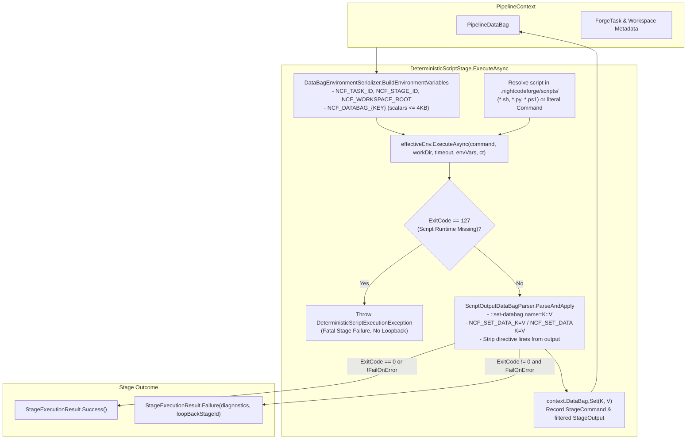

# 📜 Step 12.9: Custom Repository Scripts for Deterministic Steps (Bash, Python, PowerShell)

> **Phase 12 Implementation Step (Extend Features - Deep Integrations & Remote Experience)** *(formerly Step 11.8)*  
> *Parent Plan:* [Features & Integrations Roadmap](README.md)  
> *Project Target:* `src/NightCodeForge.Core/Workflow/Stages`, `src/NightCodeForge.Core/Workflow`, `src/NightCodeForge.Infrastructure/Execution`, `tests/NightCodeForge.Core.Tests`, `tests/NightCodeForge.Infrastructure.Tests` | *Status:* Planned

---

## 1. Executive Objective

Enable workspaces and repositories to define **custom deterministic scripts** written in **Bash**, **Python**, or **PowerShell** located inside the workspace repository (under `.nightcodeforge/scripts/`). These scripts are executed during deterministic workflow stages to perform domain-specific linting, custom test runners, static analysis, security scans, code generators, or deployment preparations without requiring C# stage re-compilation.

Key Capabilities:
1. **Multi-Runtime Script Dispatch:**
   - Execute Bash (`.sh`), Python (`.py`), or PowerShell (`.ps1`) scripts based on file extension across all workspace execution tiers (`BareHost`, `WslDirect`, and `ContainerSandbox`) via [`IExecutionEnvironment.ExecuteAsync`](file:///c:/Users/Julien/source/repos/jetelain/NightCodeForge/src/NightCodeForge.Core/Interfaces/IExecutionEnvironment.cs#L27-L32).
2. **Bi-Directional Pipeline Data Bag Interoperability:**
   - **Ingress (Data Bag $\rightarrow$ Environment Variables):** Primitive and string properties stored in [`PipelineDataBag`](file:///c:/Users/Julien/source/repos/jetelain/NightCodeForge/src/NightCodeForge.Core/Workflow/PipelineDataBag.cs) are serialized and injected into the script process environment as `NCF_DATABAG_<KEY>` (plus standardized task metadata variables `NCF_TASK_ID`, `NCF_WORKSPACE_ID`, `NCF_BASE_BRANCH`, `NCF_FEATURE_BRANCH`, `NCF_STAGE_ID`, `NCF_WORKSPACE_ROOT`), with full forwarding into WSL2 (`BareHost` / `WslDirect`) and container (`ContainerSandbox`) shells.
   - **Egress (Special Stdout Syntax $\rightarrow$ Data Bag):** Scripts can emit special stdout directives (e.g. `::set-databag name=coverage_delta::0.85` or `NCF_SET_DATA_<KEY>=<VALUE>`) to update string properties directly in [`PipelineDataBag`](file:///c:/Users/Julien/source/repos/jetelain/NightCodeForge/src/NightCodeForge.Core/Workflow/PipelineDataBag.cs), persisted across stages in `ForgeTask.PipelineDataJson`.
3. **Execution Safety, Loopback Routing & Fail-Fast Runtime Validation:**
   - Exit code `0` indicates success. Non-zero script exit codes fail the gate (when `FailOnError = true`) and trigger loopback routing (resolving `context.DataBag.Get<string>(PipelineDataBagKeys.LoopBackId) ?? Config.LoopBackStageId`) with directive-stripped stdout/stderr recorded in `PipelineDataBagKeys.StageOutput(StageId)` for synthetic priming and agent feedback.
   - Missing interpreter binaries (`bash`, `python3`/`python`, `pwsh`) fail fast with a dedicated domain exception (`DeterministicScriptExecutionException`) that terminates the stage immediately without looping back to the AI implementation agent.

---

## 2. Directory Structure & Discovery Convention

Add `public const string Scripts = "scripts";` to [`NightCodeForgeDirectories`](file:///c:/Users/Julien/source/repos/jetelain/NightCodeForge/src/NightCodeForge.Core/Workflow/NightCodeForgeDirectories.cs). Inside each target workspace/repository:
```
<WorkspaceRoot>/
  └── .nightcodeforge/
        └── scripts/
              ├── pre-impl.sh            # Runs during deterministic-pre-impl (e.g. baseline capture)
              ├── post-impl.py           # Runs during deterministic-post-impl (e.g. custom metrics)
              ├── post-review.sh         # Runs during deterministic-post-review
              ├── security-audit.ps1     # Explicit script stage or sub-stage
              └── custom-verify.sh       # Custom integration test runner
```

### 2.1 Host File Discovery vs. Execution Working Directory
- **Execution Working Directory (`workDir`):** Resolved consistently with [`DeterministicBuildStage`](file:///c:/Users/Julien/source/repos/jetelain/NightCodeForge/src/NightCodeForge.Core/Workflow/Stages/DeterministicBuildStage.cs#L110-L114) and [`DeterministicSastStage`](file:///c:/Users/Julien/source/repos/jetelain/NightCodeForge/src/NightCodeForge.Core/Workflow/Stages/DeterministicSastStage.cs#L71-L75):
  `context.WorkingDirectory ?? workspace.Ext4MirrorPath ?? workspace.RepositoryPath`.
- **Host Discovery Path:** Because `File.Exists` runs in the host .NET process, script discovery resolves candidate paths against the host-accessible working directory (`context.WorkingDirectory` or `workspace.RepositoryPath`; if only a Linux WSL path like `Ext4MirrorPath` is set on Windows, convert or fall back to `workspace.RepositoryPath` for discovery).
- **Relative POSIX Script Path for Execution:** Once a script file is matched inside `.nightcodeforge/`, [`DeterministicScriptStage`](file:///c:/Users/Julien/source/repos/jetelain/NightCodeForge/src/NightCodeForge.Core/Workflow/Stages/DeterministicScriptStage.cs) passes its **workspace-relative POSIX path** (e.g. `.nightcodeforge/scripts/pre-impl.sh`) to `effectiveEnv.ExecuteAsync(...)` so execution works identically across `BareHost`, `WslDirect`, and `ContainerSandbox` (where the repository is mounted at `/workspace`).
- **Path Traversal Guard:** When checking whether `Config.Command` or `{StageId}` resolves to a file under `.nightcodeforge/`, verify via `Path.GetFullPath` that the resolved candidate path resides strictly inside `<HostWorkspaceRoot>/.nightcodeforge/` (and validate `{StageId}` via [`WorkspacePromptResolver.ValidateStageId`](file:///c:/Users/Julien/source/repos/jetelain/NightCodeForge/src/NightCodeForge.Core/Workflow/WorkspacePromptResolver.cs#L17-L24)).

### 2.2 Discovery & Resolution Priority
When [`DeterministicScriptStage.ExecuteAsync`](file:///c:/Users/Julien/source/repos/jetelain/NightCodeForge/src/NightCodeForge.Core/Workflow/Stages/DeterministicScriptStage.cs#L57) runs:
1. **Explicit `Config.Command` configured:**
   - Extract the leading token (script path/name) and any trailing arguments (e.g. `security-audit.ps1 --strict`).
   - Check `<HostWorkspaceRoot>/.nightcodeforge/scripts/<ScriptToken>`.
   - Check `<HostWorkspaceRoot>/.nightcodeforge/<ScriptToken>`.
   - Check `<HostWorkspaceRoot>/<ScriptToken>` if `<ScriptToken>` already starts with `.nightcodeforge/` and has `.sh`, `.py`, or `.ps1` extension.
   - If a file with extension `.sh`, `.py`, or `.ps1` is matched on disk, dispatch it via the corresponding runtime interpreter (forwarding any trailing arguments).
   - Otherwise, fall back to executing `Config.Command` as a literal shell command (still injecting the `NCF_*` environment variables and parsing stdout egress directives).
2. **No `Config.Command` configured (Convention Lookup by `StageId`):**
   - Build candidate base names in priority order:
     1. Exact `StageId` (e.g. `deterministic-pre-impl` or `custom-verify`).
     2. Normalized shorthand derived from `StageId` by stripping a trailing `-script` suffix and/or a leading `deterministic-` prefix (so `deterministic-pre-impl` and `deterministic-pre-impl-script` both match `pre-impl`).
   - For each candidate base name, check in order:
     - `.nightcodeforge/scripts/{candidate}.sh`
     - `.nightcodeforge/scripts/{candidate}.py`
     - `.nightcodeforge/scripts/{candidate}.ps1`
3. **Graceful Skip when Unconfigured:**
   - If no matching script file exists and no explicit `Config.Command` is set, the stage skips gracefully (`StageExecutionResult.Success()`), logging an informational message and recording `"script (skipped)"` in `PipelineDataBagKeys.StageCommand(StageId)`.

### 2.3 Integration with `CompositeDeterministicStage` & Default Workflows
- Add `public const string ScriptSubStage = "script";` to [`DeterministicStageConstants`](file:///c:/Users/Julien/source/repos/jetelain/NightCodeForge/src/NightCodeForge.Core/Workflow/DeterministicStageConstants.cs).
- In [`CompositeDeterministicStage`](file:///c:/Users/Julien/source/repos/jetelain/NightCodeForge/src/NightCodeForge.Core/Workflow/Stages/CompositeDeterministicStage.cs):
  - Support `"script"` (convention lookup for the parent composite stage ID, e.g. `deterministic-pre-impl` $\rightarrow$ `pre-impl.{sh,py,ps1}`) as well as parameterized `"script:<filename>"` (e.g. `script:security-audit.ps1`, which sets `DeterministicStageConfig.Command = "<filename>"` on the resolved sub-stage).
  - After executing the configured `Stages` list in `CompositeDeterministicStage`, if no explicit `script` sub-stage was already in `stageKeys` and a convention script matching the parent `StageId` (e.g. `.nightcodeforge/scripts/pre-impl.{sh,py,ps1}` for `deterministic-pre-impl`, `post-impl.{sh,py,ps1}` for `deterministic-post-impl`, `post-review.{sh,py,ps1}` for `deterministic-post-review`) exists on disk, automatically execute it as a `"script"` sub-stage. When no convention script exists on disk and `"script"` was not explicitly requested, do not emit no-op `ToolStarted`/`ToolCompleted` turns.

---

## 3. Data Bag Environment Variable Injection & Stdout Protocol

### 3.1 Ingress: Data Bag to Environment Variables (`DataBagEnvironmentSerializer`)
Before spawning the script or command, `DataBagEnvironmentSerializer.BuildEnvironmentVariables(PipelineContext context, string stageId, string workingDirectory)` builds an `IReadOnlyDictionary<string, string>`:

| Variable Name | Source / Example | Description |
| :--- | :--- | :--- |
| `NCF_TASK_ID` | `context.ForgeTask.Id.ToString(CultureInfo.InvariantCulture)` (`"42"`) | Current task ID |
| `NCF_WORKSPACE_ID` | `context.Workspace.Id.ToString(CultureInfo.InvariantCulture)` (`"1"`) | Workspace ID |
| `NCF_STAGE_ID` | `stageId` (fallback `context.ForgeTask.CurrentStageId ?? ""`) (`"deterministic-verify"`) | Active stage identifier |
| `NCF_BASE_BRANCH` | `context.ForgeTask.BaseBranch ?? "main"` (`"main"`) | Target base branch |
| `NCF_FEATURE_BRANCH` | `context.ForgeTask.FeatureBranch ?? $"feature/task-{context.ForgeTask.Id}"` | Active feature branch |
| `NCF_WORKSPACE_ROOT` | `workingDirectory` (`"/workspace"` or host/mirror path) | Active working directory path |
| `NCF_DATABAG_<KEY>` | `context.DataBag.GetAll()` | Scalar entries in [`PipelineDataBag`](file:///c:/Users/Julien/source/repos/jetelain/NightCodeForge/src/NightCodeForge.Core/Workflow/PipelineDataBag.cs), with `<KEY>` normalized to uppercase ASCII alphanumeric and underscores (e.g. `coverage.baseline.line_rate` $\rightarrow$ `NCF_DATABAG_COVERAGE_BASELINE_LINE_RATE`). |

#### Serialization & Safety Rules for `NCF_DATABAG_<KEY>`
- Inspect each `JsonElement` in `context.DataBag.GetAll()`:
  - `JsonValueKind.String`: extract via `element.GetString()`.
  - `JsonValueKind.Number`, `JsonValueKind.True`, `JsonValueKind.False`: extract via `element.GetRawText()`.
  - `JsonValueKind.Object`, `JsonValueKind.Array`, `JsonValueKind.Null`, `JsonValueKind.Undefined`: **skip** (complex structured objects like `Workflow.StageRetries`, `PendingSyntheticPriming`, `CompilerErrors` are not injected as flat env vars).
- **Size & Internal Key Filtering:** Skip internal large-payload keys (`SerializedMemory`, `RecoveredSerializedMemory`, `PendingSyntheticPriming`, `ReviewDiff`, `ReviewDiffStat`, `LastHumanAnswerJson`, and keys ending with `.output`) as well as any string value exceeding `4096` characters (`MaxEnvironmentVariableValueLength = 4096`) to prevent OS `E2BIG` environment block overflows.
- **Key Normalization:** Replace any sequence of non-alphanumeric ASCII characters with `_`, trim leading/trailing `_`, convert to uppercase (`InvariantCulture`), and prefix with `NCF_DATABAG_`. Validate the resulting identifier with [`ShellQuoting.IsValidVariableName`](file:///c:/Users/Julien/source/repos/jetelain/NightCodeForge/src/NightCodeForge.Core/Execution/ShellQuoting.cs#L33-L36).

### 3.2 Environment Variable Forwarding in `BareHostExecutionEnvironment` & `WslExecutionEnvironment`
- On Windows, [`BareHostExecutionEnvironment`](file:///c:/Users/Julien/source/repos/jetelain/NightCodeForge/src/NightCodeForge.Infrastructure/Execution/BareHostExecutionEnvironment.cs) and [`WslExecutionEnvironment`](file:///c:/Users/Julien/source/repos/jetelain/NightCodeForge/src/NightCodeForge.Infrastructure/Execution/WslExecutionEnvironment.cs) invoke `wsl.exe -- bash -c ...`. Because `wsl.exe` does not automatically forward Windows host environment variables into Linux processes, both environments must prepend `export KEY='VALUE';` statements (for each entry in `environmentVariables` where `ShellQuoting.IsValidVariableName(key)` is true, using `ShellQuoting.QuotePosix(value)`) before `cd "<wslTargetDir>" && <command>` (matching [`NightCodeForgeContainerExecutor`](file:///c:/Users/Julien/source/repos/jetelain/NightCodeForge/src/NightCodeForge.Infrastructure/Execution/NightCodeForgeContainerExecutor.cs#L339-L354)).

### 3.3 Egress: Stdout Syntax for Data Bag Mutation (`ScriptOutputDataBagParser`)
After script execution completes, `ScriptOutputDataBagParser.ParseAndApply(string stdout, PipelineDataBag dataBag)` scans `StandardOutput` line by line:

#### Supported Directive Formats
1. **GitHub Actions style:**
   ```
   ::set-databag name=<KEY>::<VALUE>
   ```
2. **Prefix Assignment style:**
   ```
   NCF_SET_DATA_<KEY>=<VALUE>
   ```
   *or*
   ```
   NCF_SET_DATA <KEY>=<VALUE>
   ```

#### Processing Rules
- `<KEY>` must match `^[a-zA-Z0-9_.-]+$` (non-empty). Leading/trailing whitespace around `<KEY>` is trimmed; `<KEY>` casing is preserved verbatim as emitted by the script.
- `<VALUE>` is stored as a `string` in [`PipelineDataBag`](file:///c:/Users/Julien/source/repos/jetelain/NightCodeForge/src/NightCodeForge.Core/Workflow/PipelineDataBag.cs) via `dataBag.Set(key, value)`.
- Matching directive lines are **stripped** from the returned cleaned stdout before `PipelineDataBagKeys.StageOutput(StageId)` and `StageExecutionResult.Failure(...)` are populated, ensuring directives do not clutter user-facing logs, conversation turns, or agent synthetic priming.

---

## 4. Script Invocation by Runtime & Fail-Fast Policy

All [`IExecutionEnvironment`](file:///c:/Users/Julien/source/repos/jetelain/NightCodeForge/src/NightCodeForge.Core/Interfaces/IExecutionEnvironment.cs#L23) implementations already execute commands inside a `bash` shell in the target environment (`wsl.exe -- bash -c` on Windows `BareHost`/`WslDirect`, `/bin/bash -c` on Unix `BareHost`, and `docker exec -i ... bash` in `ContainerSandbox`). Therefore, [`DeterministicScriptStage`](file:///c:/Users/Julien/source/repos/jetelain/NightCodeForge/src/NightCodeForge.Core/Workflow/Stages/DeterministicScriptStage.cs) constructs a single shell command for `effectiveEnv.ExecuteAsync(...)`:

| Script Type | Interpreter Check | Shell Command Passed to `effectiveEnv.ExecuteAsync` |
| :--- | :--- | :--- |
| **Bash (`.sh`)** | `bash` | `if ! command -v bash >/dev/null 2>&1; then exit 127; fi; bash '.nightcodeforge/scripts/run.sh' <args>` |
| **Python (`.py`)** | `python3` (fallback `python`) | `if command -v python3 >/dev/null 2>&1; then python3 '.nightcodeforge/scripts/run.py' <args>; elif command -v python >/dev/null 2>&1; then python '.nightcodeforge/scripts/run.py' <args>; else exit 127; fi` |
| **PowerShell (`.ps1`)** | `pwsh` | `if ! command -v pwsh >/dev/null 2>&1; then exit 127; fi; pwsh -NoProfile -NonInteractive -File '.nightcodeforge/scripts/run.ps1' <args>` |

> **Fail-Fast Policy (No Silent Failures):**
> - When a resolved `.sh`, `.py`, or `.ps1` script returns exit code `127` (standard POSIX exit code for missing command/interpreter), [`DeterministicScriptStage`](file:///c:/Users/Julien/source/repos/jetelain/NightCodeForge/src/NightCodeForge.Core/Workflow/Stages/DeterministicScriptStage.cs) immediately throws `DeterministicScriptExecutionException` (`NightCodeForge.Core.Exceptions.DeterministicScriptExecutionException`):
>   `Required runtime '{interpreter}' was not found in the {effectiveEnv.Tier} environment for script '{scriptPath}'.`
> - In [`TaskOrchestrator.ProcessTaskAsync`](file:///c:/Users/Julien/source/repos/jetelain/NightCodeForge/src/NightCodeForge.Core/Workflow/TaskOrchestrator.cs), catch `DeterministicScriptExecutionException` explicitly: broadcast a `ToolCompleted` / error activity event to [`IAgentActivityStreamer`](file:///c:/Users/Julien/source/repos/jetelain/NightCodeForge/src/NightCodeForge.Core/Streaming/IAgentActivityStreamer.cs), finalize the deterministic conversation as failed, and invoke `HandleStageFatalFailureAsync` directly **without** looping back to `implementation` (since the AI agent cannot fix a missing host/container runtime binary).

---

## 5. Architectural Flow



---

## 6. Implementation Checklist & Deliverables

- [ ] **Constants & Domain Exception:**
  - Add `Scripts = "scripts"` to [`NightCodeForgeDirectories`](file:///c:/Users/Julien/source/repos/jetelain/NightCodeForge/src/NightCodeForge.Core/Workflow/NightCodeForgeDirectories.cs) and `ScriptSubStage = "script"` to [`DeterministicStageConstants`](file:///c:/Users/Julien/source/repos/jetelain/NightCodeForge/src/NightCodeForge.Core/Workflow/DeterministicStageConstants.cs).
  - Create `DeterministicScriptExecutionException` in `src/NightCodeForge.Core/Exceptions/DeterministicScriptExecutionException.cs`.
- [ ] **Data Bag Ingress & Egress Helpers:**
  - Create `DataBagEnvironmentSerializer` in `src/NightCodeForge.Core/Workflow/DataBagEnvironmentSerializer.cs` to transform [`PipelineContext`](file:///c:/Users/Julien/source/repos/jetelain/NightCodeForge/src/NightCodeForge.Core/Workflow/PipelineContext.cs) and scalar [`PipelineDataBag`](file:///c:/Users/Julien/source/repos/jetelain/NightCodeForge/src/NightCodeForge.Core/Workflow/PipelineDataBag.cs) entries into `IReadOnlyDictionary<string, string>`.
  - Create `ScriptOutputDataBagParser` in `src/NightCodeForge.Core/Workflow/ScriptOutputDataBagParser.cs` to extract `::set-databag name=...`, `NCF_SET_DATA_...`, and `NCF_SET_DATA ...` directives and return directive-stripped stdout.
- [ ] **WSL Environment Variable Export:**
  - Update [`BareHostExecutionEnvironment`](file:///c:/Users/Julien/source/repos/jetelain/NightCodeForge/src/NightCodeForge.Infrastructure/Execution/BareHostExecutionEnvironment.cs) and [`WslExecutionEnvironment`](file:///c:/Users/Julien/source/repos/jetelain/NightCodeForge/src/NightCodeForge.Infrastructure/Execution/WslExecutionEnvironment.cs) on Windows so `environmentVariables` are exported via `ShellQuoting.QuotePosix` inside the `wsl.exe -- bash -c` command.
- [ ] **Script Discovery, Runtime Dispatcher & Composite Integration:**
  - Update [`DeterministicScriptStage`](file:///c:/Users/Julien/source/repos/jetelain/NightCodeForge/src/NightCodeForge.Core/Workflow/Stages/DeterministicScriptStage.cs) with `.nightcodeforge/scripts/` resolution, path-traversal protection, `.sh`/`.py`/`.ps1` runtime dispatch, exit code `127` fail-fast `DeterministicScriptExecutionException`, env var injection, stdout directive parsing/stripping, and dynamic `PipelineDataBagKeys.LoopBackId` support.
  - Update [`CompositeDeterministicStage`](file:///c:/Users/Julien/source/repos/jetelain/NightCodeForge/src/NightCodeForge.Core/Workflow/Stages/CompositeDeterministicStage.cs) to support `"script"` / `"script:<name>"` sub-stages and automatic convention script execution when a matching `.nightcodeforge/scripts/{StageId}.*` script exists on disk.
  - Update [`TaskOrchestrator`](file:///c:/Users/Julien/source/repos/jetelain/NightCodeForge/src/NightCodeForge.Core/Workflow/TaskOrchestrator.cs) to handle `DeterministicScriptExecutionException` as a fatal non-loopback stage error and broadcast failure telemetry.
- [ ] **Unit & Integration Tests:**
  - Unit tests for `DataBagEnvironmentSerializer` (metadata keys, key normalization, non-string scalars, skipping complex/oversized entries).
  - Unit tests for `ScriptOutputDataBagParser` (all 3 directive formats, key sanitization, stripping directive lines from output).
  - Unit tests for [`DeterministicScriptStage`](file:///c:/Users/Julien/source/repos/jetelain/NightCodeForge/src/NightCodeForge.Core/Workflow/Stages/DeterministicScriptStage.cs) and [`CompositeDeterministicStage`](file:///c:/Users/Julien/source/repos/jetelain/NightCodeForge/src/NightCodeForge.Core/Workflow/Stages/CompositeDeterministicStage.cs) covering `.sh`, `.py`, `.ps1` dispatch, convention discovery (`pre-impl.sh`, `post-impl.py`), missing runtime (`ExitCode == 127` $\rightarrow$ `DeterministicScriptExecutionException`), and loopback diagnostics.
  - Unit tests in `ExecutionEnvironmentTests` verifying `BareHostExecutionEnvironment` and `WslExecutionEnvironment` export `environmentVariables` into WSL commands.
