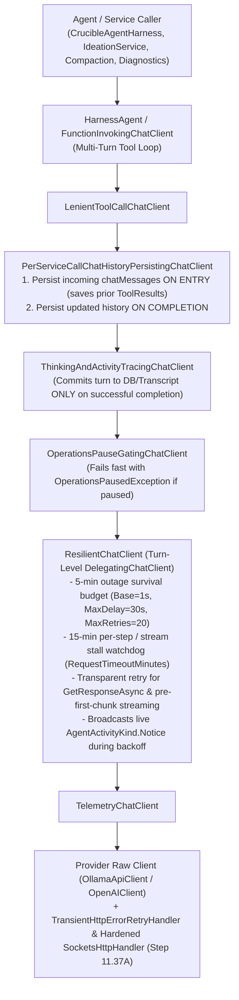

# 🛡️ Step 11.37B: Turn-Level `ResilientChatClient`, 15-Minute Stream Stall Watchdog & Multi-Turn Tool Recovery

> **Bug Fix & Resiliency Step (Part 2 of 2 — Turn-Level ChatClient & Agent Recovery Layer)**  
> *Parent Plan:* [Bug Fixes & Resiliency Roadmap](README.md)  
> *Prerequisite Step:* [Step 11.37A: HTTP Transport Hardening & 5-Minute Outage Retry Policy](STEP_11_37A_HTTP_TRANSPORT_HARDENING_AND_OUTAGE_RETRY_POLICY.md)  
> *Target Framework:* .NET 10 (C# 13) | *Status:* Proposed  
> *Target Projects:* [`src/NightCodeForge.Core`](../../src/NightCodeForge.Core), [`src/NightCodeForge.Agents`](../../src/NightCodeForge.Agents), [`tests/NightCodeForge.Agents.Tests`](../../tests/NightCodeForge.Agents.Tests)  
> *Dependencies:* [Step 11.37A](STEP_11_37A_HTTP_TRANSPORT_HARDENING_AND_OUTAGE_RETRY_POLICY.md), [Step 11.29: Global Operations Pause & GPU VRAM Reclamation](../archive/phase-11/STEP_11_29_GLOBAL_OPERATIONS_PAUSE_AND_GPU_VRAM_RECLAMATION.md), [Step 11.36: Unified In-Place Conversation Resumption](../archive/phase-11/STEP_11_36_CONVERSATION_CONTINUITY_ON_PAUSE_AND_CRASH_RECOVERY.md)  
> *Aligns With:* [AGENTS.md](../../AGENTS.md), [docs/PLAN.md](../PLAN.md)

---

## 1. Executive Summary & Root Cause Analysis

### 1.1 Turn-Level & Multi-Turn Streaming Root Causes Covered in Step 11.37B

While [Step 11.37A](STEP_11_37A_HTTP_TRANSPORT_HARDENING_AND_OUTAGE_RETRY_POLICY.md) hardens HTTP transport and pre-response HTTP retries, `HttpClient` delegating handlers (`TransientHttpErrorRetryHandler`) only intercept failures **before** HTTP response headers (`ResponseHeadersRead`) arrive. Once streaming begins, or across multi-turn tool calls inside `FunctionInvokingChatClient`, two critical vulnerabilities remain:

| # | Limitation | Root Cause in Current Codebase | Impact During Outage |
| :--- | :--- | :--- | :--- |
| **1** | **Mid-Stream Retry Corrupts Multi-Turn Tool History** | [`PerServiceCallChatHistoryPersistingChatClient`](../../src/NightCodeForge.Agents/Crucible/ChatClients/PerServiceCallChatHistoryPersistingChatClient.cs#L51-L96) only persists `chatHistory` *after* a streaming response finishes. Meanwhile, [`ThinkingAndActivityTracingChatClient`](../../src/NightCodeForge.Agents/Inference/ThinkingAndActivityTracingChatClient.cs#L128-L132) flushes partial buffers to the DB on exception. | If Turn $N$ executes a tool and Turn $N+1$ fails mid-stream, Turn $N$'s `ToolResult` (passed in `chatMessages` on entry to Turn $N+1$) is missing from `chatHistory`, leaving an orphan `FunctionCallContent` and polluting SQLite with partial turns on retry. |
| **2** | **No Stream Stall Watchdog & Inconsistent Caller Retries** | Once HTTP `200 OK` streaming headers arrive, `HttpClient` no longer times out stalled streams, while [`IdeationService.ConverseStreamingAsync`](../../src/NightCodeForge.Agents/Ideation/IdeationService.cs#L550-L590), [`PiStyleCrucibleCompactionStrategy`](../../src/NightCodeForge.Agents/Compaction/PiStyleCrucibleCompactionStrategy.cs#L466-L509), and [`TranscriptDiagnosticService`](../../src/NightCodeForge.Agents/Transcripts/TranscriptDiagnosticService.cs#L27-L64) lack turn-level streaming retry loops. | A dropped mid-stream connection or stalled socket hangs forever, or fails immediately in ideation, compaction, and diagnostics. |

---

## 2. Architectural Solution

### 2.1 High-Level Resilience Pipeline

---

## 3. Detailed Behavioral & Component Specifications

### 3.1 Turn-Level `ResilientChatClient` & 15-Minute Stream Stall Watchdog

1. **Middleware Placement in `LlmChatClientFactoryBase`:**
   - Wrap the provider chat client in a turn-level resilience `DelegatingChatClient` (`ResilientChatClient`) inside [`LlmChatClientFactoryBase.BuildClient`](../../src/NightCodeForge.Agents/Inference/LlmChatClientFactories.cs#L98-L104) (and `OllamaChatClientFactory` when used directly), situated below `OperationsPauseGatingChatClient` and `FunctionInvokingChatClient`.
   - Before every retry attempt and after every backoff delay, check `IOperationsControlService.IsPaused` (if provided) and `cancellationToken.ThrowIfCancellationRequested()` so Global Pause or user cancellation aborts retry waits immediately.

2. **15-Minute Per-Attempt & Stream Stall Watchdog Timeout:**
   - Configure the stream inactivity / attempt watchdog timeout from `LlmProviderOptions.RequestTimeoutMinutes` (default **15 minutes**).
   - Keeping the watchdog timeout at **15 minutes** ensures that local LLMs—which can take many minutes to re-evaluate a large prompt context when the KV cache was lost after a server restart—are never prematurely aborted while computing tokens.
   - In `GetResponseAsync`, apply the 15-minute timeout per attempt.
   - In `GetStreamingResponseAsync`, apply the 15-minute watchdog timeout to each `enumerator.MoveNextAsync()` call (resetting the 15-minute timer whenever a chunk arrives). If `MoveNextAsync()` does not complete within 15 minutes while the caller's `CancellationToken` is still active, cancel the stalled stream enumerator and throw `LlmStreamStallException`.

3. **Two-Phase Streaming Retry Protocol:**
   - **Phase 1 — Pre-First-Chunk Failure (Transparent In-Place Turn Retry):**
     - If a transient exception or stall timeout occurs in `GetStreamingResponseAsync` **before any meaningful `ChatResponseUpdate` has been yielded to the caller** for the current turn, `ResilientChatClient` catches the exception, waits for the jittered backoff delay (within the 5-minute `MaxRetryDuration` and `MaxRetries` budget), and retries `base.GetStreamingResponseAsync` transparently inside the same `IAsyncEnumerable` invocation.
     - Because zero chunks were yielded to `FunctionInvokingChatClient` prior to the failure, retrying in-place produces zero duplicate chunks and preserves the active multi-turn tool loop without interruption.
     - If retries are exhausted during Phase 1, tag the thrown exception with `ResilienceConstants.RetriedKey` so outer callers do not retry a second 5-minute cycle.
   - **Phase 2 — Mid-Stream Drop After Chunks Were Yielded:**
     - Once at least one content chunk has been yielded to the caller (`FunctionInvokingChatClient`), `ResilientChatClient` must **not** restart the stream inside the same `GetStreamingResponseAsync` enumerator (as `FunctionInvokingChatClient` would concatenate partial text from attempt 1 with attempt 2).
     - Instead, let the transient exception propagate **without** `ResilienceConstants.RetriedKey` so the outer streaming loop ([`CrucibleAgentHarness`](../../src/NightCodeForge.Agents/Crucible/CrucibleAgentHarness.cs) or [`IdeationService`](../../src/NightCodeForge.Agents/Ideation/IdeationService.cs)) catches it, discards the uncommitted partial turn buffer, waits for backoff, and resumes cleanly from the start of the interrupted turn.

### 3.2 Pre-Call History Persistence & Transcript Hygiene on Mid-Stream Failure

1. **[`PerServiceCallChatHistoryPersistingChatClient`](../../src/NightCodeForge.Agents/Crucible/ChatClients/PerServiceCallChatHistoryPersistingChatClient.cs):**
   - Persist the incoming `messages` list **on entry** to `GetResponseAsync` and `GetStreamingResponseAsync` (before calling `base`), in addition to persisting the `updated` list (including the assistant's reply) upon completion.
   - This guarantees that when Turn $N-1$ completes a tool execution inside `FunctionInvokingChatClient` and passes the resulting `ChatRole.Tool` (`FunctionResultContent`) message into Turn $N$, `chatHistory` in `CrucibleAgentHarness` immediately records that tool result before Turn $N$ starts streaming. If Turn $N$ drops mid-stream and `CrucibleAgentHarness` restarts `RunStreamingAsync(chatHistory.ToList(), session)`, it resumes at Turn $N$ with all prior tool calls and tool results intact.
2. **[`ThinkingAndActivityTracingChatClient`](../../src/NightCodeForge.Agents/Inference/ThinkingAndActivityTracingChatClient.cs):**
   - Do **not** call `FlushStream(reasoningBuilder, textBuilder, functionCalls)` when `enumerator.MoveNextAsync()` throws an exception (`catch (Exception)` at line 128). Only commit streamed assistant/thinking/tool-call entries to `_capturedEntries` and `_onEntry` (SQLite `ConversationTurns`) when the stream completes normally, preventing failed partial turns from polluting the database transcript before a retry.
3. **[`CrucibleAgentHarness`](../../src/NightCodeForge.Agents/Crucible/CrucibleAgentHarness.cs) & [`IdeationService.ConverseStreamingAsync`](../../src/NightCodeForge.Agents/Ideation/IdeationService.cs):**
   - Update outer mid-stream transient retry loops to enforce `RetryPolicyOptions` (`MaxRetryDuration = 5 minutes`, `MaxRetries = 20`) and recover cleanly from mid-stream drops.
4. **Live Activity Feed Notifications During Outages:**
   - When retrying a transient LLM error (in `ResilientChatClient`, `CrucibleAgentHarness`, or `IdeationService`), log a structured warning and broadcast an `AgentActivityKind.Notice` event (when an `IAgentActivityStreamer` / session context is active) indicating the transient error reason, retry attempt, delay in seconds, and elapsed outage duration.

---

## 4. Verification & Test Strategy

1. **`ResilientChatClientTests` ([`tests/NightCodeForge.Agents.Tests`](../../tests/NightCodeForge.Agents.Tests)):**
   - Verify a simulated **3-minute server restart** (returning `ConnectionRefused` for 90s, then `503 Service Unavailable` for 60s, then `500 loading model` for 30s, then `200 OK`) succeeds transparently using a fake `TimeProvider` without throwing to the caller.
   - Verify pre-first-chunk streaming failures retry transparently inside `GetStreamingResponseAsync` without duplicating yielded chunks.
   - Verify the **15-minute stream stall watchdog** cancels a dead/hanging stream when `MoveNextAsync()` stalls beyond `RequestTimeoutMinutes`, and retries the turn.
   - Verify slow token generation that takes 10 minutes before the first token (simulating local LLM KV-cache recomputation, $< 15$ minutes) succeeds without triggering the stall watchdog.
   - Verify Global Pause (`OperationsPausedException`) or caller cancellation during a retry backoff delay aborts immediately without further retries.
2. **`CrucibleTransientRetryTests` & Multi-Turn Mid-Stream Recovery ([`tests/NightCodeForge.Agents.Tests`](../../tests/NightCodeForge.Agents.Tests)):**
   - Verify that in a multi-turn tool-calling run (Turn 1 calls `bash` tool $\rightarrow$ tool executes $\rightarrow$ Turn 2 streams 3 chunks and then drops with `ConnectionReset`), `PerServiceCallChatHistoryPersistingChatClient` preserves Turn 1's `FunctionCallContent` **and** `FunctionResultContent`, `ThinkingAndActivityTracingChatClient` does not write the aborted Turn 2 fragment to `ConversationTurns`, and Turn 2 retries and completes without re-running Turn 1 or losing Turn 1's tool result.

---

## 5. Definition of Done (DoD) Checklist

- [ ] Implement `ResilientChatClient` (`DelegatingChatClient`) with 5-minute outage retry budget, pre-first-chunk streaming retry, and **15-minute stream stall watchdog** (`RequestTimeoutMinutes`).
- [ ] Wire `ResilientChatClient` into `LlmChatClientFactoryBase` (and `OllamaChatClientFactory`).
- [ ] Update `PerServiceCallChatHistoryPersistingChatClient` to persist incoming `chatMessages` on entry (preserving completed tool results from the preceding turn if the current turn fails mid-stream).
- [ ] Update `ThinkingAndActivityTracingChatClient` to only commit streamed turns on stream completion (not on mid-stream exception).
- [ ] Update `CrucibleAgentHarness` and `IdeationService` outer streaming retry loops to respect `MaxRetryDuration` and recover cleanly from mid-stream drops.
- [ ] Add unit and integration tests in `NightCodeForge.Agents.Tests` using `TimeProvider` fakes to verify multi-minute outage survival, 15-minute stall watchdog, and multi-turn mid-stream tool history integrity; ensure all tests pass.

