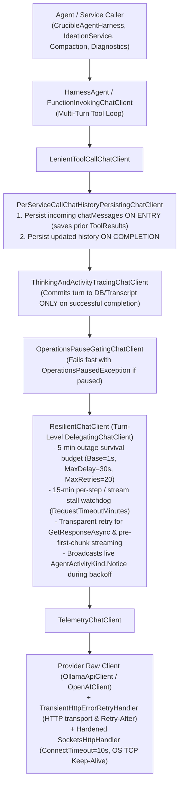

# 🛡️ Step 11.37: Outage-Resilient LLM Inference, Turn-Level Recovery & Transport Hardening

> **Phase 11 Implementation Step (Post-MVP - Real-Project Hardening, Token Efficiency & Agent Ergonomics)**  
> *Parent Plan:* [Bug Fixes & Resiliency Roadmap](README.md)  
> *Target Framework:* .NET 10 (C# 13) | *Status:* Proposed  
> *Target Projects:* [`src/NightCodeForge.Core`](src/NightCodeForge.Core), [`src/NightCodeForge.Infrastructure`](src/NightCodeForge.Infrastructure), [`src/NightCodeForge.Agents`](src/NightCodeForge.Agents), [`tests/NightCodeForge.Core.Tests`](tests/NightCodeForge.Core.Tests), [`tests/NightCodeForge.Infrastructure.Tests`](tests/NightCodeForge.Infrastructure.Tests), [`tests/NightCodeForge.Agents.Tests`](tests/NightCodeForge.Agents.Tests)  
> *Dependencies:* [Step 11.29: Global Operations Pause & GPU VRAM Reclamation](../archive/phase-11/STEP_11_29_GLOBAL_OPERATIONS_PAUSE_AND_GPU_VRAM_RECLAMATION.md), [Step 11.33: Unified LLM Provider Architecture](STEP_11_33_UNIFIED_LLM_PROVIDER_DYNAMIC_CONTEXT_AND_FLEET_INTEGRATION.md), [Step 11.35: OpenAI-Compatible LLM Provider](STEP_11_35_OPENAI_COMPATIBLE_LLM_PROVIDER.md), [Step 11.36: Unified In-Place Conversation Resumption](STEP_11_36_CONVERSATION_CONTINUITY_ON_PAUSE_AND_CRASH_RECOVERY.md)  
> *Aligns With:* [AGENTS.md](../../AGENTS.md), [docs/PLAN.md](../PLAN.md)

---

## 1. Executive Summary & Root Cause Analysis

### 1.1 Problem Statement
Long-running autonomous coding stages and interactive ideation sessions frequently span dozens of turns and tens of minutes. During execution, the inference provider (local Ollama, OllamaRouter fleet, vLLM, LM Studio, or remote cloud gateway) can experience **1 to 5 minutes of downtime** due to:
- Server or container restarts (e.g., Ollama / OllamaRouter / vLLM service restart, OS update, or GPU driver reset).
- Short internet, VPN, Wi-Fi, or LAN drops.
- Model eviction and cold weight reloading or KV-cache recomputation under VRAM pressure.

Although NightCodeForge includes [`TransientHttpErrorRetryHandler`](src/NightCodeForge.Core/Resilience/TransientHttpErrorRetryHandler.cs), [`TransientErrorDetector`](src/NightCodeForge.Core/Resilience/TransientErrorDetector.cs), and a streaming retry catch block in [`CrucibleAgentHarness`](src/NightCodeForge.Agents/Crucible/CrucibleAgentHarness.cs), the current design only survives sub-second network blips and fails on real-world multi-minute outages.

### 1.2 Six Root Causes in the Current Implementation

| # | Limitation | Root Cause in Current Codebase | Impact During Outage |
| :--- | :--- | :--- | :--- |
| **1** | **3.5s–7s Total Retry Window** | [`RetryPolicyOptions`](src/NightCodeForge.Core/Resilience/RetryPolicyOptions.cs) defaults to `MaxRetries = 3`, `BaseDelay = 1s`, `MaxDelay = 15s`. With $[0.5\times, 1.0\times]$ jitter on $1\text{s}, 2\text{s}, 4\text{s}$, all retries finish in **3.5 to 7 seconds**. | Any server restart or internet drop lasting more than ~7 seconds permanently fails the stage. |
| **2** | **`ConnectionRefused` Fails on Attempt 1** | [`TransientErrorDetector.IsTransient`](src/NightCodeForge.Core/Resilience/TransientErrorDetector.cs#L31-L35) explicitly excludes `SocketError.ConnectionRefused`, and [`IsTransientSocketError`](src/NightCodeForge.Core/Resilience/TransientErrorDetector.cs#L105-L114) omits DNS/interface transition errors (`TryAgain`, `HostNotFound`, `NoData`, `OperationAborted`, `Interrupted`). | When an inference process restarts while the host OS is up, the OS kernel immediately sends TCP `RST` (`ConnectionRefused`), aborting on Attempt 1 with **0 retries**. |
| **3** | **HTTP/1.1 Dead-Socket Blindness & Coupled `HttpClient.Timeout`** | [`OllamaHttpConstants`](src/NightCodeForge.Agents/Inference/OllamaHttpConstants.cs) sets `KeepAlivePingDelay = 30s` on `SocketsHttpHandler`, which only applies to HTTP/2+ PING frames and is a no-op on HTTP/1.1 inference endpoints. `ConnectTimeout` is unset (~21–120s OS SYN timeout), and `HttpClient.Timeout` (15m) wraps the entire retry handler before headers and stops applying once streaming headers (`ResponseHeadersRead`) arrive. | Half-open connections after a router drop or silent reboot hang indefinitely during streaming, or exhaust the shared `HttpClient.Timeout` and throw `TaskCanceledException` (which is not retried). |
| **4** | **Mid-Stream Retry Corrupts Multi-Turn Tool History** | [`PerServiceCallChatHistoryPersistingChatClient`](src/NightCodeForge.Agents/Crucible/ChatClients/PerServiceCallChatHistoryPersistingChatClient.cs#L51-L96) only persists `chatHistory` *after* a streaming response finishes. Meanwhile, [`ThinkingAndActivityTracingChatClient`](src/NightCodeForge.Agents/Inference/ThinkingAndActivityTracingChatClient.cs#L128-L132) flushes partial buffers to the DB on exception. | If Turn $N$ executes a tool and Turn $N+1$ fails mid-stream, Turn $N$'s `ToolResult` (passed in `chatMessages` on entry to Turn $N+1$) is missing from `chatHistory`, leaving an orphan `FunctionCallContent` and polluting SQLite with partial turns on retry. |
| **5** | **Other `IChatClient` Callers Lack Streaming Retry** | [`IdeationService.ConverseStreamingAsync`](src/NightCodeForge.Agents/Ideation/IdeationService.cs#L550-L590), [`PiStyleCrucibleCompactionStrategy`](src/NightCodeForge.Agents/Compaction/PiStyleCrucibleCompactionStrategy.cs#L466-L509), and [`TranscriptDiagnosticService`](src/NightCodeForge.Agents/Transcripts/TranscriptDiagnosticService.cs#L27-L64) have no mid-stream retry loop. | Any transient stream drop during ideation chat, compaction summarization, or diagnostics fails immediately. |
| **6** | **Uncoordinated SDK & Probe Retries** | [`OpenAiCompatibleChatClientFactory`](src/NightCodeForge.Agents/Inference/OpenAiCompatibleChatClientFactory.cs#L103-L129) leaves `System.ClientModel`'s default 3-retry policy active on top of `TransientHttpErrorRetryHandler`, and [`InferenceServiceCollectionExtensions`](src/NightCodeForge.Infrastructure/InferenceServiceCollectionExtensions.cs#L31-L44) attaches inference retry handlers to 2–3s UI health/catalog probes. | OpenAI-compatible calls multiply retries ($4 \times 4$), and multi-minute retry budgets would block fast UI liveness probes if not separated. |

---

## 2. Architectural Solution

### 2.1 High-Level Resilience Pipeline

---

## 3. Detailed Behavioral & Component Specifications

### 3.1 Outage-Grade Retry Budget & `Retry-After` Support (`RetryPolicyOptions`)

1. **Default Outage Survival Configuration:**
   - Update [`RetryPolicyOptions`](src/NightCodeForge.Core/Resilience/RetryPolicyOptions.cs) defaults to survive a **5-minute** provider outage while recovering within 1–2 seconds from momentary glitches:
     - `DefaultMaxRetries = 20` (`MaxRetries`)
     - `DefaultBaseDelaySeconds = 1.0` (`BaseDelay = 1s`)
     - `DefaultMaxDelaySeconds = 30.0` (`MaxDelay = 30s`)
     - `DefaultMaxRetryDurationSeconds = 300.0` (`MaxRetryDuration = 5 minutes`)
   - Backoff progression follows exponential growth ($1\text{s} \to 2\text{s} \to 4\text{s} \to 8\text{s} \to 16\text{s} \to 30\text{s}$ ceiling) with random jitter in $[0.5\times, 1.0\times]$.
   - A retry attempt is permitted when **both** `attempt <= MaxRetries` **and** `elapsedOutage < MaxRetryDuration` (when `MaxRetryDuration > TimeSpan.Zero`). If the calculated delay would exceed the remaining `MaxRetryDuration`, clamp the delay to the remaining duration.

2. **`Retry-After` Header Compliance:**
   - When [`TransientHttpErrorRetryHandler`](src/NightCodeForge.Core/Resilience/TransientHttpErrorRetryHandler.cs) receives a transient status code (`429 TooManyRequests` or `503 ServiceUnavailable`) containing an HTTP `Retry-After` header (`RetryConditionHeaderValue.Delta` or `Date`), use `Max(calculatedJitteredDelay, retryAfterDelay)` clamped to the remaining `MaxRetryDuration`.

3. **Separation of Fast UI Liveness Probes from Long-Horizon Inference Retries:**
   - Gateway status and model catalog discovery services (`ILlmGatewayService`, `ILlmModelCatalogService`) in [`InferenceServiceCollectionExtensions`](src/NightCodeForge.Infrastructure/InferenceServiceCollectionExtensions.cs) execute short 2–3 second probes to report cluster liveness to the UI. They must **not** enter a 5-minute retry loop when the inference server is offline; keep them without long-horizon retries (or bounded to their short probe cancellation tokens) so UI status indicators immediately reflect `Offline` during a restart.

### 3.2 Comprehensive Transient Error & Timeout Classification (`TransientErrorDetector`)

1. **Server Restart & Network Transition Socket Errors:**
   - Update [`TransientErrorDetector`](src/NightCodeForge.Core/Resilience/TransientErrorDetector.cs) so `SocketError.ConnectionRefused` (`WSAECONNREFUSED`) is classified as **transient** (removing the `IsConnectionRefused` exclusion).
   - Expand `IsTransientSocketError` to include transient DNS and network interface transition errors that occur during short internet cuts or router restarts:
     - `SocketError.ConnectionRefused`
     - `SocketError.TryAgain` (temporary DNS failure `EAI_AGAIN`)
     - `SocketError.HostNotFound` and `SocketError.NoData` (DNS resolution failure while WAN/router link is down)
     - `SocketError.OperationAborted` and `SocketError.Interrupted`
     - Existing codes: `ConnectionReset`, `ConnectionAborted`, `TimedOut`, `HostUnreachable`, `NetworkUnreachable`, `NetworkReset`, `Shutdown`, `NotConnected`.

2. **OpenAI SDK (`System.ClientModel`) Exception & Retry Alignment:**
   - In [`OpenAiCompatibleChatClientFactory`](src/NightCodeForge.Agents/Inference/OpenAiCompatibleChatClientFactory.cs), disable the built-in `System.ClientModel` retry policy (`clientOptions.RetryPolicy = new ClientRetryPolicy(maxRetries: 0)`) so retries are never multiplied across layers.
   - Ensure `TransientErrorDetector` and `HttpErrorDetailHelper` recognize `ClientResultException` (or exceptions exposing an HTTP status code or inner transport exception) when evaluating transient failures outside the HTTP handler.

3. **Per-Attempt / Stream Stall Timeouts vs. User Cancellation & Global Pause:**
   - Introduce a dedicated transient timeout exception (e.g. `LlmStreamStallException` or `TimeoutException` produced by the per-attempt / stream watchdog timer when the caller's `CancellationToken` is not cancelled and operations are not paused).
   - `TransientErrorDetector.IsTransient` must return `true` for per-attempt connect/stall timeouts (unless already marked with `ResilienceConstants.RetriedKey`), while continuing to return `false` for explicit caller `OperationCanceledException` / `TaskCanceledException` and `OperationsPausedException`.

### 3.3 Socket & Transport Hardening (`OllamaHttpConstants`, `LlmChatClientFactoryBase`, `OllamaChatClientFactory`, `OpenAiCompatibleChatClientFactory`)

1. **Fast TCP Connect Timeout:**
   - Configure `SocketsHttpHandler.ConnectTimeout` to **10 seconds** (`OllamaHttpConstants.DefaultConnectTimeout = TimeSpan.FromSeconds(10)`) so dropped SYN packets during an internet cut or host reboot fail within 10s and enter the backoff loop instead of blocking on a 21–120s OS timeout.

2. **OS-Level TCP Keep-Alive for HTTP/1.1 Connections:**
   - Because `SocketsHttpHandler.KeepAlivePingDelay` only operates on HTTP/2+, configure OS-level TCP Keep-Alive on sockets created by `SocketsHttpHandler` (via `ConnectCallback` or socket options) with:
     - `SocketOptionName.KeepAlive = true`
     - `TcpKeepAliveTime = 15s`
     - `TcpKeepAliveInterval = 5s`
     - `TcpKeepAliveRetryCount = 3`
   - Lower `PooledConnectionIdleTimeout` to **1 minute** so idle pooled sockets are recycled proactively.

3. **Decouple `HttpClient.Timeout` from the Multi-Minute Retry Loop:**
   - Set `HttpClient.Timeout = Timeout.InfiniteTimeSpan` on the `HttpClient` instances created in [`OllamaChatClientFactory`](src/NightCodeForge.Agents/Inference/OllamaChatClientFactory.cs) and [`OpenAiCompatibleChatClientFactory`](src/NightCodeForge.Agents/Inference/OpenAiCompatibleChatClientFactory.cs) so `HttpClient` does not abort an in-progress multi-minute retry cycle across attempts.
   - Enforce the configured request/stall timeout (`LlmProviderOptions.RequestTimeoutMinutes`, default **15 minutes**) per attempt and per streaming step inside the resilience layer.

### 3.4 Turn-Level `ResilientChatClient` & 15-Minute Stream Stall Watchdog

1. **Middleware Placement in `LlmChatClientFactoryBase`:**
   - Wrap the provider chat client in a turn-level resilience `DelegatingChatClient` (`ResilientChatClient`) inside [`LlmChatClientFactoryBase.BuildClient`](src/NightCodeForge.Agents/Inference/LlmChatClientFactories.cs#L98-L104) (and `OllamaChatClientFactory` when used directly), situated below `OperationsPauseGatingChatClient` and `FunctionInvokingChatClient`.
   - Before every retry attempt and after every backoff delay, check `IOperationsControlService.IsPaused` (if provided) and `cancellationToken.ThrowIfCancellationRequested()` so Global Pause or user cancellation aborts retry waits immediately.

2. **15-Minute Per-Attempt & Stream Stall Watchdog Timeout:**
   - Configure the stream inactivity / attempt watchdog timeout from `LlmProviderOptions.RequestTimeoutMinutes` (default **15 minutes**).
   - Keeping the watchdog timeout at **15 minutes** ensures that local LLMs—which can take many minutes to re-evaluate a large prompt context when the KV cache was lost after a server restart—are never prematurely aborted while computing tokens.
   - In `GetResponseAsync`, apply the 15-minute timeout per attempt.
   - In `GetStreamingResponseAsync`, apply the 15-minute watchdog timeout to each `enumerator.MoveNextAsync()` call (resetting the 15-minute timer whenever a chunk arrives). If `MoveNextAsync()` does not complete within 15 minutes while the caller's `CancellationToken` is still active, cancel the stalled stream enumerator and throw a transient stall timeout exception.

3. **Two-Phase Streaming Retry Protocol:**
   - **Phase 1 — Pre-First-Chunk Failure (Transparent In-Place Turn Retry):**
     - If a transient exception or stall timeout occurs in `GetStreamingResponseAsync` **before any meaningful `ChatResponseUpdate` has been yielded to the caller** for the current turn, `ResilientChatClient` catches the exception, waits for the jittered backoff delay (within the 5-minute `MaxRetryDuration` and `MaxRetries` budget), and retries `base.GetStreamingResponseAsync` transparently inside the same `IAsyncEnumerable` invocation.
     - Because zero chunks were yielded to `FunctionInvokingChatClient` prior to the failure, retrying in-place produces zero duplicate chunks and preserves the active multi-turn tool loop without interruption.
     - If retries are exhausted during Phase 1, tag the thrown exception with `ResilienceConstants.RetriedKey` so outer callers do not retry a second 5-minute cycle.
   - **Phase 2 — Mid-Stream Drop After Chunks Were Yielded:**
     - Once at least one content chunk has been yielded to the caller (`FunctionInvokingChatClient`), `ResilientChatClient` must **not** restart the stream inside the same `GetStreamingResponseAsync` enumerator (as `FunctionInvokingChatClient` would concatenate partial text from attempt 1 with attempt 2).
     - Instead, let the transient exception propagate **without** `ResilienceConstants.RetriedKey` so the outer streaming loop ([`CrucibleAgentHarness`](src/NightCodeForge.Agents/Crucible/CrucibleAgentHarness.cs) or [`IdeationService`](src/NightCodeForge.Agents/Ideation/IdeationService.cs)) catches it, discards the uncommitted partial turn buffer, waits for backoff, and resumes cleanly from the start of the interrupted turn.

4. **Pre-Call History Persistence & Transcript Hygiene on Mid-Stream Failure:**
   - **[`PerServiceCallChatHistoryPersistingChatClient`](src/NightCodeForge.Agents/Crucible/ChatClients/PerServiceCallChatHistoryPersistingChatClient.cs):**
     - Persist the incoming `messages` list **on entry** to `GetResponseAsync` and `GetStreamingResponseAsync` (before calling `base`), in addition to persisting the `updated` list (including the assistant's reply) upon completion.
     - This guarantees that when Turn $N-1$ completes a tool execution inside `FunctionInvokingChatClient` and passes the resulting `ChatRole.Tool` (`FunctionResultContent`) message into Turn $N$, `chatHistory` in `CrucibleAgentHarness` immediately records that tool result before Turn $N$ starts streaming. If Turn $N$ drops mid-stream and `CrucibleAgentHarness` restarts `RunStreamingAsync(chatHistory.ToList(), session)`, it resumes at Turn $N$ with all prior tool calls and tool results intact.
   - **[`ThinkingAndActivityTracingChatClient`](src/NightCodeForge.Agents/Inference/ThinkingAndActivityTracingChatClient.cs):**
     - Do **not** call `FlushStream(reasoningBuilder, textBuilder, functionCalls)` when `enumerator.MoveNextAsync()` throws an exception (`catch (Exception)` at line 128). Only commit streamed assistant/thinking/tool-call entries to `_capturedEntries` and `_onEntry` (SQLite `ConversationTurns`) when the stream completes normally, preventing failed partial turns from polluting the database transcript before a retry.
   - **[`IdeationService.ConverseStreamingAsync`](src/NightCodeForge.Agents/Ideation/IdeationService.cs):**
     - Add outer mid-stream transient retry handling matching `CrucibleAgentHarness` (bounded by `RetryPolicyOptions` duration and retry limits) so mid-stream network drops during ideation recover cleanly.

5. **Live Activity Feed Notifications During Outages:**
   - When retrying a transient LLM error (in `ResilientChatClient`, `CrucibleAgentHarness`, or `IdeationService`), log a structured warning and broadcast an `AgentActivityKind.Notice` event (when an `IAgentActivityStreamer` / session context is active) indicating the transient error reason, retry attempt, delay in seconds, and elapsed outage duration.

---

## 4. Verification & Test Strategy

1. **Core Resilience Unit Tests ([`tests/NightCodeForge.Core.Tests`](tests/NightCodeForge.Core.Tests)):**
   - **`TransientErrorDetectorTests`:**
     - Verify `SocketError.ConnectionRefused` (direct and wrapped in `HttpRequestException` / `IOException`) returns `true` for `IsTransient`.
     - Verify `SocketError.TryAgain`, `HostNotFound`, `NoData`, `OperationAborted`, and `Interrupted` return `true`.
     - Verify `LlmStreamStallException` (per-attempt / stream stall timeout) returns `true`, whereas caller `OperationCanceledException` and `OperationsPausedException` return `false`.
   - **`TransientHttpErrorRetryHandlerTests`:**
     - Verify `ConnectionRefused` is retried across attempts and succeeds when the server comes back online.
     - Verify `MaxRetryDuration` (time-bounded outage budget) stops retrying once total elapsed simulated time (`FakeTimeProvider`) exceeds `MaxRetryDuration`, and permits multiple retries within the 5-minute window using `FakeTimeProvider` (zero real wall-clock delay in tests).
     - Verify HTTP `Retry-After` header (delta seconds) on `429` and `503` responses is respected and clamped to remaining `MaxRetryDuration`.

2. **Agent & ChatClient Resilience Tests ([`tests/NightCodeForge.Agents.Tests`](tests/NightCodeForge.Agents.Tests)):**
   - **`ResilientChatClientTests`:**
     - Verify a simulated **3-minute server restart** (returning `ConnectionRefused` for 90s, then `503 Service Unavailable` for 60s, then `500 loading model` for 30s, then `200 OK`) succeeds transparently using a fake `TimeProvider` without throwing to the caller.
     - Verify pre-first-chunk streaming failures retry transparently inside `GetStreamingResponseAsync` without duplicating yielded chunks.
     - Verify the **15-minute stream stall watchdog** cancels a dead/hanging stream when `MoveNextAsync()` stalls beyond `RequestTimeoutMinutes`, and retries the turn.
     - Verify slow token generation that takes 10 minutes before the first token (simulating local LLM KV-cache recomputation, $< 15$ minutes) succeeds without triggering the stall watchdog.
     - Verify Global Pause (`OperationsPausedException`) or caller cancellation during a retry backoff delay aborts immediately without further retries.
   - **`CrucibleTransientRetryTests` & Multi-Turn Mid-Stream Recovery:**
     - Verify that in a multi-turn tool-calling run (Turn 1 calls `bash` tool $\rightarrow$ tool executes $\rightarrow$ Turn 2 streams 3 chunks and then drops with `ConnectionReset`), `PerServiceCallChatHistoryPersistingChatClient` preserves Turn 1's `FunctionCallContent` **and** `FunctionResultContent`, `ThinkingAndActivityTracingChatClient` does not write the aborted Turn 2 fragment to `ConversationTurns`, and Turn 2 retries and completes without re-running Turn 1 or losing Turn 1's tool result.
   - **`OllamaSharpRetryBehaviorTests`:**
     - Update `GetResponseAsync_ConnectionRefused_FailsFastWithSingleAttempt` to verify that `ConnectionRefused` is now retried up to the configured retry budget and marked as retried upon exhaustion.

---

## 5. Definition of Done (DoD) Checklist

- [ ] Update `RetryPolicyOptions` with outage-grade defaults (`MaxRetries = 20`, `BaseDelay = 1s`, `MaxDelay = 30s`, `MaxRetryDuration = 5 minutes`) and enforce `MaxRetryDuration` + `Retry-After` header support in `TransientHttpErrorRetryHandler`.
- [ ] Separate UI liveness/catalog probes (`ILlmGatewayService`, `ILlmModelCatalogService`) from the 5-minute inference retry loop in `InferenceServiceCollectionExtensions`.
- [ ] Update `TransientErrorDetector` to classify `SocketError.ConnectionRefused`, `TryAgain`, `HostNotFound`, `NoData`, `OperationAborted`, `Interrupted`, `ClientResultException` transient statuses, and per-attempt/stream stall timeouts as transient.
- [ ] Disable built-in `System.ClientModel` retries (`maxRetries: 0`) in `OpenAiCompatibleChatClientFactory` to prevent retry multiplication.
- [ ] Harden `SocketsHttpHandler` in `OllamaHttpConstants` / chat client factories with `ConnectTimeout = 10s`, OS-level TCP Keep-Alive sockets, and `HttpClient.Timeout = Timeout.InfiniteTimeSpan` (delegating per-attempt timeouts to the resilience layer).
- [ ] Implement `ResilientChatClient` (`DelegatingChatClient`) with 5-minute outage retry budget, pre-first-chunk streaming retry, and **15-minute stream stall watchdog** (`RequestTimeoutMinutes`).
- [ ] Update `PerServiceCallChatHistoryPersistingChatClient` to persist incoming `chatMessages` on entry (preserving completed tool results from the preceding turn if the current turn fails mid-stream).
- [ ] Update `ThinkingAndActivityTracingChatClient` to only commit streamed turns on stream completion (not on mid-stream exception).
- [ ] Update `CrucibleAgentHarness` and `IdeationService` outer streaming retry loops to respect `MaxRetryDuration` and recover cleanly from mid-stream drops.
- [ ] Add and update unit and integration tests using `TimeProvider` fakes to verify multi-minute outage survival, `ConnectionRefused` recovery, 15-minute stall watchdog, and multi-turn mid-stream tool history integrity; ensure all tests pass.
