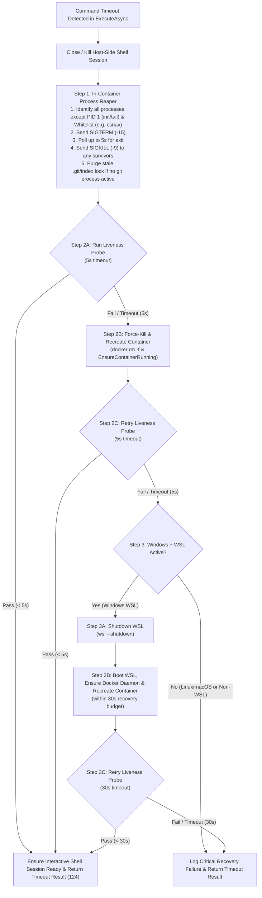

# 🛡️ Step 11.40: Bash Timeout Escalation Ladder, In-Container Process Reaper, Stale Container Recycling & WSL2 Self-Healing

> **Bug Fix & Resiliency Step (Execution Sandbox, Container Process Hygiene & WSL2 Recovery)**  
> *Parent Plan:* [Bug Fixes & Resiliency Roadmap](README.md)  
> *Target Framework:* .NET 10 (C# 13) | *Status:* Proposed  
> *Target Projects:* [`src/NightCodeForge.Core`](../../src/NightCodeForge.Core), [`src/NightCodeForge.Infrastructure`](../../src/NightCodeForge.Infrastructure), [`src/NightCodeForge.Agents`](../../src/NightCodeForge.Agents), [`tests/NightCodeForge.Core.Tests`](../../tests/NightCodeForge.Core.Tests), [`tests/NightCodeForge.Infrastructure.Tests`](../../tests/NightCodeForge.Infrastructure.Tests)  
> *Dependencies:* [Step 11.21: Container ICU & Dynamic Timeouts](../archive/phase-11/STEP_11_21_CONTAINER_ICU_DYNAMIC_TIMEOUTS_AND_REVIEW_TEST_MANDATE.md), [Step 11.26: Container Reuse Validation & Task Lifecycle Cleanup](../archive/phase-11/STEP_11_26_CONTAINER_REUSE_VALIDATION_AND_TASK_LIFECYCLE_CLEANUP.md)  
> *Aligns With:* [AGENTS.md](../../AGENTS.md), [docs/PLAN.md](../PLAN.md)

> This document is a **specification**: it states required behaviors and constraints, not implementations. Implementation choices (signatures, code structure) are left to the implementer, within the constraints of the documents.

---

## 1. Executive Summary & Root Cause Analysis

### 1.1 Problem Statement
During autonomous stage execution and interactive sessions, shell commands executed via the `bash` tool or deterministic quality gates occasionally time out due to hung test runners (`dotnet test` / `testhost`), deadlocked child processes, compiler server stalls, or underlying Docker / WSL2 instability.

Investigation of how [`NightCodeForgeContainerExecutor`](../../src/NightCodeForge.Infrastructure/Execution/NightCodeForgeContainerExecutor.cs) and [`WslExecutionEnvironment`](../../src/NightCodeForge.Infrastructure/Execution/WslExecutionEnvironment.cs) currently handle command timeouts reveals four critical failure modes:

| # | Vulnerability | Root Cause in Current Codebase | Impact |
| :--- | :--- | :--- | :--- |
| **1** | **Orphaned In-Container Processes Survive Timeouts** | On timeout, [`NightCodeForgeContainerExecutor.ExecuteAsync`](../../src/NightCodeForge.Infrastructure/Execution/NightCodeForgeContainerExecutor.cs#L391-L431) writes `\x03` to `_stdin` (which is a non-PTY pipe where `\x03` does not generate kernel `SIGINT`, and the subshell redirects `< /dev/null` anyway), then calls `ForceRestartShellProcess()` which only kills the host-side `docker exec -i` client process. | Hung child processes (`dotnet`, `testhost`, `msbuild`, `node`, `python3`, `git`) remain alive inside the container reparented to `PID 1`, holding file locks (`obj/`, `bin/`, `.git/index.lock`), ports, and RAM/CPU, causing all subsequent turns to fail or time out. |
| **2** | **Zombie Process Accumulation (`PID 1 = tail`)** | Containers are launched with `tail -f /dev/null` as `PID 1` without `--init`. `tail` does not call `waitpid(-1)` on reparented child processes. | Every terminated or orphaned subprocess inside the container becomes a permanent `<defunct>` zombie in the container's PID table. |
| **3** | **Wedged Container State After Timeout** | `ForceRestartShellProcess()` immediately spawns a new `docker exec -i` without verifying whether the container runtime can still execute commands or whether the container's namespace/mounts are wedged. | If the container is wedged, the next command hangs until another full build/test timeout (5–10 minutes) expires. |
| **4** | **WSL2 / Docker Daemon Deadlocks on Windows** | On Windows hosts using WSL2 (`UseWsl = true` or `ExecutionMode.WslDirect`), the WSL2 utility VM, 9P/Plan9 mount bridge, or in-WSL Docker daemon occasionally freezes under heavy I/O or memory pressure. | Killing the container fails or hangs indefinitely until a human manually runs `wsl --shutdown`. |
| **5** | **Idle Containers Remain Resident on `Ready` / `WaitingForHuman` / `Failed` Tasks** | [`TaskContainerReaper`](../../src/NightCodeForge.Core/Services/TaskContainerReaper.cs) only reaps containers when a task reaches `Closed`, `Rejected`, or `Cancelled`. | Tasks waiting hours or days for human review (`Ready`), human answers (`WaitingForHuman`), or sitting in `Failed` state keep their containers (and inside-container daemons like `csnav` holding 500 MB–2 GB RAM each) alive indefinitely. |

---

## 2. Escalation Architecture on `bash` Timeout

When a command executed in `NightCodeForgeContainerExecutor` (or `WslExecutionEnvironment`) times out, the executor must execute a deterministic **3-stage self-healing escalation ladder** before releasing the execution lock and returning the timeout result to the caller:

---

## 3. Detailed Behavioral Specifications

### 3.1 Step 1: In-Container Process Sweep (`SIGTERM` $\to$ 5s Wait $\to$ `SIGKILL`)

1. **Trigger Condition:**
   - Whenever a command in `NightCodeForgeContainerExecutor.ExecuteAsync` times out (`TimeoutException`), or is aborted via caller `OperationCanceledException` while a command is already in-flight on `_stdin`, first terminate and dispose the host-side `docker exec -i` shell session so the stuck or desynchronized subshell client is closed.
   - Note: On caller `OperationCanceledException`, after closing the desynchronized shell session and running Step 1 process cleanup (using `CancellationToken.None` with a bounded cleanup timeout), rethrow the `OperationCanceledException` to preserve standard cancellation semantics.

2. **Protected Process Whitelist:**
   - Maintain a configurable whitelist of process names (`ContainerExecutorOptions.ProcessKillWhitelist`) that must **not** be killed during timeout cleanup:
     - **Always protected:** Container root process (`PID 1`, e.g., `docker-init`, `tini`, or `tail`), the `tail -f /dev/null` keep-alive process (which runs as a child of `PID 1` when `--init` is enabled and whose termination would cause the container to exit), and the reaper script's own process tree (`$$`).
     - **Default whitelist (`DefaultProcessKillWhitelist`):** `["csnav"]` (preserves the warm Roslyn navigation daemon across command timeouts so subsequent agent turns do not pay cold solution indexing latency).
     - **Explicitly NOT whitelisted (must be reaped on timeout):** `dotnet` (non-`csnav`), `testhost`, `vstest.console`, `MSBuild`, `VBCSCompiler`, `node`, `npm`, `python3`, `pytest`, `cargo`, `git`, `bash`, `sh`, and any browser binaries (`chrome`, `chromium`, `msedge`, `firefox`) spawned by E2E tests.
     - Note: Because `csnav` runs as a .NET global tool (whose `/proc/<pid>/comm` may be `csnav` or `dotnet` with `csnav` in `/proc/<pid>/cmdline`), whitelist matching must inspect both the executable name (`comm`) and command-line arguments (`cmdline`) so `csnav server` is accurately preserved while `dotnet test` / `dotnet build` / `VBCSCompiler` are terminated.

3. **Two-Phase Signal Escalation (`SIGTERM` $\to$ 5s $\to$ `SIGKILL`) & Container User Matching:**
   - Execute an out-of-band cleanup command inside the container (`docker exec --user <effectiveUser> <containerName> bash -c "..."`):
     - **User Identity Constraint:** Always pass the same `--user <effectiveUser>` as `BuildProcessStartSpec` (`1000:1000` when `IsRestrictedReadOnly == true`, or `options.UserUidGid`). In `RestrictedReadOnly` containers launched with `--cap-drop=ALL`, `root` lacks `CAP_KILL` and cannot signal processes owned by UID `1000`, whereas matching `--user` allows signalling all processes of that UID without elevated capabilities.
     1. Enumerate all running PIDs inside the container excluding `PID 1`, the keep-alive `tail -f /dev/null`, the reaper script's own PID, and any process matching the whitelist.
     2. If target PIDs exist, send `SIGTERM` (`kill -15 <pids>`).
     3. Wait up to **5 seconds** (polling every `200ms–250ms` via `kill -0 <pid>`) for all targeted PIDs to terminate gracefully. As soon as all targeted PIDs have exited, proceed immediately without waiting the full 5 seconds.
     4. After 5 seconds, if any targeted PIDs (or newly spawned descendants of those PIDs) remain alive, send `SIGKILL` (`kill -9 <survivor_pids>`).
   - Bound the Step 1 `docker exec` invocation itself with a hard host-side timeout (e.g., `10 seconds`) so a completely frozen container or Docker daemon immediately falls through to Step 2.

4. **Post-Kill Stale Git Lock Hygiene (Worktree & Canonical Clone Aware):**
   - If a `git` process was running when the timeout occurred, killing it can leave a stale `index.lock`.
   - Because per-task sandboxes operate inside a Git worktree (`/workspace/task-{taskId}`) where `.git` is a pointer file (`gitdir: /workspace/clone/.git/worktrees/task-{taskId}`) rather than a directory, lock cleanup must resolve the actual Git directory (e.g. via `git rev-parse --git-dir` or inspecting `/workspace/clone/.git/worktrees/*/index.lock` and `/workspace/clone/.git/index.lock` as well as `/workspace/.git/index.lock`) and purge any dangling `index.lock` once Step 1 confirms no `git` process is running.

---

### 3.2 Step 2: Container Liveness Probe (5s) & Container Recycling (5s Retry)

1. **Initial Liveness Probe (5-Second Timeout):**
   - Immediately after Step 1 completes (or if Step 1 timed out / failed), run a lightweight probe command inside the container (e.g., `docker exec <containerName> echo __NCF_PROBE_OK__` or equivalent sentinel check) with a strict **5-second timeout**.
   - If the probe exits with code `0` and emits the expected probe token within 5 seconds:
     - Start a fresh interactive shell session (`StartShellProcess()`).
     - Record recovery telemetry (`ContainerRecoveryStage.ProcessSweepSucceeded`) and return the timeout `CommandResult` (exit code `124`).

2. **Container Kill, Recreation & Probe Retry (5-Second Timeout):**
   - If the initial probe times out after 5 seconds or returns a non-zero exit code:
     - Log a warning indicating that container `{ContainerName}` is unresponsive after timeout and is being recycled.
     - Force-remove the wedged container (`docker rm -f <containerName>` with a bounded timeout, e.g., 10s).
     - Recreate and start a clean container instance (`EnsureContainerRunning()`).
     - **Retry the liveness probe with a 5-second timeout.**
     - If the retry probe succeeds within 5 seconds:
       - Start a fresh interactive shell session (`StartShellProcess()`).
       - Record recovery telemetry (`ContainerRecoveryStage.ContainerRecreated`).

---

### 3.3 Step 3: Windows-Specific WSL2 Reset (`wsl --shutdown`) & 30-Second Probe Retry

1. **Trigger Condition:**
   - Executed **only on Windows** (`RuntimeInformation.IsOSPlatform(OSPlatform.Windows)`) when WSL2 is in use (`options.UseWsl == true` for `ContainerSandbox`, or in `WslDirect` mode) and **Step 2's retry probe failed or timed out**.

2. **WSL2 Shutdown & Environment Re-Initialization:**
   - Log a critical warning that both the container probe and container recreation failed, triggering a full WSL2 utility VM reset (`wsl --shutdown`).
   - Execute `wsl.exe --shutdown` via `IProcessRunner` (with a bounded timeout, e.g., 15 seconds).
   - Because `wsl --shutdown` terminates the WSL2 VM and causes all host-side `wsl.exe` / `docker exec` client processes to exit (`HasExited == true`), any other cached `NightCodeForgeContainerExecutor` instances will automatically detect the exited session in `EnsureShellProcessRunning()` on their next command and invoke `EnsureContainerRunning()` + `StartShellProcess()` without requiring a circular reference between `NightCodeForgeContainerExecutor` and `ExecutionEnvironmentProvider` (an optional callback on `ContainerExecutorOptions` may also be used if proactive cache invalidation is desired).
   - Within the **30-second recovery window**:
     - Ensure the target WSL2 distribution boots and the Docker daemon inside WSL2 is reachable (if `docker info` fails because native `dockerd` inside WSL2 stopped on shutdown, attempt non-interactive daemon startup `wsl -u root -- sh -c "service docker start || systemctl start docker || true"`).
     - Recreate/start the container via `EnsureContainerRunning()`.
     - **Retry the container liveness probe with a 30-second timeout.**
   - If the 30-second probe succeeds, start a fresh interactive shell session and record telemetry (`ContainerRecoveryStage.WslShutdownRecovered`).
   - If the 30-second probe still fails, log an error with full diagnostic context and surface a clear failure message in the command result.

3. **`WslExecutionEnvironment` (`WslDirect` Mode) Parity:**
   - When a command times out in `WslExecutionEnvironment` on Windows:
     - Run a 5-second WSL probe (`wsl.exe [-d <distro>] -- echo __NCF_PROBE_OK__`).
     - If the 5-second probe fails, execute `wsl.exe --shutdown` and retry the probe with a **30-second timeout**.

---

### 3.4 Automatic Stale Container, PID Limit & Zombie Lifecycle Hardening

1. **Enable `--init` and `--pids-limit` on Container Spawn (`BuildDockerRunArgs`):**
   - Include `--init` in `NightCodeForgeContainerExecutor.BuildDockerRunArgs` so Docker's lightweight init process (`docker-init` / `tini`) runs as `PID 1` and automatically reaps reparented zombie processes throughout the container's lifetime.
   - Add a configurable `PidsLimit` to `ContainerExecutorOptions` (default: `DefaultPidsLimit = 4096`) and pass `--pids-limit <PidsLimit>` in `BuildDockerRunArgs` when `PidsLimit > 0` so a runaway test runner or fork loop inside a container cannot exhaust the WSL2 kernel PID table before the command timeout triggers.
   - Existing containers created prior to this change do not require forced drift-detection recreation solely for `--init`/`--pids-limit`; they will adopt the new flags naturally as containers are reaped or recycled.

2. **Expand `TaskContainerReaper` & Lifecycle Teardown to Non-Active States:**
   - When a task transitions to `Ready` (awaiting human review in Review Room), `WaitingForHuman` (awaiting human answer in Inbox), or `Failed` (in [`TaskOrchestrator`](../../src/NightCodeForge.Core/Workflow/TaskOrchestrator.cs), or in `TaskLifecycleMutationCoordinator` / `TaskOrchestrator` once [Step 11.38D](STEP_11_38D_TASK_ORCHESTRATOR_AND_STARTUP_RECOVERY_DECOMPOSITION.md) is applied):
     - Tear down its per-task sandbox container (`CleanupTaskContainerAsync`) so idle containers and in-container daemons (`csnav`) do not consume gigabytes of WSL2 memory while waiting for human action.
     - When the task later resumes (e.g., human answers a question, requests changes in Review Room, or restarts a failed stage), `EnsureContainerRunning` transparently recreates the container on demand with all volume mounts and caches intact.
   - Update [`TaskContainerReaper.ReapAsync`](../../src/NightCodeForge.Core/Services/TaskContainerReaper.cs) so periodic and startup sweeps also reap containers belonging to `Failed` tasks, `Ready` tasks, and `Open` tasks where `IsWaitingForHuman == true` or `IsDeferredByPause == true`.

3. **Idle Workspace Container TTL Eviction:**
   - Track `LastExecutionTimestampUtc` on `NightCodeForgeContainerExecutor`.
   - During periodic maintenance sweeps (e.g., `GitSyncService` / `TaskContainerReaper`), any shared workspace container (`ncf-sandbox-{workspaceId}` or `-ro` container) that is not currently executing a command and has been idle for longer than `IdleContainerTimeoutMinutes` (default: `30 minutes`) is stopped and removed.

---

## 4. Verification & Test Strategy

1. **In-Container Process Reaper Unit Tests (`NightCodeForge.Infrastructure.Tests`):**
   - Verify that on command timeout (and on caller `OperationCanceledException` while a command is in-flight) in `NightCodeForgeContainerExecutor.ExecuteAsync`, Step 1 closes the stuck shell session and executes the process sweep as `--user <effectiveUser>` targeting non-whitelisted processes with `SIGTERM`, waits up to 5 seconds, escalates to `SIGKILL` while preserving `PID 1`, `tail`, and whitelisted `csnav`, and cleans up stale worktree/clone `index.lock` files.
   - Verify custom `ProcessKillWhitelist` entries in `ContainerExecutorOptions` are respected.

2. **3-Stage Escalation Ladder Unit Tests (`NightCodeForge.Infrastructure.Tests`):**
   - **Scenario 1 (Healthy Probe after Step 1):** Command times out $\to$ Step 1 sweeps processes $\to$ Step 2A probe (5s) succeeds $\to$ container is NOT removed, shell restarts cleanly, returns exit code `124`.
   - **Scenario 2 (Unresponsive Container Recovered at Step 2):** Command times out $\to$ Step 1 runs $\to$ Step 2A probe (5s) times out/fails $\to$ Step 2B runs `docker rm -f` + `EnsureContainerRunning` $\to$ Step 2C retry probe (5s) succeeds $\to$ `wsl --shutdown` is NOT called.
   - **Scenario 3 (Windows WSL2 Wedged Recovered at Step 3):** Command times out $\to$ Step 2A probe (5s) fails $\to$ Step 2B recreates container $\to$ Step 2C retry probe (5s) fails $\to$ on Windows with `UseWsl = true`, Step 3 executes `wsl --shutdown`, restarts container, and succeeds on the 30s probe.
   - **Scenario 4 (Non-Windows or Non-WSL Guard):** Verify Step 3 (`wsl --shutdown`) is never invoked when `UseWsl == false` or on non-Windows platforms.

3. **Stale Container Reaper, `--init` & `--pids-limit` Tests (`NightCodeForge.Core.Tests` & `NightCodeForge.Infrastructure.Tests`):**
   - Verify `BuildDockerRunArgs` includes `--init` and `--pids-limit 4096` (or the configured `PidsLimit`).
   - Verify `TaskContainerReaper.ReapAsync` reaps containers for `Failed`, `Ready`, and `WaitingForHuman` / paused tasks in addition to `Closed`, `Rejected`, and `Cancelled`.

---

## 5. Definition of Done (DoD) Checklist

- [ ] Add `ProcessKillWhitelist` (defaulting to `["csnav"]`) and `PidsLimit` (defaulting to `4096`) to `ContainerExecutorOptions`, and include `--init` and `--pids-limit` in `BuildDockerRunArgs`.
- [ ] Implement **Step 1 (In-Container Process Reaper)** on `bash` timeout (and in-flight caller cancellation) in `NightCodeForgeContainerExecutor`: close the stuck shell session, run the reaper as `--user <effectiveUser>`, send `SIGTERM` to all container processes except `PID 1`/`tail` and `ProcessKillWhitelist`, wait up to 5s, send `SIGKILL` to survivors, and purge dangling worktree/repository `index.lock` files.
- [ ] Implement **Step 2 (Container Liveness Probe & Recycling)**: run a 5s probe command; if it fails or times out, force-remove and recreate the container (`docker rm -f` + `EnsureContainerRunning`) and retry the probe with a 5s timeout.
- [ ] Implement **Step 3 (Windows WSL2 Shutdown Recovery)**: on Windows when `UseWsl` is enabled and Step 2's retry probe fails, execute `wsl --shutdown`, ensure Docker daemon & container recovery, and retry the probe with a 30s timeout (and apply matching 5s probe $\to$ `wsl --shutdown` $\to$ 30s probe recovery to `WslExecutionEnvironment`).
- [ ] Expand `TaskContainerReaper` and task lifecycle transitions (`Failed`, `Ready`, `WaitingForHuman`) to tear down idle task containers automatically, plus idle workspace container TTL eviction.
- [ ] Author unit tests in `NightCodeForge.Infrastructure.Tests` and `NightCodeForge.Core.Tests` covering all 3 escalation stages, process whitelist preservation, `--init` and `--pids-limit` flag generation, and expanded container reaping; verify all tests pass via `dotnet test --filter "Category!=Acceptance&Category!=E2E"`.

