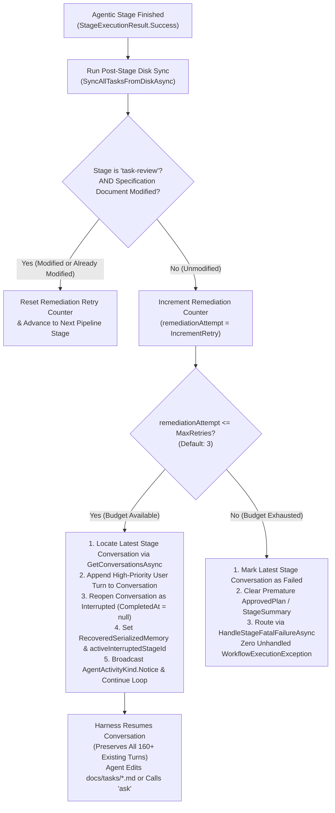

# 🛡️ Step 11.41: Task Review Specification Enforcement, Conversational Remediation & Unhandled Exception Shielding

> **Bug Fix & Resiliency Step (Workflow Orchestration, HITL / Stage Resumption & HITL Guardrails)**  
> *Parent Plan:* [Bug Fixes & Resiliency Roadmap](README.md)  
> *Target Framework:* .NET 10 (C# 13) | *Status:* Implemented  
> *Target Projects:* [`src/NightCodeForge.Core`](../../src/NightCodeForge.Core), [`src/NightCodeForge.Agents`](../../src/NightCodeForge.Agents), [`tests/NightCodeForge.Core.Tests`](../../tests/NightCodeForge.Core.Tests), [`tests/NightCodeForge.Agents.Tests`](../../tests/NightCodeForge.Agents.Tests)  
> *Related Steps (Non-Blocking):* [Step 11.38D: `TaskOrchestrator` Decomposition](STEP_11_38D_TASK_ORCHESTRATOR_AND_STARTUP_RECOVERY_DECOMPOSITION.md), [Step 11.38C: Crucible Session Factorization](STEP_11_38C_CRUCIBLE_AND_IDEATION_SHARED_SESSION_AND_TOOLSET_FACTORIZATION.md)  
> *Aligns With:* [AGENTS.md](../../AGENTS.md), [docs/PLAN.md](../PLAN.md)

> This document is a **specification**: it states required behaviors and constraints, not implementations. Implementation choices (signatures, code structure) are left to the implementer, within the constraints of the documents.

---

## 1. Executive Summary & Live Incident Investigation

### 1.1 Live Incident Report
In the live instance (`C:\Users\Julien\AppData\Local\NightCodeForge\data`), **Task #19** (*Dynamic Fleet Configuration & Setup API*) and **Task #36** (*Integrate Pmad.AI.LlamaSharp and remove the in-repo local SLM stack*) both failed abruptly in their `task-review` stage with the execution log:
```text
Pipeline failed unexpectedly: Stage 'task-review' completed without producing a modified task specification document.
```
Both tasks were transitioned directly to `TaskOverallStatus.Failed`, terminating autonomous processing.

### 1.2 Root Cause Analysis

Database inspection of the live SQLite store (`nightcodeforge.db`) reveals the exact timeline and root cause across both tasks:

#### Task #19 (Conversation #412):
- The `crucible` harness agent executed **161 turns** of deep architectural exploration using `bash` and `read` (inspecting YARP dynamic route swaps, option binding lifetimes, `FakeOllamaDaemon` fixtures, AOT serializer contexts).
- At Turn 39082 (Index 161), the LLM synthesized its findings and formulated two genuine maintainer questions. However, instead of calling the `ask` tool to invoke HITL clarification, the LLM outputted:
  > *"Investigation is complete. ... Now let me write the enriched task specification document, then ask the two genuine product-level ambiguities I discovered. Open questions for the maintainer (batched ask): Q1 ... Q2 ..."*
- The model generated no further tool calls and closed its generation stream.

#### Task #36 (Conversation #399 & #413):
- Attempt 1 (Conv #399) and Attempt 2 (Conv #413, **160 turns**) executed extensive `dotnet run` compatibility probes on `Pmad.AI.LlamaSharp`.
- At Turn 39248 (Index 160), the LLM outputted:
  > *"Very informative! Main findings: 1. LocalModelPathResolver ... 2. LlamaModelPreset ... Question for the maintainer: acceptable, or keep ComicGen's resolver?"*
- The model concluded its text stream without invoking `ask` or calling `edit`/`write` on `docs/tasks/*.md`.

#### The Orchestrator Failure Cascade:
1. **Harness Completion:** Because the LLM concluded its text stream without calling tools, `CrucibleAgentHarness` treated the reasoning turn as finished and returned `AgentRunResult.Completed` (`StageExecutionStatus.Completed`).
2. **Post-Stage Disk Verification:** In [`TaskOrchestrator.cs`](../../src/NightCodeForge.Core/Workflow/TaskOrchestrator.cs#L1490-L1537), post-stage synchronization evaluated `modifiedInThisStage` and `alreadyModifiedByEarlierRun`. Because the specification document on disk was not edited, both flags evaluated to `false`.
3. **Unhandled Exception Bypass:** At line 1535, `TaskOrchestrator` directly threw:
   ```csharp
   throw new WorkflowExecutionException($"Stage '{stage.StageId}' completed without producing a modified task specification document.");
   ```
4. **Permanent Pipeline Abort:** This `WorkflowExecutionException` escaped the stage loop into the outer `catch (Exception ex)` block of `ExecuteTaskAsync`, which:
   - Logged `Pipeline failed unexpectedly: Stage 'task-review' completed without producing a modified task specification document.`
   - Closed all active conversations as `Failed`.
   - Set `task.Status = TaskOverallStatus.Failed`.
   - Re-threw the exception, bypassing all retry policies, loopback routing, and human-in-the-loop fallback mechanisms. Over 160 turns of valuable architectural research per task were stranded.

---

## 2. Architectural Deficiencies & Core Requirements

| # | Existing Defect | Required Architecture & Behavior |
| :--- | :--- | :--- |
| **1** | **Direct Fatal Exception on Incomplete Agent Action** | An agent that investigates thoroughly but fails to write the specification document is suffering an agent-level procedural omission, not an unhandled system crash. The orchestrator must never throw an unhandled `WorkflowExecutionException` that aborts the pipeline. |
| **2** | **Disposal of In-Session Architectural Context** | A naive stage restart re-launches from turn 1, wasting tens of minutes of compute and repeating 160+ tool calls from scratch. The orchestrator must **resume the active conversation** with a high-priority system reminder turn, allowing the agent to immediately apply its findings to the document. |
| **3** | **Unmonitored Plain-Text Questions** | When an agent outputs questions intended for the maintainer in conversational plain text instead of invoking the `ask` tool, the questions are lost to the human and the stage fails. Directives and system prompts must explicitly warn against plain-text questioning, and remediation reminders must guide the agent to use `ask`. |
| **4** | **Absence of Graceful Retry & Failure Governance** | If conversational reminders are exhausted without the specification document being modified, the system must follow established quality gate governance: mark the active conversation as `Failed`, clear premature stage plan keys from the data bag, record execution diagnostics, and route deterministically through `HandleStageFatalFailureAsync`. |

---

## 3. Detailed Remediation Specification

### 3.1 Conversational Remediation Flow (In-Session Continuation)

When `task-review` finishes execution with `result.IsSuccess == true`, `result.IsCancelled == false`, and `result.NeedsClarification == false`:



### 3.2 In-Session Remediation Turn Injection Specification

1. **Attempt Tracking & Ceiling Resolution:**
   - Track document modification remediation attempts in `pipelineContext` using `pipelineContext.IncrementRetry(remediationRetryKey)` where `remediationRetryKey = $"{stage.StageId}:missing-doc"` (backed by `PipelineDataBagKeys.StageRetries`, which is automatically purged on pipeline restart).
   - Expose `int MaxRetries => WorkflowDefaults.DefaultMaxStageRetries;` on `IWorkflowStage` (implemented by `GenericAgenticStage.MaxRetries`).
   - Resolve the effective retry ceiling via `pipelineContext.DataBag.Get<int?>(PipelineDataBagKeys.MaxRetries) ?? (stage.MaxRetries > 0 ? stage.MaxRetries : WorkflowDefaults.DefaultMaxStageRetries)` (default `3`).
   - While `remediationAttempt <= effectiveMaxRetries`, inject a conversational remediation turn and re-enter the stage loop. When `modifiedInThisStage || alreadyModifiedByEarlierRun` succeeds, call `pipelineContext.ResetStageRetry(remediationRetryKey)`.

2. **Remediation User Prompt Message:**
   - If the remediation budget is not exhausted (`remediationAttempt <= effectiveMaxRetries`), the orchestrator must append a new turn of role `StageTurnRole.User` to the active stage conversation:
   ```text
   [System Notice: Mandatory Task Specification Document Update Required]
   Your investigation turn concluded without modifying the task specification document on disk in docs/tasks/.

   As a Staff Software Architect, you are required to produce an updated task specification before this stage can complete.
   1. EDIT THE SPECIFICATION: Use the 'edit' or 'write' tool to update the specification document with your approved technical architecture, affected files and classes, implementation plan, and testable acceptance criteria.
   2. PRESERVE FRONTMATTER: Keep the top YAML frontmatter block intact (do not modify id or status fields).
   3. CLARIFICATION QUESTIONS: If you have blocking questions or product ambiguities for the maintainer, you MUST invoke the 'ask' tool with your structured questions. Plain text questions in conversational chat are not received by the maintainer and cannot be answered.

   Please update the task specification document on disk or invoke 'ask' now to proceed.
   ```

3. **Conversation State, Memory & Re-execution:**
   - Because `CrucibleAgentHarness.SaveTranscriptAsync` marks the conversation as `StageExecutionStatus.Completed` before returning to `TaskOrchestrator`, `GetResumableConversationAsync` (which only queries `WaitingForHuman` or `Interrupted`) will not find it until its status is transitioned back to `Interrupted`.
   - Locate the latest conversation for `(task.Id, stage.StageId)` via `_taskRepository.GetConversationsAsync(task.Id, cancellationToken)` (ordered by `AttemptIndex` descending, `StartedAt` descending, `Id` descending).
   - If a conversation exists:
     - Persist the reminder turn via `_taskRepository.AddConversationTurnAsync(latestConv.Id, StageTurnRole.User, content: remediationPrompt, cancellationToken: cancellationToken)`.
     - Transition the conversation status from `Completed` to `StageExecutionStatus.Interrupted` via `_taskRepository.CompleteConversationAsync(latestConv.Id, StageExecutionStatus.Interrupted, summary: $"Awaiting task specification document update (attempt {remediationAttempt}/{effectiveMaxRetries}).", cancellationToken: cancellationToken)` (which clears `CompletedAt = null`).
     - Re-fetch the conversation with turns via `_taskRepository.GetConversationWithTurnsAsync(latestConv.Id, cancellationToken)` and store `ConversationHistorySerializer.Serialize(convWithTurns.Turns)` into `pipelineContext.DataBag.Set(PipelineDataBagKeys.RecoveredSerializedMemory, ...)` so both `CrucibleAgentHarness` and external harnesses (`AcpAgentHarness`, `PiRpcAgentHarness`) receive the updated history via `agentContext.SerializedStateJson`.
   - Clear any prematurely recorded `PipelineDataBagKeys.ApprovedPlan` and `PipelineDataBagKeys.StageSummary(stage.StageId)` from the incomplete turn.
   - Set `isResumedRun = true`, `activeInterruptedStageId = stage.StageId`, and `task.InterruptedStageId = stage.StageId` (ensuring `task.InterruptedStageId` is also cleared alongside `activeInterruptedStageId = null` when the resumed stage run is consumed in `TaskOrchestrator`, so stale interruption state never leaks to subsequent stages).
   - Sync `pipelineContext.SyncDataBagToTask()` and persist via `_taskRepository.UpdateAsync(task, cancellationToken: cancellationToken)`.
   - Broadcast an `AgentActivityKind.Notice` event to the activity streamer notifying the user interface:
     > *"Stage 'task-review' prompted agent to update task specification document (attempt {Attempt}/{MaxRetries})."*
   - Re-enter the stage execution loop (`continue;` in the orchestrator).
   - `CrucibleAgentHarness` (and external process harnesses) will resume the conversation seamlessly, loading all preceding investigation history plus the remediation prompt.

### 3.3 Exhausted Budget & Terminal Failure Shielding

1. **Elimination of Unhandled `WorkflowExecutionException`:**
   - The naked `throw new WorkflowExecutionException(...)` must be permanently removed from `TaskOrchestrator`.
2. **Deterministic Quality Gate Failure Handling:**
   - When remediation attempts exceed the retry ceiling (`remediationAttempt > effectiveMaxRetries`) without the document being modified:
     - Log an explicit warning:
       > *"Task #{TaskId} stage '{StageId}' exhausted document remediation budget ({MaxRetries}) without modifying the specification document."*
     - Clear any prematurely stored `PipelineDataBagKeys.ApprovedPlan` and `PipelineDataBagKeys.StageSummary(stage.StageId)` from `pipelineContext.DataBag`.
     - If a latest conversation exists for `(task.Id, stage.StageId)`, mark it as `StageExecutionStatus.Failed` via `_taskRepository.CompleteConversationAsync(latestConv.Id, StageExecutionStatus.Failed, summary: failureMessage, cancellationToken: cancellationToken)` so it does not remain marked `Completed`.
     - Construct a structured `StageExecutionResult.Failure`:
       ```csharp
       var failureResult = StageExecutionResult.Failure(
           $"Stage '{stage.StageId}' completed without producing a modified task specification document after {effectiveMaxRetries} conversational remediation attempts.",
           record: record);
       ```
     - Delegate deterministically to `HandleStageFatalFailureAsync(task, workspace, pipelineContext, stage, failureResult, cancellationToken, remediationRetryKey)` and set `cohortExitReason = CohortExitReason.Failed; return;`.
     - Record failure in `ExecutionLogs` and `TaskHistories` with full attribution to `AuditActors.TaskOrchestrator`.

### 3.4 Prompt & Directive Hardening

1. **`CrucibleAgentHarness.BuildTaskReviewDirective` (`GetStageDirective`):**
   - Extract the inline `StandardStageIds.TaskReview` switch arm in `CrucibleAgentHarness.GetStageDirective` into `public static string BuildTaskReviewDirective()` (matching `BuildImplementationDirective()` and `BuildReviewDirective()`) and augment the Stage 1 system directive to explicitly warn the agent:
     > *"CRITICAL: Never output questions as conversational plain text. If you require answers from the maintainer, you MUST invoke the 'ask' tool. Plain text questions cannot be processed and will trigger a stage failure."*
2. **`StandardWorkflowDefinitions.cs` Stage 1 Directive & Bootstrap Prompt:**
   - Update the default stage directive and prompt template in `StandardWorkflowDefinitions` to reinforce that stage completion is strictly gated on writing or editing the markdown document via tool invocation and that maintainer questions must use the `ask` tool rather than plain text.

---

## 4. Live Instance Remediation Procedure (Tasks #19 & #36)

To recover the live instance database (`C:\Users\Julien\AppData\Local\NightCodeForge\data\nightcodeforge.db`) and allow Tasks #19 and #36 to resume without losing their rich conversational transcripts:

1. **State Recovery SQL / Maintenance Script:**
   - Set task status back to `TaskOverallStatus.Open` (value `2`).
   - Set `CurrentStageId = 'task-review'` and `InterruptedStageId = 'task-review'`.
   - Update the last conversation (Conv #412 for Task 19; Conv #413 for Task 36) status from `Failed` (`3`) to `Interrupted` (`8`), clearing `CompletedAt`.
   - Inject the remediation user turn into `ConversationTurns`.
2. **Execution Trigger:**
   - Enqueue stage execution in Hangfire queue `llm-taskreview` or trigger task resumption via UI / API `RestartTaskPipelineAsync` or `ProcessTaskAsync`.
   - When the agent wakes up, it resumes with its 160+ turns intact, reads the remediation notice, and generates the specification edits directly.

---

## 5. Definition of Done (DoD) Checklist

- [x] **TaskOrchestrator Conversational Remediation:**
  - [x] Remove `throw new WorkflowExecutionException` at `TaskOrchestrator.cs:1535`.
  - [x] Expose `int MaxRetries => WorkflowDefaults.DefaultMaxStageRetries;` on `IWorkflowStage` and implement remediation attempt tracking via `pipelineContext.IncrementRetry($"{stage.StageId}:missing-doc")` (and reset via `ResetStageRetry` on success).
  - [x] Locate the latest stage conversation via `GetConversationsAsync`, append the remediation turn (`StageTurnRole.User`), reopen the conversation as `StageExecutionStatus.Interrupted`, and populate `PipelineDataBagKeys.RecoveredSerializedMemory` (with fallback when no conversation record exists).
  - [x] Clear `task.InterruptedStageId` alongside `activeInterruptedStageId` when the resumed stage execution is consumed in `TaskOrchestrator`, and loop in-process (`isResumedRun = true`, `continue`) to resume the stage immediately.
  - [x] When attempts exceed `effectiveMaxRetries`, mark the latest stage conversation as `StageExecutionStatus.Failed`, clear premature `ApprovedPlan` / `StageSummary` entries, and route to `HandleStageFatalFailureAsync` with structured failure diagnostics.
- [x] **Prompt & Directive Hardening:**
  - [x] Extract `CrucibleAgentHarness.BuildTaskReviewDirective()` and update Stage 1 directive to mandate `ask` tool usage and forbid plain-text questions.
  - [x] Update `StandardWorkflowDefinitions.cs` Stage 1 directive and bootstrap prompt.
- [x] **Unit & Integration Testing:**
  - [x] Add unit test in `NightCodeForge.Core.Tests` verifying that when `task-review` finishes without modifying the specification document, the orchestrator injects the reminder turn, sets conversation status to `Interrupted`, and resumes execution.
  - [x] Add unit test verifying that when remediation attempts exceed the ceiling, the task fails gracefully without unhandled exceptions and marks the conversation as `Failed`.
  - [x] Update the 3 existing integration tests in `WorkflowSpecIntegrationTests.cs` (`TaskReviewStage_WhenSpecificationUnchanged_FailsTaskFast`, `TaskReviewStage_WhenSpecificationUnchangedAndVersionGreaterThanOneFromUserEdits_FailsTaskFast`, and `TaskReviewStage_WhenResumedWithoutEarlierTaskReviewEdit_FailsTaskFast`) to assert in-session remediation retries and graceful `TaskOverallStatus.Failed` transitions instead of `ThrowsAsync<WorkflowExecutionException>`.
  - [x] Verify existing test suite passes with `dotnet test --filter "Category!=Acceptance&Category!=E2E"`.
- [x] **Live Instance Recovery Verification:**
  - [x] Verify that tasks 19 and 36 can be resumed with their existing conversation transcripts intact.

