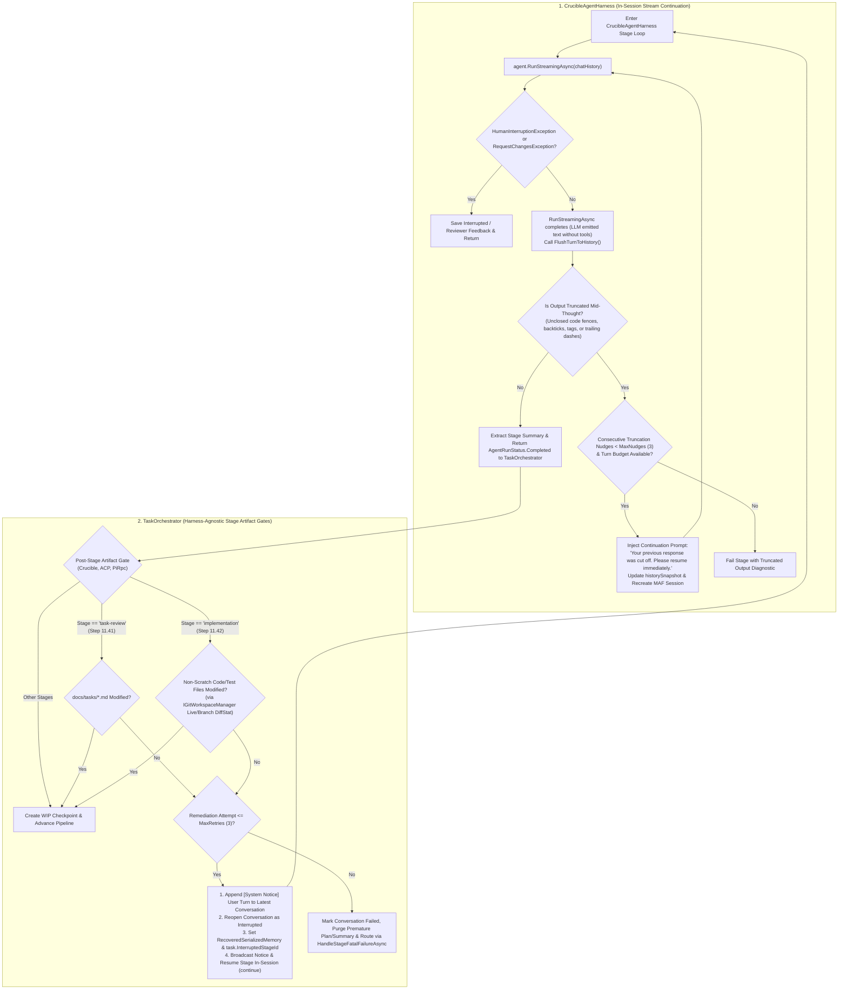

# 🛡️ Step 11.42: Crucible Harness False-Completion Prevention, In-Session Conversational Continuation & Stage Artifact Gates

> **Bug Fix & Resiliency Step (Harness Premature Completion Shield & Autonomous Agent Turn Continuation)**  
> *Parent Plan:* [Bug Fixes & Resiliency Roadmap](README.md)  
> *Target Framework:* .NET 10 (C# 13) | *Status:* Proposed  
> *Target Projects:* [`src/NightCodeForge.Agents`](../../src/NightCodeForge.Agents), [`src/NightCodeForge.Core`](../../src/NightCodeForge.Core), [`tests/NightCodeForge.Agents.Tests`](../../tests/NightCodeForge.Agents.Tests), [`tests/NightCodeForge.Core.Tests`](../../tests/NightCodeForge.Core.Tests)  
> *Dependencies:* [Step 11.37A: HTTP Transport Hardening & Outage Retry Policy](STEP_11_37A_HTTP_TRANSPORT_HARDENING_AND_OUTAGE_RETRY_POLICY.md), [Step 11.41: Task Review Specification Enforcement & Conversational Remediation](STEP_11_41_TASK_REVIEW_SPECIFICATION_ENFORCEMENT_AND_CONVERSATIONAL_REMEDIATION.md)  
> *Aligns With:* [AGENTS.md](../../AGENTS.md), [docs/PLAN.md](../PLAN.md)

> This document is a **specification**: it states required behaviors and constraints, not implementations. Implementation choices (signatures, code structure) are left to the implementer, within the constraints of the documents.

---

## 1. Executive Summary & Root Cause Analysis

### 1.1 Problem Statement
During long-running agentic pipeline stages (such as `task-review` and `implementation`), autonomous agents frequently emit multiple conversational turns: exploring code, running probes, analyzing test suites, writing source code, and executing verification commands.

In production runs (specifically demonstrated on **ForgeTask #36**), the agent repeatedly **ended prematurely after 60+ turns without implementing any code**:
- In **Implementation Run 1** (Conversation #415), the agent spent 62 turns reading files and running tests. At Turn 63, the LLM streamed text outlining its planned probes (`"3. With a normalizer: parse \"`) and stopped without invoking a tool. The harness immediately marked the stage **Completed**, advancing the task to `deterministic-post-impl`.
- Because the repository was unmodified, the post-implementation gates (build and tests) passed cleanly.
- The pipeline advanced to `code-review-fix` (Conversation #420), which immediately **rejected the task** (`"REJECTED — nothing has been implemented. The full diff against master contains ONLY 11 scratch probe projects (~395 lines)"`) and looped back to implementation.
- In **Implementation Run 2** (Conversation #418), the exact same failure repeated: at Turn 61, the model emitted probe plans (`"   - \"`), stopped without calling a tool, and the harness again prematurely marked the stage **Completed**.

Investigation of Ollama logs on the GPU inference host (`aiserver`) at the exact timestamps (`19:12:05.873Z` and `19:20:38.424Z`) revealed:
```text
source=qwen35.go:115 msg="qwen3.5 tool call parsing failed" error=EOF
source=qwen3coder.go:87 msg="qwen tool call parsing failed" error="XML syntax error on line 17: unexpected EOF"
```
When the LLM's generation cut off mid-thought, Ollama failed to parse any tool calls from the unclosed tags and returned the output as **plain conversational text**.

Crucially, **the harness is single-pass and unconditionally assumes any text response without tool calls signifies total stage completion**.

---

### 1.2 Core Defects in Current Codebase

| # | Defect | Root Cause in Codebase | Impact on Pipeline |
| :--- | :--- | :--- | :--- |
| **1** | **Single-Pass MAF Invocation** | In [`CrucibleAgentHarness.cs`](../../src/NightCodeForge.Agents/Crucible/CrucibleAgentHarness.cs#L1184-L1406), `agent.RunStreamingAsync` is invoked exactly **once**. In Microsoft Agents Framework (MAF), `HarnessAgent` runs tool calls in a loop until the LLM returns a text response with **no tool calls**, then finishes. The harness treats the completion of this single chat response as the completion of the *entire stage*. | The moment the model outputs intermediate thinking, an interim plan, or questions without tools, the stage terminates immediately. |
| **2** | **Indiscriminate "Completed" Stage Exit & Missing Implementation Artifact Gate** | In [`CrucibleAgentHarness.cs`](../../src/NightCodeForge.Agents/Crucible/CrucibleAgentHarness.cs#L1395-L1413), the harness calls `StageSummaryExtractor.Extract(concludingText, fallbackSummary: "Stage completed successfully.")` and immediately saves `AgentRunStatus.Completed`, and in [`TaskOrchestrator.cs`](../../src/NightCodeForge.Core/Workflow/TaskOrchestrator.cs#L1490-L1545), the orchestrator only validates `task-review` specification edits (Step 11.41) — never verifying whether the `implementation` stage generated a non-scratch git diff. | Stages exit with "Stage completed successfully" and advance to downstream review even when 0 lines of production/test code were written or when the agent was cut off mid-sentence. |
| **3** | **Unclosed / Interrupted Model Output Vulnerability** | Models running under high reasoning effort occasionally stop generating at stop tokens (`<|im_end|>`) while in the middle of formulating thoughts or tool call tags. Ollama's parser hits `error=EOF` and returns plain text. Downstream, [`LenientToolCallChatClient`](../../src/NightCodeForge.Agents/Inference/LenientToolCallChatClient.cs) finds no valid `<tool_call>` tags, so no `FunctionCallContent` is produced. | Interrupted thoughts trigger immediate false completion rather than conversational continuation. |
| **4** | **Absence of Autonomous Continuation Nudges** | The harness lacks an in-session loop to challenge the agent. When an agent emits text like `"Next, I will write probe5..."`, a human developer would say `"Continue"`. Without an automated continuation prompt, the autonomous pipeline treats the intermediate monologue as a final report. | Tasks get caught in futile retry loops between `implementation` and `code-review-fix`, exhausting retry budgets and GPU compute. |

---

## 2. Detailed Behavioral & Component Specifications



---

### 2.1 In-Harness Conversational Continuation Loop (`CrucibleAgentHarness`)

1. **Multi-Turn Truncated-Stream Continuation Loop:**
   - In [`CrucibleAgentHarness.cs`](../../src/NightCodeForge.Agents/Crucible/CrucibleAgentHarness.cs), wrap the `agent.RunStreamingAsync` (and its non-streaming `agent.RunAsync` fallback) execution in an in-session continuation loop governed by `maxTurns` (the profile/harness turn budget) and a truncation circuit breaker (`MaxConsecutiveTruncationNudges = 3`).
   - At the end of each `RunStreamingAsync` / `RunAsync` pass (when the stream finishes with a text message containing **zero tool calls**), immediately call `FlushTurnToHistory()` so the assistant's latest message and reasoning are recorded in `chatHistory` before evaluating truncation (§2.2).
   - Evaluate `InterruptedGenerationDetector.IsTruncated(concludingText)` (§2.2):
     - If the output is **not** truncated: extract the summary via `StageSummaryExtractor`, mark `AgentRunStatus.Completed`, and return to `TaskOrchestrator` (which enforces post-stage artifact gates across all harnesses in §2.3).
     - If the output **is** truncated and both the truncation nudge budget (`consecutiveTruncationNudges <= MaxConsecutiveTruncationNudges`) and cumulative turn budget remain: inject a `ChatRole.User` continuation nudge into `chatHistory`, update `historySnapshot = chatHistory.ToList()`, persist the user turn to the conversation repository via `TurnWriter`, broadcast an `AgentActivityKind.Notice`, recreate the MAF `AgentSession` (`session = await agent.CreateSessionAsync(cancellationToken)`), and re-invoke `agent.RunStreamingAsync` within the same stage run.
     - Reset `consecutiveTruncationNudges = 0` whenever a pass executes at least one tool call (`FunctionCallContent`).

2. **Session Preservation Across Continuation Turns:**
   - Continuation turns must preserve the full live conversation history (`chatHistory`), tool dispatcher state, and running metrics (elapsed time, cumulative tokens).
   - The loop continues until:
     - The agent produces a non-truncated concluding response.
     - A tool throws `HumanInterruptionException` or `RequestChangesException`.
     - The cumulative turn count reaches `maxTurns`.
     - The consecutive truncation circuit breaker is tripped (`consecutiveTruncationNudges > MaxConsecutiveTruncationNudges`).

---

### 2.2 Truncated Thought & Interrupted Generation Detection (`InterruptedGenerationDetector`)

1. **Mid-Sentence / Truncated Stream Detection:**
   - Define a helper `InterruptedGenerationDetector` in `NightCodeForge.Agents`:
     - Inspect the trailing characters of the assistant's concluding text.
     - Detect incomplete markdown backticks (odd count of unclosed triple-backticks ```` ``` ````, or trailing unclosed single backtick `` ` ``).
     - Detect unfinished list items or bullet dashes ending with punctuation ellipsis or dangling operators (e.g. `   - \``, `3. With a normalizer: parse \``, `Next, I will `).
     - Detect unclosed XML/HTML tool tags (e.g. `<tool_call>`, `<action>`, `<function=`).
   - When a truncated stream is detected:
     - Increment `consecutiveTruncationNudges`.
     - If `consecutiveTruncationNudges <= MaxConsecutiveTruncationNudges`:
       - Log an informative warning: `"Assistant response in conversation #{ConversationId} appears cut off mid-thought. Injecting continuation prompt."`
       - Append a user continuation message:
         > `"[System Notice]: Your previous response was interrupted mid-thought before calling a tool. Please resume immediately and proceed with your planned action or tool call."`
       - Immediately continue the loop in `CrucibleAgentHarness`.
     - If `consecutiveTruncationNudges > MaxConsecutiveTruncationNudges`:
       - Fail the stage (`AgentRunStatus.Failed`) with a diagnostic message indicating the model repeatedly emitted truncated responses.

---

### 2.3 Harness-Agnostic Stage Artifact Validation Gate in `TaskOrchestrator`

Because premature no-op stage exits (e.g. an agent only creating `.scratch/` probe scripts or emitting an interim plan without modifying production/test files) can occur across **any** harness (`CrucibleAgentHarness`, `AcpAgentHarness`, or `PiRpcAgentHarness`), stage artifact validation is enforced in [`TaskOrchestrator.cs`](../../src/NightCodeForge.Core/Workflow/TaskOrchestrator.cs), sharing the conversational remediation mechanism introduced in [Step 11.41](STEP_11_41_TASK_REVIEW_SPECIFICATION_ENFORCEMENT_AND_CONVERSATIONAL_REMEDIATION.md):

1. **`Implementation` Stage Non-Scratch Diff Gate (`StandardStageIds.Implementation`):**
   - In [`TaskOrchestrator.cs`](../../src/NightCodeForge.Core/Workflow/TaskOrchestrator.cs) (immediately following the post-stage disk sync and Step 11.41's `TaskReview` check), when `stage.StageId == StandardStageIds.Implementation && result.IsSuccess && !result.IsCancelled && !result.NeedsClarification` (and no active merge conflict resolution is pending):
   - Query [`IGitWorkspaceManager.GenerateLiveDiffStatAsync(workspace, task.Id, task.BaseBranch, cancellationToken)`](../../src/NightCodeForge.Core/Interfaces/IGitWorkspaceManager.cs#L45) (falling back to `GenerateDiffStatAsync` if the worktree is not yet materialized on disk).
   - **Exclusion & Filtering Rule:**
     - Add `":(exclude).scratch/**"`, `":(exclude)**/.scratch/**"`, and `":(exclude)docs/transcripts/**"` to [`GitDiffConstants.ExclusionPathspecs`](../../src/NightCodeForge.Core/Domain/GitDiffConstants.cs) (or filter them out alongside `docs/tasks/` when evaluating the diff stat).
     - Inspect the file entries in the returned diff stat: verify that at least one production, project, configuration, or test file outside `.scratch/`, `docs/tasks/`, and `docs/transcripts/` was modified, added, or deleted relative to `task.BaseBranch` (covering both uncommitted worktree changes and any commits already made on `feature/task-{id}`).
     - In [`TestOrchestratorBuilder.CreateDefaultGitWorkspaceManager()`](../../tests/NightCodeForge.Core.Tests/Fixtures/TestOrchestratorBuilder.cs#L55-L65), configure a default non-empty diff stat (matching [`FakeGitWorkspaceManager.GeneratedDiffStat`](../../tests/NightCodeForge.Core.Tests/TestFakes.cs#L92)) so existing orchestrator unit tests that do not specifically test empty diffs pass without boilerplate setup.
   - **Conversational Remediation & Retry Budget (`implementation:empty-diff`):**
     - Track attempts via `remediationRetryKey = $"{stage.StageId}:empty-diff"`.
     - If non-scratch changes exist: call `pipelineContext.ResetStageRetry(remediationRetryKey)` and proceed normally to WIP checkpointing and the next stage.
     - If **zero** non-scratch repository files were modified:
       - Increment `remediationAttempt = pipelineContext.IncrementRetry(remediationRetryKey)` against `remediationMaxRetries` (default `3`).
       - Extract a shared helper method in `TaskOrchestrator` (reused by both Step 11.41's `task-review:missing-doc` and Step 11.42's `implementation:empty-diff`) that:
         - When `remediationAttempt <= remediationMaxRetries`:
           - Appends a `StageTurnRole.User` turn to the latest stage conversation (`latestConv`):
             ```text
             [System Notice: Mandatory Code Implementation Required]
             Your implementation turn concluded without modifying or adding any source or test files in the repository (git diff against the base branch is empty, excluding .scratch/ and docs/tasks/).

             You must implement the required code and test changes in the workspace and verify them before this stage can complete. If you are blocked by a genuine product ambiguity, invoke the 'ask' tool.

             Please proceed with implementing the changes now.
             ```
           - Reopens `latestConv` as `StageExecutionStatus.Interrupted`, populates `PipelineDataBagKeys.RecoveredSerializedMemory`, clears premature `StageSummary(stage.StageId)`, sets `isResumedRun = true`, `activeInterruptedStageId = stage.StageId`, `task.InterruptedStageId = stage.StageId`, broadcasts an `AgentActivityKind.Notice`, and executes `continue;` to resume the stage in-session.
         - When `remediationAttempt > remediationMaxRetries`:
           - Marks `latestConv` as `StageExecutionStatus.Failed` with summary `"Stage 'implementation' completed without modifying any repository source or test files after {remediationMaxRetries} conversational remediation attempts."`, and routes deterministically through `HandleStageFatalFailureAsync`.

2. **Unified Division of Responsibility Across Stages:**
   - **`TaskReview` (`StandardStageIds.TaskReview`):** Handled in `TaskOrchestrator` via `task-review:missing-doc` ([Step 11.41](STEP_11_41_TASK_REVIEW_SPECIFICATION_ENFORCEMENT_AND_CONVERSATIONAL_REMEDIATION.md)).
   - **`Implementation` (`StandardStageIds.Implementation`):** Handled in `TaskOrchestrator` via `implementation:empty-diff` (Step 11.42).
   - **Mid-Thought Stream Cutoffs (All Stages in Crucible):** Handled in-session inside `CrucibleAgentHarness` via `InterruptedGenerationDetector` (§2.1 & §2.2).

---

### 2.4 Prompt Engineering & Directive Hardening

1. **Harness Directive Reinforcement:**
   - In [`PromptPrefixStabilizer.cs`](../../src/NightCodeForge.Agents/Optimizations/PromptPrefixStabilizer.cs) (`CanonicalRulesPrompt`) and [`CrucibleAgentHarness.BuildImplementationDirective()`](../../src/NightCodeForge.Agents/Crucible/CrucibleAgentHarness.cs#L1736-L1737):
     - Explicitly instruct the agent:
       > *"CRITICAL: You are an autonomous coding agent operating in a multi-step pipeline. Do NOT write monologues about what you plan to do next and stop; execute your planned actions immediately via tools until your task is 100% implemented and verified."*
   - Do **not** require a special `<stage-complete>` tag in concluding messages so that [`StageSummaryExtractor`](../../src/NightCodeForge.Agents/StageSummaryExtractor.cs) and existing workflow integration tests continue to extract clean human-readable stage summaries without tag leakage.

---

## 3. Verification & Test Strategy

1. **`CrucibleContinuationLoopTests` ([`tests/NightCodeForge.Agents.Tests`](../../tests/NightCodeForge.Agents.Tests)):**
   - **Mid-Thought Interruption Test:** Mock an `IChatClient` that returns a truncated response ending with `   - \`` or an unclosed `<tool_call>` tag on Turn 1, then a valid `bash` or `edit` tool call on Turn 2, and concluding text on Turn 3. Verify `CrucibleAgentHarness` injects the continuation prompt, executes the tool, and does not terminate on Turn 1.
   - **Truncation Circuit Breaker Test:** Mock an `IChatClient` that repeatedly returns truncated text across turns. Verify `CrucibleAgentHarness` halts after `MaxConsecutiveTruncationNudges` (3) and returns `AgentRunStatus.Failed` with a clear diagnostic.
   - **Clean Completion Test:** Verify that a non-truncated concluding response completes on the first evaluation without redundant nudges.

2. **`ImplementationArtifactGateTests` ([`tests/NightCodeForge.Core.Tests`](../../tests/NightCodeForge.Core.Tests)):**
   - **Zero-Diff Implementation Remediation Test:** Configure `IGitWorkspaceManager.GenerateLiveDiffStatAsync` to return `GitDiffConstants.NoChanges` (or only `.scratch/probe.cs`) on Attempt 1 of `implementation`, and `"src/Service.cs | 10 ++\n 1 file changed"` on Attempt 2. Verify `TaskOrchestrator` injects `[System Notice: Mandatory Code Implementation Required]`, reopens the conversation as `Interrupted`, populates `RecoveredSerializedMemory`, and resumes the stage in-session across any harness.
   - **Exhausted Implementation Remediation Ceiling Test:** Configure `GenerateLiveDiffStatAsync` to return `GitDiffConstants.NoChanges` across all attempts. Verify `TaskOrchestrator` halts after `MaxRetries` (3), marks the conversation `Failed`, and transitions the task to `TaskOverallStatus.Failed` via `HandleStageFatalFailureAsync`.

3. **Integration Verification:**
   - Run full unit tests via `dotnet test --filter "Category!=Acceptance&Category!=E2E"`.

---

## 4. Definition of Done (DoD) Checklist

- [ ] Implement `InterruptedGenerationDetector` in `NightCodeForge.Agents` to reliably identify truncated trailing markdown fences, backticks, bullet items, and unclosed tool tags.
- [ ] Implement the in-harness truncated-stream continuation loop in `CrucibleAgentHarness` (governed by `MaxConsecutiveTruncationNudges = 3`, reset on tool calls), calling `FlushTurnToHistory()`, updating `historySnapshot`, and recreating the MAF `AgentSession` before each continuation pass.
- [ ] Add `.scratch/**` and `docs/transcripts/**` exclusions to `GitDiffConstants.ExclusionPathspecs` and implement the harness-agnostic `Implementation` non-scratch diff gate in `TaskOrchestrator` (`implementation:empty-diff`), sharing the conversational remediation helper with Step 11.41's `TaskReview` gate.
- [ ] Update `TestOrchestratorBuilder.CreateDefaultGitWorkspaceManager()` to return a non-empty default diff stat matching `FakeGitWorkspaceManager`.
- [ ] Update rules and implementation directives in `PromptPrefixStabilizer` and `CrucibleAgentHarness.BuildImplementationDirective()` instructing models not to stop after intermediate planning monologues.
- [ ] Author unit tests in `NightCodeForge.Agents.Tests` (for mid-thought stream continuation and circuit breaking) and `NightCodeForge.Core.Tests` (for orchestrator-level `Implementation` empty-diff conversational remediation and retry exhaustion).
- [ ] Verify all tests pass via `dotnet test --filter "Category!=Acceptance&Category!=E2E"`.

