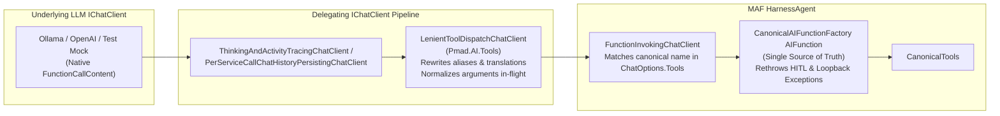

# 🧩 Step 11.43B: `Pmad.AI` `LenientToolDispatcher` & Delegating Chat Client (`LenientToolDispatchChatClient`) Migration

> **Bug Fix, Architecture Consolidation & Tool-Calling Resiliency Step**  
> *Parent Plan:* [Bug Fixes & Resiliency Roadmap](README.md)  
> *Target Framework:* .NET 10 (C# 13) | *Status:* Proposed  
> *Target Projects:* [`src/NightCodeForge.Core`](../../src/NightCodeForge.Core), [`src/NightCodeForge.Agents`](../../src/NightCodeForge.Agents), [`tests/NightCodeForge.Agents.Tests`](../../tests/NightCodeForge.Agents.Tests), [`tests/NightCodeForge.Core.Tests`](../../tests/NightCodeForge.Core.Tests)  
> *Dependencies:* [Step 11.43A: `Pmad.AI` 0.0.2 Upgrade & `ReadOnlyCommandValidator` Migration](STEP_11_43A_PMAD_AI_READONLY_COMMAND_VALIDATOR_MIGRATION.md)  
> *Related Steps:* [Step 11.43C: `Pmad.AI` Opt-In SLM Delegating Chat Clients](STEP_11_43C_PMAD_AI_SLM_DELEGATING_CHAT_CLIENTS_OPT_IN.md), [Step 11.38C: Shared Agent Session & Toolset Factorization](STEP_11_38C_CRUCIBLE_AND_IDEATION_SHARED_SESSION_AND_TOOLSET_FACTORIZATION.md)  
> *Reference Prototype:* [`NcfMigrationConfiguration.cs`](file:///C:/Users/Julien/source/repos/jetelain/PmadAI/tests/Pmad.AI.Tests/NightCodeForge/NcfMigrationConfiguration.cs), [`NcfMigrationDispatcherTests.cs`](file:///C:/Users/Julien/source/repos/jetelain/PmadAI/tests/Pmad.AI.Tests/NightCodeForge/NcfMigrationDispatcherTests.cs)  
> *Aligns With:* [AGENTS.md](../../AGENTS.md), [docs/PLAN.md](../PLAN.md)

> This document is a **specification**: it states required behaviors and constraints, not implementations. Implementation choices (signatures, code structure) are left to the implementer, within the constraints of the documents.

---

## 1. Problem Statement & Architectural Deficiencies

`NightCodeForge.Agents` currently contains ~1,450 lines of hand-rolled tool dispatching and chat-client tool extraction code across four files:
- [`src/NightCodeForge.Agents/Dispatcher/LenientToolDispatcher.cs`](../../src/NightCodeForge.Agents/Dispatcher/LenientToolDispatcher.cs) (989 lines)
- [`src/NightCodeForge.Agents/Dispatcher/LenientToolDispatcher.Backlog.cs`](../../src/NightCodeForge.Agents/Dispatcher/LenientToolDispatcher.Backlog.cs) (257 lines)
- [`src/NightCodeForge.Agents/Dispatcher/ToolDefinition.cs`](../../src/NightCodeForge.Agents/Dispatcher/ToolDefinition.cs) (74 lines)
- [`src/NightCodeForge.Agents/Inference/LenientToolCallChatClient.cs`](../../src/NightCodeForge.Agents/Inference/LenientToolCallChatClient.cs) (145 lines)

This legacy architecture has three major flaws:

1. **Missing In-Flight `FunctionCallContent` Rewriting in the `IChatClient` Pipeline & Unconditional XML Tool-Tag Extraction:**
   - `LenientToolCallChatClient` only parses `<tool_call>` XML tags out of assistant `TextContent` (which for 25B+ LLMs that emit native structured tool calls is more error-prone than useful, as it can destructively strip literal `<tool_call>` tags from code/documentation responses); meanwhile, it does **not** rewrite `FunctionCallContent.Name` or `FunctionCallContent.Arguments` on streaming or non-streaming `IChatClient` responses before Microsoft Agents Framework's (`MAF`) `HarnessAgent` / `FunctionInvokingChatClient` inspects them.
   - Consequently, when a model emits a native tool call using a **tool alias** (e.g., `cat`, `read_file`, `replace_file_content`, `run_command`, `ask_question`, `reject_implementation`, `read_task`, `update_task`) or a **dropped virtual tool** (`list_dir`, `grep_search`, `get_file_outline`, `find_files`), `FunctionInvokingChatClient` looks up the unnormalized name in `ChatOptions.Tools` (which only advertises canonical names: `read`, `edit`, `write`, `bash`, `ask`, `request_changes`, `get_task`, etc.) and fails to match the tool.
2. **Dual Tool Registration & Handler Duplication:**
   - Every canonical and backlog tool is currently implemented **twice**: once as a typed `AIFunction` in [`CanonicalAIFunctionFactory.cs`](../../src/NightCodeForge.Agents/Tools/CanonicalAIFunctionFactory.cs) and a second time as a manual dictionary-parsing lambda in `LenientToolDispatcher.RegisterCanonicalTools` / `RegisterBacklogTools`.
   - `CanonicalAIFunctionFactory` then wraps its `AIFunction`s in a private `LenientAIFunction` that bypasses the `AIFunction` delegate altogether and calls `LenientToolDispatcher.ExecuteCanonicalCallAsync(...)`.
3. **Duplication of `Pmad.AI` 0.0.2 Capabilities:**
   - `Pmad.AI` `0.0.2` provides `Pmad.AI.Tools.LenientToolDispatcher`, `ToolDispatcherConfiguration`, and `LenientToolDispatchChatClient` (`.UseLenientToolDispatch(...)`), which were specifically designed and tested against NightCodeForge's tool surface (see [`NcfMigrationConfiguration.cs`](file:///C:/Users/Julien/source/repos/jetelain/PmadAI/tests/Pmad.AI.Tests/NightCodeForge/NcfMigrationConfiguration.cs)). (Note: `Pmad.AI.Healing.ToolCallHealingChatClient` is handled separately as an opt-in SLM middleware in [Step 11.43C](STEP_11_43C_PMAD_AI_SLM_DELEGATING_CHAT_CLIENTS_OPT_IN.md).)

---

## 2. Target Architecture

---

## 3. Detailed Requirements & Specifications

### 3.1 Declarative `ToolDispatcherConfiguration` for NightCodeForge

Define a centralized declarative configuration builder in `NightCodeForge.Agents` (building on the prototype in [`NcfMigrationConfiguration.cs`](file:///C:/Users/Julien/source/repos/jetelain/PmadAI/tests/Pmad.AI.Tests/NightCodeForge/NcfMigrationConfiguration.cs)) that configures `Pmad.AI.Tools.ToolDispatcherConfiguration` and `Pmad.AI.Tools.LenientToolDispatcherOptions`:

1. **Canonical Tool Mappings (`Tools`):**
   - **`read`:**
     - Tool aliases: `read_file`, `readfile`, `read_file_content`, `cat`, `view_file`, `get_file_contents`, `open_file`.
     - Parameter aliases: `path` $\leftarrow$ `filePath`, `file_path`, `filepath`, `filename`, `file`, `target_file`, `TargetFile`; `offset` $\leftarrow$ `start_line`, `startLine`, `from_line`, `line_start`, `start`, `StartLine`, `line_offset`; `limit` $\leftarrow$ `max_lines`, `line_count`, `num_lines`.
     - Computed parameters: `offset` resolved from start-line aliases; `limit` computed as $\max(1, \text{end\_line} - (\text{offset} ?? 1) + 1)$ when `end_line` / `endLine` / `to_line` / `line_end` / `end` / `EndLine` is provided and `limit` is omitted.
   - **`edit`:**
     - Tool aliases: `replace_file_content`, `replacefilecontent`, `replace_content`, `replacecontent`, `edit_file`, `str_replace`, `patch_file`, `editfile`, `replace_in_file`, `modify_file`, `multi_edit`, `multi_replace_file_content`.
     - Parameter aliases: `path` $\leftarrow$ `filePath`, `file_path`, `filepath`, `filename`, `file`, `target_file`, `TargetFile`; `old_text` $\leftarrow$ `oldText`, `old_str`, `old_string`, `search`, `target`, `find`, `original`, `target_string`, `targetContent`, `TargetContent`, `target_content`; `new_text` $\leftarrow$ `newText`, `new_str`, `new_string`, `replace`, `replacement`, `updated`, `replacementContent`, `ReplacementContent`, `replacement_content`; `replace_all` $\leftarrow$ `replaceAll`, `all`, `ReplaceAll`, `replace_all_occurrences`; `edits` $\leftarrow$ `replacements`, `chunks`, `changes`, `patches`, `operations`, `replacementChunks`, `ReplacementChunks`, `replacement_chunks`, `items`.
     - Nested parameter aliases on `edits[]`: `oldText` $\leftarrow$ `old_text`, `old_str`, `old_string`, `search`, `target`, `find`, `original`, `target_string`, `targetContent`, `TargetContent`, `target_content`; `newText` $\leftarrow$ `new_text`, `new_str`, `new_string`, `replace`, `replacement`, `updated`, `replacementContent`, `ReplacementContent`, `replacement_content`; `replaceAll` $\leftarrow$ `replace_all`, `all`, `ReplaceAll`, `replace_all_occurrences`.
     - Propagated parameters: `replace_all`, `replaceAll`.
     - Computed `edits` synthesis: when `edits` is not already supplied (or is empty/blank chunks) and a flat `old_text`/`new_text` pair is present under any accepted alias, synthesize `edits` (or pass normalized `old_text`/`new_text`/`replace_all` to the `edit` `AIFunction` delegate).
   - **`write`:**
     - Tool aliases: `write_file`, `writefile`, `create_file`, `new_file`, `save_file`, `overwrite_file`.
     - Parameter aliases: `path` $\leftarrow$ `filePath`, `file_path`, `filepath`, `filename`, `file`, `target_file`, `TargetFile`; `content` $\leftarrow$ `file_content`, `contents`, `text`, `code`, `CodeContent`, `code_content`, `body`, `data`.
   - **`bash`:**
     - Tool aliases: `run_command`, `runcommand`, `run_cmd`, `exec`, `execute`, `execute_command`, `cmd`, `terminal`, `powershell`, `sh`, `shell`, `run_bash`.
     - Parameter aliases: `command` $\leftarrow$ `cmd`, `command_line`, `CommandLine`, `exec`, `script`, `bash_command`, `shell_command`; `working_directory` $\leftarrow$ `workingDirectory`, `workdir`, `work_dir`, `cwd`.
   - **`load_skill`:**
     - Tool aliases: `loadskill`, `use_skill`, `useskill`, `get_skill`.
     - Parameter aliases: `skill_name` $\leftarrow$ `skillName`, `skill`, `name`.
   - **`ask`:**
     - Tool aliases: `ask_human_question`, `ask_human`, `ask_user`, `askhumanquestion`, `ask_question`, `ask_questions`, `askhuman`, `clarify`, `request_clarification`, `question`.
     - Parameter aliases: `questions` $\leftarrow$ `question_items`, `questionItems`, `items`, `question`, `prompts`, `queries`.
     - Primary collection property: `questions` $\rightarrow$ `prompt`.
     - Nested parameter aliases on `questions[]`: `prompt` $\leftarrow$ `question`, `text`, `query`, `message`, `title`; `rationale` $\leftarrow$ `reason`, `context`, `why`, `explanation`; `options` $\leftarrow$ `choices`, `values`, `candidates`, `items`, `options_json`, `optionsJson`, `OptionsJson`.
   - **`web_search`:**
     - Tool aliases: `search_web`, `google_search`, `bing_search`, `brave_search`, `websearch`, `internet_search`, `search`.
     - Parameter aliases: `query` $\leftarrow$ `q`, `search_query`, `text`, `searchQuery`; `max_results` $\leftarrow$ `maxResults`, `count`, `limit`.
   - **`propose_tasks`:**
     - Tool aliases: `propose_task`, `proposetasks`, `create_tasks`, `submit_tasks`, `add_tasks`, `propose_backlog`.
     - Parameter aliases: `tasks` $\leftarrow$ `proposals`, `items`, `task_list`, `task`.
     - Nested parameter aliases on `tasks[]`: `title` $\leftarrow$ `name`, `summary`, `task_title`; `description` $\leftarrow$ `desc`, `details`, `body`, `content`, `spec`; `priority` $\leftarrow$ `prio`, `order`, `rank`; `dependsOnIndices` $\leftarrow$ `depends_on_indices`, `depends_on`, `dependencies`, `deps`; `mergeMode` $\leftarrow$ `merge_mode`; `baseBranch` $\leftarrow$ `base_branch`, `branch`.
   - **`request_changes`:**
     - Tool aliases: `reject_implementation`, `requestchanges`, `rejectimplementation`, `send_back`, `sendback`, `reject_stage`, `loopback`, `request_rework`, `fail_review`, `return_to_implementation`.
     - Parameter aliases: `feedback` $\leftarrow$ `critique`, `message`, `comments`, `review`, `details`, `issues`, `findings`; `reason` $\leftarrow$ `comment`, `summary`, `rationale`, `cause`, `why`.
   - **Backlog Mutation Tools (`get_task`, `edit_task`, `set_task_priority`, `rework_priorities`, `remove_task`):**
     - `get_task`: aliases (`gettask`, `read_task`, `show_task`, `view_task`, `inspect_task`, `fetch_task`); parameter aliases (`task_id` $\leftarrow$ `taskId`, `id`, `TaskId`, `task`, `number`, `task_number`).
     - `edit_task`: aliases (`edittask`, `update_task`, `updatetask`, `modify_task`, `patch_task`, `change_task`); parameter aliases (`task_id` $\leftarrow$ `taskId`, `id`, `TaskId`, `task`, `number`, `task_number`; `title` $\leftarrow$ `name`, `summary`, `task_title`; `description` $\leftarrow$ `desc`, `details`, `body`, `content`, `spec`; `priority` $\leftarrow$ `prio`, `order`, `rank`; `depends_on_ids` $\leftarrow$ `dependsOnIds`, `depends_on`, `dependsOn`, `prerequisites`, `prerequisite_ids`, `dependencies`, `deps`, `dependency_ids`; `merge_mode` $\leftarrow$ `mergeMode`, `merge_strategy`; `base_branch` $\leftarrow$ `baseBranch`, `branch`, `target_branch`).
     - `set_task_priority`: aliases (`settaskpriority`, `set_priority`, `change_task_priority`, `update_task_priority`, `prioritize_task`); parameter aliases (`task_id` $\leftarrow$ `taskId`, `id`, `TaskId`, `task`, `number`, `task_number`; `priority` $\leftarrow$ `prio`, `order`, `rank`, `new_priority`).
     - `rework_priorities`: aliases (`reworkpriorities`, `rework_priority`, `set_task_priorities`, `reorder_tasks`, `batch_set_priorities`, `update_priorities`, `reprioritize_tasks`, `reprioritize`, `set_priorities`); parameter aliases (`updates` $\leftarrow$ `priorities`, `tasks`, `items`, `changes`, `rework`); nested parameter aliases on `updates[]` (`taskId` $\leftarrow$ `task_id`, `id`, `TaskId`, `task`, `number`, `task_number`; `priority` $\leftarrow$ `prio`, `order`, `rank`, `new_priority`).
     - `remove_task`: aliases (`removetask`, `delete_task`, `deletetask`, `cancel_task`, `drop_task`, `archive_task`); parameter aliases (`task_id` $\leftarrow$ `taskId`, `id`, `TaskId`, `task`, `number`, `task_number`; `reason` $\leftarrow$ `rationale`, `comment`, `explanation`, `why`).

2. **Dropped-Tool Shell Translations (`Translations`):**
   - Configure `Translations` (with `ParameterEscapeMethod.Bash` and `ValidateTranslationsWithReadOnlyValidator = true` backed by the `ReadOnlyCommandValidator` from [Step 11.43A](STEP_11_43A_PMAD_AI_READONLY_COMMAND_VALIDATOR_MIGRATION.md)):
     - `list_dir` (and aliases `listdir`, `list_directory`, `ls`): translates to `bash` with `ls -la {path:.}` (supporting parameter aliases `dir`, `directory`, `folder`, `target`, `dir_path`, `directory_path` for `path`).
     - `grep_search` (and aliases `grep`, `search_files`, `find_in_files`): translates to `bash` with `rg -n -- {query} {path:.}` (supporting parameter aliases `pattern`, `search`, `regex`, `text`, `term`, `query_pattern` for `query` and `dir`, `directory`, `file`, `include`, `search_path` for `path`).
     - `get_file_outline` (and aliases `outline`, `view_outline`, `file_outline`): translates to `bash` with `csnav outline {path}` (or `rg` fallback if configured, supporting parameter aliases `file_path`, `filePath`, `filepath`, `file`, `filename`, `target_file` for `path`).
     - `find_files` (and aliases `find`, `findfiles`, `locate_files`): translates to `bash` with `find {path:.} -maxdepth 4 -iname {pattern:*}` (supporting parameter aliases `query`, `name`, `glob`, `file_pattern`, `filter` for `pattern` and `dir`, `directory`, `folder`, `search_path`, `root` for `path`).

### 3.2 Single-Source-of-Truth `CanonicalAIFunctionFactory` & Special Coercion Rules

1. **Eliminate Duplicate Tool Handlers:**
   - Delete `LenientToolDispatcher.RegisterCanonicalTools`, `LenientToolDispatcher.Backlog.cs`, and `ToolDefinition.cs`.
   - `CanonicalAIFunctionFactory` must be the **single source of truth** creating the `AIFunction` instances for `CanonicalTools`.
   - Register the unwrapped `AIFunction`s into `Pmad.AI.Tools.LenientToolDispatcher` via `dispatcher.RegisterTools(...)`.

2. **Preserve NightCodeForge Domain & Edge-Case Normalization Contracts:**
   - **Control-Flow Exception Propagation:**
     - Note that `Pmad.AI.Tools.LenientAIFunction` catches all non-cancellation exceptions and converts them into `"Error executing tool ..."` strings.
     - In NightCodeForge, `ask` throws `HumanInterruptionException` (when pausing a headless Crucible stage for HITL input) and `request_changes` throws `RequestChangesException` (when looping back from code review to implementation).
     - `CanonicalAIFunctionFactory`'s `DelegatingAIFunction` wrapper (and any direct dispatcher invocation helper) **must** rethrow `OperationCanceledException`, `HumanInterruptionException`, and `RequestChangesException` (including when wrapped as `InnerException`) without swallowing them as model-visible error strings.
   - **Hash-Prefixed Task ID Coercion (`#42`) & `depends_on_ids` Validation:**
     - Models frequently pass task IDs as `"#42"` or `depends_on_ids: [1, "#3"]`.
     - Ensure `task_id` (`get_task`, `edit_task`, `set_task_priority`, `remove_task`), `depends_on_ids` (`edit_task`), and `updates` (`rework_priorities`) accept integer values, numeric strings (`"42"`), and `#`-prefixed numeric strings (`"#42"`).
     - Preserve the `edit_task` `depends_on_ids` distinction required by `BacklogToolWiringTests`:
       - Omitted or `null` `depends_on_ids` passes `null` (leaving existing dependencies unchanged).
       - Empty array `[]` passes an empty list/array (clearing dependencies).
       - Non-numeric invalid entries (e.g., `["not-a-task-id"]`) throw `ArgumentException`.
   - **Null-Valued Canonical Key vs. Non-Null Alias Key Precedence:**
     - When an argument payload contains both a canonical key with `null` (or `JsonValueKind.Null`) and an alias key with a non-null value (e.g., `{"task_id": 5, "merge_mode": null, "mergeMode": "Automatic"}`), strip or ignore the `null` entry before alias resolution so the non-null alias value (`"Automatic"`) is preserved.
   - **Top-Level JSON Array Payloads (`ask` & `rework_priorities`):**
     - When a model emits a raw top-level JSON array string (including truncated arrays repaired by `SanitizeArgumentsJson`, e.g. `[{"prompt": "Q1"}, {"prompt": "Q2"}` for `ask` or `[{"task_id": 1, "priority": 2}]` for `rework_priorities`), wrap the parsed root array into the tool's collection parameter (`questions` / `updates` / `items`) before normalizing.
   - **Stringified Nested `optionsJson` on `ask`:**
     - Ensure `QuestionItemParser.ParseFromObject` (or nested normalization on `ask`) continues to support `QuestionItem` records where `options` / `optionsJson` is passed as a stringified JSON array (e.g., `"[\"A\", \"B\"]"`).

### 3.3 Delegating `IChatClient` Pipeline Integration (`LenientToolDispatchChatClient`)

1. **Removal of `LenientToolCallChatClient`:**
   - Delete [`src/NightCodeForge.Agents/Inference/LenientToolCallChatClient.cs`](../../src/NightCodeForge.Agents/Inference/LenientToolCallChatClient.cs).
   - Note: Plain-text `<tool_call>` / ReAct `Action:` extraction via `Pmad.AI.Healing.ToolCallHealingChatClient` is intentionally **not** wired by default because for 25B+ LLMs native tool calling is standard and text-based tool extraction is more error-prone than useful (e.g., destructively stripping literal `<tool_call>` snippets when working on LLM parser code). Opt-in support for `ToolCallHealingChatClient` (`LocalOptimizationFlags.ToolCallHealing = false`) is specified in [Step 11.43C](STEP_11_43C_PMAD_AI_SLM_DELEGATING_CHAT_CLIENTS_OPT_IN.md).
2. **Middleware Pipeline Wiring in `CrucibleAgentHarness` and `IdeationService` (and `IHarnessAgentFactory` in Step 11.38C):**
   - Replace `new LenientToolCallChatClient(...)` with `Pmad.AI.Tools.LenientToolDispatchChatClient` (or `.UseLenientToolDispatch(dispatcher)`) wrapping the inner tracing/persistence client.
   - `LenientToolDispatchChatClient` intercepts every `FunctionCallContent` in `GetResponseAsync` and `GetStreamingResponseAsync` and rewrites `Name` and `Arguments` via `dispatcher.NormalizeCall(...)` *before* `HarnessAgent` (`FunctionInvokingChatClient`) matches the tool name against `ChatOptions.Tools`.

### 3.4 Consolidation of `JsonRepairHelper`

1. Check all callers of [`NightCodeForge.Core.Domain.JsonRepairHelper`](../../src/NightCodeForge.Core/Domain/JsonRepairHelper.cs):
   - In `NightCodeForge.Agents`, use `Pmad.AI.Healing.ToolCallHealingTransform.SanitizeArgumentsJson` / `Pmad.AI.Common.JsonRepairUtilities`.
   - Keep `QuestionItemParser` in `NightCodeForge.Core` functioning cleanly without introducing heavy dependencies into `NightCodeForge.Core`.

---

## 4. Verification & Test Strategy

1. **Migrate & Expand `LenientToolDispatcherTests` ([`tests/NightCodeForge.Agents.Tests/LenientToolDispatcherTests.cs`](../../tests/NightCodeForge.Agents.Tests/LenientToolDispatcherTests.cs)):**
   - Verify all existing NightCodeForge tool-name aliases, parameter aliases, computed `read` `offset`/`limit` (`end_line`), `edit` single-chunk and multi-chunk normalization (`replace_all` propagation), `ask` question normalization (including stringified `optionsJson` and truncated JSON repair), `propose_tasks`, `request_changes`, and dropped-tool translations (`list_dir`, `grep_search`, `get_file_outline`, `find_files` and their aliases) pass against the `Pmad.AI.Tools.LenientToolDispatcher`-backed implementation.
2. **Verify `BacklogToolWiringTests` & `Step1131MultiMatchEditTests` & `CodeReviewLoopbackAndPromptOverrideTests`:**
   - Ensure all tests in `BacklogToolWiringTests` (`#42` task IDs, `[1, "#3"]` `depends_on_ids`, empty array `[]` vs `null` `depends_on_ids`, invalid non-numeric `depends_on_ids` throwing `ArgumentException`, `null` first alias key fallback, top-level JSON array payloads for `rework_priorities` and `ask`) pass without regression.
   - Ensure `HumanInterruptionException` and `RequestChangesException` propagate through both dispatcher execution and `AIFunction.InvokeAsync`.
3. **Add `LenientToolDispatchChatClient` Pipeline Tests & Update `IdeationServiceTests`:**
   - Verify that native `FunctionCallContent` items with aliased tool names (`cat`, `replace_file_content`, `ask_question`, `read_task`) and translated virtual tools (`list_dir`, `grep_search`) are rewritten in-flight to canonical tool names (`read`, `edit`, `ask`, `get_task`, `bash`) with normalized arguments in both `GetResponseAsync` and `GetStreamingResponseAsync`.
   - Update existing mock `IChatClient` tests in [`tests/NightCodeForge.Agents.Tests/IdeationServiceTests.cs`](../../tests/NightCodeForge.Agents.Tests/IdeationServiceTests.cs) (`ConverseStreamingAsync_ExecutesToolCalls_AndIncorporatesPendingProposals`, `ConverseStreamingAsync_YieldsToolCallStartedAndCompletedUpdates`, `ConverseStreamingAsync_LogsAndYieldsToolFailure_WhenToolFails`, `ConverseStreamingAsync_ProposeTasks_EstablishesSequentialDependencies_WhenMultipleTasksProposed`) that previously simulated tool calls via raw `<tool_call>` text strings to emit structured `FunctionCallContent` updates (testing `<tool_call>` text extraction with opt-in `ToolCallHealing = true` is covered in [Step 11.43C](STEP_11_43C_PMAD_AI_SLM_DELEGATING_CHAT_CLIENTS_OPT_IN.md)).
   - Verify that `dispatcher.Validate(throwOnError: false)` produces zero `ToolValidationSeverity.Error` issues when all canonical tools are registered.

---

## 5. Definition of Done (DoD) Checklist

- [ ] Create NightCodeForge's declarative `ToolDispatcherConfiguration` builder covering all canonical tools, backlog mutation tools, parameter aliases, nested collection aliases, computed parameters, propagated parameters, and dropped-tool shell translations (`list_dir`, `grep_search`, `get_file_outline`, `find_files`).
- [ ] Refactor `CanonicalAIFunctionFactory` to register its `AIFunction` instances directly with `Pmad.AI.Tools.LenientToolDispatcher` (eliminating duplicate tool handler lambdas) while preserving `OperationCanceledException`, `HumanInterruptionException`, and `RequestChangesException` propagation and `#42` / top-level array / null-alias handling.
- [ ] Delete legacy in-repo `Dispatcher/LenientToolDispatcher.Backlog.cs`, `Dispatcher/ToolDefinition.cs`, and `Inference/LenientToolCallChatClient.cs`, and replace `Dispatcher/LenientToolDispatcher.cs` with `Pmad.AI.Tools.LenientToolDispatcher` (or a thin NCF facade/configuration wrapper around it).
- [ ] Wire `LenientToolDispatchChatClient` into the `IChatClient` pipeline in `CrucibleAgentHarness` and `IdeationService`.
- [ ] Update and expand `LenientToolDispatcherTests`, `BacklogToolWiringTests`, `IdeationServiceTests`, and `LenientToolDispatchChatClient` pipeline tests in `tests/NightCodeForge.Agents.Tests`.
- [ ] Verify all non-E2E tests pass via `dotnet test --filter "Category!=Acceptance&Category!=E2E"`.
