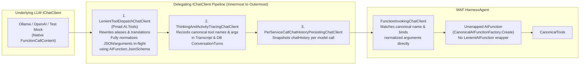

# 🧩 Step 11.43B: `Pmad.AI` `LenientToolDispatcher` & Delegating Chat Client (`LenientToolDispatchChatClient`) Migration

> **Bug Fix, Architecture Consolidation & Tool-Calling Resiliency Step**  
> *Parent Plan:* [Bug Fixes & Resiliency Roadmap](README.md)  
> *Target Framework:* .NET 10 (C# 13) | *Status:* Proposed  
> *Target Projects:* [`src/NightCodeForge.Core`](../../src/NightCodeForge.Core), [`src/NightCodeForge.Agents`](../../src/NightCodeForge.Agents), [`tests/NightCodeForge.Agents.Tests`](../../tests/NightCodeForge.Agents.Tests), [`tests/NightCodeForge.Core.Tests`](../../tests/NightCodeForge.Core.Tests)  
> *Dependencies:* [Step 11.43A: `Pmad.AI` 0.0.2 Upgrade & `ReadOnlyCommandValidator` Migration](STEP_11_43A_PMAD_AI_READONLY_COMMAND_VALIDATOR_MIGRATION.md), `Pmad.AI` `0.0.3`  
> *Related Steps:* [Step 11.43C: `Pmad.AI` Opt-In SLM Delegating Chat Clients](STEP_11_43C_PMAD_AI_SLM_DELEGATING_CHAT_CLIENTS_OPT_IN.md), [Step 11.38C: Shared Agent Session & Toolset Factorization](STEP_11_38C_CRUCIBLE_AND_IDEATION_SHARED_SESSION_AND_TOOLSET_FACTORIZATION.md)  
> *Reference `Pmad.AI` Tests:* [`LenientToolDispatcherEnhancementsTests.cs`](file:///C:/Users/Julien/source/repos/jetelain/PmadAI/tests/Pmad.AI.Tests/LenientToolDispatcherEnhancementsTests.cs)  
> *Aligns With:* [AGENTS.md](../../AGENTS.md), [docs/PLAN.md](../PLAN.md)

> This document is a **specification**: it states required behaviors and constraints, not implementations. Implementation choices (signatures, code structure) are left to the implementer, within the constraints of the documents.

---

## 1. Problem Statement & Architectural Deficiencies

`NightCodeForge.Agents` currently contains ~1,450 lines of hand-rolled tool dispatching and chat-client tool extraction code across four files:
- [`src/NightCodeForge.Agents/Dispatcher/LenientToolDispatcher.cs`](../../src/NightCodeForge.Agents/Dispatcher/LenientToolDispatcher.cs) (989 lines)
- [`src/NightCodeForge.Agents/Dispatcher/LenientToolDispatcher.Backlog.cs`](../../src/NightCodeForge.Agents/Dispatcher/LenientToolDispatcher.Backlog.cs) (257 lines)
- [`src/NightCodeForge.Agents/Dispatcher/ToolDefinition.cs`](../../src/NightCodeForge.Agents/Dispatcher/ToolDefinition.cs) (74 lines)
- [`src/NightCodeForge.Agents/Inference/LenientToolCallChatClient.cs`](../../src/NightCodeForge.Agents/Inference/LenientToolCallChatClient.cs) (145 lines)

This legacy architecture has three major flaws:

1. **Missing In-Flight `FunctionCallContent` Rewriting in the `IChatClient` Pipeline & Unconditional XML Tool-Tag Extraction:**
   - `LenientToolCallChatClient` only parses `<tool_call>` XML tags out of assistant `TextContent` (which for 25B+ LLMs that emit native structured tool calls is more error-prone than useful, as it can destructively strip literal `<tool_call>` tags from code/documentation responses); meanwhile, it does **not** rewrite `FunctionCallContent.Name` or `FunctionCallContent.Arguments` on streaming or non-streaming `IChatClient` responses before Microsoft Agents Framework's (`MAF`) `HarnessAgent` / `FunctionInvokingChatClient` inspects them.
   - Consequently, when a model emits a native tool call using a **tool alias** (e.g., `cat`, `read_file`, `replace_file_content`, `run_command`, `ask_question`, `reject_implementation`, `read_task`, `update_task`) or a **dropped virtual tool** (`list_dir`, `grep_search`, `get_file_outline`, `find_files`), `FunctionInvokingChatClient` looks up the unnormalized name in `ChatOptions.Tools` (which only advertises canonical names: `read`, `edit`, `write`, `bash`, `ask`, `request_changes`, `get_task`, etc.) and fails to match the tool.
2. **Dual Tool Registration & Handler Duplication:**
   - Every canonical and backlog tool is currently implemented **twice**: once as a typed `AIFunction` in [`CanonicalAIFunctionFactory.cs`](../../src/NightCodeForge.Agents/Tools/CanonicalAIFunctionFactory.cs) and a second time as a manual dictionary-parsing lambda in `LenientToolDispatcher.RegisterCanonicalTools` / `RegisterBacklogTools`.
   - `CanonicalAIFunctionFactory` then wraps its `AIFunction`s in a private `LenientAIFunction` that bypasses the `AIFunction` delegate altogether and calls `LenientToolDispatcher.ExecuteCanonicalCallAsync(...)`.
3. **Duplication of `Pmad.AI` 0.0.3 Capabilities:**
   - `Pmad.AI` `0.0.3` provides `Pmad.AI.Tools.LenientToolDispatcher`, `ToolDispatcherConfiguration`, `LenientAIFunction`, and `LenientToolDispatchChatClient` (`.UseLenientToolDispatch(...)`), with full schema-driven in-flight normalization and transparent exception propagation tested in [`LenientToolDispatcherEnhancementsTests.cs`](file:///C:/Users/Julien/source/repos/jetelain/PmadAI/tests/Pmad.AI.Tests/LenientToolDispatcherEnhancementsTests.cs). (Note: `Pmad.AI.Healing.ToolCallHealingChatClient` is handled separately as an opt-in SLM middleware in [Step 11.43C](STEP_11_43C_PMAD_AI_SLM_DELEGATING_CHAT_CLIENTS_OPT_IN.md).)

---

## 2. Target Architecture

---

## 3. Detailed Requirements & Specifications

### 3.1 Prerequisite `Pmad.AI` Changes (Completed in `Pmad.AI` `0.0.3`)

The prerequisite enhancements requested for `Pmad.AI` are implemented and shipped in **`Pmad.AI` `0.0.3`**:

1. **Upgrade Package Reference to `Pmad.AI` `0.0.3`:**
   - Update [`src/NightCodeForge.Agents/NightCodeForge.Agents.csproj`](../../src/NightCodeForge.Agents/NightCodeForge.Agents.csproj) from `Pmad.AI` `0.0.2` to `0.0.3`.
2. **Capabilities Provided by `Pmad.AI` `0.0.3`:**
   - **Transparent Exception Propagation:** `Pmad.AI.Tools.LenientAIFunction.InvokeCoreAsync` and `LenientToolDispatcher.ExecuteAsync` no longer catch or convert tool exceptions into `"Error executing tool ..."` strings; `HumanInterruptionException`, `RequestChangesException`, `ArgumentException`, and `OperationCanceledException` propagate naturally.
   - **Immutable Configuration Snapshot & Thread-Safe Tool Registry:** `Pmad.AI.Tools.LenientToolDispatcher` takes `ToolDispatcherConfiguration? configuration = null`, `LenientToolDispatcherOptions? options = null`, and `IEnumerable<AIFunction>? aIFunctions = null` in its constructor, snapshotting `ToolDispatcherConfiguration` at construction time (`ToolDispatcherConfigurationSnapshot`) while maintaining a thread-safe `RegistredToolsMetadata` registry for `AIFunction` instances (`RegisterTool`, `RegisterTools`, `Clone`).
   - **Full Schema-Driven In-Flight Argument Normalization in `LenientToolDispatcher.NormalizeCall`:**
     - **Null-Valued Canonical Key vs. Non-Null Alias Precedence:** Treats `null` or `JsonElement` with `JsonValueKind.Null`/`Undefined` on a canonical key as unset so a non-null alias value wins (e.g., `{"task_id": 5, "merge_mode": null, "mergeMode": "Automatic"}`), and unwraps `JsonValueKind.Null` to `null`.
     - **Top-Level JSON Array Payloads (`JsonValueKind.Array`):** Maps root JSON arrays (e.g., `[{"prompt": "Q1"}]` for `ask` or `[{"task_id": 1, "priority": 2}]` for `rework_priorities`, including truncated arrays repaired by `SanitizeArgumentsJson`) via `ToolCallHealingTransform.RootArraySentinelKey` (`"$rootArray"`) to the tool's collection parameter identified via `ParameterAliases["items"]` or `AIFunction.JsonSchema`.
     - **Recursive Scalar Array Element Coercion & `#`-Prefixed Integer Coercion (`"#42"` $\rightarrow$ `42`):** Strips optional leading `#` prefixes for `integer` schema properties and coerces scalar array elements against the item schema (e.g., `depends_on_ids: [1, "#3"]` $\rightarrow$ `[1, 3]`).
     - **Nested Object, Case-Insensitive / Snake-Case & `_json`/`Json` Suffix Normalization Against `AIFunction.JsonSchema`:** Automatically normalizes nested object properties inside collection parameters (`questions[]`, `edits[]`, `updates[]`) to the exact property names declared in `AIFunction.JsonSchema`, strips `_json` / `Json` suffixes when matching schema properties (e.g., `optionsJson` / `options_json` $\rightarrow$ `options`, `questions_json` $\rightarrow$ `questions`), and parses stringified JSON arrays into arrays.
     - **Blank/Empty Collection Placeholder Promotion (`edits: [{}]`):** Treats collection elements that are empty or contain only `null`/whitespace values as empty so flat shortcut arguments (e.g., `old_text` / `new_text` alongside `"edits": [{}]`) are promoted into `edits`.
     - **Non-Streaming & Streaming Parity in `LenientToolDispatchChatClient`:** Both `GetResponseAsync` and `GetStreamingResponseAsync` register `options.Tools.OfType<AIFunction>()` with the dispatcher, set `options.SetToolDispatcher(_dispatcher)`, and normalize `FunctionCallContent` items in-flight with exception-safe fallback.

### 3.2 Declarative `ToolDispatcherConfiguration` for NightCodeForge

Define a centralized declarative configuration builder in `NightCodeForge.Agents` that constructs `Pmad.AI.Tools.ToolDispatcherConfiguration`, `Pmad.AI.Tools.LenientToolDispatcherOptions` (with `CommandValidator = ReadOnlyCommandValidator.Instance` and `ValidateTranslationsWithReadOnlyValidator = true`), and `Pmad.AI.Tools.LenientToolDispatcher`:

1. **Canonical Tool Mappings (`Tools`):**
   - **`read`:**
     - Tool aliases: `read_file`, `readfile`, `read_file_content`, `cat`, `view_file`, `get_file_contents`, `open_file`.
     - Parameter aliases: `path` $\leftarrow$ `filePath`, `file_path`, `filepath`, `filename`, `file`, `target_file`, `TargetFile`; `offset` $\leftarrow$ `start_line`, `startLine`, `from_line`, `line_start`, `start`, `StartLine`, `line_offset`; `limit` $\leftarrow$ `max_lines`, `line_count`, `num_lines`.
     - Computed parameters: `offset` resolved from start-line aliases; `limit` computed as $\max(1, \text{end\_line} - (\text{offset} ?? 1) + 1)$ when `end_line` / `endLine` / `to_line` / `line_end` / `end` / `EndLine` is provided and `limit` is omitted.
   - **`edit`:**
     - Tool aliases: `replace_file_content`, `replacefilecontent`, `replace_content`, `replacecontent`, `edit_file`, `str_replace`, `patch_file`, `editfile`, `replace_in_file`, `modify_file`, `multi_edit`, `multi_replace_file_content`.
     - Parameter aliases: `path` $\leftarrow$ `filePath`, `file_path`, `filepath`, `filename`, `file`, `target_file`, `TargetFile`; `old_text` $\leftarrow$ `oldText`, `old_str`, `old_string`, `search`, `target`, `find`, `original`, `target_string`, `targetContent`, `TargetContent`, `target_content`; `new_text` $\leftarrow$ `newText`, `new_str`, `new_string`, `replace`, `replacement`, `updated`, `replacementContent`, `ReplacementContent`, `replacement_content`; `replace_all` $\leftarrow$ `replaceAll`, `all`, `ReplaceAll`, `replace_all_occurrences`; `edits` $\leftarrow$ `replacements`, `chunks`, `changes`, `patches`, `operations`, `replacementChunks`, `ReplacementChunks`, `replacement_chunks`, `items`.
     - Nested parameter aliases on `edits[]`: `oldText` $\leftarrow$ `old_text`, `old_str`, `old_string`, `search`, `target`, `find`, `original`, `target_string`, `targetContent`, `TargetContent`, `target_content`; `newText` $\leftarrow$ `new_text`, `new_str`, `new_string`, `replace`, `replacement`, `updated`, `replacementContent`, `ReplacementContent`, `replacement_content`; `replaceAll` $\leftarrow$ `replace_all`, `all`, `ReplaceAll`, `replace_all_occurrences`.
     - Propagated parameters: `replace_all`, `replaceAll`.
     - Computed `edits` synthesis: when `edits` is not already supplied (or is empty/blank chunks) and a flat `old_text`/`new_text` pair is present under any accepted alias, synthesize `edits` (or pass normalized `old_text`/`new_text`/`replace_all` to the `edit` `AIFunction` delegate).
   - **`write`:**
     - Tool aliases: `write_file`, `writefile`, `create_file`, `new_file`, `save_file`, `overwrite_file`.
     - Parameter aliases: `path` $\leftarrow$ `filePath`, `file_path`, `filepath`, `filename`, `file`, `target_file`, `TargetFile`; `content` $\leftarrow$ `file_content`, `contents`, `text`, `code`, `CodeContent`, `code_content`, `body`, `data`.
   - **`bash`:**
     - Tool aliases: `run_command`, `runcommand`, `run_cmd`, `exec`, `execute`, `execute_command`, `cmd`, `terminal`, `powershell`, `sh`, `shell`, `run_bash`.
     - Parameter aliases: `command` $\leftarrow$ `cmd`, `command_line`, `CommandLine`, `exec`, `script`, `bash_command`, `shell_command`; `working_directory` $\leftarrow$ `workingDirectory`, `workdir`, `work_dir`, `cwd`.
   - **`load_skill`:**
     - Tool aliases: `loadskill`, `use_skill`, `useskill`, `get_skill`.
     - Parameter aliases: `skill_name` $\leftarrow$ `skillName`, `skill`, `name`.
   - **`ask`:**
     - Tool aliases: `ask_human_question`, `ask_human`, `ask_user`, `askhumanquestion`, `ask_question`, `ask_questions`, `askhuman`, `clarify`, `request_clarification`, `question`.
     - Parameter aliases: `questions` $\leftarrow$ `question_items`, `questionItems`, `items`, `question`, `prompts`, `queries`.
     - Primary collection property: `questions` $\rightarrow$ `prompt`.
     - Nested parameter aliases on `questions[]`: `prompt` $\leftarrow$ `question`, `text`, `query`, `message`, `title`; `rationale` $\leftarrow$ `reason`, `context`, `why`, `explanation`; `options` $\leftarrow$ `choices`, `values`, `candidates`, `items`, `options_json`, `optionsJson`, `OptionsJson`.
   - **`web_search`:**
     - Tool aliases: `search_web`, `google_search`, `bing_search`, `brave_search`, `websearch`, `internet_search`, `search`.
     - Parameter aliases: `query` $\leftarrow$ `q`, `search_query`, `text`, `searchQuery`; `max_results` $\leftarrow$ `maxResults`, `count`, `limit`.
   - **`propose_tasks`:**
     - Tool aliases: `propose_task`, `proposetasks`, `create_tasks`, `submit_tasks`, `add_tasks`, `propose_backlog`.
     - Parameter aliases: `tasks` $\leftarrow$ `proposals`, `items`, `task_list`, `task`; `title` $\leftarrow$ `name`, `summary`, `task_title`; `description` $\leftarrow$ `desc`, `details`, `body`, `content`, `spec`; `priority` $\leftarrow$ `prio`, `order`, `rank`.
     - Nested parameter aliases on `tasks[]`: `title` $\leftarrow$ `name`, `summary`, `task_title`; `description` $\leftarrow$ `desc`, `details`, `body`, `content`, `spec`; `priority` $\leftarrow$ `prio`, `order`, `rank`; `dependsOnTitles` $\leftarrow$ `depends_on_titles`, `dependsOnIndices`, `depends_on_indices`, `depends_on`, `dependencies`, `deps`.
   - **`request_changes`:**
     - Tool aliases: `reject_implementation`, `requestchanges`, `rejectimplementation`, `send_back`, `sendback`, `reject_stage`, `loopback`, `request_rework`, `fail_review`, `return_to_implementation`.
     - Parameter aliases: `feedback` $\leftarrow$ `critique`, `message`, `comments`, `review`, `details`, `issues`, `findings`; `reason` $\leftarrow$ `comment`, `summary`, `rationale`, `cause`, `why`.
   - **Backlog Mutation Tools (`get_task`, `edit_task`, `set_task_priority`, `rework_priorities`, `remove_task`):**
     - `get_task`: aliases (`gettask`, `read_task`, `show_task`, `view_task`, `inspect_task`, `fetch_task`); parameter aliases (`task_id` $\leftarrow$ `taskId`, `id`, `TaskId`, `task`, `number`, `task_number`).
     - `edit_task`: aliases (`edittask`, `update_task`, `updatetask`, `modify_task`, `patch_task`, `change_task`); parameter aliases (`task_id` $\leftarrow$ `taskId`, `id`, `TaskId`, `task`, `number`, `task_number`; `title` $\leftarrow$ `name`, `summary`, `task_title`; `description` $\leftarrow$ `desc`, `details`, `body`, `content`, `spec`; `priority` $\leftarrow$ `prio`, `order`, `rank`; `depends_on_ids` $\leftarrow$ `dependsOnIds`, `depends_on`, `dependsOn`, `prerequisites`, `prerequisite_ids`, `dependencies`, `deps`, `dependency_ids`; `merge_mode` $\leftarrow$ `mergeMode`, `merge_strategy`; `base_branch` $\leftarrow$ `baseBranch`, `branch`, `target_branch`).
     - `set_task_priority`: aliases (`settaskpriority`, `set_priority`, `change_task_priority`, `update_task_priority`, `prioritize_task`); parameter aliases (`task_id` $\leftarrow$ `taskId`, `id`, `TaskId`, `task`, `number`, `task_number`; `priority` $\leftarrow$ `prio`, `order`, `rank`, `new_priority`).
     - `rework_priorities`: aliases (`reworkpriorities`, `rework_priority`, `set_task_priorities`, `reorder_tasks`, `batch_set_priorities`, `update_priorities`, `reprioritize_tasks`, `reprioritize`, `set_priorities`); parameter aliases (`updates` $\leftarrow$ `priorities`, `tasks`, `items`, `changes`, `rework`); nested parameter aliases on `updates[]` (`taskId` $\leftarrow$ `task_id`, `id`, `TaskId`, `task`, `number`, `task_number`; `priority` $\leftarrow$ `prio`, `order`, `rank`, `new_priority`).
     - `remove_task`: aliases (`removetask`, `delete_task`, `deletetask`, `cancel_task`, `drop_task`, `archive_task`); parameter aliases (`task_id` $\leftarrow$ `taskId`, `id`, `TaskId`, `task`, `number`, `task_number`; `reason` $\leftarrow$ `rationale`, `comment`, `explanation`, `why`).

2. **Dropped-Tool Shell Translations (`Translations`):**
   - Configure `Translations` (with `ParameterEscapeMethod.Bash` and `ValidateTranslationsWithReadOnlyValidator = true` backed by the `ReadOnlyCommandValidator` from [Step 11.43A](STEP_11_43A_PMAD_AI_READONLY_COMMAND_VALIDATOR_MIGRATION.md)):
     - `list_dir` (and aliases `listdir`, `list_directory`, `ls`): translates to `bash` with `ls -la {path:.}` (supporting parameter aliases `dir`, `directory`, `folder`, `target`, `dir_path`, `directory_path` for `path`).
     - `grep_search` (and aliases `grep`, `search_files`, `find_in_files`): translates to `bash` with `rg -n -- {query} {path:.}` (supporting parameter aliases `pattern`, `search`, `regex`, `text`, `term`, `query_pattern` for `query` and `dir`, `directory`, `file`, `include`, `search_path` for `path`).
     - `get_file_outline` (and aliases `outline`, `view_outline`, `file_outline`): translates to `bash` with `rg -n "^(public|private|protected|internal|class|interface|record|def|function)" {path}` (supporting parameter aliases `file_path`, `filePath`, `filepath`, `file`, `filename`, `target_file` for `path`).
     - `find_files` (and aliases `find`, `findfiles`, `locate_files`): translates to `bash` with `find {path:.} -maxdepth 4 -iname {pattern:*}` (supporting parameter aliases `query`, `name`, `glob`, `file_pattern`, `filter` for `pattern` and `dir`, `directory`, `folder`, `search_path`, `root` for `path`).

### 3.3 Single-Source-of-Truth `CanonicalAIFunctionFactory`, `CanonicalToolsetFactory` & Exception Semantics

1. **Eliminate Duplicate Tool Handlers & Legacy Wrapper Classes:**
   - Delete `LenientToolDispatcher.RegisterCanonicalTools`, `LenientToolDispatcher.Backlog.cs`, `ToolDefinition.cs`, and the private `LenientAIFunction` wrapper inside [`CanonicalAIFunctionFactory.cs`](../../src/NightCodeForge.Agents/Tools/CanonicalAIFunctionFactory.cs).
   - `CanonicalAIFunctionFactory` must be the **single source of truth** creating standard, unwrapped `AIFunction` instances via `AIFunctionFactory.Create(...)` for `CanonicalTools`.
   - Strongly type the `updates` parameter of `rework_priorities` in `CanonicalAIFunctionFactory` as `IReadOnlyList<TaskPriorityUpdate>` (matching `CanonicalTools.ReworkPrioritiesAsync`) instead of `object?` with `LenientToolDispatcher.ParsePriorityUpdates`, so `AIFunction.JsonSchema` exposes the `TaskPriorityUpdate` item schema directly to `Pmad.AI.Tools.LenientToolDispatcher`.
   - Register the unwrapped `AIFunction` instances into `Pmad.AI.Tools.LenientToolDispatcher` (`dispatcher.RegisterTools(...)`) so `LenientToolDispatcher` extracts each tool's `AIFunction.JsonSchema` for in-flight normalization inside `LenientToolDispatchChatClient` and direct execution via `dispatcher.ExecuteAsync(...)`.
   - Pass the unwrapped `AIFunction` instances directly in `ChatOptions.Tools` (no `DelegatingAIFunction` / `LenientAIFunction` wrapper around `AIFunction`).
2. **`CanonicalToolsetFactory` & Custom / MCP Tool Registration:**
   - Update [`CanonicalToolsetFactory.cs`](../../src/NightCodeForge.Agents/Tools/CanonicalToolsetFactory.cs) (and [`CrucibleAgentHarness.cs`](../../src/NightCodeForge.Agents/Crucible/CrucibleAgentHarness.cs)) to use `Pmad.AI.Tools.LenientToolDispatcher`:
     - Because `Pmad.AI.Tools.LenientToolDispatcher` snapshots `ToolDispatcherConfiguration` at construction time, include any active `CustomToolConfig` aliases and parameter aliases in the `ToolDispatcherConfiguration` before constructing the session's `LenientToolDispatcher`.
     - Replace `ToolDefinition` and `DispatcherAIFunction` for custom database tools and MCP server stub tools with `AIFunction` instances registered directly on the `LenientToolDispatcher` (`dispatcher.RegisterTool(...)`) and included in the active `IList<AITool>` list when permitted by the session's tool filter.
     - Update `CrucibleAgentHarness` to call `dispatcher.ResolveCanonicalToolName(fc.Name)` (replacing legacy `dispatcher.ResolveToolName(fc.Name)`).

3. **`FunctionInvokingChatClient` Exception Behavior (`ask`, `request_changes` vs. Model-Visible Tool Errors):**
   - **How `FunctionInvokingChatClient` Handles Tool Exceptions:**
     - Internally, `Microsoft.Extensions.AI.FunctionInvokingChatClient` (`FunctionInvocationProcessor.InvokeFunctionAsync`) wraps tool execution in `catch (Exception ex) when (!cancellationToken.IsCancellationRequested)`.
     - This means `FunctionInvokingChatClient` **does catch and swallow** any non-cancellation exception (when `cancellationToken.IsCancellationRequested == false`), converting it into `FunctionResultContent("Error: Function failed.")` (since `HarnessAgent` leaves `IncludeDetailedErrors = false`) and feeding it back to the LLM up to `MaximumConsecutiveErrorsPerRequest = 3` times before rethrowing.
   - **Why `ask` and `request_changes` Are Not Swallowed in `CrucibleAgentHarness` & `IdeationService`:**
     - **In `CrucibleAgentHarness`:** `AskHandler` and `RequestChangesHandler` ([`CrucibleAgentHarness.cs:122-145`](../../src/NightCodeForge.Agents/Crucible/CrucibleAgentHarness.cs#L122-L145)) capture the `HumanInterruptionException` / `RequestChangesException`, call `interruptionCts.Cancel()` on the linked token passed to `agent.RunStreamingAsync(..., interruptionCts.Token)`, and throw `OperationCanceledException(interruptionCts.Token)`. Because `cancellationToken.IsCancellationRequested` is `true`, `FunctionInvokingChatClient`'s `when (!cancellationToken.IsCancellationRequested)` filter evaluates to `false`: the exception bypasses `FunctionInvokingChatClient` immediately without emitting a synthetic error `FunctionResultContent`, and `CrucibleAgentHarness` unwraps `capturedInterruption` / `capturedRequestChanges`.
     - **In `IdeationService`:** `AskHandler` ([`IdeationService.cs:316-349`](../../src/NightCodeForge.Agents/Ideation/IdeationService.cs#L316-L349)) does not throw; it pushes `IdeationQuestion` items to `questionChannel` (streamed to the Blazor UI), `await`s the user's answers in-turn, and returns the formatted answers string to `FunctionInvokingChatClient` as a normal tool result.
     - **For Direct `AIFunction.InvokeAsync` / `LenientToolDispatcher` Callers:** Because `CanonicalAIFunctionFactory` returns plain `AIFunction` instances and `Pmad.AI.Tools.LenientToolDispatcher.ExecuteAsync` / `LenientAIFunction` do not catch exceptions, `HumanInterruptionException` (when `AskHandler == null`), `RequestChangesException` (when `RequestChangesHandler == null`), and `OperationCanceledException` propagate directly to the caller.
   - **Model-Recoverable Tool Errors Return `"Error: ..."` Strings in `CanonicalTools`:**
     - Because `FunctionInvokingChatClient` hides thrown exception messages behind `"Error: Function failed."` and aborts the stage after 3 unhandled exceptions, recoverable domain/validation errors that the LLM is expected to read and self-correct from—specifically `EditAsync` (`InvalidOperationException` when `oldText` is not found or matches multiple locations) and backlog mutation methods in `CanonicalTools.Backlog.cs` (`TaskCannotBeModifiedException` / `KeyNotFoundException` from `IBacklogMutationToolService`, while letting `ArgumentException` for malformed argument binding throw when required by direct callers)—must return `"Error: {ex.Message}"` strings directly from `CanonicalTools` (matching `ReadAsync`, `WriteAsync`, and `BashAsync`).

### 3.4 Delegating `IChatClient` Pipeline Ordering, UI Feedback & Telemetry (`LenientToolDispatchChatClient` Only)

1. **Removal of `LenientToolCallChatClient`:**
   - Delete [`src/NightCodeForge.Agents/Inference/LenientToolCallChatClient.cs`](../../src/NightCodeForge.Agents/Inference/LenientToolCallChatClient.cs).
   - Note: Plain-text `<tool_call>` / ReAct `Action:` extraction via `Pmad.AI.Healing.ToolCallHealingChatClient` is intentionally **not** wired by default because for 25B+ LLMs native tool calling is standard and text-based tool extraction is more error-prone than useful (e.g., destructively stripping literal `<tool_call>` snippets when working on LLM parser code). Opt-in support for `ToolCallHealingChatClient` (`LocalOptimizationFlags.ToolCallHealing = false`) is specified in [Step 11.43C](STEP_11_43C_PMAD_AI_SLM_DELEGATING_CHAT_CLIENTS_OPT_IN.md).
2. **Exact Middleware Ordering for UI Feedback, Database Persistence & Telemetry:**
   - Pass the session's `Pmad.AI.Tools.LenientToolDispatcher` via `HarnessAgentRequest` (creating a default NightCodeForge-configured `LenientToolDispatcher` when not explicitly provided) so [`HarnessAgentFactory.CreateAsync`](../../src/NightCodeForge.Agents/Inference/HarnessAgentFactory.cs) wires `LenientToolDispatchChatClient` **immediately above `baseClient` and below `ThinkingAndActivityTracingChatClient`**:
     $$\text{baseClient} \rightarrow \text{LenientToolDispatchChatClient} \rightarrow \text{ThinkingAndActivityTracingChatClient} \rightarrow \text{PerServiceCallChatHistoryPersistingChatClient} \rightarrow \text{HarnessAgent (FunctionInvokingChatClient)}$$
   - **Why this ordering matters for UI & telemetry:**
     - `LenientToolDispatchChatClient` rewrites aliased/translated `FunctionCallContent` items (e.g., `ask_question` $\rightarrow$ `ask`, `replace_file_content` $\rightarrow$ `edit`, `list_dir` $\rightarrow$ `bash`) and normalizes `Arguments` *before* `ThinkingAndActivityTracingChatClient` inspects the response stream.
     - Consequently, `ThinkingAndActivityTracingChatClient`, `RecordTracedEntry` (database `ConversationTurns`), `CompleteWithInterruptionAsync` (which matches `e.ToolName == CanonicalToolNames.Ask`), `CrucibleConversationCoordinator.IsAskToolTurn` (HITL resumption), session markdown transcripts, and live UI activity events (`AgentActivityKind.ToolStarted`, `AgentActivityKind.Interrupted`, and `IdeationStreamUpdate.ToolCall`) all observe the canonical tool names (`ask`, `edit`, `bash`, etc.) and normalized arguments.

### 3.5 Consolidation of `JsonRepairHelper`

1. Check all callers of [`NightCodeForge.Core.Domain.JsonRepairHelper`](../../src/NightCodeForge.Core/Domain/JsonRepairHelper.cs):
   - In `NightCodeForge.Agents`, use `Pmad.AI.Healing.ToolCallHealingTransform.SanitizeArgumentsJson` / `Pmad.AI.Common.JsonRepairUtilities`.
   - Keep `QuestionItemParser` in `NightCodeForge.Core` functioning cleanly without introducing heavy dependencies into `NightCodeForge.Core`.

---

## 4. Verification & Test Strategy

1. **Migrate & Expand `LenientToolDispatcherTests` ([`tests/NightCodeForge.Agents.Tests/LenientToolDispatcherTests.cs`](../../tests/NightCodeForge.Agents.Tests/LenientToolDispatcherTests.cs)):**
   - Verify all existing NightCodeForge tool-name aliases, parameter aliases, computed `read` `offset`/`limit` (`end_line`), `edit` single-chunk and multi-chunk normalization (`replace_all` propagation and `edits: [{}]` promotion), `ask` question normalization (including stringified `optionsJson` and truncated JSON repair), `propose_tasks`, `request_changes`, and dropped-tool translations (`list_dir`, `grep_search`, `get_file_outline`, `find_files` and their aliases) pass through `LenientToolDispatchChatClient` / `Pmad.AI.Tools.LenientToolDispatcher`.
2. **Verify `BacklogToolWiringTests`, `CanonicalAIFunctionFactoryTests`, `CanonicalToolsetFactoryTests`, `Step1131MultiMatchEditTests` & `CodeReviewLoopbackAndPromptOverrideTests`:**
   - Ensure all scenarios in `BacklogToolWiringTests` (`#42` task IDs, `[1, "#3"]` `depends_on_ids`, empty array `[]` vs `null` `depends_on_ids`, invalid non-numeric `depends_on_ids` throwing `ArgumentException`, `null` first alias key fallback, top-level JSON array payloads for `rework_priorities` and `ask`, and model-visible `"Error: ..."` string when `IBacklogMutationToolService` throws `TaskCannotBeModifiedException`) pass when normalized by `LenientToolDispatcher` / `LenientToolDispatchChatClient` and invoked on the unwrapped `AIFunction`.
   - Update `CanonicalAIFunctionFactoryTests` and `CanonicalToolsetFactoryTests` so tests verifying aliased parameter normalization normalize via `LenientToolDispatcher` / `LenientToolDispatchChatClient` before invoking the unwrapped `AIFunction` (and update `EditTool_WhenSingleChunkMissing_ThrowsInvalidOperationException` / `Step1131MultiMatchEditTests` to expect the model-visible `"Error: ..."` string returned by `EditAsync` when invoked through `AIFunction`).
   - Ensure `HumanInterruptionException` and `RequestChangesException` propagate transparently through `AIFunction.InvokeAsync`, `LenientToolDispatcher.ExecuteAsync`, and the `LenientToolDispatchChatClient` pipeline.
3. **Add `LenientToolDispatchChatClient` End-to-End Pipeline Tests & Update `HarnessAgentFactoryTests` and `IdeationServiceTests`:**
   - Verify that native `FunctionCallContent` items with aliased tool names (`cat`, `replace_file_content`, `ask_question`, `read_task`) and translated virtual tools (`list_dir`, `grep_search`) are rewritten in-flight to canonical tool names (`read`, `edit`, `ask`, `get_task`, `bash`) with schema-normalized arguments in both `GetResponseAsync` and `GetStreamingResponseAsync`, and bind cleanly to the unwrapped `CanonicalAIFunctionFactory` `AIFunction`s.
   - Update `HarnessAgentFactoryTests` to assert the new pipeline ordering (`baseClient` $\rightarrow$ `LenientToolDispatchChatClient` $\rightarrow$ `ThinkingAndActivityTracingChatClient` $\rightarrow$ decorated client).
   - Update existing mock `IChatClient` tests in [`tests/NightCodeForge.Agents.Tests/IdeationServiceTests.cs`](../../tests/NightCodeForge.Agents.Tests/IdeationServiceTests.cs) (`ConverseStreamingAsync_ExecutesToolCalls_AndIncorporatesPendingProposals`, `ConverseStreamingAsync_YieldsToolCallStartedAndCompletedUpdates`, `ConverseStreamingAsync_LogsAndYieldsToolFailure_WhenToolFails`, `ConverseStreamingAsync_ProposeTasks_EstablishesSequentialDependencies_WhenMultipleTasksProposed`) that previously simulated tool calls via raw `<tool_call>` text strings to emit structured `FunctionCallContent` updates (testing `<tool_call>` text extraction with opt-in `ToolCallHealing = true` is covered in [Step 11.43C](STEP_11_43C_PMAD_AI_SLM_DELEGATING_CHAT_CLIENTS_OPT_IN.md)).
   - Verify that `dispatcher.Validate(throwOnError: false)` produces zero `ToolValidationSeverity.Error` issues when all canonical tools are registered.

---

## 5. Definition of Done (DoD) Checklist

- [x] Prerequisite `Pmad.AI` `0.0.3` changes completed: transparent `LenientAIFunction` exception propagation and full schema-driven in-flight JSON normalization in `LenientToolDispatcher.NormalizeCall` (`#42` integer coercion, scalar array element coercion, top-level JSON array mapping, null-key alias fallback, and nested schema normalization).
- [ ] Upgrade `Pmad.AI` package reference in `src/NightCodeForge.Agents/NightCodeForge.Agents.csproj` from `0.0.2` to `0.0.3`.
- [ ] Create NightCodeForge's declarative `ToolDispatcherConfiguration` builder covering all canonical tools, backlog mutation tools, parameter aliases, nested collection aliases, computed parameters, propagated parameters, and dropped-tool shell translations (`list_dir`, `grep_search`, `get_file_outline`, `find_files`).
- [ ] Refactor `CanonicalAIFunctionFactory` and `CanonicalToolsetFactory` to return standard unwrapped `AIFunction` instances (removing NightCodeForge's private `LenientAIFunction` and duplicate tool handler lambdas) and register them with `Pmad.AI.Tools.LenientToolDispatcher` for schema inspection; return model-visible `"Error: ..."` strings from `CanonicalTools` for recoverable domain errors (`EditAsync` and `TaskCannotBeModifiedException`).
- [ ] Delete legacy in-repo `Dispatcher/LenientToolDispatcher.Backlog.cs`, `Dispatcher/ToolDefinition.cs`, and `Inference/LenientToolCallChatClient.cs`, and replace `Dispatcher/LenientToolDispatcher.cs` with NightCodeForge's declarative `Pmad.AI.Tools.LenientToolDispatcher` configuration.
- [ ] Wire `LenientToolDispatchChatClient` into the `IChatClient` pipeline in `HarnessAgentFactory` immediately above `baseClient` and below `ThinkingAndActivityTracingChatClient` (serving both `CrucibleAgentHarness` and `IdeationService`).
- [ ] Update and expand `LenientToolDispatcherTests`, `BacklogToolWiringTests`, `CanonicalAIFunctionFactoryTests`, `CanonicalToolsetFactoryTests`, `HarnessAgentFactoryTests`, `IdeationServiceTests`, and `LenientToolDispatchChatClient` pipeline tests in `tests/NightCodeForge.Agents.Tests`.
- [ ] Verify all non-E2E tests pass via `dotnet test --filter "Category!=Acceptance&Category!=E2E"`.
