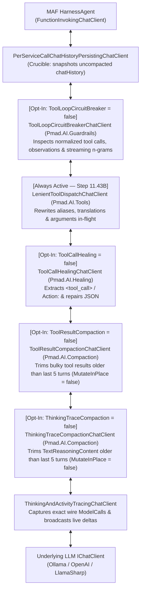

# ⚡ Step 11.43C: `Pmad.AI` Opt-In SLM Delegating Chat Clients (`ToolCallHealing`, `ToolLoopCircuitBreaker`, `ThinkingTraceCompaction` & `ToolResultCompaction`)

> **Bug Fix, SLM Resiliency & Context Optimization Step (Opt-In Delegating Chat Middleware for Small LLMs)**  
> *Parent Plan:* [Bug Fixes & Resiliency Roadmap](README.md)  
> *Target Framework:* .NET 10 (C# 13) | *Status:* Proposed  
> *Target Projects:* [`src/NightCodeForge.Core`](../../src/NightCodeForge.Core), [`src/NightCodeForge.Agents`](../../src/NightCodeForge.Agents), [`src/NightCodeForge.Web`](../../src/NightCodeForge.Web), [`tests/NightCodeForge.Agents.Tests`](../../tests/NightCodeForge.Agents.Tests), [`tests/NightCodeForge.Core.Tests`](../../tests/NightCodeForge.Core.Tests), [`tests/NightCodeForge.Web.Tests`](../../tests/NightCodeForge.Web.Tests)  
> *Dependencies:* [Step 11.43A: `Pmad.AI` 0.0.2 Upgrade & `ReadOnlyCommandValidator` Migration](STEP_11_43A_PMAD_AI_READONLY_COMMAND_VALIDATOR_MIGRATION.md), [Step 11.43B: `Pmad.AI` `LenientToolDispatcher` & Delegating Chat Client Migration](STEP_11_43B_PMAD_AI_LENIENT_TOOL_DISPATCHER_AND_DELEGATING_CHAT_CLIENT_MIGRATION.md)  
> *Related Steps:* [Step 11.38C: Shared Agent Session & Toolset Factorization](STEP_11_38C_CRUCIBLE_AND_IDEATION_SHARED_SESSION_AND_TOOLSET_FACTORIZATION.md)  
> *Aligns With:* [AGENTS.md](../../AGENTS.md), [docs/PLAN.md](../PLAN.md)

> This document is a **specification**: it states required behaviors and constraints, not implementations. Implementation choices (signatures, code structure) are left to the implementer, within the constraints of the documents.

---

## 1. Problem Statement & Motivation

In addition to `LenientToolDispatchChatClient` ([Step 11.43B](STEP_11_43B_PMAD_AI_LENIENT_TOOL_DISPATCHER_AND_DELEGATING_CHAT_CLIENT_MIGRATION.md)), `Pmad.AI` `0.0.2` provides four specialized `DelegatingChatClient` middlewares designed to heal malformed tool calls, prevent runaway loops, and compress context for **Small Language Models (SLMs, e.g. $\le 8\text{B}$–$14\text{B}$ parameters)**:

| `Pmad.AI` Delegating Chat Client | Purpose | Why Opt-In (`default: false`) |
| :--- | :--- | :--- |
| **`ToolCallHealingChatClient`** (`Pmad.AI.Healing`) | Scans assistant `TextContent` for `<tool_call>...</tool_call>` XML tags and ReAct `Action:` / `Action Input:` blocks, strips markdown fences, repairs truncated JSON arguments, and converts them into structured `FunctionCallContent` items before `LenientToolDispatchChatClient` normalizes them. | 25B+ LLMs reliably emit native structured `FunctionCallContent`. For 25B+ models, regex/XML extraction from `TextContent` is more error-prone than useful—especially when an agent is working on LLM or tool-call parser codebases where responses or test fixtures legitimately contain literal `<tool_call>` or `Action:` text. |
| **`ToolLoopCircuitBreakerChatClient`** (`Pmad.AI.Guardrails`) | Monitors normalized tool calls, tool result observations, and streaming text for runaway loops: consecutive identical tool calls on unchanged state (`ToolPingPong`), consecutive identical tool observations or consecutive tool error streaks (`NoProgress`), and streaming $n$-gram token repetitions (`StreamingRepetition`). | Small LLMs frequently get trapped in repetitive tool ping-pong or token repetition loops. Larger reasoning models legitimately perform multi-step test/fix iterations that should not be interrupted unless explicitly opted in. |
| **`ThinkingTraceCompactionChatClient`** (`Pmad.AI.Compaction`) | Deterministically trims historical `TextReasoningContent` (thinking monologues) outside the active turn window (`KeepVerbatimCount = 5`), retaining prefix + truncation marker + suffix before sending the prompt to the model. | Reasoning-tuned SLMs (e.g., Qwen3-4B/8B, DeepSeek-R1-Distill) emit verbose `<think>` traces every turn that quickly saturate small context windows and degrade attention before turn-level compaction triggers. Larger models with large KV caches prefer unmodified historical prefixes. |
| **`ToolResultCompactionChatClient`** (`Pmad.AI.Compaction`) | Deterministically trims bulky historical `FunctionResultContent` / `ChatRole.Tool` outputs outside the active turn window (`KeepVerbatimCount = 5`, `FallbackCharacterLimit = 4500`) using prefix + truncation marker + suffix. | While `HarnessAgent` already runs `PiStyleCrucibleCompactionStrategy` when approaching the full context-window ceiling, per-request rolling tool-result compaction keeps the active prompt small on every turn for SLMs whose effective reasoning degrades well before the hard context limit. |

---

## 2. Target Pipeline Architecture & Middleware Ordering

### Key Layering Invariants
1. **Healed Tool Calls Flow Through `LenientToolDispatchChatClient`:**
   - When `ToolCallHealing = true`, `ToolCallHealingChatClient` sits **inside** `LenientToolDispatchChatClient` so that `<tool_call>` XML tags or `Action:` blocks extracted from `TextContent` are immediately normalized (tool aliases, parameter aliases, and shell translations) by `LenientToolDispatchChatClient` before reaching `HarnessAgent`.
2. **Uncompacted History Persistence:**
   - `PerServiceCallChatHistoryPersistingChatClient` sits **outside** `ToolResultCompactionChatClient` and `ThinkingTraceCompactionChatClient`, and both compactors run with `MutateInPlace = false` (default).
   - This guarantees that `chatHistory` persisted to SQLite (`ConversationTurns`) and rendered in the UI retains the full, uncompacted tool outputs and reasoning traces, while `ThinkingAndActivityTracingChatClient` (sitting **inside** the compactors) captures the exact compacted prompt sent over the wire in `ModelCalls`.
3. **Normalized Loop Detection:**
   - `ToolLoopCircuitBreakerChatClient` sits **outside** `LenientToolDispatchChatClient` (and receives the `LenientToolDispatcher` instance) so that tool calls emitted under different aliases (e.g., `cat` followed by `read_file` and `read` on the same file) are canonicalized before ping-pong hash evaluation.

---

## 3. Detailed Requirements & Specifications

### 3.1 New Opt-In Flags on [`LocalOptimizationFlags`](../../src/NightCodeForge.Core/Domain/LocalOptimizationFlags.cs)

Add four opt-in boolean properties (all defaulting to `false`) to `LocalOptimizationFlags` and copy them in `LocalOptimizationFlags.Clone()`:

1. **`public bool ToolCallHealing { get; set; } = false;`**
   - Enables `Pmad.AI.Healing.ToolCallHealingChatClient` in the `IChatClient` pipeline to extract `<tool_call>` XML tags and ReAct `Action:` blocks from plain-text `TextContent` and repair malformed JSON arguments for smaller models that struggle with native structured tool calling.
2. **`public bool ToolLoopCircuitBreaker { get; set; } = false;`**
   - Enables `Pmad.AI.Guardrails.ToolLoopCircuitBreakerChatClient` in the `IChatClient` pipeline to halt repetitive tool ping-pong calls, identical observation streaks, consecutive tool error streaks, and streaming $n$-gram token repetitions.
3. **`public bool ThinkingTraceCompaction { get; set; } = false;`**
   - Enables `Pmad.AI.Compaction.ThinkingTraceCompactionChatClient` in the `IChatClient` pipeline to deterministically compact historical `TextReasoningContent` outside the recent verbatim turn window.
4. **`public bool ToolResultCompaction { get; set; } = false;`**
   - Enables `Pmad.AI.Compaction.ToolResultCompactionChatClient` in the `IChatClient` pipeline to deterministically compact bulky historical `FunctionResultContent` / `ChatRole.Tool` outputs outside the recent verbatim turn window.

### 3.2 Middleware Configuration & Telemetry Integration in `CrucibleAgentHarness` & `IdeationService`

In [`CrucibleAgentHarness`](../../src/NightCodeForge.Agents/Crucible/CrucibleAgentHarness.cs) and [`IdeationService`](../../src/NightCodeForge.Agents/Ideation/IdeationService.cs) (and centralized in `IHarnessAgentFactory` when [Step 11.38C](STEP_11_38C_CRUCIBLE_AND_IDEATION_SHARED_SESSION_AND_TOOLSET_FACTORIZATION.md) is implemented):

1. **`ThinkingTraceCompactionChatClient` (when `optimizationFlags.ThinkingTraceCompaction == true`):**
   - Configure `ThinkingTraceCompactionOptions` with `Pmad.AI` SLM defaults (`KeepVerbatimCount = 5`, `FallbackCharacterLimit = 2000`, `FallbackPrefixLength = 1400`, `FallbackSuffixLength = 600`, `MutateInPlace = false`, `Summarizer = null`).
2. **`ToolResultCompactionChatClient` (when `optimizationFlags.ToolResultCompaction == true`):**
   - Configure `ToolResultCompactionOptions` with `Pmad.AI` defaults (`KeepVerbatimCount = 5`, `FallbackCharacterLimit = 4500`, `FallbackPrefixLength = 2800`, `FallbackSuffixLength = 1200`, `MutateInPlace = false`).
3. **`ToolCallHealingChatClient` (when `optimizationFlags.ToolCallHealing == true`):**
   - Wrap the inner client (before `LenientToolDispatchChatClient`) with `ToolCallHealingChatClient` (`ValidateExtractedToolNames = false` so unknown extracted tool names still surface as failed tool call attempts rather than being silently dropped).
   - When `optimizationFlags.ToolCallHealing == false` (default), do not wire `ToolCallHealingChatClient`, ensuring literal `<tool_call>` tags and `Action:` text in assistant messages are never parsed or stripped.
4. **`ToolLoopCircuitBreakerChatClient` (when `optimizationFlags.ToolLoopCircuitBreaker == true`):**
   - Construct with the session's `Pmad.AI.Tools.LenientToolDispatcher` and `ToolLoopCircuitBreakerOptions`:
     - `PingPongThreshold = 3`
     - `ResetOnUserPrompt = true`
     - `MaxToolHistory = 30`
     - `MaxIdenticalObservationStreak = 4`
     - `MaxConsecutiveToolErrors = 5`
     - `SessionId = sessionId`
   - Wire `OnLoopDetected` to log a warning via `ILogger` detailing the `LoopCheckResult.Type`, `ToolName`, and `DiagnosticMessage`.

### 3.3 Settings UI, Transcript Frontmatter & Diagnostics Propagation

1. **Transcript YAML Frontmatter ([`SessionTranscriptService.cs`](../../src/NightCodeForge.Agents/Transcripts/SessionTranscriptService.cs)):**
   - Under the `optimizations:` block in `SaveTranscriptAsync`, serialize:
     - `tool_call_healing: true|false`
     - `tool_loop_circuit_breaker: true|false`
     - `thinking_trace_compaction: true|false`
     - `tool_result_compaction: true|false`
2. **Transcript Browser & Remediation ([`TranscriptBrowserService.cs`](../../src/NightCodeForge.Web/Services/TranscriptBrowserService.cs) & [`TranscriptMetadataCard.razor`](../../src/NightCodeForge.Web/Components/Transcripts/TranscriptMetadataCard.razor)):**
   - Parse `tool_call_healing`, `tool_loop_circuit_breaker`, `thinking_trace_compaction`, and `tool_result_compaction` in `TranscriptBrowserService.ParseSummaryFromContent`.
   - Support `"toolcallhealing"` / `"tool_call_healing"`, `"toolloopcircuitbreaker"` / `"tool_loop_circuit_breaker"`, `"thinkingtracecompaction"` / `"thinking_trace_compaction"`, and `"toolresultcompaction"` / `"tool_result_compaction"` in `TranscriptBrowserService.CloneAndSetFlag`.
   - Render badges in `TranscriptMetadataCard.razor` when these opt-in flags are active on a transcript.
3. **Settings UI ([`GlobalOptimizationSettingsTab.razor`](../../src/NightCodeForge.Web/Components/Settings/GlobalOptimizationSettingsTab.razor) & [`AgentProfilesTab.razor`](../../src/NightCodeForge.Web/Components/Settings/AgentProfilesTab.razor)):**
   - Expose checkboxes and descriptive help text (highlighting that these 4 flags are opt-in healing/guardrail/compaction middlewares recommended for small local LLMs, whereas 25B+ models should leave them off) in both the global optimization settings tab and the per-profile optimization override grid.

---

## 4. Verification & Test Strategy

1. **`LocalOptimizationFlags` & Serialization Tests (`NightCodeForge.Core.Tests` / `NightCodeForge.Web.Tests`):**
   - Verify that `new LocalOptimizationFlags()` initializes `ToolCallHealing = false`, `ToolLoopCircuitBreaker = false`, `ThinkingTraceCompaction = false`, and `ToolResultCompaction = false` (while the existing 5 prompt/tool-surface flags default to `true`).
   - Verify `LocalOptimizationFlags.Clone()`, `SessionTranscriptService.SaveTranscriptAsync`, and `TranscriptBrowserService.ParseSummaryFromContent` / `CloneAndSetFlag` round-trip all flags accurately.
2. **Opt-In Pipeline Middleware Tests (`NightCodeForge.Agents.Tests`):**
   - **Default (Opt-Out of SLM Middlewares) Test:** Verify that with default `LocalOptimizationFlags`, `ToolCallHealingChatClient`, `ToolLoopCircuitBreakerChatClient`, `ThinkingTraceCompactionChatClient`, and `ToolResultCompactionChatClient` are **not** active in the pipeline (e.g., literal `<tool_call>` XML tags and `Action:` blocks in `TextContent` remain intact as plain text).
   - **`ToolCallHealing` Opt-In Test:** Verify that when `ToolCallHealing = true`, `<tool_call>` XML blocks and ReAct `Action:` blocks emitted in `TextContent` (including for aliased or translated tools) are extracted by `ToolCallHealingChatClient` and normalized by `LenientToolDispatchChatClient` into canonical `FunctionCallContent` calls.
   - **`ToolLoopCircuitBreaker` Opt-In Test:** Verify that when `ToolLoopCircuitBreaker = true`, 3 consecutive identical tool calls (including across aliases like `cat` $\rightarrow$ `read_file` $\rightarrow$ `read`) or streaming $n$-gram repetitions trip the circuit breaker and return `[Circuit Breaker Tripped] ...` with `ChatFinishReason.Stop`.
   - **`ThinkingTraceCompaction` & `ToolResultCompaction` Opt-In Test:** Verify that when `ThinkingTraceCompaction = true` and `ToolResultCompaction = true`, historical messages beyond the 5-turn verbatim window have their `TextReasoningContent` and bulky `FunctionResultContent` compacted on the wire (as observed by the inner `IChatClient` / `ModelCalls`), while the outer `chatHistory` remains unmutated (`MutateInPlace = false`).

---

## 5. Definition of Done (DoD) Checklist

- [ ] Add `ToolCallHealing`, `ToolLoopCircuitBreaker`, `ThinkingTraceCompaction`, and `ToolResultCompaction` (`default: false`, opt-in) to `LocalOptimizationFlags` and `LocalOptimizationFlags.Clone()`.
- [ ] Wire `ThinkingTraceCompactionChatClient`, `ToolResultCompactionChatClient`, `ToolCallHealingChatClient`, and `ToolLoopCircuitBreakerChatClient` into the `IChatClient` pipeline in `CrucibleAgentHarness` and `IdeationService` (respecting the inner-to-outer layering order so healed tool calls pass through `LenientToolDispatchChatClient`, `PerServiceCallChatHistoryPersistingChatClient` preserves uncompacted history, and `ThinkingAndActivityTracingChatClient` records the wire-compacted `ModelCalls`).
- [ ] Update `SessionTranscriptService`, `TranscriptBrowserService`, `TranscriptMetadataCard.razor`, `GlobalOptimizationSettingsTab.razor`, and `AgentProfilesTab.razor` to serialize, parse, display, and toggle the four opt-in SLM flags.
- [ ] Add unit tests in `NightCodeForge.Agents.Tests` and `NightCodeForge.Core.Tests` verifying default opt-out behavior, opt-in activation, non-destructive history preservation (`MutateInPlace = false`), and transcript frontmatter round-tripping.
- [ ] Verify all non-E2E tests pass via `dotnet test --filter "Category!=Acceptance&Category!=E2E"`.

