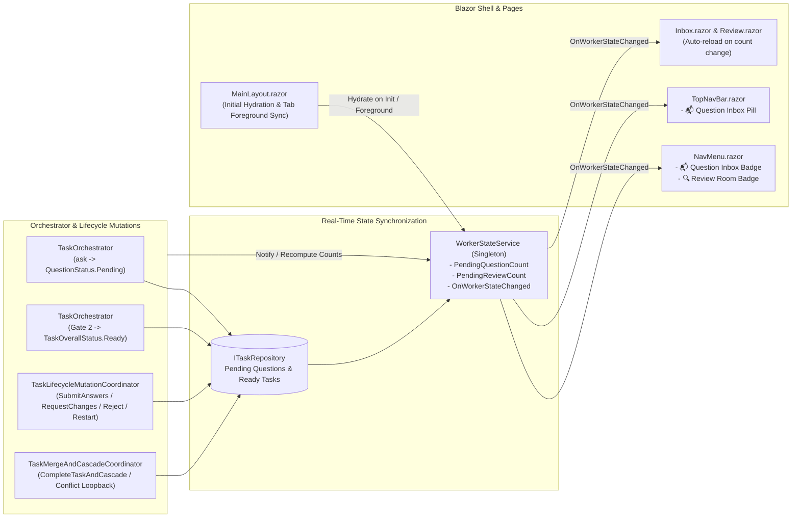

# 🔔 Step 11.46: Live Question Inbox & Review Room Badge Synchronization

> **Bug Fix & Real-Time UI State Synchronization Step**  
> *Parent Plan:* [Bug Fixes & Resiliency Roadmap](README.md)  
> *Target Framework:* .NET 10 (C# 13) | *Status:* Proposed  
> *Target Projects:* [`src/NightCodeForge.Core`](../../src/NightCodeForge.Core), [`src/NightCodeForge.Infrastructure`](../../src/NightCodeForge.Infrastructure), [`src/NightCodeForge.Web`](../../src/NightCodeForge.Web), [`tests/NightCodeForge.Core.Tests`](../../tests/NightCodeForge.Core.Tests), [`tests/NightCodeForge.Web.Tests`](../../tests/NightCodeForge.Web.Tests)  
> *Related Steps:* [Step 11.17: Portal Task Scoping & Pipeline State Hygiene](../archive/phase-11/STEP_11_17_PORTAL_TASK_SCOPING_AND_EXECUTION_STATE_HYGIENE.md), [Step 12.24: Home Page Pending Code Reviews](../archive/phase-12/STEP_12_24_HOME_PAGE_PENDING_CODE_REVIEWS.md)  
> *Aligns With:* [AGENTS.md](../../AGENTS.md), [docs/PLAN.md](../PLAN.md)

> This document is a **specification**: it states required behaviors and constraints, not implementations. Implementation choices (signatures, code structure) are left to the implementer, within the constraints of the documents.

---

## 1. Problem Statement & Root Cause Analysis

### 1.1 Question Inbox Badge Is Not Updated When an Agent Calls `ask`
When an agent invokes the `ask` tool during stage execution, the **Question Inbox** badge in the sidebar ([`NavMenu.razor`](../../src/NightCodeForge.Web/Components/Layout/NavMenu.razor)) and top navigation bar ([`TopNavBar.razor`](../../src/NightCodeForge.Web/Components/Layout/TopNavBar.razor)) remains stale (`0` or its previous value) until the user manually clicks the **Question Inbox** menu entry (`/inbox`) or navigates to the Home dashboard (`/`):

1. **No Notification After Persisting `Question` Entities:**
   - During stage execution, the agent harness emits `AgentActivityKind.Interrupted` *before* throwing `HumanInterruptionException`.
   - [`TaskOrchestrator.ProcessTaskAsync`](../../src/NightCodeForge.Core/Workflow/TaskOrchestrator.cs) catches `HumanInterruptionException` and only afterward creates the `Question` entities (`QuestionStatus.Pending`) and saves them via `_taskRepository.UpdateAsync(task)`.
   - Neither `TaskOrchestrator`, `SignalRActivityBridgeService`, nor `WorkerStateService` updates `PendingQuestionCount` after the questions are persisted to SQLite.
2. **Missing Startup / Layout Hydration:**
   - [`WorkerStateService`](../../src/NightCodeForge.Web/Services/WorkerStateService.cs) initializes `PendingQuestionCount = 0` in its constructor. If a user opens the application on `/ideation`, `/backlog`, `/monitoring`, `/inspector`, or `/settings`, `PendingQuestionCount` is never hydrated from the database until `/inbox` or `/` is visited.
3. **Orphaned Pending Questions on Task Rejection & Cancellation:**
   - While [`TaskLifecycleMutationCoordinator.RestartTaskPipelineAsync`](../../src/NightCodeForge.Core/Workflow/TaskLifecycleMutationCoordinator.cs) marks pending questions as `QuestionStatus.Skipped`, `RejectTaskAsync` and task cancellation paths in `TaskOrchestrator.ProcessTaskAsync` do not mark `QuestionStatus.Pending` questions on the rejected/cancelled task as `QuestionStatus.Skipped` and do not refresh the badge count.
4. **Workspace Filter Overwrite in `Inbox.razor`:**
   - In [`Inbox.razor`](../../src/NightCodeForge.Web/Components/Pages/Inbox.razor), `LoadQuestionsAsync` passes `_pendingQuestions.Count` directly to `WorkerState.UpdatePendingQuestions(...)` even when `_filterCurrentWorkspaceOnly` is enabled, overwriting the global badge count with a workspace-filtered subset. Additionally, `Inbox.razor` does not subscribe to live question count changes when new questions arrive while the page is already open.

### 1.2 Missing Badge on Review Room
- [`NavMenu.razor`](../../src/NightCodeForge.Web/Components/Layout/NavMenu.razor) displays a `.nav-badge` counter on **Question Inbox**, but **Review Room** (`🔍 Review Room`) has no badge indicating how many tasks have completed automated verification gates and are awaiting human review (`Status == TaskOverallStatus.Ready && HasExecutionRun`).

---

## 2. Architecture & Data Flow



---

## 3. Detailed Requirements & Specifications

### 3.1 Extend `WorkerStatusSnapshot` and `WorkerStateService`
1. **`PendingReviewCount` on `WorkerStatusSnapshot`:**
   - Extend [`WorkerStatusSnapshot`](../../src/NightCodeForge.Web/Services/WorkerStateService.cs) with `int PendingReviewCount = 0` (preserving positional defaults for existing callers).
2. **`UpdatePendingReviews` on `WorkerStateService`:**
   - Add `void UpdatePendingReviews(int count)` (and/or a combined update method) on `WorkerStateService` following the exact thread-safe, change-deduplicated pattern of `UpdatePendingQuestions(int count)`:
     - Only mutate `_current` and fire `OnWorkerStateChanged` when `PendingReviewCount != count`.
3. **Authoritative Count Definition:**
   - **`PendingQuestionCount`:** Total number of questions across all workspaces with `QuestionStatus.Pending` whose parent task is not in a terminal state (`Closed`, `Rejected`, `Cancelled`).
   - **`PendingReviewCount`:** Total number of tasks across all workspaces awaiting human code review (`task.Status == TaskOverallStatus.Ready && task.HasExecutionRun`), matching [`HomeDashboardBuilder.IsPendingHumanReview`](../../src/NightCodeForge.Web/Services/HomeDashboardBuilder.cs) and [`TaskReviewService.IsPendingReview`](../../src/NightCodeForge.Web/Services/TaskReviewService.cs).

### 3.2 Real-Time Synchronization Across All Lifecycle Transitions
1. **Initial Hydration & Foreground Sync:**
   - Hydrate `PendingQuestionCount` and `PendingReviewCount` from `ITaskRepository` during initial shell initialization ([`MainLayout.razor`](../../src/NightCodeForge.Web/Components/Layout/MainLayout.razor) / `WorkerStateService`) and when a browser tab returns to the foreground (`MainLayout.OnTabForegrounded`), so badges are immediately visible on any route without visiting `/inbox`, `/review`, or `/`.
2. **Live Updates on Question & Review State Transitions:**
   - Refresh `PendingQuestionCount` and `PendingReviewCount` on `WorkerStateService` (and broadcast via SignalR / telemetry events) immediately after persistence whenever:
     - **Questions Raised (`ask` tool):** `TaskOrchestrator.ProcessTaskAsync` persists `result.ClarificationQuestions` (`QuestionStatus.Pending`) and transitions `task.IsWaitingForHuman = true`.
     - **Questions Answered:** `TaskLifecycleMutationCoordinator.SubmitHumanAnswerAsync` / `SubmitAnswersAsync` marks one or more questions as `QuestionStatus.Answered`.
     - **Task Enters Review Room:** `TaskOrchestrator.ProcessTaskAsync` transitions a task with `MergeMode.ManualReviewRequired` to `TaskOverallStatus.Ready`.
     - **Task Approved & Merged (or Conflict Loopback):** `TaskMergeAndCascadeCoordinator.CompleteTaskAndCascadeInternalAsync` transitions a task to `TaskOverallStatus.Closed` (or loops it back to `TaskOverallStatus.Open` on merge conflict).
     - **Changes Requested in Review Room:** `TaskLifecycleMutationCoordinator.RequestChangesAsync` routes a `Ready` task back to `TaskOverallStatus.Open`.
     - **Task Restarted, Rejected, Cancelled, Mutated, or Deleted:** `RestartTaskPipelineAsync`, `RejectTaskAsync`, cancellation in `ProcessTaskAsync`, and manual task status mutations/deletions in `TaskMutationService` / `TaskDiskSyncCoordinator`.
3. **Orphaned Question Cleanup on Task Rejection & Cancellation:**
   - In [`TaskLifecycleMutationCoordinator.RejectTaskAsync`](../../src/NightCodeForge.Core/Workflow/TaskLifecycleMutationCoordinator.cs) and the task cancellation paths in [`TaskOrchestrator.ProcessTaskAsync`](../../src/NightCodeForge.Core/Workflow/TaskOrchestrator.cs), mark any `QuestionStatus.Pending` questions belonging to the task as `QuestionStatus.Skipped` (consistent with `RestartTaskPipelineAsync`) before saving the task.

### 3.3 Navigation Badges & Page Synchronization (`NavMenu.razor`, `Inbox.razor`, `Review.razor`, `Home.razor`)
1. **Review Room Badge in `NavMenu.razor`:**
   - In [`NavMenu.razor`](../../src/NightCodeForge.Web/Components/Layout/NavMenu.razor), render a `.nav-badge` inside the **Review Room** `<NavLink>` when `WorkerState.Current.PendingReviewCount > 0`, matching the **Question Inbox** badge structure:
     ```razor
     <NavLink class="forge-nav-link" href="@WorkspaceState.GetNavHref("review")">
         <span class="nav-icon">🔍</span>
         <span>Review Room</span>
         @if (WorkerState.Current.PendingReviewCount > 0)
         {
             <span class="nav-badge">@WorkerState.Current.PendingReviewCount</span>
         }
     </NavLink>
     ```
2. **Global Count Preservation & Live Refresh in `Inbox.razor`:**
   - In [`Inbox.razor`](../../src/NightCodeForge.Web/Components/Pages/Inbox.razor), when `_filterCurrentWorkspaceOnly` is `true`, do not overwrite `WorkerState.UpdatePendingQuestions(...)` with the workspace-filtered count; always keep `WorkerState.Current.PendingQuestionCount` synchronized with the global pending question count across all workspaces.
   - Subscribe `Inbox.razor` to `WorkerState.OnWorkerStateChanged` so that if `PendingQuestionCount` changes externally (e.g., an agent raises a new question via `ask` while `/inbox` is open), `Inbox.razor` reloads its pending questions list and re-renders automatically.
3. **Review Count Sync & Live Refresh in `Review.razor` and `Home.razor`:**
   - In [`Home.razor`](../../src/NightCodeForge.Web/Components/Pages/Home.razor) (`RefreshDashboardAsync`), call `WorkerState.UpdatePendingReviews(_snapshot.PendingReviewCount)` alongside `WorkerState.UpdatePendingQuestions(_snapshot.PendingQuestionCount)`.
   - In [`Review.razor`](../../src/NightCodeForge.Web/Components/Pages/Review.razor), update the global pending review count on `WorkerState` when changes are requested or a task is approved/merged, and subscribe to `WorkerState.OnWorkerStateChanged` so newly `Ready` tasks appear in the Review Room without manual page reload.

---

## 4. Verification & Test Strategy

1. **`WorkerStateService` Unit Tests (`NightCodeForge.Web.Tests/WorkerStateServiceTests.cs`):**
   - Verify `PendingReviewCount` defaults to `0` on initial state.
   - Verify `UpdatePendingReviews(int count)` updates `Current.PendingReviewCount`, preserves other `WorkerStatusSnapshot` fields, and fires `OnWorkerStateChanged` only when the count actually changes.
2. **Orchestrator & Lifecycle Coordinator Tests (`NightCodeForge.Core.Tests`):**
   - Verify that when `TaskOrchestrator.ProcessTaskAsync` catches `HumanInterruptionException` (`ask` tool), the persisted questions trigger pending count synchronization after database persistence.
   - Verify that `RejectTaskAsync` and task cancellation mark any `QuestionStatus.Pending` questions on the task as `QuestionStatus.Skipped`.
   - Verify that transitioning a task to `TaskOverallStatus.Ready`, completing merge (`Closed`), requesting changes (`Open`), rejecting (`Rejected`), or restarting (`Open`) triggers pending review/question count synchronization.
3. **Blazor UI Component Tests (`NightCodeForge.Web.Tests`):**
   - **`NavMenuShellTests.cs`:**
     - Verify `NavMenu` renders `.nav-badge` on **Question Inbox** when `PendingQuestionCount > 0` and hides it when `0`.
     - Verify `NavMenu` renders `.nav-badge` on **Review Room** when `PendingReviewCount > 0` and hides it when `0`.
     - Verify `NavMenu` dynamically updates both badges in real time when `WorkerState.UpdatePendingQuestions` or `WorkerState.UpdatePendingReviews` is called while on another page, without clicking the menu links.
   - **`InboxPageTests.cs`:**
     - Verify toggling `#filter-workspace-checkbox` filters displayed cards to the active workspace without corrupting the global `WorkerState.Current.PendingQuestionCount`.
     - Verify `Inbox` automatically reloads and displays newly persisted questions when `PendingQuestionCount` increases while the page is open.
   - **`HomeDashboardTests.cs`:**
     - Verify `Home.razor` synchronizes both `PendingQuestionCount` and `PendingReviewCount` on `WorkerStateService`.

---

## 5. Definition of Done (DoD) Checklist

- [x] Add `PendingReviewCount` to `WorkerStatusSnapshot` and `UpdatePendingReviews(int count)` to `WorkerStateService` with change deduplication.
- [x] Render `<span class="nav-badge">@WorkerState.Current.PendingReviewCount</span>` on the **Review Room** link in `NavMenu.razor` when `PendingReviewCount > 0`.
- [x] Hydrate `PendingQuestionCount` and `PendingReviewCount` from `ITaskRepository` on layout initialization (`MainLayout.razor`) and tab foregrounding (`OnTabForegrounded`).
- [x] Synchronize `PendingQuestionCount` and `PendingReviewCount` in real time after database persistence whenever questions are raised (`ask`), answered, or skipped, and whenever tasks enter or leave `TaskOverallStatus.Ready` (Gate 2 completion, Approve & Merge, Request Changes, Reject, Cancel, Restart, or manual mutation).
- [x] Mark pending questions as `QuestionStatus.Skipped` when a task is rejected (`RejectTaskAsync`) or cancelled (`ProcessTaskAsync`).
- [x] Preserve global `PendingQuestionCount` when workspace filtering is toggled in `Inbox.razor`, and auto-refresh `Inbox.razor` and `Review.razor` when `WorkerState` counts change.
- [x] Add unit and bUnit component tests in `NightCodeForge.Core.Tests` and `NightCodeForge.Web.Tests`, and verify all non-E2E tests pass via `dotnet test --filter "Category!=Acceptance&Category!=E2E"`.

