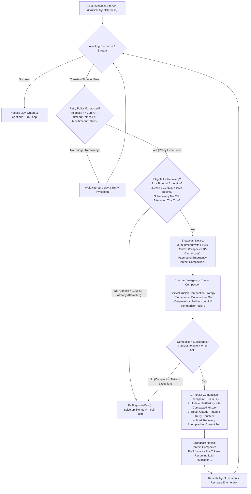

# 🛡️ Step 11.48: Large-Context Timeout KV-Cache Compaction Recovery (Pre-Abandonment Compaction)

> **Bug Fix, Resiliency & Inference Recovery Step (KV-Cache Stall Recovery, 30m Timeout Interception, Pre-Abandonment Context Compaction & Seamless Resumption)**  
> *Parent Plan:* [Bug Fixes & Resiliency Roadmap](README.md)  
> *Target Framework:* .NET 10 (C# 13) | *Status:* Proposed  
> *Target Projects:* [`src/NightCodeForge.Core`](../../src/NightCodeForge.Core), [`src/NightCodeForge.Agents`](../../src/NightCodeForge.Agents), [`tests/NightCodeForge.Core.Tests`](../../tests/NightCodeForge.Core.Tests), [`tests/NightCodeForge.Agents.Tests`](../../tests/NightCodeForge.Agents.Tests)  
> *Dependencies:* [Step 11.37A: HTTP Transport Hardening & Outage Retry Policy](../archive/phase-11/STEP_11_37A_HTTP_TRANSPORT_HARDENING_AND_OUTAGE_RETRY_POLICY.md), [Step 11.45: Measured-Token Compaction Trigger & Pmad.AI Estimator](../archive/phase-11/STEP_11_45_MEASURED_TOKEN_COMPACTION_TRIGGER_AND_PMAD_AI_ESTIMATOR.md), [Step 11.47: Compaction Checkpoint Persistence, Resume Fidelity & Telemetry](../archive/phase-11/STEP_11_47_COMPACTION_CHECKPOINT_PERSISTENCE_RESUME_FIDELITY_AND_IN_FLIGHT_TELEMETRY.md), [Step 11.49: Two-Phase Streaming Idle Watchdog & Output Token Cap](STEP_11_49_STREAMING_IDLE_WATCHDOG_OUTPUT_TOKEN_CAP_AND_TIMEOUT_DIAGNOSTICS.md), [Step 12.33A: OllamaRouter Session Affinity Lease Release](../features/STEP_12_33A_OLLAMAROUTER_SESSION_AFFINITY_RELEASE_AND_COST_COLLECTION.md)  
> *Aligns With:* [AGENTS.md](../../AGENTS.md), [docs/PLAN.md](../PLAN.md)

> This document is a **specification**: it states required behaviors and constraints, not implementations. Implementation choices (signatures, code structure) are left to the implementer, within the constraints of the documents.

---

## 1. Executive Summary & Problem Analysis

### 1.1 Problem Statement: The KV-Cache Eviction Trap on Large Contexts
In autonomous, multi-turn coding tasks executed by `CrucibleAgentHarness`, context windows grow steadily over hours of tool execution (reading files, compiling solutions, running test suites, parsing diffs). In modern long-context local LLMs (e.g. Qwen 2.5 Coder 32B, Llama 3.3 70B, DeepSeek Coder), active conversations often reach **100k to 200k+ tokens**.

While the GPU's Key-Value (KV) cache remains resident and warm in VRAM, processing each incremental turn requires evaluating only the newly appended tokens, completing in a few seconds.

However, in local inference servers (Ollama, vLLM, llama.cpp, LM Studio), the KV cache can be suddenly evicted or invalidated during a multi-hour session due to:
1. **Background Memory Eviction or Slot Swapping:** Running concurrent tasks, background maintenance, OS memory pressure, or temporary slot recycling causes the inference engine to discard the prompt cache.
2. **Engine Restart or Transient Reload:** A temporary daemon glitch or model reload forces the inference engine to start with an empty cache.
3. **Context Shifts & Attention Drift:** Fragmented VRAM allocations under extreme context lengths trigger garbage collection of older KV blocks.

When the KV cache is lost, the local inference engine must **recompute prompt evaluation (prefill) across the entire 100k+ token history from scratch**. On consumer or prosumer GPUs (e.g. RTX 3090, RTX 4090, Apple Silicon M-series, or dual-GPU rigs):
- Prefilling 100k–180k tokens cold takes **15 to 35+ minutes**, or completely stalls under memory saturation.
- The request hits the per-attempt timeout (`10 minutes` / `600s`) and accumulates toward the 30-minute maximum retry duration (`MaxRetryDuration = 1800s`, `DefaultLlmMaxRetryDurationSeconds = 1800.0`).
- Once timeout retries (`streamTimeoutRetries >= MaxTimeoutRetries`) or total elapsed outage time (`elapsed >= MaxRetryDuration`) are exhausted:
  ```csharp
  // Current behavior in CrucibleAgentHarness (both streaming and non-streaming):
  if (timeoutExhausted || streamRetryCount >= maxTransientRetries || elapsed >= _retryOptions.MaxRetryDuration)
  {
      _logger.LogError(ex, "Crucible streaming LLM invocation exhausted retry policy ({Attempt}/{MaxRetries}, elapsed {Elapsed}): {ErrorMessage}", ...);
      return await FailAsync(failMsg);
  }
  ```
- **The orchestrator abruptly gives up**, permanently failing the entire task and throwing away hours of successful implementation progress, even though the task and codebase are perfectly healthy.

### 1.2 Proposed Solution: Pre-Abandonment Context Compaction
Instead of giving up immediately when a 30-minute timeout occurs on a large context (> 100k tokens), the system should recognize that **the failure is most likely caused by KV-cache eviction rather than a permanent model failure**.

Before declaring failure, `CrucibleAgentHarness` intercepts the timeout exhaustion and triggers **pre-abandonment context compaction**:
1. **Verify Conditions:** Confirm the failure was caused by an HTTP / inference timeout, cumulative outage reached ~30 minutes or retry timeout exhausted, context size exceeds `100,000` tokens, and timeout recovery compaction has not already been attempted for this turn.
2. **Execute Emergency Context Compaction:** Compact the active conversation history down to bounded headroom (summarizing historical turns, clamping tool outputs, preserving task anchor and recent window, and outputting `<= 96k tokens`, typically ~20k–40k tokens).
   - If the LLM summarizer call itself fails or times out during compaction, fall back to deterministic structured summary generation so compaction itself never hangs or depends on another cold 100k prefill.
3. **Branch on Outcome:**
   - **Compaction Succeeded:**
     - Replace active `chatHistory` with the compacted history.
     - Persist the compaction checkpoint in SQLite (`ConversationTurns`) using Step 11.47 persistence.
     - Reset the outage timer (`streamOutageStartTimestamp = null`), timeout retry counters (`streamTimeoutRetries = 0`), and retry backoff.
     - Broadcast a prominent telemetry notice informing the user that KV cache loss was mitigated by compaction.
     - Refresh the agent session and **resume the execution loop**.
     - Because prompt tokens dropped from >100k to ~30k tokens, the local GPU prefills the prompt in seconds and inference succeeds.
   - **Compaction Failed (or Resumed Call Times Out Again):**
     - Give up immediately and fail fast with domain error reporting, preserving the exact failure state as today without infinite loops.

---

## 2. Architecture & Data Flow



---

## 3. Detailed Behavioral Specifications

### 3.1 Trigger Conditions & Safety Guardrails

1. **Timeout Detection:**
   - The recovery mechanism triggers exclusively when the LLM invocation fails due to an HTTP or inference timeout (`TransientErrorDetector.IsHttpTimeout(ex) == true`).
   - The retry policy has reached its exhaustion boundary:
     - `timeoutExhausted` (`streamTimeoutRetries >= _retryOptions.MaxTimeoutRetries`), OR
     - `elapsed >= _retryOptions.MaxRetryDuration` (cumulative elapsed outage duration reaches `1800s` / 30 minutes), OR
     - `streamRetryCount >= maxTransientRetries`.

2. **Large-Context Threshold Evaluation (`> 100k` Tokens):**
   - The active conversation context must meet or exceed a configurable threshold:
     - Constant: `DefaultLargeContextTimeoutRecoveryThresholdTokens = 100_000` (100k tokens).
     - Configurable property: `CrucibleCompactionOptions.LargeContextTimeoutRecoveryThresholdTokens` (default: `100_000`).
     - Flag toggle: `CrucibleCompactionOptions.EnableTimeoutRecoveryCompaction` (default: `true`).
   - Token count is evaluated using authoritative measured tokens when available, or `ModelCalibratedTokenEstimator.EstimateMessagesTokens(chatHistory, setup.EffectiveModelId)`.
   - If the active context is **less than 100k tokens**, the recovery mechanism is bypassed and the task fails immediately (`FailAsync`), because KV cache recomputation for smaller contexts should finish well within the 30-minute budget; a timeout on small context points to server death, infinite generation, or bad configuration rather than prefill latency.

3. **Strict One-Shot Recovery Guard (Infinite Loop Prevention):**
   - A turn-scoped boolean flag (`hasAttemptedTimeoutRecoveryCompaction`) must track whether emergency compaction has already been attempted during the current assistant turn.
   - If emergency compaction succeeds and the agent loop is resumed, but the subsequent resumed LLM call **times out again** on the same turn, the guard detects `hasAttemptedTimeoutRecoveryCompaction == true`.
   - The second timeout will **not** attempt another compaction; it will immediately exit to `FailAsync(failMsg)`.
   - To prevent a mid-stream stall from bypassing the guard after yielding a few initial tokens, the flag must **not** be reset on partial streaming text or reasoning deltas. Consistent with `streamRetryCount`, `streamTimeoutRetries`, and `streamOutageStartTimestamp`, `hasAttemptedTimeoutRecoveryCompaction` is reset only when a tool execution completes (`FunctionResultContent` received) or when a full turn completes in the outer loop.

---

### 3.2 Emergency Context Compaction Execution

1. **In-Flight State Sanitization Before Compaction:**
   - Before invoking emergency compaction in the timeout recovery block, clear any partial streaming buffers (`accumulatedText.Clear()`, `accumulatedReasoning.Clear()`) and invoke `SanitizeInFlightTurns(chatHistory)` so that incomplete or un-responded tool calls from the timed-out attempt are never summarized or kept as orphaned turns.
2. **Compaction Strategy Invocability:**
   - `PiStyleCrucibleCompactionStrategy` must expose a mechanism to execute an on-demand emergency compaction pass over the active conversation history, bypassing both the regular warm/cold trigger threshold checks (`TriggerThresholdTokens` / `ColdResumeThresholdTokens` in `ShouldCompact` and `CompactCoreAsync`, since a 100k+ context may still sit below a 128k or 225k trigger ceiling) and the incremental debounce cooldown (`DebounceTurnCooldown` / `DebounceTokenDelta`), while preserving all core safety invariants:
     - Task Anchor Protection (Turn 0 initial User / System instructions preserved verbatim).
     - Cut Point Calculation honoring tool call atomicity (never orphaning tool calls or tool results).
     - Clamping tool results to `ToolResultMaxChars` (2,000 characters).
     - Capping summarizer input transcript to `MaxSummarizerInputTokens` (96k tokens).
     - Preserving recent turns within `KeepRecentTokens` verbatim and enforcing the post-compaction ceiling (`MaxCompactedContextTokens`).
     - Structured markdown summary with lossless file operation tracking (`<read-files>`, `<modified-files>`).
3. **Deterministic Fallback Resilience & Cancellation Propagation:**
   - If the LLM summarizer itself encounters an HTTP timeout, network failure, or model exception when summarizing the 96k clamped transcript, `PiStyleCrucibleCompactionStrategy` must automatically fall back to its internal deterministic summary generation (`GenerateDeterministicSummary`).
   - However, if `GenerateLlmSummaryAsync` throws an `OperationCanceledException` when the caller's stage `cancellationToken` is explicitly cancelled (e.g. user pause or task cancellation), the cancellation must propagate immediately rather than being swallowed into the deterministic summary fallback.
   - Emergency compaction must **never fail due to a secondary LLM timeout**; the deterministic fallback guarantees the context will be shrunk even if the LLM provider is unresponsive to large prompts.
4. **Failure Boundary:**
   - If compaction cannot find enough non-anchor groups to summarize (e.g. fewer than 3 groups), fails to reduce the active context, or throws an unhandled non-cancellation exception, compaction returns `false`.
   - When compaction returns `false`, `CrucibleAgentHarness` catches the failure, logs a descriptive error, and invokes `FailAsync(failMsg)`.

---

### 3.3 State Update, Persistence & Telemetry Broadcast

1. **History Replacement & Database Turn Persistence (Single-Write Invariant via `OnCompacted`):**
   - In `CrucibleAgentHarness.RunStageAsync`, `piStrategy.OnCompacted` is already wired to:
     - Update the in-memory `chatHistory` list in place with `notification.IncludedMessages` (`[Task Anchor] + [CONTEXT COMPACTION CHECKPOINT] + [Recent Turns]`) and refresh `latestSerializedState = SerializeSession(chatHistory)`.
     - Drain `conversationState`, resolve `cutTurnIndex` via `ResolveCompactionCutTurnIndex`, and enqueue a single `StageTurnRole.Optimization` turn to `ConversationTurns` (`conversationState.EnqueueTurn(StageTurnRole.Optimization, ...)`).
   - When emergency compaction runs through `PiStyleCrucibleCompactionStrategy`, the timeout recovery handler must rely on (or coordinate with) `OnCompacted` so that `chatHistory` is updated and **exactly one** `StageTurnRole.Optimization` checkpoint turn is persisted in `ConversationTurns` without duplicate writes.
   - In the streaming loop, `historySnapshot` must also be updated (`historySnapshot = chatHistory.ToList();`) after compaction so that a subsequent fallback to non-streaming mode (`streamingFailed == true`) cannot overwrite the compacted `chatHistory` with the pre-compaction snapshot.
2. **Telemetry & User Visibility:**
   - Broadcast an `AgentActivityKind.Notice` event via `IAgentActivityStreamer` (`BroadcastAsync`):
     ```text
     "LLM invocation timed out after 30 minutes with {PreTokens:N0} tokens context (suspected KV cache loss). Emergency context compaction recovered active context to {PostTokens:N0} tokens. Resuming agent execution..."
     ```
   - Log an `ILogger.LogWarning` with structured parameters: `TaskId`, `StageId`, `PreCompactionTokens`, `PostCompactionTokens`, `ElapsedSeconds`.

---

### 3.4 Outage State Reset, Session Affinity Release & Execution Resumption

1. **Outage Counter & Timer Reset:**
   - Clear the outage tracking timestamps:
     - `streamOutageStartTimestamp = null;` (streaming loop)
     - `nonStreamingOutageStartTimestamp = null;` (non-streaming fallback loop)
   - Reset the timeout retry counter:
     - `streamTimeoutRetries = 0;`
     - `nonStreamingTimeoutRetries = 0;`
   - Reset transient retry counter:
     - `streamRetryCount = 0;`
     - `nonStreamingRetries = 0;`
2. **Release Stale OllamaRouter Session Affinity Lease (Step 12.33A Integration):**
   - Because the active context was just compacted from $> 100\text{k}$ down to $\sim 30\text{k}$ tokens (invalidating any prior $> 100\text{k}$ KV-cache prefix) and the target node holding the sticky session lease (`LlmSessionIds.ForStage(taskId, stageId)`) may be overloaded or stalled, release the sticky session affinity lease via `conversationCoordinator` / `ILlmGatewayService.ReleaseSessionAffinityAsync(conversationState.SessionId)` before resuming. This allows OllamaRouter to place the freshly compacted $\sim 30\text{k}$ prompt on the healthiest available node in the fleet.
3. **Session & Enumerator Refresh:**
   - Refresh or recreate the agent session:
     ```csharp
     session = await agent.CreateSessionAsync(cancellationToken);
     ```
   - Recreate the streaming enumerator with the newly compacted `chatHistory`:
     ```csharp
     enumerator = agent.RunStreamingAsync(chatHistory.ToList(), session, cancellationToken: interruptionCts.Token)
         .GetAsyncEnumerator(interruptionCts.Token);
     ```
   - Continue the outer execution loop cleanly.

---

### 3.5 Both Streaming and Non-Streaming Coverage

`CrucibleAgentHarness` supports two execution paths:
1. Primary path: `RunStreamingAsync` (lines ~747–870).
2. Fallback path: `RunAsync` (lines ~920–1030) used when the model or provider does not support streaming.

Both execution paths must implement the pre-abandonment context compaction recovery interceptor before calling `FailAsync`. Shared recovery logic should be factorized into a cohesive private helper method (e.g. `TryRecoverFromLargeContextTimeoutAsync`) to avoid code duplication and ensure identical resilience behavior across both modes.

---

## 4. Configuration & Component Models

### 4.1 `CrucibleCompactionOptions` Additions
```csharp
public class CrucibleCompactionOptions
{
    public const int DefaultLargeContextTimeoutRecoveryThresholdTokens = 100_000;

    /// <summary>
    /// Whether emergency context compaction is attempted before failing when an LLM call
    /// times out (30m) with a large context window (>100k tokens).
    /// </summary>
    public bool EnableTimeoutRecoveryCompaction { get; set; } = true;

    /// <summary>
    /// Context size threshold in tokens above which a 30-minute timeout triggers emergency
    /// context compaction rather than immediate failure (defaults to 100,000 tokens).
    /// </summary>
    public int LargeContextTimeoutRecoveryThresholdTokens { get; set; } = DefaultLargeContextTimeoutRecoveryThresholdTokens;
}
```

---

## 5. Definition of Done (DoD) Checklist

- [ ] **Configuration & Domain Options:**
  - [ ] Add `EnableTimeoutRecoveryCompaction` (default: `true`) and `LargeContextTimeoutRecoveryThresholdTokens` (default: `100_000`) to `CrucibleCompactionOptions`.
- [ ] **Compaction Strategy Enhancement:**
  - [ ] Implement on-demand emergency compaction execution in `PiStyleCrucibleCompactionStrategy` that can be invoked directly on an active message list or index when triggered by timeout recovery, bypassing `TriggerThresholdTokens`, `ColdResumeThresholdTokens`, and debounce cooldowns.
  - [ ] Verify that deterministic fallback (`GenerateDeterministicSummary`) is utilized if the summarizer client times out or throws an error during emergency compaction, while propagating `OperationCanceledException` when the caller's stage `cancellationToken` is explicitly cancelled.
- [ ] **Crucible Harness Pre-Abandonment Interceptor:**
  - [ ] Factorize and implement timeout recovery in `CrucibleAgentHarness` for both `RunStreamingAsync` and `RunAsync` catch blocks.
  - [ ] Enforce the three guard conditions: `TransientErrorDetector.IsHttpTimeout(ex)`, context tokens >= `LargeContextTimeoutRecoveryThresholdTokens`, and recovery not yet attempted for the current turn (`hasAttemptedTimeoutRecoveryCompaction`, reset only on tool result completion or full turn completion).
  - [ ] Sanitize partial streaming state (`accumulatedText`, `accumulatedReasoning`, `SanitizeInFlightTurns(chatHistory)`) before executing emergency compaction.
  - [ ] On successful compaction: ensure `chatHistory` (and `historySnapshot`) is updated and a single `StageTurnRole.Optimization` checkpoint turn is persisted in `ConversationTurns` (via `OnCompacted` without duplication), reset outage timers and retry counters, broadcast `AgentActivityKind.Notice` via `IAgentActivityStreamer`, recreate the session/enumerator, and resume execution.
  - [ ] On compaction failure or subsequent timeout: fail fast with `FailAsync` without infinite loops.
- [ ] **Automated Testing:**
  - [ ] Add unit tests in `NightCodeForge.Agents.Tests` verifying:
    - When timeout retry policy is exhausted and context is < 100k tokens, harness fails fast without attempting compaction.
    - When timeout retry policy is exhausted and context is >= 100k tokens, harness triggers emergency compaction, updates history, resets counters, and resumes.
    - If emergency compaction fails, harness immediately fails fast.
    - If resumed call times out again after compaction, harness fails fast without looping.
    - Streaming and non-streaming modes both exhibit identical recovery behavior.
  - [ ] Run all unit tests with `dotnet test --filter "Category!=Acceptance&Category!=E2E"` and ensure 100% pass rate.

