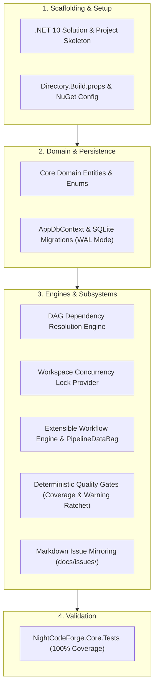

# 🧱 Phase 1: Foundation, Domain Models & Extensible Workflow Pipeline

> **Implementation Roadmap & Technical Specification**  
> *Parent Plan:* [docs/PLAN.md](../PLAN.md) | *Status:* Ready for Scaffolding

---

## 1. Executive Objective

Establish the core solution architecture for **NightCodeForge** targeting **.NET 10**, implementing clean domain entities, SQLite persistence via Entity Framework Core, the Directed Acyclic Graph (DAG) dependency engine, workspace concurrency control, the extensible stage-based workflow engine with **PipelineDataBag** cross-stage state persistence, differential quality gates, and the file-system issue mirroring service.

---

## 2. Detailed Task Breakdown



### Step 1.1: Solution Architecture & Project Skeleton
* **Action:** Create the solution root and 5 projects with clean architectural boundaries:
  ```text
  src/
  ├── NightCodeForge.Core/            # Clean pure C#, zero heavy external dependencies
  ├── NightCodeForge.Infrastructure/  # EF Core SQLite, CliWrap Git CLI, Hangfire, SignalR
  ├── NightCodeForge.Agents/          # Microsoft.Agents.AI, Extensions.AI, Tools, Harnesses
  └── NightCodeForge.Web/             # Blazor Interactive Server UI
  tests/
  ├── NightCodeForge.Core.Tests/
  ├── NightCodeForge.Infrastructure.Tests/
  └── NightCodeForge.Agents.Tests/
  ```
* **Directory.Build.props:**
  - Target Framework: `net10.0`
  - LangVersion: `13.0` / `latest`
  - Nullable: `enable`
  - ImplicitUsings: `enable`
  - TreatWarningsAsErrors: `true` (with selective suppressions for generated code)

### Step 1.2: Domain Entities & Enumerations (`NightCodeForge.Core/Domain`)
Implement clean domain entities with explicit value types:
1. **`Workspace`:**
   - Properties: `int Id`, `string Name`, `string RepositoryPath`, `string DefaultBaseBranch`, `ExecutionMode ExecutionMode`, `string? ContainerImage`, `string? Ext4MirrorPath`, `DateTime CreatedAt`.
2. **`AgentProfile`:**
   - Properties: `string Id`, `int? WorkspaceId`, `string Name`, `string HarnessId` (`crucible`, `pi-rpc`, `acp`), `string ModelName`, `ThinkingEffort ThinkingEffort`, `int? ThinkingTokenBudget`, `double? Temperature`, `string? HarnessConfigurationJson`, `LocalOptimizationFlags? OptimizationFlags`, `IReadOnlyList<string>? PermittedTools`, `SandboxSecurityTier SecurityTier`.
3. **`Issue`:**
   - Properties: `int Id`, `int WorkspaceId`, `string Title`, `string Description`, `IssueOverallStatus Status`, `string CurrentStageId`, `int Priority`, `string BaseBranch`, `string FeatureBranch`, `string? PipelineDataJson`, `DateTime CreatedAt`, `DateTime UpdatedAt`, `string? LastHangfireJobId`.
4. **`IssueDependency`:**
   - Properties: `int Id`, `int IssueId`, `int DependsOnIssueId`.
5. **`Question`:**
   - Properties: `int Id`, `int IssueId`, `string StageId`, `string Prompt`, `string Rationale`, `QuestionType QuestionType`, `string? OptionsJson`, `string? Answer`, `DateTime AskedAt`, `DateTime? AnsweredAt`, `QuestionStatus Status`.
6. **`StageCheckpoint`:**
   - Properties: `int Id`, `int IssueId`, `string StageId`, `string SerializedMemory`, `string GitCommitHash`, `DateTime CreatedAt`.
7. **`StageExecutionRecord`:**
   - Properties: `int Id`, `int IssueId`, `string StageId`, `string StageKind`, `string AgentProfileId`, `string HarnessId`, `string ModelName`, `DateTime StartedAt`, `DateTime? CompletedAt`, `int DurationMs`, `int PromptTokens`, `int CompletionTokens`, `int TotalTokens`, `string? TargetRouting`, `StageExecutionStatus Status`, `string? OutputDataJson`.
8. **`ExecutionLog`:**
   - Properties: `int Id`, `int IssueId`, `string? StageId`, `DateTime Timestamp`, `LogLevel Level`, `string Source`, `string Message`, `string? PayloadJson`.
9. **`LocalOptimizationFlags`:**
   - Strongly-typed class containing boolean flags: `ThinkingTraceCompaction`, `LoopCircuitBreaker`, `GuidedGrammarDecoding`, `DeterministicSymbolMap`, `StructuredDiagnosticExtraction`, `PrefixStabilization`, `JitModelPreload`.

### Step 1.3: Directed Acyclic Graph (DAG) Dependency Engine
* **Contract:** `IDependencyResolutionEngine` in `NightCodeForge.Core/Dependencies`:
  ```csharp
  public interface IDependencyResolutionEngine
  {
      bool HasCycle(int workspaceId, IEnumerable<(int IssueId, int DependsOnIssueId)> dependencies);
      IReadOnlyList<int> GetTopologicalOrder(int workspaceId);
      bool IsReadyForExecution(int issueId);
      Task<IReadOnlyList<int>> ResolveCascadeUnblockedIssuesAsync(int completedIssueId);
  }
  ```
* **Algorithm Requirements:**
  - Cycle detection using DFS with 3-color graph traversal (White, Gray, Black). Throws `CircularDependencyException` on detection.
  - Dependency readiness: An issue is ready if and only if all prerequisite issues in `DependsOnIssueId` have `Status == IssueOverallStatus.Completed`.
  - Cascade unblocking: When Issue $A$ transitions to `Completed`, query all dependent issues $B_i$; if all prerequisites of $B_i$ are completed, transition $B_i$ to `Pending` and enqueue to `llm-inference`.

### Step 1.4: Workspace Concurrency Lock Provider
* **Contract:** `IWorkspaceLockProvider` in `NightCodeForge.Core/Interfaces`:
  ```csharp
  public interface IWorkspaceLockProvider
  {
      Task<IDisposable> AcquireLockAsync(int workspaceId, CancellationToken cancellationToken = default);
      bool TryAcquireLock(int workspaceId, out IDisposable? lockReleaser);
  }
  ```
* **Implementation:** Keyed asynchronous semaphore lock (`AsyncKeyedLock<int>`) preventing concurrent Git operations on the same workspace while allowing utility tasks on different workspaces to run in parallel.

### Step 1.5: Extensible Workflow Pipeline Engine & PipelineDataBag
* **Core Abstractions (`NightCodeForge.Core/Workflow`):**
  ```csharp
  public interface IWorkflowPipeline
  {
      IReadOnlyList<IWorkflowStage> Stages { get; }
      IWorkflowStage? GetNextStage(string currentStageId);
      IWorkflowStage? GetStage(string stageId);
  }

  public interface IWorkflowStage
  {
      string StageId { get; }
      string DisplayName { get; }
      WorkflowStageKind Kind { get; } // Agentic vs Deterministic
      Task<StageExecutionResult> ExecuteAsync(PipelineContext context, CancellationToken cancellationToken = default);
  }
  ```
* **`PipelineDataBag` Implementation:**
  - Thread-safe `ConcurrentDictionary<string, JsonElement>` serialized to/from `Issue.PipelineDataJson`.
  - Methods: `Set<T>(key, value)`, `Get<T>(key)`, `TryGet<T>(key, out value)`.
* **Differential Quality Gates:**
  - **`DeterministicCoverageGate`:**
    - Baseline phase: records `coverage.baseline` (line rate, branch rate) and `tests.baseline.total`.
    - Verification phase: computes $\Delta$. Fails if line rate drops $> 0.0\%$ or if total test count decreases ("anti-cheating").
  - **`DeterministicWarningRatchetStage`:**
    - Baseline phase: records `warnings.baseline`.
    - Verification phase: fails if `warnings.current > warnings.baseline`, outputting newly introduced warnings.
* **Stage Handover & Zero-Memory Context Resets:**
  - Archives previous chat history to transcripts; passes only structured plan, diff, and diagnostic artifacts to subsequent stages.
* **Built-in `Default3AgentPipeline`:**
  - Stage 1: `IssueReviewStage` (Agentic - Deep reasoning)
  - Stage 2: `ImplementationStage` (Agentic - Fast coding)
  - Gate: `DeterministicCoverageGate` (Deterministic - CPU native)
  - Stage 3: `CodeReviewAndFixStage` (Agentic - Strict auditor)

### Step 1.6: Markdown Issue Mirroring Subsystem (`IssueMarkdownSyncService`)
* **File Location:** `<WorkspaceRoot>/docs/issues/YYYY-MM-DD-<slug>.md`
* **Features:**
  - Date-prefixed naming without ID to allow clean chronological sorting without file renames.
  - Frontmatter schema parsing with YamlDotNet.
  - 300ms debouncing window on `FileSystemWatcher` to prevent duplicate events.
  - In-memory SHA-256 hash tracker to suppress self-triggering write loops.
  - Field protection: protects `id`, `status`, `stage` from unauthorized disk changes while syncing `title`, `description`, `priority`, and `profile`.
  - Auto-allocates ID for new markdown files dropped into the directory.

### Step 1.7: Entity Framework Core Persistence (`NightCodeForge.Infrastructure/Data`)
* **Technology:** SQLite with Write-Ahead Logging (`PRAGMA journal_mode = WAL;`) for maximum local concurrent read/write throughput.
* **Configurations:** Fluent API entity configurations for all 8 entities, foreign keys, cascade deletes, and JSON value converters for `LocalOptimizationFlags` and `PipelineDataBag`.
* **Initial Migration:** Create baseline migration `InitialCreate`.

---

## 3. Verification & Test Plan

| Test Class | Focus Area | Scenarios Covered |
| :--- | :--- | :--- |
| **`DependencyEngineTests`** | DAG Resolution | Circular dependency detection, topological sorting, prerequisite readiness, cascade unblocking. |
| **`WorkspaceLockTests`** | Concurrency | Same workspace serialization, multi-workspace parallelism, timeout handling. |
| **`PipelineEngineTests`** | Workflow Stages | Forward advancement, backward loop routing on failure, retry loop circuit breaker (max 3). |
| **`PipelineDataBagTests`** | Cross-Stage State | Type-safe get/set, JSON serialization/deserialization, persistence across issue reloads. |
| **`DifferentialGateTests`** | Quality Gates | Test coverage drop failure, test count reduction detection (anti-cheating), warning ratchet delta. |
| **`IssueMarkdownSyncTests`** | Disk Mirroring | YAML frontmatter parsing, debounced file watcher, echo loop suppression, field protection. |

---

## 4. Definition of Done (DoD) Checklist

- [x] All 5 projects scaffolded and compiling with 0 warnings on .NET 10.
- [x] SQLite database migrations created and verified in WAL mode.
- [x] DAG dependency engine passes all topological sort and cycle detection tests.
- [x] Workspace concurrency provider serializes operations per workspace ID.
- [x] `PipelineDataBag` stores and retrieves cross-stage state reliably.
- [x] `DeterministicCoverageGate` detects coverage drops and deleted tests.
- [x] `IssueMarkdownSyncService` mirrors issues to `docs/issues/` with echo loop suppression.
- [x] 100% of unit tests in `NightCodeForge.Core.Tests` pass cleanly.
