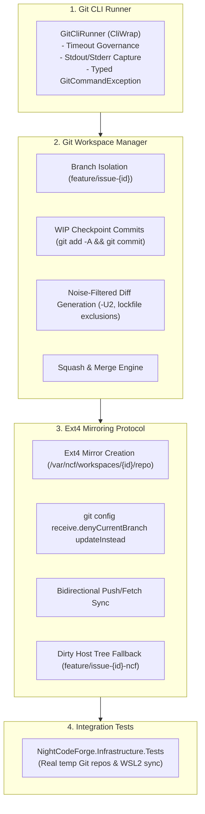

# 🔀 Phase 2: Git CLI Subsystem & Ext4 Workspace Mirroring (CliWrap)

> **Implementation Roadmap & Technical Specification**  
> *Parent Plan:* [docs/PLAN.md](../PLAN.md) | *Status:* Ready for Scaffolding

---

## 1. Executive Objective

Deliver a robust, native Git CLI engine (strictly without LibGit2Sharp) capable of safe context switching, WIP checkpointing, and cross-filesystem Git mirroring via **CliWrap**. This phase completely eliminates the notorious **WSL2 9p filesystem performance bottleneck** on Windows hosts by maintaining an isolated Git clone on ext4 with automated local remote push/fetch synchronization.

---

## 2. Detailed Task Breakdown



### Step 2.1: Native Git CLI Runner (`NightCodeForge.Infrastructure/Git`)
* **Contract:** `IGitCliRunner`
  ```csharp
  public interface IGitCliRunner
  {
      Task<GitCommandResult> ExecuteAsync(
          string workingDirectory, 
          string arguments, 
          int? timeoutSeconds = null, 
          CancellationToken cancellationToken = default);
  }
  ```
* **Implementation Details:**
  - Wraps `CliWrap.Cli.Wrap("git")` with buffered stdout and stderr.
  - Applies a default timeout policy (30 seconds for standard commands; 120 seconds for deep clones/fetches).
  - Captures exact exit codes. Throws `GitCommandException` containing the full command string, working directory, exit code, and stderr on non-zero exit codes.
  - Enforces `PAGER=cat` and `GIT_TERMINAL_PROMPT=0` to guarantee commands never hang awaiting interactive terminal input.

### Step 2.2: Git Workspace Manager (`NightCodeForge.Infrastructure/Git`)
* **Contract:** `IGitWorkspaceManager`
  ```csharp
  public interface IGitWorkspaceManager
  {
      Task EnsureRepositoryValidAsync(string repoPath, CancellationToken cancellationToken = default);
      Task CheckoutIssueBranchAsync(Workspace workspace, int issueId, string baseBranch, CancellationToken cancellationToken = default);
      Task<string> CreateWipCheckpointAsync(Workspace workspace, int issueId, string stageName, string summary, CancellationToken cancellationToken = default);
      Task<string> GenerateDiffAsync(Workspace workspace, int issueId, string baseBranch, CancellationToken cancellationToken = default);
      Task SquashAndMergeAsync(Workspace workspace, int issueId, string baseBranch, string commitMessage, CancellationToken cancellationToken = default);
      Task RevertOrCleanAsync(Workspace workspace, CancellationToken cancellationToken = default);
  }
  ```
* **Core Operations:**
  1. **Branch Checkout (`CheckoutIssueBranchAsync`):**
     - Checks if `feature/issue-{id}` exists. If not, creates it branching from `baseBranch`: `git checkout -B feature/issue-{id} {baseBranch}`.
  2. **WIP Checkpoint (`CreateWipCheckpointAsync`):**
     - Executes `git add -A` followed by `git commit -m "WIP: [Issue #{id}][Stage: {stageName}] {summary}" --no-verify`.
     - Returns the 40-character SHA commit hash.
  3. **Noise-Filtered Diff Generation (`GenerateDiffAsync`):**
     - Executes `git diff {baseBranch}...feature/issue-{id} -U2 -- . ":(exclude)package-lock.json" ":(exclude)pnpm-lock.yaml" ":(exclude)*.Designer.cs"`.
     - Filters noisy build artifacts and generated files to keep review diffs readable for both humans and AI auditor agents.
  4. **Squash and Merge (`SquashAndMergeAsync`):**
     - Checks out `baseBranch`, executes `git merge --squash feature/issue-{id}`, and commits with the final approved summary message.

### Step 2.3: Ext4 Workspace Mirroring Protocol (`GitMirrorSyncService`)
* **The WSL2 9p Performance Problem:**
  On Windows hosts, Docker containers mounting NTFS directories through `/mnt/c/` suffer from severe I/O penalties (up to 10x slower for `dotnet build` or `npm install`).
* **The Mirror Architecture:**
  1. **Mirror Initialization:**
     - Clones an isolated working tree on ext4: `/var/ncf/workspaces/{workspaceId}/repo`.
     - Adds the developer's Windows NTFS repository as a local remote named `host-origin`:
       `git remote add host-origin /mnt/c/Users/.../TargetProject`
  2. **Host Configuration (`updateInstead`):**
     - Configures the host repository: `git config receive.denyCurrentBranch updateInstead`.
     - This allows `git push host-origin feature/issue-{id}` to update the branch on the host repository even if the developer has that branch currently checked out in Visual Studio or VS Code.
  3. **Dirty Host Tree Fallback Protocol:**
     - If the developer has uncommitted edits to tracked files in their host IDE, Git's `updateInstead` rejects the push with an error.
     - `GitMirrorSyncService` catches the push rejection, immediately pushes to `refs/heads/feature/issue-{id}-ncf`, and emits a high-priority SignalR alert to the web dashboard:
       > *"⚠️ Host Working Tree Dirty: Changes pushed to `feature/issue-{id}-ncf`. Please commit or stash local edits in your host IDE to reconcile with the active agent branch."*
  4. **Synchronization Lifecycle:**
     - **Stage Inception:** `git fetch host-origin <baseBranch>` ensures the agent works on the latest base commit.
     - **Stage Checkpoint / Completion:** `git push host-origin feature/issue-{id}` keeps the host repository in sync.

---

## 3. Verification & Test Plan

| Test Class | Focus Area | Scenarios Covered |
| :--- | :--- | :--- |
| **`GitCliRunnerTests`** | Command Execution | Timeout cancellation, stdout/stderr capture, non-zero exit code exceptions, environment variable injection (`PAGER=cat`). |
| **`GitWorkspaceManagerTests`** | Branch & Checkpoints | Branch checkout from base, dirty file staging with `add -A`, WIP commit generation with `--no-verify`, squash merge on base branch. |
| **`NoiseFilteredDiffTests`** | Diff Generation | `-U2` context window reduction, exclusion of `package-lock.json` and generated files from diff payload. |
| **`GitMirrorSyncServiceTests`** | Ext4 Mirroring | Remote initialization, bidirectional fetch/push sync, `updateInstead` branch update, dirty tree rejection fallback. |

---

## 4. Definition of Done (DoD) Checklist

- [ ] `GitCliRunner` wraps `CliWrap` with timeout governance and typed exceptions.
- [ ] Safe branch isolation and WIP commit checkpointing verified.
- [ ] Noise-filtered diff generation verified with lockfile exclusions.
- [ ] Ext4 Git mirroring protocol verified with local remote fetch and push.
- [ ] `denyCurrentBranch updateInstead` and dirty-tree fallback verified.
- [ ] 100% of integration tests in `NightCodeForge.Infrastructure.Tests` pass using real temporary Git repositories.
