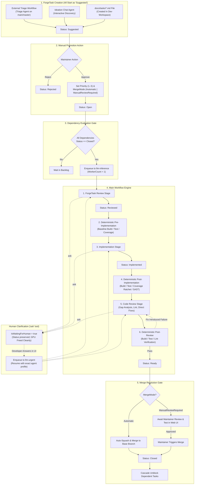
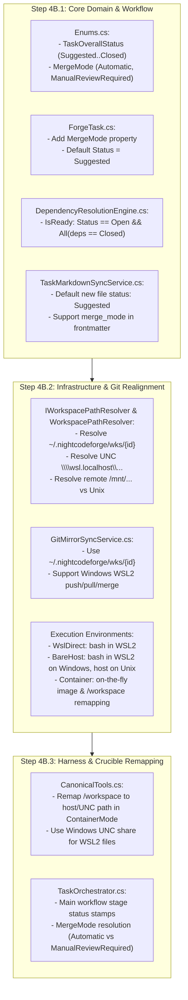

# 🌉 Phase 4B: Execution Environment, Path Remapping & ForgeTask Lifecycle Alignment

> **Implementation Roadmap & Technical Specification**  
> *Parent Plan:* [docs/PLAN.md](../PLAN.md) | *Status:* Ready for Scaffolding / Implementation  
> *Preceding Phase:* [Phase 4: AI Harness Abstraction & Tools](04_HARNESSES_TOOLS_AND_LOCAL_OPTIMIZATIONS.md)  
> *Succeeding Phase:* [Phase 5: Modern Blazor Web UI & SignalR Telemetry](05_BLAZOR_WEB_UI_AND_TELEMETRY.md)

---

## 1. Executive Objective

Bridge the foundational backend implementations with the exact cross-platform execution architecture and the updated, rigorous task lifecycle. 

This intermediate phase resolves critical structural requirements:
1. **Unix-Only Agent Confinement:** Autonomous agents run strictly in Unix environments. While NightCodeForge runs natively on Windows, Linux, or macOS, **running on Windows strictly requires WSL2**.
2. **Canonical Working Clones & Remote Resolution:** All agent clone repositories live at `~/.nightcodeforge/wks/{id}`. On Windows, remotes point to `/mnt/{transformed_windows_path}`; on Unix, remotes point to the developer workspace path. Git push, pull, and merge operations on `main` execute in the bare host on Unix and in plain WSL2 on Windows.
3. **Crucible Host-to-WSL Bridge & Container Path Remapping:** Crucible runs in-process inside the Forge. On Windows, its file I/O operations (`read`, `write`, `edit`) navigate via `\\wsl.localhost\{distrib}\home\{username}\.nightcodeforge\wks\{id}\`. In container mode, agents operate inside `/workspace` mapped to `~/.nightcodeforge/wks/{id}`; Crucible transparently remaps `/workspace` paths to the real host/WSL filesystem. Container images are generated on the fly as minimal layers, with package caches (NuGet, npm, uv) bind-mounted to the host.
4. **Unified 3-Channel ForgeTask Creation:** Tasks originate via (1) External Triage agent workflows, (2) Ideation chat, or (3) Markdown files dropped into `docs/tasks/`. In all cases, tasks start in status `Suggested`.
5. **Human Promotion & Main Workflow:** A manual action promotes `Suggested` tasks to `Open` (setting `Priority` and `MergeMode`: `Automatic` vs. `ManualReviewRequired`) or `Rejected`. Once `Open` and all dependencies are `Closed`, tasks execute through the main pipeline: `ForgeTask Review` (`Reviewed`) $\rightarrow$ `Deterministic Pre-Impl` $\rightarrow$ `Implementation` (`Implemented`) $\rightarrow$ `Deterministic Post-Impl` $\rightarrow$ `Code Review` $\rightarrow$ `Deterministic Post-Review` (`Ready`) $\rightarrow$ Merge (`Closed`). Human clarifications (`ask`) remain possible at any point.

---

## 2. Architectural Design & Flow



---

## 3. Detailed Component Specifications

### 3.1 Execution Environment & Path Mapping Architecture

#### A. Host vs. Agent Operating System Separation
* **Forge Host:** Runs on Windows (x64/arm64), Linux, or macOS.
* **Agent Execution:** Runs **strictly on Unix**. Coding agents (Crucible tool scripts, Pi, ACP runners) assume a POSIX shell, standard utilities (`ls`, `rg`, `sed`, `git`), and Linux directory layouts.
* **Windows Requirement:** When NightCodeForge runs on Windows, **WSL2 is mandatory**. If WSL2 is absent or not initialized, the orchestrator refuses to start and alerts the user with installation instructions (`wsl --install`).

#### B. Workspace Working Directory Conventions
* **Agent Working Clones:**
  - For every task workspace, the agent's isolated Git working clone is located at:
    ```text
    ~/.nightcodeforge/wks/{workspaceId}
    ```
  - On Linux/macOS: Resolves to `$HOME/.nightcodeforge/wks/{workspaceId}`.
  - On Windows: Resolves inside the targeted WSL2 distribution to `/home/{wslUser}/.nightcodeforge/wks/{workspaceId}`.
* **Git Remote URL Configuration:**
  - On Linux/macOS: The remote `host-origin` points directly to the developer's repository path on the host:
    ```bash
    git remote add host-origin "/path/to/developer/workspace"
    ```
  - On Windows: The developer's Windows repository path (e.g. `C:\Users\Julien\source\repos\MyProject`) is converted to its WSL mount path `/mnt/c/Users/Julien/source/repos/MyProject`:
    ```bash
    git remote add host-origin "/mnt/c/Users/Julien/source/repos/MyProject"
    ```
* **Git Operations Execution (`push`, `pull`, `merge`):**
  - On Linux/macOS: Executed on the bare host via `git` CLI.
  - On Windows: Executed inside plain WSL2 via `wsl.exe -d <distrib> -- git ...`.

#### C. Crucible Host-to-WSL File I/O Bridge (Windows)
Crucible is embedded in the Forge process. When Forge runs on Windows, Crucible must read and write files directly within the agent's WSL2 working tree:
* Crucible file tools (`read`, `write`, `edit`) translate paths to Windows UNC shares:
  ```text
  \\wsl.localhost\{distrib}\home\{username}\.nightcodeforge\wks\{workspaceId}\
  ```
* This grants Crucible full, high-speed NTFS/WSL cross-boundary file manipulation without requiring child processes or SSH tunnels.

#### D. "Bare Mode" vs. "Container Mode"
1. **Bare Mode:**
   - **On Windows:** The `bash` tool executes directly inside WSL2:
     ```bash
     wsl.exe -d <distrib> -- bash -c "cd ~/.nightcodeforge/wks/{id} && <cmd>"
     ```
   - **On Linux/macOS:** The `bash` tool executes directly in the host shell:
     ```bash
     /bin/bash -c "cd ~/.nightcodeforge/wks/{id} && <cmd>"
     ```
2. **Container Mode & Virtual Path Remapping:**
   - The container runs with the agent working clone mounted at `/workspace`:
     ```text
     -v ~/.nightcodeforge/wks/{id}:/workspace
     ```
   - **Agent Perspective:** The agent sees only `/workspace` as its root project directory.
   - **Crucible I/O Remapping:** When the agent calls file tools (`read("/workspace/src/App.cs")`, `edit("/workspace/src/App.cs")`, `write("/workspace/src/App.cs")`), Crucible (executing on the host) automatically strips `/workspace` and maps the target to the real path:
     - On Linux/macOS: `~/.nightcodeforge/wks/{id}/src/App.cs`
     - On Windows: `\\wsl.localhost\{distrib}\home\{username}\.nightcodeforge\wks\{id}\src\App.cs`
   - **SDK & Package Cache Mounts:**
     Host package caches are bind-mounted into the container to eliminate redundant downloads:
     - NuGet: `~/.nuget/packages` $\rightarrow$ `/root/.nuget/packages`
     - npm: `~/.npm` $\rightarrow$ `/root/.npm`
     - uv / Python: `~/.cache/uv` $\rightarrow$ `/root/.cache/uv`
   - **On-the-Fly Lightweight Container Image:**
     Instead of maintaining massive monolithic multi-GB Docker images, Forge generates a minimal, tailored container image on the fly (or runs a slim base containing standard tools, mounting host SDKs/binaries where possible).

---

### 3.2 ForgeTask Lifecycle & Main Workflow Engine

#### A. Domain Enumerations & Model Updates

```csharp
namespace NightCodeForge.Core.Domain;

/// <summary>
/// Comprehensive lifecycle status of a task in NightCodeForge.
/// </summary>
public enum TaskOverallStatus
{
    Suggested = 0,         // Newly created (via triage agent, ideation chat, or docs/tasks/*.md)
    Rejected = 1,          // Manually rejected by maintainer
    Open = 2,              // Approved by maintainer; eligible for processing once dependencies are Closed
    Reviewed = 3,          // Stage 1 (ForgeTask Review) completed successfully
    Implemented = 4,       // Stage 3 (Implementation) completed successfully
    Ready = 5,             // Stage 6 (Deterministic Post-Review Verification) completed; awaiting merge
    Closed = 6,            // Fully merged into base branch; terminal state
    Cancelled = 7,         // Manually cancelled during processing
    Failed = 8             // Execution failed with fatal unrecoverable error
}

/// <summary>
/// Determines how an approved and verified task is merged into the base branch.
/// </summary>
public enum MergeMode
{
    Automatic = 0,             // Auto-squashes and merges to base branch once status reaches Ready
    ManualReviewRequired = 1   // Maintainer manually reviews diff/tests before triggering merge in UI
}

// Dedicated tracking fields on ForgeTask entity (ForgeTask status is NEVER mutated by human interruption):
// public bool IsWaitingForHuman { get; set; } = false;
// public string? InterruptedAgentProfileId { get; set; }
// public string? InterruptedStageId { get; set; }
//
// Dedicated tracking field on Question entity:
// public string? AgentProfileId { get; set; }
```

#### B. The 3 Channels of ForgeTask Creation
1. **External Triage Workflow:**
   - External systems (webhooks, GitHub tasks, GitLab) trigger a lightweight, isolated triage pipeline.
   - Runs the `TriageStage` using a restricted read-only container on `main`.
   - Analyzes the request, validates reproducibility, and invokes `propose_tasks`.
   - Proposed tasks are created in `AppDbContext` with `Status = TaskOverallStatus.Suggested`.
2. **Ideation Chat:**
   - Developer interacts with the codebase ideation assistant.
   - Assistant or developer proposes a task with title, description, and dependencies.
   - Created with `Status = TaskOverallStatus.Suggested`.
3. **Markdown Sync from `docs/tasks/*.md`:**
   - Developer drops a markdown file into `<WorkspaceRoot>/docs/tasks/YYYY-MM-DD-<slug>.md`.
   - `TaskMarkdownSyncService` detects the file, assigns an ID, and writes back frontmatter with `status: suggested`.

#### C. The Manual Promotion Action
A task remains in `Suggested` until a human maintainer takes explicit action via the Web UI or CLI:
* **Action: Promote to Open**
  - **Inputs:** `Priority` (1 to 5), `MergeMode` (`Automatic` or `ManualReviewRequired`), optional target `BaseBranch` and `AgentProfile`.
  - **Transition:** `Suggested` $\rightarrow$ `Open`.
  - **Trigger:** Checks dependency graph. If all dependencies are `Closed`, the task is immediately enqueued to `llm-inference`.
* **Action: Reject**
  - **Transition:** `Suggested` $\rightarrow$ `Rejected`.
  - ForgeTask is archived and never enters the inference queue.

#### D. Main Workflow Stage Execution & Status Stamps
Once a task is `Open` and all prerequisites in `DependsOnTaskId` have `Status == TaskOverallStatus.Closed`:

| Order | Step / Stage | Stage Type | Resulting ForgeTask Status | Purpose & Handover |
| :---: | :--- | :--- | :--- | :--- |
| **1** | **ForgeTask Review Stage** | Agentic (GPU) | **`Reviewed`** | Deep codebase analysis, ambiguity detection, plan formulation. Invokes `ask` if ambiguous. |
| **2** | **Deterministic Pre-Implementation** | Deterministic (CPU) | *(Remains `Reviewed`)* | Captures baseline compilation cleanliness, test suite passing status, and baseline code coverage. Stored in `PipelineDataBag`. |
| **3** | **Implementation Stage** | Agentic (GPU) | **`Implemented`** | Modifies code, writes new unit tests, verifies builds and unit tests in the sandbox. |
| **4** | **Deterministic Post-Implementation** | Deterministic (CPU) | *(Remains `Implemented`)* | Evaluates `DeterministicCoverageGate` ($\Delta \ge 0$) and `DeterministicWarningRatchetStage` ($\Delta \le 0$). Loops back to Step 3 if regression detected. |
| **5** | **Code Review Stage** | Agentic (GPU) | *(Remains `Implemented`)* | Strict gap analysis, linting, regression auditing on `git diff -U2`. Applies direct minor polish patches or formatting fixes. |
| **6** | **Deterministic Post-Review Verification** | Deterministic (CPU) | **`Ready`** | Validates compilation cleanliness, unit test execution, and formatting after review patches. On pass $\rightarrow$ transitions to `Ready`; on regression $\rightarrow$ loops back to Stage 5 with compiler/test diagnostics. |
| **7** | **Merge Gate** | Deterministic / UI | **`Closed`** | Evaluates `MergeMode`: if `Automatic`, merges immediately; if `ManualReviewRequired`, waits for maintainer approval in Review Room. |

#### E. Universal Interruption via `ask`
* At any point during Stages 1, 3, or 5, an agent can call `ask`.
* **Strict Invariant:** Human interruption **never mutates `task.Status`**. The task's overall lifecycle milestone (`Open`, `Reviewed`, or `Implemented`) is preserved completely intact.
* The orchestrator intercepts the call:
  - Generates a Git WIP commit on the feature branch.
  - Persists the question card and serialized memory snapshot.
  - Sets `task.IsWaitingForHuman = true;`
  - Sets `task.InterruptedStageId = stage.StageId;`
  - Sets `task.InterruptedAgentProfileId = profile?.Id;`
  - Sets `question.AgentProfileId = profile?.Id;`
  - Completes the Hangfire job cleanly (`Succeeded`), immediately freeing the single GPU worker for other tasks.
* When the developer answers:
  - The answer is recorded in the question entity (`Status = QuestionStatus.Answered; Answer = answer;`).
  - Sets `task.IsWaitingForHuman = false;` (leaving `task.Status` unchanged).
  - The task is enqueued to **`llm-urgent`** for immediate priority pickup.
  - When dequeued, the orchestrator retrieves the original agent profile via `InterruptedAgentProfileId` and resumes the exact stage with the appropriate agent and injected answer context.

---

## 4. Implementation Steps & File Changes



### Step 4B.1: Core Domain Models & Enums
1. Update `src/NightCodeForge.Core/Domain/Enums.cs`:
   - Replace existing `TaskOverallStatus` with:
     `Suggested`, `Rejected`, `Open`, `Reviewed`, `Implemented`, `Ready`, `Closed`, `Cancelled`, `Failed`.
   - Add `MergeMode` enum (`Automatic = 0`, `ManualReviewRequired = 1`).
2. Update `src/NightCodeForge.Core/Domain/ForgeTask.cs`:
   - Set default `Status = TaskOverallStatus.Suggested`.
   - Add `public MergeMode MergeMode { get; set; } = MergeMode.ManualReviewRequired;`.
   - Add `public bool IsWaitingForHuman { get; set; } = false;`.
   - Add `public string? InterruptedAgentProfileId { get; set; }`.
   - Add `public string? InterruptedStageId { get; set; }`.
3. Update `src/NightCodeForge.Core/Domain/Question.cs`:
   - Add `public string? AgentProfileId { get; set; }`.
4. Update `src/NightCodeForge.Core/Dependencies/DependencyResolutionEngine.cs`:
   - A task is ready for execution if:
     `task.Status == TaskOverallStatus.Open && dependencies.All(d => d.Status == TaskOverallStatus.Closed)`.
   - Cascade unblocking triggers when a task transitions to `Closed`.
5. Update `src/NightCodeForge.Core/Services/TaskMarkdownSyncService.cs`:
   - New markdown files dropped without an ID are created with `Status = TaskOverallStatus.Suggested`.
   - Add `merge_mode` and `waiting_for_human` serialization/deserialization to `TaskFrontmatter`.

### Step 4B.2: Infrastructure & Path Resolution Subsystem
1. Implement `IWorkspacePathResolver` in `NightCodeForge.Core/Interfaces/IWorkspacePathResolver.cs` and `NightCodeForge.Infrastructure/Execution/WorkspacePathResolver.cs`:
   - `GetAgentWorkingClonePath(int workspaceId)`: Returns `~/.nightcodeforge/wks/{id}` (or expanded path).
   - `GetHostRemoteUrl(string repositoryPath)`: Transforms Windows drive path to `/mnt/{drive}/{rel}` if on Windows; returns raw path on Unix.
   - `GetCrucibleIoPath(int workspaceId, string relativeOrContainerPath)`:
     - On Windows: Maps to `\\wsl.localhost\{distrib}\home\{wslUser}\.nightcodeforge\wks\{id}\{relativePath}`.
     - On Linux/macOS: Maps to `~/.nightcodeforge/wks/{id}/{relativePath}`.
     - Automatically strips `/workspace/` prefix in container mode.
2. Update `src/NightCodeForge.Infrastructure/Git/GitMirrorSyncService.cs`:
   - Replace `/var/ncf/...` with `~/.nightcodeforge/wks/{id}`.
   - Execute git commands via WSL2 on Windows and native host on Unix.
3. Update `src/NightCodeForge.Infrastructure/Execution/BareHostExecutionEnvironment.cs`:
   - On Windows, execute commands through WSL2 bash (`wsl.exe -d <distrib> -- bash -c ...`), **never** PowerShell for agent commands.
   - On Unix, execute commands via `/bin/bash`.
4. Update `src/NightCodeForge.Infrastructure/Execution/NightCodeForgeContainerExecutor.cs`:
   - Implement on-the-fly minimal container generation.
   - Mount host cache directories (`~/.nuget/packages`, `~/.npm`, `~/.cache/uv`).

### Step 4B.3: Harness, Crucible Tools & Orchestrator Main Workflow
1. Update `src/NightCodeForge.Agents/Tools/CanonicalTools.cs`:
   - Inject `IWorkspacePathResolver`.
   - Normalize incoming paths: if path starts with `/workspace/`, remap to the resolved host/UNC workspace path.
2. Update `src/NightCodeForge.Core/Workflow/TaskOrchestrator.cs`:
   - Update stage transition hooks:
     - Stage 1 (ForgeTask Review) completed $\rightarrow$ `task.Status = TaskOverallStatus.Reviewed`.
     - Stage 2 (Deterministic Pre-Implementation) executes baseline checks.
     - Stage 3 (Implementation) completed $\rightarrow$ `task.Status = TaskOverallStatus.Implemented`.
     - Stage 4 (Deterministic Post-Implementation) checks coverage and warning ratchets.
     - Stage 5 (Code Review) applies review patches.
     - Stage 6 (Deterministic Post-Review Verification) compiles and tests review patches; on pass $\rightarrow$ `task.Status = TaskOverallStatus.Ready`; on failure $\rightarrow$ loops back with compiler/test diagnostics.
   - Merge evaluation:
     - If `task.MergeMode == MergeMode.Automatic`: calls `CompleteTaskAndCascadeAsync`, performs squash & merge, sets `task.Status = TaskOverallStatus.Closed`.
     - If `task.MergeMode == MergeMode.ManualReviewRequired`: retains `Ready`, notifies UI, awaits manual maintainer trigger to merge $\rightarrow$ `Closed`.
   - Interruption handling:
     - Intercepts `ask` $\rightarrow$ preserves `task.Status`, sets `task.IsWaitingForHuman = true`, `task.InterruptedStageId = stage.StageId`, `task.InterruptedAgentProfileId = profile?.Id`, and `question.AgentProfileId = profile?.Id`.
     - Answering question $\rightarrow$ sets `task.IsWaitingForHuman = false`, enqueues to `llm-urgent`, resumes with original agent profile from `InterruptedAgentProfileId`.

---

## 5. Automated Verification & Test Matrix

| Test Suite | Focus Area | Verification Scenarios |
| :--- | :--- | :--- |
| **`WorkspacePathResolverTests`** | Path Translation | Windows drive to `/mnt/...` remote, `\\wsl.localhost\` UNC resolution, `/workspace` container prefix stripping. |
| **`ExecutionEnvironmentTests`** | Bare & Container | Windows executes bash via WSL2 (never PowerShell); container mounts cache directories. |
| **`TaskLifecycleWorkflowTests`** | Status Progression | `Suggested` $\rightarrow$ Manual `Open` $\rightarrow$ `Reviewed` $\rightarrow$ `Implemented` $\rightarrow$ `Ready` $\rightarrow$ `Closed`. |
| **`DependencyEngineClosedTests`** | DAG Readiness | ForgeTask only ready when all dependencies are `Closed`; cascade triggers on `Closed`. |
| **`MergeModeTests`** | Auto vs Manual Merge | `Automatic` triggers immediate squash & merge; `ManualReviewRequired` pauses at `Ready`. |
| **`MarkdownSyncSuggestedTests`** | File Mirroring | New markdown files created with `status: suggested` and `merge_mode: manual_review_required`. |

---

## 6. Definition of Done (DoD)

- [ ] `TaskOverallStatus` and `MergeMode` enums defined and persisted in `AppDbContext`.
- [ ] `IWorkspacePathResolver` implemented with complete Windows WSL2, UNC share, and `/workspace` container remapping support.
- [ ] Bare mode bash runs in WSL2 on Windows and host bash on Unix.
- [ ] All working clones consistently target `~/.nightcodeforge/wks/{id}`.
- [ ] All three task creation sources create tasks in `Suggested` status.
- [ ] Manual promotion action changes status to `Open` or `Rejected`, setting `Priority` and `MergeMode`.
- [ ] Main workflow advances through `Reviewed` $\rightarrow$ `Implemented` $\rightarrow$ `Ready` $\rightarrow$ `Closed`.
- [ ] `ask` pauses workflow with `IsWaitingForHuman = true` and records `InterruptedAgentProfileId` without modifying `task.Status`, freeing the GPU; answer enqueues to `llm-urgent` and resumes with the exact agent profile.
- [ ] All unit and integration tests compile and pass 100%.
