# 🖥️ Phase 5: Modern Blazor Web UI & SignalR Telemetry

> **Master Implementation Roadmap & Step-by-Step Technical Guide**  
> *Parent Plan:* [docs/PLAN.md](../PLAN.md) | *Preceding Phase:* [Phase 4B: Execution Environment & Workflow Alignment](04B_EXECUTION_ENVIRONMENT_AND_WORKFLOW_ALIGNMENT.md) | *Succeeding Phase:* [Phase 6: End-to-End Hardening](06_END_TO_END_TESTING_AND_HARDENING.md)  
> *Status:* Ready for Scaffolding & Component Implementation

---

## 1. Executive Objective & Architecture

Build a modern, developer-grade reactive dashboard using **ASP.NET Core Blazor (Interactive Server)** and **SignalR**. 

The UI provides low-latency live telemetry, interactive ideation chat with the codebase exploration agent, visual DAG dependency management with maintainer promotion actions (`Suggested` $\rightarrow$ `Open` / `Rejected`), human-in-the-loop question answering, visual git diff review with dual merge modes (`Automatic` vs. `ManualReviewRequired`), execution environment and host SDK discovery inspection, transcript inspection with hybrid AI diagnostics, sandboxed untrusted intake triage (Stage 0), Ext4 Git mirror lifecycle and host dirty tree reconciliation, and a dedicated **Dev-Queue & Concurrency Lock Inspector** to manage the single-worker GPU queue.

```mermaid
flowchart TD
    subgraph UIClient ["Blazor Interactive Server UI (NightCodeForge.Web)"]
        TopNav["TopNavBar (Workspace Selector, GPU Worker Gauge, Inbox Pill)"]
        SideNav["NavMenu (12 Core Modules)"]
        Pages["Dynamic View Canvas (@Body)"]
        HubClient["OrchestratorHubClientConnection (SignalR Client Wrapper)"]
    end

    subgraph SignalRLayer ["Real-Time Telemetry (NightCodeForge.Infrastructure/Hubs)"]
        Hub["OrchestratorHub (/hubs/orchestrator)"]
        Bridge["SignalRActivityBridgeService (IAgentActivityStreamer Listener)"]
    end

    subgraph BackendCore ["Backend Orchestration & Domain Engine"]
        Orchestrator["ITaskOrchestrator (ForgeTask Processing, Promotions, Merges)"]
        TriageSvc["ITriageService (Untrusted Intake & Restricted Sandbox)"]
        IdeationSvc["IIdeationService (ConverseStreamingAsync)"]
        DAG["IDependencyResolutionEngine (Topological Sort, Cycle Detection)"]
        GitMirror["IGitMirrorSyncService (Ext4 Mirror, Host Push & Dirty Fallback)"]
        LockProvider["IWorkspaceLockProvider (Workspace & ForgeTask Concurrency Locks)"]
        SdkProbe["IHostSdkDiscoveryService (Mount Paths, Binaries, Env Vars)"]
        ModelCatalog["IOllamaModelCatalogService (Available Models & JIT Preload)"]
        Db["AppDbContext & Repositories (SQLite WAL)"]
    end

    TopNav --> HubClient
    Pages --> HubClient
    HubClient <-->|WebSocket SignalR Events| Hub
    Bridge --> Hub
    Pages --> Orchestrator
    Pages --> TriageSvc
    Pages --> IdeationSvc
    Pages --> DAG
    Pages --> GitMirror
    Pages --> LockProvider
    Pages --> SdkProbe
    Pages --> ModelCatalog
    Pages --> Db
```

---

## 2. Master Step Decomposition & Implementation Guides

To ensure thorough, battle-tested execution without ambiguity, Phase 5 is decomposed into **13 self-contained, highly detailed technical specification documents**:

| Step | Dedicated Technical Specification | Focus Area & Deliverables |
| :---: | :--- | :--- |
| **5.1** | [🎨 Step 5.1: Design System & Blazor Layout](phase-5/STEP_5_1_DESIGN_SYSTEM_AND_LAYOUT.md) | Pure Vanilla CSS token architecture (`theme.css`), obsidian/indigo dark theme, Google Fonts (`Inter`, `JetBrains Mono`), glassmorphic `TopNavBar` with workspace switcher and pulsating GPU worker status badge, collapsible `NavMenu`, and `ToastService`. |
| **5.1b** | [🧙 Step 5.1b: Workspace Provisioning & Creation Wizard](phase-5/STEP_5_1B_WORKSPACE_PROVISIONING_AND_CREATION_WIZARD.md) | Multi-step repository onboarding wizard, local git validation, auto-detected stack & base branch, WSL2 sandboxing check, automated Ext4 mirror clone (`~/.nightcodeforge/wks/{id}`), default agent profiles seeding, and first-run empty state hero. |
| **5.2** | [⚡ Step 5.2: SignalR Telemetry Infrastructure](phase-5/STEP_5_2_SIGNALR_TELEMETRY_INFRASTRUCTURE.md) | Strongly typed `IOrchestratorHubClient`, `OrchestratorHub` (`/hubs/orchestrator`), `SignalRActivityBridgeService` channel listener, and client-side `OrchestratorHubClientConnection` with auto-reconnect and per-task group isolation. |
| **5.3** | [💡 Step 5.3: Interactive Ideation & Discovery Chat](phase-5/STEP_5_3_IDEATION_AND_DISCOVERY_CHAT.md) | Conversational codebase exploration UI backed by `IIdeationService`, streaming model thoughts in collapsible `<think>` accordion, interactive `IdeationProposalCard` with in-place edits, and one-click ingestion to `Suggested` status and `docs/tasks/*.md`. |
| **5.4** | [📋 Step 5.4: Backlog Management & Visual DAG](phase-5/STEP_5_4_BACKLOG_AND_VISUAL_DAG.md) | Kanban board & SVG interactive DAG graph, Maintainer Promotion modal (`Suggested` $\rightarrow$ `Open` with `Priority` 1..5 & `MergeMode` vs `Rejected`), prerequisite `Closed` gating rule, and real-time cycle prevention via `IDependencyResolutionEngine.HasCycle`. |
| **5.5** | [⚡ Step 5.5: Monitoring Console & Telemetry Gauges](phase-5/STEP_5_5_MONITORING_CONSOLE_AND_GAUGES.md) | Active worker card with elapsed stopwatch and hardware routing gauge, 7-Step Pipeline Stepper distinguishing Agentic (GPU) vs. Deterministic (CPU) stages, real-time terminal console with auto-scroll and level filtering, and live tool latency strip. |
| **5.6** | [📬 Step 5.6: Human-in-the-Loop Question Inbox](phase-5/STEP_5_6_HUMAN_IN_THE_LOOP_INBOX.md) | Consolidated cross-workspace question inbox (`task.IsWaitingForHuman == true`), rich question cards with prompt/rationale, multiple-choice buttons, and status-preserving resumption re-queueing to `llm-urgent` with `InterruptedAgentProfileId`. |
| **5.7** | [🔍 Step 5.7: Review Room & Dual Merge Gates](phase-5/STEP_5_7_REVIEW_ROOM_AND_MERGE_GATES.md) | Side-by-side and unified Git diff visualizer using `DiffPlex` on noise-filtered changesets (`-U2`, lockfile exclusions), deterministic quality gate cards (Coverage delta $\Delta \ge 0\%$, Warning ratchet $\Delta \le 0$, Test suite), and `Automatic` vs. `ManualReviewRequired` merge actions. |
| **5.8** | [⚙️ Step 5.8: Two-Tier Settings Architecture, Agent Profiles, OllamaRouter Gateway & A/B Testing](phase-5/STEP_5_8_SETTINGS_HOST_SDKS_AND_AB_TESTING.md) | Two-tier settings hierarchy (Global System Settings vs. Workspace Confinement), dual-scope Agent Profile editor with dynamic inheritance fallback, generous autonomous turn budgets (500 turns), `MaxTurns` precedence fix, complete 12-parameter optimization matrix, deep OllamaRouter gateway awareness (`/api/tags`, `/api/ps` VRAM inspection, non-destructive memory reclaim, target pinning), Host SDK Inspector, and A/B Testing Comparator. |
| **5.9** | [📜 Step 5.9: Session Transcripts & AI Diagnostics](phase-5/STEP_5_9_TRANSCRIPTS_AND_AI_DIAGNOSTICS.md) | Markdown transcript browser under `docs/transcripts/` with YAML frontmatter metadata card, turn-by-turn dialogue viewer, and "Diagnose with AI" modal (Option A: Cloud zero-VRAM vs. Option B: Local sequential queue) with structured remediation reports. |
| **5.10** | [🛡️ Step 5.10: Untrusted Intake & Sandboxed Triage](phase-5/STEP_5_10_UNTRUSTED_INTAKE_AND_TRIAGE.md) | Channel 1 intake station deploying Stage 0 Triage Agent on `main`/`master` in a `RestrictedReadOnly` sandbox (`:ro` mount, `--network none`), verifying external bug reproducibility and formulating structured backlog tasks in `Suggested` status. |
| **5.11** | [🌿 Step 5.11: Git Ext4 Mirror & Host Sync](phase-5/STEP_5_11_GIT_MIRROR_AND_HOST_SYNC.md) | Isolated Ext4 mirror inspector (`~/.nightcodeforge/mirror/{id}`), active worktrees console, SignalR `ReceiveHostDirtyAlert` reactive drawer, and guided resolution for fallback rescue branches (`feature/task-{id}-ncf`). |
| **5.12** | [⏱️ Step 5.12: Dev-Queue & Concurrency Locks](phase-5/STEP_5_12_DEV_QUEUE_AND_LOCK_INSPECTOR.md) | Sequential GPU dev-queue management (`llm-urgent` vs. `llm-inference`), active workspace lock inspector (`IWorkspaceLockProvider`) preventing `.git/index.lock` collisions, emergency unlock tool, and native Hangfire dashboard integration. |

---

## 3. Backend-to-Frontend Integration Matrix

| Blazor Component / Page | Backend Service / Interface | Primary Method / Contract | Key Data Transferred |
| :--- | :--- | :--- | :--- |
| **`TopNavBar.razor`** | `WorkspaceStateService` `WorkerStateService` | State properties & events | Active Workspace ID, GPU status, pending questions count. |
| **`WorkspaceCreationWizardModal.razor`** | `IWorkspaceProvisioningService` `IWorkspaceRepository` `IGitMirrorSyncService` | `ProbeRepositoryAsync()` `ProvisionWorkspaceAsync()` | Directory path, Git branch, stack detection, Ext4 clone mirror, agent profiles. |
| **`Ideation.razor`** | `IIdeationService` `ITaskRepository` `ITaskMarkdownSyncService` | `ConverseStreamingAsync()` `CreateAsync()` `SyncTaskToMarkdownAsync()` | Chat history, streaming tokens, proposed tasks, disk sync. |
| **`Backlog.razor`** | `ITaskRepository` `ITaskOrchestrator` `IDependencyResolutionEngine` | `GetByWorkspaceIdAsync()` `PromoteSuggestedTaskAsync()` `HasCycle()` | Backlog task list, DAG dependencies, cycle validation, promotion. |
| **`Monitoring.razor`** | `OrchestratorHubClientConnection` `ITaskRepository` | `OnTokenDeltaReceived` `OnStageTransitionReceived` `GetByIdAsync()` | Token stream, tool latency, active stage pulse, log lines. |
| **`Inbox.razor`** | `ITaskRepository` `ITaskOrchestrator` | `GetQuestionByIdAsync()` `SubmitHumanAnswerAsync()` | Question prompt, rationale, options JSON, answer submission to `llm-urgent`. |
| **`Review.razor`** | `IGitWorkspaceManager` `ITaskOrchestrator` | `GetDiffAsync()` `CompleteTaskAndCascadeAsync()` `RequestChangesAsync()` | Git diff text, DiffPlex model, squash merge, Stage 3 re-route. |
| **`Settings.razor`** | `IHostSdkDiscoveryService` `IOllamaModelCatalogService` `IWslMetadataService` | `DiscoverSdkDetailsAsync()` `GetAvailableModelsAsync()` `GetInstalledDistributionsAsync()` | Read-only SDK mount paths, environment variables, models list, WSL2 status. |
| **`Transcripts.razor`** | `AppDbContext` `OllamaRouter` / LLM Client | Direct file reading (`docs/transcripts/`) Diagnostic prompting | Frontmatter metadata, turn history, diagnostic report. |
| **`Triage.razor`** | `ITriageService` `ITaskRepository` | `TriageExternalReportAsync()` | Untrusted bug reports, `RestrictedReadOnly` sandbox, suggested tasks. |
| **`GitSync.razor`** | `IGitMirrorSyncService` `OrchestratorHubClientConnection` | `FetchFromHostAsync()` `OnHostDirtyAlertReceived` | Ext4 mirror status, fallback `-ncf` rescue branches, stash & reconcile. |
| **`DevQueue.razor`** | `IWorkspaceLockProvider` `Hangfire.JobStorage` | `AcquireLockAsync()` `TryAcquireTaskLock()` | Queue depths, active keyed locks, emergency lock release. |

---

## 4. Phase 5 Definition of Done (DoD) Checklist

- [x] **Step 5.1:** Design system tokens in `theme.css`, `app.css`, `App.razor`, and responsive shell (`TopNavBar`, `NavMenu`, `MainLayout`, `ToastHost`).
- [x] **Step 5.1b:** `WorkspaceCreationWizardModal.razor` multi-step onboarding wizard, `IWorkspaceProvisioningService` (probe, git init, Ext4 clone, default profiles), TopNavBar `[+]` button, and first-run empty state hero.
- [x] **Step 5.2:** `IOrchestratorHubClient`, `OrchestratorHub`, `SignalRActivityBridgeService`, and client-side `OrchestratorHubClientConnection` implemented and wired to DI.
- [x] **Step 5.3:** `Ideation.razor` conversing with `IIdeationService` in real time, proposing tasks with editable fields, and saving to SQLite as `Suggested`.
- [x] **Step 5.4:** `Backlog.razor` rendering Kanban columns and SVG DAG graph, with Maintainer Promotion modal (`Suggested` $\rightarrow$ `Open`/`Rejected`) and cycle prevention.
- [x] **Step 5.5:** `Monitoring.razor` displaying active worker state, 7-step pipeline (GPU vs CPU), and live terminal stream.
- [x] **Step 5.6:** `Inbox.razor` displaying pending questions, accepting answers, and resuming via `llm-urgent` without mutating task status.
- [x] **Step 5.7:** `Review.razor` rendering side-by-side diffs via `DiffPlex`, displaying quality gate cards, and executing auto-merge or approve/request-changes.
- [x] **Step 5.8:** `Settings.razor` two-tier configuration console (Global System vs. Workspace Scoped), dual-scope agent reasoning profile editor with dynamic inheritance fallback, generous autonomous turn budgets (500 turns), `MaxTurns` precedence fix, complete 12-parameter optimization matrix, deep OllamaRouter gateway integration (`/api/tags`, `/api/ps` VRAM inspection, target pinning `X-OllamaRouter-Target`, non-destructive memory reclaim), probed host SDK paths, and A/B test metrics.
- [x] **Step 5.9:** `Transcripts.razor` rendering markdown transcripts and executing hybrid AI diagnostics (Cloud vs. Local).
- [x] **Step 5.10:** `Triage.razor` portal executing Stage 0 intake triage in a `RestrictedReadOnly` sandbox (`:ro` mount, `--network none`) on `main`/`master`.
- [x] **Step 5.12:** `DevQueue.razor` monitoring Hangfire queue priorities (`llm-urgent` vs. `llm-inference`), inspecting `IWorkspaceLockProvider` locks, and mounting Hangfire dashboard.
