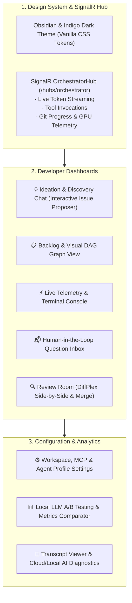

# 🖥️ Phase 5: Modern Blazor Web UI & SignalR Telemetry

> **Implementation Roadmap & Technical Specification**  
> *Parent Plan:* [docs/PLAN.md](../PLAN.md) | *Status:* Ready for Scaffolding

---

## 1. Executive Objective

Build a modern, developer-grade reactive dashboard using **ASP.NET Core Blazor (Interactive Server)** and **SignalR**. The interface provides low-latency live monitoring, interactive ideation chat with the codebase exploration agent, visual DAG dependency management, human-in-the-loop question answering, visual git diff review, transcript inspection with AI diagnostics, and a dedicated **A/B Testing & Profiling Dashboard** to benchmark local LLM optimizations.

---

## 2. Detailed Task Breakdown

### Step 5.1: Design System & Blazor Layout (`NightCodeForge.Web`)
* **Aesthetic Standard:** Modern obsidian/indigo dark theme engineered with pure Vanilla CSS tokens (no TailwindCSS dependencies):
  - Deep rich background: `--bg-primary: #0f1117`, `--bg-surface: #181b24`, `--bg-card: #202433`.
  - Vibrant accent palette: `--accent-indigo: #6366f1`, `--accent-teal: #14b8a6`, `--accent-amber: #f59e0b`, `--accent-crimson: #ef4444`.
  - Modern typography: `Inter` / `JetBrains Mono` from Google Fonts.
  - Glassmorphic navigation bar, subtle micro-animations on stage transitions, and sticky status headers.

### Step 5.2: SignalR Real-Time Telemetry Hub (`NightCodeForge.Infrastructure/Hubs`)
* **Endpoint:** `/hubs/orchestrator`
* **Real-Time Event Streams:**
  - `ReceiveTokenDelta(int issueId, string token)`: Live streaming of model thoughts and text responses.
  - `ReceiveToolExecution(int issueId, string toolName, string arguments, string status)`: Visual tool call indicator.
  - `ReceiveGitProgress(int issueId, string operation, string message)`: Branch creation, WIP commit, fetch/push sync.
  - `ReceiveWorkerStatus(string status, int? activeIssueId, string? stageId, string hardwareTarget)`: Live GPU status.
  - `ReceiveHostDirtyAlert(int issueId, string branchName)`: Alert when host working tree prevents `updateInstead`.

### Step 5.3: Interactive Ideation & Codebase Discovery Chat (`Components/Ideation`)
* **Features:**
  - Conversational chat interface with the read-only exploration agent.
  - Codebase Q&A: query project architecture, existing modules, and implementation strategies.
  - **Issue Proposal Cards:** When the agent invokes `propose_issues`, proposals render as rich interactive cards with editable scope, title, description, and dependency checkboxes.
  - One-click "Add to Backlog" with automated database insertion and dependency graph wiring.

### Step 5.4: Backlog & Visual Dependency DAG (`Components/Backlog`)
* **Features:**
  - Visual Kanban and interactive tree visualizer highlighting issue states:
    `Waiting on Dependencies` $\rightarrow$ `Pending` $\rightarrow$ `Running [Stage]` $\rightarrow$ `Blocked` $\rightarrow$ `Review` $\rightarrow$ `Completed`.
  - Dependency linking modal: connect prerequisite issues with instant cycle detection validation.
  - Drag-and-drop priority reordering.

### Step 5.5: Monitoring Console & Telemetry Gauges (`Components/Monitoring`)
* **Features:**
  - Active worker dashboard: current issue, active stage (`Review ➔ Implement ➔ Fix`), elapsed execution timer.
  - Hardware routing badge: displays active inference target (Fast Local GPU vs. Remote Server vs. Cloud Overflow).
  - Live terminal console with auto-scroll toggle, clear button, and log level filtering (`Debug`, `Info`, `Warning`, `Error`).

### Step 5.6: Human-in-the-Loop Question Inbox (`Components/Inbox`)
* **Features:**
  - Consolidated grid of all blocked questions across all workspaces.
  - Rich question card displaying question prompt, rationale, stage context, and associated code files.
  - Rich answer form supporting freeform text, code snippets, or multiple-choice button selections.
  - Submitting an answer instantly enqueues the issue to `llm-urgent` with visual confirmation.

### Step 5.7: Review Room (`Components/Review`)
* **Features:**
  - Side-by-side and unified `git diff` visualizer using `DiffPlex`.
  - File tree navigator showing added, modified, and deleted files with line addition/deletion counts.
  - **"Approve & Merge" Button:** Triggers `CompleteIssueAndCascadeAsync`, squashing WIP commits into the base branch and unlocking dependent backlog tasks.
  - **"Request Changes" Button:** Opens revision notes modal, routing the issue back to Stage 2 (`ImplementationStage`) with highest priority via `llm-urgent`.

### Step 5.8: Settings, Profiles & A/B Testing Dashboard (`Components/Settings`)
* **Features:**
  - Workspace management: add/switch repositories, configure execution environment (`BareHost`, `WslDirect`, `ContainerSandbox`).
  - MCP configuration editor: inspect and modify `mcp_config.json`.
  - **Agent Profile Editor & Optimization Toggles:**
    - Form to edit Harness, Model Name, Thinking Effort, and Temperature.
    - Toggle switches for all 7 `LocalOptimizationFlags`:
      - `ThinkingTraceCompaction`
      - `LoopCircuitBreaker`
      - `GuidedGrammarDecoding`
      - `DeterministicSymbolMap`
      - `StructuredDiagnosticExtraction`
      - `PrefixStabilization`
      - `JitModelPreload`
  - **A/B Testing Metrics Comparator:**
    - Side-by-side comparison table of Profile A vs. Profile B across executed runs:
      - Prompt tokens consumed
      - Total execution duration (ms)
      - KV cache hit rate (%)
      - First-attempt test pass rate (%)
      - Caught runaway loop count

### Step 5.9: Session Transcript Viewer & AI Diagnostics Modal (`Components/Transcripts`)
* **Features:**
  - Markdown viewer for turn-by-turn transcripts under `docs/transcripts/` with syntax highlighting and YAML frontmatter metadata card.
  - **"Diagnose with AI" Action:** Choice between:
    - *Option A: Cloud Diagnostics* (fast, zero local VRAM consumption via OllamaRouter cloud overflow or direct API).
    - *Option B: Local Diagnostics* (100% offline and private, queued sequentially).
  - Diagnostic Report Modal: displays Root Cause Breakdown, Prompt/Skill Critique, and one-click remediation suggestions.

---

## 3. Verification & UI Test Plan

| Component | Focus Area | Scenarios Covered |
| :--- | :--- | :--- |
| **`SignalRStreamingTests`** | Telemetry | Token delta arrival, tool status badge updates, reconnection handling. |
| **`IdeationProposalTests`** | Ideation Chat | Proposal card rendering, editing proposed title/scope, adding to backlog with dependencies. |
| **`QuestionInboxTests`** | Human-in-the-Loop | Form validation, multiple-choice selection, submission triggering `llm-urgent` re-queueing. |
| **`ReviewRoomDiffTests`** | Diff Viewer | Side-by-side diff rendering with DiffPlex, approve & merge execution, change request re-routing. |
| **`ABTestingComparatorTests`** | Analytics | Side-by-side metric calculations, profile flag toggling, transcript frontmatter display. |

---

## 4. Definition of Done (DoD) Checklist

- [ ] Blazor Interactive Server application running with modern obsidian/indigo dark theme.
- [ ] SignalR hub streaming real-time tokens, tool executions, and Git progress.
- [ ] Ideation chat converses with exploration agent and proposes backlog items.
- [ ] Visual Backlog renders DAG dependencies with cycle prevention.
- [ ] Question Inbox allows answering questions with immediate `llm-urgent` re-queueing.
- [ ] Review Room displays side-by-side diffs and handles squash-merge or change requests.
- [ ] Agent Profile editor provides toggle switches for all 7 `LocalOptimizationFlags`.
- [ ] A/B Testing comparator displays empirical metrics across profiles.
- [ ] Session transcripts and AI diagnostics modal operational.
