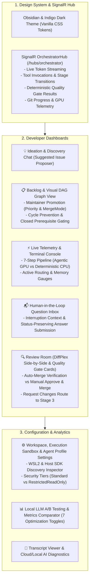

# 🖥️ Phase 5: Modern Blazor Web UI & SignalR Telemetry

> **Implementation Roadmap & Technical Specification**  
> *Parent Plan:* [docs/PLAN.md](../PLAN.md) | *Preceding Phase:* [Phase 4B: Execution Environment & Workflow Alignment](04B_EXECUTION_ENVIRONMENT_AND_WORKFLOW_ALIGNMENT.md) | *Status:* Ready for Scaffolding

---

## 1. Executive Objective

Build a modern, developer-grade reactive dashboard using **ASP.NET Core Blazor (Interactive Server)** and **SignalR**. The interface provides low-latency live monitoring, interactive ideation chat with the codebase exploration agent, visual DAG dependency management with maintainer promotion actions (`Suggested` $\rightarrow$ `Open` / `Rejected`), human-in-the-loop question answering, visual git diff review with dual merge modes (`Automatic` vs. `ManualReviewRequired`), execution environment and host SDK discovery inspection, transcript inspection with hybrid AI diagnostics, and a dedicated **A/B Testing & Profiling Dashboard** to benchmark local LLM optimizations.

---

## 2. Detailed Task Breakdown

### Step 5.1: Design System & Blazor Layout (`NightCodeForge.Web`)
* **Aesthetic Standard:** Modern obsidian/indigo dark theme engineered with pure Vanilla CSS tokens (no TailwindCSS dependencies):
  - Deep rich background: `--bg-primary: #0f1117`, `--bg-surface: #181b24`, `--bg-card: #202433`.
  - Vibrant accent palette: `--accent-indigo: #6366f1`, `--accent-teal: #14b8a6`, `--accent-amber: #f59e0b`, `--accent-crimson: #ef4444`.
  - Modern typography: `Inter` / `JetBrains Mono` from Google Fonts.
  - Glassmorphic top navigation bar with active workspace switcher, global GPU inference worker indicator (`Idle`, `Running [Stage]`, `Interrupted`), and sticky breadcrumbs.
  - Micro-animations on stage transitions, status badges, and terminal stream updates.

### Step 5.2: SignalR Real-Time Telemetry Hub (`NightCodeForge.Infrastructure/Hubs`)
* **Endpoint:** `/hubs/orchestrator`
* **Real-Time Event Streams:**
  - `ReceiveTokenDelta(int issueId, string token)`: Live streaming of model thoughts (`<think>`) and text responses.
  - `ReceiveToolExecution(int issueId, string toolName, string arguments, string status)`: Visual tool call indicator with latency timing.
  - `ReceiveGitProgress(int issueId, string operation, string message)`: Branch creation, WIP commit, fetch/push sync.
  - `ReceiveWorkerStatus(string status, int? activeIssueId, string? stageId, string hardwareTarget)`: Live GPU status and OllamaRouter target routing.
  - `ReceiveStageTransition(int issueId, string stageId, string stageKind, string status)`: Pipeline advancement across agentic and deterministic stages.
  - `ReceiveDeterministicGateResult(int issueId, string gateName, bool passed, string metricsSummary)`: Instant notification of coverage delta, warning count, or test assertions.
  - `ReceiveHostDirtyAlert(int issueId, string branchName)`: Alert when developer host working tree prevents `updateInstead` push.

### Step 5.3: Interactive Ideation & Codebase Discovery Chat (`Components/Ideation`)
* **Features:**
  - Conversational chat interface backed by `IIdeationService` (read-only exploration agent).
  - Codebase Q&A: query project architecture, existing modules, and implementation strategies.
  - **Issue Proposal Cards:** When the agent invokes `propose_issues`, proposals render as rich interactive cards with editable scope, title, description, and dependency checkboxes.
  - One-click "Add to Backlog": inserts new issues directly into `AppDbContext` with initial `Status = IssueOverallStatus.Suggested`.

### Step 5.4: Backlog & Visual Dependency DAG (`Components/Backlog`)
* **Features:**
  - Visual Kanban and interactive DAG tree visualizer displaying full lifecycle milestone badges:
    `Suggested` $\rightarrow$ `Open` $\rightarrow$ `Reviewed` $\rightarrow$ `Implemented` $\rightarrow$ `Ready` $\rightarrow$ `Closed` (along with `Rejected`, `Cancelled`, `Failed`).
  - Overlay indicator: **`Waiting for Human`** badge when `issue.IsWaitingForHuman = true`.
  - **Maintainer Promotion Modal:**
    - Action dialog on `Suggested` issues:
      - **Promote to Open:** Maintainer sets `Priority` (1 to 5, default = 1) and `MergeMode` (`Automatic` vs. `ManualReviewRequired`), transitioning status to `Open`.
      - **Reject:** Marks status as `Rejected`, archiving the issue without entering the execution queue.
  - **DAG Dependency & Execution Readiness:**
    - Visual indicators showing which prerequisite issues are blocking readiness.
    - Explicit execution readiness rule: an issue is ready for `llm-inference` only if `issue.Status == IssueOverallStatus.Open` and **all prerequisite issues in `DependsOnIssueId` have `Status == IssueOverallStatus.Closed`**.
  - Dependency linking modal: connect prerequisite issues with instant client/server cycle detection validation via `IDependencyResolutionEngine.HasCycle`.
  - Drag-and-drop priority reordering.

### Step 5.5: Monitoring Console & Telemetry Gauges (`Components/Monitoring`)
* **Features:**
  - Active worker dashboard: current issue, elapsed execution timer, and current pipeline stage:
    `Stage 1 (Issue Review, GPU)` $\rightarrow$ `Stage 2 (Pre-Impl, CPU)` $\rightarrow$ `Stage 3 (Implementation, GPU)` $\rightarrow$ `Stage 4 (Post-Impl Gates, CPU)` $\rightarrow$ `Stage 5 (Code Review, GPU)` $\rightarrow$ `Stage 6 (Post-Review, CPU)` $\rightarrow$ `Stage 7 (Merge Gate)`.
  - Clear visual styling distinguishing **Agentic (GPU inference)** stages from **Deterministic (CPU-native verification)** stages.
  - Hardware routing badge: displays active inference target (Fast Local GPU vs. Remote Server vs. Cloud Overflow via OllamaRouter).
  - Live terminal console with auto-scroll toggle, clear button, and log level filtering (`Debug`, `Info`, `Warning`, `Error`).

### Step 5.6: Human-in-the-Loop Question Inbox (`Components/Inbox`)
* **Features:**
  - Consolidated grid of all questions awaiting developer answers across workspaces (`issue.IsWaitingForHuman == true`).
  - Rich question card displaying prompt, rationale, stage context, associated agent profile (`question.AgentProfileId`), and related code files.
  - Rich answer form supporting freeform text, code snippets, or multiple-choice button selections.
  - **Status-Preserving Resumption:**
    - Submitting an answer records `Question.Answer`, sets `Question.Status = Answered`, and resets `issue.IsWaitingForHuman = false` without mutating `issue.Status` (preserving the exact lifecycle milestone `Open`, `Reviewed`, or `Implemented`).
    - Enqueues the issue to **`llm-urgent`** with visual confirmation, resuming with the exact original agent profile (`InterruptedAgentProfileId`).

### Step 5.7: Review Room (`Components/Review`)
* **Features:**
  - Side-by-side and unified `git diff` visualizer using `DiffPlex` on noise-filtered changesets (`-U2`, lockfile exclusions).
  - File tree navigator showing added, modified, and deleted files with line addition/deletion metrics.
  - **Deterministic Quality Gate Cards:**
    - Code coverage delta from `DeterministicCoverageGate` ($\Delta \ge 0\%$) with pass/fail indicator.
    - Compiler/linter warning delta from `DeterministicWarningRatchetStage` ($\Delta \le 0$).
    - Test execution summary (total tests, passing tests, execution duration) and deterministic post-review verification status.
  - **Merge Mode Handling:**
    - **`MergeMode.Automatic`:** Displays "Auto-merged upon passing quality gates" badge once Stage 6 passes and the branch is squashed into `baseBranch`.
    - **`MergeMode.ManualReviewRequired`:**
      - **"Approve & Merge" Button:** Triggers `CompleteIssueAndCascadeAsync`, squashing WIP commits into the base branch, updating status to `Closed`, and cascading DAG unblocking to dependent tasks.
      - **"Request Changes" Button:** Opens revision notes modal, routing the issue back to **Stage 3 (`ImplementationStage`)** with reviewer notes injected and highest priority via **`llm-urgent`**.

### Step 5.8: Settings, Execution Environment & A/B Testing (`Components/Settings`)
* **Features:**
  - **Workspace & Execution Environment Configuration:**
    - Workspace management: add/switch repositories, configure target base branch.
    - Environment selection: `BareHost` (WSL2 bash on Windows, native bash on Unix), `WslDirect` (`wsl.exe -d <distro>`), or `ContainerSandbox`.
    - Windows WSL2 readiness card: verifies WSL2 is installed and running; alerts if WSL2 is missing.
    - Package cache directory configuration (`~/.nuget/packages`, `~/.npm`, `~/.cache/uv`).
  - **Host SDK Discovery Inspector:**
    - Interactive viewer for `IHostSdkDiscoveryService` discovered SDKs:
      - Read-only SDK mount paths for container sandboxes (e.g. `/usr/share/dotnet`, `/usr/lib/jvm`).
      - Discovered environment variables (`DOTNET_ROOT`, `JAVA_HOME`, `ANDROID_HOME`).
      - Discovered command binaries (`which dotnet`, `node`, `python3`).
  - **Agent Profile Editor:**
    - Configure Harness (`Crucible`, `PiRpc`, `Acp`), Model Name, Thinking Effort (`None`, `Low`, `Medium`, `High`, `CustomBudget`), Thinking Token Budget, and Temperature.
    - Configure `SandboxSecurityTier`: `Standard` vs. `RestrictedReadOnly` (for untrusted Stage 0 external intake triage).
    - Configure `PermittedTools` whitelist.
    - Toggle switches for all 7 `LocalOptimizationFlags`:
      - `ThinkingTraceCompaction`
      - `LoopCircuitBreaker`
      - `GuidedGrammarDecoding`
      - `DeterministicSymbolMap`
      - `StructuredDiagnosticExtraction`
      - `PrefixStabilization`
      - `JitModelPreload`
  - **A/B Testing Metrics Comparator:**
    - Side-by-side comparison table of Profile A vs. Profile B across executed runs:
      - Prompt tokens consumed
      - Total execution duration (ms)
      - KV cache hit rate (%)
      - First-attempt test pass rate (%)
      - Caught runaway loop count

### Step 5.9: Session Transcript Viewer & AI Diagnostics Modal (`Components/Transcripts`)
* **Features:**
  - Markdown viewer for turn-by-turn transcripts under `docs/transcripts/` with syntax highlighting and YAML frontmatter metadata card.
  - **"Diagnose with AI" Action:** Choice between:
    - *Option A: Cloud Diagnostics* (fast, zero local VRAM consumption via OllamaRouter cloud overflow or direct API).
    - *Option B: Local Diagnostics* (100% offline and private, queued sequentially via `WorkerCount = 1`).
  - Diagnostic Report Modal: displays Root Cause Breakdown, Prompt/Skill Critique, and one-click remediation suggestions.

---

## 3. Verification & UI Test Plan

| Component | Focus Area | Scenarios Covered |
| :--- | :--- | :--- |
| **`SignalRStreamingTests`** | Telemetry | Token delta arrival, tool status badge updates, stage transition broadcasts, deterministic gate result updates, reconnection handling. |
| **`IdeationProposalTests`** | Ideation Chat | Proposal card rendering, editing proposed title/scope, adding to backlog with initial `Suggested` status and dependency wiring. |
| **`MaintainerPromotionTests`** | Backlog Promotion | Maintainer promotion modal: setting `Priority` and `MergeMode` (`Automatic` vs `ManualReviewRequired`), transitioning `Suggested` $\rightarrow$ `Open` or `Rejected`. |
| **`QuestionInboxTests`** | Human-in-the-Loop | Form validation, multiple-choice selection, status preservation (`isWaitingForHuman = false`), and submission triggering `llm-urgent` re-queueing with original agent profile. |
| **`ReviewRoomDiffTests`** | Diff Viewer & Gates | Side-by-side diff rendering with DiffPlex, quality gate metric cards (coverage delta, warning ratchet), approve & merge execution, change request re-routing to Stage 3. |
| **`ExecutionSettingsTests`** | Sandboxing & SDKs | WSL2 distribution selection, host SDK mount path inspection from `IHostSdkDiscoveryService`, and container cache mount display. |
| **`ABTestingComparatorTests`** | Analytics | Side-by-side metric calculations, profile optimization flag toggling, transcript frontmatter display. |

---

## 4. Definition of Done (DoD) Checklist

- [ ] Blazor Interactive Server application running with modern obsidian/indigo dark theme.
- [ ] SignalR hub streaming real-time tokens, tool executions, Git progress, stage transitions, and deterministic gate metrics.
- [ ] Ideation chat converses with exploration agent and proposes backlog items in `Suggested` status.
- [ ] Visual Backlog renders DAG dependencies with cycle prevention and enforces prerequisite `Closed` gating.
- [ ] Maintainer Promotion action enables promoting `Suggested` issues to `Open` (with `Priority` and `MergeMode`) or `Rejected`.
- [ ] Question Inbox allows answering questions, resetting `IsWaitingForHuman = false` without mutating issue status, and immediately re-queueing to `llm-urgent`.
- [ ] Live monitoring console displays the full 7-step pipeline (3 agentic + 3 deterministic + 1 merge gate) with GPU/CPU indicators.
- [ ] Review Room displays side-by-side diffs, quality gate metric cards, and handles `Automatic` vs. `ManualReviewRequired` merge triggers or Stage 3 change requests.
- [ ] Execution settings display WSL2 status, container cache mounts, and probed host SDK paths from `IHostSdkDiscoveryService`.
- [ ] Agent Profile editor provides toggle switches for all 7 `LocalOptimizationFlags`, `SandboxSecurityTier`, and permitted tools.
- [ ] A/B Testing comparator displays empirical metrics across profiles.
- [ ] Session transcripts and AI diagnostics modal operational.
