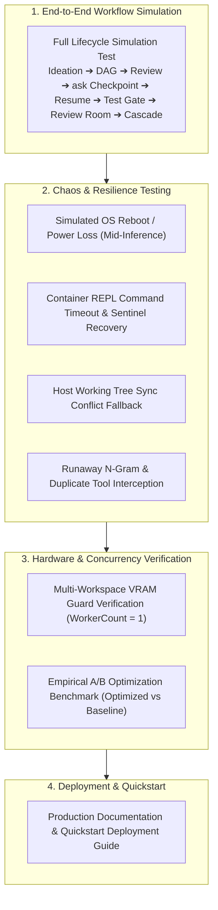

# 🛡️ Phase 6: End-to-End Testing, Resilience & Hardening

> **Implementation Roadmap & Technical Specification**  
> *Parent Plan:* [docs/PLAN.md](../PLAN.md) | *Status:* Ready for Scaffolding

---

## 1. Executive Objective

Execute comprehensive end-to-end integration testing, chaos resilience engineering, multi-workspace VRAM protection validation, and empirical A/B optimization benchmarks under realistic software development workloads. Ensure that **NightCodeForge** operates autonomously overnight with zero prompt fatigue and zero data loss.

---

## 2. Detailed Task Breakdown

### Step 6.1: Full End-to-End Workflow Simulation Test
* **Objective:** Validate the complete multi-agent pipeline and non-blocking dev-queue lifecycle:
  1. **Ideation:** Automated test submits a codebase query to `IIdeationService`; discovery agent analyzes code and proposes Issue #101 ("Implement Discount Service") and dependent Issue #102 ("Expose Discount API").
  2. **DAG Wiring:** Both issues are added to the backlog; Issue #102 is marked as depending on Issue #101. Issue #101 transitions to `Pending`, while Issue #102 enters `WaitingOnDependencies`.
  3. **Stage 1 (Issue Review):** Issue #101 is dequeued into `llm-inference`. Agent analyzes code and calls `ask("Should discounts apply before or after VAT?")`.
  4. **Clean Checkpoint:** Orchestrator intercepts interruption, creates Git WIP commit on `feature/issue-101`, saves serialized memory to `STAGE_CHECKPOINT`, and completes Hangfire job as `Succeeded`. **GPU is verified freed.**
  5. **Human Answer & Preemption:** Test submits answer *"Apply discounts before VAT"*. Issue transitions to `Pending` and is enqueued into **`llm-urgent`**.
  6. **Resumption:** Single worker picks up Issue #101 immediately; memory is rehydrated via `MessageInjectingChatClient`. Agent finalizes Technical Plan and completes Stage 1.
  7. **Stage 2 (Implementation):** Agent implements code and writes unit tests.
  8. **Differential Quality Gate:** `DeterministicCoverageGate` executes `dotnet test --collect:"XPlat Code Coverage"`. Verifies line coverage did not drop and total test count did not decrease.
  9. **Stage 3 (Code Review & Fixes):** Agent reviews `git diff`, checks coding standards, applies minor fixes. Issue advances to `Review`.
  10. **Review Room & Cascade:** Test triggers `CompleteIssueAndCascadeAsync`. Issue #101 is squashed and merged into `baseBranch`. Issue #102 automatically transitions from `WaitingOnDependencies` to `Pending` and enters `llm-inference`.

### Step 6.2: Chaos & Resilience Testing
1. **Simulated Sudden Host Crash / Windows Update Reboot:**
   * Abruptly terminate the orchestrator process midway through a code editing turn.
   * On restart, verify `IStartupRecoveryService`:
     - Detects and safely purges stale `.git/index.lock` files.
     - Detects uncommitted working tree edits and creates a rescue commit: `WIP-RECOVERY: Preserving uncommitted workspace changes`.
     - Rehydrates conversational memory from the last turn checkpoint.
     - Enqueues the interrupted task directly to the head of `llm-urgent`.
2. **Container Shell Hang & Timeout Cancellation:**
   * Dispatch a simulated hanging bash command (`sleep 300` or infinite loop inside container).
   * Verify `NightCodeForgeContainerExecutor`:
     - Reaches timeout threshold.
     - Emits `\x03` (SIGINT) to stdin.
     - Awaits 2-second grace period for sentinel return.
     - If unresponsive, forcefully restarts container shell process and reports clean timeout failure without leaving runaway processes.
3. **Host Working Tree Dirty Conflict:**
   * Intentionally dirty tracked files on the host repository before an ext4 checkpoint sync.
   * Verify `GitMirrorSyncService`:
     - Catches `updateInstead` push rejection.
     - Safely pushes to `refs/heads/feature/issue-{id}-ncf`.
     - Broadcasts SignalR alert to developer without crashing the pipeline.
4. **Runaway LLM Loop Interception:**
   * Feed a mock local model that emits repetitive 16-character n-gram cycles or executes `read` on the same file 3 times.
   * Verify `ToolLoopCircuitBreaker`:
     - Aborts generation stream immediately.
     - Intercepts duplicate tool call and injects synthetic steering correction prompt.

### Step 6.3: Multi-Workspace VRAM Isolation Verification
* **Setup:** Create 3 independent workspaces (`Workspace A`, `Workspace B`, `Workspace C`), each with 2 pending issues.
* **Execution:** Enqueue all 6 issues simultaneously.
* **Verification:** Monitor Hangfire active worker and GPU VRAM telemetry:
  - Guarantees exactly **1 LLM inference task** runs at any given millisecond across all 3 workspaces.
  - VRAM consumption remains flat and bounded.
  - Zero VRAM thrashing, context truncation, or OOM crashes.

### Step 6.4: Empirical A/B Optimization Benchmark
* Run identical benchmark tasks on:
  - **Profile A (`optimized`):** All 7 optimizations enabled.
  - **Profile B (`baseline`):** All optimizations disabled.
* Validate measured performance:
  - Token consumption reduced by $\ge 60\%$ on reasoning models.
  - KV cache hit rate $\ge 90\%$.
  - Exploratory turns reduced by $\ge 2$ turns via `RoslynSymbolIndexProvider`.
  - Model swap latency reduced to 0s via JIT model warmup.

---

## 3. Definition of Done (DoD) Checklist

- [ ] Complete end-to-end workflow simulation test passes 100%.
- [ ] Stale lock cleanup and uncommitted working tree rescue commit verified under crash simulation.
- [ ] Sentinel REPL timeout and runaway process termination verified.
- [ ] Dirty host working tree fallback (`feature/issue-{id}-ncf`) verified.
- [ ] Multi-workspace single-worker VRAM protection (`WorkerCount = 1`) verified under high load.
- [ ] A/B benchmark confirms token savings and KV cache acceleration.
- [ ] Quickstart deployment guide and production documentation completed.
