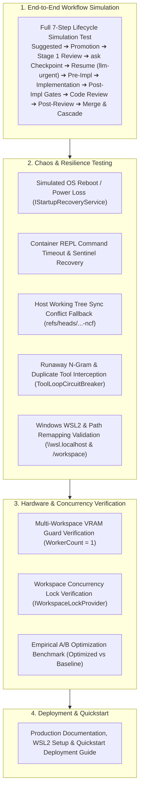

# 🛡️ Phase 6: End-to-End Testing, Resilience & Hardening

> **Implementation Roadmap & Technical Specification**  
> *Parent Plan:* [docs/PLAN.md](../PLAN.md) | *Preceding Phase:* [Phase 5: Modern Blazor Web UI & SignalR Telemetry](05_BLAZOR_WEB_UI_AND_TELEMETRY.md) | *Status:* Ready for Scaffolding

---

## 1. Executive Objective

Execute comprehensive end-to-end integration testing, chaos resilience engineering, cross-platform WSL2/Unix confinement validation, multi-workspace VRAM protection validation (`WorkerCount = 1`), and empirical A/B optimization benchmarks under realistic software engineering workloads. Ensure that **NightCodeForge** operates autonomously overnight with zero prompt fatigue and zero data loss.

---

## 2. Detailed Task Breakdown

### Step 6.1: Full End-to-End Workflow Simulation Test
* **Objective:** Validate the complete 7-step pipeline, 3-channel intake, maintainer promotion, status-preserving interruption, dual merge modes, and non-blocking dev-queue lifecycle:
  1. **Ideation Intake:** Automated test submits a codebase query to `IIdeationService`; discovery agent analyzes code and proposes Issue #101 ("Implement Discount Service") and dependent Issue #102 ("Expose Discount API"). Both issues are created in `AppDbContext` with initial `Status = IssueOverallStatus.Suggested`.
  2. **Maintainer Promotion & DAG Wiring:**
     - Maintainer promotes Issue #101: sets `Priority = 1`, `MergeMode = MergeMode.ManualReviewRequired` $\rightarrow$ status transitions to `Open`.
     - Maintainer promotes Issue #102: sets `Priority = 2`, `MergeMode = MergeMode.Automatic`, dependency on #101 $\rightarrow$ status transitions to `Open`.
     - Dependency engine evaluates readiness: Issue #101 has 0 unclosed dependencies $\rightarrow$ ready for execution and enqueued to `llm-inference`. Issue #102 has prerequisite #101 which is not `Closed` $\rightarrow$ remains waiting in backlog.
  3. **Stage 1 (Issue Review):** Issue #101 is dequeued into `llm-inference`. Agent analyzes code and calls `ask("Should discounts apply before or after VAT?")`.
  4. **Clean Interruption Checkpoint:** Orchestrator intercepts interruption, creates Git WIP commit on `feature/issue-101`, saves serialized memory to `StageCheckpoint`, records `Question` (with `AgentProfileId`), sets `issue.IsWaitingForHuman = true`, `issue.InterruptedStageId = "stage-1"`, `issue.InterruptedAgentProfileId = profile.Id` without mutating `issue.Status` (remains `Open`). Hangfire completes job as `Succeeded`. **GPU is verified freed.**
  5. **Human Answer & Resumption:** Test submits answer *"Apply discounts before VAT"*. Orchestrator sets `question.Status = Answered`, clears `issue.IsWaitingForHuman = false` (preserving `issue.Status = Open`), and enqueues Issue #101 into **`llm-urgent`**.
  6. **Resumption & Stage 1 Handover:** Single worker picks up Issue #101 immediately; memory is rehydrated via `MessageInjectingChatClient` with original agent profile (`InterruptedAgentProfileId`). Agent finalizes Technical Plan and completes Stage 1 $\rightarrow$ orchestrator sets `issue.Status = IssueOverallStatus.Reviewed`.
  7. **Stage 2 (Deterministic Pre-Implementation):** Executes baseline `dotnet build`, baseline test suite, and captures baseline code coverage and compiler warning counts into `PipelineDataBag` (0 GPU tokens). Issue remains `Reviewed`.
  8. **Stage 3 (Implementation):** Coding agent implements Discount Service and writes unit tests. Verifies builds and unit tests in the sandbox. Stage 3 completes $\rightarrow$ orchestrator sets `issue.Status = IssueOverallStatus.Implemented`.
  9. **Stage 4 (Deterministic Post-Implementation):** `DeterministicCoverageGate` executes test runner with coverage collection. Verifies line coverage did not drop ($\Delta \ge 0\%$) and total test count did not decrease. `DeterministicWarningRatchetStage` verifies newly introduced warnings ($\Delta \le 0$). Issue remains `Implemented`.
  10. **Stage 5 (Code Review & Fixes):** Agent reviews noise-filtered `git diff -U2`, checks coding conventions, and applies minor formatting and documentation patches.
  11. **Stage 6 (Deterministic Post-Review Verification):** Re-compiles and re-executes tests to ensure review patches introduced no regressions. Verification passes $\rightarrow$ orchestrator transitions `issue.Status = IssueOverallStatus.Ready`.
  12. **Review Room, Merge & Cascade:**
      - Because Issue #101 was configured with `MergeMode.ManualReviewRequired`, it pauses at `Ready`. Test simulates maintainer inspection in Review Room and clicks "Approve & Merge".
      - Orchestrator invokes `CompleteIssueAndCascadeAsync`: squashes WIP commits into a clean conventional commit on `baseBranch` and sets Issue #101 status to `Closed`.
      - Cascade unblocking triggers: dependency engine evaluates Issue #102 (which is in `Open` status). All dependencies (`#101`) are now `Closed` $\rightarrow$ Issue #102 is immediately enqueued to `llm-inference`!

### Step 6.2: Chaos & Resilience Testing
1. **Simulated Sudden Host Crash / Windows Update Reboot:**
   * Abruptly terminate the orchestrator process midway through a code editing turn.
   * On restart, verify `IStartupRecoveryService`:
     - Detects and safely purges stale `.git/index.lock` and `.git/refs/...` files.
     - Detects uncommitted working tree edits and creates a rescue commit: `WIP-RECOVERY: Preserving uncommitted workspace changes`.
     - Rehydrates conversational memory from the last turn checkpoint.
     - Enqueues the interrupted task directly to the head of `llm-urgent`.
2. **Container Shell Hang & Timeout Cancellation:**
   * Dispatch a simulated hanging bash command (`sleep 300` or infinite loop inside container).
   * Verify `NightCodeForgeContainerExecutor`:
     - Reaches timeout threshold.
     - Emits `\x03` (SIGINT) to stdin.
     - Awaits 2-second grace period for sentinel return.
     - If unresponsive, forcefully restarts container shell process and reports clean timeout failure without leaving runaway processes.
3. **Host Working Tree Dirty Conflict:**
   * Intentionally dirty tracked files on the host repository before an ext4 checkpoint sync.
   * Verify `GitMirrorSyncService`:
     - Catches `updateInstead` push rejection.
     - Safely pushes to `refs/heads/feature/issue-{id}-ncf`.
     - Broadcasts SignalR alert to developer without crashing the pipeline.
4. **Runaway LLM Loop Interception:**
   * Feed a mock local model that emits repetitive 16-character n-gram cycles or executes `read` on the same file 3 times.
   * Verify `ToolLoopCircuitBreaker`:
     - Aborts generation stream immediately.
     - Intercepts duplicate tool call and injects synthetic steering correction prompt.
5. **Cross-Platform & Environment Confinement Resilience:**
   * Verify orchestrator validates that agent execution is confined strictly to Unix:
     - On Windows hosts: verifies WSL2 is installed and responsive. If WSL2 is missing, halts gracefully with actionable installation instructions (`wsl --install`).
     - Verifies working clones reside at `~/.nightcodeforge/wks/{id}`.
     - Verifies Crucible file tools access WSL2 files via Windows UNC paths (`\\wsl.localhost\{distrib}\...`).
     - Verifies container `/workspace` paths are transparently remapped by Crucible to real host filesystem paths.
     - Verifies `IHostSdkDiscoveryService` discovered SDK mount paths bind correctly without permission errors.

### Step 6.3: Multi-Workspace VRAM Isolation & Concurrency Verification
* **Setup:** Create 3 independent workspaces (`Workspace A`, `Workspace B`, `Workspace C`), each with 2 pending issues.
* **Execution:** Enqueue all 6 issues simultaneously.
* **Verification:** Monitor Hangfire active worker and GPU VRAM telemetry:
  - Guarantees exactly **1 LLM inference task** runs at any given millisecond across all 3 workspaces (`WorkerCount = 1`).
  - Background utility jobs (`WorkerCount = 4`) and workspace concurrency locks (`IWorkspaceLockProvider`) operate safely without index lock race conditions across separate workspaces.
  - VRAM consumption remains flat and bounded. Zero VRAM thrashing, context truncation, or OOM crashes.

### Step 6.4: Empirical A/B Optimization Benchmark
* Run identical benchmark tasks on:
  - **Profile A (`optimized`):** All 7 optimizations enabled (`ThinkingTraceCompaction`, `LoopCircuitBreaker`, `GuidedGrammarDecoding`, `DeterministicSymbolMap`, `StructuredDiagnosticExtraction`, `PrefixStabilization`, `JitModelPreload`).
  - **Profile B (`baseline`):** All optimizations disabled.
* Validate measured performance:
  - Token consumption reduced by $\ge 60\%$ on reasoning models via thinking trace compaction.
  - KV cache hit rate $\ge 90\%$ via prefix stabilization.
  - Exploratory turns reduced by $\ge 2$ turns via `RoslynSymbolIndexProvider`.
  - Model swap latency reduced to 0s via JIT model preloading during deterministic stage execution.

### Step 6.5: Production Documentation & Deployment Guide
* Deliver clear documentation:
  - Windows WSL2 prerequisites and distro setup guide.
  - Ollama / OllamaRouter multi-target GPU configuration guide.
  - Quickstart guide: registering workspaces, configuring agent profiles, and launching autonomous development queues.

---

## 3. Definition of Done (DoD) Checklist

- [ ] Complete 7-step end-to-end workflow simulation test passes 100% (Ideation $\rightarrow$ Maintainer Promotion $\rightarrow$ Review $\rightarrow$ Checkpoint $\rightarrow$ Resumption $\rightarrow$ Pre-Impl $\rightarrow$ Implementation $\rightarrow$ Post-Impl Gates $\rightarrow$ Code Review $\rightarrow$ Post-Review Verification $\rightarrow$ Merge & Cascade).
- [ ] Stale lock cleanup and uncommitted working tree rescue commit (`WIP-RECOVERY`) verified under crash simulation.
- [ ] Sentinel REPL timeout and runaway process termination verified.
- [ ] Dirty host working tree fallback (`refs/heads/feature/issue-{id}-ncf`) verified.
- [ ] Windows WSL2 mandatory check and Crucible UNC / container `/workspace` path remapping verified.
- [ ] Multi-workspace single-worker VRAM protection (`WorkerCount = 1`) and workspace concurrency lock (`IWorkspaceLockProvider`) verified under high load.
- [ ] A/B benchmark confirms $\ge 60\%$ token savings and $\ge 90\%$ KV cache hit rate.
- [ ] Quickstart deployment guide and production documentation completed.
