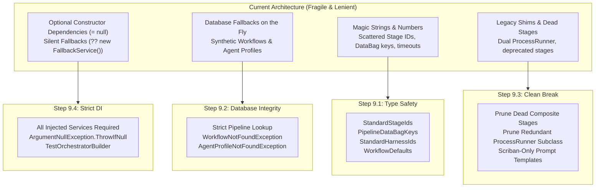

# 🛡️ Phase 9: Codebase Remediation & Robustness

> **Architectural Specification & Implementation Roadmap**  
> *Parent Plan:* [docs/PLAN.md](../PLAN.md) | *Source Policy:* [AGENTS.md](../../AGENTS.md)  
> *Dependencies:* Phase 8 (Database-Driven Workflows) | *Target Framework:* .NET 10 (C# 13)  
> *Status:* Active / In Progress

---

## 1. Executive Summary & Policy Alignment

During initial rapid development, various lenient patterns, fallback strategies, and magic literals were introduced across the codebase. Following the completion of Phase 8 (Database-Driven Extensible Workflows), this dedicated **Phase 9: Codebase Remediation & Robustness** systematically enforces the strict architectural policies established in [AGENTS.md](../../AGENTS.md):

1. **Required Service Dependencies (Fail Fast):**
   * Eliminate optional parameters (`= null`, `= default`) in service constructors.
   * Require all services needed for proper operation and fail fast if any dependency is missing.
   * Remove silent fallback strategies (`?? new FallbackService()`, `?? NullLogger...`).
   * In unit tests, use mocks (via Moq), fakes, or stubs wrapped in reusable test builders.

2. **Hard Errors on Missing Database Entities (Zero Synthetic Fallbacks):**
   * Prohibit creating synthetic fallback entities on the fly when a database record is missing.
   * When an entity (such as a `WorkflowDefinition` or `AgentProfile`) cannot be found in the database, raise explicit domain exceptions (e.g., `WorkflowNotFoundException`, `AgentProfileNotFoundException`) so the system and UI fail loudly and predictably.

3. **Constants and Enums Over Magic Literals:**
   * Prohibit magic strings and numbers across all layers.
   * Centralize stage identifiers, DataBag keys, harness identifiers, C# implementation types, and execution defaults in type-safe constants and enums.

4. **Clean Break Policy (Zero Backward Compatibility Debt):**
   * Early development phase allows breaking changes without maintaining backward compatibility.
   * Prune superseded deterministic stages, duplicate runner subclasses, and legacy string concatenation formatting methods in favor of Scriban templates and composite execution.

---

## 2. Implementation Steps Roadmap

| Step | Specification | Focus & Key Deliverables | Status |
| :--- | :--- | :--- | :--- |
| **9.1** | [🏷️ Step 9.1: Constants, Enums & Literal Remediation](phase-9/STEP_9_1_CONSTANTS_ENUMS_AND_LITERAL_REMEDIATION.md) | Centralize `StandardStageIds`, `PipelineDataBagKeys`, `StandardHarnessIds`, `StageImplementationTypes`, and `WorkflowDefaults`. Refactor raw string/numeric literals throughout Core, Infrastructure, Agents, and Web. | Completed |
| **9.2** | [🏛️ Step 9.2: Database Integrity & Hard Errors (Zero Synthetic Fallbacks)](phase-9/STEP_9_2_DATABASE_INTEGRITY_AND_HARD_ERRORS.md) | Enforce hard errors when database records are missing: remove default pipeline fallback in `DatabaseWorkflowPipelineProvider` when a specific ID is requested, eliminate on-the-fly synthetic `AgentProfile` creation in `TaskOrchestrator`, `IdeationService`, and `TriageService`. | Planned |
| **9.3** | [✂️ Step 9.3: Clean Break & Dead Code Pruning](phase-9/STEP_9_3_CLEAN_BREAK_AND_DEAD_CODE_PRUNING.md) | Prune superseded legacy stages (`DeterministicPreImplementationStage`, `DeterministicPostImplementationStage`, `DeterministicPostReviewStage`), remove redundant `SystemProcessRunner` subclass, prune legacy string prompt formatters in `DefaultBootstrapPromptBuilder`, and drop dead sync-over-async interface methods. | Planned |
| **9.4** | [💉 Step 9.4: Required Constructor DI & Fail-Fast Architecture](phase-9/STEP_9_4_REQUIRED_CONSTRUCTOR_DI_AND_FAIL_FAST.md) | Eliminate `= null` and fallback instances from 25+ service constructors across Core, Infrastructure, Agents, and Web. Add `ArgumentNullException.ThrowIfNull(...)`. Introduce centralized test builders (`TestOrchestratorBuilder`) to keep test suites clean and maintainable. | Planned |

---

## 3. High-Level Architecture & Transformation

---

## 4. Phase 9 Definition of Done (DoD) Checklist

- [ ] **Step 9.1: Constants, Enums & Literals**
  - [ ] `StandardStageIds`, `PipelineDataBagKeys`, `StandardHarnessIds`, `StageImplementationTypes`, and `WorkflowDefaults` implemented in `NightCodeForge.Core`.
  * [ ] All magic strings/numbers across all projects replaced with canonical constants.
  * [ ] Zero compiler warnings or broken references.
- [ ] **Step 9.2: Database Integrity & Hard Errors**
  - [ ] `DatabaseWorkflowPipelineProvider` throws `KeyNotFoundException` / `WorkflowNotFoundException` if a specified `WorkflowId` does not exist.
  - [ ] `TaskOrchestrator`, `IdeationService`, and `TriageService` throw hard exceptions if required `AgentProfile` records are missing.
  - [ ] Targeted tests verify hard errors when database records are absent.
- [ ] **Step 9.3: Clean Break & Dead Code Pruning**
  - [ ] `DeterministicPreImplementationStage`, `DeterministicPostImplementationStage`, and `DeterministicPostReviewStage` removed.
  - [ ] Redundant `NightCodeForge.Infrastructure.Execution.SystemProcessRunner` subclass removed.
  - [ ] `BuildLegacyFormat` removed from `DefaultBootstrapPromptBuilder`.
  - [ ] Sync `GetPipeline` removed from `IWorkflowPipelineProvider`.
- [ ] **Step 9.4: Required Constructor DI & Fail Fast**
  - [ ] All service constructors require dependencies explicitly with zero `= null` parameter defaults.
  - [ ] Reusable test fixtures / `TestOrchestratorBuilder` implemented across test suites.
  - [ ] Complete test suite passes: `dotnet test` (all unit, integration, and E2E tests passing).
