# 🛡️   

> **Architectural Specification & Implementation Roadmap**  
> *Parent Plan:* [docs/PLAN.md](../PLAN.md) | *Source Policy:* [AGENTS.md](../../AGENTS.md)  
> *Dependencies:* Phase 8 (Database-Driven Workflows) | *Target Framework:* .NET 10 (C# 13)  
> *Status:* Active / In Progress

---

## 1. Executive Summary & Policy Alignment

During initial rapid development, various lenient patterns, fallback strategies, and magic literals were introduced across the codebase. Following the completion of Phase 8 (Database-Driven Extensible Workflows), this dedicated **Phase 9: Codebase Remediation & Robustness** systematically enforces the strict architectural policies established in [AGENTS.md](../../AGENTS.md):

1. **Required Service Dependencies (Fail Fast):**
   * Eliminate optional parameters (`= null`, `= default`) in service constructors.
   * Require all services needed for proper operation and fail fast if any dependency is missing.
   * Remove silent fallback strategies (`?? new FallbackService()`, `?? NullLogger...`).
   * In unit tests, use mocks (via Moq), fakes, or stubs wrapped in reusable test builders.

2. **Hard Errors on Missing Database Entities (Zero Synthetic Fallbacks):**
   * Prohibit creating synthetic fallback entities on the fly when a database record is missing.
   * When an entity (such as a `WorkflowDefinition` or `AgentProfile`) cannot be found in the database, raise explicit domain exceptions (e.g., `WorkflowNotFoundException`, `AgentProfileNotFoundException`) so the system and UI fail loudly and predictably.

3. **Constants and Enums Over Magic Literals:**
   * Prohibit magic strings and numbers across all layers.
   * Centralize stage identifiers, DataBag keys, harness identifiers, C# implementation types, and execution defaults in type-safe constants and enums.

4. **Clean Break Policy (Zero Backward Compatibility Debt):**
   * Early development phase allows breaking changes without maintaining backward compatibility.
---

## 2. Implementation Steps Roadmap

| Step | Specification | Focus & Key Deliverables | Status |
| :--- | :--- | :--- | :--- |
| **9.1** | [🏷️ Step 9.1: Constants, Enums & Literal Remediation](phase-9/STEP_9_1_CONSTANTS_ENUMS_AND_LITERAL_REMEDIATION.md) | Centralize `StandardStageIds`, `PipelineDataBagKeys`, `StandardHarnessIds`, `StageImplementationTypes`, and `WorkflowDefaults`. Refactor raw string/numeric literals throughout Core, Infrastructure, Agents, and Web. | Completed |
| **9.2** | [🏛️ Step 9.2: Database Integrity & Hard Errors (Zero Synthetic Fallbacks)](phase-9/STEP_9_2_DATABASE_INTEGRITY_AND_HARD_ERRORS.md) | Enforce hard errors when database records are missing: remove default pipeline fallback in `DatabaseWorkflowPipelineProvider` when a specific ID is requested, eliminate on-the-fly synthetic `AgentProfile` creation in `TaskOrchestrator`, `IdeationService`, and `TriageService`. | Completed |
| **9.3** | [✂️ Step 9.3: Clean Break & Dead Code Pruning](phase-9/STEP_9_3_CLEAN_BREAK_AND_DEAD_CODE_PRUNING.md) | Prune superseded legacy stages (`DeterministicPreImplementationStage`, `DeterministicPostImplementationStage`, `DeterministicPostReviewStage`), remove redundant `SystemProcessRunner` subclass, prune legacy string prompt formatters in `DefaultBootstrapPromptBuilder`, drop dead sync-over-async methods, and drive dynamic database labels in `StageRunSelector` and `StageConversationViewer`. | Completed |
| **9.4** | [🗑️ Step 9.4: Remove Non-Functional A/B Testing & Dead Navigation Relics](phase-9/STEP_9_4_REMOVE_AB_TESTING_FROM_SETTINGS.md) | Delete `ABTestingComparatorTab.razor`, remove A/B tab from `Settings.razor`, rebrand vestigial "Settings & A/B" navigation links across `NavMenu`, `TopNavBar`, and `Home`, and prune unused `_dbContext` parameter in `WorkspaceProvisioningService`. | Completed |
| **9.5** | [🏛️ Step 9.5: Standard Workflow Domain Extraction & Canonical Stage Identifiers](phase-9/STEP_9_5_STANDARD_WORKFLOW_DOMAIN_EXTRACTION.md) | Move standard 3-agent pipeline definition from `EnsureDefaultWorkflowsAsync` in `AppDbContext.cs` to a dedicated `StandardWorkflowDefinitions` domain class. Add `StandardStageIds.Merge` and `StandardStageIds.Ideation` to eliminate remaining magic strings. | Planned |
| **9.6** | [💉 Step 9.6: Required Constructor DI & Fail-Fast Architecture](phase-9/STEP_9_6_REQUIRED_CONSTRUCTOR_DI_AND_FAIL_FAST.md) | Eliminate `= null` and fallback instances from service constructors across Core, Infrastructure, Agents, and Web. Fix silent-success bug in deterministic quality gates on missing environment. Introduce `TestOrchestratorBuilder` for clean unit tests. | Planned |
| **9.7** | [📦 Step 9.7: DataBag Orphan Remediation & Quality Gate Handoff Integrity](phase-9/STEP_9_7_DATABAG_ORPHANS_AND_QUALITY_GATE_INTEGRITY.md) | Remediate orphan DataBag keys. Fix lost test diagnostics (`FailedTests`), empty warning ratchets (`WarningsNew`), deterministic execution tool logging (`StageCommand`, `StageOutput`), test metrics in Web UI (`TestsCurrentPassed`), and prune dead phantom keys. | Planned |
| **9.8** | [🧩 Step 9.8: AgentSessionContext Property Promotion & Harness Decoupling](phase-9/STEP_9_8_AGENT_SESSION_CONTEXT_PROMOTION_AND_HARNESS_DECOUPLING.md) | Promote cross-cutting DataBag keys (`TaskMarkdownPath`, `ReviewDiff`, `ApprovedPlan`, `ReviewerFeedback`, `PriorDiagnostics`) to strongly-typed properties on `AgentSessionContext`. Wire git diff into Code Review prompts. Decouple `IAgentHarness` implementations from `PipelineDataBag`. | Planned |
| **9.9** | [🔄 Step 9.9: Resilient Crash Recovery, Database Conversation Rehydration & State Persistence](phase-9/STEP_9_9_RESILIENT_CRASH_RECOVERY_AND_STATE_PERSISTENCE.md) | Upgrade `StartupRecoveryService` to resume interrupted agentic sessions from SQLite `Conversation` & `ConversationTurn` records with recovery notice; cleanly re-run deterministic steps with purged metrics; persist `PipelineDataBag` and mutable `AgentSessionContext` properties across turns in SQLite. | Planned |

---

## 3. High-Level Architecture & Transformation

```mermaid
flowchart TD
    subgraph Current ["Current Architecture (Fragile & Lenient)"]
        C1["Optional Constructor Dependencies (= null)<br/>Silent Fallbacks (?? new FallbackService())<br/>Silent Success on Missing ExecutionEnv"]
        C2["Database Fallbacks on the Fly<br/>Synthetic Workflows & Agent Profiles"]
        C3["Magic Strings & Numbers<br/>Scattered Stage IDs ('merge', 'ideation')"]
        C4["Legacy Shims & Dead Stages<br/>Dual ProcessRunner, deprecated stages"]
        C5["Broken/Unused Features<br/>A/B Testing Tab, vestigial nav links"]
        C6["Infrastructure Leaking Domain Logic<br/>AppDbContext embedding workflow schema"]
        C7["Orphan DataBag Keys & Lost Diagnostics<br/>FailedTests/WarningsNew never delivered<br/>StageCommand defaults to 'dotnet build'"]
        C8["Leaky Harness Abstractions<br/>Harnesses reaching into PipelineContext.DataBag<br/>ReviewDiff never passed to Review Agent"]
        C9["Fragile Crash Recovery<br/>Relies on empty StageCheckpoints<br/>Mid-session DataBag & turn context lost"]
    end

    subgraph Step1 ["Step 9.1: Type Safety"]
        S1["StandardStageIds<br/>PipelineDataBagKeys<br/>StandardHarnessIds<br/>WorkflowDefaults"]
    end

    subgraph Step2 ["Step 9.2: Database Integrity"]
        S2["Strict Pipeline Lookup<br/>WorkflowNotFoundException<br/>AgentProfileNotFoundException"]
    end

    subgraph Step3 ["Step 9.3: Clean Break & Dynamic UI Labels"]
        S3["Prune Dead Composite Stages<br/>Prune Redundant ProcessRunner Subclass<br/>Scriban-Only Prompt Templates<br/>Dynamic Stage Labels from Database"]
    end

    subgraph Step4 ["Step 9.4: Remove Dead Features"]
        S4["Delete ABTestingComparatorTab<br/>Prune A/B Settings Tab & Nav Links<br/>Prune Dead WorkspaceProvisioningService DI"]
    end

    subgraph Step5 ["Step 9.5: Domain Workflow Extraction"]
        S5["StandardWorkflowDefinitions in Domain<br/>Canonical Merge & Ideation Stage IDs<br/>Pure Infrastructure AppDbContext"]
    end

    subgraph Step6 ["Step 9.6: Strict DI & Fail Fast"]
        S6["All Injected Services Required<br/>Quality Gate Fail Fast (Zero Silent Success)<br/>ArgumentNullException.ThrowIfNull<br/>TestOrchestratorBuilder"]
    end

    subgraph Step7 ["Step 9.7: DataBag Integrity & Observability"]
        S7["StageCommand & StageOutput Turn Records<br/>FailedTests Diagnostic Handoff to Agent<br/>WarningsNew Ratchet Fidelity<br/>Prune Dead Phantom Keys"]
    end

    subgraph Step8 ["Step 9.8: Harness Decoupling & ReviewDiff"]
        S8["Typed AgentSessionContext Properties<br/>Wire ReviewDiff to Code Review Agent<br/>AgentRunResult Feedback & Proposals<br/>Pure Harness Decoupling from DataBag"]
    end

    subgraph Step9 ["Step 9.9: Resilient Crash Recovery"]
        S9["Rehydrate Agentic Sessions from DB Turns<br/>Clean Deterministic Re-Run with Purged Metrics<br/>Turn-Level PipelineDataBag & State Persistence"]
    end

    C3 --> Step1
    C2 --> Step2
    C4 --> Step3
    C5 --> Step4
    C6 --> Step5
    C1 --> Step6
    C7 --> Step7
    C8 --> Step8
    C9 --> Step9
```

---

## 4. Phase 9 Definition of Done (DoD) Checklist

- [x] **Step 9.1: Constants, Enums & Literals**
  - [x] `StandardStageIds`, `PipelineDataBagKeys`, `StandardHarnessIds`, `StageImplementationTypes`, and `WorkflowDefaults` implemented in `NightCodeForge.Core`.
  - [x] All magic strings/numbers across all projects replaced with canonical constants.
  - [x] Zero compiler warnings or broken references.
- [x] **Step 9.2: Database Integrity & Hard Errors**
  - [x] `DatabaseWorkflowPipelineProvider` throws `KeyNotFoundException` / `WorkflowNotFoundException` if a specified `WorkflowId` does not exist.
  - [x] `TaskOrchestrator`, `IdeationService`, and `TriageService` throw hard exceptions if required `AgentProfile` records are missing.
  - [x] Targeted tests verify hard errors when database records are absent.
- [x] **Step 9.3: Clean Break & Dead Code Pruning**
  - [x] `DeterministicPreImplementationStage`, `DeterministicPostImplementationStage`, and `DeterministicPostReviewStage` removed.
  - [x] Redundant `NightCodeForge.Infrastructure.Execution.SystemProcessRunner` subclass removed.
  - [x] `BuildLegacyFormat` removed from `DefaultBootstrapPromptBuilder`.
  - [x] Sync `GetPipeline` removed from `IWorkflowPipelineProvider`.
  - [x] `StageRunSelector.razor` and `StageConversationViewer.razor` format stage names dynamically from database `WorkflowStages`.
  - [x] `WorkerStatusCard.razor` uses `WorkflowStageKind` instead of substring heuristics.
- [x] **Step 9.4: Remove Non-Functional A/B Testing & Dead Navigation Relics**
  - [x] `ABTestingComparatorTab.razor` deleted.
  - [x] A/B Testing tab button and switch case removed from `Settings.razor`.
  - [x] Navigation titles in `NavMenu.razor`, `TopNavBar.razor`, and `Home.razor` updated to "Settings".
  - [x] Dead `AppDbContext? dbContext` constructor parameter and field removed from `WorkspaceProvisioningService`.
- [x] **Step 9.5: Standard Workflow Domain Extraction & Canonical Stage Identifiers**
  - [x] Standard 3-agent pipeline extracted from `AppDbContext` to `StandardWorkflowDefinitions.CreateStandard3AgentWorkflow()` in `NightCodeForge.Core.Domain`.
  - [x] `StandardStageIds.Merge` and `StandardStageIds.Ideation` defined and referenced across Core, Infrastructure, Agents, and Web.
  - [x] `InMemoryWorkflowRepository` and test scenarios updated to use `StandardWorkflowDefinitions`.
- [x] **Step 9.6: Required Constructor DI & Fail Fast**
  - [x] All service constructors require dependencies explicitly with zero `= null` parameter defaults.
  - [x] Deterministic quality gates (`DeterministicBuildStage`, `DeterministicTestStage`, `DeterministicCoverageGate`, `DeterministicSastStage`) require `IExecutionEnvironmentProvider` and fail fast if environment is unavailable (zero silent success).
  - [x] Reusable test fixtures / `TestOrchestratorBuilder` implemented across test suites.
- [x] **Step 9.7: DataBag Orphan Remediation & Quality Gate Handoff Integrity**
  - [x] `DeterministicBuildStage`, `DeterministicTestStage`, `DeterministicSastStage`, and `DeterministicCoverageGate` record `StageCommand` and `StageOutput`.
  - [x] `DeterministicBuildStage` parses and stores `WarningsNew` lines; `DeterministicWarningRatchetStage` emits detailed new warnings.
  - [x] `DeterministicTestStage` failure lines (`FailedTests`) are passed to the repairing agent via `CompilerErrors` on loopback.
  - [x] `TestsCurrentPassed` and `TestsCurrentDurationMs` recorded by `DeterministicTestStage`; `TaskReviewService` bug displaying incorrect passed tests resolved.
  - [x] Phantom keys `AllowLoopBack`, `MaxLoopBackAttempts`, `StrictCompilationGate`, `DeterministicMetrics` pruned.
- [ ] **Step 9.8: AgentSessionContext Property Promotion & Harness Decoupling**
  - [ ] `TaskMarkdownPath`, `ReviewDiff`, `ApprovedPlan`, `ReviewerFeedback`, and `PriorDiagnostics` promoted as strongly typed properties on `AgentSessionContext`.
  - [ ] Critical Bug Fix: `ReviewDiff` wired into `AgentSessionContext` and `DefaultBootstrapPromptBuilder` for Code Review agents.
  - [ ] `AgentRunResult` carries `ReviewerFeedback` and `Proposals`; `TaskOrchestrator` updates DataBag centrally.
  - [ ] `CrucibleAgentHarness`, `PiRpcAgentHarness`, and `AcpAgentHarness` decoupled from `PipelineContext.DataBag`.
- [ ] **Step 9.9: Resilient Crash Recovery, Database Conversation Rehydration & State Persistence**
  - [ ] `StartupRecoveryService` queries `ITaskRepository` for active `Conversation` and turns on agentic stages.
  - [ ] Agentic recovery reconstructs message history, appends a system notice turn, and rehydrates `SerializedStateJson` in `AgentSessionContext`.
  - [ ] Agent harnesses (`Crucible`, `PiRpc`, `Acp`) resume from rehydrated conversation history without restarting from turn 0.
  - [ ] Deterministic recovery purges all stale metric keys from `PipelineDataBag` and supersedes interrupted conversation records.
  - [ ] `PipelineDataBag` and mutable `AgentSessionContext` properties are committed to `task.PipelineDataJson` across execution turns.
  - [ ] Complete test suite passes: `dotnet test` (all unit, integration, and E2E tests passing).
