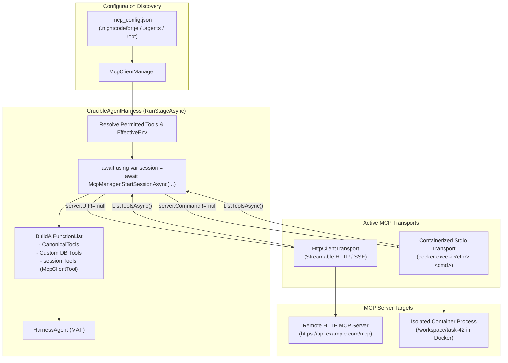

# 🧩 Phase 9: Extend Features & Integrations

> **Architectural Specification & Implementation Roadmap**  
> *Parent Plan:* [docs/PLAN.md](../PLAN.md) | *Dependencies:* Phase 4 (Harnesses & Sandboxing), Phase 5 (Web UI), Phase 8 (Database-Driven Workflows)  
> *Status:* Active / In Progress | *Target Framework:* .NET 10 (C# 13)

---

## 1. Executive Summary & Scope

The core architecture of **NightCodeForge** delivers an autonomous software engineering pipeline: multi-workspace isolation, local Git mirror synchronization, single-worker GPU Hangfire queuing, multi-stage agentic workflows, deterministic verification quality gates, a modern Blazor web dashboard, and database-driven dynamic workflow orchestration.

**Phase 9 (Extend Features)** serves as the dedicated roadmap for capabilities and ecosystem extensions that augment the core orchestrator:
- **Advanced Protocol Integrations:** First-class Model Context Protocol (MCP) client connectivity for remote and containerized tool servers.
- **Ecosystem Extensibility:** Modular tools, external bridge services, and specialized agent utilities.
- **Incremental Expansion:** New extended capabilities and integrations will be systematically planned, specified, and implemented within this phase.

---

## 2. Implementation Steps

| Step | Specification | Focus & Key Deliverables | Status |
| :--- | :--- | :--- | :--- |
| **9.1** | [🔌 Step 9.1: Model Context Protocol (MCP) Integration: HTTP Servers & ContainerSandbox Stdio](phase-9/STEP_9_1_MCP_HTTP_AND_CONTAINER_SANDBOX_INTEGRATION.md) | First-class MCP tool discovery and execution via official Microsoft Agent Framework standards (`ModelContextProtocol`), streamable HTTP/SSE remote servers (Phase 1), and isolated stdio MCP servers running inside `ContainerSandbox` via `docker exec -i` (Phase 2). | Planned |
| **9.x** | *Future Extended Features* | Additional integrations, advanced toolchains, and plugin capabilities will be appended here as requirements evolve. | Planned |

---

## 3. High-Level Architecture: Step 9.1 MCP Integration

### Key Architectural Tenets of MCP Integration
1. **Zero Synthetic Wrappers:** Direct integration with official Microsoft Agent Framework `ModelContextProtocol.Client`, yielding native `AITool` / `AIFunction` instances.
2. **Container Sandbox Confinement:** Stdio MCP servers never spawn processes on the host when container isolation is enforced; they run inside `ContainerSandbox` via interactive `docker exec -i`.
3. **Resilient HTTP Transports:** Remote HTTP/SSE MCP endpoints run on scoped `IMcpSession` lifecycles tied to stage execution with non-blocking graceful degradation.
4. **Namespace Isolation & Directives:** Tools are namespaced as `mcp_{server}_{tool}` to avoid collisions with canonical tools (`read`, `edit`, `bash`).

---

## 4. Phase 9 Definition of Done (DoD) Checklist

- [ ] **Step 9.1:**
  - [ ] Add `ModelContextProtocol` NuGet package to `NightCodeForge.Agents.csproj`.
  - [ ] Implement `IMcpSession` lifecycle and `IMcpClientManager.StartSessionAsync`.
  - [ ] Support remote HTTP/SSE servers via `HttpClientTransport` with fail-soft connection handling.
  - [ ] Support containerized stdio servers via `docker exec -i` inside `ContainerSandboxEnvironment`.
  - [ ] Wire MCP tools dynamically into `CrucibleAgentHarness` and telemetry pipelines.
  - [ ] Unit and integration tests covering discovery, invocation, error recovery, and security boundary enforcement.
