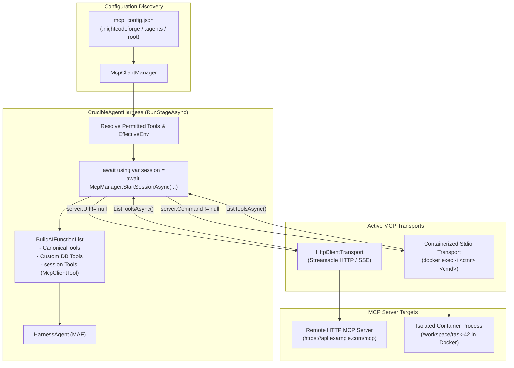
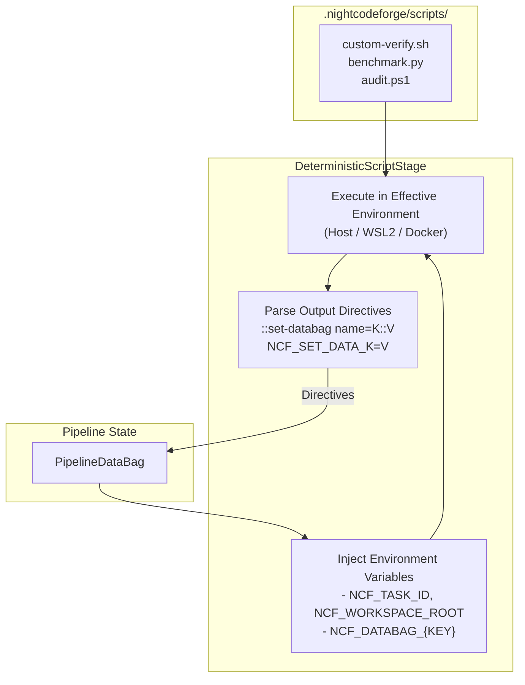
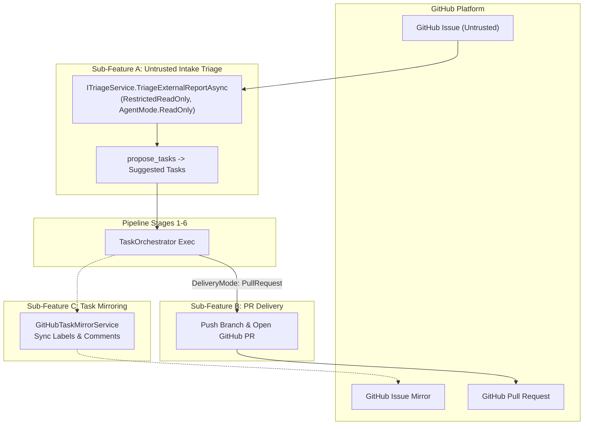

# 🧩 Phase 10: Extend Features & Integrations

> **Architectural Specification & Implementation Roadmap**  
> *Parent Plan:* [docs/PLAN.md](../PLAN.md) | *Dependencies:* Phase 4 (Harnesses & Sandboxing), Phase 5 (Web UI), Phase 8 (Database-Driven Workflows), Phase 9 (Codebase Remediation & Robustness)  
> *Status:* Active / In Progress | *Target Framework:* .NET 10 (C# 13)

---

## 1. Executive Summary & Scope

The core architecture of **NightCodeForge** delivers an autonomous software engineering pipeline: multi-workspace isolation, local Git mirror synchronization, single-worker GPU Hangfire queuing, multi-stage agentic workflows, deterministic verification quality gates, a modern Blazor web dashboard, database-driven dynamic workflow orchestration, and strict adherence to architectural robustness policies.

**Phase 10 (Extend Features)** serves as the dedicated roadmap for capabilities and ecosystem extensions that augment the core orchestrator:
- **Advanced Protocol Integrations:** First-class Model Context Protocol (MCP) client connectivity for remote and containerized tool servers.
- **Ecosystem Extensibility:** Modular tools, external bridge services, and specialized agent utilities.
- **Incremental Expansion:** New extended capabilities and integrations will be systematically planned, specified, and implemented within this phase.

---

## 2. Implementation Steps

| Step | Specification | Focus & Key Deliverables | Status |
| :--- | :--- | :--- | :--- |
| **10.1** | [🔌 Step 10.1: Model Context Protocol (MCP) Integration: HTTP Servers & ContainerSandbox Stdio](phase-10/STEP_10_1_MCP_HTTP_AND_CONTAINER_SANDBOX_INTEGRATION.md) | First-class MCP tool discovery and execution via official Microsoft Agent Framework standards (`ModelContextProtocol`), streamable HTTP/SSE remote servers (Phase 1), and isolated stdio MCP servers running inside `ContainerSandbox` via `docker exec -i` (Phase 2). | Planned |
| **10.2** | [📜 Step 10.2: Custom Repository Scripts for Deterministic Steps (Bash, Python, PowerShell)](phase-10/STEP_10_2_CUSTOM_SCRIPTS_FOR_DETERMINISTIC_STEPS.md) | Execution of custom repository scripts in `.nightcodeforge/scripts/` during deterministic stages across Bash, Python, and PowerShell. Automatic injection of `PipelineDataBag` as environment variables (`NCF_DATABAG_*`) and special stdout syntax (`::set-databag name=...` / `NCF_SET_DATA_*`) to set string properties in the data bag. | Planned |
| **10.3** | [🐙 Step 10.3: GitHub Integration (Untrusted Intake Triage, PR Delivery & Task Mirroring)](phase-10/STEP_10_3_GITHUB_INTEGRATION_ISSUES_AND_PRS.md) | Modular, fully optional GitHub integration: untrusted issue intake routed to sandboxed triage (`RestrictedReadOnly` / `ITriageService`) to generate vetted proposals, Pull Request delivery mode with rich PR metadata, and bi-directional task mirroring (status labels and milestone comments). | Planned |
| **10.x** | *Future Extended Features* | Additional integrations, advanced toolchains, and plugin capabilities will be appended here as requirements evolve. | Planned |

---

## 3. High-Level Architecture Overview

### 3.1 Step 10.1: MCP Integration

### 3.2 Step 10.2: Custom Repository Scripts & Data Bag Interop

### 3.3 Step 10.3: Optional GitHub Integration (Untrusted Intake, PR Delivery & Mirroring)

---

## 4. Phase 10 Definition of Done (DoD) Checklist

- [ ] **Step 10.1 (MCP Integration):**
  - [ ] Add `ModelContextProtocol` NuGet package to `NightCodeForge.Agents.csproj`.
  - [ ] Implement `IMcpSession` lifecycle and `IMcpClientManager.StartSessionAsync`.
  - [ ] Support remote HTTP/SSE servers via `HttpClientTransport` with fail-soft connection handling.
  - [ ] Support containerized stdio servers via `docker exec -i` inside `ContainerSandboxEnvironment`.
  - [ ] Wire MCP tools dynamically into `CrucibleAgentHarness` and telemetry pipelines.
  - [ ] Unit and integration tests covering discovery, invocation, error recovery, and security boundary enforcement.

- [ ] **Step 10.2 (Custom Repository Scripts):**
  - [ ] Support script discovery convention in `.nightcodeforge/scripts/` for `.sh`, `.py`, and `.ps1`.
  - [ ] Implement `DataBagEnvironmentSerializer` to inject `PipelineDataBag` properties as `NCF_DATABAG_*` environment variables.
  - [ ] Implement real-time stdout parsing for `::set-databag name=<key>::<value>` and `NCF_SET_DATA_<key>=<value>` directives into `context.DataBag`.
  - [ ] Test cross-platform script execution (WSL2, Host, Container) and loopback failure routing.

- [ ] **Step 10.3 (Optional GitHub Integration):**
  - [ ] Implement `IGitHubClientService` with fail-fast constructor DI.
  - [ ] Implement Sub-Feature A: `GitHubIssueSyncService` feeding discovered untrusted issues to `ITriageService.TriageExternalReportAsync` in `RestrictedReadOnly` sandbox.
  - [ ] Implement Sub-Feature B: `DeliveryMode.PullRequest` pushing feature branches and creating rich markdown PRs with quality gate metrics.
  - [ ] Implement Sub-Feature C: `GitHubTaskMirrorService` synchronizing task status labels and milestone comments.
  - [ ] Add UI controls in Workspace Settings (enable toggles, token, repo configuration) and Review Room (PR creation button and link badge).

