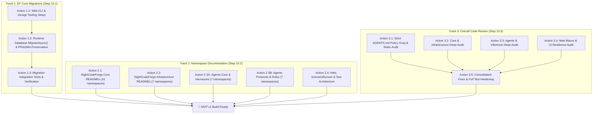

# 🚀 Phase 10: MVP Final Polish, EF Migrations & Codebase Hardening

> **Architectural Specification & Subagent Execution Roadmap**  
> *Parent Plan:* [docs/PLAN.md](../PLAN.md) | *Source Policy:* [AGENTS.md](../../AGENTS.md)  
> *Target Framework:* .NET 10 (C# 13) | *Status:* Ready for Execution  

---

## 1. Executive Summary & Objective

As **NightCodeForge** approaches its first MVP release, this plan defines the final three essential preparation tracks before packaging and building v1:
1. **Turn on `dotnet ef migrations`:** Move from ad-hoc schema creation (`Database.EnsureCreatedAsync()`) to production-grade EF Core migrations applied automatically at startup and accessible via the `dotnet ef` CLI.
2. **Namespace & Module `README.md` Documentation:** Establish a modular documentation architecture across every project and functional namespace in `src/` to guide both autonomous AI agents and human contributors without polluting LLM context windows.
3. **Comprehensive Code Review & AGENTS.md Policy Remediation:** Execute a multi-stream audit across Core, Infrastructure, Agents, and Web to eliminate bare catch blocks, verify required constructor DI, prevent resource leaks, validate concurrency primitives, and resolve technical debt.

To ensure execution success under LLM context-window constraints, each track is decomposed into **atomic, self-contained subagent tasks** with explicit file boundaries, standardized templates, and concrete verification commands.

---

## 2. Roadmap & Subagent Task Decomposition

---

## 3. Subagent Work Packages

| Step | Specification Document | Subagent Action | Focus & Deliverables | Est. Context | Status |
| :--- | :--- | :--- | :--- | :--- | :--- |
| **10.1** | [STEP_10_1_EF_MIGRATIONS.md](phase-10/STEP_10_1_EF_MIGRATIONS.md) | **Action 1.1** | Add `Microsoft.EntityFrameworkCore.Design` to `NightCodeForge.Web.csproj`, verify `dotnet ef` CLI works seamlessly with both projects. | ~10k tokens | Completed |
| | | **Action 1.2** | Switch `EnsureDatabaseCreatedAndWalAsync` to `Database.MigrateAsync()`, preserve SQLite WAL pragmas and sequence seeding. | ~15k tokens | Completed |
| | | **Action 1.3** | Implement automated migration test in `NightCodeForge.Infrastructure.Tests` verifying `__EFMigrationsHistory` and schema integrity. | ~12k tokens | Completed |
| **10.2** | [STEP_10_2_NAMESPACE_DOCUMENTATION.md](phase-10/STEP_10_2_NAMESPACE_DOCUMENTATION.md) | **Action 2.1** | Document `NightCodeForge.Core` (Project root + 10 namespaces: Concurrency, Dependencies, Domain, Exceptions, Execution, Interfaces, Repositories, Services, Streaming, Workflow). | ~25k tokens | Planned |
| | | **Action 2.2** | Document `NightCodeForge.Infrastructure` (Project root + 7 namespaces: BackgroundJobs, Data, Execution, Git, Hubs, Inference, Migrations). | ~20k tokens | Planned |
| | | **Action 2.3A** | Document `NightCodeForge.Agents` Part A (Root + 7 namespaces: Crucible, Inference, Tools, Dispatcher, Context, Streaming, Transcripts). | ~25k tokens | Planned |
| | | **Action 2.3B** | Document `NightCodeForge.Agents` Part B (7 namespaces: Acp, PiRpc, Mcp, Skills, Optimizations, Ideation, Triage). | ~25k tokens | Planned |
| | | **Action 2.4** | Document `NightCodeForge.Web` (Components, Models, Services), update `ScenarioRunner/README.md`, create `tests/README.md`. | ~25k tokens | Planned |
| **10.3** | [STEP_10_3_OVERALL_CODE_REVIEW_AND_REMEDIATION.md](phase-10/STEP_10_3_OVERALL_CODE_REVIEW_AND_REMEDIATION.md) | **Action 3.1** | AGENTS.md policy audit: bare `catch`, optional constructor DI (`= null`), hard errors on missing DB entities, magic strings/numbers. | ~20k tokens | Planned |
| | | **Action 3.2** | Core & Infrastructure deep audit: DbContext concurrency/lifecycles, lock safety, process disposal, cancellation propagation. | ~25k tokens | Planned |
| | | **Action 3.3** | Agents deep audit: tool sandboxing, prompt caching stability, KV cache preservation, token estimation, streaming error propagation. | ~25k tokens | Planned |
| | | **Action 3.4** | Web UI deep audit: Blazor component disposal, SignalR auto-reconnect & group retention, UI error boundaries, responsive layout. | ~25k tokens | Planned |
| | | **Action 3.5** | Consolidated remediation: execute fixes for all High/Critical findings, run regression suites, verify 0 warnings. | ~30k tokens | Planned |

---

## 4. Policy Alignment & Quality Constraints

All subagents executing tasks under Phase 10 must adhere strictly to repository policies from [AGENTS.md](../../AGENTS.md):
- **Test Command Discipline:** Run non-E2E tests with `dotnet test --filter "Category!=Acceptance&Category!=E2E"`. Run all tests at the end of each major step.
- **Fail Fast DI:** No optional parameters (`= null`, `= default`) in service constructors. Require all dependencies.
- **No Silent Failures:** Bare `catch { }` without logging or justification are forbidden.
- **Clean Break Policy:** Do not maintain legacy shims or backwards-compatibility hacks.
- **Git Safety:** Never execute git mutations (`git commit`, `git add`, etc.) unless explicitly instructed by the user.
