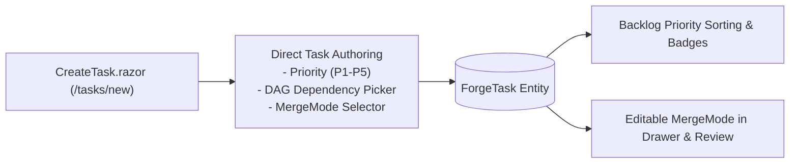
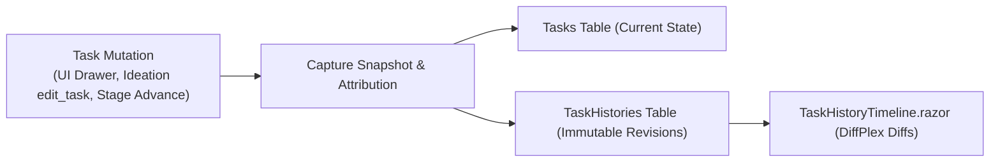
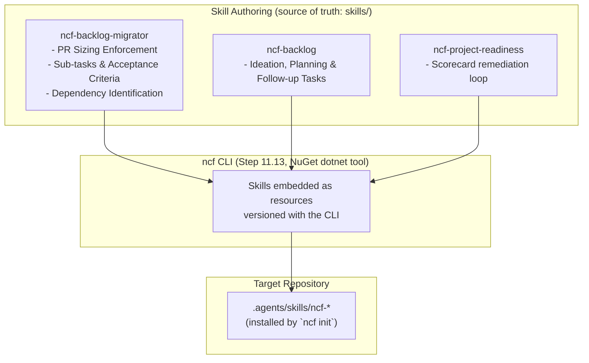
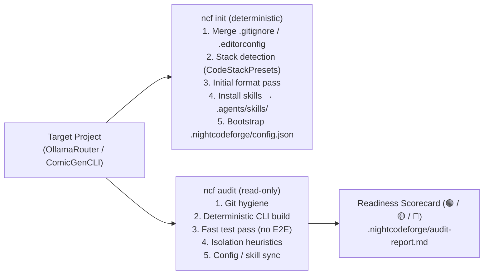
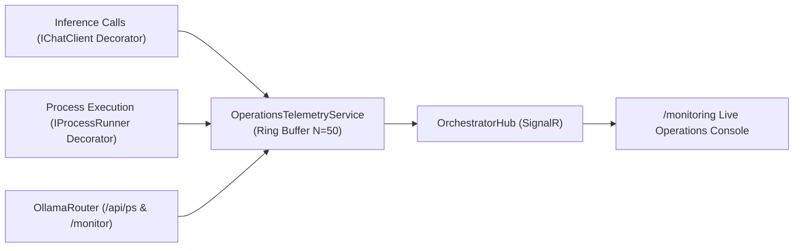
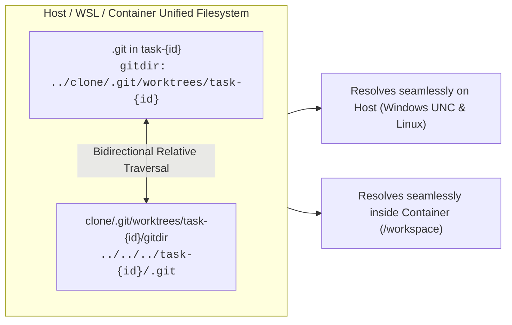
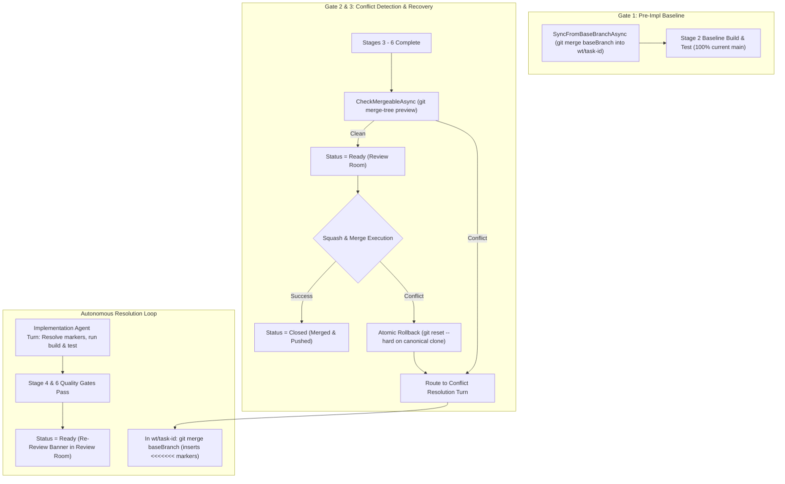
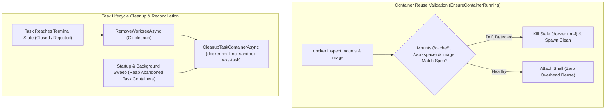
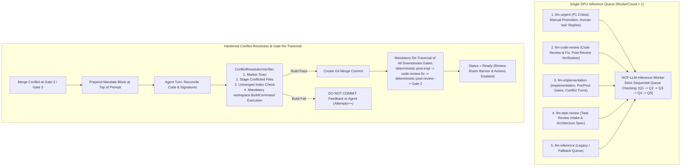

# 🧩 Phase 11: Real-Project Onboarding, Hardening & Bug Fixes

> **Architectural Specification & Implementation Roadmap**  
> *Parent Plan:* [docs/PLAN.md](../PLAN.md) | *Dependencies:* Phase 4 (Harnesses & Sandboxing), Phase 5 (Web UI), Phase 8 (Database-Driven Workflows), Phase 9 (Codebase Remediation & Robustness), Phase 10 (MVP Final Polish)  
> *Status:* Completed | *Target Framework:* .NET 10 (C# 13)

---

## 1. Executive Summary & Strategic Prioritization

The core architecture of **NightCodeForge** delivers an autonomous software engineering pipeline: multi-workspace isolation, local Git mirror synchronization, single-worker GPU Hangfire queuing, multi-stage agentic workflows, deterministic verification quality gates, a modern Blazor web dashboard, database-driven dynamic workflow orchestration, and strict adherence to architectural robustness policies.

To transition active, real-world development projects (**OllamaRouter** and **ComicGenCLI**) into NightCodeForge immediately, **Phase 11** was re-focused on **backlog onboarding, direct task management, project preparedness, system hardening, and critical bug fixes**:

1. **Backlog Management & Direct Task Authoring:**
   - **Step 11.2:** Dedicated Task Creation Page (`/tasks/new`), First-Class Priority Management (P1–P5), and MergeMode Lifecycle.
   - **Step 11.7:** Task State History & Temporal Snapshot Audit Trail (interactive timeline and DiffPlex visual text diffs in Web UI).
   - **Step 11.12:** Packaged Agent Skills for Backlog Management & Migration — versioned, model-agnostic skills (`ncf-backlog`, `ncf-backlog-migrator`, `ncf-project-readiness`) authored as a packaging source of truth and distributed by the `ncf` CLI, plus ready-to-use prompt templates.
   - **Step 11.13:** `ncf` CLI — a NuGet `dotnet tool` performing all deterministic preparation in one command: `.gitignore`/`.editorconfig` management, stack detection, initial format pass, external harness skills installation (`.agents/skills/`), and `.nightcodeforge/config.json` bootstrap, with a read-only `ncf audit` readiness scorecard.
   - **Step 11.15:** Priority-Aware Task Queue Scheduling & Execution Ordering (aligning DAG cascade unblocking, Hangfire insertion order, and DevQueue promotion with 1 Highest -> 5 Lowest).

2. **Pipeline State Hygiene, Portal Scoping & Telemetry:**
   - **Step 11.17:** Portal Task Scoping, Origin Provenance & Pipeline State Hygiene — enforcing `TaskOrigin.UntrustedIntake` for `/triage` proposed backlog cards, restricting `/inspector` and `/review` dropdowns to tasks with $\ge 1$ stage run, and eliminating false "Running" stepper indicators on idle tasks.
   - **Step 11.18:** Live Operations Telemetry: Real-Time LLM Calls, Shell Activity & OllamaRouter Deep Monitoring — re-architecting `/monitoring` from redundant pipeline inspector into a real-time Developer Operations Console showing current and last $N$ LLM calls, deterministic bash/CLI operations, and deep OllamaRouter cluster/VRAM metrics.
   - **Step 11.20:** Live Operations Telemetry Refinement, Command Transparency & Context Sizing — 500ms dynamic ticking timer preventing frozen elapsed duration on large tool generation, clean static badge styling, container command transparency logging real commands instead of persistent wrappers, and accurate full prompt context sizing.

3. **Container Sandboxing, Git Worktree Concurrency & Bug Fixes:**
   - **Step 11.21:** Dynamic Tool Timeouts, Container ICU & User Permissions, and Review Rejection Test Mandate — dynamic bash timeout formula $\max(300\text{s}, \text{build} + \text{test})$, full `libicu-dev` & locales in container base image fixing `NETSDK1188`, preserving host user name and group (`-u $(id -u):$(id -g)`) to eliminate workspace file permission conflicts, and mandatory automated regression test authoring contract on Review rejection.
   - **Step 11.22:** Container Git Worktree Relative Paths & Cross-Environment Portability — bidirectional relative Git worktree pointer normalization (`<worktree>/.git` and `<clone>/.git/worktrees/.../gitdir`) with Windows WSL UNC path resolution and `worktree.useRelativePaths = true`, resolving Exit Code 128 "fatal: not a git repository" errors in container sandboxes.
   - **Step 11.23:** Backlog Task Rejection Lifecycle, Kanban State Hygiene & Shell UI Polish — first-class maintainer rejection action for backlog tasks (domain orchestration, audit attribution, queue eviction, disk markdown sync), white text contrast for priority filter chips, decoupling stage ID from unstarted tasks to prevent false In-Flight display, sidebar collapse visibility fix, and SVG favicon replacement.
   - **Step 11.24:** Fine-Grained Workspace Concurrency & Non-Blocking Git Merge Operations — decoupling long-running agent LLM loops from the workspace reader lock, keeping atomic mutual exclusion on the shared canonical Git clone (< 500ms), and enabling instantaneous Squash & Merge in the Review Room while background tasks execute.
   - **Step 11.25:** Autonomous Git Conflict Management, Baseline Synchronization & Re-Review Lifecycle — zero-conflict synchronization of task feature branches from main at Stage 2 Pre-Implementation Baseline, non-destructive merge preview and conflict detection at Stage 6 / Review Room entry, atomic rollback on Squash & Merge failure, and autonomous conflict resolution by the Implementation Agent with re-review audit trail.
   - **Step 11.26:** Container Reuse Validation & Task Lifecycle Sandbox Cleanup — comprehensive volume mount and image drift detection during container reuse in `EnsureContainerRunning` (eliminating permission denied errors from stale mounts), task terminal state container teardown (`Closed`, `Rejected`), and startup/background orphan container reconciliation sweeps.
   - **Step 11.27:** Stage-Priority Inference Queue Scheduling & Conflict Resolution Lifecycle Hardening — stage-priority queue hierarchy treating each task "as a whole" (`code-review-fix` -> `implementation` -> `task-review`), mandatory compilation/build verification in `ConflictResolutionVerifier` before creating merge commits, mandatory re-traversal of all downstream gates (`deterministic-post-impl`, `code-review-fix`, `deterministic-post-review`, Gate 2), prompt mandate block prepended at top of prompt, and Review Room state hygiene restricting review actions and banners strictly to `Ready` tasks.
   - **Step 11.28:** Pipeline Restart Git Options: Soft Resume vs Hard Reset & Base Branch Rebase — first-class operator choice in Task Execution Inspector between Soft Restart (preserving existing worktree/branch commits) and Clean Hard Reset (discarding WIP commits, rebasing/hard-resetting feature branch onto latest base branch, recycling sandbox container, and starting Stage 1 on a clean baseline).
   - **Step 11.29:** Global Operations Pause & GPU VRAM Eviction (Gamer / Dedicated Workload Mode) — first-class global pause toggle (`TopNavBar.razor`, operations telemetry) that suspends all background queues, checkpoints in-flight tasks gracefully without failure, and instantly evicts resident LLM models from GPU VRAM via `IOllamaRouterGatewayService.ReclaimVramAsync` so the host GPU is 100% free for gaming or dedicated workloads.
   - **Step 11.31:** Prompt Deduplication, Dynamic Compaction Budgeting & Inference Ergonomics — eliminate duplicate task descriptions in initial user bootstrap messages to slim the immutable anchor, dynamically scale compaction budgets with mathematically sound safety margins and turn debounce to prevent infinite back-to-back compaction loops (eliminating 80+ churn cycles and saving millions of tokens per task), dump active context window tokens and compaction parameters in transcripts for full auditability, support multi-match `edit` replacements, and raise transcript logging limits.
   - **Step 11.32:** Synthetic Conversation Priming & Human Clarification Answer Hygiene — scope isolation and single-consumption lifecycle for human clarification answers (`LastHumanAnswer`) preventing rogue `ask` tool turns from polluting downstream stages, defensive orphan tool result prevention in `CrucibleAgentHarness`, and implementation of Synthetic Conversation Priming (pre-seeding `ChatHistory` with verified or failing `bash` tool call/result pairs from prior deterministic quality gates to eliminate redundant exploratory build/test agent turns).
> [!NOTE]
> **Subsequent Feature Roadmap:** Non-completed exploratory and feature expansion steps (including Intelligent Task Dependency Detection, Task Attachments, Dual Model Routing, CLI Output Compression, DevSkim SAST, Mobile UI, MCP, and GitHub Integration) have been moved to **[Phase 12: Extend Features & Integrations](12_EXTEND_FEATURES.md)**.  
> Step numbering in Phase 11 preserves its historical numbers to match Git commit history.

---

## 2. Implementation Steps Roadmap

| Step | Specification | Focus & Key Deliverables | Status |
| :--- | :--- | :--- | :--- |
| **11.2** | [📄 Step 11.2: Dedicated Task Creation Page, Priority Management & MergeMode](phase-11/STEP_11_2_TASK_CREATION_PAGE_AND_MERGE_MODE.md) | Dedicated task authoring page (`/tasks/new`) and modal, first-class editable Priority management (P1 Critical to P5 Trivial badges, drawer & inline card editing, sorting/filtering in Backlog), DAG prerequisite selection at creation, and interactive `MergeMode` editing (`Automatic`, `ManualReviewRequired`). | Completed |
| **11.7** | [🕰️ Step 11.7: Task State History & Temporal Snapshot Audit Trail](phase-11/STEP_11_7_TASK_STATE_HISTORY_AND_AUDIT_TRAIL.md) | Temporal audit history for `ForgeTask` entities: backend `TaskHistories` table with immutable snapshots, attribution (`ChangedBy`, `ChangeReason`), and interactive `TaskHistoryTimeline.razor` UI with DiffPlex text diff comparison. | Completed |
| **11.12** | [📦 Step 11.12: Packaged Agent Skills for Backlog Migration, Ideation & Flexible Dependencies](phase-11/STEP_11_12_BACKLOG_MIGRATION_AND_IDEATION_SKILLS.md) | Versioned agent skills (`ncf-backlog`, `ncf-backlog-migrator`, `ncf-project-readiness`), prompt templates, canonical `docs/TASK_MARKDOWN_SPECIFICATION.md`, and flexible `depends_on` in `TaskFrontmatter`/`TaskMarkdownSyncService` with topological sorting and in-place normalization. | Completed |
| **11.13** | [🚀 Step 11.13: `ncf` CLI — Deterministic Project Preparation & Onboarding](phase-11/STEP_11_13_PROJECT_PREPAREDNESS_AND_ONBOARDING.md) | NuGet `dotnet tool` (`ncf init` / `ncf audit`): one-command deterministic preparation of existing repositories — `.gitignore`/`.editorconfig` merge, stack detection via shared `CodeStackPresets`, initial format pass, skills installation into `.agents/skills/`, `.nightcodeforge/config.json` bootstrap, and green/yellow/red readiness audit. | Completed |
| **11.15** | [⏱️ Step 11.15: Priority-Aware Task Queue Scheduling & Execution Ordering](phase-11/STEP_11_15_PRIORITY_AWARE_TASK_QUEUE_SCHEDULING.md) | Priority queue enforcement for single GPU inference worker: DAG unblocking cascade ordered by `Priority ASC (1 -> 5)`, P1 hotfix routing to `llm-urgent`, and DevQueue priority sorting and manual head promotion. | Completed |
| **11.17** | [🎯 Step 11.17: Portal Task Scoping, Origin Provenance & Pipeline State Hygiene](phase-11/STEP_11_17_PORTAL_TASK_SCOPING_AND_EXECUTION_STATE_HYGIENE.md) | Enforce `TaskOrigin.UntrustedIntake` filtering in `/triage`, restrict `/inspector` task dropdown and `/review` pending reviews to tasks with $\ge 1$ stage run, and eliminate false "Running" state for idle tasks in `PipelineStepper`. | Completed |
| **11.18** | [⚡ Step 11.18: Live Operations Telemetry: Real-Time LLM Calls, Shell Activity & OllamaRouter Deep Monitoring](phase-11/STEP_11_18_LIVE_OPERATIONS_TELEMETRY_LLM_SHELL_OLLAMAROUTER.md) | Re-architect `/monitoring` into a live Developer Operations Console: in-flight and last $N$ LLM calls (speed, tokens, target backend), live shell/CLI commands with stdout/stderr, and deep OllamaRouter cluster/VRAM metrics. | Completed |
| **11.20** | [⚡ Step 11.20: Live Operations Telemetry Refinement, Command Transparency & Context Sizing](phase-11/STEP_11_20_LIVE_TELEMETRY_REFINEMENT_AND_COMMAND_TRANSPARENCY.md) | Dynamic 500ms ticker preventing frozen elapsed time during large tool generation, clean static badges, real command logging in container executor, and full prompt context sizing across telemetry. | Completed |
| **11.21** | [🛡️ Step 11.21: Dynamic Tool Timeouts, Container ICU & User Permissions, and Review Rejection Test Mandate](phase-11/STEP_11_21_CONTAINER_ICU_DYNAMIC_TIMEOUTS_AND_REVIEW_TEST_MANDATE.md) | Dynamic bash tool timeout $\max(300\text{s}, \text{build} + \text{test})$, install `libicu-dev` & locales in base container image (resolving `NETSDK1188`), preserve host user/group permissions (`-u $(id -u):$(id -g)`), and mandate automated test creation for each bug upon review rejection. | Completed |
| **11.22** | [🌳 Step 11.22: Container Git Worktree Relative Paths & Cross-Environment Portability](phase-11/STEP_11_22_CONTAINER_GIT_WORKTREE_RELATIVE_PATHS_AND_PORTABILITY.md) | Enforce bidirectional relative Git worktree pointers (`<worktree>/.git` and `<clone>/.git/worktrees/.../gitdir`), resolve Windows WSL UNC paths via `ResolveHostAccessiblePath`, set `worktree.useRelativePaths = true`, and add startup legacy worktree repair. | Completed |
| **11.23** | [🎯 Step 11.23: Backlog Task Rejection Lifecycle, Kanban State Hygiene & Shell UI Polish](phase-11/STEP_11_23_BACKLOG_REJECTION_KANBAN_HYGIENE_AND_SHELL_ERGONOMICS.md) | First-class maintainer rejection action for backlog tasks (domain orchestration, audit attribution, queue eviction, disk markdown sync), white text contrast for priority filter chips, decoupling stage ID from unstarted tasks to prevent false In-Flight display, sidebar collapse visibility fix, and SVG favicon replacement. | Completed |
| **11.24** | [🔒 Step 11.24: Fine-Grained Workspace Concurrency & Non-Blocking Git Merge Operations](phase-11/STEP_11_24_FINE_GRAINED_WORKSPACE_LOCKING_AND_NON_BLOCKING_MERGE.md) | Decouple long-running agent LLM loops from the workspace reader lock, keep atomic mutual exclusion on the shared canonical Git clone (< 500ms), and enable instantaneous Review Room Squash & Merge without waiting for background dev-queue tasks. | Completed |
| **11.25** | [🔀 Step 11.25: Autonomous Git Conflict Management, Baseline Synchronization & Re-Review Lifecycle](phase-11/STEP_11_25_GIT_CONFLICT_MANAGEMENT_AND_RE_REVIEW_LIFECYCLE.md) | Synchronize task branch from main prior to Stage 2 Pre-Implementation Baseline (conflict-free), non-destructive mergeability preview (`git merge-tree`) before entering Ready, atomic canonical rollback on squash conflict with `MergeConflictException`, and autonomous conflict resolution by Implementation Agent with re-review alert banner in Review Room. | Completed |
| **11.26** | [🐳 Step 11.26: Container Reuse Validation & Task Lifecycle Sandbox Cleanup](phase-11/STEP_11_26_CONTAINER_REUSE_VALIDATION_AND_TASK_LIFECYCLE_CLEANUP.md) | Complete volume mount and image drift detection during container reuse in `EnsureContainerRunning` (eliminating root permission errors from stale mounts), task terminal state container teardown (`Closed`, `Rejected`), and startup/background orphan container reconciliation sweeps. | Completed |
| **11.27** | [🎯 Step 11.27: Stage-Priority Inference Queue Scheduling & Conflict Resolution Lifecycle Hardening](phase-11/STEP_11_27_STAGE_PRIORITY_SCHEDULING_AND_CONFLICT_RESOLUTION_HARDENING.md) | Stage-priority queue scheduling hierarchy (`code-review-fix` -> `implementation` -> `task-review`) treating tasks "as a whole", mandatory compilation/build verification in `ConflictResolutionVerifier` before creating merge commits, mandatory re-traversal of all downstream gates (`deterministic-post-impl`, `code-review-fix`, `deterministic-post-review`, Gate 2), prompt mandate block prepended at top of prompt, and Review Room state hygiene restricting review actions and banners strictly to `Ready` tasks. | Proposed |
| **11.28** | [🔄 Step 11.28: Pipeline Restart Git Options: Soft Resume vs Hard Reset & Base Branch Rebase](phase-11/STEP_11_28_PIPELINE_RESTART_GIT_RESET_AND_REBASE_OPTIONS.md) | First-class operator choice when restarting pipelines: Soft Restart (preserve commits/worktree) vs Clean Hard Reset (discard changes, hard reset/rebase to latest base branch, teardown task container, and restart Stage 1 fresh). | Completed |
| **11.29** | [⏸️ Step 11.29: Global Operations Pause & GPU VRAM Eviction (Gamer / Dedicated Workload Mode)](phase-11/STEP_11_29_GLOBAL_OPERATIONS_PAUSE_AND_GPU_VRAM_RECLAMATION.md) | One-click global operations pause: gracefully suspend in-flight tasks, defer Hangfire inference queues, and immediately evict resident models from GPU VRAM (`keep_alive: 0`) to free the GPU for gaming or 3D applications. | Proposed |
| **11.30** | [⚡ Step 11.30: Pipeline Stage Chaining & Atomic Cohort Job Execution](phase-11/STEP_11_30_PIPELINE_STAGE_CHAINING_AND_COHORT_JOB_CONTINUATION.md) | In-process stage chaining grouping Stages 2, 3, 4 into an atomic Implementation Cohort job and Stages 5, 6, Auto-Merge into an atomic Review & Delivery Cohort job, eliminating inter-stage GPU hijacking and branch drift during deterministic gates. | Proposed |
| **11.31** | [⚡ Step 11.31: Prompt Deduplication, Dynamic Compaction Budgeting & Inference Ergonomics](phase-11/STEP_11_31_PROMPT_DEDUPLICATION_DYNAMIC_COMPACTION_AND_TOOL_ERGONOMICS.md) | Single-source task descriptions in System Prompt Layer 3, mathematically balanced dynamic compaction budgets and turn debounce (stopping 80+ compaction passes per task), transcript compaction diagnostics dumping, multi-match `edit` tool replacements, and transcript sizing resilience. | Implemented |
| **11.32** | [⚡ Step 11.32: Synthetic Conversation Priming & Human Clarification Answer Hygiene](phase-11/STEP_11_32_SYNTHETIC_CONVERSATION_PRIMING_AND_HUMAN_ANSWER_HYGIENE.md) | Scope isolation and single-consumption lifecycle for human clarification answers (`LastHumanAnswer`), defensive orphan tool result prevention in `CrucibleAgentHarness`, and implementation of Synthetic Conversation Priming (pre-seeding `ChatHistory` with verified or failing `bash` tool call/result pairs from prior deterministic quality gates to eliminate redundant exploratory build/test agent turns). | Proposed |

---

## 3. High-Level Architecture Overview

### 3.1 Step 11.2: Dedicated Task Creation & Priority Management


### 3.2 Step 11.7: Task State History & Snapshots


### 3.3 Step 11.12: Packaged Skills (distributed by the `ncf` CLI)


### 3.4 Step 11.13: `ncf` CLI — Deterministic Preparation & Audit


### 3.5 Step 11.17: Portal Task Scoping & Origin Provenance
```mermaid
flowchart LR
    Triage["Untrusted Intake Triage"] -->|Stamp Origin = UntrustedIntake| DB[("ForgeTask")]
    DB -->|Origin == UntrustedIntake| TriageUI["/triage Proposed Tasks"]
    DB -->|HasExecutionRun == true| InspectorUI["/inspector Task Dropdown"]
    DB -->|HasExecutionRun & Status in (Ready, Implemented, Reviewed, Closed)| ReviewUI["/review Pending Reviews"]
```

### 3.6 Step 11.18 & 11.20: Live Operations Telemetry & OllamaRouter Integration


### 3.7 Step 11.22: Container Git Worktree Relative Paths & Cross-Environment Portability


### 3.8 Step 11.25: Autonomous Git Conflict Management & Re-Review Lifecycle


### 3.9 Step 11.26: Container Reuse Validation & Task Lifecycle Sandbox Cleanup


### 3.10 Step 11.27: Stage-Priority Inference Queue Scheduling & Conflict Resolution Hardening


---

## 4. Phase 11 Definition of Done (DoD) Checklist

### Real-Project Onboarding & Backlog Management
- [x] **Step 11.2 (Dedicated Task Creation Page, Priority & MergeMode):**
  - [x] Implement `CreateTask.razor` page at `/tasks/new` supporting direct creation without ideation chat.
  - [x] Implement multi-select prerequisite dependency selector querying existing workspace tasks.
  - [x] Make priority fully editable on existing tasks (interactive [TaskDetailDrawer.razor](file:///c:/Users/Julien/source/repos/jetelain/NightCodeForge/src/NightCodeForge.Web/Components/Backlog/TaskDetailDrawer.razor) selector, fast inline Kanban/card popover, and queue synchronization).
  - [x] Add sorting and filtering by priority in [Backlog.razor](file:///c:/Users/Julien/source/repos/jetelain/NightCodeForge/src/NightCodeForge.Web/Components/Pages/Backlog.razor) (`OrderBy(t => t.Priority).ThenBy(t => t.CreatedAt)` putting P1 first).
  - [x] Enable interactive MergeMode editing (Automatic, ManualReviewRequired) in [TaskDetailDrawer.razor](file:///c:/Users/Julien/source/repos/jetelain/NightCodeForge/src/NightCodeForge.Web/Components/Backlog/TaskDetailDrawer.razor) and [ApproveMergeModal.razor](file:///c:/Users/Julien/source/repos/jetelain/NightCodeForge/src/NightCodeForge.Web/Components/Review/ApproveMergeModal.razor).

- [x] **Step 11.7 (Task State History & Audit Trail):**
  - [x] Configure EF Core table `TaskHistories` with unique `(TaskId, Version)` index and entity `ForgeTaskHistory`.
  - [x] Implement repository baseline history capture and version incrementation in `EfCoreTaskRepository`.
  - [x] Ensure all mutation channels (`TaskDetailDrawer`, `IdeationService`, `TaskOrchestrator`, `TaskMarkdownSyncService`) provide explicit `ChangedBy` and `ChangeReason`.
  - [x] Build `TaskHistoryTimeline.razor` revision viewer with DiffPlex text diff comparison and embed in `TaskDetailDrawer.razor` and `TaskInspector.razor`.

- [x] **Step 11.12 (Packaged Agent Skills):**
  - [x] Author `skills/ncf-backlog-migrator/SKILL.md` (+ `assets/TASK_TEMPLATE.md`) with PR-sizing and decomposition rules.
  - [x] Author `skills/ncf-backlog/SKILL.md` for ideation, planning, and non-blocking follow-up task creation.
  - [x] Author `skills/ncf-project-readiness/SKILL.md` (remediation companion to `ncf audit`).
  - [x] Unit tests validating skill frontmatter contract and `SkillsService` loadability for every packaged skill.
  - [x] Provide standalone prompt templates in `docs/prompts/` (`BACKLOG_MIGRATION_PROMPT.md`, `TASK_DECOMPOSITION_PROMPT.md`, `PROJECT_PREPAREDNESS_PROMPT.md`).

- [x] **Step 11.13 (`ncf` CLI — Deterministic Preparation & Onboarding):**
  - [x] Create `src/NightCodeForge.Cli/` packaged as NuGet `dotnet tool` (`ncf`), referencing `NightCodeForge.Core` and embedding `skills/**` as resources.
  - [x] Implement `ncf init`: `.gitignore`/`.editorconfig` merge (managed blocks, idempotent), stack detection via shared `CodeStackPresets`, initial format pass, skills installation into `.agents/skills/`, `.nightcodeforge/config.json` bootstrap with `ncfVersion`.
  - [x] Implement `ncf audit`: read-only 5-pillar readiness scorecard (git hygiene, deterministic build, fast tests, isolation heuristics, config/skill sync) with `.nightcodeforge/audit-report.md` and exit codes 0/1/2.
  - [x] Tests: merge idempotency, stack detection fixtures (dotnet/node/python/rust/go), config JSON conformance to `WorkspaceProjectConfig`, end-to-end `init` + `audit` on sample git repos.

- [x] **Step 11.15 (Priority-Aware Task Queue Scheduling & Ordering):**
  - [x] Update `TaskOrchestrator` cascade unblocking to query and sort unblocked tasks by `Priority ASC (1 -> 5), CreatedAt ASC`.
  - [x] Route Priority 1 (Critical) unblocked tasks directly to `llm-urgent`.
  - [x] Set default priority to `3` (Normal) across `ForgeTask`, `TaskCreationModal`, `MaintainerPromotionModal`, and `CanonicalTools`.
  - [x] Add queue priority sorting and manual head promotion in `DevQueueService` and `DevQueueTable.razor`.

### Pipeline State Hygiene & Telemetry Console
- [x] **Step 11.17 (Portal Task Scoping, Origin Provenance & Pipeline State Hygiene):**
  - [x] Add `TaskOrigin` enum (`Manual`, `Ideation`, `UntrustedIntake`, `Import`, `GitHubIssue`) and property `ForgeTask.Origin` with EF Core migration.
  - [x] Update `TriageService` to stamp `TaskOrigin.UntrustedIntake` on all triage task proposals.
  - [x] Update `TaskMarkdownSyncService` to serialize and parse `origin` in YAML frontmatter.
  - [x] Update `Triage.razor` to filter "Proposed Backlog Tasks" strictly by `Status == Suggested && Origin == UntrustedIntake`.
  - [x] Add `HasExecutionRun` (bool) and `MaxExecutedStageOrder` (int) to `ForgeTask` entity and EF Core index `(WorkspaceId, HasExecutionRun)`.
  - [x] Stamp `task.HasExecutionRun = true` in `TaskOrchestrator` upon execution start.
  - [x] Implement `GetExecutedTasksByWorkspaceIdAsync` on `ITaskRepository` querying `t.HasExecutionRun == true`.
  - [x] Update `TaskInspector.razor` dropdown to display tasks with `HasExecutionRun == true`.
  - [x] Update `TaskReviewService.GetPendingReviewsAsync` to only return tasks with `HasExecutionRun == true` in reviewable statuses (`Ready`, `Implemented`, `Reviewed`, `Closed`).
  - [x] Fix `PipelineStepper.razor` to default null `CurrentStageStatus` to `Pending` instead of `Running`.

- [x] **Step 11.18 (Live Operations Telemetry: Real-Time LLM Calls, Shell Activity & OllamaRouter Deep Monitoring):**
  - [x] Implement `IOperationsTelemetryService` with thread-safe ring buffer (`MaxLlmCalls = 50`, `MaxShellCommands = 50`).
  - [x] Implement `TelemetryChatClient` (`DelegatingChatClient`) wrapping `IChatClient` to transparently intercept all LLM inference calls without requiring task metadata.
  - [x] Implement `TelemetryProcessRunner` decorator wrapping `IProcessRunner` to universally capture all process execution without requiring task metadata.
  - [x] Extend `IOllamaRouterGatewayService` with cluster latency checks and resident model VRAM percentage calculations.
  - [x] Redesign `/monitoring` with `ActiveOperationsHero` (live LLM inference + live shell command), `OllamaRouterClusterHealthCard`, `LlmCallsHistoryTable`, and `ShellOperationsFeed`.

- [x] **Step 11.20 (Live Operations Telemetry Refinement, Command Transparency & Context Sizing):**
  - [x] Add 500ms dynamic ticking timer in `ActiveOperationsHero.razor` computing live elapsed duration from `StartTime` when status is `Running`.
  - [x] Remove `animation: pulse` from `● Inferring` and `● Executing` badges in `ActiveOperationsHero.razor`.
  - [x] Instrument `NightCodeForgeContainerExecutor.ExecuteAsync` to record each real executing command (`dotnet build`, `dotnet test`, etc.) to `IOperationsTelemetryService`.
  - [x] Suppress outer persistent interactive shell session wrapper from hero active shell card.
  - [x] Implement full input messages token estimation in `TelemetryChatClient.cs` and capture `response.Usage.InputTokenCount`.
  - [x] Display `Context: {N} tokens` in `ActiveOperationsHero`, `LlmCallsHistoryTable`, and `InferenceInspectionModal`.

### Sandboxing, Concurrency & Bug Fixes
- [x] **Step 11.21 (Dynamic Tool Timeouts, Container ICU & User Permissions, and Review Rejection Test Mandate):**
  - [x] Update `CanonicalTools.bash` timeout calculation to $\max(300\text{s}, \text{buildTimeout} + \text{testTimeout})$.
  - [x] Update `DefaultAgentBaseDockerfile` to install `libicu-dev`, `locales`, and configure `en_US.UTF-8` and `fr_FR.UTF-8` locales.
  - [x] Set `DOTNET_SYSTEM_GLOBALIZATION_INVARIANT=0`, `LANG=en_US.UTF-8`, `LC_ALL=en_US.UTF-8` in `NightCodeForgeContainerExecutor.ExecuteAsync`.
  - [x] Implement host user/group discovery capturing `$(id -u):$(id -g)` once and caching in `ContainerExecutorOptions.UserUidGid`.
  - [x] Update `BuildDockerRunArgs` and `BuildProcessStartSpec` in `NightCodeForgeContainerExecutor.cs` to pass `--user <uid>:<gid>`.
  - [x] Configure container environment `$HOME` and relocate shared package caches (`/cache/nuget` with `NUGET_PACKAGES=/cache/nuget`) ensuring zero-redownload parity for non-root UIDs.
  - [x] Update `StandardWorkflowDefinitions.cs` review stage directive requiring automated unit/integration tests for each bug upon rejection.
  - [x] Update `CrucibleAgentHarness.cs` review and implementation loopback directives to enforce the bug regression test mandate.

- [x] **Step 11.22 (Container Git Worktree Relative Paths & Cross-Environment Portability):**
  - [x] Enforce bidirectional relative worktree pointers in `GitWorkspaceManager` (`../{cloneDir}/.git/worktrees/task-{id}` forward and `../../../task-{id}/.git` reverse).
  - [x] Ensure all worktree `.git` file I/O operations resolve Windows WSL UNC paths via `ResolveHostAccessiblePath(path)`.
  - [x] Add `EnsureWorktreeRelativePathsAsync(Workspace workspace, int taskId)` to `IGitWorkspaceManager` and `GitWorkspaceManager`.
  - [x] Configure `worktree.useRelativePaths = true` on the canonical repository.
  - [x] Enforce relative normalization unconditionally in `EnsureWorktreeAsync`, even when `isWorktreeRegistered == true`.
  - [x] Integrate worktree relative path verification into `ExecutionEnvironmentProvider` and container pre-flight.
  - [x] Update `StartupRecoveryService` to migrate legacy absolute worktree pointers on startup.
  - [x] Author unit tests in `GitWorkspaceManagerTests` verifying relative forward/reverse pointers, UNC path resolution, idempotency, and clean Git CLI execution.

- [x] **Step 11.23 (Backlog Task Rejection Lifecycle, Kanban State Hygiene & Shell UI Polish):**
  - [x] Add `RejectTaskAsync` to `ITaskOrchestrator` and `ITaskMutationService` enabling rejection of non-terminal backlog tasks with immutable audit history, DevQueue/Hangfire job cancellation, and markdown synchronization.
  - [x] Add `🗑️ Reject Task` action buttons in `TaskDetailDrawer.razor`, `TaskDetail.razor`, and `KanbanCard.razor`.
  - [x] Fix Priority filter chip text color in `app.css` to render high-contrast white text (`#ffffff` / `var(--text-primary)`) on dark surfaces.
  - [x] Extract `BacklogStatusClassifier` in `NightCodeForge.Web.Services` ensuring unstarted `Open` tasks (`!t.HasExecutionRun`) remain in Column 2 ("Open (Backlog)") and never in "In-Flight".
  - [x] Remove preemptive `CurrentStageId` initialization to `"task-review"` for unstarted tasks in `TaskMarkdownSyncService.cs` and `TriageService.cs`.
  - [x] Fix sidebar collapse styling in `app.css` and `NavMenu.razor` hiding `.brand-text`, centering icons, and keeping `.sidebar-toggle-btn` visible and clickable.
  - [x] Replace brand header emoji with vector `favicon.svg` and style `.brand-favicon` cleanly at $32\times 32\text{px}$.
  - [x] Author unit tests in `BacklogStatusClassifierTests` and `TaskOrchestratorRejectionTests`.

- [x] **Step 11.24 (Fine-Grained Workspace Concurrency & Non-Blocking Git Merge Operations):**
  - [x] Decouple task execution semaphore (`taskSem`) from workspace active reader count in `WorkspaceLockProvider`.
  - [x] Ensure `AcquireTaskLockAsync` maintains task-level execution exclusivity without blocking canonical `AcquireLockAsync`.
  - [x] Keep atomic workspace lock on canonical Git operations (`CheckoutTaskBranchAsync`, `SquashAndMergeAsync`, mirror push/pull) lasting $< 500\text{ms}$.
  - [x] Enable immediate Review Room Squash & Merge while background tasks actively infer on the GPU.

- [x] **Step 11.25 (Autonomous Git Conflict Management, Baseline Synchronization & Re-Review Lifecycle):**
  - [x] Implement `SyncFromBaseBranchAsync` on `IGitWorkspaceManager` and `GitWorkspaceManager` performing worktree merge of `baseBranch` with conflict detection.
  - [x] Implement `CheckMergeableAsync` on `IGitWorkspaceManager` and `GitWorkspaceManager` performing non-destructive `git merge-tree` preview.
  - [x] Update `SquashAndMergeAsync` with atomic rollback (`git reset --hard HEAD` on the canonical clone; no `git clean`) throwing `MergeConflictException`, plus bounded host push-race retry (`MirrorPushRejectedException`).
  - [x] Gate 2 re-runs deterministic build/test verification when the base merge brought new changes; conflict resolution has a bounded retry budget with human escalation and a deterministic `ConflictResolutionVerifier` (orchestrator-owned merge commit).
  - [x] Gate 1: Synchronize task feature branch from latest base branch at start of Stage 2 (`PreImplementationBaseline`).
  - [x] Gate 2: Verify mergeability prior to setting `Ready` state; route to conflict resolution if conflicts exist.
  - [x] Gate 3: Catch `MergeConflictException` in `CompleteTaskAndCascadeInternalAsync` and trigger automated conflict resolution.
  - [x] Implement `InitiateConflictResolutionAsync` in `TaskOrchestrator` routing task back to Implementation Agent with conflict metadata.
  - [x] Update `StandardWorkflowDefinitions` and `TaskOrchestrator` to inject conflict resolution directives and file lists into implementation prompt when conflicts exist.
  - [x] Display "Conflict Resolved by Agent" warning banner in `Review.razor` when `HasResolvedConflict` is true.
  - [x] Handle `MergeConflictException` cleanly in `ApproveMergeModal.razor` with informative feedback.

- [x] **Step 11.26 (Container Reuse Validation & Task Lifecycle Sandbox Cleanup):**
  - [x] Enhance `EnsureContainerRunning` in `NightCodeForgeContainerExecutor` to inspect all mount destinations and RW modes against `BuildVolumeMounts(options)`, recreating containers on mount or image drift.
  - [x] Add `CleanupTaskContainerAsync` and `CleanupWorkspaceContainersAsync` to `IExecutionEnvironmentProvider` and `ExecutionEnvironmentProvider`.
  - [x] Hook container teardown into `TaskOrchestrator` on task squash-merge (`Closed`), task rejection (`Rejected`), and task deletion.
  - [x] Implement orphan container reconciliation sweep in `StartupRecoveryService` and `GitSyncService` to reap running containers belonging to closed/missing tasks.
  - [x] Author unit and integration tests verifying mount drift detection, container recreation, and lifecycle cleanup.

- [ ] **Step 11.27 (Stage-Priority Inference Queue Scheduling & Conflict Resolution Lifecycle Hardening):**
  - [ ] Add `HangfireQueues.LlmCodeReview`, `HangfireQueues.LlmImplementation`, `HangfireQueues.LlmTaskReview` and configure `NCF-LLM-Inference-Worker` polling sequence (`LlmUrgent` -> `LlmCodeReview` -> `LlmImplementation` -> `LlmTaskReview` -> `LlmInference`).
  - [ ] Update `ITaskJobQueue` with `EnqueueStage(taskId, stageId, priority)` and update all dispatchers across `TaskOrchestrator`, `CreateTask.razor`, and `DevQueueService`.
  - [ ] Update `DevQueueService` snapshot and re-ordering logic to prioritize by stage tier first, then task priority (P1 -> P5), then FIFO.
  - [ ] Inject `IExecutionEnvironmentProvider` into `ConflictResolutionVerifier` and execute `workspace.BuildCommand` deterministically; fail fast without creating merge commit on compiler errors.
  - [ ] Prepend conflict resolution mandate block at the very top of the prompt in `DefaultBootstrapPromptBuilder.cs` with explicit instructions on constructor/interface reconciliation and compiler diagnostic injection.
  - [ ] Enforce mandatory full pipeline re-traversal (`PostImplementationGates` -> `CodeReviewAndFix` -> `PostReviewVerification` -> Gate 2) after conflict resolution.
  - [ ] Restrict `TaskReviewService.GetPendingReviewsAsync` strictly to `Status == TaskOverallStatus.Ready` (eliminating `Implemented` and `Reviewed` tasks).
  - [ ] Restrict Review Room actions (`Approve & Merge`, `Request Changes`) and `Autonomous Conflict Resolution Completed` banner strictly to `Ready` status.
  - [ ] Author unit tests in `HangfireQueuePriorityTests`, `ConflictResolutionVerifierTests`, `DefaultBootstrapPromptBuilderTests`, and `TaskReviewServiceTests`.

