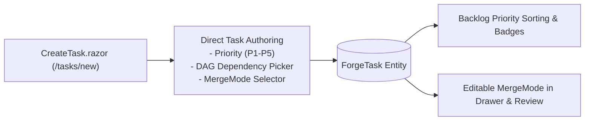
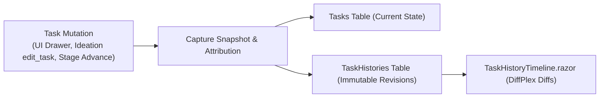
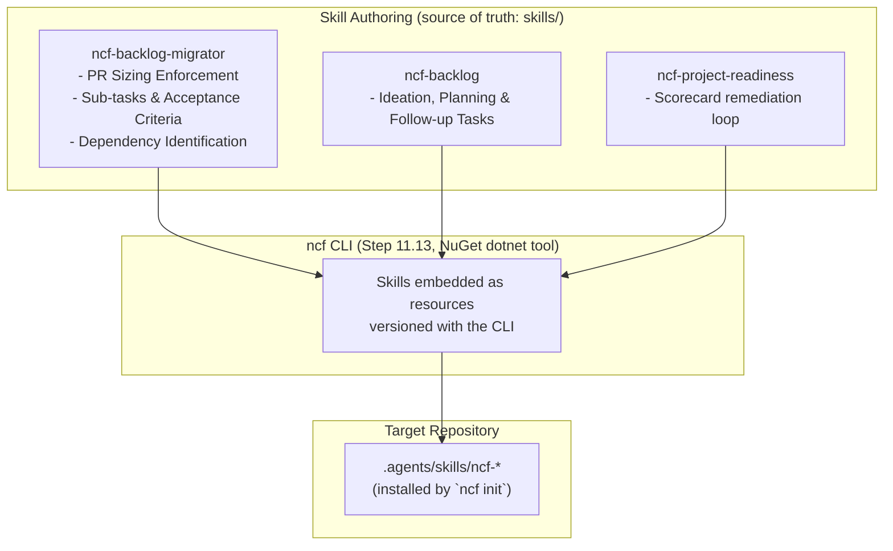
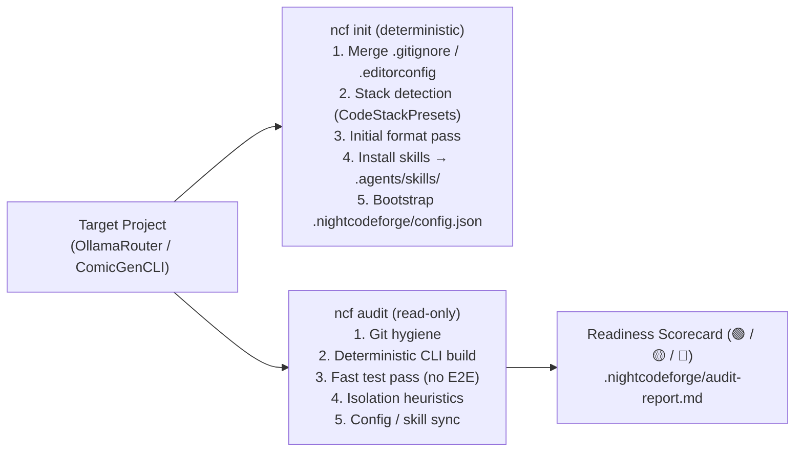
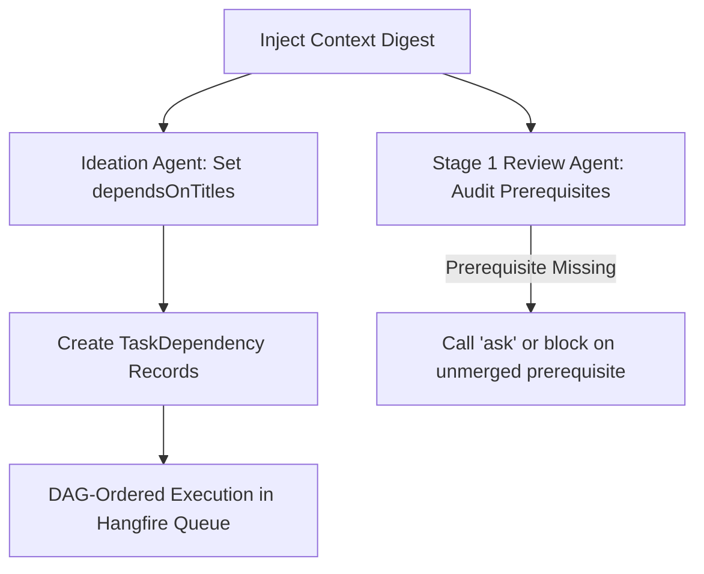
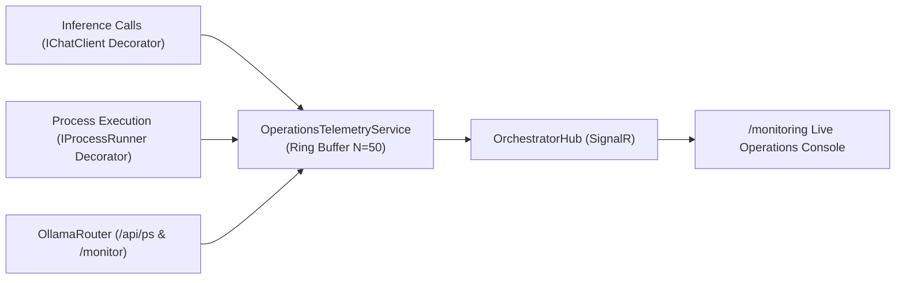

# 🧩 Phase 11: Extend Features & Integrations

> **Architectural Specification & Implementation Roadmap**  
> *Parent Plan:* [docs/PLAN.md](../PLAN.md) | *Dependencies:* Phase 4 (Harnesses & Sandboxing), Phase 5 (Web UI), Phase 8 (Database-Driven Workflows), Phase 9 (Codebase Remediation & Robustness), Phase 10 (MVP Final Polish)  
> *Status:* Active / In Progress | *Target Framework:* .NET 10 (C# 13)

---

## 1. Executive Summary & Strategic Prioritization

The core architecture of **NightCodeForge** delivers an autonomous software engineering pipeline: multi-workspace isolation, local Git mirror synchronization, single-worker GPU Hangfire queuing, multi-stage agentic workflows, deterministic verification quality gates, a modern Blazor web dashboard, database-driven dynamic workflow orchestration, and strict adherence to architectural robustness policies.

To transition active, real-world development projects (**OllamaRouter** and **ComicGenCLI**) into NightCodeForge immediately, **Phase 11 (Extend Features - Post-MVP)** prioritizes **backlog onboarding, direct task management, project preparedness, and quick wins**:

1. **Tier 1: Real-Project Onboarding & Backlog Management (Top Priority - Immediate Value):**
   - **Step 11.2:** Dedicated Task Creation Page (`/tasks/new`), First-Class Priority Management (P1–P5), and MergeMode Lifecycle.
   - **Step 11.7:** Task State History & Temporal Snapshot Audit Trail (interactive timeline and DiffPlex visual text diffs in Web UI).
   - **Step 11.12:** Packaged Agent Skills for Backlog Management & Migration — versioned, model-agnostic skills (`ncf-backlog`, `ncf-backlog-migrator`, `ncf-project-readiness`) authored as a packaging source of truth and ready to be distributed by the `ncf` CLI, plus ready-to-use prompt templates. (Web UI bulk import is deferred to a later step.)
   - **Step 11.13:** `ncf` CLI — a NuGet `dotnet tool` performing all deterministic preparation in one command: `.gitignore`/`.editorconfig` management, stack detection, initial format pass, external harness skills installation (`.agents/skills/`), and `.nightcodeforge/config.json` bootstrap, with a read-only `ncf audit` readiness scorecard. (Future lower-priority commands: `ncf server`, `ncf register` via Web API.)
   - **Step 11.14:** Intelligent Task Dependency Detection in Ideation & Review Agents (backlog context injection, DAG relationship inference, and prerequisite enforcement).
   - **Step 11.15:** Priority-Aware Task Queue Scheduling & Execution Ordering (aligning DAG cascade unblocking, Hangfire insertion order, and DevQueue promotion with 1 Highest -> 5 Lowest).
   - **Step 11.16:** Task Attachments & Context Documents — a workspace-level read-only `attachments/` store (sibling of the canonical clone and task worktrees) populated from file drops, cited host paths, and URL captures (MarkItDown markdown companions), citable by the ideation agent (`@attachment:{id}`) and readable by the three workflow stage agents.
   - **Step 11.17:** Portal Task Scoping, Origin Provenance & Pipeline State Hygiene — enforcing `TaskOrigin.UntrustedIntake` for `/triage` proposed backlog cards, restricting `/inspector` and `/review` dropdowns to tasks with $\ge 1$ stage run, and eliminating false "Running" stepper indicators on idle tasks.

2. **Tier 2: Core Ideation & Developer Ergonomics Quick Wins:**
   - **Step 11.18:** Live Operations Telemetry: Real-Time LLM Calls, Shell Activity & OllamaRouter Deep Monitoring — re-architecting `/monitoring` from redundant pipeline inspector into a real-time Developer Operations Console showing current and last $N$ LLM calls, deterministic bash/CLI operations, and deep OllamaRouter cluster/VRAM metrics.
   - **Step 11.19:** Conversational UI Unification, Stepper Running Hygiene & Review Room Ergonomics — reusing `AgentQuestionTurnCard` in the Question Inbox, fixing the Pipeline Stepper false "Pending" state during active runs, unifying Task Inspector and Ideation chat to share a compact, readable conversation UI, and adding sticky file tree navigation with Inspector deep link to the Review Room.
   - **Step 11.20:** Live Operations Telemetry Refinement, Command Transparency & Context Sizing — 500ms dynamic ticking timer preventing frozen elapsed duration on large tool generation, clean static badge styling, container command transparency logging real commands instead of persistent wrappers, and accurate full prompt context sizing.
   - **Step 11.21:** Dynamic Tool Timeouts, Container ICU Globalization & Review Rejection Test Mandate — dynamic bash timeout formula $\max(300\text{s}, \text{build} + \text{test})$, full `libicu-dev` & locales in container base image fixing `NETSDK1188`, and mandatory automated regression test authoring contract on Review rejection.
   - **Step 11.5:** Ideation Quick Notes, Suggestions Backlog & Conversational Refinement.
   - **Step 11.1:** Heterogeneous Dual Model Architecture (Reviewer vs Coder models) and difficulty escalation.
   - **Step 11.3:** Smart CLI Output Filtering (compiler and test noise suppression for 95% token savings).
   - **Step 11.4:** Zero-Token Open-Source SAST Gate via Microsoft DevSkim CLI.

3. **Tier 3: Deep Integrations & Remote Experience:**
   - **Step 11.6:** Mobile-Responsive Web UI & Remote Tailscale Experience.
   - **Step 11.8:** Custom Repository Scripts for Deterministic Stages (Bash, Python, PowerShell).
   - **Step 11.9:** Model Context Protocol (MCP) Integration (HTTP & ContainerSandbox Stdio).
   - **Step 11.10:** GitHub Integration (Untrusted Intake Triage, PR Delivery & Mirroring).
   - **Step 11.11:** Voice Support, Continuous Dictation & PWA Mobile Experience.

---

## 2. Implementation Steps Roadmap

### Priority Tier 1: Real-Project Onboarding & Backlog Management (Top Priority)

| Step | Specification | Focus & Key Deliverables | Status |
| **11.2** | [📄 Step 11.2: Dedicated Task Creation Page, Priority Management & MergeMode](phase-11/STEP_11_2_TASK_CREATION_PAGE_AND_MERGE_MODE.md) | Dedicated task authoring page (`/tasks/new`) and modal, first-class editable Priority management (P1 Critical to P5 Trivial badges, drawer & inline card editing, sorting/filtering in Backlog), DAG prerequisite selection at creation, and interactive `MergeMode` editing (`Automatic`, `ManualReviewRequired`; `ExternalPullRequest` deferred to Step 11.10). | Completed |
| **11.7** | [🕰️ Step 11.7: Task State History & Temporal Snapshot Audit Trail](phase-11/STEP_11_7_TASK_STATE_HISTORY_AND_AUDIT_TRAIL.md) | Temporal audit history for `ForgeTask` entities: backend `TaskHistories` table with immutable snapshots, attribution (`ChangedBy`, `ChangeReason`), and interactive `TaskHistoryTimeline.razor` UI with DiffPlex text diff comparison. | **Top Priority** |
| **11.15** | [⏱️ Step 11.15: Priority-Aware Task Queue Scheduling & Execution Ordering](phase-11/STEP_11_15_PRIORITY_AWARE_TASK_QUEUE_SCHEDULING.md) | Priority queue enforcement for single GPU inference worker: DAG unblocking cascade ordered by `Priority ASC (1 -> 5)`, P1 hotfix routing to `llm-urgent`, and DevQueue priority sorting and manual head promotion. | Completed |
| **11.12** | [📦 Step 11.12: Packaged Agent Skills for Backlog Migration, Ideation & Flexible Dependencies](phase-11/STEP_11_12_BACKLOG_MIGRATION_AND_IDEATION_SKILLS.md) | Versioned agent skills (`ncf-backlog`, `ncf-backlog-migrator`, `ncf-project-readiness`), prompt templates, canonical `docs/TASK_MARKDOWN_SPECIFICATION.md`, and flexible `depends_on` in `TaskFrontmatter`/`TaskMarkdownSyncService` with topological sorting and in-place normalization. Web UI bulk import and `ncf sync` command deferred. | Completed |
| **11.13** | [🚀 Step 11.13: `ncf` CLI — Deterministic Project Preparation & Onboarding](phase-11/STEP_11_13_PROJECT_PREPAREDNESS_AND_ONBOARDING.md) | NuGet `dotnet tool` (`ncf init` / `ncf audit`): one-command deterministic preparation of existing repositories — `.gitignore`/`.editorconfig` merge, stack detection via shared `CodeStackPresets`, initial format pass, skills installation into `.agents/skills/`, `.nightcodeforge/config.json` bootstrap, and green/yellow/red readiness audit. | Completed |
| **11.14** | [🔗 Step 11.14: Intelligent Task Dependency Detection in Ideation & Review Agents](phase-11/STEP_11_14_INTELLIGENT_TASK_DEPENDENCY_DETECTION.md) | Backlog context injection for Ideation and Stage 1 Review agents; system prompts requiring identification of prerequisites, shared interfaces, and ordering; auto-population of `dependsOnTitles` and DAG dependency chips in Kanban and Drawer. | **Next Priority** |
| **11.16** | [📎 Step 11.16: Task Attachments & Context Documents](phase-11/STEP_11_16_TASK_ATTACHMENTS_AND_CONTEXT_DOCS.md) | Workspace-level read-only `attachments/` directory (sibling of clone & worktrees): intake via file drop, cited host paths, and URL captures with MarkItDown markdown companions; SHA-256 dedup & reusability; `@attachment:{id}` citations in tasks; read-only `list_attachments`/`read_attachment` tools for ideation and the three workflow stage agents; attachments picker on `/tasks/new`. | **Next Priority** |
| **11.17** | [🎯 Step 11.17: Portal Task Scoping, Origin Provenance & Pipeline State Hygiene](phase-11/STEP_11_17_PORTAL_TASK_SCOPING_AND_EXECUTION_STATE_HYGIENE.md) | Enforce `TaskOrigin.UntrustedIntake` filtering in `/triage`, restrict `/inspector` task dropdown and `/review` pending reviews to tasks with $\ge 1$ stage run, and eliminate false "Running" state for idle tasks in `PipelineStepper`. | Completed |

### Priority Tier 2: Core Ideation & Developer Ergonomics Quick Wins

| Step | Specification | Focus & Key Deliverables | Status |
| :--- | :--- | :--- | :--- |
| **11.18** | [⚡ Step 11.18: Live Operations Telemetry: Real-Time LLM Calls, Shell Activity & OllamaRouter Deep Monitoring](phase-11/STEP_11_18_LIVE_OPERATIONS_TELEMETRY_LLM_SHELL_OLLAMAROUTER.md) | Re-architect `/monitoring` into a live Developer Operations Console: in-flight and last $N$ LLM calls (speed, tokens, target backend), live shell/CLI commands with stdout/stderr, and deep OllamaRouter cluster/VRAM metrics. | Completed |
| **11.19** | [🎨 Step 11.19: Conversational UI Unification, Stepper Running Hygiene & Review Room Ergonomics](phase-11/STEP_11_19_CONVERSATIONAL_UI_UNIFICATION_AND_REVIEW_ERGONOMICS.md) | Reuse `AgentQuestionTurnCard` in `/inbox`, fix `PipelineStepper` false "Pending" state during active runs, unify `StageConversationViewer` with `Ideation` compact bubble layout, and provide sticky file tree with `/inspector` link in Review room. | **Top Priority** |
| **11.20** | [⚡ Step 11.20: Live Operations Telemetry Refinement, Command Transparency & Context Sizing](phase-11/STEP_11_20_LIVE_TELEMETRY_REFINEMENT_AND_COMMAND_TRANSPARENCY.md) | Dynamic 500ms ticker preventing frozen elapsed time during large tool generation, clean static badges (remove pulse animations), real command logging in container executor, and full prompt context sizing across telemetry. | **Top Priority** |
| **11.21** | [🛡️ Step 11.21: Dynamic Tool Timeouts, Container ICU Globalization & Review Rejection Test Mandate](phase-11/STEP_11_21_CONTAINER_ICU_DYNAMIC_TIMEOUTS_AND_REVIEW_TEST_MANDATE.md) | Dynamic bash tool timeout $\max(300\text{s}, \text{build} + \text{test})$, install `libicu-dev` & locales in base container image (resolving `NETSDK1188`), and mandate automated test creation for each bug upon review rejection. | **Top Priority** |
| **11.5** | [💡 Step 11.5: Ideation Quick Notes, Suggestions & Conversational Refinement](phase-11/STEP_11_5_IDEATION_QUICK_NOTES_SUGGESTIONS_AND_REFINEMENT.md) | Quick notes backlog intake ("Think Now, Chat Later"); proposal card lifecycle (`Approve` $\rightarrow$ Open, `Keep as Suggestion` $\rightarrow$ Suggested, `Discard` $\rightarrow$ Delete); "Refine in Ideation" pre-seeded chat; scoped `edit_task` tools; 24h draft pruning. | Planned |
| **11.1** | [🧠 Step 11.1: Dual Model Role Configuration & Difficulty Escalation](phase-11/STEP_11_1_DUAL_MODEL_ROLE_CONFIGURATION_AND_DIFFICULTY_ESCALATION.md) | Heterogeneous model architecture: Architect/Reviewer model (e.g. Qwen 3.8 27B) for ideation, review, code review; Coder model (e.g. Qwen 3.6 35B A3B) for fast coding; dynamic difficulty escalation for difficult/expert tasks. | Planned |
| **11.3** | [🧹 Step 11.3: Smart CLI & Build Tool Output Filtering (Context Compression)](phase-11/STEP_11_3_SMART_CLI_AND_BASH_OUTPUT_FILTERING.md) | Semantic output filtering for verbose CLI tools (`dotnet build`, `dotnet test`, `npm`). Relativizes paths, strips SDK boilerplates, drops non-fatal warnings when errors exist, preserving raw transcripts on disk. | Planned |
| **11.4** | [🛡️ Step 11.4: Free & Open-Source SAST Quality Gate via Microsoft DevSkim CLI](phase-11/STEP_11_4_DEVSKIM_SAST_QUALITY_GATE.md) | Deterministic SAST quality gate using Microsoft DevSkim CLI across C#, JS/TS, Python, Go. SARIF report parsing, configurable severity thresholds, and automatic loopback routing with diagnostics. | Planned |

### Priority Tier 3: Deep Integrations & Remote Experience

| Step | Specification | Focus & Key Deliverables | Status |
| :--- | :--- | :--- | :--- |
| **11.6** | [📱 Step 11.6: Mobile-Responsive Web UI & Remote Tailscale Experience](phase-11/STEP_11_6_MOBILE_RESPONSIVE_UI_AND_TAILSCALE_ACCESS.md) | First-class mobile/tablet responsiveness: off-canvas hamburger navigation drawer, touch targets $\ge 44\text{px}$, fixed-bottom ideation chat, mobile bottom sheet drawer, and SignalR reconnect resilience over Tailscale. | Planned |
| **11.8** | [📜 Step 11.8: Custom Repository Scripts for Deterministic Steps (Bash, Python, PowerShell)](phase-11/STEP_11_8_CUSTOM_SCRIPTS_FOR_DETERMINISTIC_STEPS.md) | Execution of custom repository scripts in `.nightcodeforge/scripts/` during deterministic stages across Bash, Python, and PowerShell. Injection of `PipelineDataBag` environment variables and output directives. | Planned |
| **11.9** | [⚡ Step 11.9: Model Context Protocol (MCP) Integration: HTTP Servers & ContainerSandbox Stdio](phase-11/STEP_11_9_MCP_HTTP_AND_CONTAINER_SANDBOX_INTEGRATION.md) | First-class MCP tool discovery and execution via Microsoft Agent Framework standards (`ModelContextProtocol`), streamable HTTP/SSE remote servers, and isolated stdio MCP servers in `ContainerSandbox`. | Planned |
| **11.10** | [🐙 Step 11.10: GitHub Integration (Untrusted Intake Triage, PR Delivery & Task Mirroring)](phase-11/STEP_11_10_GITHUB_INTEGRATION_ISSUES_AND_PRS.md) | Modular GitHub integration: untrusted issue intake routed to sandboxed triage to generate proposals, Pull Request delivery mode with rich PR metadata, and bi-directional status mirroring. | Planned |
| **11.11** | [🎙️ Step 11.11: Voice Support, Continuous Dictation & PWA Mobile Experience](phase-11/STEP_11_11_VOICE_SUPPORT_PWA_AND_MOBILE_SPEECH.md) | Hands-free mobile voice operations via Web Speech API (`SpeechRecognition`) and Blazor JS Interop. Continuous dictation with 1500ms silence detection and PWA configuration for persistent mic permissions. | Planned |

---

## 3. High-Level Architecture Overview

### 3.1 Step 11.2: Dedicated Task Creation & Priority Management


### 3.2 Step 11.7: Task State History & Snapshots


### 3.3 Step 11.12: Packaged Skills (distributed by the `ncf` CLI)


### 3.4 Step 11.13: `ncf` CLI — Deterministic Preparation & Audit


### 3.5 Step 11.14: Intelligent Task Dependency Detection


### 3.6 Step 11.17: Portal Task Scoping & Origin Provenance
```mermaid
flowchart LR
    Triage["Untrusted Intake Triage"] -->|Stamp Origin = UntrustedIntake| DB[("ForgeTask")]
    DB -->|Origin == UntrustedIntake| TriageUI["/triage Proposed Tasks"]
    DB -->|HasExecutionRun == true| InspectorUI["/inspector Task Dropdown (incl. Step 11.14 rollbacks)"]
    DB -->|HasExecutionRun & Status in (Ready, Implemented, Reviewed, Closed)| ReviewUI["/review Pending Reviews"]
```

### 3.7 Step 11.18: Live Operations Telemetry & OllamaRouter Integration


---

## 4. Phase 11 Definition of Done (DoD) Checklist

### Tier 1 Deliverables (Top Priority)
- [ ] **Step 11.2 (Dedicated Task Creation Page, Priority & MergeMode):**
  - [ ] Implement `CreateTask.razor` page at `/tasks/new` supporting direct creation without ideation chat.
  - [ ] Implement multi-select prerequisite dependency selector querying existing workspace tasks.
  - [ ] Make priority fully editable on existing tasks (interactive [TaskDetailDrawer.razor](file:///c:/Users/Julien/source/repos/jetelain/NightCodeForge/src/NightCodeForge.Web/Components/Backlog/TaskDetailDrawer.razor) selector, fast inline Kanban/card popover, and queue synchronization).
  - [ ] Add sorting and filtering by priority in [Backlog.razor](file:///c:/Users/Julien/source/repos/jetelain/NightCodeForge/src/NightCodeForge.Web/Components/Pages/Backlog.razor) (`OrderBy(t => t.Priority).ThenBy(t => t.CreatedAt)` putting P1 first).
  - [ ] Enable interactive MergeMode editing (Automatic, ManualReviewRequired) in [TaskDetailDrawer.razor](file:///c:/Users/Julien/source/repos/jetelain/NightCodeForge/src/NightCodeForge.Web/Components/Backlog/TaskDetailDrawer.razor) and [ApproveMergeModal.razor](file:///c:/Users/Julien/source/repos/jetelain/NightCodeForge/src/NightCodeForge.Web/Components/Review/ApproveMergeModal.razor) (ExternalPullRequest deferred to Step 11.10).

- [x] **Step 11.7 (Task State History & Audit Trail):**
  - [x] Configure EF Core table `TaskHistories` with unique `(TaskId, Version)` index and entity `ForgeTaskHistory`.
  - [x] Implement repository baseline history capture and version incrementation in `EfCoreTaskRepository`.
  - [x] Ensure all mutation channels (`TaskDetailDrawer`, `IdeationService`, `TaskOrchestrator`, `TaskMarkdownSyncService`) provide explicit `ChangedBy` and `ChangeReason`.
  - [x] Build `TaskHistoryTimeline.razor` revision viewer with DiffPlex text diff comparison and embed in `TaskDetailDrawer.razor` and `TaskInspector.razor`.

- [x] **Step 11.15 (Priority-Aware Task Queue Scheduling & Ordering):**
  - [x] Update `TaskOrchestrator` cascade unblocking to query and sort unblocked tasks by `Priority ASC (1 -> 5), CreatedAt ASC`.
  - [x] Route Priority 1 (Critical) unblocked tasks directly to `llm-urgent`.
  - [x] Set default priority to `3` (Normal) across `ForgeTask`, `TaskCreationModal`, `MaintainerPromotionModal`, and `CanonicalTools`.
  - [x] Add queue priority sorting and manual head promotion in `DevQueueService` and `DevQueueTable.razor`.

- [x] **Step 11.12 (Packaged Agent Skills):**
  - [x] Author `skills/ncf-backlog-migrator/SKILL.md` (+ `assets/TASK_TEMPLATE.md`) with PR-sizing and decomposition rules.
  - [x] Author `skills/ncf-backlog/SKILL.md` for ideation, planning, and non-blocking follow-up task creation.
  - [x] Author `skills/ncf-project-readiness/SKILL.md` (remediation companion to `ncf audit`).
  - [x] Unit tests validating skill frontmatter contract and `SkillsService` loadability for every packaged skill.
  - [x] Provide standalone prompt templates in `docs/prompts/` (`BACKLOG_MIGRATION_PROMPT.md`, `TASK_DECOMPOSITION_PROMPT.md`, `PROJECT_PREPAREDNESS_PROMPT.md`).
  - [x] **Deferred (lower priority, later step):** Web UI bulk import page/modal (`/tasks/import`, `ITaskImportService`).

- [x] **Step 11.13 (`ncf` CLI — Deterministic Preparation & Onboarding):**
  - [x] Create `src/NightCodeForge.Cli/` packaged as NuGet `dotnet tool` (`ncf`), referencing `NightCodeForge.Core` and embedding `skills/**` as resources.
  - [x] Implement `ncf init`: `.gitignore`/`.editorconfig` merge (managed blocks, idempotent), stack detection via shared `CodeStackPresets`, initial format pass, skills installation into `.agents/skills/`, `.nightcodeforge/config.json` bootstrap with `ncfVersion`.
  - [x] Implement `ncf audit`: read-only 5-pillar readiness scorecard (git hygiene, deterministic build, fast tests, isolation heuristics, config/skill sync) with `.nightcodeforge/audit-report.md` and exit codes 0/1/2.
  - [x] Tests: merge idempotency, stack detection fixtures (dotnet/node/python/rust/go), config JSON conformance to `WorkspaceProjectConfig`, end-to-end `init` + `audit` on sample git repos.
  - [x] **Deferred (later Stage 11 commands):** `ncf server` (install web app), `ncf register` (register workspace via Web API), `ncf import`.

- [ ] **Step 11.14 (Intelligent Task Dependency Detection):**
  - [ ] Implement `IWorkspaceBacklogSummaryService` generating compact `<existing_workspace_tasks>` digests (excluding archived/closed tasks, capped to top 15–20 active tasks by priority order).
  - [ ] Inject existing backlog digest into `IdeationService` system prompt with circular dependency prohibition.
  - [ ] Inject existing backlog digest and dependency directives into Stage 1 Task Review directive in `CrucibleAgentHarness`.
  - [ ] Direct Stage 1 Review Agent to populate `depends_on` in YAML frontmatter (with rationale under `## Dependencies`), enforce cycle rejection loopback, and verify `TaskMarkdownSyncService` dependency synchronization.
  - [ ] Implement dynamic task suspension and full workflow reset in `TaskOrchestrator`: if Stage 1 reveals unclosed prerequisites, reset `task.Status = Open` and `CurrentStageId = TaskReview` to rerun full workflow once prerequisites close.
  - [ ] Render clickable prerequisite and downstream dependency chips in `KanbanCard.razor` and `TaskDetailDrawer.razor`.

- [ ] **Step 11.16 (Task Attachments & Context Documents):**
  - [ ] Create `attachments/` store sibling to the canonical clone and task worktrees, with `manifest.json` registry and `TaskAttachments` / `TaskAttachmentLinks` EF Core tables.
  - [ ] Implement `IAttachmentIntakeService`: file drop, cited host-path copy, and URL capture (SSRF-guarded) with MarkItDown markdown companions and SHA-256 deduplication.
  - [ ] Register read-only `list_attachments` / `read_attachment` tools for ideation and the three workflow stage agents; inject attachments digests into ideation and stage prompts.
  - [ ] Support `@attachment:{id}` citations in task descriptions, materialized as `TaskAttachmentLinks` on task creation (hard error on unknown IDs).
  - [ ] Build Web UI: chat drop zone + attachment chips, workspace attachments panel with preview drawer, attachments picker on `/tasks/new`, and user-only delete.

- [ ] **Step 11.17 (Portal Task Scoping, Origin Provenance & Pipeline State Hygiene):**
  - [ ] Add `TaskOrigin` enum (`Manual`, `Ideation`, `UntrustedIntake`, `Import`, `GitHubIssue`) and property `ForgeTask.Origin` with EF Core migration.
  - [ ] Update `TriageService` to stamp `TaskOrigin.UntrustedIntake` on all triage task proposals.
  - [ ] Update `TaskMarkdownSyncService` to serialize and parse `origin` in YAML frontmatter.
  - [ ] Update `Triage.razor` to filter "Proposed Backlog Tasks" strictly by `Status == Suggested && Origin == UntrustedIntake`.
  - [ ] Add `HasExecutionRun` (bool) and `MaxExecutedStageOrder` (int) to `ForgeTask` entity and EF Core index `(WorkspaceId, HasExecutionRun)`.
  - [ ] Stamp `task.HasExecutionRun = true` in `TaskOrchestrator` upon execution start, preserving `true` across Step 11.14 rollback resets to `Open`.
  - [ ] Implement `GetExecutedTasksByWorkspaceIdAsync` on `ITaskRepository` querying `t.HasExecutionRun == true`.
  - [ ] Update `TaskInspector.razor` dropdown to display tasks with `HasExecutionRun == true` (including rolled-back/suspended tasks).
  - [ ] Update `TaskReviewService.GetPendingReviewsAsync` to only return tasks with `HasExecutionRun == true` in reviewable statuses (`Ready`, `Implemented`, `Reviewed`, `Closed`).
  - [ ] Fix `PipelineStepper.razor` to default null `CurrentStageStatus` to `Pending` instead of `Running`, and eliminate synthetic "Running" state in `Monitoring.razor`.

### Tier 2 Deliverables (Quick Wins & Ergonomics)
- [x] **Step 11.18 (Live Operations Telemetry: Real-Time LLM Calls, Shell Activity & OllamaRouter Deep Monitoring):**
  - [x] Implement `IOperationsTelemetryService` with thread-safe ring buffer (`MaxLlmCalls = 50`, `MaxShellCommands = 50`).
  - [x] Implement `TelemetryChatClient` (`DelegatingChatClient`) wrapping `IChatClient` to transparently intercept all LLM inference calls without requiring task metadata.
  - [x] Implement `TelemetryProcessRunner` decorator wrapping `IProcessRunner` to universally capture all process execution without requiring task metadata.
  - [x] Extend `IOllamaRouterGatewayService` with cluster latency checks and resident model VRAM percentage calculations.
  - [x] Redesign `/monitoring` with `ActiveOperationsHero` (live LLM inference + live shell command), `OllamaRouterClusterHealthCard`, `LlmCallsHistoryTable`, and `ShellOperationsFeed`.
- [ ] **Step 11.19 (Conversational UI Unification, Stepper Running Hygiene & Review Room Ergonomics):**
  - [ ] Enhance `AgentQuestionTurnCard.razor` with task metadata header (Task #Id, Title, Stage, Time) and reuse in `Inbox.razor` / `QuestionCard.razor`.
  - [ ] Fix `PipelineStepper.razor` to preserve `StageExecutionStatus.Running` when `OverallStatus == TaskOverallStatus.InProgress` or stage conversation is running.
  - [ ] Explicitly pass `CurrentStageStatus` in `TaskExecutionInspector.razor` to `<PipelineStepper>`.
  - [ ] Unify `StageConversationViewer.razor` with `Ideation.razor` compact chat bubble architecture, avatar column, inline `<details class="think-trace">`, and compact `<details class="tool-trace">`.
  - [ ] Style `.file-tree` in `Review.razor` with sticky positioning (`position: sticky; top: 1rem; max-height: calc(100vh - 2rem)`).
  - [ ] Add deep link button to `/inspector/@_snapshot.TaskId` in `Review.razor` header.
- [ ] **Step 11.20 (Live Operations Telemetry Refinement, Command Transparency & Context Sizing):**
  - [ ] Add 500ms dynamic ticking timer in `ActiveOperationsHero.razor` computing live elapsed duration from `StartTime` when status is `Running`.
  - [ ] Remove `animation: pulse` from `● Inferring` and `● Executing` badges in `ActiveOperationsHero.razor`.
  - [ ] Instrument `NightCodeForgeContainerExecutor.ExecuteAsync` to record each real executing command (`dotnet build`, `dotnet test`, etc.) to `IOperationsTelemetryService`.
  - [ ] Suppress outer persistent interactive shell session wrapper (`wsl.exe ... docker exec ... bash`) from hero active shell card.
  - [ ] Implement full input messages token estimation in `TelemetryChatClient.cs` and capture `response.Usage.InputTokenCount`.
  - [ ] Display `Context: {N} tokens` in `ActiveOperationsHero`, `LlmCallsHistoryTable`, and `InferenceInspectionModal`.
- [ ] **Step 11.21 (Dynamic Tool Timeouts, Container ICU Globalization & Review Rejection Test Mandate):**
  - [ ] Update `CanonicalTools.bash` timeout calculation to $\max(300\text{s}, \text{buildTimeout} + \text{testTimeout})$.
  - [ ] Update `DefaultAgentBaseDockerfile` to install `libicu-dev`, `locales`, and configure `en_US.UTF-8` and `fr_FR.UTF-8` locales.
  - [ ] Set `DOTNET_SYSTEM_GLOBALIZATION_INVARIANT=0`, `LANG=en_US.UTF-8`, `LC_ALL=en_US.UTF-8` in `NightCodeForgeContainerExecutor.ExecuteAsync`.
  - [ ] Update `StandardWorkflowDefinitions.cs` review stage directive requiring automated unit/integration tests for each bug upon rejection.
  - [ ] Update `CrucibleAgentHarness.cs` review and implementation loopback directives to enforce the bug regression test mandate.
- [ ] **Step 11.5 (Ideation Quick Notes & Suggestions):** Quick notes bar, proposal card tri-state actions, "Refine in Ideation", scoped `edit_task` tools, 24h pruning.
- [ ] **Step 11.1 (Dual Model Role Configuration):** Architect/Reviewer model vs Coder model, dynamic escalation on difficult tasks.
- [ ] **Step 11.3 (Smart CLI Output Filtering):** Compiler & test noise suppression, workspace path relativization.
- [ ] **Step 11.4 (DevSkim SAST Quality Gate):** Microsoft DevSkim CLI SARIF parsing and loopback diagnostics.

### Tier 3 Deliverables (Deep Integrations & Remote Experience)
- [ ] **Step 11.6 (Mobile Responsive UI & Tailscale):** Off-canvas nav drawer, touch targets $\ge 44\text{px}$, bottom sheet drawer.
- [ ] **Step 11.8 (Custom Repository Scripts):** Support `.nightcodeforge/scripts/` (.sh, .py, .ps1) and DataBag environment serialization.
- [ ] **Step 11.9 (MCP Integration):** Streamable HTTP/SSE and containerized stdio MCP transports.
- [ ] **Step 11.10 (GitHub Integration):** Sandboxed issue triage, Pull Request delivery, and bi-directional status mirroring.
- [ ] **Step 11.11 (Voice Support & PWA):** Web Speech API JS interop, 1500ms silence detection, and PWA manifest.
