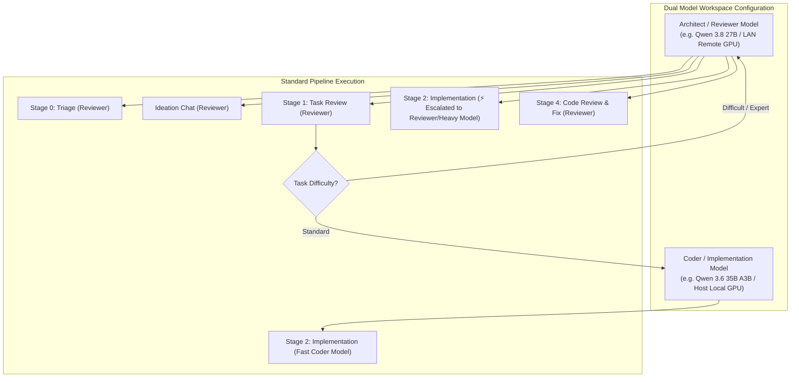
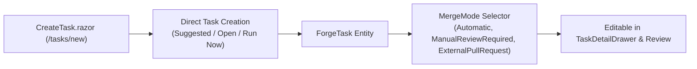
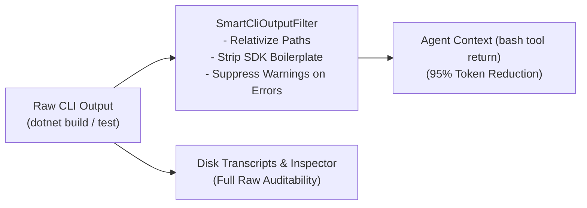
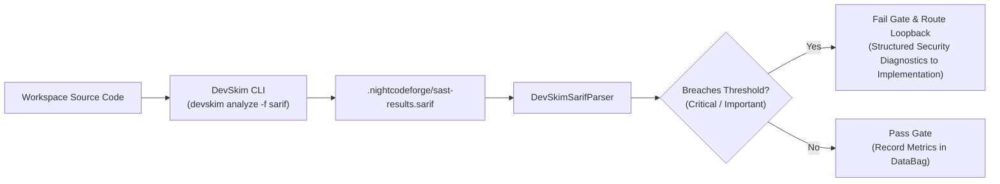
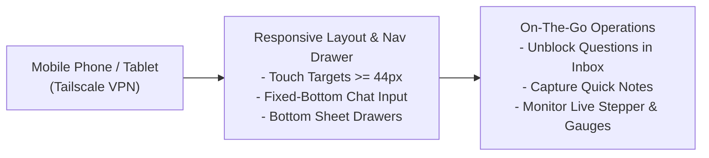
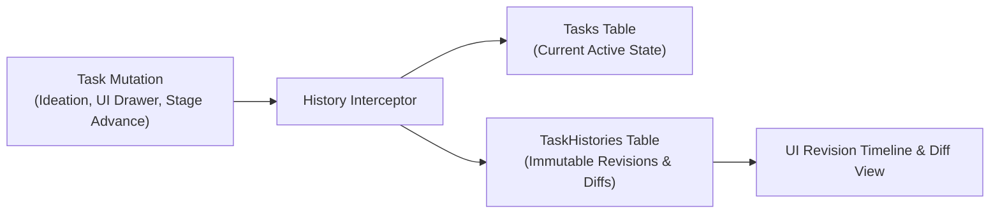
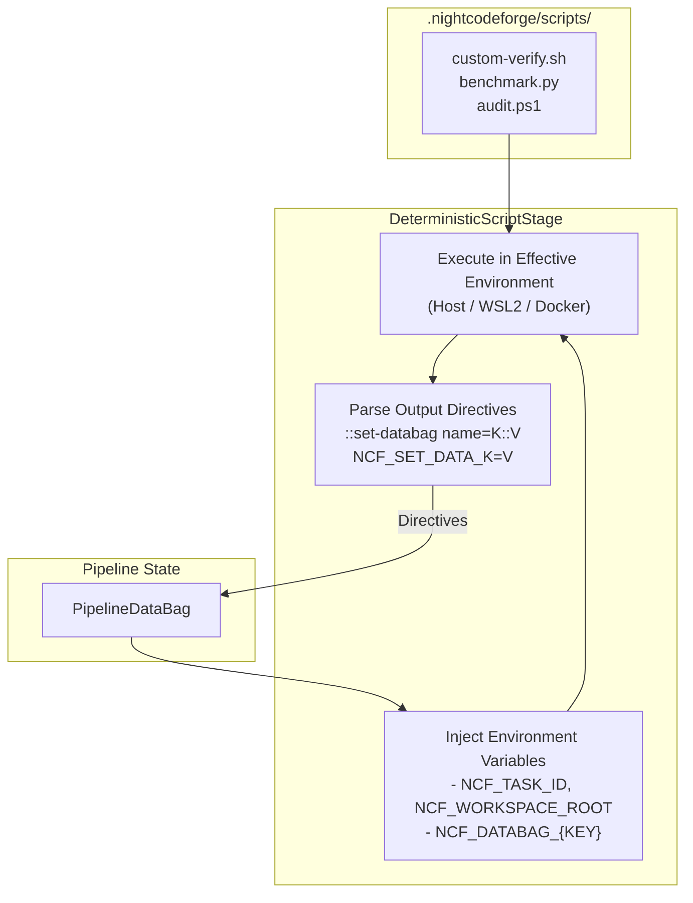
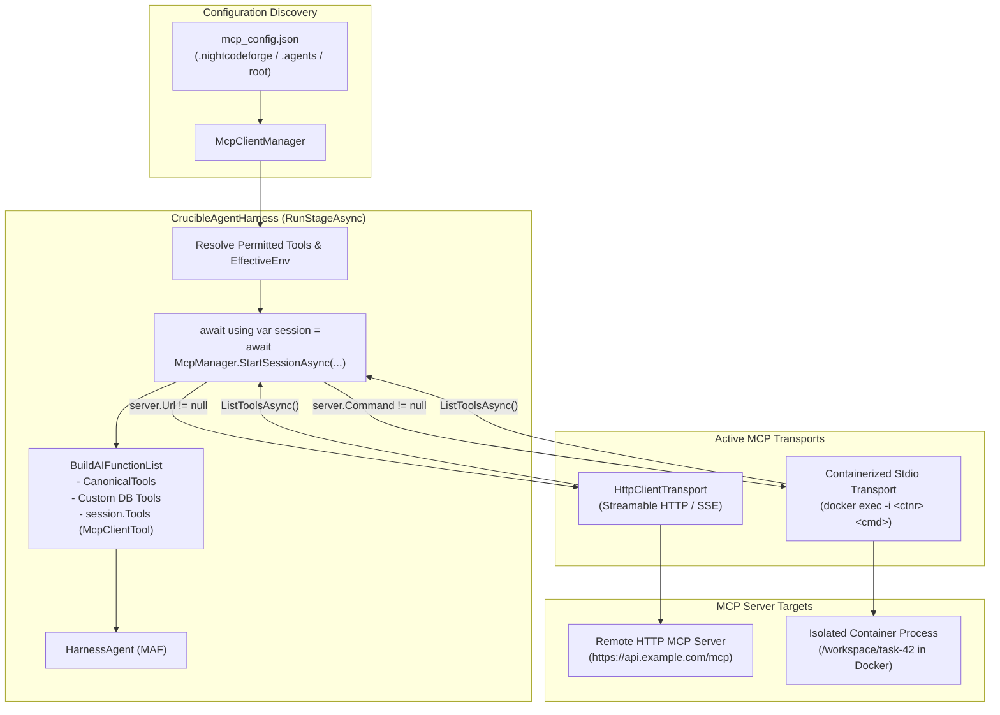
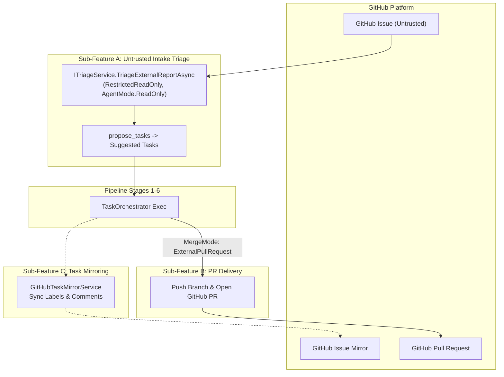

# 🧩 Phase 10: Extend Features & Integrations

> **Architectural Specification & Implementation Roadmap**  
> *Parent Plan:* [docs/PLAN.md](../PLAN.md) | *Dependencies:* Phase 4 (Harnesses & Sandboxing), Phase 5 (Web UI), Phase 8 (Database-Driven Workflows), Phase 9 (Codebase Remediation & Robustness), Phase 10 (MVP Final Polish)  
> *Status:* Active / In Progress | *Target Framework:* .NET 10 (C# 13)

---

## 1. Executive Summary & Scope

The core architecture of **NightCodeForge** delivers an autonomous software engineering pipeline: multi-workspace isolation, local Git mirror synchronization, single-worker GPU Hangfire queuing, multi-stage agentic workflows, deterministic verification quality gates, a modern Blazor web dashboard, database-driven dynamic workflow orchestration, and strict adherence to architectural robustness policies.

**Phase 11 (Extend Features - Post-MVP)** serves as the dedicated roadmap for capabilities and ecosystem extensions that augment the core orchestrator, prioritized by **quick wins, developer ergonomics, and everyday impact**:
1. **Quick Wins & Productivity Boosts (Steps 11.1–10.4):** Role-specialized dual model setups, direct task authoring, context-compressing CLI filters, and zero-token open-source SAST.
2. **Core Ideation & Usability Evolution (Steps 11.5–10.7):** Ideation quick notes, suggestions lifecycle, pre-seeded conversational refinement, mobile-responsive Tailscale access, and temporal task audit history.
3. **Deep Ecosystem Integrations (Steps 11.8–10.10):** Repository deterministic scripts, Model Context Protocol (MCP), and full GitHub intake/PR delivery.

---

## 2. Implementation Steps Roadmap (Prioritized by Value & Quick Wins)

| Step | Specification | Focus & Key Deliverables | Status |
| :--- | :--- | :--- | :--- |
| **11.1** | [🧠 Step 11.1: Dual Model Role Configuration & Difficulty Escalation](phase-11/STEP_11_1_DUAL_MODEL_ROLE_CONFIGURATION_AND_DIFFICULTY_ESCALATION.md) | Heterogeneous model architecture specializing by stage role: Architect/Reviewer model (e.g. Qwen 3.8 27B) for ideation, task review, code review, and triage; Coder/Implementation model (e.g. Qwen 3.6 35B A3B) for fast coding; dynamic escalation for difficult/expert tasks to high-reasoning models; independent hardware routing targets. | Planned |
| **11.2** | [📄 Step 11.2: Dedicated Task Creation Page & MergeMode Management](phase-11/STEP_11_2_TASK_CREATION_PAGE_AND_MERGE_MODE.md) | Direct task authoring page (`/tasks/new`) bypassing the AI ideation chat, expanded `MergeMode` options (`Automatic`, `ManualReviewRequired`, `ExternalPullRequest`), and interactive merge mode editing in the Task Detail Drawer and Review Room. | Planned |
| **11.3** | [🧹 Step 11.3: Smart CLI & Build Tool Output Filtering (Context Compression & Noise Reduction)](phase-11/STEP_11_3_SMART_CLI_AND_BASH_OUTPUT_FILTERING.md) | Semantic output filtering for verbose CLI tools (`dotnet build`, `msbuild`, `dotnet test`, `tsc`, `npm`). Relativizes full paths to workspace root, suppresses internal SDK boilerplates, drops non-fatal warnings when errors exist, and caps warning bursts while preserving raw audit logs in disk transcripts, with an optional agent parameter (`disable_filter`) to bypass filtering on demand. | Planned |
| **11.4** | [🛡️ Step 11.4: Free & Open-Source SAST Quality Gate via Microsoft DevSkim CLI](phase-11/STEP_11_4_DEVSKIM_SAST_QUALITY_GATE.md) | Out-of-the-box deterministic SAST using Microsoft DevSkim CLI (`Microsoft.CST.DevSkim.CLI`) across C#, JS/TS, Python, Go, and C/C++. Standardized SARIF report parsing, configurable severity thresholds (`Critical`, `Important`), and automatic loopback routing with security diagnostics. | Planned |
| **11.5** | [💡 Step 11.5: Ideation Quick Notes, Suggestions & Conversational Refinement](phase-11/STEP_11_5_IDEATION_QUICK_NOTES_SUGGESTIONS_AND_REFINEMENT.md) | Quick notes backlog intake for fast idea capture ("Think Now, Chat Later"); three-way proposal card lifecycle (`Approve` $\rightarrow$ Open, `Keep as Suggestion` $\rightarrow$ Suggested, `Discard` $\rightarrow$ Delete); "Refine in Ideation" to launch pre-seeded chat on suggestions; scoped `edit_task`/`remove_task` tools; 24h TTL draft pruning. | Planned |
| **11.6** | [📱 Step 11.6: Mobile-Responsive Web UI & Remote Tailscale Experience](phase-11/STEP_11_6_MOBILE_RESPONSIVE_UI_AND_TAILSCALE_ACCESS.md) | First-class mobile and tablet responsiveness for remote access via Tailscale: off-canvas hamburger navigation drawer, touch targets $\ge 44\text{px}$, fixed-bottom ideation chat input, mobile bottom sheet for `TaskDetailDrawer`, touch-scrollable stepper, and SignalR reconnect resilience. | Planned |
| **11.7** | [🕰️ Step 11.7: Task State History & Temporal Snapshot Audit Trail](phase-11/STEP_11_7_TASK_STATE_HISTORY_AND_AUDIT_TRAIL.md) | Temporal audit history for `ForgeTask` records: primary table maintains current state while secondary `TaskHistories` table stores immutable point-in-time snapshots with versioning, change attribution (`ChangedBy`, `ChangeReason`), and visual text diffing. | Planned |
| **11.8** | [📜 Step 11.8: Custom Repository Scripts for Deterministic Steps (Bash, Python, PowerShell)](phase-11/STEP_11_8_CUSTOM_SCRIPTS_FOR_DETERMINISTIC_STEPS.md) | Execution of custom repository scripts in `.nightcodeforge/scripts/` during deterministic stages across Bash, Python, and PowerShell. Automatic injection of `PipelineDataBag` as environment variables (`NCF_DATABAG_*`) and special stdout syntax (`::set-databag name=...` / `NCF_SET_DATA_*`) to set string properties in the data bag. | Planned |
| **11.9** | [⚡ Step 11.9: Model Context Protocol (MCP) Integration: HTTP Servers & ContainerSandbox Stdio](phase-11/STEP_11_9_MCP_HTTP_AND_CONTAINER_SANDBOX_INTEGRATION.md) | First-class MCP tool discovery and execution via official Microsoft Agent Framework standards (`ModelContextProtocol`), streamable HTTP/SSE remote servers (Phase 1), and isolated stdio MCP servers running inside `ContainerSandbox` via `docker exec -i` (Phase 2). | Planned |
| **11.10** | [🐙 Step 11.10: GitHub Integration (Untrusted Intake Triage, PR Delivery & Task Mirroring)](phase-11/STEP_11_10_GITHUB_INTEGRATION_ISSUES_AND_PRS.md) | Modular, fully optional GitHub integration: untrusted issue intake routed to sandboxed triage (`RestrictedReadOnly` / `ITriageService`) to generate vetted proposals, Pull Request delivery mode with rich PR metadata, and bi-directional task mirroring (status labels and milestone comments). | Planned |

---

## 3. High-Level Architecture Overview

### 3.1 Step 11.1: Dual Model Role Configuration & Difficulty Escalation


### 3.2 Step 11.2: Dedicated Task Creation & MergeMode Management


### 3.3 Step 11.3: Smart CLI & Build Tool Output Filtering


### 3.4 Step 11.4: Free & Open-Source SAST Quality Gate via Microsoft DevSkim CLI


### 3.5 Step 11.5: Ideation Quick Notes, Suggestions & Conversational Refinement
```mermaid
flowchart TD
    subgraph Intake ["Intake Channels"]
        QuickNote["Quick Note Input<br/>('Support DevSkim CLI')"]
        IdeationChat["Ideation Chat Session<br/>(User + Agent)"]
    end

    subgraph Database ["SQLite Database"]
        TaskDB[("ForgeTask")]
    end

    subgraph Proposals ["Ideation Proposal Card"]
        DraftCard["Draft Task Card (#104)"]
        ApproveBtn["Approve (-> Open)"]
        KeepBtn["Keep as Suggestion (-> Suggested)"]
        DiscardBtn["Discard (Delete)"]
    end

    subgraph Backlog ["Ideation Backlog & Suggestions"]
        SuggestionsList["Suggested Tasks View<br/>(Ideation Backlog)"]
        RefineBtn["Refine in Ideation<br/>(Pre-seeded Chat)"]
    end

    subgraph ExecutionQueue ["Autonomous Dev Queue"]
        ActiveQueue["Hangfire Worker Queue<br/>(Stages 1-6)"]
    end

    QuickNote -->|Save directly with Status = Suggested| TaskDB
    IdeationChat -->|propose_tasks() -> Status = Draft| TaskDB
    TaskDB --> DraftCard

    DraftCard --> ApproveBtn -->|Status = Open| ActiveQueue
    DraftCard --> KeepBtn -->|Status = Suggested| SuggestionsList
    DraftCard --> DiscardBtn -->|Delete from DB| TaskDB

    SuggestionsList --> RefineBtn -->|Seed Conversation| IdeationChat
    IdeationChat -->|edit_task(#104)| TaskDB
```

### 3.6 Step 11.6: Mobile-Responsive UI & Tailscale Remote Access


### 3.7 Step 11.7: Task State History & Snapshots


### 3.8 Step 11.8: Custom Repository Scripts & Data Bag Interop


### 3.9 Step 11.9: MCP Integration


### 3.10 Step 11.10: Optional GitHub Integration (Untrusted Intake, PR Delivery & Mirroring)


---

## 4. Phase 10 Definition of Done (DoD) Checklist

- [ ] **Step 11.1 (Dual Model Role Configuration & Difficulty Escalation):**
  - [ ] Add `TaskDifficulty` enum (`Standard`, `Difficult`, `Expert`) and extend `ForgeTask` entity.
  - [ ] Extend `WorkspaceCreationModel` and `Workspace` with `ReviewerModelName`, `CoderModelName`, and `EscalatedCoderModelName`.
  - [ ] Implement `AgentProfile.CreateDualModelProfiles(...)` factory method.
  - [ ] Update `TaskOrchestrator` to escalate Implementation stage when `task.Difficulty >= TaskDifficulty.Difficult`.
  - [ ] Update `WizardStep3Environment.razor` with dual-model toggle and heterogeneous presets.
  - [ ] Update `AgentProfilesTab.razor` grouping profiles by functional role (Review vs Implementation).
  - [ ] Add difficulty controls in `CreateTask.razor` and `TaskDetailDrawer.razor`.
  - [ ] Unit and scenario tests verifying heterogeneous model assignment and dynamic escalation.

- [ ] **Step 11.2 (Dedicated Task Creation Page & MergeMode Management):**
  - [ ] Implement `CreateTask.razor` page at `/tasks/new` supporting direct creation without ideation chat.
  - [ ] Extend `MergeMode` enum with `ExternalPullRequest = 2` (available when GitHub is enabled).
  - [ ] Enable editing `MergeMode` (`Automatic`, `ManualReviewRequired`, `ExternalPullRequest`) in `TaskDetailDrawer.razor` and `Review.razor`.
  - [ ] Wire `MergeMode.ExternalPullRequest` to the GitHub PR creation pipeline in `TaskOrchestrator`.

- [ ] **Step 11.3 (Smart CLI Output Filtering):**
  - [ ] Implement `ICliOutputFilter` and `DotNetCliOutputFilter` with workspace path relativization.
  - [ ] Implement warning suppression policy (drop warnings when fatal errors exist, cap warnings when no errors).
  - [ ] Strip internal SDK boilerplate and verbose package restore lines.
  - [ ] Wire into `CanonicalTools.BashAsync` (with `disable_filter` parameter) and deterministic stage diagnostics.
  - [ ] Containerized synthetic test suite validating 5 test cases against real compiler output.

- [ ] **Step 11.4 (DevSkim SAST Quality Gate):**
  - [ ] Add `SastFinding` domain record and `SastSeverity` enum.
  - [ ] Implement `DevSkimSarifParser` with relativized file path resolution.
  - [ ] Update `DeterministicSastStage.cs` to execute DevSkim CLI, parse SARIF, and enforce failure thresholds.
  - [ ] Wire default `devskim analyze` command into `CodeStackPresets.cs`.
  - [ ] Add DevSkim CLI tool install to `ContainerSandbox` environment specifications.
  - [ ] Add SAST gate metrics card and findings inspection in Web UI (`Review.razor`, `TaskExecutionInspector.razor`).
  - [ ] Unit and synthetic integration tests validating vulnerability detection and loopback formatting.

- [ ] **Step 11.5 (Ideation Quick Notes, Suggestions & Conversational Refinement):**
  - [ ] Add quick-capture input box in `Ideation.razor` and global navigation bar.
  - [ ] Create `IdeationBacklogTab.razor` listing all `Suggested` tasks with filters.
  - [ ] Add three-way action buttons on `IdeationProposalCard.razor`: `Approve` (Open), `Keep as Suggestion` (Suggested), `Discard` (Delete).
  - [ ] Add "Refine in Ideation" action button on suggestion cards pre-seeding the agent conversation.
  - [ ] Implement `edit_task` and `remove_task` tools in `IdeationService` scoped strictly to `Draft` and `Suggested` tasks.
  - [ ] Implement Hangfire recurring job `IdeationDraftPruningService` purging `Draft` tasks older than 24h while preserving suggestions.
  - [ ] Unit tests for proposal actions, refinement chat seeding, and pruning.

- [ ] **Step 11.6 (Mobile-Responsive Web UI & Remote Tailscale Experience):**
  - [ ] Add mobile viewport meta tag and CSS touch variables to `app.css` / `theme.css`.
  - [ ] Implement hamburger toggle and off-canvas mobile drawer in `MainLayout.razor` and `NavMenu.razor`.
  - [ ] Enforce minimum $44\times 44\text{px}$ touch targets across all interactive buttons and chips.
  - [ ] Style fixed-bottom chat input bar pinned above virtual keyboards in `Ideation.razor`.
  - [ ] Make proposal card buttons full-width stackable on mobile viewports.
  - [ ] Transform `TaskDetailDrawer.razor` into a mobile bottom sheet.
  - [ ] Make `PipelineStepper.razor` horizontally touch-scrollable.
  - [ ] Implement responsive card-stack view for `DevQueue.razor` and `Backlog.razor` on narrow screens.
  - [ ] Wire `visibilitychange` listener to refresh active task status on mobile tab focus over Tailscale.
  - [ ] bUnit and Playwright responsive viewport tests ($375\text{px}$ and $390\text{px}$).

- [ ] **Step 11.7 (Task State History & Audit Trail):**
  - [ ] Add `ForgeTaskHistory` entity and configure EF Core table `TaskHistories` with unique `(TaskId, Version)` index.
  - [ ] Capture immutable snapshots automatically on task creation, field edits, and status transitions with attribution (`ChangedBy`, `ChangeReason`).
  - [ ] Build `TaskHistoryTimeline.razor` revision viewer with DiffPlex text diff comparison.
  - [ ] Unit and integration tests covering version incrementation, rollback queries, and cascade deletion.

- [ ] **Step 11.8 (Custom Repository Scripts):**
  - [ ] Support script discovery convention in `.nightcodeforge/scripts/` for `.sh`, `.py`, and `.ps1`.
  - [ ] Implement `DataBagEnvironmentSerializer` to inject `PipelineDataBag` properties as `NCF_DATABAG_*` environment variables.
  - [ ] Implement real-time stdout parsing for `::set-databag name=<key>::<value>` and `NCF_SET_DATA_<key>=<value>` directives into `context.DataBag`.
  - [ ] Test cross-platform script execution (WSL2, Host, Container) and loopback failure routing.

- [ ] **Step 11.9 (MCP Integration):**
  - [ ] Add `ModelContextProtocol` NuGet package to `NightCodeForge.Agents.csproj`.
  - [ ] Implement `IMcpSession` lifecycle and `IMcpClientManager.StartSessionAsync`.
  - [ ] Support remote HTTP/SSE servers via `HttpClientTransport` with fail-soft connection handling.
  - [ ] Support containerized stdio servers via `docker exec -i` inside `ContainerSandboxEnvironment`.
  - [ ] Wire MCP tools dynamically into `CrucibleAgentHarness` and telemetry pipelines.
  - [ ] Unit and integration tests covering discovery, invocation, error recovery, and security boundary enforcement.

- [ ] **Step 11.10 (Optional GitHub Integration):**
  - [ ] Implement `IGitHubClientService` with fail-fast constructor DI.
  - [ ] Implement Sub-Feature A: `GitHubIssueSyncService` feeding discovered untrusted issues to `ITriageService.TriageExternalReportAsync` in `RestrictedReadOnly` sandbox.
  - [ ] Implement Sub-Feature B: `MergeMode.ExternalPullRequest` pushing feature branches and creating rich markdown PRs with quality gate metrics.
  - [ ] Implement Sub-Feature C: `GitHubTaskMirrorService` synchronizing task status labels and milestone comments.
  - [ ] Add UI controls in Workspace Settings (enable toggles, token, repo configuration) and Review Room (PR creation button and link badge).
