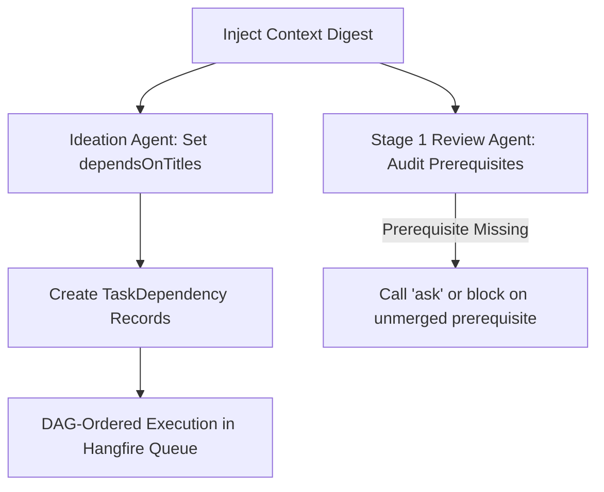
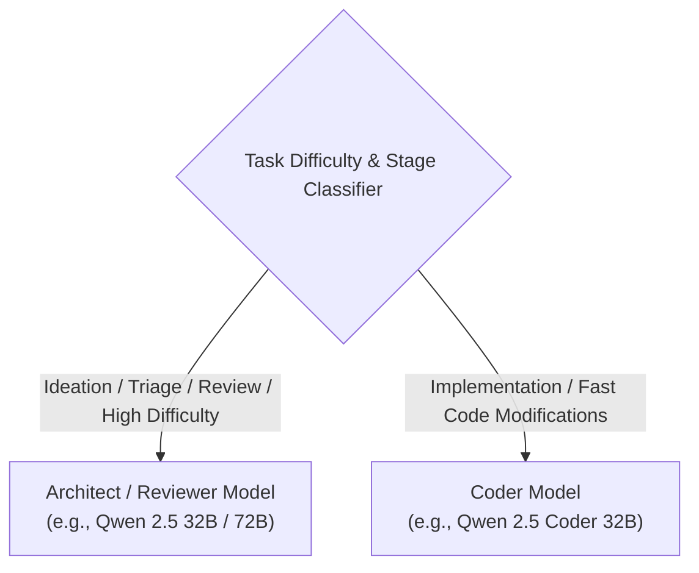
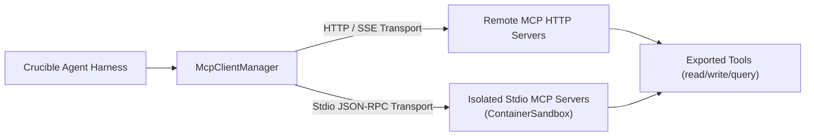
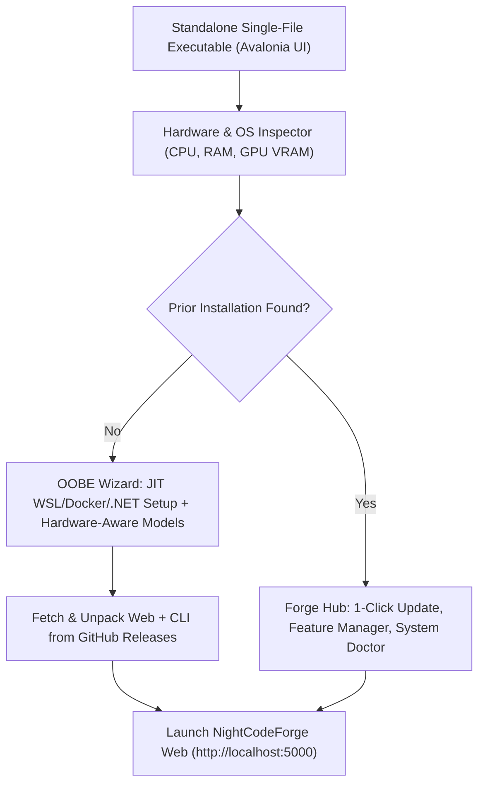

# 🧩 Phase 12: Extend Features & Integrations

> **Architectural Specification & Implementation Roadmap**  
> *Parent Plan:* [docs/PLAN.md](../PLAN.md) | *Dependencies:* Phase 4 (Harnesses & Sandboxing), Phase 5 (Web UI), Phase 8 (Database-Driven Workflows), Phase 9 (Codebase Remediation & Robustness), Phase 10 (MVP Final Polish), Phase 11 (Real-Project Onboarding, Hardening & Bug Fixes)  
> *Status:* Active / In Progress | *Target Framework:* .NET 10 (C# 13)

---

## 1. Executive Summary & Strategic Prioritization

Following the stabilization, real-project onboarding, and hardening completed in **Phase 11** (which delivered dedicated task creation, temporal state audit history, packaged agent skills, `ncf` CLI, priority scheduling, telemetry console, dynamic timeouts, worktree relative paths, task rejection, fine-grained workspace locks, autonomous Git conflict resolution, and container lifecycle cleanup), **Phase 12 (Extend Features & Integrations)** delivers advanced developer ergonomics, multi-task intelligence, and deep ecosystem integrations.

The roadmap is prioritized into three strategic delivery tiers:

1. **Tier 1: Real-Project Backlog Management & Dependencies (Top Priority):**
   - **Step 12.1:** Intelligent Task Dependency Detection in Ideation & Review Agents (formerly Step 11.14) — lightweight backlog context injection, DAG relationship inference, cycle rejection, and prerequisite enforcement.
   - **Step 12.2:** Task Attachments & Context Documents (formerly Step 11.16) — workspace-level read-only `attachments/` store (sibling of clone and task worktrees) populated from file drops, cited host paths, and URL captures (MarkItDown companions), citable by ideation (`@attachment:{id}`) and readable by workflow stage agents.
   - **Step 12.3:** Conversational UI Unification, Review Room & Task Detail Ergonomics, Inspector Grouping & Running State Hygiene (formerly Step 11.19) — reusing `AgentQuestionTurnCard` across Question Inbox and Task Inspector; fixing stepper false "Pending" indicators during active runs; unifying chat bubble styling; sticky navigation, hierarchical directory tree view, and syntax highlighting in Review Room; in-flight task card in live telemetry; `<optgroup>` status grouping in Task Inspector (Running, Waiting for Slot, Waiting for Human, Closed); strictly filtering out closed/merged tasks in Review Room; dedicated "Changes" diff tab in Task Details with "Open in Review Room" action; Review Room link to Task Details; and clean pulsing running badges on Kanban cards mirroring the DAG view.
   - **Step 12.4:** Ideation Quick Notes, Suggestions Backlog & Conversational Refinement (formerly Step 11.5) — quick notes backlog intake ("Think Now, Chat Later"); proposal card lifecycle (`Approve` $\rightarrow$ Open, `Keep as Suggestion` $\rightarrow$ Suggested, `Discard` $\rightarrow$ Delete); "Refine in Ideation" pre-seeded chat; scoped `edit_task` tools; 24h draft pruning.
   - **Step 12.13:** Conversational Backlog Management, Task Refinement & Scoped Mutation Tools in Ideation — enabling the ideation agent to inspect existing tasks on demand (`get_task`), enrich details, sub-tasks, and scope without prompt bloat (`edit_task`), rework priorities across the backlog (`set_task_priority`, `rework_priorities`), and safely remove unstarted tasks (`remove_task`) with DAG cycle checks, audit attribution, and markdown synchronization while preserving the strictly read-only workspace filesystem invariant; mandating upfront interactive functional and business ambiguity resolution (without mandating low-level technical impact or file identification) so all obvious questions are solved before scheduling (Stage 1 acts as a technical verification/drift guard); providing a direct "Refine in Ideation" entry point on Task Detail views; and aligning official skills (`ncf-backlog`).

2. **Tier 2: Intelligence, Efficiency & Quality Gates:**
   - **Step 12.5:** Heterogeneous Dual Model Role Configuration & Difficulty Escalation (formerly Step 11.1) — Architect/Reviewer model (e.g. Qwen 3.8 27B) for ideation, review, code review; Coder model (e.g. Qwen 3.6 35B A3B) for fast coding; dynamic difficulty escalation for difficult/expert tasks.
   - **Step 12.6:** Smart CLI & Build Tool Output Filtering (Context Compression) (formerly Step 11.3) — compiler and test noise suppression for 95% token savings, workspace path relativization, and preserving raw transcripts on disk.
   - **Step 12.7:** Free & Open-Source SAST Quality Gate via Microsoft DevSkim CLI (formerly Step 11.4) — deterministic SAST quality gate using Microsoft DevSkim CLI across C#, JS/TS, Python, Go; SARIF report parsing; and automatic loopback routing with diagnostics.
   - **Step 12.14:** Global Skills Injection & Stack-Specific Tool Provisioning (csnav, mdfetch, codecondenser) — central skill store on host (`~/.nightcodeforge/skills/`) and container sandbox (`/opt/nightcodeforge/skills/`), stack-driven provisioning via `CodeStackPresets`, transparent worktree injection via relative symlinks or bind-mounts with `.git/info/exclude` registration to avoid repository pollution, and first-class integration of PmadCSharpNav (`csnav`), MarkdownFetch (`mdfetch`), and PmadCodeCondenser (`codecondenser`).

3. **Tier 3: Deep Integrations & Remote Experience:**
   - **Step 12.8:** Mobile-Responsive Web UI, PWA & Web Worker Notifications (formerly Step 11.6) — off-canvas hamburger navigation drawer, touch targets $\ge 44\text{px}$, bottom sheet drawer, installable Progressive Web App (`manifest.webmanifest`, `service-worker.js`), and browser web notifications (dispatched via Web Worker / Service Worker on mobile) for human intervention (question inbox, review room) and task merges with per-subject user preferences.
   - **Step 12.9:** Custom Repository Scripts for Deterministic Steps (Bash, Python, PowerShell) (formerly Step 11.8) — execution of custom repository scripts in `.nightcodeforge/scripts/` during deterministic stages with `PipelineDataBag` environment variable injection.
   - **Step 12.10:** Model Context Protocol (MCP) Integration: HTTP Servers & ContainerSandbox Stdio (formerly Step 11.9) — first-class MCP tool discovery and execution via Microsoft Agent Framework standards (`ModelContextProtocol`), supporting streamable HTTP/SSE remote servers and isolated stdio MCP servers in `ContainerSandbox`.
   - **Step 12.11:** GitHub Integration: Untrusted Intake Triage, PR Delivery & Task Mirroring (formerly Step 11.10) — modular GitHub integration: untrusted issue intake routed to sandboxed triage to generate proposals, Pull Request delivery mode with rich PR metadata, and bi-directional status mirroring.
   - **Step 12.12:** Voice Support, Continuous Dictation & Hands-Free Operations (formerly Step 11.11) — hands-free voice operations via Web Speech API (`SpeechRecognition`) and Blazor JS Interop, continuous dictation with 1500ms silence detection, and ergonomic visual feedback.
   - **Step 12.15:** Deep OllamaRouter Fleet Provisioning & In-App Setup — in-app fleet management UI (`/settings` -> OllamaRouter tab) enabling developers to add, test, configure, and remove compute nodes across the local area network, pre-flight connectivity/latency testing, secure Cloud Overflow API key management, and interactive dynamic context visual tuning.
   - **Step 12.16:** Remote Tailscale Mesh Access, HTTPS & Transient Network Resilience — zero-firewall private mesh VPN access, automated MagicDNS Let's Encrypt TLS termination via attached `TailscaleServeHostedService` (or CLI trap), graceful shutdown cleanup with `tailscale serve reset` (zero desktop overhead when disabled), WebSocket reverse proxying for Blazor Interactive Server and SignalR telemetry, and transient network reconnection handling.
   - **Step 12.18:** Cross-Platform Desktop Installer, Updater & Setup Wizard (Avalonia UI) — standalone, self-contained single-file desktop application (`NightCodeForge.Installer`) for Windows, Linux, and macOS delivering a zero-clone, zero-scripting out-of-the-box experience (OOBE); fetches binary distributions of `NightCodeForge.Web` and `ncf` CLI directly from GitHub Releases; provisions WSL2, Docker Engine, .NET 10 SDK, and companion tools with JIT privilege elevation; runs an automated setup micro-benchmark on the host GPU/RAM to determine the optimal mix and context size across curated `jetelain/*` models (`jetelain/qwen3.6-35b-a3b`, `jetelain/qwen3.8-27b` with Q3/Q4, and `jetelain/qwen3.5-9b`) with Unsloth Dynamics, strictly enforcing a minimum 128k context window (`num_ctx >= 131,072`) per role; configures OllamaRouter mesh nodes; and acts as an ongoing desktop maintenance and software updater hub.

---

## 2. Implementation Steps Roadmap

### Priority Tier 1: Real-Project Backlog Management & Dependencies (Top Priority)

| Step | Specification | Focus & Key Deliverables | Status |
| :--- | :--- | :--- | :--- |
| **12.1** | [🔗 Step 12.1: Intelligent Task Dependency Detection in Ideation & Review Agents](phase-12/STEP_12_1_INTELLIGENT_TASK_DEPENDENCY_DETECTION.md) | Backlog context injection for Ideation and Stage 1 Review agents; system prompts requiring identification of prerequisites, shared interfaces, and ordering; auto-population of `dependsOnTitles` and DAG dependency chips in Kanban and Drawer. *(formerly Step 11.14)* | **Top Priority** |
| **12.2** | [📎 Step 12.2: Task Attachments & Context Documents](phase-12/STEP_12_2_TASK_ATTACHMENTS_AND_CONTEXT_DOCS.md) | Workspace-level read-only `attachments/` directory (sibling of clone & worktrees): intake via file drop, cited host paths, and URL captures with Pmad.Markitdown markdown companions; SHA-256 dedup & reusability; `@attachment:{id}` citations in tasks; read-only `list_attachments`/`read_attachment` tools for ideation and the three workflow stage agents; attachments picker on `/tasks/new`. *(formerly Step 11.16)* | **Top Priority** |
| **12.3** | [🎨 Step 12.3: Conversational UI Unification, Review Room & Task Detail Ergonomics, Inspector Grouping & Running State Hygiene](phase-12/STEP_12_3_CONVERSATIONAL_UI_UNIFICATION_AND_REVIEW_ERGONOMICS.md) | Reuse `AgentQuestionTurnCard` in `/inbox`, fix `PipelineStepper` false "Pending" state during active runs, unify `StageConversationViewer` with `Ideation` compact bubble layout, provide sticky file tree with `/inspector` and `/tasks/{id}` links, hierarchical tree view preventing path truncation, DiffViewer syntax highlighting, in-flight task display in live telemetry, `<optgroup>` status grouping in Task Inspector, strict pending reviews filtering in Review Room, dedicated "Changes" diff tab in Task Details with "Open in Review Room" button, and pulsing running markers on Kanban cards. *(formerly Step 11.19)* | Completed |
| **12.4** | [💡 Step 12.4: Ideation Quick Notes, Suggestions & Conversational Refinement](phase-12/STEP_12_4_IDEATION_QUICK_NOTES_SUGGESTIONS_AND_REFINEMENT.md) | Quick notes backlog intake ("Think Now, Chat Later"); proposal card lifecycle (`Approve` $\rightarrow$ Open, `Keep as Suggestion` $\rightarrow$ Suggested, `Discard` $\rightarrow$ Delete); "Refine in Ideation" pre-seeded chat; scoped `edit_task` tools; 24h draft pruning. *(formerly Step 11.5)* | Planned |
| **12.13** | [📋 Step 12.13: Conversational Backlog Management, Task Refinement & Scoped Mutation Tools in Ideation](phase-12/STEP_12_13_IDEATION_BACKLOG_MANAGEMENT_AND_TASK_MUTATION_TOOLS.md) | Equips read-only ideation agent with scoped host-level tools (`get_task`, `edit_task`, `set_task_priority`, `rework_priorities`, `remove_task`) to inspect, refine details/sub-tasks, rework priorities, and remove unstarted tasks (`Draft`, `Suggested`, `Open`) while enforcing read-only workspace safety, DAG cycle validation, audit logging, and markdown disk sync; mandates upfront functional/business question resolution in ideation prompts without requiring technical file mapping (Stage 1 becomes technical verification guard); adds "Refine in Ideation" button to Task Detail views; aligns `ncf-backlog` skill. | Planned |
| **12.17** | [📜 Step 12.17: Follow Trail Auto-Scroll & Bottom-Right Action in Task Execution Inspector & Reasoning Trace](phase-12/STEP_12_17_FOLLOW_TRAIL_AUTO_SCROLL_INSPECTOR_AND_REASONING_TRACE.md) | Universal reasoning trace auto-scroll tracking in Ideation Chat and Task Execution Inspector, mounting a floating follow-trail button at the bottom-right of `StageConversationViewer`, dual-tier pinning of stream and open `.think-content`, non-intrusive decoupling on manual upward scroll, and bUnit test coverage. | Planned |

### Priority Tier 2: Intelligence, Efficiency & Quality Gates

| Step | Specification | Focus & Key Deliverables | Status |
| :--- | :--- | :--- | :--- |
| **12.5** | [🧠 Step 12.5: Dual Model Role Configuration & Difficulty Escalation](phase-12/STEP_12_5_DUAL_MODEL_ROLE_CONFIGURATION_AND_DIFFICULTY_ESCALATION.md) | Heterogeneous model architecture: Architect/Reviewer model (e.g. Qwen 3.8 27B) for ideation, review, code review; Coder model (e.g. Qwen 3.6 35B A3B) for fast coding; dynamic difficulty escalation for difficult/expert tasks. *(formerly Step 11.1)* | Planned |
| **12.6** | [🧹 Step 12.6: Smart CLI & Build Tool Output Filtering (Context Compression)](phase-12/STEP_12_6_SMART_CLI_AND_BASH_OUTPUT_FILTERING.md) | Semantic output filtering for verbose CLI tools (`dotnet build`, `dotnet test`, `npm`). Relativizes paths, strips SDK boilerplates, drops non-fatal warnings when errors exist, preserving raw transcripts on disk. *(formerly Step 11.3)* | Planned |
| **12.7** | [🛡️ Step 12.7: Free & Open-Source SAST Quality Gate via Microsoft DevSkim CLI](phase-12/STEP_12_7_DEVSKIM_SAST_QUALITY_GATE.md) | Deterministic SAST quality gate using Microsoft DevSkim CLI across C#, JS/TS, Python, Go. SARIF report parsing, configurable severity thresholds, and automatic loopback routing with diagnostics. *(formerly Step 11.4)* | Planned |
| **12.14** | [📦 Step 12.14: Global Skills Injection & Stack-Specific Tool Provisioning (csnav, mdfetch, codecondenser)](phase-12/STEP_12_14_GLOBAL_SKILLS_INJECTION_AND_STACK_TOOLING.md) | Central global skills store (`~/.nightcodeforge/skills/`), stack-driven skill mapping via `CodeStackPresets`, transparent worktree injection (symlink / bind-mount with zero git pollution), and integration of `csnav` (C# navigation & BCL/NuGet decompiler), `mdfetch` (markdown fetcher), and `codecondenser` (clone detection). | Planned |

### Priority Tier 3: Deep Integrations & Remote Experience

| Step | Specification | Focus & Key Deliverables | Status |
| :--- | :--- | :--- | :--- |
| **12.8** | [📱 Step 12.8: Mobile-Responsive Web UI, PWA & Web Worker Notifications](phase-12/STEP_12_8_MOBILE_RESPONSIVE_UI_AND_PWA.md) | First-class mobile/tablet responsiveness: off-canvas hamburger navigation drawer, touch targets $\ge 44\text{px}$, fixed-bottom ideation chat, mobile bottom sheet drawer, installable PWA (`manifest.webmanifest`, `service-worker.js`), and browser web notifications (dispatched via Web Worker / Service Worker on mobile) with per-subject user preferences. *(formerly Step 11.6)* | Planned |
| **12.9** | [📜 Step 12.9: Custom Repository Scripts for Deterministic Steps (Bash, Python, PowerShell)](phase-12/STEP_12_9_CUSTOM_SCRIPTS_FOR_DETERMINISTIC_STEPS.md) | Execution of custom repository scripts in `.nightcodeforge/scripts/` during deterministic stages across Bash, Python, and PowerShell. Injection of `PipelineDataBag` environment variables and output directives. *(formerly Step 11.8)* | Planned |
| **12.10** | [⚡ Step 12.10: Model Context Protocol (MCP) Integration: HTTP Servers & ContainerSandbox Stdio](phase-12/STEP_12_10_MCP_HTTP_AND_CONTAINER_SANDBOX_INTEGRATION.md) | First-class MCP tool discovery and execution via Microsoft Agent Framework standards (`ModelContextProtocol`), streamable HTTP/SSE remote servers, and isolated stdio MCP servers in `ContainerSandbox`. *(formerly Step 11.9)* | Planned |
| **12.11** | [🐙 Step 12.11: GitHub Integration (Untrusted Intake Triage, PR Delivery & Task Mirroring)](phase-12/STEP_12_11_GITHUB_INTEGRATION_ISSUES_AND_PRS.md) | Modular GitHub integration: untrusted issue intake routed to sandboxed triage to generate proposals, Pull Request delivery mode with rich PR metadata, and bi-directional status mirroring. *(formerly Step 11.10)* | Planned |
| **12.12** | [🎙️ Step 12.12: Voice Support, Continuous Dictation & Hands-Free Operations](phase-12/STEP_12_12_VOICE_SUPPORT_AND_CONTINUOUS_DICTATION.md) | Hands-free voice operations via Web Speech API (`SpeechRecognition`) and Blazor JS Interop. Continuous dictation with 1500ms silence detection and visual audio feedback. *(formerly Step 11.11)* | Planned |
| **12.15** | [🌐 Step 12.15: Deep OllamaRouter Fleet Provisioning & In-App Setup](phase-12/STEP_12_15_DEEP_OLLAMAROUTER_FLEET_PROVISIONING_AND_IN_APP_SETUP.md) | In-app fleet provisioning UI in `/settings` to add, test, configure, and remove LAN compute nodes, live connectivity testing, secure Cloud Overflow API key management, and dynamic context visual tuning. Consumes OllamaRouter Tasks #19 and #20 (durable user configuration layer). | Planned |
| **12.16** | [🔒 Step 12.16: Remote Tailscale Mesh Access, HTTPS & Transient Network Resilience](phase-12/STEP_12_16_TAILSCALE_REMOTE_ACCESS.md) | Zero-firewall private mesh VPN remote access, automated MagicDNS Let's Encrypt TLS termination via attached `TailscaleServeHostedService`, graceful shutdown cleanup (`tailscale serve reset`), WebSocket reverse proxying for Blazor circuits, and network shift resilience. | Planned |
| **12.18** | [🖥️ Step 12.18: Cross-Platform Desktop Installer, Updater & Setup Wizard](phase-12/STEP_12_18_CROSS_PLATFORM_DESKTOP_INSTALLER_AND_ENVIRONMENT_WIZARD.md) | Standalone self-contained Avalonia UI desktop application across Windows, Linux, and macOS. Zero-clone GitHub Releases binary deployment, automated host/WSL2/Docker/.NET provisioning with JIT privilege elevation, in-wizard micro-benchmark finding optimal mix of curated `jetelain/*` Unsloth Dynamic models (`qwen3.6-35b-a3b`, `qwen3.8-27b` Q3/Q4, `qwen3.5-9b`) with strict $\ge 128\text{k}$ context guarantee, OllamaRouter mesh fleet setup, and post-install maintenance & 1-click update hub. | Planned |

---

## 3. High-Level Architecture Overview

### 3.1 Step 12.1: Intelligent Task Dependency Detection

### 3.2 Step 12.2: Task Attachments & Context Documents

```mermaid
flowchart LR
    subgraph Intake ["Intake Channels"]
        Drop["File Drop / Web UI Upload"]
        HostPath["Host Path Citation"]
        UrlCap["URL Web Capture (MarkItDown)"]
    end

    subgraph Store ["Workspace Attachments Store (~/.nightcodeforge/wks/{id}/attachments)"]
        Files["Immutable SHA-256 Storage"]
        Meta["manifest.json & TaskAttachments Table"]
    end

    subgraph Agents ["Read-Only Agent Consumption"]
        Ideation["Ideation Agent (@attachment:{id})"]
        StageReview["Stage 1 Review Agent"]
        StageImpl["Stage 2 Implementation Agent"]
        StageFix["Stage 3 Code Review & Fix Agent"]
    end

    Intake --> Store
    Store --> Agents
```

### 3.3 Step 12.5: Heterogeneous Dual Model Architecture

### 3.4 Step 12.10: Model Context Protocol (MCP) Integration

### 3.5 Step 12.18: Cross-Platform Desktop Installer & Maintenance Hub

---

## 4. Phase 12 Definition of Done (DoD) Checklist

### Tier 1 Deliverables (Top Priority)
- [ ] **Step 12.1 (Intelligent Task Dependency Detection):**
  - [ ] Implement `IWorkspaceBacklogSummaryService` generating compact `<existing_workspace_tasks>` digests (excluding archived/closed tasks, capped to top 15–20 active tasks by priority order).
  - [ ] Inject existing backlog digest into `IdeationService` system prompt with circular dependency prohibition.
  - [ ] Inject existing backlog digest and dependency directives into Stage 1 Task Review directive in `CrucibleAgentHarness`.
  - [ ] Direct Stage 1 Review Agent to populate `depends_on` in YAML frontmatter (with rationale under `## Dependencies`), enforce cycle rejection loopback, and verify `TaskMarkdownSyncService` dependency synchronization.
  - [ ] Implement dynamic task suspension and full workflow reset in `TaskOrchestrator`: if Stage 1 reveals unclosed prerequisites, reset `task.Status = Open` and `CurrentStageId = TaskReview` to rerun full workflow once prerequisites close.
  - [ ] Render clickable prerequisite and downstream dependency chips in `KanbanCard.razor` and `TaskDetailDrawer.razor`.

- [ ] **Step 12.2 (Task Attachments & Context Documents):**
  - [ ] Create `attachments/` store sibling to the canonical clone and task worktrees, with `manifest.json` registry and `TaskAttachments` / `TaskAttachmentLinks` EF Core tables.
  - [ ] Implement `IAttachmentIntakeService`: file drop, cited host-path copy, and URL capture (SSRF-guarded) with MarkItDown markdown companions and SHA-256 deduplication.
  - [ ] Register read-only `list_attachments` / `read_attachment` tools for ideation and the three workflow stage agents; inject attachments digests into ideation and stage prompts.
  - [ ] Support `@attachment:{id}` citations in task descriptions, materialized as `TaskAttachmentLinks` on task creation (hard error on unknown IDs).
  - [ ] Build Web UI: chat drop zone + attachment chips, workspace attachments panel with preview drawer, attachments picker on `/tasks/new`, and user-only delete.

- [x] **Step 12.3 (Conversational UI Unification, Review Room & Task Detail Ergonomics, Inspector Grouping & Running State Hygiene):**
  - [x] Enhance `AgentQuestionTurnCard.razor` with task metadata header (Task #Id, Title, Stage, Time) and reuse in `Inbox.razor` / `QuestionCard.razor`.
  - [x] Fix `PipelineStepper.razor` to preserve `StageExecutionStatus.Running` when `OverallStatus == TaskOverallStatus.InProgress` or stage conversation is running.
  - [x] Explicitly pass `CurrentStageStatus` in `TaskExecutionInspector.razor` to `<PipelineStepper>`.
  - [x] Unify `StageConversationViewer.razor` with `Ideation.razor` compact chat bubble architecture, avatar column, inline `
`, and compact `
`.
  - [x] Style `.file-tree` in `Review.razor` with sticky positioning (`position: sticky; top: 1rem; max-height: calc(100vh - 2rem)`).
  - [x] Add deep link buttons to `/inspector/@_snapshot.TaskId` and `/tasks/@_snapshot.TaskId` in `Review.razor` header.
  - [x] Update `TaskReviewService.GetPendingReviewsAsync` and `Review.razor` to strictly filter out closed and merged tasks (`Status != TaskOverallStatus.Closed`).
  - [x] Implement `ReviewFileTreeBuilder` helper class in `NightCodeForge.Web.Services` creating hierarchical `ReviewFileTreeNode` tree with folder grouping and single-child compression.
  - [x] Update `Review.razor` left panel to render hierarchical tree view ensuring filename is always visible.
  - [x] Implement `ISyntaxHighlightingService` / `SimpleSyntaxHighlighter` tokenizing C#, TS/JS, Python, JSON, XML, Shell code lines into safe HTML spans.
  - [x] Integrate syntax highlighting in `DiffViewer.razor` for both Side-by-Side and Unified views.
  - [x] Implement `TaskInspectorGroupingHelper` in `NightCodeForge.Web.Services` and update `TaskExecutionInspector.razor` dropdown with `<optgroup>` categories (Running, In Flight waiting for slot, Waiting for Human, Closed) sorted by priority.
  - [x] Add an In-Flight Task Card / Banner in `ActiveOperationsHero.razor` on `/monitoring` showing active task metadata, active stage, and direct navigation links.
  - [x] Implement `ITaskDiffService` and add a "Changes" (Diff) tab in `TaskDetail.razor` embedding `DiffViewer.razor` for both active and closed/merged tasks.
  - [x] Add a prominent `🔍 Open in Review Room` primary action button in `TaskDetail.razor` header when `task.Status == TaskOverallStatus.Ready`.
  - [x] Add explicit running indicator badges (`● Running` with pulse glow animation) and active stage styling on `KanbanCard.razor` matching the DAG view in-flight indicator.

- [ ] **Step 12.4 (Ideation Quick Notes & Suggestions):**
  - [ ] Quick notes intake bar with instant save to `Suggested` state.
  - [ ] Proposal card tri-state actions (`Approve`, `Keep as Suggestion`, `Discard`).
  - [ ] "Refine in Ideation" action pre-seeding context and questions.
  - [ ] Scoped `edit_task` agent tools.
  - [ ] 24-hour draft pruning.

- [ ] **Step 12.13 (Conversational Backlog Management & Mutation Tools):**
  - [ ] Define `TaskCannotBeModifiedException` and enforce fail-fast hard errors on in-progress or closed tasks.
  - [ ] Implement `get_task` tool fetching full task specifications on demand.
  - [ ] Implement `edit_task` tool updating title, description, sub-tasks, priority, and dependencies for unstarted tasks (`Draft`, `Suggested`, `Open`).
  - [ ] Implement `set_task_priority` and `rework_priorities` tools for conversational backlog reordering.
  - [ ] Implement `remove_task` tool with active dependent validation.
  - [ ] Enforce audit logging via `AuditActors.IdeationAgent` and markdown disk synchronization via `ITaskMarkdownSyncService`.
  - [ ] Mandate upfront functional and business ambiguity resolution in `IdeationService` prompts (`<task_planning_guidelines>`) and `AgentProfile` persona, explicitly clarifying that ideation is not mandated to identify all technical impacts (e.g. files).
  - [ ] Inject `<backlog_management_guidelines>` into `IdeationService` system prompt.
  - [ ] Add "💡 Refine in Ideation" button to `TaskDetail.razor` and `TaskDetailDrawer.razor` with `?taskId={id}` routing.
  - [ ] Align `skills/ncf-backlog/SKILL.md` with zero-surprise scheduling and mandatory interactive interview.

### Tier 2 Deliverables (Intelligence, Efficiency & Quality Gates)
- [ ] **Step 12.5 (Dual Model Role Configuration):**
  - [ ] Architect/Reviewer model vs Coder model configuration in `AgentProfile`.
  - [ ] Dynamic escalation on difficult tasks.
- [ ] **Step 12.6 (Smart CLI Output Filtering):**
  - [ ] Compiler and test noise suppression for verbose tools (`dotnet build`, `dotnet test`, `npm`).
  - [ ] Workspace path relativization.
- [ ] **Step 12.7 (DevSkim SAST Quality Gate):**
  - [ ] Microsoft DevSkim CLI integration with SARIF report parsing.
  - [ ] Loopback diagnostics on security violations.

### Tier 3 Deliverables (Deep Integrations & Remote Experience)
- [ ] **Step 12.8 (Mobile Responsive UI & PWA):**
  - [ ] Off-canvas navigation drawer and touch targets $\ge 44\text{px}$.
  - [ ] Mobile bottom sheet drawer and touch-friendly question cards.
  - [ ] Progressive Web App (PWA) manifest (`manifest.webmanifest`) and service worker (`service-worker.js`).
  - [ ] Browser web notifications (dispatched via Web Worker / Service Worker on mobile) for human intervention (question inbox, review room) and task merges with per-subject preference toggles.
- [ ] **Step 12.9 (Custom Repository Scripts):**
  - [ ] Support `.nightcodeforge/scripts/` (.sh, .py, .ps1).
  - [ ] PipelineDataBag environment variable injection.
- [ ] **Step 12.10 (MCP Integration):**
  - [ ] Streamable HTTP/SSE and containerized stdio MCP transports.
- [ ] **Step 12.11 (GitHub Integration):**
  - [ ] Sandboxed issue triage, Pull Request delivery, and bi-directional status mirroring.
- [ ] **Step 12.12 (Voice Support & Continuous Dictation):**
  - [ ] Web Speech API JS interop, 1500ms silence detection, and `VoiceInputButton.razor` component.
  - [ ] Integration with Ideation prompt bar, Quick Notes modal, and Question Inbox.
- [ ] **Step 12.16 (Remote Tailscale Mesh Access):**
  - [ ] Kestrel `ForwardedHeadersOptions` for `X-Forwarded-Proto` and `X-Forwarded-For`.
  - [ ] Tailscale Serve configuration with MagicDNS Let's Encrypt TLS termination.
  - [ ] Transient network reconnection resilience and operational tooling (`tools/tailscale-serve.ps1`).
- [ ] **Step 12.18 (Cross-Platform Desktop Installer, Updater & Setup Wizard):**
  - [ ] Scaffold `NightCodeForge.Installer` with Avalonia UI 11+ and `CommunityToolkit.Mvvm` targeting .NET 10.
  - [ ] Implement `IHardwareInspectorService` detecting CPU architecture, RAM, and GPU VRAM across Windows, Linux, and macOS.
  - [ ] Implement `IHardwareMicroBenchmarkService` running automated setup micro-benchmarks on curated `jetelain/*` Unsloth Dynamic models (`qwen3.6-35b-a3b`, `qwen3.8-27b` Q3/Q4, `qwen3.5-9b`), enforcing a strict $\ge 128\text{k}$ context guarantee (`num_ctx >= 131,072`) per role with KV cache quantization probing (`q4_0` / `q8_0`).
  - [ ] Implement `IEnvironmentProvisioner` managing JIT elevation for WSL2 setup, Docker Engine, .NET 10 SDK, and companion CLI tools.
  - [ ] Implement `IOllamaManager` handling Ollama service verification, model streaming/pulling, and OllamaRouter mesh node setup.
  - [ ] Implement `IReleaseManager` querying GitHub Releases API, streaming binary assets with SHA-256 verification, and atomic unpacking.
  - [ ] Implement dual-mode UX: OOBE Wizard on first run with benchmark visualization, Maintenance & Updater Hub on subsequent launches with "Doctor" diagnostics and 1-click update.
  - [ ] Configure multi-platform self-contained single-file publish workflow for `win-x64`, `linux-x64`, and `osx-arm64`.
