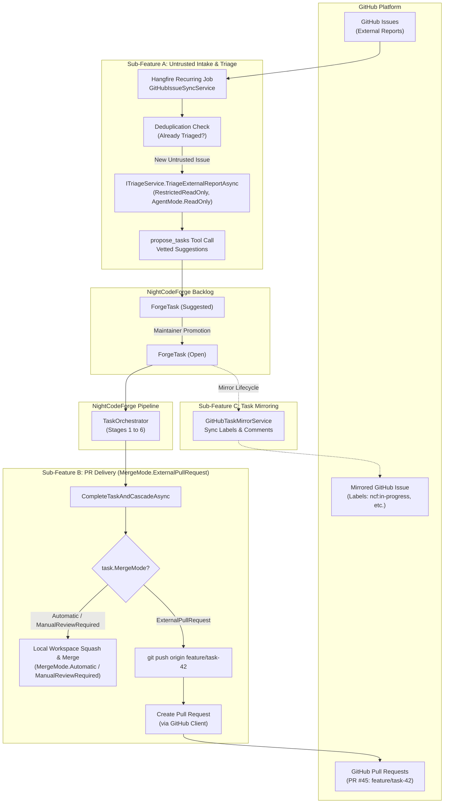

# 🐙 Step 10.10: GitHub Integration (Untrusted Intake Triage, PR Delivery & Task Mirroring)

> **Phase 10 Implementation Step**  
> *Parent Plan:* [Phase 10 Master Plan](../10_EXTEND_FEATURES.md)  
> *Project Target:* `src/NightCodeForge.Infrastructure/GitHub`, `src/NightCodeForge.Agents/Triage`, `src/NightCodeForge.Core/Workflow`, `src/NightCodeForge.Web`, `tests/NightCodeForge.Infrastructure.Tests` | *Status:* Planned

---

## 1. Executive Objective

Provide a modular, **fully optional** GitHub integration enabling autonomous, secure, and bi-directional synchronization with GitHub repositories across three distinct sub-features:

1. **Sub-Feature A: Untrusted Issue Intake & Automated Triage (Optional):**
   - GitHub issues from external contributors, public users, or bug reports are treated as **untrusted external inputs**.
   - Instead of blindly mapping 1:1 to executable tasks, discovered issues are routed directly into the **Untrusted Intake / Triage Pipeline** via [ITriageService.TriageExternalReportAsync](file:///c:/Users/Julien/source/repos/jetelain/NightCodeForge/src/NightCodeForge.Agents/Triage/TriageService.cs).
   - The Triage Agent executes strictly in `SandboxSecurityTier.RestrictedReadOnly` and `AgentMode.ReadOnly` against the base branch. It inspects the codebase, verifies reproducibility, determines affected components, and invokes `propose_tasks` to create structured, vetted backlog items in [TaskOverallStatus.Suggested](file:///c:/Users/Julien/source/repos/jetelain/NightCodeForge/src/NightCodeForge.Core/Domain/Enums.cs) with references back to the originating issue number.

2. **Sub-Feature B: Pull Request Delivery Mode via `MergeMode.ExternalPullRequest` (Optional):**
   - Provide an alternative to direct squash-and-merge into the developer's local working copy: deliver completed tasks via **GitHub Pull Requests**.
   - Configured directly on the task via **[MergeMode.ExternalPullRequest](file:///c:/Users/Julien/source/repos/jetelain/NightCodeForge/src/NightCodeForge.Core/Domain/Enums.cs)**.
   - Pushes the isolated feature branch (`feature/task-{id}`) to the remote GitHub repository.
   - Opens a GitHub Pull Request against `task.BaseBranch` with an automated summary markdown description detailing:
     - Task objective & resolution summary
     - Stage execution history & duration metrics
     - Deterministic quality gate metrics (Code coverage delta, linter ratchet status, test results)
     - Link to local NightCodeForge Task Inspector and diff review.
   - Review Room UI displays **"Create / Open Pull Request"** with link to the GitHub PR.
   - Optional webhook listener or periodic poller to transition task status to [TaskOverallStatus.Closed](file:///c:/Users/Julien/source/repos/jetelain/NightCodeForge/src/NightCodeForge.Core/Domain/Enums.cs) once the PR is merged on GitHub.

3. **Sub-Feature C: Task Mirroring & Bi-Directional State Synchronization (Optional):**
   - Synchronize internal [ForgeTask](file:///c:/Users/Julien/source/repos/jetelain/NightCodeForge/src/NightCodeForge.Core/Domain/ForgeTask.cs) lifecycle milestones with GitHub:
     - Automatically create or link a corresponding GitHub Issue when a task is promoted to `Open`.
     - Mirror stage progression through labels (e.g. `ncf:in-progress`, `ncf:under-review`, `ncf:ready`) and post milestone comments (e.g. stage review completion, deterministic gate pass/fail).
     - Synchronize closure: when the task is `Closed` or when the associated GitHub Issue is closed by a maintainer, reflect status updates bi-directionally.

---

## 2. Configuration & Domain Extensions

Each sub-feature can be enabled or disabled independently per workspace:

### 2.1 Workspace Configuration (`GitHubIntegrationSettings`)
Stored in workspace settings or JSON configuration:
```csharp
public class GitHubIntegrationSettings
{
    public bool Enabled { get; set; } = false;
    public string? RepositoryOwner { get; set; }
    public string? RepositoryName { get; set; }
    public string? ApiToken { get; set; } // Or reference to environment variable GITHUB_TOKEN
    
    // Sub-feature A: Untrusted Issue Intake & Triage
    public bool IssueTriageEnabled { get; set; } = false;
    public string? IssueFilterLabel { get; set; } // e.g. "needs-triage" or "nightcodeforge"
    public int PollingIntervalMinutes { get; set; } = 15;

    // Sub-feature B: PR Delivery
    public bool PullRequestDeliveryEnabled { get; set; } = false;
    public bool CreateAsDraft { get; set; } = false;
    public bool CloseTaskOnPrMerge { get; set; } = true;

    // Sub-feature C: Task Mirroring
    public bool TaskMirroringEnabled { get; set; } = false;
    public bool SyncStatusLabels { get; set; } = true;
    public bool PostMilestoneComments { get; set; } = true;
}
```

### 2.2 Domain Alignment with `MergeMode`
Rather than introducing a parallel delivery mode or merge strategy, GitHub PR delivery is fully unified with the core **[MergeMode](file:///c:/Users/Julien/source/repos/jetelain/NightCodeForge/src/NightCodeForge.Core/Domain/Enums.cs)** enumeration:

```csharp
public enum MergeMode
{
    Automatic = 0,             // Auto-squashes and merges to base branch once status reaches Ready
    ManualReviewRequired = 1,  // Maintainer manually reviews diff/tests before triggering merge in UI
    ExternalPullRequest = 2    // Pushes branch to origin and opens a GitHub PR (enabled when GitHub is active)
}
```

- **`ForgeTask.MergeMode`:** Set to `MergeMode.ExternalPullRequest` when PR delivery is selected.
- **`ForgeTask.ExternalSource`:** `"GitHub"` (set when created from an issue or linked to a repository).
- **`ForgeTask.ExternalReferenceId`:** `#123` (Issue or PR number).
- **`ForgeTask.PullRequestUrl`:** URL to created GitHub PR (e.g. `https://github.com/owner/repo/pull/45`).
- **UI Availability:** When `GitHubIntegrationSettings.Enabled && PullRequestDeliveryEnabled` is true, `MergeMode.ExternalPullRequest` is enabled as an option across the dedicated creation page (`/tasks/new`), backlog promotion modals, triage approval cards, and the task detail drawer.

---

## 3. High-Level Architecture & Workflow



---

## 4. Sub-Feature A: Untrusted Issue Intake & Triage Specification

### 4.1 Ingestion & Sandbox Triage Flow
1. **Discovery:** `GitHubIssueSyncService` queries the GitHub REST API for new issues matching the configured label or filter.
2. **Deduplication:** Verifies that issue `#number` has not already been triaged or processed.
3. **Untrusted Triage Execution:**
   - Wraps the issue payload into `TriageReportRequest`:
     - `Title = issue.Title`
     - `Description = issue.Body`
     - `BaseBranch = workspace.DefaultBaseBranch`
     - `Metadata["Source"] = "GitHub"`
     - `Metadata["IssueNumber"] = issue.Number.ToString()`
   - Dispatches to [ITriageService.TriageExternalReportAsync](file:///c:/Users/Julien/source/repos/jetelain/NightCodeForge/src/NightCodeForge.Agents/Triage/TriageService.cs).
4. **Isolated Sandboxing:**
   - The Triage Agent runs with `AgentMode.ReadOnly` in `SandboxSecurityTier.RestrictedReadOnly`.
   - Cannot mutate workspace files or access external internet.
   - Evaluates the report against the base branch, verifies code context, and calls `propose_tasks`.
5. **Backlog Population:**
   - Emits structured task proposals saved as `ForgeTask` in `TaskOverallStatus.Suggested`.
   - Links each proposal back to `ExternalReferenceId = issue.Number.ToString()`.
6. **Issue Acknowledgment (Optional):**
   - Posts a status comment on the GitHub issue:
     > 🤖 *NightCodeForge Untrusted Intake has triaged this report. 1 backlog item proposed for maintainer review.*

---

## 5. Sub-Feature B: Pull Request Delivery Specification

### 5.1 Pull Request Generation Flow
When a task reaches completion and `task.MergeMode == MergeMode.ExternalPullRequest`:
1. **Push Branch:** The orchestrator pushes `feature/task-{id}` to the configured GitHub remote (`git push origin feature/task-{id}`).
2. **Build PR Body:** Formats a structured PR description:
   ```markdown
   ## 🚀 Autonomous Implementation: Task #{TaskId} - {TaskTitle}
   
   Resolves #{IssueNumber}
   
   ### 📋 Summary
   {TaskDescription}
   
   ### 🛡️ Quality Gate Verification Results
   - **Build Status:** ✅ Passed
   - **Test Suite:** ✅ Passed (0 failures)
   - **Coverage Delta:** 📈 +1.2% (Baseline: 82.1% -> Current: 83.3%)
   - **Linter / Warning Ratchet:** ✅ 0 new compiler warnings
   
   ---
   *Generated by [NightCodeForge](https://github.com/jetelain/NightCodeForge)*
   ```
3. **Open Pull Request:** Invokes GitHub API `POST /repos/{owner}/{repo}/pulls` with `head = feature/task-{id}`, `base = task.BaseBranch`.
4. **UI Presentation:** The Review Room renders a badge with link to the PR and status (Open, Merged, Draft).

---

## 6. Sub-Feature C: Task Mirroring Specification

### 6.1 State & Label Synchronization
When a `ForgeTask` changes status or advances stages:

| ForgeTask State | GitHub Issue Label | Action / Comment |
| :--- | :--- | :--- |
| **`Open`** | `ncf:backlog` | Create or link GitHub Issue; mark as accepted into backlog. |
| **`Reviewed`** | `ncf:in-progress` | Post comment with generated task implementation plan. |
| **`Implemented`** | `ncf:gates-passed` | Update labels; post deterministic test & coverage metrics. |
| **`Ready`** | `ncf:ready-for-review` | Ready for maintainer review or PR creation. |
| **`Closed`** | `ncf:closed` | Close GitHub Issue with reference to commit SHA or merged PR. |

---

## 7. Implementation Checklist & Deliverables

- [ ] **GitHub Client Abstraction (`IGitHubClientService`):**
  - Implement client using `HttpClient` or `Octokit` with strict constructor DI and fail-fast validation.
  - Implement `ListIssuesAsync(owner, repo, label)`, `CreateIssueAsync`, `UpdateIssueAsync`, and `CreatePullRequestAsync`.
- [ ] **Sub-Feature A (Untrusted Intake & Triage):**
  - Register Hangfire recurring job `GitHubIssueSyncService.SyncOpenIssuesAsync`.
  - Feed issues into `ITriageService.TriageExternalReportAsync` in `RestrictedReadOnly` sandbox.
  - Ingest proposals into `Suggested` tasks with `ExternalReferenceId`.
- [ ] **Sub-Feature B (PR Delivery via `MergeMode.ExternalPullRequest`):**
  - Extend [ITaskOrchestrator](file:///c:/Users/Julien/source/repos/jetelain/NightCodeForge/src/NightCodeForge.Core/Workflow/ITaskOrchestrator.cs) and [TaskOrchestrator](file:///c:/Users/Julien/source/repos/jetelain/NightCodeForge/src/NightCodeForge.Core/Workflow/TaskOrchestrator.cs) to support `MergeMode.ExternalPullRequest`.
  - Push branch and create rich markdown PRs.
- [ ] **Sub-Feature C (Task Mirroring):**
  - Implement `GitHubTaskMirrorService` to synchronize labels and post progress comments on stage transitions.
- [ ] **Blazor UI Integration:**
  - Workspace settings tab: GitHub configuration inputs (Owner, Repo, Token, Sub-feature Toggles).
  - Review Room UI: Render "Open GitHub Pull Request" link button when PR delivery is active.
- [ ] **Unit & Mock Tests:**
  - Test untrusted triage integration and deduplication.
  - Test PR body markdown formatting and quality gate extraction.
  - Test task mirroring label updates.
