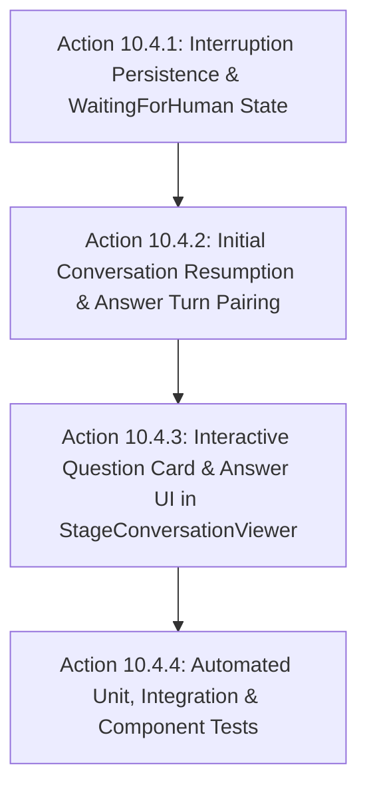

# 💬 Step 10.4: Crucible Interactive Ask Tool & Conversation Resumption

> **Phase 10 Implementation Step**  
> *Parent Plan:* [Phase 10 Master Plan](../10_MVP_FINAL_POLISH.md) | *Source Policy:* [AGENTS.md](../../../AGENTS.md)  
> *Status:* Ready for Execution | *Target Framework:* .NET 10 (C# 13)  

---

## 1. Executive Summary & Problem Analysis

### Reported Issues
1. **Empty Chat History on Interruption:** In Crucible, when an agent invokes the `ask` tool, nothing appears in the stage conversation / chat history in the UI.
2. **Conversation Fragmentation on Resumption:** When the human answers the question(s), Crucible starts a brand new conversation from scratch with the bootstrap prompt, abandoning the initial conversation and fragmenting the audit trail into disconnected "Run 1", "Run 2" attempts.

### Root Cause Analysis

```mermaid
flowchart TD
    subgraph Current ["Current Broken Flow"]
        A1["LLM calls ask(questions)"] --> A2["AskHandler cancels interruptionCts<br/>throws OperationCanceledException"]
        A2 --> A3["CompleteWithInterruptionAsync updates in-memory chatHistory only<br/>no guaranteed ask turn in DB"]
        A3 --> A4["SaveTranscriptAsync maps WaitingForHuman to Running<br/>and CompleteConversationAsync sets CompletedAt = DateTime.UtcNow"]
        A4 --> A5["UI: StageConversationViewer loads DB turns -> question may be missing!"]
        A5 --> A6["Human answers in Inbox -> SubmitAnswersAsync enqueues llm-urgent"]
        A6 --> A7["CrucibleAgentHarness.RunStageAsync runs<br/>Calls StartConversationAsync UNCONDITIONALLY<br/>Spawns brand new conversation + duplicate User prompt!"]
    end

    subgraph Target ["Target Resilient Flow (Step 10.4)"]
        B1["LLM calls ask(questions)"] --> B2["CrucibleAgentHarness guarantees exactly one<br/>StageTurnRole.Tool ask turn (by CallId) in DB"]
        B2 --> B3["Conversation status -> WaitingForHuman<br/>CompletedAt remains null"]
        B3 --> B4["UI: StageConversationViewer renders interactive Question Block<br/>Shows prompt, rationale, options, Waiting for Answer badge"]
        B4 --> B5["Human answers in Chat or Inbox -> ToolResult turn recorded in DB<br/>Block updates to Answered showing selected answers"]
        B5 --> B6["RunStageAsync finds the WaitingForHuman conversation (task + stage)<br/>RESUMES it seamlessly<br/>Appends subsequent turns to same conversation!"]
    end
```



#### Root Cause 1: Lack of Guaranteed Turn Persistence During Interruption
In [CrucibleAgentHarness.cs](../../../src/NightCodeForge.Agents/Crucible/CrucibleAgentHarness.cs), when the LLM issues an `ask` tool call, `canonicalTools.AskHandler` cancels `interruptionCts` and throws `OperationCanceledException`. Conversation turns are written by the `onEntry` callback of `ThinkingAndActivityTracingChatClient` through `TurnWriter` (a `TOOL` entry carrying `CallId`, written when the model response/stream is flushed). That path is not guaranteed to run for a call that is interrupted mid-stream, and `CompleteWithInterruptionAsync` only appends a `FunctionCallContent` (with a **freshly generated** call id when no pending `ask` is in `chatHistory`) to the in-memory `chatHistory`: **it never enqueues a turn itself**. Furthermore, in `SaveTranscriptAsync`, `AgentRunStatus.WaitingForHuman` is mapped to `StageExecutionStatus.Running` (rather than `WaitingForHuman`) and `EfCoreTaskRepository.CompleteConversationAsync` unconditionally stamps `CompletedAt = DateTime.UtcNow`. Consequently the `ask` question may be missing from `GetConversationWithTurnsAsync`, and the paused conversation is indistinguishable from a running one.

> The implementer must first reproduce which case occurs (tracer already wrote the `ask` `TOOL` turn vs. no turn written) and make sure the final DB state contains **exactly one** `ask` Tool turn per call id.

#### Root Cause 2: Unconditional New Conversation on Resumption
In `CrucibleAgentHarness.RunStageAsync`, execution begins with:
```csharp
conversation = await _taskRepository.StartConversationAsync(
    context.ForgeTask.Id,
    context.StageId,
    WorkflowStageKind.Agentic,
    attemptIndex, ...);
```
There is no check for an existing paused conversation for the stage. When `TaskOrchestrator.SubmitAnswersAsync` unblocks the task and reschedules it to `llm-urgent`, `CrucibleAgentHarness` creates a brand new `Conversation` entity and injects `context.BootstrapPrompt` as turn 0 of the new conversation. The initial conversation is left in an incomplete state and a duplicate conversation appears in `StageRunSelector`. Note that the in-memory chat **history** is already correctly restored from `SerializedStateJson` and step 8 pairs the answer with the pending call id; only the **database conversation record** is fragmented.

#### Root Cause 3: Missing Interactive UI Component in Conversation Viewer
In [StageConversationViewer.razor](../../../src/NightCodeForge.Web/Components/Monitoring/StageConversationViewer.razor), tool turns are routed through generic `ToolCallCard.razor`, which only formats raw JSON arguments and output inside `<pre>` tags. There is no specialized component for rendering structured `QuestionItem` lists with selectable options, human answer inputs, or "Waiting for Answer" status badges.

---

## 2. Technical Scope & Architecture

### Target Architecture & Expected Behavior

1. **Structured Interruption State & Turn Persistence:**
   - When `ask` is invoked, the DB must contain exactly one `ConversationTurn` with `StageTurnRole.Tool`, the `ask` tool name (use the existing canonical tool-name constant, no string literal), `ToolArguments` holding the serialized questions, and `MetadataJson` with the `CallId` of the `FunctionCallContent` in `chatHistory`. If the tracer already wrote that turn (same `CallId`), do not write a second one; otherwise enqueue it through `TurnWriter` (never call the repository directly: the DbContext is not concurrency-safe and ordering must be preserved).
   - The conversation status in the database is updated to `StageExecutionStatus.WaitingForHuman`.
   - `CompletedAt` remains `null` while waiting for human input.
   - The paused conversation is found on resumption by repository lookup (task id + stage id + `WaitingForHuman`); no extra DataBag key or `AgentSessionContext` field is introduced (a persisted id would be redundant and can go stale).
   - Real-time activity event `AgentActivityKind.Interrupted` is broadcast (already the case; keep it).

2. **Interactive UI Question Card in Chat History:**
   - In `StageConversationViewer.razor`, tool turns for the `ask` tool render using a dedicated `AgentQuestionTurnCard.razor` (or inline dedicated block).
   - **While Pending (Waiting for Answer):**
     - Displays question prompt(s), context / rationale, and selectable option chips.
     - Displays a prominent amber "Waiting for Answer" badge with pulsing indicator.
     - Allows direct answer entry and submission within the conversation viewer without going to `/inbox`. `SubmitAnswersAsync(taskId, IReadOnlyDictionary<int,string>)` is keyed by **database `Question` ids** (created from the interruption with a shared `BatchId`), whereas `QuestionItem` has no id: the viewer must resolve the task's `Pending` `Question` rows of the batch and match them to the card's questions. Inbox semantics apply: partial answers keep the task waiting, the task resumes only when the whole batch is answered, already-answered questions are rejected.
   - **Once Answered:**
     - Displays the block in answered state ("✓ Clarification Provided").
     - Highlights the selected option(s) and displays the user's answer text.

3. **Lossless Conversation Resumption:**
   - In `CrucibleAgentHarness.RunStageAsync`, before starting a new conversation, look up the conversation for `context.ForgeTask.Id` and `context.StageId` with `Status == StageExecutionStatus.WaitingForHuman`; resume it only when `context.PendingHumanAnswer` is present, otherwise close it (`Cancelled`) so nothing stays `WaitingForHuman` forever.
   - `TaskOrchestrator` cancellation handling and `StartupRecoveryService` only consider `Running` conversations today: they must also close `WaitingForHuman` ones.
   - If a paused conversation is resumed:
     - **Resume the initial conversation**: do NOT call `StartConversationAsync`.
     - Update its status from `WaitingForHuman` back to `Running`.
     - Do NOT insert a duplicate bootstrap user prompt turn.
     - Ensure the `StageTurnRole.ToolResult` turn with the human answer (`ask` tool name, `ToolResult = context.PendingHumanAnswer`) is recorded in the initial conversation.
     - Append all subsequent turns (thinking, tool executions, assistant response) to the same initial conversation.
     - Upon completion, `CompleteConversationAsync` sets the initial conversation status to `Completed` with its final duration and summary.

---

## 3. Subagent Work Packages



### Subagent Action 10.4.1: Interruption Turn Persistence & WaitingForHuman State
- **Target Files:**
  - `src/NightCodeForge.Core/Repositories/ITaskRepository.cs` (interface **and** the second implementation declared in the same file)
  - `src/NightCodeForge.Infrastructure/Data/Repositories/EfCoreTaskRepository.cs`
  - Any test fakes implementing `ITaskRepository`
  - `src/NightCodeForge.Agents/Crucible/CrucibleAgentHarness.cs`
- **Tasks:**
  1. In every `ITaskRepository` implementation:
     - Update `CompleteConversationAsync`: if `status == StageExecutionStatus.WaitingForHuman`, leave `CompletedAt = null`; stamp it only for terminal statuses.
     - Add `GetWaitingConversationAsync(int taskId, string stageId, CancellationToken ct = default)` returning the conversation in `WaitingForHuman` (or null), and a method to put a conversation back to `Running` (clearing `CompletedAt`).
  2. In `CrucibleAgentHarness.cs`:
     - `SaveTranscriptAsync`: map `AgentRunStatus.WaitingForHuman` to `StageExecutionStatus.WaitingForHuman` (currently `Running`).
     - `CompleteWithInterruptionAsync`: reuse the pending `ask` call id when present, otherwise generate it once and use it for both the `FunctionCallContent` and the persisted turn. Enqueue the `ask` Tool turn through `turnWriter` if the tracer has not already written it (`SaveAsync` already drains `turnWriter` before closing).
     - Keep the `AgentActivityKind.Interrupted` broadcast.
- **Acceptance Criteria:** When `ask` is invoked, exactly one `ConversationTurn` with the `ask` tool name and the call id is present in the database, `Conversation.Status == StageExecutionStatus.WaitingForHuman`, and `CompletedAt` is null.

---

### Subagent Action 10.4.2: Initial Conversation Resumption & Answer Turn Pairing
- **Target Files:**
  - `src/NightCodeForge.Agents/Crucible/CrucibleAgentHarness.cs`
  - `src/NightCodeForge.Core/Workflow/TaskOrchestrator.cs` (cancellation handling only)
  - `src/NightCodeForge.Core/Services/StartupRecoveryService.cs`
- **Tasks:**
  1. In `CrucibleAgentHarness.RunStageAsync`:
     - Query `_taskRepository.GetWaitingConversationAsync(context.ForgeTask.Id, context.StageId)`.
     - If one exists **and** `context.PendingHumanAnswer` is set: reuse it as `conversation`, set it back to `Running`, skip the duplicate bootstrap prompt turn.
     - If one exists without pending answer: close it as `Cancelled`, then start a new conversation.
     - Else: start a new conversation as usual.
     - Repository failures here must surface (fail fast) instead of being logged and silently forking the audit trail into a new conversation.
  2. In `CrucibleAgentHarness.RunStageAsync` during Preemptive Resumption (step 8):
     - When `!string.IsNullOrWhiteSpace(context.PendingHumanAnswer)`:
       - Enqueue (via `turnWriter`) a `StageTurnRole.ToolResult` turn for the `ask` tool carrying the call id and `ToolResult = context.PendingHumanAnswer`, unless the conversation already has one.
       - Enqueue the follow-up user turn ("Please proceed with your plan based on the clarified answers.") if not present.
  3. In the `TaskOrchestrator.cs` cancellation handler and in `StartupRecoveryService`: also close conversations in `WaitingForHuman` (today only `Running` ones are handled) when the task is cancelled or recovered without an answer.
- **Acceptance Criteria:** Submitting answers resumes the exact same conversation ID without creating a new conversation record, and records the answer turn as `StageTurnRole.ToolResult`.

---

### Subagent Action 10.4.3: Interactive Question Card & Answer UI in StageConversationViewer
- **Target Files:**
  - (New) `src/NightCodeForge.Web/Components/Monitoring/AgentQuestionTurnCard.razor`
  - `src/NightCodeForge.Web/Components/Monitoring/StageConversationViewer.razor`
  - `src/NightCodeForge.Web/Components/Monitoring/StageRunSelector.razor`
  - `src/NightCodeForge.Web/wwwroot/css/app.css`
- **Tasks:**
  1. Create `AgentQuestionTurnCard.razor`:
     - Accepts `IReadOnlyList<QuestionItem> Questions`, `string? Answer`, `bool IsWaitingForAnswer`, `EventCallback<string> OnAnswerSubmitted`.
     - Renders clean question cards with:
       - Question prompt and optional context/rationale.
       - Suggested options as selectable chip buttons.
       - Text input / textarea for custom or option-selected answer.
       - "Submit Clarification" button (enabled when answer is provided).
     - When answered:
       - Shows green badge "✓ Answered".
       - Highlights the selected choice chip and displays the answered text in a formatted summary box.
  2. Update `StageConversationViewer.razor`:
     - When a turn is an `ask` tool turn: render `AgentQuestionTurnCard` instead of generic `ToolCallCard` (use the canonical tool-name constant, not a string literal).
     - Extract questions list from `turn.ToolArguments` or `turn.MetadataJson`.
     - Extract answer from paired `ToolResult` turn (`PairToolResults` pairs by tool name, in order).
     - Wire up `OnAnswerSubmitted` to resolve the pending DB `Question` ids of the interrupted batch and call `TaskOrchestrator.SubmitAnswersAsync` (see section 2 for partial-batch semantics), then refresh.
     - Update `GetStatusClass`: add `StageExecutionStatus.WaitingForHuman => "badge-amber"` (currently falls through to `badge-zinc`) and show the label "Waiting for Answer" in the header badge.
  3. Update `StageRunSelector.razor`:
     - For runs with `Status == StageExecutionStatus.WaitingForHuman`: show `⚠️ Waiting` or `❓ Question` badge.
  4. Add CSS styles in `app.css` for `.agent-question-turn-card`, option chips, and answer summary.
- **Acceptance Criteria:** Pending questions appear as an interactive card in the stage conversation viewer with a "Waiting for Answer" badge. Submitting an answer from either the viewer or the Inbox updates the card to show the selected answer, resumes the conversation, and displays subsequent turns in the same view.

---

### Subagent Action 10.4.4: Automated Unit, Integration & Component Tests
- **Target Files:**
  - `tests/NightCodeForge.Agents.Tests/CrucibleAskToolResumptionTests.cs`
  - `tests/NightCodeForge.Core.Tests/TaskOrchestratorConversationResumptionTests.cs`
  - `tests/NightCodeForge.Web.Tests/StageConversationViewerAskToolTests.cs`
- **Tasks:**
  1. Unit tests in `NightCodeForge.Agents.Tests`:
     - Verify `CrucibleAgentHarness` records exactly one `ask` tool turn upon `HumanInterruptionException`.
     - Verify conversation status is set to `WaitingForHuman` and `CompletedAt` is null.
     - Verify subsequent `RunStageAsync` with `PendingHumanAnswer` reuses the existing conversation, appends `ToolResult`, adds no second bootstrap turn.
     - Verify a paused conversation without pending answer is closed and a new one is started.
  2. Orchestrator tests in `NightCodeForge.Core.Tests`:
     - Verify `SubmitAnswersAsync` marks `IsWaitingForHuman = false` only once the whole batch is answered.
     - Verify cancellation/recovery closes `WaitingForHuman` conversations.
     - Verify end-to-end question submission and resumption lifecycle preserves single conversation attempt.
  3. BUnit tests in `NightCodeForge.Web.Tests`:
     - Verify `StageConversationViewer` renders `AgentQuestionTurnCard` for `ask` tool turns.
     - Verify pending questions render prompt, rationale, option buttons, and "Waiting for Answer" status.
     - Verify answered questions render selected option and answer text.
- **Acceptance Criteria:** All new and existing tests pass cleanly with `dotnet test --filter "Category!=Acceptance&Category!=E2E"`; at the end of the step the full suite (including Acceptance/E2E) must also pass, per `AGENTS.md`.

---

## 4. Verification & Testing Commands

Execute verification after implementing each subagent action:

```powershell
# 1. Build entire solution
dotnet build NightCodeForge.sln

# 2. Run Core and Agents tests
dotnet test tests/NightCodeForge.Core.Tests/NightCodeForge.Core.Tests.csproj
dotnet test tests/NightCodeForge.Agents.Tests/NightCodeForge.Agents.Tests.csproj

# 3. Run Web BUnit tests
dotnet test tests/NightCodeForge.Web.Tests/NightCodeForge.Web.Tests.csproj

# 4. Run all non-E2E tests
dotnet test --filter "Category!=Acceptance&Category!=E2E"

# 5. At the end of the step: full suite including Acceptance/E2E
dotnet test
```
