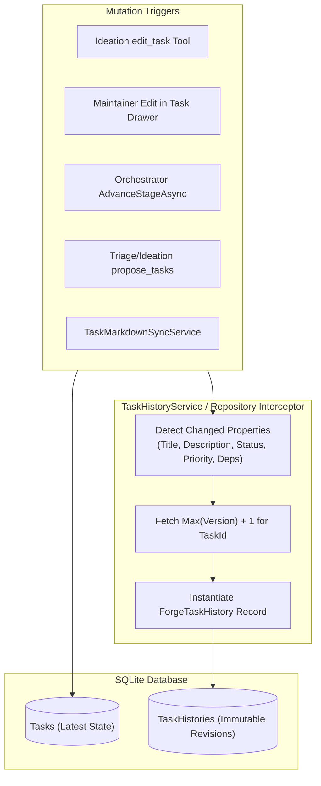

# 🕰️ Step 10.7: Task State History & Temporal Snapshot Audit Trail

> **Phase 10 Implementation Step**  
> *Parent Plan:* [Phase 10 Master Plan](../10_EXTEND_FEATURES.md)  
> *Project Target:* `src/NightCodeForge.Core/Domain`, `src/NightCodeForge.Infrastructure/Data`, `src/NightCodeForge.Web/Components/Backlog`, `tests/NightCodeForge.Infrastructure.Tests` | *Status:* Planned

---

## 1. Executive Objective

Provide a robust, temporal audit history for all [ForgeTask](file:///c:/Users/Julien/source/repos/jetelain/NightCodeForge/src/NightCodeForge.Core/Domain/ForgeTask.cs) entities:
1. **Up-to-Date Entity Storage (`ForgeTask`):**
   - The primary `Tasks` table holds the single source of truth for current state (enabling optimal query performance, straightforward indices, and existing foreign key relationships).
2. **Historical State Capture (`ForgeTaskHistory`):**
   - A dedicated secondary table (`TaskHistories`) stores immutable point-in-time snapshots whenever a task is created, modified, or transitioned.
   - Captures changes across all mutation channels: interactive ideation agent edits (`edit_task`), manual developer edits in the UI drawer, stage lifecycle transitions, triage proposals, and markdown disk synchronizations.
3. **Change Attribution & Diffs:**
   - Tracks `Version` (monotonically increasing integer per task), `ChangedAt`, `ChangedBy` (e.g. `"User"`, `"IdeationAgent"`, `"TriageAgent"`, `"TaskOrchestrator"`), and an optional `ChangeReason`.
   - Enables visual side-by-side or unified text diffs between task revisions in the Blazor Web dashboard.

---

## 2. Domain & Database Schema

### 2.1 Entity Model: `ForgeTaskHistory`

```csharp
namespace NightCodeForge.Core.Domain;

/// <summary>
/// Immutable point-in-time snapshot of a ForgeTask state revision.
/// </summary>
public class ForgeTaskHistory
{
    public int Id { get; set; }
    public int TaskId { get; set; }
    public int Version { get; set; }

    public string Title { get; set; } = string.Empty;
    public string Description { get; set; } = string.Empty;
    public TaskOverallStatus Status { get; set; }
    public int Priority { get; set; }
    public MergeMode MergeMode { get; set; }
    public string BaseBranch { get; set; } = "main";
    public string FeatureBranch { get; set; } = string.Empty;
    public string? CurrentStageId { get; set; }
    public string? DependenciesJson { get; set; } // JSON array of DependsOnTaskIds at this revision

    public DateTime ChangedAt { get; set; } = DateTime.UtcNow;
    public string ChangedBy { get; set; } = "System"; // "User", "IdeationAgent", "TriageAgent", "Orchestrator", "TaskMarkdownSync"
    public string? ChangeReason { get; set; }

    // Navigation
    public ForgeTask? Task { get; set; }
}
```

### 2.2 Entity Framework Core Configuration
In `AppDbContext.cs`:
```csharp
modelBuilder.Entity<ForgeTaskHistory>(entity =>
{
    entity.ToTable("TaskHistories");
    entity.HasKey(h => h.Id);
    entity.HasIndex(h => new { h.TaskId, h.Version }).IsUnique();
    entity.HasIndex(h => h.ChangedAt);

    entity.HasOne(h => h.Task)
          .WithMany(t => t.History)
          .HasForeignKey(h => h.TaskId)
          .OnDelete(DeleteBehavior.Cascade);
});
```

---

## 3. Snapshot Generation Strategy



### Automatic Snapshot Triggers
1. **Task Creation (`Version = 1`):**
   - Automatically created with `ChangedBy = "Creator"`, `ChangeReason = "Initial Task Creation"`.
2. **Field Modifications (`Title`, `Description`, `Priority`, `Dependencies`):**
   - Evaluated during `UpdateAsync`: if core content fields changed, persist a new history row with incremented `Version`.
3. **Status Transitions:**
   - When status advances (e.g. `Draft` $\rightarrow$ `Suggested` $\rightarrow$ `Open` $\rightarrow$ `Reviewed` $\rightarrow$ `Implemented` $\rightarrow$ `Ready` $\rightarrow$ `Closed`), record the transition milestone with stage identification.

---

## 4. UI Presentation: Revision Timeline & Diff View

### 4.1 Task Detail Drawer / Inspector Tab (`TaskHistoryTab.razor`)
- Displays an interactive vertical timeline of revisions:
  ```
  ● Version 3 (2 minutes ago) by User
    "Approved draft into Suggested backlog"
    Status: Draft -> Suggested
  ● Version 2 (10 minutes ago) by IdeationAgent
    "Refined acceptance criteria and dependencies based on user chat"
    [View Diff] (DiffPlex side-by-side or inline text diff of Description)
  ● Version 1 (15 minutes ago) by IdeationAgent
    "Initial proposal created during ideation"
  ```
- Uses existing `DiffPlex` integration to highlight additions/deletions in task descriptions and acceptance criteria across versions.

---

## 5. Implementation Checklist & Deliverables

- [ ] **Domain Entity & Database Schema:**
  - Create `ForgeTaskHistory` entity and add `ICollection<ForgeTaskHistory> History` to `ForgeTask`.
  - Add `DbSet<ForgeTaskHistory> TaskHistories` in `AppDbContext` with indexes on `(TaskId, Version)` and `ChangedAt`.
  - Add EF Core migration.
- [ ] **History Recording Pipeline:**
  - Implement `ITaskHistoryService` (or EF Core SaveChanges interceptor) to automatically capture history snapshots on task insert/update.
  - Wire change attribution (`ChangedBy`, `ChangeReason`) from Ideation tools, Web UI, Orchestrator, and Markdown sync.
- [ ] **Repository Queries:**
  - Add `GetHistoryByTaskIdAsync(int taskId)` to `ITaskRepository`.
- [ ] **Blazor UI Components:**
  - Build `TaskHistoryTimeline.razor` embedded into `TaskDetailDrawer.razor` and `TaskInspector.razor`.
  - Provide text diff comparator for task description revisions.
- [ ] **Unit & Integration Tests:**
  - Test initial version creation on task insert.
  - Test version incrementation on task update.
  - Test cascade deletion when task is purged or discarded.
  - Test description diff rendering.
