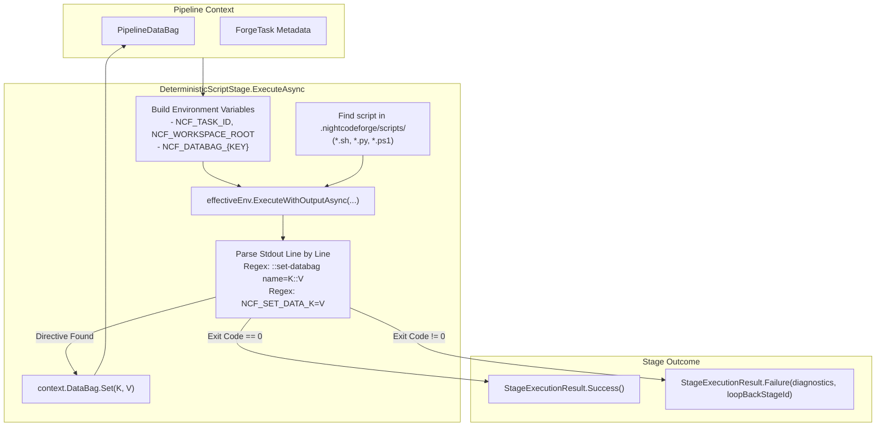

# 📜 Step 10.8: Custom Repository Scripts for Deterministic Steps (Bash, Python, PowerShell)

> **Phase 10 Implementation Step**  
> *Parent Plan:* [Phase 10 Master Plan](../10_EXTEND_FEATURES.md)  
> *Project Target:* `src/NightCodeForge.Core/Workflow/Stages`, `src/NightCodeForge.Core/Workflow`, `tests/NightCodeForge.Core.Tests` | *Status:* Planned

---

## 1. Executive Objective

Enable workspaces and repositories to define **custom deterministic scripts** written in **Bash**, **Python**, or **PowerShell** located inside the workspace repository (under `.nightcodeforge/scripts/`). These scripts are executed during deterministic workflow stages to perform domain-specific linting, custom test runners, static analysis, security scans, code generators, or deployment preparations without requiring C# stage re-compilation.

Key Capabilities:
1. **Multi-Runtime Script Dispatch:**
   - Execute Bash (`.sh`), Python (`.py`), or PowerShell (`.ps1`) scripts based on file extension and workspace execution environment (`BareHost`, `WslDirect`, or `ContainerSandbox`).
2. **Bi-Directional Pipeline Data Bag Interoperability:**
   - **Ingress (Data Bag $\rightarrow$ Environment Variables):** All properties stored in [PipelineDataBag](file:///c:/Users/Julien/source/repos/jetelain/NightCodeForge/src/NightCodeForge.Core/Workflow/PipelineDataBag.cs) are serialized and injected into the script process environment as `NCF_DATABAG_<KEY>` (plus standardized task metadata variables `NCF_TASK_ID`, `NCF_WORKSPACE_ID`, `NCF_BASE_BRANCH`, `NCF_FEATURE_BRANCH`, `NCF_STAGE_ID`).
   - **Egress (Special Stdout Syntax $\rightarrow$ Data Bag):** Scripts can emit special stdout directives (e.g. `::set-databag name=coverage_delta::0.85` or `NCF_SET_DATA_<KEY>=<VALUE>`) to update string properties directly in [PipelineDataBag](file:///c:/Users/Julien/source/repos/jetelain/NightCodeForge/src/NightCodeForge.Core/Workflow/PipelineDataBag.cs), persisted across stages in `ForgeTask.PipelineDataJson`.
3. **Execution Safety & Loopback Routing:**
   - Exit code 0 indicates success. Non-zero exit codes fail the gate and trigger loopback routing (e.g. to the `implementation` stage) with captured stderr/stdout formatted as synthetic diagnostic artifacts for the AI agent.

---

## 2. Directory Structure & Discovery Convention

Inside each target workspace/repository:
```
<WorkspaceRoot>/
  └── .nightcodeforge/
        └── scripts/
              ├── pre-impl.sh            # Runs before implementation (e.g. baseline capture)
              ├── post-impl.py           # Runs after implementation (e.g. custom metrics)
              ├── security-audit.ps1     # Security audit script
              └── custom-verify.sh       # Custom integration test runner
```

### Discovery & Resolution Priority
When a deterministic stage with `Action = "Script"` executes:
1. If [DeterministicStageConfig.Command](file:///c:/Users/Julien/source/repos/jetelain/NightCodeForge/src/NightCodeForge.Core/Workflow/Configuration/DeterministicStageConfig.cs) specifies an explicit path or script name:
   - Check `<WorkspaceRoot>/.nightcodeforge/scripts/<Command>`
   - Check `<WorkspaceRoot>/.nightcodeforge/<Command>`
   - Fall back to literal shell command execution.
2. If no command is configured, conventions lookup by stage ID:
   - `.nightcodeforge/scripts/{StageId}.sh`
   - `.nightcodeforge/scripts/{StageId}.py`
   - `.nightcodeforge/scripts/{StageId}.ps1`
3. If no matching script exists and no explicit command is set, the stage skips gracefully or completes with a logged informational status.

---

## 3. Data Bag Environment Variable Injection & Stdout Protocol

### 3.1 Ingress: Data Bag to Environment Variables
Before spawning the script, the runner builds an environment variable dictionary:

| Variable Name | Source / Example | Description |
| :--- | :--- | :--- |
| `NCF_TASK_ID` | `context.ForgeTask.Id` (`42`) | Current task ID |
| `NCF_WORKSPACE_ID` | `context.Workspace.Id` (`1`) | Workspace ID |
| `NCF_STAGE_ID` | `context.CurrentStageId` (`"deterministic-verify"`) | Active stage identifier |
| `NCF_BASE_BRANCH` | `context.ForgeTask.BaseBranch` (`"main"`) | Target base branch |
| `NCF_FEATURE_BRANCH` | `context.ForgeTask.FeatureBranch` (`"feature/task-42"`) | Active feature branch |
| `NCF_WORKSPACE_ROOT` | `context.WorkingDirectory` (`"/workspace/repo"`) | Absolute path to repository |
| `NCF_DATABAG_<KEY>` | `context.DataBag.Get<string>(key)` | All existing keys in [PipelineDataBag](file:///c:/Users/Julien/source/repos/jetelain/NightCodeForge/src/NightCodeForge.Core/Workflow/PipelineDataBag.cs), normalized to uppercase alphanumeric and underscores (e.g. `coverage.baseline` $\rightarrow$ `NCF_DATABAG_COVERAGE_BASELINE`). |

### 3.2 Egress: Stdout Syntax for Data Bag Mutation
The script writes output to standard output. The script runner parses lines in real-time using regular expressions:

#### Supported Directive Formats
1. **GitHub Actions style:**
   ```
   ::set-databag name=<KEY>::<VALUE>
   ```
2. **Prefix Assignment style:**
   ```
   NCF_SET_DATA_<KEY>=<VALUE>
   ```
   *or*
   ```
   NCF_SET_DATA <KEY>=<VALUE>
   ```

#### Processing Rules
- When matched, `<KEY>` is sanitized and `<VALUE>` (string only) is stored in [PipelineDataBag](file:///c:/Users/Julien/source/repos/jetelain/NightCodeForge/src/NightCodeForge.Core/Workflow/PipelineDataBag.cs) via `context.DataBag.Set(key, value)`.
- The matching directive line is stripped from the diagnostic error log so it does not clutter user-facing or agent-facing feedback.
- Non-directive lines are recorded in stdout/stderr execution logs and SignalR telemetry.

---

## 4. Script Invocation by Runtime

| Script Type | Windows (BareHost) | Windows (WSL2 Direct) | Container Sandbox (Docker) |
| :--- | :--- | :--- | :--- |
| **Bash (`.sh`)** | `wsl bash .nightcodeforge/scripts/run.sh` / `bash` | `bash .nightcodeforge/scripts/run.sh` | `docker exec -w /workspace ... bash .nightcodeforge/scripts/run.sh` |
| **Python (`.py`)** | `python .nightcodeforge/scripts/run.py` | `python3 .nightcodeforge/scripts/run.py` | `docker exec -w /workspace ... python3 .nightcodeforge/scripts/run.py` |
| **PowerShell (`.ps1`)** | `pwsh -File .nightcodeforge/scripts/run.ps1` | `pwsh -File .nightcodeforge/scripts/run.ps1` | `docker exec -w /workspace ... pwsh -File .nightcodeforge/scripts/run.ps1` |

---

## 5. Architectural Flow



---

## 6. Implementation Checklist & Deliverables

- [ ] **Data Bag Ingress & Egress Helpers:**
  - Create `DataBagEnvironmentSerializer` to transform `PipelineDataBag` to `IDictionary<string, string>`.
  - Create `ScriptOutputDataBagParser` to extract `::set-databag name=...` and `NCF_SET_DATA_...` directives.
- [ ] **Runtime Dispatcher in `DeterministicScriptStage`:**
  - Detect runtime by script extension (`.sh`, `.py`, `.ps1`).
  - Pass custom environment variables into `IExecutionEnvironment.ExecuteAsync`.
- [ ] **Diagnostic Artifact Generation:**
  - On non-zero exit, capture remaining stdout/stderr into synthetic error diagnostics and route to `LoopBackStageId`.
- [ ] **Unit & Integration Tests:**
  - Test Bash, Python, and PowerShell script invocations with mock execution environments.
  - Test variable ingress and stdout egress parsing.
