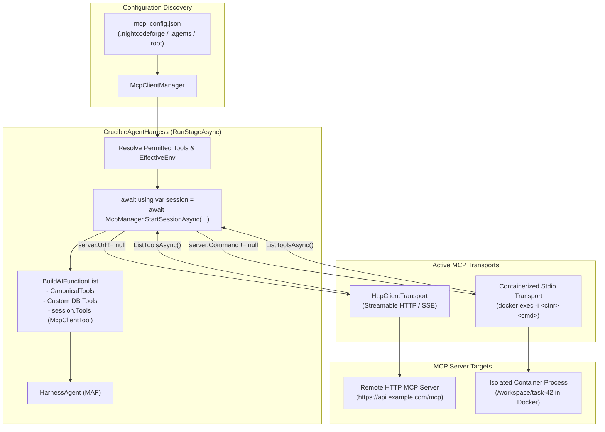

# ⚡ Step 10.9: Model Context Protocol (MCP) Integration: HTTP Servers & ContainerSandbox Stdio

> **Phase 10 Implementation Step**  
> *Parent Plan:* [Phase 10 Master Plan](../10_EXTEND_FEATURES.md)  
> *Project Target:* `src/NightCodeForge.Agents/Mcp`, `src/NightCodeForge.Agents/Crucible`, `tests/NightCodeForge.Agents.Tests` | *Status:* Planned

---

## 1. Executive Objective

Provide first-class **Model Context Protocol (MCP)** tool discovery, invocation, and lifecycle management for NightCodeForge agentic stages, fully aligned with the **Microsoft Agent Framework (MAF)** and .NET MCP ecosystem:

1. **Native Microsoft Agent Framework (MAF) Integration:**
   - Consume MCP servers via the official Microsoft .NET package `ModelContextProtocol` (`ModelContextProtocol.Client` v2.2.0), as referenced by MAF in `C:\Users\Julien\source\repos\agent-framework-main\dotnet` and documented in [Microsoft Learn's Local MCP Tools guide](https://learn.microsoft.com/en-us/agent-framework/agents/tools/local-mcp-tools?pivots=programming-language-csharp).
   - Leverage `McpClient.ListToolsAsync()` which produces `McpClientTool` instances that natively derive from and implement `AITool` / `AIFunction`, integrating directly into `HarnessAgent` (`ChatOptions.Tools`) without synthetic wrappers.

2. **Phase 1 — Remote / Hosted HTTP MCP Servers (Streamable HTTP / SSE):**
   - Connect to remote MCP servers specified with `"url"` in `mcp_config.json`.
   - Manage active HTTP sessions via an `IAsyncDisposable` lifecycle scope tied to stage execution.
   - Namespace tools cleanly (`mcp_{serverName}_{toolName}`) to eliminate collisions with canonical tools (`read`, `edit`, `bash`).
   - Provide graceful fault tolerance: an offline or misconfigured HTTP server logs a warning and is skipped without aborting stage startup.

3. **Phase 2 — Isolated Stdio MCP Servers inside `ContainerSandbox`:**
   - Run stdio MCP servers (e.g., `@modelcontextprotocol/server-github`, Python/Node MCP packages) **strictly inside the task's Docker sandbox container**.
   - Prevent executing untrusted or unverified host binaries when the workspace security policy mandates container isolation.
   - Construct interactive `docker exec -i -w /workspace/task-{id} <containerName> <command> <args>` transports piped directly to `StdioClientTransport`.

4. **Security & Permission Gating:**
   - Enforce `AgentProfile.PermittedTools` whitelists (e.g., allowing specific servers via wildcard `mcp_github_*`).
   - Automatically gate modifying/external tools in `AgentMode.ReadOnly` and `SandboxSecurityTier.RestrictedReadOnly`.
   - Provide full telemetry observability: MCP tool calls, arguments, latency, and outputs stream through `ThinkingAndActivityTracingChatClient` to the Task Inspector and SignalR live feed.

---

## 2. Current State & Gap Analysis

| Component | Current State | Target State |
| :--- | :--- | :--- |
| **`McpClientManager`** | Only reads and deserializes `mcp_config.json`, `.nightcodeforge/mcp_config.json`, or `.agents/mcp_config.json` into data models. | Manages active MCP sessions (`IMcpSession : IAsyncDisposable`), creating and managing client connections. |
| **Tool Handlers in `CrucibleAgentHarness`** | Registered a placeholder tool returning an error stub (`"Error: MCP server '{server}' ... is not supported yet"`). | Discovers actual tools via `client.ListToolsAsync()`, passing native `AITool` definitions to `HarnessAgent`. |
| **HTTP Transport** | Unimplemented (`"url"` property was parsed but ignored). | Handled via `HttpClientTransport` (streamable HTTP / SSE) with optional authorization headers. |
| **Stdio Transport Execution** | Legacy code attempted `effectiveEnv.ExecuteAsync(cmd)` once and dumped stdout as a single string, failing JSON-RPC communication. | Uses `StdioClientTransport` wrapping interactive `docker exec -i` inside the active container. |
| **Tool Naming & Directives** | Exposed a single `mcp_{server}` function per server. | Namespaces individual server tools as `mcp_{server}_{tool}` and applies `ToolDirectives` from database profile config. |

---

## 3. Architecture & Data Flow



---

## 4. Technical Design Specifications

### 4.1 NuGet & MAF Dependencies

`NightCodeForge.Agents.csproj` references:
```xml
<PackageReference Include="ModelContextProtocol" Version="2.2.0" />
```
*Note: This is the official Microsoft .NET package referenced by Microsoft Agent Framework samples and projects (`dotnet/src/Microsoft.Agents.AI.Mcp/Microsoft.Agents.AI.Mcp.csproj`). No third-party or custom protocol parsers are needed.*

Key classes from `ModelContextProtocol.Client`:
- `McpClient`: Central client connection.
- `HttpClientTransport`: HTTP/SSE transport (`HttpTransportMode.StreamableHttp`).
- `StdioClientTransport`: Standard I/O subprocess transport.
- `McpClientTool`: Derived `AITool` / `AIFunction` implementation returned by `ListToolsAsync()`.

---

### 4.2 Managed Session Architecture (`IMcpSession` & `IMcpClientManager`)

```csharp
namespace NightCodeForge.Agents.Mcp;

/// <summary>
/// Scoped session holding active MCP client connections for a single stage execution.
/// Disposed automatically when the stage run completes, fails, or is cancelled.
/// </summary>
public interface IMcpSession : IAsyncDisposable
{
    /// <summary>
    /// All discovered tools across configured and connected MCP servers,
    /// ready for addition to ChatOptions.Tools.
    /// </summary>
    IReadOnlyList<AITool> Tools { get; }
}

public interface IMcpClientManager
{
    Task<IReadOnlyDictionary<string, McpServerDefinition>> GetConfiguredServersAsync(
        string workspaceRoot,
        CancellationToken cancellationToken = default);

    Task<IMcpSession> StartSessionAsync(
        string workspaceRoot,
        IExecutionEnvironment? executionEnv,
        IReadOnlyList<string> permittedTools,
        IReadOnlyDictionary<string, string>? toolDirectives = null,
        CancellationToken cancellationToken = default);

    Task<IReadOnlyList<object>> GetAcpMcpServersAsync(
        int? workspaceId,
        string? workspaceRoot = null,
        CancellationToken cancellationToken = default);
}
```

---

### 4.3 Phase 1: HTTP MCP Server Support

#### 4.3.1 Connection & Tool Discovery
For each server in `McpConfigurationFile.McpServers` where `!string.IsNullOrWhiteSpace(serverDef.Url)`:
1. Validate URL scheme (`http` or `https`).
2. Build `HttpClientTransportOptions`:
   ```csharp
   var transportOptions = new HttpClientTransportOptions
   {
       Endpoint = new Uri(serverDef.Url),
       Name = serverName,
       TransportMode = HttpTransportMode.StreamableHttp
   };
   var transport = new HttpClientTransport(transportOptions, httpClient);
   var client = await McpClient.CreateAsync(transport, cancellationToken: ct);
   ```
3. Retrieve tools:
   ```csharp
   var discoveredTools = await client.ListToolsAsync(cancellationToken: ct);
   ```
4. Namespace and wrap tools:
   - Tool Name: `mcp_{serverName}_{tool.Name}`.
   - Description: Apply database-configured directive from `toolDirectives` if present; otherwise preserve server description.
   - Filter against `permittedTools`: If whitelists are active, only add tools matching `mcp_{serverName}_{tool.Name}` or `mcp_{serverName}_*`.
5. Error Resilience: If a remote server is down, unreachable, or returns a 5xx error on connect, log a warning with the server name and URL, and continue discovering other servers.

---

### 4.4 Phase 2: Stdio MCP Servers inside `ContainerSandbox`

#### 4.4.1 Container Command Builder
When `serverDef.Command` is populated and `executionEnv` is `NightCodeForgeContainerExecutor` (`ExecutionTier.ContainerSandbox`):

1. **Extract Container Runtime Parameters:**
   - Container Name/ID: `containerExecutor.Options.ContainerNameOrId`.
   - Container Working Directory: `/workspace/task-{taskId}` (or `/workspace/clone`).
   - WSL Distribution (if Docker is running in WSL): `containerExecutor.Options.UseWsl ? containerExecutor.Options.WslDistribution : null`.

2. **Construct Interactive Docker Execution Arguments:**
   ```csharp
   var dockerArgs = new List<string>
   {
       "exec",
       "-i",                         // Interactive stdio stream for JSON-RPC
       "-w", containerWorkingDir
   };

   // Inject environment variables into the container command
   foreach (var (key, value) in serverDef.Env)
   {
       dockerArgs.Add("-e");
       dockerArgs.Add($"{key}={value}");
   }

   dockerArgs.Add(containerName);
   dockerArgs.Add(serverDef.Command);
   dockerArgs.AddRange(serverDef.Args);
   ```

3. **Initialize `StdioClientTransport`:**
   ```csharp
   var transportOptions = new StdioClientTransportOptions
   {
       Name = serverName,
       Command = useWsl ? "wsl.exe" : "docker",
       Arguments = useWsl ? BuildWslDockerArgs(wslDistro, dockerArgs) : dockerArgs,
       WorkingDirectory = workspaceRoot
   };
   var transport = new StdioClientTransport(transportOptions);
   var client = await McpClient.CreateAsync(transport, cancellationToken: ct);
   ```

4. **Security Isolation Guarantee:**
   - If the task requires `ContainerSandbox`, stdio tools **never** spawn direct processes on the host. If no running container is available or execution environment is not resolved, stdio tools are skipped with an explicit audit log.
   - For `BareHostExecutionEnvironment` (local dev mode only), `StdioClientTransportOptions` runs `serverDef.Command` directly on the host, subject to `SecurityTier` constraints.

---

### 4.5 Integration with `CrucibleAgentHarness.cs`

In `RunStageAsync`:

```csharp
// 1. Start active MCP session (disposed at end of stage)
await using var mcpSession = _mcpManager != null
    ? await _mcpManager.StartSessionAsync(
        workspacePath,
        effectiveEnv,
        permittedTools,
        harnessConfig.ToolDirectives,
        cancellationToken)
    : null;

// 2. Build AI Function List including Canonical Tools, Custom Tools, and MCP Tools
var aiTools = BuildAIFunctionList(
    canonicalTools,
    permittedTools,
    dispatcher,
    harnessConfig.CustomTools,
    harnessConfig.ToolDirectives,
    mcpSession?.Tools);
```

---

## 5. Implementation Roadmap

### Milestone 1: HTTP MCP Server Support (Remote / Hosted)
- [ ] Add `<PackageReference Include="ModelContextProtocol" Version="2.2.0" />` to `NightCodeForge.Agents.csproj`.
- [ ] Implement `IMcpSession` and update `IMcpClientManager.StartSessionAsync(...)`.
- [ ] Implement `McpSession` with `HttpClientTransport` connection, tool discovery, namespacing (`mcp_{server}_{tool}`), and async disposal.
- [ ] Update `CrucibleAgentHarness.cs` to acquire `IMcpSession` and include `mcpSession.Tools` in `ChatOptions.Tools`.
- [ ] Add unit tests with mock HTTP MCP servers verifying tool discovery, invocation, error handling, and graceful offline degradation.

### Milestone 2: Stdio MCP Servers inside `ContainerSandbox`
- [ ] Implement containerized stdio transport builder extracting container metadata from `NightCodeForgeContainerExecutor`.
- [ ] Wire `StdioClientTransport` with interactive `docker exec -i` argument formatting (including WSL wrappers if applicable).
- [ ] Implement security gates: reject host execution when container sandbox is active.
- [ ] Add unit tests verifying argument generation, environment variable formatting, and isolation constraints.

### Milestone 3: Telemetry, Transcripts & UI Alignment
- [ ] Verify `ThinkingAndActivityTracingChatClient` captures MCP tool calls with arguments and execution timing.
- [ ] Ensure `BuildTranscriptEntries` renders `mcp_{server}_{tool}` calls and results cleanly in Markdown transcripts.
- [ ] Test end-to-end stage execution with mixed canonical tools (`read`, `edit`) and remote/containerized MCP tools.

---

## 6. Verification & Acceptance Criteria

1. **HTTP MCP Server Verification:**
   - Defining an HTTP MCP server in `mcp_config.json` exposes its tools to `CrucibleAgentHarness`.
   - Tool calls execute through HTTP/SSE and return results to the model without synthetic wrappers.
   - If the HTTP server returns a 500 error or is unreachable, the stage completes normally using canonical tools.

2. **ContainerSandbox Stdio Verification:**
   - In container execution mode, stdio MCP commands spawn inside Docker via `docker exec -i`.
   - Subprocesses have access to container filesystem (`/workspace/task-{id}`) and container environment variables.
   - Disposing `IMcpSession` terminates the container child processes cleanly.

3. **Regression Safety:**
   - All existing tests continue to pass with zero regressions.
   - Checkpoints with MCP tool calls round-trip cleanly through `SerializeSession` / `DeserializeSession`.
